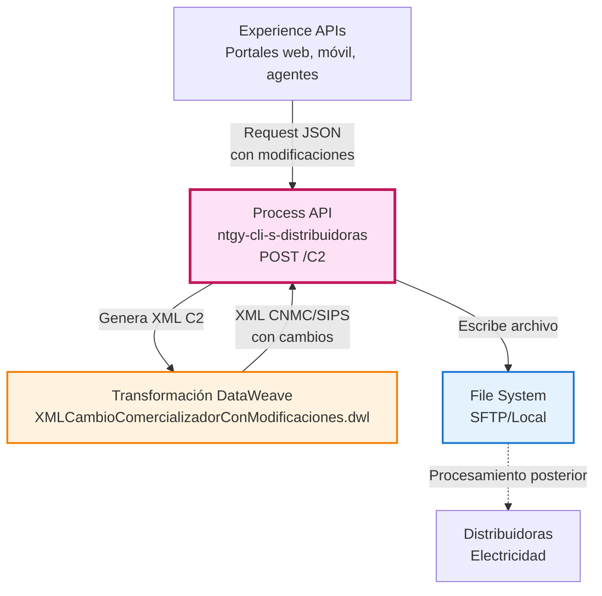
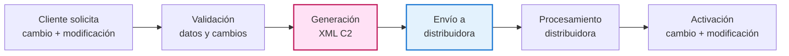
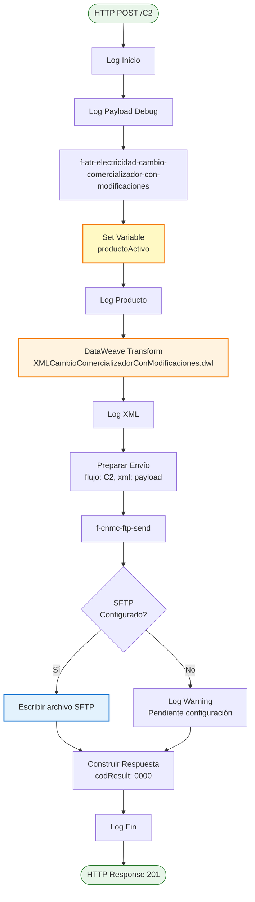
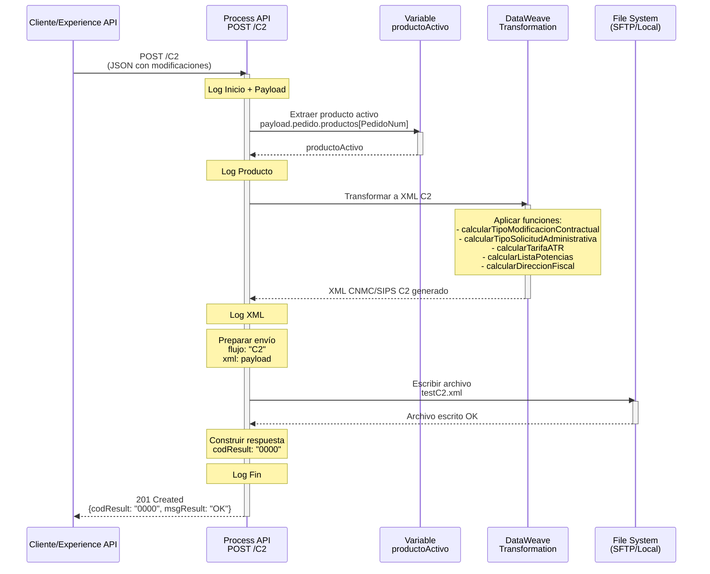
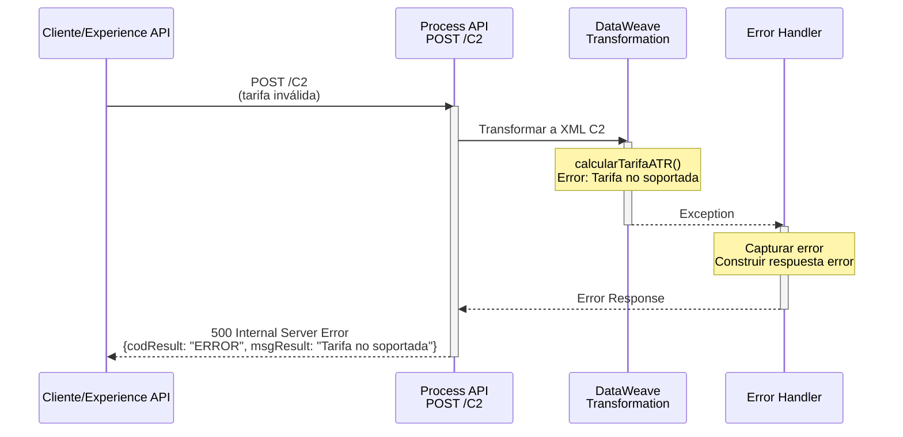
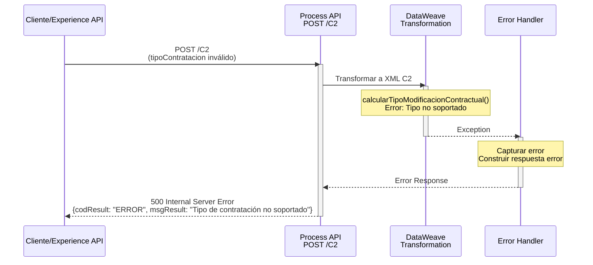

# POST /C2

## 📌 Descripción General

### Propósito del Endpoint

Este endpoint implementa el **proceso C2 de la CNMC** (Comisión Nacional de los Mercados y la Competencia) para gestionar cambios de comercializador de electricidad **con modificaciones en el contrato de acceso**. A diferencia del proceso C1, este endpoint permite realizar cambios en las condiciones contractuales como potencia contratada, tarifa ATR, o tipo de contrato, al mismo tiempo que se cambia de comercializadora.

El endpoint recibe los datos del contrato en formato JSON, genera un XML conforme al formato SIPS (Sistema de Intercambio de Información de Puntos de Suministro) incluyendo las modificaciones solicitadas, y lo envía al sistema de archivos configurado (SFTP o local) para su posterior procesamiento por las distribuidoras.

### Tipo de API

**Capa:** Process API (API-Led Connectivity)

**Función:** Transformación y generación de documentos regulatorios con modificaciones contractuales

### Patrón de Integración

**Tipo:** Transformación + File Output

**Descripción:** Este endpoint NO consume System APIs downstream. Realiza una transformación compleja de JSON a XML según el formato CNMC C2, incluyendo información detallada sobre las modificaciones contractuales, y escribe el resultado directamente en el sistema de archivos (SFTP o local) para su envío a las distribuidoras.

### Arquitectura API-Led Connectivity



---

## 💼 Propósito del Negocio

### Casos de Uso Principales

1. **Cambio de Comercializador con Modificación de Potencia**
   - Cliente cambia de comercializadora y aumenta/reduce potencia contratada
   - Ajuste de potencias por periodo (P1-P6)
   - Optimización de costes según consumo real

2. **Cambio de Comercializador con Cambio de Tarifa ATR**
   - Cliente cambia de comercializadora y modifica tarifa de acceso
   - Migración entre tarifas (ej: 2.0TD → 3.0TD)
   - Adaptación a nuevas necesidades de consumo

3. **Cambio de Comercializador con Modificaciones Administrativas**
   - Cambio de titular simultáneo al cambio de comercializadora
   - Actualización de datos administrativos
   - Corrección de información contractual

4. **Cumplimiento Normativo CNMC**
   - Generación de XML en formato SIPS según especificaciones C2
   - Envío de documentación requerida a distribuidoras
   - Trazabilidad completa del proceso con modificaciones

### Proceso de Negocio C2



**Pasos del Proceso:**

1. **Recepción de Solicitud**: El endpoint recibe los datos completos del contrato, cliente y modificaciones
2. **Extracción de Producto Activo**: Se identifica el producto específico con las modificaciones
3. **Generación de XML C2**: Transforma los datos JSON a formato XML CNMC/SIPS con modificaciones
4. **Preparación de Envío**: Empaqueta el XML con metadatos (flujo: "C2", nombre archivo)
5. **Escritura de Archivo**: Escribe el XML en el sistema de archivos configurado
6. **Confirmación**: Retorna confirmación de envío exitoso al consumidor

### Diferencias entre C1 y C2

| Aspecto | C1 (Sin Modificaciones) | C2 (Con Modificaciones) |
|---------|-------------------------|-------------------------|
| **Modificaciones** | ❌ No permite cambios | ✅ Permite cambios contractuales |
| **Potencia** | Mantiene la actual | Puede modificarse |
| **Tarifa ATR** | Mantiene la actual | Puede modificarse |
| **Tipo Contrato** | Mantiene el actual | Puede modificarse |
| **Complejidad XML** | Más simple | Más complejo |
| **Código Proceso** | "C1" | "C2" |
| **Indicativo Activación** | "L" (cuanto antes) | "A" (fecha programada) |
| **Fecha Acción** | Opcional | Requerida |

### Transformaciones Aplicadas

Este Process API realiza una **transformación compleja** de JSON a XML con información adicional de modificaciones:

| Aspecto | Transformación |
|---------|----------------|
| **Formato** | JSON → XML CNMC/SIPS C2 |
| **Estructura** | Datos planos → Estructura jerárquica con modificaciones |
| **Validaciones** | Aplicación de reglas de negocio CNMC + validación de cambios |
| **Enriquecimiento** | Códigos de solicitud, timestamps, tipos de modificación |
| **Mapeo de Códigos** | Tipos de documento, modificaciones, tarifas ATR, potencias |

**Funciones de Transformación Aplicadas:**

- `calcularTipoModificacionContractual()`: Determina tipo de modificación (A/S/N)
- `calcularTipoSolicitudAdministrativa()`: Determina tipo de solicitud administrativa (T/A)
- `calcularTarifaATR()`: Mapea tarifa a código CNMC (018-025)
- `calcularListaPotencias()`: Convierte potencias de kW a W y las ordena
- `calcularTipoIdentificador()`: Mapea NIF/NIE/Pasaporte a códigos CNMC
- `calcularTipoPersona()`: Determina si es persona física (F) o jurídica (J)
- `calcularDireccionFiscal()`: Determina si dirección fiscal coincide con suministro
- `calcularTipoDocumentacion()`: Mapea tipos de documentos adjuntos a códigos CNMC

### Contexto Empresarial

- **Dominio:** Gestión de Contratos de Energía
- **Sector:** Energía - Utilities (Electricidad)
- **División:** Naturgy España - Clientes
- **Proceso de Negocio:** Procesos ATR (Acceso de Terceros a la Red) con Modificaciones
- **Regulador:** CNMC (Comisión Nacional de los Mercados y la Competencia)

### Stakeholders

- **Comercializadoras**: Necesitan enviar solicitudes de cambio con modificaciones
- **Distribuidoras**: Reciben y procesan las solicitudes C2
- **Clientes Finales**: Beneficiarios del cambio y optimización de contrato
- **CNMC**: Regulador que establece el formato y proceso
- **Equipos de Atención al Cliente**: Gestionan el proceso y asesoran sobre modificaciones

### Valor de Negocio

- **Flexibilidad**: Permite cambio de comercializadora y optimización de contrato en un solo proceso
- **Eficiencia**: Evita dos procesos separados (cambio + modificación)
- **Automatización**: Eliminación de procesos manuales de generación de XMLs complejos
- **Cumplimiento**: Garantiza formato correcto según normativa CNMC C2
- **Trazabilidad**: Registro completo de todas las solicitudes y modificaciones
- **Optimización**: Clientes pueden ajustar su contrato al cambiar de comercializadora

### Consumidores Potenciales

Este endpoint puede ser consumido por:
- Portales web de contratación de energía con comparador de tarifas
- Aplicaciones móviles de gestión de contratos con simulador
- Sistemas de agentes de call center con herramientas de optimización
- Plataformas de gestión comercial con análisis de consumo
- Sistemas de CRM y gestión de clientes con recomendaciones

---

## 🔧 Especificación Técnica

### URLs por Ambiente

| Ambiente | URL Base | URL Completa |
|----------|----------|--------------|
| **Local** | `http://localhost:8081` | `http://localhost:8081/api/C2` |
| **Development** | `https://ntgy-cli-s-distribuidoras-dev.us-e2.cloudhub.io` | `https://ntgy-cli-s-distribuidoras-dev.us-e2.cloudhub.io/api/C2` |
| **UAT** | `https://ntgy-cli-s-distribuidoras-uat.us-e2.cloudhub.io` | `https://ntgy-cli-s-distribuidoras-uat.us-e2.cloudhub.io/api/C2` |
| **Production** | `https://ntgy-cli-s-distribuidoras-pro.us-e2.cloudhub.io` | `https://ntgy-cli-s-distribuidoras-pro.us-e2.cloudhub.io/api/C2` |

### Método HTTP

```
POST /api/C2
```

### Parámetros de Entrada

#### Headers

| Header | Tipo | Requerido | Descripción |
|--------|------|-----------|-------------|
| `Content-Type` | string | ✅ | Debe ser `application/json` |
| `client_id` | string | ✅ | Client ID de Anypoint Platform |
| `client_secret` | string | ✅ | Client Secret de Anypoint Platform |

#### Body (application/json)

**Estructura completa del request (igual que C1 pero con campos de modificación relevantes):**

```json
{
  "usuarioGrabador": "string",
  "codigoAgente": "string",
  "comercializadora": "string",
  "canalDarwin": "string",
  "cliente": {
    "nombre": "string",
    "apellido1": "string",
    "apellido2": "string",
    "email": "string",
    "telefono": "string",
    "tipoDocumento": "NIF|NIE|Pasaporte",
    "documento": "string",
    "idioma": "string",
    "gdpr": {
      "aceptaCesion": boolean,
      "aceptaConservacion": boolean,
      "aceptaPublicidad": boolean
    },
    "fechaNacimiento": "YYYY-MM-DD",
    "titularIban": "string",
    "iban": "string",
    "facturaOnline": boolean,
    "pyme": boolean,
    "planMensual": boolean,
    "cnae": "string",
    "direccionSuministro": {
      "idVia": "string",
      "codigoPostal": "string",
      "provincia": "string",
      "municipio": "string",
      "localidad": "string",
      "tipoVia": "string",
      "via": "string",
      "numero": "string",
      "portal": "string",
      "escalera": "string",
      "piso": "string",
      "puerta": "string"
    },
    "direccionFacturacion": {
      "idVia": "string",
      "codigoPostal": "string",
      "provincia": "string",
      "municipio": "string",
      "localidad": "string",
      "tipoVia": "string",
      "via": "string",
      "numero": "string",
      "portal": "string",
      "escalera": "string",
      "piso": "string",
      "puerta": "string"
    }
  },
  "suministroLuz": {
    "cups": "string (20-22 caracteres)",
    "tarifaAtr": "string",
    "potenciaP1": number,
    "potenciaP2": number,
    "potenciaP3": number,
    "potenciaP4": number,
    "potenciaP5": number,
    "potenciaP6": number,
    "consumoAnual": number,
    "cambioTitular": boolean,
    "cambioTarifaAtr": boolean
  },
  "pedido": {
    "idPedido": "string",
    "fechaFirma": "YYYY-MM-DD",
    "idCampana": "string",
    "nombreCampana": "string",
    "productos": [
      {
        "id": "string",
        "nombre": "string",
        "tarifaAtr": "string",
        "tipoContratacion": "ALTA|CC|CCT|CCP|CCPT",
        "fechaAccion": "YYYY-MM-DD",
        "eco": boolean,
        "online": boolean,
        "duracion": "string",
        "fechaDirectriz": "YYYY-MM-DD",
        "fechaReservaPrecios": "YYYY-MM-DD"
      }
    ],
    "servicios": [
      {
        "id": "string",
        "nombre": "string",
        "tipoEnergia": "string",
        "termostato": "string"
      }
    ]
  },
  "documentos": [
    {
      "tipo": "string",
      "nombre": "string",
      "envioDistribuidora": boolean
    }
  ],
  "PedidoNum": number,
  "codDistribuidora": "string"
}
```

**Campos Clave para C2:**

- `cliente.tipoDocumento`: Valores permitidos: "NIF", "NIE", "Pasaporte"
- `cliente.pyme`: Determina si se usa Nombre/Apellidos o RazonSocial en el XML
- `cliente.cnae`: Código CNAE (solo si hay cambio de actividad)
- `suministroLuz.cups`: CUPS de electricidad (20-22 caracteres, formato ES...)
- `suministroLuz.tarifaAtr`: **Tarifa nueva** (puede ser diferente a la actual)
- `suministroLuz.potenciaP1-P6`: **Potencias nuevas** en kW (pueden ser diferentes)
- `productos[].tipoContratacion`: **CRÍTICO** - Determina tipo de modificación:
  - `"CCT"`: Cambio comercializador con modificaciones administrativas (S)
  - `"CCP"`: Cambio comercializador con modificaciones técnicas (N)
  - `"CCPT"`: Cambio comercializador con modificaciones técnicas y administrativas (A)
- `productos[].fechaReservaPrecios`: **REQUERIDA** - Fecha prevista de acción
- `documentos[].envioDistribuidora`: Solo se incluyen en XML los documentos con `true`
- `PedidoNum`: Índice del producto activo en el array de productos

### Respuestas

#### 201 Created - Envío Exitoso

```json
{
  "codResult": "0000",
  "msgResult": "OK"
}
```

**Descripción:** El XML C2 se generó correctamente con las modificaciones y se escribió en el sistema de archivos. Esto NO garantiza que la distribuidora haya procesado la solicitud, solo confirma el envío.

#### 500 Internal Server Error

```json
{
  "result": {
    "codResult": "ERROR_CODE",
    "msgResult": "Descripción del error"
  }
}
```

**Causas comunes:**
- Error en transformación DataWeave (datos inválidos o modificaciones incorrectas)
- Tipo de contratación no soportado
- Tarifa ATR no válida
- Error de escritura en sistema de archivos
- Configuración de SFTP incorrecta
- Tipo de documento no soportado

### Autenticación

- **Tipo:** Client ID & Client Secret (Anypoint Platform)
- **Headers requeridos:** `client_id`, `client_secret`

### Timeouts

| Tipo | Valor |
|------|-------|
| **Request Timeout** | 30 segundos |
| **Connection Timeout** | 10 segundos |
| **File Write Timeout** | 15 segundos |

---

## 🏗️ Implementación Técnica

### Arquitectura del Flow



### Flows Implementados

#### 1. Flow Principal: `ucf-electricidad-cambio-comercializador-con-modificaciones`

**Ubicación:** Código proporcionado en el XML principal

**Responsabilidades:**
- Orquestación del proceso completo C2
- Logging de inicio, payload y fin
- Construcción de respuesta estándar

**Código clave:**
```xml
<flow name="ucf-electricidad-cambio-comercializador-con-modificaciones">
    <logger level="INFO" message="Inicio" />
    <logger level="DEBUG" message="#[payload]" />
    <flow-ref name="f-atr-electricidad-cambio-comercializador-con-modificaciones"/>
    <ee:transform>
        <!-- Prepara payload con flujo: "C2" y xml: payload -->
    </ee:transform>
    <flow-ref name="f-cnmc-ftp-send" />
    <ee:transform>
        <!-- Construye respuesta: codResult: "0000", msgResult: "OK" -->
    </ee:transform>
    <logger level="INFO" message="Fin" />
</flow>
```

#### 2. Subflow: `f-atr-electricidad-cambio-comercializador-con-modificaciones`

**Ubicación:** Mismo archivo XML

**Responsabilidades:**
- **Extracción explícita del producto activo** (diferencia clave con C1)
- Generación del XML CNMC/SIPS C2
- Logging del producto para trazabilidad
- Aplicación de transformación DataWeave

**Diferencia clave con C1:**
```xml
<set-variable 
    value="#[payload.pedido.productos[payload.PedidoNum as Number]]" 
    variableName="productoActivo"/>
<logger message="#[vars.productoActivo]" />
```

**Transformación aplicada:**
```
src/main/resources/modules/cnmc/xml/electricidad/XMLCambioComercializadorConModificaciones.dwl
```

#### 3. Subflow: `f-cnmc-ftp-send`

**Ubicación:** `src/main/mule/cnmc/f-cnmc-ftp-send.xml`

**Responsabilidades:**
- Preparación del nombre de archivo (testC2.xml)
- Escritura en SFTP o sistema local
- Manejo de errores de escritura

**Configuración SFTP:**
```yaml
backends:
  FTPCNMC:
    host: ${backends.FTPCNMC.host}
    port: ${backends.FTPCNMC.port}
    username: ${backends.FTPCNMC.username}
    password: ${backends.FTPCNMC.password}
    basePath: ${backends.FTPCNMC.basePath}
```

### Transformación DataWeave Principal

**Archivo:** `XMLCambioComercializadorConModificaciones.dwl`

**Estructura del XML generado:**

```xml
<MensajeCambiodeComercializadorConCambios xmlns="http://localhost/elegibilidad">
    <Cabecera>
        <CodigoREEEmpresaEmisora>1646</CodigoREEEmpresaEmisora>
        <CodigoREEEmpresaDestino>0000</CodigoREEEmpresaDestino>
        <CodigoDelProceso>C2</CodigoDelProceso>
        <CodigoDePaso>01</CodigoDePaso>
        <CodigoDeSolicitud>[12 dígitos generados]</CodigoDeSolicitud>
        <SecuencialDeSolicitud>01</SecuencialDeSolicitud>
        <FechaSolicitud>[YYYY-MM-DDThh:mm:ss]</FechaSolicitud>
        <CUPS>[CUPS del suministro]</CUPS>
    </Cabecera>
    <CambiodeComercializadorConCambios>
        <DatosSolicitud>
            <TipoModificacion>[A|S|N]</TipoModificacion>
            <TipoSolicitudAdministrativa>[T|A]</TipoSolicitudAdministrativa>
            <!-- Solo si hay cambio de actividad -->
            <CNAE>[código CNAE]</CNAE>
            <IndActivacion>A</IndActivacion>
            <FechaPrevistaAccion>[YYYY-MM-DD]</FechaPrevistaAccion>
            <ContratacionIncondicionalPS>S</ContratacionIncondicionalPS>
            <ContratacionIncondicionalBS>S</ContratacionIncondicionalBS>
        </DatosSolicitud>
        <Contrato>
            <TipoAutoconsumo>00</TipoAutoconsumo>
            <TipoContratoATR>01</TipoContratoATR>
            <CondicionesContractuales>
                <TarifaATR>[018-025]</TarifaATR>
                <PotenciasContratadas>
                    <Potencia Periodo="0">[potencia en W]</Potencia>
                    <Potencia Periodo="1">[potencia en W]</Potencia>
                    <!-- Más periodos según tarifa -->
                </PotenciasContratadas>
            </CondicionesContractuales>
        </Contrato>
        <Cliente>
            <IdCliente>
                <TipoIdentificador>[NI|NE|PS]</TipoIdentificador>
                <Identificador>[documento]</Identificador>
                <TipoPersona>[F|J]</TipoPersona>
            </IdCliente>
            <!-- Si NO es PYME -->
            <Nombre>
                <NombreDePila>[nombre]</NombreDePila>
                <PrimerApellido>[apellido1]</PrimerApellido>
                <SegundoApellido>[apellido2]</SegundoApellido>
            </Nombre>
            <!-- Si es PYME -->
            <RazonSocial>[nombre]</RazonSocial>
            <Telefono>
                <PrefijoPais>34</PrefijoPais>
                <Numero>[telefono]</Numero>
            </Telefono>
            <CorreoElectronico>[email]</CorreoElectronico>
            <IndicadorTipoDireccion>[S|F]</IndicadorTipoDireccion>
        </Cliente>
        <!-- Solo si hay documentos con envioDistribuidora: true -->
        <RegistrosDocumento>
            <RegistroDoc>
                <TipoDocAportado>[código CNMC]</TipoDocAportado>
                <DireccionUrl>[nombre archivo]</DireccionUrl>
            </RegistroDoc>
        </RegistrosDocumento>
    </CambiodeComercializadorConCambios>
</MensajeCambiodeComercializadorConCambios>
```

### Diferencias Clave en la Transformación C2 vs C1

| Elemento XML | C1 | C2 |
|--------------|----|----|
| **Mensaje raíz** | `MensajeCambiodeComercializadorSinCambios` | `MensajeCambiodeComercializadorConCambios` |
| **TipoModificacion** | ❌ No incluido | ✅ A/S/N (calculado) |
| **TipoSolicitudAdministrativa** | ❌ No incluido | ✅ T/A (calculado) |
| **CNAE** | ❌ No incluido | ✅ Condicional |
| **IndActivacion** | "L" (cuanto antes) | "A" (fecha programada) |
| **FechaPrevistaAccion** | ❌ Opcional | ✅ Requerida |
| **Contrato** | ❌ No incluido | ✅ Completo con condiciones |
| **TarifaATR** | ❌ No incluido | ✅ Código CNMC |
| **PotenciasContratadas** | ❌ No incluido | ✅ Array de potencias |
| **IndicadorTipoDireccion** | ❌ No incluido | ✅ S/F (calculado) |

### Módulos DataWeave Auxiliares

#### XMLComun.dwl

**Función:** Genera la cabecera estándar CNMC (misma que C1)

```dataweave
fun Cabecera(origen: String, destino: String, proceso: String, CUPS: String): Any = {
    CodigoREEEmpresaEmisora: origen,
    CodigoREEEmpresaDestino: destino,
    CodigoDelProceso: proceso,  // "C2" para este endpoint
    CodigoDeSolicitud: [12 dígitos generados dinámicamente],
    FechaSolicitud: [timestamp actual],
    CUPS: CUPS
}
```

#### functions.dwl

**Funciones de Mapeo Específicas para C2:**

1. **calcularTipoModificacionContractual(producto)**
   - Basado en `tipoContratacion` del producto
   - "CCT" → "S" (Solo administrativa)
   - "CCP" → "N" (Solo técnica)
   - "CCPT" → "A" (Administrativa y técnica)
   - Según tabla 7 de CNMC

2. **calcularTipoSolicitudAdministrativa(producto)**
   - Basado en tipo de modificación
   - "S" → "T" (Cambio de titular por traspaso)
   - "A" → "A" (Cambio datos administrativos)
   - Según tabla 53 de CNMC

3. **calcularTarifaATR(producto)**
   - Mapea tarifa a código CNMC
   - "2.0TD" → "018"
   - "3.0TD" → "019"
   - "6.1TD" → "020"
   - "6.2TD" → "021"
   - "6.3TD" → "022"
   - "6.4TD" → "023"
   - "3.0TDVE" → "024"
   - "6.1TDVE" → "025"

4. **calcularListaPotencias(suministro)**
   - Convierte potencias de kW a W (multiplica por 1000)
   - Ordena por periodo
   - Filtra potencias = 0
   - Retorna array de strings

5. **calcularDireccionFiscal(domicilioSuministro, domicilioFiscal)**
   - Compara todos los campos de dirección
   - "S" si coinciden
   - "F" si no coinciden

6. **solicitaCambioDeActividad()**
   - Actualmente retorna `false` (hardcoded)
   - TODO: Implementar lógica real

### Configuración Global

**Archivo:** `s-distribuidoras-global-config.yaml`

**Códigos de Comercializadora:**
```yaml
origenes:
  electrico: "1646"  # Código Naturgy electricidad
  gas: "0762"        # Código Naturgy gas
```

**Nota:** El código de distribuidora destino está hardcodeado como "0000" en la transformación.

### Patrones de Diseño

**Patrón:** Transformation + File Output con Extracción de Variables

**Justificación:** 
- No hay System APIs downstream que consultar
- La transformación es más compleja que C1 (incluye modificaciones contractuales)
- Requiere extracción explícita del producto activo para cálculos
- El output es un archivo XML que debe escribirse en file system
- Separación clara de responsabilidades entre generación y envío

### Diagramas de Secuencia

#### 1. Flujo Normal de Éxito con Modificaciones



#### 2. Flujo con Error de Tarifa No Soportada



#### 3. Flujo con Tipo de Contratación No Soportado



### Manejo de Errores

**Error Handler:** `cnmc-error-manager-error-handler`

**Estrategia:**

1. **Errores de Transformación DataWeave:**
   - Capturados por error handler global
   - Retornan 500 con mensaje descriptivo
   - Ejemplos: 
     - Tipo de contratación no soportado
     - Tarifa ATR no válida
     - Campos requeridos faltantes
     - Tipo de documento no soportado

2. **Errores de Escritura SFTP:**
   - Capturados por `on-error-continue` en `f-cnmc-ftp-send`
   - Log de WARNING pero NO falla el flow
   - Retorna respuesta exitosa (comportamiento actual)

3. **SFTP No Configurado:**
   - Choice con condición `false` (hardcoded)
   - Log de WARNING
   - Continúa sin error
   - **Nota:** En producción, la condición debería evaluarse dinámicamente

**Códigos de Error:**

| Código | Descripción | HTTP Status |
|--------|-------------|-------------|
| `0000` | Operación exitosa | 201 |
| `ERROR` | Error genérico de transformación | 500 |
| `TARIFA_ERROR` | Tarifa ATR no soportada | 500 |
| `TIPO_CONTRATACION_ERROR` | Tipo de contratación no válido | 500 |
| `SFTP_ERROR` | Error de escritura SFTP | 500 |

---

## 💻 Ejemplos de Uso

### Ejemplo 1: Cambio con Aumento de Potencia

#### cURL

```bash
curl -X POST "https://ntgy-cli-s-distribuidoras-dev.us-e2.cloudhub.io/api/C2" \
  -H "Content-Type: application/json" \
  -H "client_id: YOUR_CLIENT_ID" \
  -H "client_secret: YOUR_CLIENT_SECRET" \
  -d '{
    "usuarioGrabador": "AGENTE001",
    "codigoAgente": "AG123",
    "comercializadora": "1646",
    "canalDarwin": "WEB",
    "cliente": {
      "nombre": "Ana",
      "apellido1": "Martínez",
      "apellido2": "Ruiz",
      "email": "ana.martinez@example.com",
      "telefono": "655443322",
      "tipoDocumento": "NIF",
      "documento": "23456789C",
      "pyme": false,
      "cnae": "",
      "direccionSuministro": {
        "codigoPostal": "28003",
        "provincia": "28",
        "municipio": "28079",
        "localidad": "28079000100",
        "tipoVia": "CL",
        "via": "Serrano",
        "numero": "50"
      },
      "direccionFacturacion": {
        "codigoPostal": "28003",
        "provincia": "28",
        "municipio": "28079",
        "localidad": "28079000100",
        "tipoVia": "CL",
        "via": "Serrano",
        "numero": "50"
      }
    },
    "suministroLuz": {
      "cups": "ES0021000000000005GH4I",
      "tarifaAtr": "2.0TD",
      "potenciaP1": 5.75,
      "potenciaP2": 5.75,
      "potenciaP3": 0,
      "potenciaP4": 0,
      "potenciaP5": 0,
      "potenciaP6": 0,
      "consumoAnual": 4500
    },
    "pedido": {
      "idPedido": "PED-2026-C2-001",
      "fechaFirma": "2026-09-07",
      "productos": [
        {
          "id": "5-230005",
          "nombre": "Tarifa Plana Luz Plus",
          "tarifaAtr": "2.0TD",
          "tipoContratacion": "CCP",
          "fechaAccion": "2026-09-20",
          "fechaReservaPrecios": "2026-09-20"
        }
      ]
    },
    "documentos": [
      {
        "tipo": "CTX",
        "nombre": "/files/contrato-ana-c2.pdf",
        "envioDistribuidora": true
      }
    ],
    "PedidoNum": 0,
    "codDistribuidora": "0021"
  }'
```

#### Respuesta (201 Created)

```json
{
  "codResult": "0000",
  "msgResult": "OK"
}
```

**Interpretación:**
- Cambio de comercializadora con aumento de potencia de 4.6 kW a 5.75 kW
- Tipo de modificación: "N" (Solo técnica - CCP)
- Fecha programada: 2026-09-20
- Archivo generado: `testC2.xml`

---

### Ejemplo 2: Cambio con Modificación de Tarifa ATR

#### cURL

```bash
curl -X POST "https://ntgy-cli-s-distribuidoras-uat.us-e2.cloudhub.io/api/C2" \
  -H "Content-Type: application/json" \
  -H "client_id: YOUR_CLIENT_ID" \
  -H "client_secret: YOUR_CLIENT_SECRET" \
  -d '{
    "usuarioGrabador": "AGENTE002",
    "codigoAgente": "AG456",
    "comercializadora": "1646",
    "canalDarwin": "CALL_CENTER",
    "cliente": {
      "nombre": "Restaurante El Buen Sabor SL",
      "pyme": true,
      "tipoDocumento": "NIF",
      "documento": "B87654321",
      "email": "info@elbuensabor.com",
      "telefono": "913334455",
      "cnae": "5610",
      "direccionSuministro": {
        "codigoPostal": "28010",
        "provincia": "28",
        "municipio": "28079",
        "localidad": "28079000100",
        "tipoVia": "CL",
        "via": "Goya",
        "numero": "75"
      },
      "direccionFacturacion": {
        "codigoPostal": "28010",
        "provincia": "28",
        "municipio": "28079",
        "localidad": "28079000100",
        "tipoVia": "CL",
        "via": "Goya",
        "numero": "75"
      }
    },
    "suministroLuz": {
      "cups": "ES0021000000000006IJ5K",
      "tarifaAtr": "3.0TD",
      "potenciaP1": 15.0,
      "potenciaP2": 15.0,
      "potenciaP3": 10.0,
      "potenciaP4": 0,
      "potenciaP5": 0,
      "potenciaP6": 0,
      "consumoAnual": 35000
    },
    "pedido": {
      "idPedido": "PED-2026-C2-002",
      "fechaFirma": "2026-09-07",
      "productos": [
        {
          "id": "5-230015",
          "nombre": "Tarifa Empresas 3.0TD",
          "tarifaAtr": "3.0TD",
          "tipoContratacion": "CCP",
          "fechaAccion": "2026-09-25",
          "fechaReservaPrecios": "2026-09-25"
        }
      ]
    },
    "documentos": [
      {
        "tipo": "CTX",
        "nombre": "/files/contrato-restaurante-c2.pdf",
        "envioDistribuidora": true
      }
    ],
    "PedidoNum": 0,
    "codDistribuidora": "0022"
  }'
```

#### Respuesta (201 Created)

```json
{
  "codResult": "0000",
  "msgResult": "OK"
}
```

**Interpretación:**
- Cambio de comercializadora con cambio de tarifa 2.0TD → 3.0TD
- Cliente PYME (usa RazonSocial en XML)
- Tipo de modificación: "N" (Solo técnica)
- Potencias ajustadas para tarifa 3.0TD

---

### Ejemplo 3: Cambio con Modificaciones Administrativas y Técnicas

#### JavaScript (Node.js)

```javascript
const axios = require('axios');

async function enviarSolicitudC2ConModificaciones() {
  try {
    const response = await axios.post(
      'https://ntgy-cli-s-distribuidoras-dev.us-e2.cloudhub.io/api/C2',
      {
        usuarioGrabador: "AGENTE003",
        codigoAgente: "AG789",
        comercializadora: "1646",
        canalDarwin: "MOBILE_APP",
        cliente: {
          nombre: "Pedro",
          apellido1: "González",
          apellido2: "López",
          email: "pedro.gonzalez@example.com",
          telefono: "677889900",
          tipoDocumento: "NIF",
          documento: "34567890D",
          pyme: false,
          cnae: "",
          direccionSuministro: {
            codigoPostal: "41001",
            provincia: "41",
            municipio: "41091",
            localidad: "41091000100",
            tipoVia: "AV",
            via: "Constitución",
            numero: "10"
          },
          direccionFacturacion: {
            codigoPostal: "41001",
            provincia: "41",
            municipio: "41091",
            localidad: "41091000100",
            tipoVia: "AV",
            via: "Constitución",
            numero: "10"
          }
        },
        suministroLuz: {
          cups: "ES0021000000000007KL6M",
          tarifaAtr: "2.0TD",
          potenciaP1: 6.9,
          potenciaP2: 6.9,
          consumoAnual: 5200
        },
        pedido: {
          idPedido: "PED-2026-C2-003",
          fechaFirma: "2026-09-07",
          productos: [
            {
              id: "5-230020",
              nombre: "Tarifa Plana Premium",
              tarifaAtr: "2.0TD",
              tipoContratacion: "CCPT",  // Modificaciones técnicas Y administrativas
              fechaAccion: "2026-10-01",
              fechaReservaPrecios: "2026-10-01"
            }
          ]
        },
        documentos: [
          {
            tipo: "CTX",
            nombre: "/files/contrato-pedro-c2.pdf",
            envioDistribuidora: true
          },
          {
            tipo: "LOC",
            nombre: "/files/dni-pedro.pdf",
            envioDistribuidora: true
          }
        ],
        PedidoNum: 0,
        codDistribuidora: "0021"
      },
      {
        headers: {
          'Content-Type': 'application/json',
          'client_id': process.env.CLIENT_ID,
          'client_secret': process.env.CLIENT_SECRET
        }
      }
    );

    console.log('✅ Solicitud C2 enviada exitosamente');
    console.log('Tipo de modificación: Administrativa y Técnica (CCPT → A)');
    console.log('Respuesta:', response.data);
    return response.data;

  } catch (error) {
    console.error('❌ Error al enviar solicitud C2:', error.response?.data || error.message);
    throw error;
  }
}

// Ejecutar
enviarSolicitudC2ConModificaciones();
```

---

### Ejemplo 4: Python - Cambio con Modificación Administrativa

```python
import requests
import os
from datetime import datetime, timedelta

def enviar_solicitud_c2_administrativa():
    """
    Envía una solicitud C2 con modificaciones administrativas (cambio de titular)
    """
    url = "https://ntgy-cli-s-distribuidoras-dev.us-e2.cloudhub.io/api/C2"
    
    headers = {
        "Content-Type": "application/json",
        "client_id": os.getenv("CLIENT_ID"),
        "client_secret": os.getenv("CLIENT_SECRET")
    }
    
    # Fecha de acción: 15 días desde hoy
    fecha_accion = (datetime.now() + timedelta(days=15)).strftime("%Y-%m-%d")
    
    payload = {
        "usuarioGrabador": "AGENTE004",
        "codigoAgente": "AG012",
        "comercializadora": "1646",
        "canalDarwin": "WEB",
        "cliente": {
            "nombre": "Laura",
            "apellido1": "Fernández",
            "apellido2": "Sánchez",
            "email": "laura.fernandez@example.com",
            "telefono": "688990011",
            "tipoDocumento": "NIF",
            "documento": "45678901E",
            "pyme": False,
            "cnae": "",
            "direccionSuministro": {
                "codigoPostal": "08001",
                "provincia": "08",
                "municipio": "08019",
                "localidad": "08019000100",
                "tipoVia": "CL",
                "via": "Balmes",
                "numero": "200"
            },
            "direccionFacturacion": {
                "codigoPostal": "08001",
                "provincia": "08",
                "municipio": "08019",
                "localidad": "08019000100",
                "tipoVia": "CL",
                "via": "Balmes",
                "numero": "200"
            }
        },
        "suministroLuz": {
            "cups": "ES0021000000000008MN7O",
            "tarifaAtr": "2.0TD",
            "potenciaP1": 4.6,
            "potenciaP2": 4.6,
            "consumoAnual": 3200
        },
        "pedido": {
            "idPedido": "PED-2026-C2-004",
            "fechaFirma": datetime.now().strftime("%Y-%m-%d"),
            "productos": [
                {
                    "id": "5-230025",
                    "nombre": "Tarifa Plana Luz",
                    "tarifaAtr": "2.0TD",
                    "tipoContratacion": "CCT",  # Solo modificaciones administrativas
                    "fechaAccion": fecha_accion,
                    "fechaReservaPrecios": fecha_accion
                }
            ]
        },
        "documentos": [
            {
                "tipo": "CTX",
                "nombre": "/files/contrato-laura-c2.pdf",
                "envioDistribuidora": True
            }
        ],
        "PedidoNum": 0,
        "codDistribuidora": "0021"
    }
    
    try:
        response = requests.post(url, json=payload, headers=headers, timeout=30)
        response.raise_for_status()
        
        print("✅ Solicitud C2 enviada exitosamente")
        print(f"Tipo de modificación: Solo Administrativa (CCT → S)")
        print(f"Tipo de solicitud: Cambio de titular (T)")
        print(f"Fecha programada: {fecha_accion}")
        print(f"Respuesta: {response.json()}")
        return response.json()
        
    except requests.exceptions.HTTPError as e:
        print(f"❌ Error HTTP: {e.response.status_code}")
        print(f"Detalle: {e.response.text}")
        raise
    except Exception as e:
        print(f"❌ Error inesperado: {str(e)}")
        raise

# Ejecutar
if __name__ == "__main__":
    enviar_solicitud_c2_administrativa()
```

---

### Ejemplo 5: Error - Tarifa ATR No Soportada

#### Request

```bash
curl -X POST "https://ntgy-cli-s-distribuidoras-dev.us-e2.cloudhub.io/api/C2" \
  -H "Content-Type: application/json" \
  -H "client_id: YOUR_CLIENT_ID" \
  -H "client_secret: YOUR_CLIENT_SECRET" \
  -d '{
    "cliente": {
      "tipoDocumento": "NIF",
      "documento": "12345678A"
    },
    "suministroLuz": {
      "cups": "ES0021000000000001JN0F",
      "tarifaAtr": "2.0A"
    },
    "pedido": {
      "productos": [
        {
          "tarifaAtr": "2.0A",
          "tipoContratacion": "CCP",
          "fechaReservaPrecios": "2026-09-20"
        }
      ]
    },
    "PedidoNum": 0
  }'
```

#### Respuesta (500 Internal Server Error)

```json
{
  "result": {
    "codResult": "TARIFA_ERROR",
    "msgResult": "Tarifa '2.0A' no soportada"
  }
}
```

**Causa:** La tarifa "2.0A" es antigua y no está en la lista de tarifas soportadas (solo tarifas TD).

**Solución:** Usar una tarifa válida: 2.0TD, 3.0TD, 6.1TD, 6.2TD, 6.3TD, 6.4TD, 3.0TDVE, 6.1TDVE.

---

### Ejemplo 6: XML Generado C2 (Fragmento)

**Para referencia, este es un fragmento del XML C2 que se genera internamente:**

```xml
<?xml version="1.0" encoding="UTF-8"?>
<MensajeCambiodeComercializadorConCambios xmlns="http://localhost/elegibilidad">
    <Cabecera>
        <CodigoREEEmpresaEmisora>1646</CodigoREEEmpresaEmisora>
        <CodigoREEEmpresaDestino>0000</CodigoREEEmpresaDestino>
        <CodigoDelProceso>C2</CodigoDelProceso>
        <CodigoDePaso>01</CodigoDePaso>
        <CodigoDeSolicitud>172589345678</CodigoDeSolicitud>
        <SecuencialDeSolicitud>01</SecuencialDeSolicitud>
        <FechaSolicitud>2026-09-07T15:45:30</FechaSolicitud>
        <CUPS>ES0021000000000005GH4I</CUPS>
    </Cabecera>
    <CambiodeComercializadorConCambios>
        <DatosSolicitud>
            <TipoModificacion>N</TipoModificacion>
            <TipoSolicitudAdministrativa>A</TipoSolicitudAdministrativa>
            <IndActivacion>A</IndActivacion>
            <FechaPrevistaAccion>2026-09-20</FechaPrevistaAccion>
            <ContratacionIncondicionalPS>S</ContratacionIncondicionalPS>
            <ContratacionIncondicionalBS>S</ContratacionIncondicionalBS>
        </DatosSolicitud>
        <Contrato>
            <TipoAutoconsumo>00</TipoAutoconsumo>
            <TipoContratoATR>01</TipoContratoATR>
            <CondicionesContractuales>
                <TarifaATR>018</TarifaATR>
                <PotenciasContratadas>
                    <Potencia Periodo="0">5750</Potencia>
                    <Potencia Periodo="1">5750</Potencia>
                </PotenciasContratadas>
            </CondicionesContractuales>
        </Contrato>
        <Cliente>
            <IdCliente>
                <TipoIdentificador>NI</TipoIdentificador>
                <Identificador>23456789C</Identificador>
                <TipoPersona>F</TipoPersona>
            </IdCliente>
            <Nombre>
                <NombreDePila>Ana</NombreDePila>
                <PrimerApellido>Martínez</PrimerApellido>
                <SegundoApellido>Ruiz</SegundoApellido>
            </Nombre>
            <Telefono>
                <PrefijoPais>34</PrefijoPais>
                <Numero>655443322</Numero>
            </Telefono>
            <CorreoElectronico>ana.martinez@example.com</CorreoElectronico>
            <IndicadorTipoDireccion>S</IndicadorTipoDireccion>
        </Cliente>
        <RegistrosDocumento>
            <RegistroDoc>
                <TipoDocAportado>01</TipoDocAportado>
                <DireccionUrl>/files/contrato-ana-c2.pdf</DireccionUrl>
            </RegistroDoc>
        </RegistrosDocumento>
    </CambiodeComercializadorConCambios>
</MensajeCambiodeComercializadorConCambios>
```

**Nota:** Este XML se escribe en el archivo `testC2.xml` en el sistema de archivos configurado (SFTP o local).

**Diferencias clave con C1:**
- Incluye sección `<Contrato>` con condiciones contractuales
- Incluye `<TipoModificacion>` y `<TipoSolicitudAdministrativa>`
- Incluye `<IndicadorTipoDireccion>`
- `<IndActivacion>` es "A" (fecha programada) en lugar de "L"
- Requiere `<FechaPrevistaAccion>`
