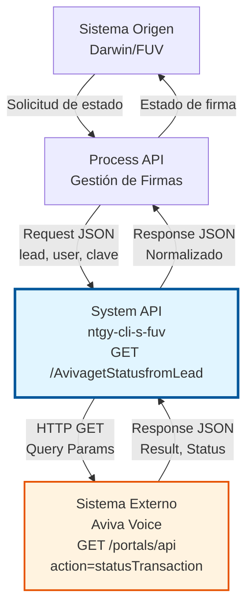
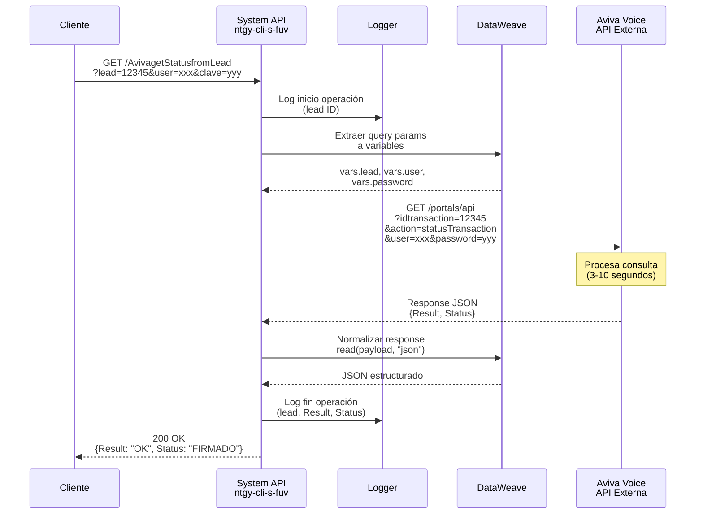
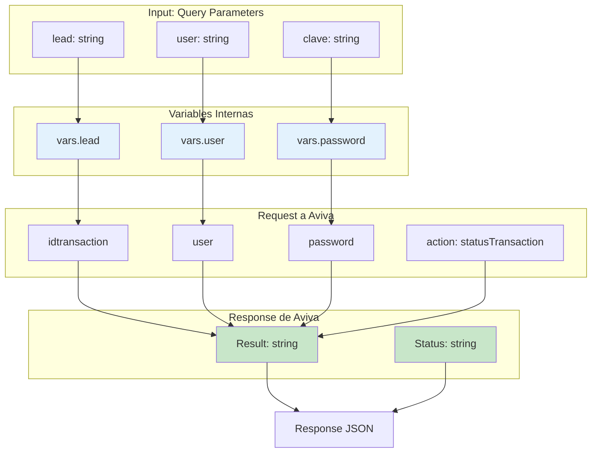

# GET /AvivagetStatusfromLead

## 📌 Descripción General

### Propósito del Endpoint

Consulta el estado actual de un Lead (transacción) en el sistema de firma digital **Aviva Voice** para verificar el progreso del proceso de firma de contratos de energía. Este endpoint permite a los sistemas de Naturgy obtener información en tiempo real sobre el estado de las firmas digitales iniciadas con clientes.

El endpoint soporta:
- **Consulta de estado de transacción**: Obtiene el estado actual de un Lead específico en Aviva
- **Verificación de firma**: Determina si un contrato ha sido firmado, está pendiente o ha sido cancelado
- **Trazabilidad completa**: Proporciona información detallada del resultado de la operación

### Tipo de API

**Capa:** System API (API-Led Connectivity)

**Función:** Integración directa con el sistema externo Aviva Voice (plataforma de firma digital) para consultar estados de transacciones de firma.

### Patrón de Integración

**Tipo:** Request-Reply Síncrono con REST API Externa

**Descripción:** El endpoint recibe una solicitud con las credenciales de Aviva y el ID del Lead, realiza una llamada HTTP GET al sistema Aviva Voice, obtiene el estado de la transacción y retorna el resultado normalizado en formato JSON. La operación es síncrona con un timeout de 5 minutos debido a la naturaleza de las operaciones de firma digital.

### Arquitectura API-Led Connectivity



---

## 💼 Propósito del Negocio

### Casos de Uso Principales

1. **Verificación de Estado de Firma Digital**
   - Un agente de ventas necesita verificar si un cliente ha completado la firma digital de su contrato
   - El sistema consulta el estado del Lead en Aviva
   - Se obtiene información actualizada sobre el progreso de la firma

2. **Procesamiento Batch de Firmas Pendientes**
   - Un proceso batch consulta periódicamente el estado de múltiples Leads pendientes
   - Se identifican los contratos que han sido firmados para actualizar Darwin
   - Se detectan firmas canceladas o expiradas para tomar acciones correctivas

3. **Sincronización de Estados entre Sistemas**
   - El sistema Darwin necesita sincronizar el estado de firma con Aviva
   - Se consulta el estado actual en Aviva
   - Se actualiza el estado correspondiente en Darwin para mantener consistencia

### Contexto Empresarial

- **Dominio:** Gestión de Ventas y Contratación
- **Sector:** Energía - Utilities (Gas y Electricidad)
- **División:** Naturgy España - NewCo
- **Proceso de Negocio:** Firma Digital de Contratos de Energía
- **Sistema Externo:** Aviva Voice (Plataforma de Firma Digital)

### Stakeholders

- **Agentes de Ventas**: Necesitan verificar el estado de las firmas de sus clientes en tiempo real
- **Gestores de Pedidos**: Requieren información actualizada para procesar contratos firmados
- **Sistemas Batch**: Procesan masivamente estados de firmas para sincronización automática
- **Equipo de Atención al Cliente**: Consultan el estado de firmas para resolver incidencias

### Valor de Negocio

- **Automatización del Proceso de Firma**: Elimina verificaciones manuales del estado de firmas
- **Reducción de Tiempos de Procesamiento**: Permite identificar rápidamente contratos firmados
- **Mejora en la Experiencia del Cliente**: Proporciona información actualizada sobre el estado de firma
- **Trazabilidad Completa**: Mantiene registro detallado de todas las consultas de estado
- **Sincronización en Tiempo Real**: Asegura consistencia entre Aviva y sistemas internos

### Consumidores Potenciales

Este endpoint puede ser consumido por:
- Process APIs de gestión de firmas digitales
- Flujos batch de sincronización de estados
- Sistemas de monitoreo de procesos de venta
- Integraciones con Darwin para actualización de estados
- Herramientas de reporting y análisis de conversión

---

## 🔧 Especificación Técnica

### URLs por Ambiente

| Ambiente | URL Base | URL Completa |
|----------|----------|--------------|
| **Local** | `http://localhost:8091` | `http://localhost:8091/api/AvivagetStatusfromLead` |
| **Development** | `https://ntgy-cli-s-fuv-dev.cloudhub.io` | `https://ntgy-cli-s-fuv-dev.cloudhub.io/api/AvivagetStatusfromLead` |
| **UAT** | `https://ntgy-cli-s-fuv-uat.cloudhub.io` | `https://ntgy-cli-s-fuv-uat.cloudhub.io/api/AvivagetStatusfromLead` |
| **Production** | `https://ntgy-cli-s-fuv-pro.cloudhub.io` | `https://ntgy-cli-s-fuv-pro.cloudhub.io/api/AvivagetStatusfromLead` |

### Método HTTP

```
GET /api/AvivagetStatusfromLead
```

### Parámetros de Entrada

#### Headers HTTP

| Header | Tipo | Requerido | Descripción | Ejemplo |
|--------|------|-----------|-------------|---------|
| `Accept` | string | ❌ No | Tipo de contenido esperado en response | `application/json` |

#### Query Parameters

| Parámetro | Tipo | Requerido | Descripción | Ejemplo | Validaciones |
|-----------|------|-----------|-------------|---------|--------------|
| `lead` | string | ✅ Sí | ID de la transacción en Aviva (identificador único del Lead) | `"12345"` | No vacío |
| `user` | string | ✅ Sí | Usuario de autenticación para acceso a Aviva Voice | `"usuario_api"` | No vacío |
| `clave` | string | ✅ Sí | Contraseña de autenticación para acceso a Aviva Voice | `"password123"` | No vacío |

**Nota de Seguridad:** Las credenciales se envían como query parameters según el diseño de la API de Aviva. Aunque HTTPS protege la transmisión, se recomienda rotar las credenciales periódicamente.

### Estructura de Respuesta

#### Response Exitoso (200 OK)

```json
{
  "Result": "OK",
  "Status": "FIRMADO"
}
```

**Campos de la Respuesta:**

| Campo | Tipo | Descripción | Valores Posibles |
|-------|------|-------------|------------------|
| `Result` | string | Resultado de la operación de consulta | `"OK"`, `"ERROR"` |
| `Status` | string | Estado actual del Lead en Aviva | `"FIRMADO"`, `"PENDIENTE"`, `"CANCELADO"`, `"EXPIRADO"` |

#### Códigos de Estado HTTP

| Código | Descripción | Escenario |
|--------|-------------|-----------|
| `200` | OK | Consulta exitosa, estado obtenido correctamente |
| `400` | Bad Request | Parámetros faltantes o inválidos |
| `401` | Unauthorized | Credenciales de Aviva inválidas |
| `404` | Not Found | Lead no encontrado en Aviva |
| `500` | Internal Server Error | Error en el sistema Aviva o en la integración |
| `503` | Service Unavailable | Sistema Aviva no disponible |
| `504` | Gateway Timeout | Timeout en la comunicación con Aviva (>5 minutos) |

### Manejo de Errores

#### Error de Autenticación (401)

```json
{
  "callId": "550e8400-e29b-41d4-a716-446655440000",
  "errorDescription": "Credenciales de Aviva inválidas",
  "errorCode": 401,
  "time": "2026-07-13T13:15:00+02:00"
}
```

#### Error de Lead No Encontrado (404)

```json
{
  "callId": "550e8400-e29b-41d4-a716-446655440001",
  "errorDescription": "Lead no encontrado en sistema Aviva",
  "errorCode": 404,
  "time": "2026-07-13T13:15:00+02:00"
}
```

#### Error de Timeout (504)

```json
{
  "callId": "550e8400-e29b-41d4-a716-446655440002",
  "errorDescription": "Timeout en comunicación con Aviva Voice",
  "errorCode": 504,
  "time": "2026-07-13T13:15:00+02:00"
}
```

### Consideraciones de Performance

- **Response Time Esperado:** 3-10 segundos (variable según carga de Aviva)
- **Timeout Configurado:** 300 segundos (5 minutos)
- **Retry Policy:** No implementado (consulta idempotente)
- **Rate Limiting:** Según límites de Aviva Voice

---

## 🏗️ Implementación Técnica

### Arquitectura de Componentes

```mermaid
graph LR
    A[HTTP Listener<br/>Port 8091] --> B[APIKit Router<br/>s-fuv-router]
    B --> C[Flow Principal<br/>get:\AvivagetStatusfromLead]
    C --> D[Sub-flow<br/>s-fuv-AvivaGetStatusfromLeadSub_Flow]
    D --> E[Logger Entrada<br/>INFO]
    E --> F[Transform Variables<br/>Extract Query Params]
    F --> G[HTTP Request<br/>GET Aviva Voice]
    G --> H[Transform Response<br/>Normalize JSON]
    H --> I[Logger Salida<br/>INFO]
    I --> J[Return Response]
    
    style D fill:#e1f5ff,stroke:#01579b,stroke-width:2px
    style G fill:#fff3e0,stroke:#e65100,stroke-width:2px
```



### Flujo de Ejecución Detallado



### Componentes de Implementación

#### 1. Flow Principal

**Archivo:** `src/main/mule/s-fuv.xml`  
**Líneas:** 155-158

```xml
<flow name="get:\AvivagetStatusfromLead:s-fuv-router">
    <logger level="DEBUG" message="get:\AvivagetStatusfromLead:s-fuv-router" />
    <flow-ref doc:name="Flow Reference" name="s-fuv-AvivaGetStatusfromLeadSub_Flow" />
</flow>
```

**Función:** Recibe el request del APIKit Router y delega al sub-flow de implementación.

#### 2. Sub-flow de Implementación

**Archivo:** `src/main/mule/s-fuv-AvivaGetStatusfromLead.xml`  
**Líneas:** 8-47

**Componentes:**

##### a) Logger de Entrada (Línea 9)
```xml
<logger level="INFO" 
        message="STARTING AvivaGetStatusfromLead METHOD. REQUEST:' #[attributes.queryParams.lead]" />
```
- Registra el inicio de la operación con el ID del Lead

##### b) Transformación de Variables (Líneas 10-27)
```dataweave
%dw 2.0
output application/java
---
// Variable 1: password
attributes.queryParams["clave"]

// Variable 2: user
attributes.queryParams["user"]

// Variable 3: lead
attributes.queryParams["lead"]
```
- Extrae los query parameters a variables para uso posterior
- Facilita la construcción del request a Aviva

##### c) HTTP Request a Aviva (Líneas 28-37)
```xml
<http:request method="GET" 
              config-ref="HTTP_Request_configuration_AVIVA" 
              path="${aviva.path.getStatus}">
    <http:query-params>
        <![CDATA[#[output application/java
        ---
        {
            "idtransaction": vars.lead,
            "action": "statusTransaction",
            "password": vars.password,
            "user": vars.user
        }]]]>
    </http:query-params>
</http:request>
```

**Configuración HTTP:**
- **Config:** `HTTP_Request_configuration_AVIVA` (definido en `global.xml`)
- **Host:** `test.avivavoice.com` (dev) / `avivavoice.com` (prod)
- **Port:** 443 (HTTPS)
- **Path:** `/portals/api`
- **Timeout:** 300,000 ms (5 minutos)

**Query Parameters enviados:**
- `idtransaction`: ID del Lead a consultar
- `action`: Valor fijo `"statusTransaction"`
- `password`: Contraseña de autenticación
- `user`: Usuario de autenticación

##### d) Transformación de Response (Líneas 38-45)
```dataweave
%dw 2.0
output application/json
---
read(payload, "application/json")
```
- Normaliza la respuesta de Aviva a JSON estructurado
- Asegura formato consistente para consumidores

##### e) Logger de Salida (Línea 46)
```xml
<logger level="INFO" 
        message="FINISH AvivaGetStatusfromLead METHOD. RESULT:' Lead: #[vars.lead] Result: #[payload.&quot;Result&quot;] Status: #[payload.&quot;Status&quot;]" />
```
- Registra el resultado de la operación con detalles del estado obtenido

#### 3. Configuración HTTP

**Archivo:** `src/main/mule/global.xml`  
**Líneas:** 38-40

```xml
<http:request-config name="HTTP_Request_configuration_AVIVA" 
                     responseTimeout="${aviva.timeout}">
    <http:request-connection host="${aviva.host}" 
                            port="${aviva.port}" 
                            protocol="HTTPS"/>
</http:request-config>
```

#### 4. Propiedades de Configuración

**Archivo:** `src/main/resources/s-fuv-dev-config.yaml`  
**Líneas:** 45-50

```yaml
aviva:
  host: "test.avivavoice.com"
  port: "443"
  timeout: "300000"  
  path:
    getStatus: "/portals/api"
```

### Diagrama de Transformación de Datos



### Manejo de Errores y Logging

#### Estrategia de Logging

**Nivel INFO:**
- Inicio de operación con Lead ID
- Fin de operación con resultado y estado
- Formato: `STARTING/FINISH AvivaGetStatusfromLead METHOD`

**Trazabilidad:**
- Cada request tiene un correlationId único (generado por Mule)
- Los logs incluyen el Lead ID para seguimiento
- Se registran Result y Status de Aviva

#### Error Handling

**Global Error Handler** (definido en `s-fuv.xml`):
- Captura errores HTTP (timeout, connectivity, unauthorized)
- Transforma a formato estándar con correlationId
- Retorna códigos HTTP apropiados

**Timeout Management:**
- Timeout configurado: 5 minutos
- Suficiente para operaciones de Aviva
- Previene bloqueos indefinidos

### Consideraciones de Seguridad

#### Autenticación
- **Método:** Query Parameters (user + password)
- **Protocolo:** HTTPS (TLS 1.2+)
- **Gestión de Credenciales:** Secure Properties en CloudHub

#### Protección de Datos
- Credenciales no se loguean (solo Lead ID)
- HTTPS encripta transmisión
- Logs no contienen información sensible

#### Recomendaciones
- Rotar credenciales de Aviva periódicamente
- Monitorear intentos de autenticación fallidos
- Implementar rate limiting si es necesario

---

## 💻 Ejemplos de Uso

### Ejemplo 1: Consulta Exitosa de Lead Firmado

#### Request

```bash
curl -X GET "https://ntgy-cli-s-fuv-dev.cloudhub.io/api/AvivagetStatusfromLead?lead=12345&user=usuario_api&clave=password123" \
  -H "Accept: application/json"
```

#### Response (200 OK)

```json
{
  "Result": "OK",
  "Status": "FIRMADO"
}
```

**Interpretación:**
- La consulta fue exitosa (`Result: "OK"`)
- El Lead ha sido firmado (`Status: "FIRMADO"`)
- El contrato puede procesarse en Darwin

---

### Ejemplo 2: Consulta de Lead Pendiente

#### Request

```bash
curl -X GET "https://ntgy-cli-s-fuv-dev.cloudhub.io/api/AvivagetStatusfromLead?lead=67890&user=usuario_api&clave=password123" \
  -H "Accept: application/json"
```

#### Response (200 OK)

```json
{
  "Result": "OK",
  "Status": "PENDIENTE"
}
```

**Interpretación:**
- La consulta fue exitosa
- El Lead aún está pendiente de firma
- Se debe esperar antes de procesar el contrato

---

### Ejemplo 3: Lead Cancelado

#### Request

```bash
curl -X GET "https://ntgy-cli-s-fuv-dev.cloudhub.io/api/AvivagetStatusfromLead?lead=11111&user=usuario_api&clave=password123" \
  -H "Accept: application/json"
```

#### Response (200 OK)

```json
{
  "Result": "OK",
  "Status": "CANCELADO"
}
```

**Interpretación:**
- La consulta fue exitosa
- El Lead ha sido cancelado
- No se debe procesar el contrato

---

### Ejemplo 4: Error de Autenticación

#### Request

```bash
curl -X GET "https://ntgy-cli-s-fuv-dev.cloudhub.io/api/AvivagetStatusfromLead?lead=12345&user=usuario_invalido&clave=password_incorrecto" \
  -H "Accept: application/json"
```

#### Response (401 Unauthorized)

```json
{
  "callId": "550e8400-e29b-41d4-a716-446655440000",
  "errorDescription": "Credenciales de Aviva inválidas",
  "errorCode": 401,
  "time": "2026-07-13T13:15:00+02:00"
}
```

**Interpretación:**
- Las credenciales proporcionadas son inválidas
- Verificar usuario y contraseña de Aviva
- Contactar con administrador si persiste el error

---

### Ejemplo 5: Lead No Encontrado

#### Request

```bash
curl -X GET "https://ntgy-cli-s-fuv-dev.cloudhub.io/api/AvivagetStatusfromLead?lead=99999&user=usuario_api&clave=password123" \
  -H "Accept: application/json"
```

#### Response (404 Not Found)

```json
{
  "callId": "550e8400-e29b-41d4-a716-446655440001",
  "errorDescription": "Lead no encontrado en sistema Aviva",
  "errorCode": 404,
  "time": "2026-07-13T13:15:00+02:00"
}
```

**Interpretación:**
- El Lead especificado no existe en Aviva
- Verificar el ID del Lead
- Puede que el Lead haya expirado o nunca se haya creado

---

### Ejemplo 6: Uso desde JavaScript

```javascript
async function consultarEstadoLead(leadId, usuario, clave) {
  const baseUrl = 'https://ntgy-cli-s-fuv-dev.cloudhub.io';
  const endpoint = '/api/AvivagetStatusfromLead';
  
  const params = new URLSearchParams({
    lead: leadId,
    user: usuario,
    clave: clave
  });
  
  try {
    const response = await fetch(`${baseUrl}${endpoint}?${params}`, {
      method: 'GET',
      headers: {
        'Accept': 'application/json'
      }
    });
    
    if (!response.ok) {
      const error = await response.json();
      throw new Error(`Error ${error.errorCode}: ${error.errorDescription}`);
    }
    
    const data = await response.json();
    
    console.log(`Lead ${leadId}:`);
    console.log(`  Resultado: ${data.Result}`);
    console.log(`  Estado: ${data.Status}`);
    
    return data;
    
  } catch (error) {
    console.error('Error consultando estado de Lead:', error.message);
    throw error;
  }
}

// Uso
consultarEstadoLead('12345', 'usuario_api', 'password123')
  .then(resultado => {
    if (resultado.Status === 'FIRMADO') {
      console.log('✅ Contrato firmado, proceder con activación');
    } else if (resultado.Status === 'PENDIENTE') {
      console.log('⏳ Firma pendiente, esperar');
    } else if (resultado.Status === 'CANCELADO') {
      console.log('❌ Firma cancelada, no procesar');
    }
  })
  .catch(error => {
    console.error('Error:', error);
  });
```

---

### Ejemplo 7: Uso desde Python

```python
import requests
from typing import Dict, Optional

def consultar_estado_lead(
    lead_id: str,
    usuario: str,
    clave: str,
    ambiente: str = 'dev'
) -> Optional[Dict]:
    """
    Consulta el estado de un Lead en Aviva Voice.
    
    Args:
        lead_id: ID del Lead a consultar
        usuario: Usuario de autenticación Aviva
        clave: Contraseña de autenticación Aviva
        ambiente: Ambiente a usar (dev, uat, pro)
    
    Returns:
        Dict con Result y Status, o None si hay error
    """
    
    base_urls = {
        'dev': 'https://ntgy-cli-s-fuv-dev.cloudhub.io',
        'uat': 'https://ntgy-cli-s-fuv-uat.cloudhub.io',
        'pro': 'https://ntgy-cli-s-fuv-pro.cloudhub.io'
    }
    
    base_url = base_urls.get(ambiente, base_urls['dev'])
    endpoint = f'{base_url}/api/AvivagetStatusfromLead'
    
    params = {
        'lead': lead_id,
        'user': usuario,
        'clave': clave
    }
    
    headers = {
        'Accept': 'application/json'
    }
    
    try:
        response = requests.get(
            endpoint,
            params=params,
            headers=headers,
            timeout=310  # Timeout ligeramente mayor que el del API
        )
        
        response.raise_for_status()
        
        data = response.json()
        
        print(f"Lead {lead_id}:")
        print(f"  Resultado: {data.get('Result')}")
        print(f"  Estado: {data.get('Status')}")
        
        return data
        
    except requests.exceptions.HTTPError as e:
        error_data = e.response.json()
        print(f"Error HTTP {e.response.status_code}: {error_data.get('errorDescription')}")
        return None
        
    except requests.exceptions.Timeout:
        print(f"Timeout consultando Lead {lead_id}")
        return None
        
    except Exception as e:
        print(f"Error inesperado: {str(e)}")
        return None

# Uso
if __name__ == '__main__':
    resultado = consultar_estado_lead(
        lead_id='12345',
        usuario='usuario_api',
        clave='password123',
        ambiente='dev'
    )
    
    if resultado:
        estado = resultado.get('Status')
        
        if estado == 'FIRMADO':
            print('✅ Contrato firmado, proceder con activación')
        elif estado == 'PENDIENTE':
            print('⏳ Firma pendiente, esperar')
        elif estado == 'CANCELADO':
            print('❌ Firma cancelada, no procesar')
        else:
            print(f'⚠️ Estado desconocido: {estado}')
```

---

### Ejemplo 8: Procesamiento Batch

```python
import requests
import time
from typing import List, Dict

def procesar_leads_pendientes(
    leads: List[str],
    usuario: str,
    clave: str,
    delay_segundos: int = 2
) -> Dict[str, List[str]]:
    """
    Procesa un lote de Leads consultando su estado en Aviva.
    
    Args:
        leads: Lista de IDs de Leads a consultar
        usuario: Usuario de autenticación Aviva
        clave: Contraseña de autenticación Aviva
        delay_segundos: Delay entre requests para evitar rate limiting
    
    Returns:
        Dict con listas de Leads por estado
    """
    
    resultados = {
        'firmados': [],
        'pendientes': [],
        'cancelados': [],
        'errores': []
    }
    
    base_url = 'https://ntgy-cli-s-fuv-dev.cloudhub.io'
    endpoint = f'{base_url}/api/AvivagetStatusfromLead'
    
    for i, lead_id in enumerate(leads, 1):
        print(f"Procesando Lead {i}/{len(leads)}: {lead_id}")
        
        try:
            params = {
                'lead': lead_id,
                'user': usuario,
                'clave': clave
            }
            
            response = requests.get(endpoint, params=params, timeout=310)
            response.raise_for_status()
            
            data = response.json()
            estado = data.get('Status')
            
            if estado == 'FIRMADO':
                resultados['firmados'].append(lead_id)
                print(f"  ✅ Firmado")
            elif estado == 'PENDIENTE':
                resultados['pendientes'].append(lead_id)
                print(f"  ⏳ Pendiente")
            elif estado == 'CANCELADO':
                resultados['cancelados'].append(lead_id)
                print(f"  ❌ Cancelado")
            else:
                resultados['errores'].append(lead_id)
                print(f"  ⚠️ Estado desconocido: {estado}")
                
        except requests.exceptions.HTTPError as e:
            resultados['errores'].append(lead_id)
            print(f"  ❌ Error HTTP: {e.response.status_code}")
            
        except Exception as e:
            resultados['errores'].append(lead_id)
            print(f"  ❌ Error: {str(e)}")
        
        # Delay entre requests
        if i < len(leads):
            time.sleep(delay_segundos)
    
    # Resumen
    print("\n" + "="*50)
    print("RESUMEN DEL PROCESAMIENTO")
    print("="*50)
    print(f"Total procesados: {len(leads)}")
    print(f"✅ Firmados: {len(resultados['firmados'])}")
    print(f"⏳ Pendientes: {len(resultados['pendientes'])}")
    print(f"❌ Cancelados: {len(resultados['cancelados'])}")
    print(f"⚠️ Errores: {len(resultados['errores'])}")
    
    return resultados

# Uso
if __name__ == '__main__':
    leads_a_procesar = ['12345', '67890', '11111', '22222', '33333']
    
    resultados = procesar_leads_pendientes(
        leads=leads_a_procesar,
        usuario='usuario_api',
        clave='password123',
        delay_segundos=2
    )
    
    # Procesar leads firmados
    if resultados['firmados']:
        print("\n📝 Actualizando Darwin con leads firmados...")
        for lead_id in resultados['firmados']:
            print(f"  Actualizando Lead {lead_id} en Darwin")
            # Aquí iría la llamada a POST /UpdateDarwinAvivaSign
```
