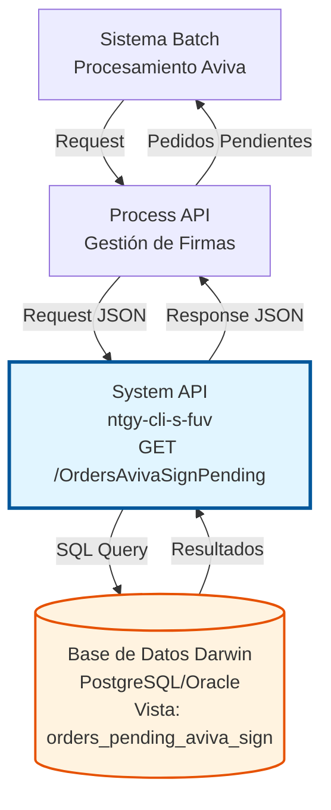
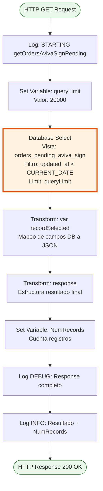
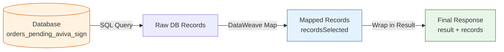

# GET /OrdersAvivaSignPending

## 📌 Descripción General

### Propósito del Endpoint

Este endpoint consulta los pedidos que están pendientes de firma digital con Aviva desde la base de datos Darwin. Está diseñado para procesamiento batch, recuperando pedidos que fueron actualizados hasta el día anterior (no incluye el día actual).

El endpoint soporta:
- **Consulta Batch**: Recupera hasta 20,000 pedidos pendientes en una sola llamada
- **Filtrado Temporal**: Solo retorna pedidos actualizados antes del día actual
- **Ordenamiento**: Pedidos ordenados por fecha de actualización descendente (más recientes primero)
- **Información Completa**: Incluye credenciales de Aviva, IDs de pedido, Lead y estado

### Tipo de API

**Capa:** System API (API-Led Connectivity)

**Función:** Integración directa con base de datos PostgreSQL/Oracle (Darwin) para consultar pedidos pendientes de firma digital con Aviva.

### Patrón de Integración

**Tipo:** Request-Reply Síncrono con SQL Query

**Descripción:** El endpoint ejecuta una consulta SQL directa a la vista `orders_pending_aviva_sign` en Darwin, filtrando por fecha de actualización, y retorna los resultados transformados en formato JSON estándar.

### Arquitectura API-Led Connectivity



---

## 💼 Propósito del Negocio

### Casos de Uso Principales

1. **Procesamiento Batch de Firmas Pendientes**
   - Sistema batch consulta pedidos que requieren firma digital
   - Procesa cada pedido para solicitar firma a Aviva
   - Actualiza estados según respuesta de Aviva
   - **Beneficio:** Automatización del proceso de firma digital

2. **Sincronización Darwin-Aviva**
   - Identifica pedidos que necesitan sincronización con Aviva
   - Obtiene credenciales y datos necesarios para la firma
   - Facilita el seguimiento de pedidos en proceso de firma
   - **Beneficio:** Trazabilidad completa del proceso de firma

3. **Monitoreo de Pedidos Pendientes**
   - Permite visualizar volumen de pedidos pendientes
   - Identifica pedidos antiguos que requieren atención
   - Facilita análisis de tiempos de procesamiento
   - **Beneficio:** Mejora en gestión de operaciones

### Contexto Empresarial

- **Dominio:** Gestión de Firma Digital
- **Sector:** Energía - Utilities
- **División:** Naturgy España - Frontal Único de Ventas (FUV)
- **Proceso de Negocio:** Firma digital de contratos con Aviva
- **Sistema Backend:** Darwin (gestión de pedidos)

### Stakeholders

- **Equipo Aviva**: Requiere información de pedidos para procesamiento de firmas
- **Equipo Darwin**: Mantiene datos de pedidos y estados de firma
- **Agentes de Ventas**: Necesitan seguimiento de estado de firmas de sus pedidos
- **Sistemas Batch**: Consumen este endpoint para procesamiento automatizado

### Valor de Negocio

- **Automatización**: Reduce intervención manual en proceso de firma digital
- **Eficiencia**: Procesamiento batch de hasta 20,000 pedidos por llamada
- **Trazabilidad**: Seguimiento completo de pedidos en proceso de firma
- **Integración**: Conexión directa entre Darwin y sistema de firma Aviva

### Consumidores Potenciales

Este endpoint puede ser consumido por:
- Sistemas batch de procesamiento de firmas Aviva
- Process APIs de gestión de pedidos
- Herramientas de monitoreo y reporting
- Sistemas de integración middleware

---

## 🔧 Especificación Técnica

### URLs por Ambiente

| Ambiente | URL Base | URL Completa |
|----------|----------|--------------|
| **Local** | `http://localhost:8081` | `http://localhost:8081/api/OrdersAvivaSignPending` |
| **Development** | `https://ntgy-cli-s-fuv-dev.cloudhub.io` | `https://ntgy-cli-s-fuv-dev.cloudhub.io/api/OrdersAvivaSignPending` |
| **UAT** | `https://ntgy-cli-s-fuv-uat.cloudhub.io` | `https://ntgy-cli-s-fuv-uat.cloudhub.io/api/OrdersAvivaSignPending` |
| **UAT01** | `https://ntgy-cli-s-fuv-uat01.cloudhub.io` | `https://ntgy-cli-s-fuv-uat01.cloudhub.io/api/OrdersAvivaSignPending` |
| **Production** | `https://ntgy-cli-s-fuv-pro.cloudhub.io` | `https://ntgy-cli-s-fuv-pro.cloudhub.io/api/OrdersAvivaSignPending` |

### Método HTTP

```
GET /api/OrdersAvivaSignPending
```

### Parámetros de Entrada

#### Headers HTTP

| Header | Tipo | Requerido | Descripción | Ejemplo |
|--------|------|-----------|-------------|---------|
| `Accept` | string | ❌ No | Tipo de contenido esperado en response | `application/json` |

#### Query Parameters

Este endpoint **no requiere query parameters**. El límite de registros (20,000) está configurado en el backend.

### Respuestas

#### Respuesta Exitosa (200 OK)

```json
{
  "result": {
    "codResult": "0000",
    "msgResult": "No hay error"
  },
  "records": [
    {
      "login": "usuario_aviva",
      "password": "password_encriptado",
      "channel_name": "WEB",
      "OrdeID": "12345",
      "CrmOrderID": "ORD-2024-001",
      "LeadID": "LEAD-2024-001",
      "AvivaID": "AVIVA-2024-001",
      "created_at": "2024-01-15T10:30:00",
      "orderState": "PENDING_SIGNATURE"
    }
  ]
}
```

**Descripción de Campos:**

| Campo | Tipo | Descripción |
|-------|------|-------------|
| `result.codResult` | string | Código de resultado ("0000" = éxito) |
| `result.msgResult` | string | Mensaje descriptivo del resultado |
| `records` | array | Array de pedidos pendientes |
| `records[].login` | string | Usuario de Aviva para la firma |
| `records[].password` | string | Contraseña de Aviva (encriptada) |
| `records[].channel_name` | string | Canal de origen del pedido |
| `records[].OrdeID` | string | ID interno del pedido en Darwin |
| `records[].CrmOrderID` | string | ID del pedido en CRM |
| `records[].LeadID` | string | ID del Lead asociado |
| `records[].AvivaID` | string | ID del proceso en Aviva |
| `records[].created_at` | string | Fecha de última actualización (ISO 8601) |
| `records[].orderState` | string | Estado actual del pedido |

#### Respuesta Sin Datos (200 OK)

```json
{
  "result": {
    "codResult": "0000",
    "msgResult": "No hay error"
  },
  "records": []
}
```

#### Respuesta de Error Técnico (500)

```json
{
  "result": {
    "codResult": "0001",
    "msgResult": "Error al consultar base de datos"
  }
}
```

### Autenticación y Autorización

- **Tipo:** Client ID & Client Secret (Anypoint Platform)
- **Autorización Base de Datos:** El usuario de conexión debe tener permisos para:
  - Acceso de lectura a la vista `orders_pending_aviva_sign`
  - Conexión a la base de datos Darwin

### Timeouts

| Tipo | Valor | Descripción |
|------|-------|-------------|
| **Request Timeout** | 30 segundos | Tiempo máximo de espera para la respuesta |
| **Connection Timeout** | 10 segundos | Tiempo máximo para establecer conexión con DB |

### Consideraciones de Performance

- **Límite de Registros:** 20,000 pedidos por llamada (configurado en backend)
- **Filtro Temporal:** Solo pedidos con `updated_at < CURRENT_DATE`
- **Ordenamiento:** Por `updated_at DESC` (más recientes primero)
- **Response Time Esperado:** < 3 segundos para volúmenes normales

---

## 🏗️ Implementación Técnica

### Arquitectura del Flow



### Componentes del Flow

#### 1. Flow Principal (s-fuv.xml)

**Ubicación:** `src/main/mule/s-fuv.xml` (línea 167-170)

```xml
<flow name="get:\OrdersAvivaSignPending:s-fuv-router">
    <logger level="DEBUG" message="get:\getOrdersAvivaSignPending:s-fuv-router" />
    <flow-ref name="s-fuv-getOrdersAvivaSignPendingSub_Flow"/>
</flow>
```

#### 2. Sub-flow de Implementación

**Ubicación:** `src/main/mule/s-fuv-getOrdersAvivaSignPending.xml` (línea 8-65)

**Componentes:**

1. **Logger de Inicio** (línea 9)
   - Registra inicio de operación
   - Mensaje: "STARTING getOrdersAvivaSignPending METHOD"

2. **Set Variable - Límite** (línea 10)
   - Variable: `queryLimit`
   - Valor: `${queries.getOrdersPendingAvivaSignLimit}` (20000)

3. **Database Select** (línea 11-16)
   - Config: `Database_Config`
   - Query: `${queries.getOrdersPendingAvivaSign}`
   - Input Parameter: `limit` = `vars.queryLimit`

4. **Transform - Records Selected** (línea 17-35)
   - Mapea campos de base de datos a estructura JSON
   - Variable: `recordsSelected`

5. **Transform - Response** (línea 36-55)
   - Construye respuesta final con estructura estándar
   - Calcula número de registros

6. **Loggers de Salida** (línea 56-64)
   - DEBUG: Response completo normalizado
   - INFO: Mensaje de resultado + número de registros

### Query SQL Real

**Ubicación:** `src/main/resources/s-fuv-global-config.yaml` (línea 4)

```sql
select * from orders_pending_aviva_sign 
where updated_at < CURRENT_DATE 
order by updated_at DESC 
Limit :limit
```

**Análisis de la Query:**

- **Tabla/Vista:** `orders_pending_aviva_sign`
- **Filtro:** `updated_at < CURRENT_DATE` (excluye día actual)
- **Ordenamiento:** `updated_at DESC` (más recientes primero)
- **Límite:** Parametrizado (`:limit`), valor: 20000

**Campos Retornados:**
- `login`: Usuario de Aviva
- `password`: Contraseña de Aviva
- `channel_name`: Canal de origen
- `id`: ID interno del pedido
- `orderid`: ID del pedido en CRM
- `lead_id`: ID del Lead
- `aviva_id`: ID en sistema Aviva
- `updated_at`: Fecha de última actualización
- `states`: Estado actual del pedido

### Transformación DataWeave

#### Transformación 1: Records Selected

**Ubicación:** `s-fuv-getOrdersAvivaSignPending.xml` (línea 20-33)

```dataweave
%dw 2.0
output application/json
---
payload map (record, findex) -> {
    "login": record.'login',
    "password": record.'password',
    "channel_name": record.'channel_name',
    "OrdeID": record.'id',
    "CrmOrderID": record.'orderid',
    "LeadID": record.'lead_id',
    "AvivaID": record.'aviva_id',
    "created_at": record.'updated_at',
    "orderState": record.'states'
}
```

**Mapeo de Campos:**

| Campo DB | Campo JSON | Descripción |
|----------|------------|-------------|
| `login` | `login` | Usuario Aviva |
| `password` | `password` | Contraseña Aviva |
| `channel_name` | `channel_name` | Canal de origen |
| `id` | `OrdeID` | ID interno pedido |
| `orderid` | `CrmOrderID` | ID pedido CRM |
| `lead_id` | `LeadID` | ID del Lead |
| `aviva_id` | `AvivaID` | ID en Aviva |
| `updated_at` | `created_at` | Fecha actualización |
| `states` | `orderState` | Estado pedido |

#### Transformación 2: Response Final

**Ubicación:** `s-fuv-getOrdersAvivaSignPending.xml` (línea 38-53)

```dataweave
%dw 2.0
output application/json
---
{
    "result": {
        "codResult": "0000",
        "msgResult": "No hay error",
    },
    "records": vars.recordsSelected
}
```

### Diagrama de Transformación de Datos



### Configuración de Base de Datos

**Connection Config:** `Database_Config`

**Propiedades:**
- **Host:** Configurado por ambiente
- **Port:** 5432 (PostgreSQL) / 1521 (Oracle)
- **Database:** Darwin
- **Connection Pooling:** Habilitado
- **Max Pool Size:** Configurable por ambiente

### Manejo de Errores

**Estrategia:**
- Errores de conexión DB → HTTP 500
- Errores de query → HTTP 500
- Sin resultados → HTTP 200 con array vacío
- Logging completo de errores para troubleshooting

### Logging

**Niveles de Log:**

1. **INFO** (línea 9):
   ```
   STARTING getOrdersAvivaSignPending METHOD. REQUEST: Recuperar Orders hasta el día anterior incluido
   ```

2. **DEBUG** (línea 56-63):
   ```
   FINISHED getOrdersAvivaSignPending METHOD. RESPONSE: [response normalizado]
   ```

3. **INFO** (línea 64):
   ```
   FINISHED getOrdersAvivaSignPending METHOD. RESPONSE: [msgResult] Registros: [NumRecords]
   ```

---

## 💻 Ejemplos de Uso

### Ejemplo 1: Consulta Básica con curl

```bash
curl -X GET "https://ntgy-cli-s-fuv-dev.cloudhub.io/api/OrdersAvivaSignPending" \
  -H "Accept: application/json" \
  -H "client_id: YOUR_CLIENT_ID" \
  -H "client_secret: YOUR_CLIENT_SECRET"
```

### Ejemplo 2: Response Exitoso con Datos

```json
{
  "result": {
    "codResult": "0000",
    "msgResult": "No hay error"
  },
  "records": [
    {
      "login": "usuario_aviva_001",
      "password": "encrypted_password_123",
      "channel_name": "WEB",
      "OrdeID": "45678",
      "CrmOrderID": "ORD-2024-12345",
      "LeadID": "LEAD-2024-67890",
      "AvivaID": "AVIVA-2024-11111",
      "created_at": "2024-01-15T14:30:00",
      "orderState": "PENDING_SIGNATURE"
    },
    {
      "login": "usuario_aviva_002",
      "password": "encrypted_password_456",
      "channel_name": "MOBILE",
      "OrdeID": "45679",
      "CrmOrderID": "ORD-2024-12346",
      "LeadID": "LEAD-2024-67891",
      "AvivaID": "AVIVA-2024-11112",
      "created_at": "2024-01-15T13:15:00",
      "orderState": "PENDING_SIGNATURE"
    }
  ]
}
```

### Ejemplo 3: Response Sin Datos (Sin Pedidos Pendientes)

```json
{
  "result": {
    "codResult": "0000",
    "msgResult": "No hay error"
  },
  "records": []
}
```

### Ejemplo 4: Response de Error

```json
{
  "result": {
    "codResult": "0001",
    "msgResult": "Error al consultar base de datos: Connection timeout"
  }
}
```

### Ejemplo 5: Uso en JavaScript/Node.js

```javascript
const axios = require('axios');

async function getOrdersAvivaSignPending() {
  try {
    const response = await axios.get(
      'https://ntgy-cli-s-fuv-dev.cloudhub.io/api/OrdersAvivaSignPending',
      {
        headers: {
          'Accept': 'application/json',
          'client_id': process.env.CLIENT_ID,
          'client_secret': process.env.CLIENT_SECRET
        }
      }
    );
    
    console.log(`Total pedidos pendientes: ${response.data.records.length}`);
    
    // Procesar cada pedido
    response.data.records.forEach(order => {
      console.log(`Pedido ${order.CrmOrderID} - Lead: ${order.LeadID}`);
    });
    
    return response.data;
  } catch (error) {
    console.error('Error al consultar pedidos:', error.message);
    throw error;
  }
}

// Ejecutar
getOrdersAvivaSignPending();
```

### Ejemplo 6: Uso en Python

```python
import requests
import os

def get_orders_aviva_sign_pending():
    url = "https://ntgy-cli-s-fuv-dev.cloudhub.io/api/OrdersAvivaSignPending"
    
    headers = {
        "Accept": "application/json",
        "client_id": os.getenv("CLIENT_ID"),
        "client_secret": os.getenv("CLIENT_SECRET")
    }
    
    try:
        response = requests.get(url, headers=headers)
        response.raise_for_status()
        
        data = response.json()
        records = data.get("records", [])
        
        print(f"Total pedidos pendientes: {len(records)}")
        
        for order in records:
            print(f"Pedido {order['CrmOrderID']} - Lead: {order['LeadID']}")
        
        return data
    
    except requests.exceptions.RequestException as e:
        print(f"Error al consultar pedidos: {e}")
        raise

# Ejecutar
if __name__ == "__main__":
    get_orders_aviva_sign_pending()
```

### Notas de Implementación

1. **Límite de Registros**: El endpoint retorna máximo 20,000 registros. Para volúmenes mayores, considerar paginación o procesamiento incremental.

2. **Filtro Temporal**: Solo retorna pedidos actualizados antes del día actual (`updated_at < CURRENT_DATE`). Los pedidos del día actual no se incluyen.

3. **Ordenamiento**: Los registros vienen ordenados por `updated_at DESC`, por lo que los pedidos más recientes aparecen primero.

4. **Credenciales Sensibles**: Los campos `login` y `password` contienen credenciales de Aviva. Manejar con seguridad apropiada.

5. **Performance**: Para volúmenes altos, el tiempo de respuesta puede aumentar. Monitorear y ajustar límites según necesidad.