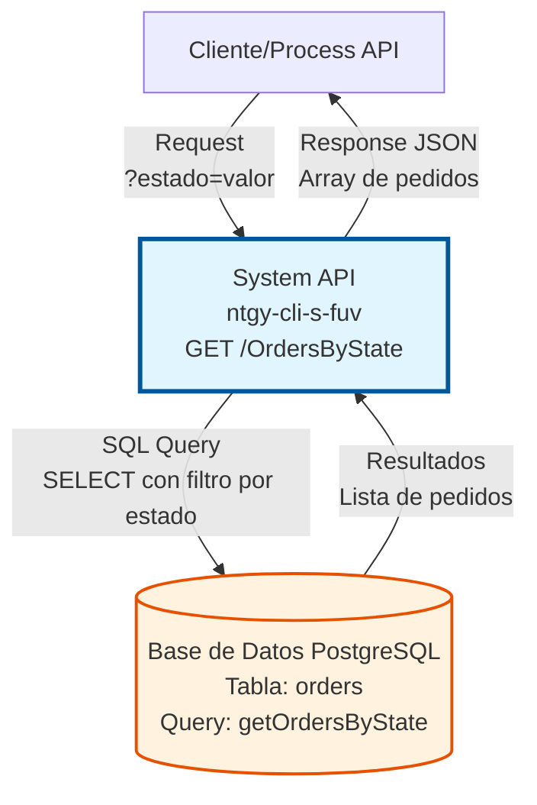
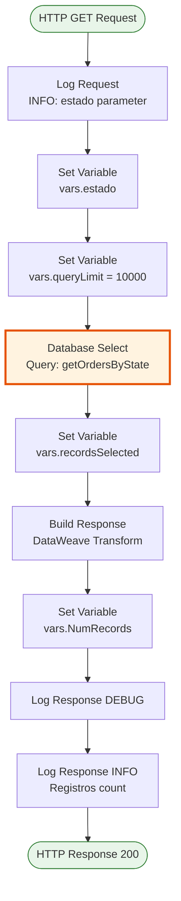
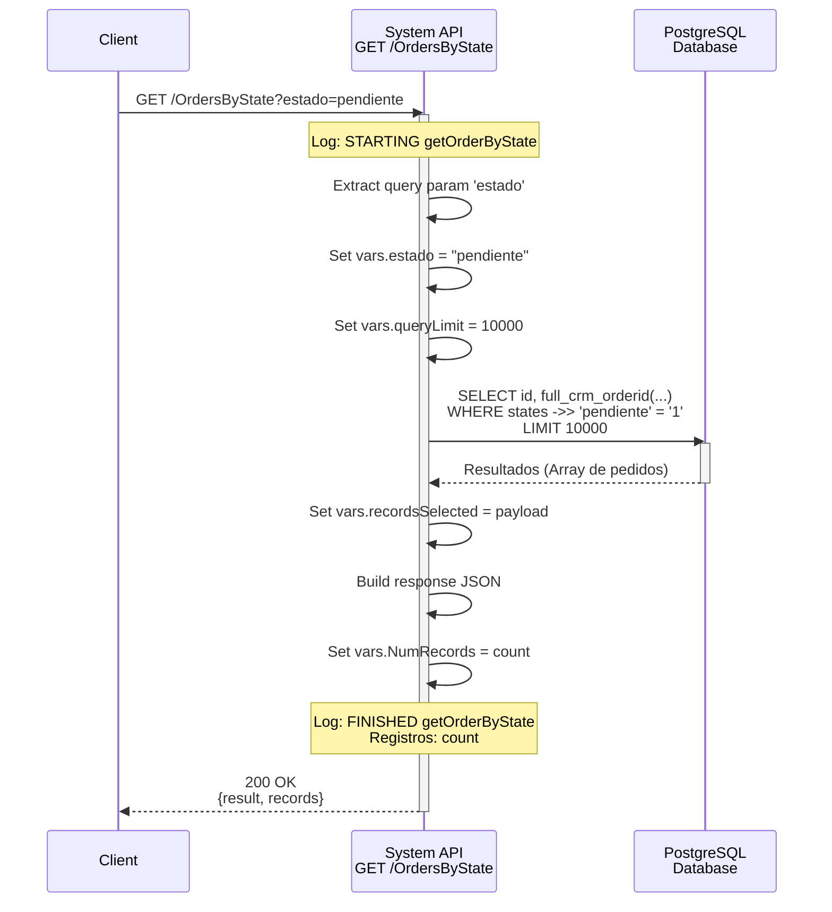
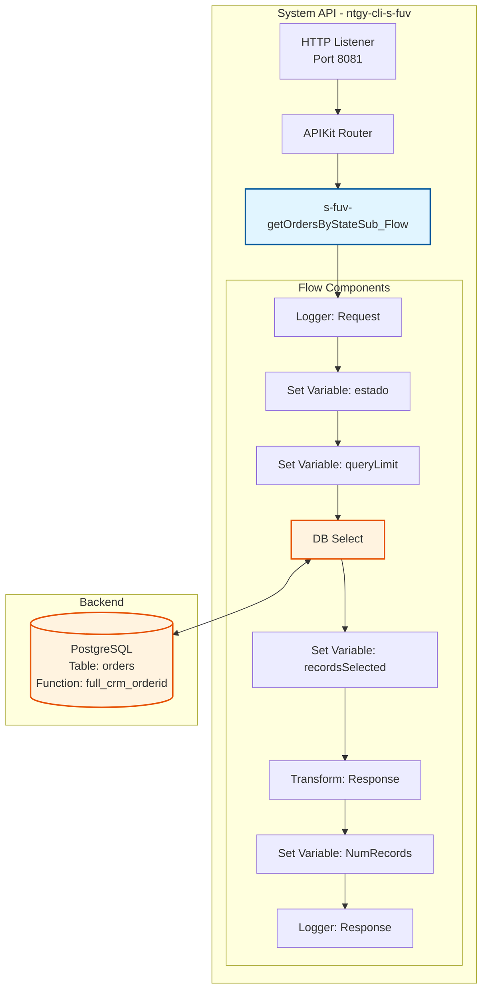

# GET /OrdersByState

## 📌 Descripción General

### Propósito del Endpoint

Este endpoint permite consultar pedidos del sistema FUV filtrados por un estado específico. Retorna una lista de pedidos que coinciden con el estado solicitado, incluyendo el ID completo del pedido (CRM Order ID con sufijo y versión de reintento).

El endpoint soporta:
- **Consulta por Estado**: Filtra pedidos según el estado especificado en el query parameter
- **Límite Configurable**: Retorna hasta 10,000 registros por defecto (configurable)
- **ID Completo**: Utiliza la función `full_crm_orderid` para construir el identificador completo del pedido

### Tipo de API

**Capa:** System API (API-Led Connectivity)

**Función:** Integración directa con base de datos PostgreSQL del sistema FUV para consulta de pedidos por estado.

### Patrón de Integración

**Tipo:** Request-Reply Síncrono con SQL Query

**Descripción:** El endpoint recibe el estado como query parameter, ejecuta una consulta SQL parametrizada contra la base de datos PostgreSQL, y retorna la lista de pedidos que coinciden con el estado especificado. La consulta utiliza una función personalizada para construir el ID completo del pedido.

### Arquitectura API-Led Connectivity



---

## 💼 Propósito del Negocio

### Casos de Uso Principales

1. **Consulta de Pedidos por Estado**
   - Agentes de ventas necesitan ver todos los pedidos en un estado específico
   - Permite filtrar pedidos por estados como "pendiente", "procesado", "cancelado", etc.
   - Facilita el seguimiento y gestión de pedidos en diferentes etapas del proceso

2. **Procesamiento Batch de Pedidos**
   - Sistemas batch necesitan obtener lotes de pedidos en estados específicos
   - Permite procesamiento masivo de pedidos según su estado
   - Límite configurable (10,000 registros) para evitar sobrecarga

3. **Monitoreo y Reportes**
   - Generación de reportes de pedidos por estado
   - Análisis de distribución de pedidos en diferentes estados
   - Identificación de cuellos de botella en el proceso de ventas

### Contexto Empresarial

- **Dominio:** Gestión del Frontal Único de Ventas (FUV)
- **Sector:** Energía - Utilities (Gas y Electricidad)
- **División:** Naturgy España
- **Proceso de Negocio:** Gestión y seguimiento de pedidos de ventas
- **Sistema:** FUV (Frontal Único de Ventas)

### Stakeholders

- **Agentes de Ventas**: Necesitan visibilidad de pedidos en estados específicos para seguimiento
- **Gestores de Pedidos**: Requieren consultas masivas para procesamiento y análisis
- **Sistemas Batch**: Procesan pedidos en lotes según su estado
- **Equipos de Soporte**: Consultan pedidos para resolución de incidencias

### Valor de Negocio

- **Visibilidad Operacional**: Permite ver en tiempo real la distribución de pedidos por estado
- **Eficiencia en Procesamiento**: Facilita el procesamiento batch de pedidos según su estado
- **Trazabilidad**: Mantiene el ID completo del pedido con sufijos y versiones para trazabilidad completa
- **Escalabilidad**: Límite configurable permite ajustar el volumen de datos según necesidades

### Consumidores Potenciales

Este endpoint puede ser consumido por:
- Process APIs de gestión de pedidos
- Sistemas batch de procesamiento de ventas
- Herramientas de reporting y análisis
- Sistemas de monitoreo operacional
- Integraciones con sistemas de terceros

---

## 🔧 Especificación Técnica

### URLs por Ambiente

| Ambiente | URL Base | URL Completa |
|----------|----------|--------------|
| **Local** | `http://localhost:8081` | `http://localhost:8081/api/OrdersByState?estado=valor` |
| **Development** | `https://ntgy-cli-s-fuv-dev.cloudhub.io` | `https://ntgy-cli-s-fuv-dev.cloudhub.io/api/OrdersByState?estado=valor` |
| **UAT** | `https://ntgy-cli-s-fuv-uat.cloudhub.io` | `https://ntgy-cli-s-fuv-uat.cloudhub.io/api/OrdersByState?estado=valor` |
| **UAT01** | `https://ntgy-cli-s-fuv-uat01.cloudhub.io` | `https://ntgy-cli-s-fuv-uat01.cloudhub.io/api/OrdersByState?estado=valor` |
| **Production** | `https://ntgy-cli-s-fuv-pro.cloudhub.io` | `https://ntgy-cli-s-fuv-pro.cloudhub.io/api/OrdersByState?estado=valor` |

### Método HTTP

```
GET /api/OrdersByState
```

### Parámetros de Entrada

#### Headers HTTP

| Header | Tipo | Requerido | Descripción | Ejemplo |
|--------|------|-----------|-------------|---------|
| `Accept` | string | ❌ No | Tipo de contenido esperado en response | `application/json` |

#### Query Parameters

| Parámetro | Tipo | Requerido | Descripción | Ejemplo |
|-----------|------|-----------|-------------|---------|
| `estado` | string | ✅ Sí | Estado del pedido a filtrar. El sistema busca en el campo JSON `states` de la tabla `orders` | `"pendiente"` |

**Nota sobre el parámetro `estado`:**
- El campo `states` en la tabla `orders` es de tipo JSON
- La consulta busca pedidos donde `states ->> :estado = '1'`
- Esto significa que busca pedidos donde el estado especificado tiene valor '1' (activo) en el objeto JSON

### Respuestas

#### Respuesta Exitosa (200 OK)

```json
{
  "result": {
    "codResult": "0000",
    "msgResult": "No hay error"
  },
  "records": [
    {
      "id": 12345,
      "full_crm_orderid": "ORD-2024-001-1.2"
    },
    {
      "id": 12346,
      "full_crm_orderid": "ORD-2024-002"
    }
  ]
}
```

**Campos de la respuesta:**
- `result.codResult`: Código de resultado ("0000" = éxito)
- `result.msgResult`: Mensaje descriptivo del resultado
- `records`: Array de pedidos encontrados
  - `id`: ID interno del pedido en la base de datos
  - `full_crm_orderid`: ID completo del pedido en formato CRM (incluye ID base, sufijo y versión)

#### Respuesta Sin Resultados (200 OK)

```json
{
  "result": {
    "codResult": "0000",
    "msgResult": "No hay error"
  },
  "records": []
}
```

#### Respuesta de Error Técnico (500)

```json
{
  "result": {
    "codResult": "0001",
    "msgResult": "Error interno del servidor"
  }
}
```

### Límites y Restricciones

- **Límite de Registros**: 10,000 pedidos por consulta (configurable mediante `queries.getOrdersByState_limit`)
- **Timeout**: 30 segundos máximo de espera
- **Performance**: < 2s response time esperado para consultas típicas

### Autenticación y Autorización

- **Tipo:** Client ID & Client Secret (Anypoint Platform)
- **Autorización DB:** El usuario de base de datos debe tener permisos de:
  - SELECT en tabla `orders`
  - EXECUTE en función `full_crm_orderid`

### Timeouts

| Tipo | Valor | Descripción |
|------|-------|-------------|
| **Request Timeout** | 30 segundos | Tiempo máximo de espera para la respuesta |
| **Connection Timeout** | 10 segundos | Tiempo máximo para establecer conexión con DB |
| **Query Timeout** | 25 segundos | Tiempo máximo de ejecución de la query SQL |

---

## 🏗️ Implementación Técnica

### Arquitectura del Flow



### Flujo de Datos Detallado



### Query SQL Real

**Archivo de configuración:** `s-fuv-global-config.yaml` (línea 2)

```sql
SELECT 
    id, 
    full_crm_orderid(
        o.order_crm_id_id, 
        o.order_crm_id_suffix, 
        o.order_retry_version
    ) 
FROM orders o 
WHERE o.states ->> :estado = '1' 
LIMIT :limit
```

**Explicación de la Query:**
- **Tabla:** `orders` (alias `o`)
- **Campos seleccionados:**
  - `id`: ID interno del pedido
  - `full_crm_orderid(...)`: Función que construye el ID completo del pedido
- **Función `full_crm_orderid`:**
  - Combina `order_crm_id_id` (ID base)
  - Añade `order_crm_id_suffix` (sufijo, ej: "-1", "-2")
  - Añade `order_retry_version` (versión de reintento, ej: ".1", ".2")
  - Resultado: "ORD-2024-001-1.2"
- **Filtro:** `states ->> :estado = '1'`
  - `states` es un campo JSON
  - `->>` es el operador de PostgreSQL para extraer valor de JSON como texto
  - Busca pedidos donde el estado especificado tiene valor '1' (activo)
- **Límite:** Configurable, por defecto 10,000 registros

### Transformaciones DataWeave

#### 1. Extracción del Query Parameter (línea 13-17)

```dataweave
%dw 2.0
output application/java
---
attributes.queryParams.estado
```

**Propósito:** Extraer el parámetro `estado` del query string y almacenarlo en `vars.estado`

#### 2. Preparación de Registros (línea 31-34)

```dataweave
%dw 2.0
output application/json
---
payload
```

**Propósito:** Convertir el resultado de la query a JSON y almacenarlo en `vars.recordsSelected`

#### 3. Construcción de Respuesta (línea 39-46)

```dataweave
%dw 2.0
output application/json
---
{
    "result": {
        "codResult": "0000",
        "msgResult": "No hay error",
    },
    "records": vars.recordsSelected
}
```

**Propósito:** Construir la respuesta final con formato estándar que incluye:
- Objeto `result` con código y mensaje de resultado
- Array `records` con los pedidos encontrados

#### 4. Conteo de Registros (línea 50-53)

```dataweave
%dw 2.0
output application/java
---
sizeOf(vars.recordsSelected)
```

**Propósito:** Calcular el número de registros retornados para logging

### Configuración de Base de Datos

**Database Connector:** `Database_Config`
- **Tipo:** PostgreSQL
- **Connection Pooling:** Habilitado
- **Max Pool Size:** Configurable por ambiente
- **Connection Timeout:** 10 segundos
- **Query Timeout:** 25 segundos

### Logging

**Nivel INFO (línea 9):**
```
STARTING getOrderByState METHOD. REQUEST: [estado]
```

**Nivel DEBUG (línea 57):**
```
FINISHED getOrderByState METHOD. RESPONSE: [response completo]
```

**Nivel INFO (línea 58):**
```
FINISHED getOrderByState METHOD. RESPONSE: No hay error   Registros: [count]
```

### Manejo de Errores

El endpoint utiliza el error handler global del API que captura:
- **Errores de Conectividad DB:** Timeout, conexión perdida
- **Errores de Query:** Sintaxis SQL, permisos insuficientes
- **Errores de Transformación:** Fallos en DataWeave

Todos los errores retornan un objeto `result` con:
- `codResult`: Código de error (diferente de "0000")
- `msgResult`: Descripción del error

### Diagrama de Componentes



---

## 💻 Ejemplos de Uso

### Ejemplo 1: Consulta de Pedidos Pendientes

#### Request con curl

```bash
curl -X GET "https://ntgy-cli-s-fuv-dev.cloudhub.io/api/OrdersByState?estado=pendiente" \
  -H "Accept: application/json"
```

#### Response Exitoso (200 OK)

```json
{
  "result": {
    "codResult": "0000",
    "msgResult": "No hay error"
  },
  "records": [
    {
      "id": 12345,
      "full_crm_orderid": "ORD-2024-001"
    },
    {
      "id": 12346,
      "full_crm_orderid": "ORD-2024-002-1"
    },
    {
      "id": 12347,
      "full_crm_orderid": "ORD-2024-003.2"
    }
  ]
}
```

### Ejemplo 2: Consulta de Pedidos Procesados

#### Request con curl

```bash
curl -X GET "https://ntgy-cli-s-fuv-uat.cloudhub.io/api/OrdersByState?estado=procesado" \
  -H "Accept: application/json"
```

#### Response Exitoso (200 OK)

```json
{
  "result": {
    "codResult": "0000",
    "msgResult": "No hay error"
  },
  "records": [
    {
      "id": 15001,
      "full_crm_orderid": "ORD-2024-100"
    },
    {
      "id": 15002,
      "full_crm_orderid": "ORD-2024-101-2.1"
    }
  ]
}
```

### Ejemplo 3: Consulta Sin Resultados

#### Request con curl

```bash
curl -X GET "https://ntgy-cli-s-fuv-pro.cloudhub.io/api/OrdersByState?estado=inexistente" \
  -H "Accept: application/json"
```

#### Response Sin Resultados (200 OK)

```json
{
  "result": {
    "codResult": "0000",
    "msgResult": "No hay error"
  },
  "records": []
}
```

### Ejemplo 4: Request con JavaScript (Fetch API)

```javascript
const estado = 'pendiente';

fetch(`https://ntgy-cli-s-fuv-dev.cloudhub.io/api/OrdersByState?estado=${estado}`, {
  method: 'GET',
  headers: {
    'Accept': 'application/json'
  }
})
  .then(response => response.json())
  .then(data => {
    console.log('Código de resultado:', data.result.codResult);
    console.log('Número de pedidos:', data.records.length);
    console.log('Pedidos:', data.records);
  })
  .catch(error => {
    console.error('Error:', error);
  });
```

### Ejemplo 5: Request con Python (requests)

```python
import requests

url = "https://ntgy-cli-s-fuv-dev.cloudhub.io/api/OrdersByState"
params = {
    "estado": "pendiente"
}
headers = {
    "Accept": "application/json"
}

response = requests.get(url, params=params, headers=headers)

if response.status_code == 200:
    data = response.json()
    print(f"Código de resultado: {data['result']['codResult']}")
    print(f"Número de pedidos: {len(data['records'])}")
    for record in data['records']:
        print(f"  - ID: {record['id']}, Order ID: {record['full_crm_orderid']}")
else:
    print(f"Error: {response.status_code}")
```

### Ejemplo 6: Error de Conexión a Base de Datos

#### Response de Error (500)

```json
{
  "result": {
    "codResult": "0001",
    "msgResult": "Error de conectividad con base de datos"
  }
}
```

### Notas de Implementación

1. **Formato del ID Completo:**
   - El campo `full_crm_orderid` puede tener diferentes formatos:
     - Simple: "ORD-2024-001"
     - Con sufijo: "ORD-2024-001-1"
     - Con versión: "ORD-2024-001.2"
     - Completo: "ORD-2024-001-1.2"

2. **Estados Válidos:**
   - Los estados válidos dependen de la configuración del campo JSON `states` en la tabla `orders`
   - Consultar con el equipo de negocio para obtener la lista completa de estados

3. **Límite de Registros:**
   - El límite por defecto es 10,000 registros
   - Si necesitas más registros, contacta al equipo de infraestructura para ajustar la configuración

4. **Performance:**
   - Para consultas de estados muy comunes (muchos registros), considera implementar paginación
   - El tiempo de respuesta puede aumentar con el número de registros retornados

---

**Última actualización:** 2026-07-13  
**Versión del API:** 1.22.0-SNAPSHOT  
**Mantenido por:** Equipo MuleSoft Naturgy