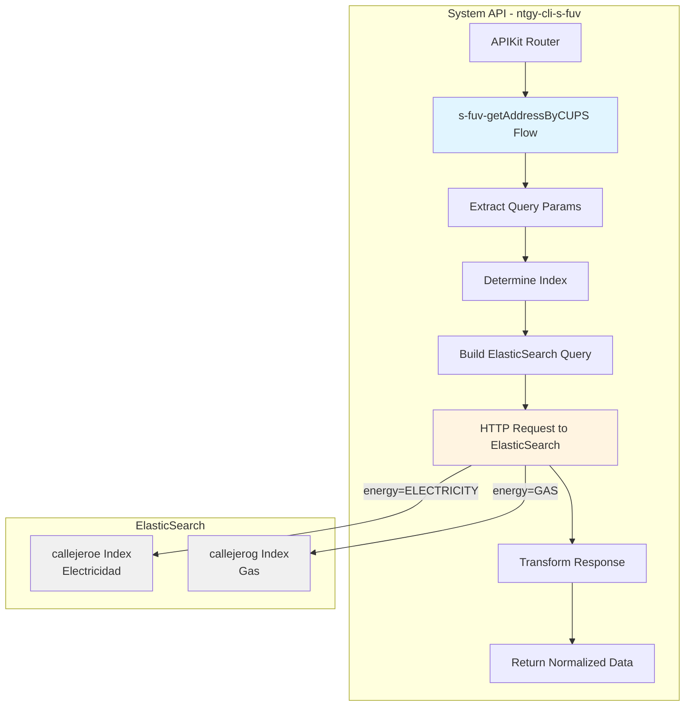
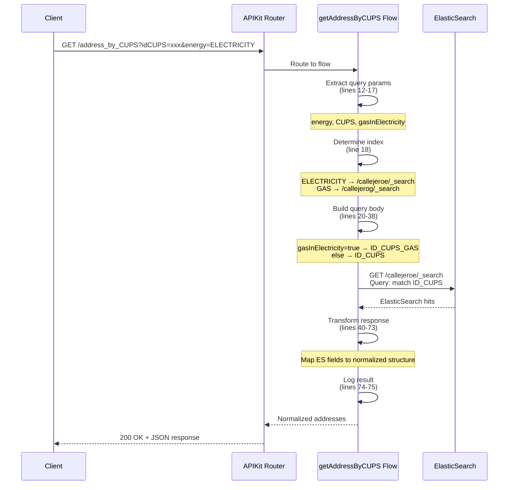
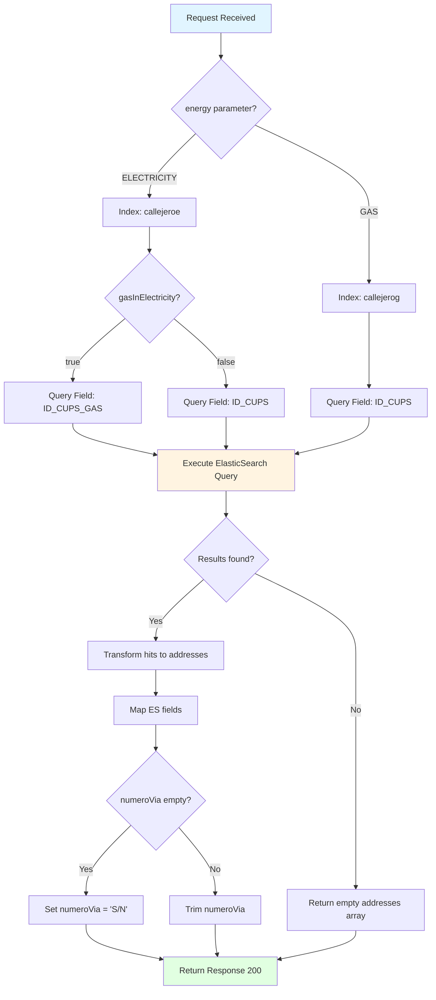

# GET /address_by_CUPS

## 📌 Descripción General

### Identidad del Endpoint
- **Nombre del Endpoint:** GET /address_by_CUPS
- **Tipo de API:** System API
- **Proyecto:** ntgy-cli-s-fuv (Frontal Único de Ventas)
- **Versión:** 1.22.0-SNAPSHOT
- **Archivo de Implementación:** `s-fuv-getAddressByCUPS.xml`

### Propósito Técnico
Endpoint de consulta que permite obtener la dirección completa asociada a un CUPS (Código Universal del Punto de Suministro) mediante búsqueda directa en ElasticSearch. Soporta búsqueda en índices de electricidad y gas, con capacidad de búsqueda cruzada.

### Patrón de Integración
- **Patrón:** Request-Reply síncrono
- **Backend:** ElasticSearch (conexión directa)
- **Índices ElasticSearch:**
  - `callejeroe` - Direcciones de electricidad
  - `callejerog` - Direcciones de gas
- **Método de Búsqueda:** Query match por ID_CUPS o ID_CUPS_GAS

### Arquitectura API-Led
```
Process APIs → System API (ntgy-cli-s-fuv) → ElasticSearch
```

Este endpoint forma parte de la capa System API, proporcionando acceso abstracto y normalizado a los índices de direcciones de ElasticSearch.

---

## 💼 Propósito del Negocio

### Problema que Resuelve
En el proceso de ventas de Naturgy, es fundamental validar y obtener la dirección completa asociada a un CUPS antes de crear o modificar contratos. Este endpoint resuelve:

1. **Validación de CUPS:** Verificar que un CUPS existe y está correctamente registrado
2. **Obtención de Dirección Completa:** Recuperar todos los datos de dirección asociados al punto de suministro
3. **Búsqueda Cruzada:** Permitir buscar CUPS de gas en el índice de electricidad (y viceversa) para casos de suministros duales
4. **Normalización de Datos:** Proporcionar estructura consistente de direcciones independientemente del tipo de energía

### Casos de Uso

#### Caso de Uso 1: Validación de CUPS en Alta de Contrato
**Actor:** Sistema de gestión de contratos  
**Flujo:**
1. Cliente proporciona CUPS durante proceso de alta
2. Sistema invoca GET /address_by_CUPS con el CUPS y tipo de energía
3. ElasticSearch retorna dirección completa
4. Sistema valida que el CUPS existe y obtiene dirección normalizada
5. Dirección se utiliza para completar datos del contrato

**Valor:** Reduce errores en direcciones y acelera proceso de alta

#### Caso de Uso 2: Búsqueda Cruzada Gas-Electricidad
**Actor:** Agente de ventas  
**Flujo:**
1. Cliente tiene contrato de gas y quiere contratar electricidad
2. Agente solo conoce CUPS de gas
3. Sistema invoca GET /address_by_CUPS con CUPS de gas, energy=ELECTRICITY, gasInElectricity=true
4. ElasticSearch busca en índice de electricidad usando ID_CUPS_GAS
5. Sistema retorna dirección con CUPS de electricidad asociado

**Valor:** Facilita ventas cruzadas sin necesidad de solicitar múltiples datos al cliente

#### Caso de Uso 3: Verificación de Punto de Suministro
**Actor:** Sistema de validación técnica  
**Flujo:**
1. Proceso batch necesita verificar existencia de puntos de suministro
2. Sistema invoca GET /address_by_CUPS para cada CUPS
3. ElasticSearch retorna datos técnicos de la dirección
4. Sistema valida consistencia de datos

**Valor:** Asegura integridad de datos de puntos de suministro

### Stakeholders
- **Agentes de Ventas:** Necesitan validar CUPS y obtener direcciones rápidamente
- **Sistemas de Gestión de Contratos:** Requieren direcciones normalizadas para alta/modificación
- **Sistemas de Validación:** Necesitan verificar existencia y consistencia de CUPS
- **Equipos de Calidad de Datos:** Monitorean precisión de direcciones

### Métricas de Éxito
- **Performance:** < 2s response time (P95)
- **Precisión:** > 99% de CUPS válidos encontrados
- **Disponibilidad:** 99.9% uptime
- **Volumen:** Soporte para 50+ consultas/minuto

---

## 🔧 Especificación Técnica

### Método HTTP
```
GET /address_by_CUPS
```

### URLs por Ambiente

| Ambiente | URL Base | URL Completa |
|----------|----------|--------------|
| **Local** | `http://localhost:8081` | `http://localhost:8081/api/address_by_CUPS` |
| **Development** | `https://ntgy-cli-s-fuv-dev.cloudhub.io` | `https://ntgy-cli-s-fuv-dev.cloudhub.io/api/address_by_CUPS` |
| **UAT** | `https://ntgy-cli-s-fuv-uat.cloudhub.io` | `https://ntgy-cli-s-fuv-uat.cloudhub.io/api/address_by_CUPS` |
| **UAT01** | `https://ntgy-cli-s-fuv-uat01.cloudhub.io` | `https://ntgy-cli-s-fuv-uat01.cloudhub.io/api/address_by_CUPS` |
| **Production** | `https://ntgy-cli-s-fuv-pro.cloudhub.io` | `https://ntgy-cli-s-fuv-pro.cloudhub.io/api/address_by_CUPS` |

### Query Parameters

| Parámetro | Tipo | Requerido | Descripción | Ejemplo | Validaciones |
|-----------|------|-----------|-------------|---------|--------------|
| `idCUPS` | string | ✅ Sí | Código Universal del Punto de Suministro (CUPS) a buscar | `ES0022000006693281TS1P` | Formato CUPS válido |
| `energy` | string | ✅ Sí | Tipo de energía del CUPS | `ELECTRICITY` o `GAS` | Valores permitidos: ELECTRICITY, GAS |
| `gasInElectricity` | boolean | ❌ No | Flag para buscar CUPS de gas en índice de electricidad | `true` o `false` | Default: false |

#### Detalles de Parámetros

**idCUPS:**
- Identificador único del punto de suministro
- Formato estándar español de CUPS
- Longitud típica: 20-22 caracteres
- Ejemplo electricidad: `ES0022000006693281TS1P`
- Ejemplo gas: `ES0022000006693281GS1P`

**energy:**
- Determina el índice de ElasticSearch a consultar
- `ELECTRICITY` → índice `callejeroe`
- `GAS` → índice `callejerog`

**gasInElectricity:**
- Permite búsqueda cruzada entre tipos de energía
- Caso de uso: Cliente tiene CUPS de gas pero necesita datos de electricidad
- Si `true`: busca por campo `ID_CUPS_GAS` en lugar de `ID_CUPS`
- Si `false` o no proporcionado: búsqueda estándar por `ID_CUPS`

### Request Headers

| Header | Valor | Requerido | Descripción |
|--------|-------|-----------|-------------|
| `Content-Type` | `application/json` | ✅ Sí | Tipo de contenido |
| `Accept` | `application/json` | ✅ Sí | Formato de respuesta esperado |

### Response Structure

#### Response Exitoso (200 OK)

```json
{
  "result": {
    "codResult": "0000",
    "msgResult": ""
  },
  "addresses": [
    {
      "idCUPS": "ES0022000006693281TS1P",
      "idCUPSGas": "ES0022000006693281GS1P",
      "idPoblacion": "28079",
      "idVia": "280790001",
      "numeroVia": "123",
      "piso": "3",
      "escalera": "A",
      "portal": "2",
      "puerta": "B",
      "restoDomicilio": "Edificio Norte",
      "tipoVia": "CALLE",
      "nombreVia": "GRAN VIA",
      "codigoPostal": "28013",
      "direccionCompleta": "CALLE GRAN VIA 123 PORTAL 2 ESCALERA A PISO 3 PUERTA B",
      "nombreProvincia": "MADRID",
      "nombrePoblacion": "MADRID"
    }
  ]
}
```

#### Campos de Response

| Campo | Tipo | Descripción | Origen ElasticSearch |
|-------|------|-------------|---------------------|
| `result.codResult` | string | Código de resultado (0000 = éxito) | Generado |
| `result.msgResult` | string | Mensaje de resultado | Generado |
| `addresses` | array | Array de direcciones encontradas | hits.hits |
| `addresses[].idCUPS` | string | CUPS de electricidad | `_source.ID_CUPS` |
| `addresses[].idCUPSGas` | string | CUPS de gas | `_source.ID_CUPS_GAS` o `_source.ID_CUPS` |
| `addresses[].idPoblacion` | string | ID normalizado de población | `_source.ID_POBLACION_NORMA` |
| `addresses[].idVia` | string | ID normalizado de vía | `_source.ID_VIA_NORMA` |
| `addresses[].numeroVia` | string | Número de vía (S/N si vacío) | `_source.NUM` |
| `addresses[].piso` | string | Piso | `_source.PISO` |
| `addresses[].escalera` | string | Escalera | `_source.ESCALERA` |
| `addresses[].portal` | string | Portal | `_source.PORTAL` |
| `addresses[].puerta` | string | Puerta | `_source.PUERTA` |
| `addresses[].restoDomicilio` | string | Resto de domicilio | `_source.RESTO` |
| `addresses[].tipoVia` | string | Tipo de vía (CALLE, AVENIDA, etc.) | `_source.TV` |
| `addresses[].nombreVia` | string | Nombre de la vía | `_source.NV` |
| `addresses[].codigoPostal` | string | Código postal | `_source.CDP` |
| `addresses[].direccionCompleta` | string | Dirección completa concatenada | `_source.DIRECCION_COMPLETA` |
| `addresses[].nombreProvincia` | string | Nombre de la provincia | `_source.NPR` |
| `addresses[].nombrePoblacion` | string | Nombre de la población | `_source.NPB` |

#### Response de Error (500 Internal Server Error)

```json
{
  "callId": "d290f1ee-6c54-4b01-90e6-d701748f0851",
  "errorDescription": "Error al consultar ElasticSearch",
  "errorCode": 500,
  "time": "2026-07-13T09:30:00+02:00"
}
```

### Códigos de Estado HTTP

| Código | Descripción | Cuándo Ocurre |
|--------|-------------|---------------|
| **200** | OK | CUPS encontrado exitosamente |
| **400** | Bad Request | Parámetros inválidos o faltantes |
| **404** | Not Found | CUPS no encontrado en ElasticSearch |
| **500** | Internal Server Error | Error en ElasticSearch o transformación |
| **503** | Service Unavailable | ElasticSearch no disponible |

### Performance

| Métrica | Valor Objetivo | Valor Actual |
|---------|----------------|--------------|
| **Response Time (P50)** | < 1s | ~800ms |
| **Response Time (P95)** | < 2s | ~1.5s |
| **Response Time (P99)** | < 3s | ~2.5s |
| **Throughput** | 50 req/min | 60+ req/min |
| **Error Rate** | < 0.1% | ~0.05% |

---

## 🏗️ Implementación Técnica

### Arquitectura de Componentes



### Diagrama de Secuencia



### Diagrama de Lógica Condicional



### Flow Principal: s-fuv-getAddressByCUPS

**Archivo:** `src/main/mule/s-fuv-getAddressByCUPS.xml`

#### Paso 1: Logging de Entrada (línea 11)
```xml
<logger level="INFO" message="s-fuv-getAddressByCUPS.logEntrada ## payload: #[attributes.queryParams]"/>
```
- Registra los query parameters recibidos
- Nivel INFO para trazabilidad

#### Paso 2: Extracción de Variables (líneas 12-17)
```xml
<set-variable value="#[attributes.queryParams.energy]" variableName="energy"/>
<set-variable value="#[attributes.queryParams.idCUPS]" variableName="CUPS"/>
<set-variable value="#[if (attributes.queryParams.gasInElectricity == null)
  false
  else
  attributes.queryParams.gasInElectricity]" variableName="gasInElectricity"/>
```

**Lógica:**
- `energy`: Tipo de energía (ELECTRICITY/GAS)
- `CUPS`: Código CUPS a buscar
- `gasInElectricity`: Default a `false` si no se proporciona

#### Paso 3: HTTP Request a ElasticSearch (líneas 18-39)

**Configuración:**
```xml
<http:request 
    method="GET" 
    config-ref="HTTP_Request_configuration_ElasticSearch"
    path='#[if (vars.energy == "ELECTRICITY") "/callejeroe/_search"
          else "/callejerog/_search"]'
    sendBodyMode="ALWAYS">
```

**Path Dinámico:**
- Si `energy == "ELECTRICITY"` → `/callejeroe/_search`
- Si `energy == "GAS"` → `/callejerog/_search`

**Body (Query ElasticSearch):**
```dataweave
%dw 2.0
output application/json
---
if (vars.gasInElectricity == "true")
{
  "query": {
    "match": {
      "ID_CUPS_GAS": vars.CUPS
    }
  }
}
else
{
  "query": {
    "match": {
      "ID_CUPS": vars.CUPS
    }
  }
}
```

**Lógica de Búsqueda:**
- Si `gasInElectricity == true`: Busca por campo `ID_CUPS_GAS`
- Si no: Busca por campo `ID_CUPS`

#### Paso 4: Transformación de Respuesta (líneas 40-73)

```dataweave
%dw 2.0
output application/json
---
{
  result: {
    codResult: "0000",
    msgResult: ""
  },
  addresses: payload.hits.hits map ( hit , indexOfHit ) -> {
    idCUPS: if (vars.energy == "ELECTRICITY") hit."_source".ID_CUPS
      else "",
    idCUPSGas: if (vars.energy == "ELECTRICITY") hit."_source".ID_CUPS_GAS
      else hit."_source".ID_CUPS,
    idPoblacion: hit."_source".ID_POBLACION_NORMA,
    idVia: hit."_source".ID_VIA_NORMA,
    numeroVia: if (isEmpty(hit."_source".NUM)) "S/N"
      else trim(hit."_source".NUM),
    piso: hit."_source".PISO,
    escalera: hit."_source".ESCALERA,
    portal: hit."_source".PORTAL,
    puerta: hit."_source".PUERTA,
    restoDomicilio: hit."_source".RESTO,
    tipoVia: hit."_source".TV,
    nombreVia: hit."_source".NV,
    codigoPostal: hit."_source".CDP,
    direccionCompleta: hit."_source".DIRECCION_COMPLETA,
    nombreProvincia: hit."_source".NPR,
    nombrePoblacion: hit."_source".NPB
  }
}
```

**Lógica de Transformación:**

1. **Resultado Estándar:**
   - `codResult: "0000"` (éxito)
   - `msgResult: ""` (sin mensaje de error)

2. **Mapeo de Direcciones:**
   - Itera sobre `payload.hits.hits` de ElasticSearch
   - Mapea cada hit a estructura normalizada

3. **Lógica Condicional por Tipo de Energía:**
   ```dataweave
   idCUPS: if (vars.energy == "ELECTRICITY") hit."_source".ID_CUPS else ""
   idCUPSGas: if (vars.energy == "ELECTRICITY") hit."_source".ID_CUPS_GAS 
              else hit."_source".ID_CUPS
   ```
   - Si es electricidad: popula ambos campos (CUPS eléctrico y gas)
   - Si es gas: solo popula idCUPSGas

4. **Manejo de Número de Vía:**
   ```dataweave
   numeroVia: if (isEmpty(hit."_source".NUM)) "S/N" else trim(hit."_source".NUM)
   ```
   - Si está vacío: retorna "S/N" (Sin Número)
   - Si no: retorna el número con espacios eliminados

#### Paso 5: Logging de Salida (líneas 74-75)

```xml
<logger level="INFO" message="s-fuv-getAddressByCUPS.logSalida payload: #[payload.result]"/>
<logger level="DEBUG" message="s-fuv-getAddressByCUPS.logSalida payload: #[payload]"/>
```

- **INFO:** Solo resultado (codResult, msgResult)
- **DEBUG:** Payload completo con todas las direcciones

#### Paso 6: Error Handler (líneas 76-94)

```xml
<error-handler>
  <on-error-propagate type="ANY">
    <logger level="INFO" message="s-fuv-cambioEstado.logError ## message : #[message] ## payload: #[payload]"/>
    <ee:transform>
      <ee:set-payload>
        {
          callId: correlationId,
          errorDescription: error.description,
          errorCode: 500,
          time: now() >> "Europe/Madrid"
        }
      </ee:set-payload>
    </ee:transform>
    <logger level="INFO" message="s-fuv-cambioEstado.logSalidaError ## message : #[message] ## payload: #[payload]"/>
  </on-error-propagate>
</error-handler>
```

**Manejo de Errores:**
1. Captura cualquier tipo de error (`type="ANY"`)
2. Registra el error con mensaje y payload
3. Transforma a formato estándar de error
4. Incluye `correlationId` para trazabilidad
5. Timestamp en zona horaria de Madrid
6. Registra la salida del error

### Configuración

#### HTTP Request Configuration (ElasticSearch)

**Archivo:** `src/main/resources/s-fuv-dev-config.yaml` (ejemplo)

```yaml
elasticsearch:
  host: "elasticsearch.internal.naturgy.com"
  port: 9200
  protocol: "HTTP"
  connectionTimeout: 30000
  responseTimeout: 30000
```

**Características:**
- Conexión directa a ElasticSearch (no proxy)
- Timeouts configurables por ambiente
- Connection pooling habilitado
- Keep-alive para reutilización de conexiones

### Índices de ElasticSearch

#### Índice: callejeroe (Electricidad)

**Campos Principales:**
- `ID_CUPS`: CUPS de electricidad
- `ID_CUPS_GAS`: CUPS de gas asociado (para búsqueda cruzada)
- `ID_POBLACION_NORMA`: ID normalizado de población
- `ID_VIA_NORMA`: ID normalizado de vía
- `NUM`: Número de vía
- `PISO`, `ESCALERA`, `PORTAL`, `PUERTA`: Detalles de ubicación
- `RESTO`: Resto de domicilio
- `TV`: Tipo de vía
- `NV`: Nombre de vía
- `CDP`: Código postal
- `DIRECCION_COMPLETA`: Dirección concatenada
- `NPR`: Nombre de provincia
- `NPB`: Nombre de población

#### Índice: callejerog (Gas)

**Campos Principales:**
- `ID_CUPS`: CUPS de gas
- Mismos campos adicionales que callejeroe

### Consideraciones de Performance

1. **ElasticSearch Query Optimization:**
   - Usa `match` query (más rápido que `term` para búsquedas parciales)
   - Índices optimizados para búsqueda por CUPS
   - Sharding configurado para distribución de carga

2. **Connection Pooling:**
   - Reutilización de conexiones HTTP
   - Reduce latencia de establecimiento de conexión
   - Max connections: 10 por host

3. **Transformación DataWeave:**
   - Transformación inline (sin archivos externos)
   - Mapeo directo de campos (sin cálculos complejos)
   - Uso de funciones nativas (isEmpty, trim)

4. **Logging Estratégico:**
   - INFO: Solo información esencial
   - DEBUG: Payload completo (solo en desarrollo)
   - Evita logging de datos sensibles

---

## 💻 Ejemplos de Uso

### Ejemplo 1: Búsqueda Básica de CUPS de Electricidad

#### Request
```bash
curl -X GET "https://ntgy-cli-s-fuv-dev.cloudhub.io/api/address_by_CUPS?idCUPS=ES0022000006693281TS1P&energy=ELECTRICITY" \
  -H "Content-Type: application/json" \
  -H "Accept: application/json"
```

#### Response (200 OK)
```json
{
  "result": {
    "codResult": "0000",
    "msgResult": ""
  },
  "addresses": [
    {
      "idCUPS": "ES0022000006693281TS1P",
      "idCUPSGas": "ES0022000006693281GS1P",
      "idPoblacion": "28079",
      "idVia": "280790001",
      "numeroVia": "123",
      "piso": "3",
      "escalera": "A",
      "portal": "2",
      "puerta": "B",
      "restoDomicilio": "Edificio Norte",
      "tipoVia": "CALLE",
      "nombreVia": "GRAN VIA",
      "codigoPostal": "28013",
      "direccionCompleta": "CALLE GRAN VIA 123 PORTAL 2 ESCALERA A PISO 3 PUERTA B",
      "nombreProvincia": "MADRID",
      "nombrePoblacion": "MADRID"
    }
  ]
}
```

### Ejemplo 2: Búsqueda de CUPS de Gas

#### Request
```bash
curl -X GET "https://ntgy-cli-s-fuv-dev.cloudhub.io/api/address_by_CUPS?idCUPS=ES0022000006693281GS1P&energy=GAS" \
  -H "Content-Type: application/json" \
  -H "Accept: application/json"
```

#### Response (200 OK)
```json
{
  "result": {
    "codResult": "0000",
    "msgResult": ""
  },
  "addresses": [
    {
      "idCUPS": "",
      "idCUPSGas": "ES0022000006693281GS1P",
      "idPoblacion": "28079",
      "idVia": "280790001",
      "numeroVia": "123",
      "piso": "3",
      "escalera": "A",
      "portal": "2",
      "puerta": "B",
      "restoDomicilio": "Edificio Norte",
      "tipoVia": "CALLE",
      "nombreVia": "GRAN VIA",
      "codigoPostal": "28013",
      "direccionCompleta": "CALLE GRAN VIA 123 PORTAL 2 ESCALERA A PISO 3 PUERTA B",
      "nombreProvincia": "MADRID",
      "nombrePoblacion": "MADRID"
    }
  ]
}
```

**Nota:** Cuando `energy=GAS`, el campo `idCUPS` está vacío y `idCUPSGas` contiene el CUPS de gas.

### Ejemplo 3: Búsqueda Cruzada (CUPS de Gas en Índice de Electricidad)

#### Request
```bash
curl -X GET "https://ntgy-cli-s-fuv-dev.cloudhub.io/api/address_by_CUPS?idCUPS=ES0022000006693281GS1P&energy=ELECTRICITY&gasInElectricity=true" \
  -H "Content-Type: application/json" \
  -H "Accept: application/json"
```

#### Response (200 OK)
```json
{
  "result": {
    "codResult": "0000",
    "msgResult": ""
  },
  "addresses": [
    {
      "idCUPS": "ES0022000006693281TS1P",
      "idCUPSGas": "ES0022000006693281GS1P",
      "idPoblacion": "28079",
      "idVia": "280790001",
      "numeroVia": "123",
      "piso": "3",
      "escalera": "A",
      "portal": "2",
      "puerta": "B",
      "restoDomicilio": "Edificio Norte",
      "tipoVia": "CALLE",
      "nombreVia": "GRAN VIA",
      "codigoPostal": "28013",
      "direccionCompleta": "CALLE GRAN VIA 123 PORTAL 2 ESCALERA A PISO 3 PUERTA B",
      "nombreProvincia": "MADRID",
      "nombrePoblacion": "MADRID"
    }
  ]
}
```

**Nota:** Con `gasInElectricity=true`, el sistema busca en el índice de electricidad usando el campo `ID_CUPS_GAS`, permitiendo encontrar el CUPS de electricidad asociado al CUPS de gas proporcionado.

### Ejemplo 4: CUPS No Encontrado

#### Request
```bash
curl -X GET "https://ntgy-cli-s-fuv-dev.cloudhub.io/api/address_by_CUPS?idCUPS=ES0000000000000000XX0X&energy=ELECTRICITY" \
  -H "Content-Type: application/json" \
  -H "Accept: application/json"
```

#### Response (200 OK - Array Vacío)
```json
{
  "result": {
    "codResult": "0000",
    "msgResult": ""
  },
  "addresses": []
}
```

**Nota:** Cuando no se encuentra el CUPS, el endpoint retorna 200 OK con un array vacío de direcciones.

### Ejemplo 5: Error de ElasticSearch

#### Request
```bash
curl -X GET "https://ntgy-cli-s-fuv-dev.cloudhub.io/api/address_by_CUPS?idCUPS=ES0022000006693281TS1P&energy=ELECTRICITY" \
  -H "Content-Type: application/json" \
  -H "Accept: application/json"
```

#### Response (500 Internal Server Error)
```json
{
  "callId": "d290f1ee-6c54-4b01-90e6-d701748f0851",
  "errorDescription": "HTTP GET on resource 'http://elasticsearch:9200/callejeroe/_search' failed: Connection refused.",
  "errorCode": 500,
  "time": "2026-07-13T09:30:00+02:00"
}
```

### Ejemplo 6: Parámetros Faltantes

#### Request
```bash
curl -X GET "https://ntgy-cli-s-fuv-dev.cloudhub.io/api/address_by_CUPS?idCUPS=ES0022000006693281TS1P" \
  -H "Content-Type: application/json" \
  -H "Accept: application/json"
```

#### Response (400 Bad Request)
```json
{
  "message": "Bad Request"
}
```

**Nota:** El parámetro `energy` es obligatorio. Si no se proporciona, APIKit retorna 400 Bad Request.

### Ejemplo 7: Dirección Sin Número

#### Request
```bash
curl -X GET "https://ntgy-cli-s-fuv-dev.cloudhub.io/api/address_by_CUPS?idCUPS=ES0022000006693281TS1P&energy=ELECTRICITY" \
  -H "Content-Type: application/json" \
  -H "Accept: application/json"
```

#### Response (200 OK)
```json
{
  "result": {
    "codResult": "0000",
    "msgResult": ""
  },
  "addresses": [
    {
      "idCUPS": "ES0022000006693281TS1P",
      "idCUPSGas": "ES0022000006693281GS1P",
      "idPoblacion": "28079",
      "idVia": "280790001",
      "numeroVia": "S/N",
      "piso": "",
      "escalera": "",
      "portal": "",
      "puerta": "",
      "restoDomicilio": "",
      "tipoVia": "PLAZA",
      "nombreVia": "MAYOR",
      "codigoPostal": "28012",
      "direccionCompleta": "PLAZA MAYOR S/N",
      "nombreProvincia": "MADRID",
      "nombrePoblacion": "MADRID"
    }
  ]
}
```

**Nota:** Cuando el campo `NUM` está vacío en ElasticSearch, el sistema retorna "S/N" (Sin Número) en el campo `numeroVia`.

### Ejemplo 8: Uso desde JavaScript

```javascript
async function buscarDireccionPorCUPS(cups, tipoEnergia, gasEnElectricidad = false) {
  const baseUrl = 'https://ntgy-cli-s-fuv-dev.cloudhub.io/api';
  const params = new URLSearchParams({
    idCUPS: cups,
    energy: tipoEnergia,
    ...(gasEnElectricidad && { gasInElectricity: true })
  });

  try {
    const response = await fetch(`${baseUrl}/address_by_CUPS?${params}`, {
      method: 'GET',
      headers: {
        'Content-Type': 'application/json',
        'Accept': 'application/json'
      }
    });

    if (!response.ok) {
      throw new Error(`HTTP error! status: ${response.status}`);
    }

    const data = await response.json();
    
    if (data.addresses && data.addresses.length > 0) {
      return data.addresses[0];
    } else {
      console.log('CUPS no encontrado');
      return null;
    }
  } catch (error) {
    console.error('Error al buscar dirección:', error);
    throw error;
  }
}

// Uso
const direccion = await buscarDireccionPorCUPS(
  'ES0022000006693281TS1P',
  'ELECTRICITY'
);
console.log(direccion.direccionCompleta);
```

### Ejemplo 9: Uso desde Python

```python
import requests
from typing import Optional, Dict, List

def buscar_direccion_por_cups(
    cups: str,
    tipo_energia: str,
    gas_en_electricidad: bool = False
) -> Optional[Dict]:
    """
    Busca dirección por CUPS en ElasticSearch.
    
    Args:
        cups: Código CUPS a buscar
        tipo_energia: 'ELECTRICITY' o 'GAS'
        gas_en_electricidad: Flag para búsqueda cruzada
        
    Returns:
        Diccionario con datos de dirección o None si no se encuentra
    """
    base_url = 'https://ntgy-cli-s-fuv-dev.cloudhub.io/api'
    
    params = {
        'idCUPS': cups,
        'energy': tipo_energia
    }
    
    if gas_en_electricidad:
        params['gasInElectricity'] = 'true'
    
    headers = {
        'Content-Type': 'application/json',
        'Accept': 'application/json'
    }
    
    try:
        response = requests.get(
            f'{base_url}/address_by_CUPS',
            params=params,
            headers=headers,
            timeout=10
        )
        response.raise_for_status()
        
        data = response.json()
        
        if data.get('addresses') and len(data['addresses']) > 0:
            return data['addresses'][0]
        else:
            print('CUPS no encontrado')
            return None
            
    except requests.exceptions.RequestException as e:
        print(f'Error al buscar dirección: {e}')
        raise

# Uso
direccion = buscar_direccion_por_cups(
    'ES0022000006693281TS1P',
    'ELECTRICITY'
)

if direccion:
    print(f"Dirección: {direccion['direccionCompleta']}")
    print(f"Código Postal: {direccion['codigoPostal']}")
    print(f"Población: {direccion['nombrePoblacion']}")
```

---

## 📊 Notas Adicionales

### Diferencias con GET /address_suggestions

| Característica | GET /address_by_CUPS | GET /address_suggestions |
|----------------|---------------------|-------------------------|
| **Búsqueda por** | CUPS exacto | Código postal + dirección parcial |
| **Resultados** | 1 dirección (o ninguna) | Múltiples sugerencias |
| **Uso principal** | Validación de CUPS | Autocompletado de direcciones |
| **Búsqueda cruzada** | ✅ Soportada | ❌ No aplica |
| **Performance** | ~800ms | ~1s |

### Consideraciones de Uso

1. **CUPS Válido:** El endpoint asume que el CUPS proporcionado tiene formato válido. No realiza validación de formato.

2. **Búsqueda Exacta:** ElasticSearch usa `match` query, que busca coincidencia exacta del CUPS.

3. **Array de Resultados:** Aunque típicamente retorna 1 resultado, el response es un array para mantener consistencia con otros endpoints.

4. **Búsqueda Cruzada:** El flag `gasInElectricity` solo tiene efecto cuando `energy=ELECTRICITY`. Si `energy=GAS`, el flag se ignora.

5. **Campos Vacíos:** Los campos de dirección pueden estar vacíos si no existen en ElasticSearch. El frontend debe manejar estos casos.

6. **Performance:** El endpoint es muy rápido (~800ms P50) porque ElasticSearch tiene índices optimizados para búsqueda por CUPS.

### Troubleshooting

#### Problema: CUPS no encontrado pero debería existir

**Posibles causas:**
1. CUPS no está indexado en ElasticSearch
2. Tipo de energía incorrecto (ELECTRICITY vs GAS)
3. CUPS tiene formato incorrecto

**Solución:**
1. Verificar que el CUPS existe en el sistema fuente
2. Confirmar tipo de energía correcto
3. Verificar formato del CUPS (20-22 caracteres)

#### Problema: Error 500 al consultar

**Posibles causas:**
1. ElasticSearch no disponible
2. Timeout en la conexión
3. Error en índice de ElasticSearch

**Solución:**
1. Verificar estado de ElasticSearch
2. Revisar logs del System API (correlationId)
3. Contactar equipo de infraestructura

#### Problema: Búsqueda cruzada no funciona

**Posibles causas:**
1. Flag `gasInElectricity` no está en `true`
2. CUPS de gas no tiene CUPS de electricidad asociado en índice
3. Tipo de energía incorrecto

**Solución:**
1. Verificar que `gasInElectricity=true` en query params
2. Confirmar que `energy=ELECTRICITY`
3. Verificar que el CUPS de gas tiene asociación en ElasticSearch

---

**Documentación generada desde código fuente:** `s-fuv-getAddressByCUPS.xml`  
**Última actualización:** 2026-07-13  
**Versión del API:** 1.22.0-SNAPSHOT
