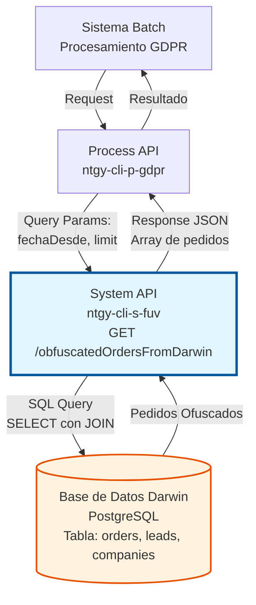
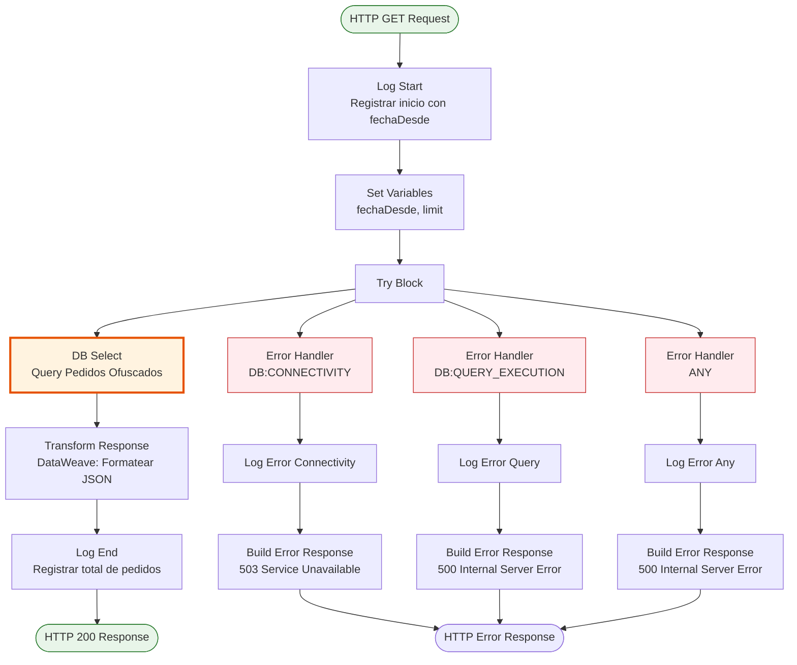

# GET /obfuscatedOrdersFromDarwin

## 📌 Descripción General

### Propósito del Endpoint

Este endpoint consulta pedidos con datos personales ofuscados desde la base de datos Darwin, cumpliendo con la normativa GDPR (Reglamento General de Protección de Datos) y específicamente con el **Derecho al Olvido**.

El endpoint soporta:
- **Consulta de Pedidos Ofuscados**: Recupera pedidos donde los datos personales han sido ofuscados según GDPR
- **Filtrado por Fecha**: Permite filtrar pedidos desde una fecha específica (default: 2020-01-01)
- **Límite de Resultados**: Soporta paginación mediante parámetro de límite
- **Soporte Multi-Compañía**: Incluye código de compañía (GNS, etc.) para cada pedido

### Tipo de API

**Capa:** System API (API-Led Connectivity)

**Función:** Integración directa con base de datos Darwin (PostgreSQL) para consulta de pedidos ofuscados cumpliendo normativa GDPR.

### Patrón de Integración

**Tipo:** Request-Reply Síncrono con SQL Query

**Descripción:** El endpoint recibe parámetros de consulta (fecha desde, límite), ejecuta una query SQL parametrizada en la base de datos Darwin, y retorna la lista de pedidos ofuscados con información básica (contractId, companyCode, fecha de actualización).

### Arquitectura API-Led Connectivity



---

## 💼 Propósito del Negocio

### Casos de Uso Principales

1. **Cumplimiento GDPR - Derecho al Olvido**
   - Cliente ejerce su derecho al olvido según GDPR
   - Sistema necesita identificar pedidos con datos personales ofuscados
   - Permite auditoría y verificación de cumplimiento normativo

2. **Procesamiento Batch de Pedidos Ofuscados**
   - Proceso batch consulta pedidos ofuscados periódicamente
   - Identifica pedidos que requieren procesamiento adicional
   - Sincroniza estado de ofuscación con otros sistemas

3. **Auditoría de Protección de Datos**
   - Equipo de compliance necesita reportes de pedidos ofuscados
   - Verificación de que datos personales han sido correctamente ofuscados
   - Trazabilidad de acciones de protección de datos

### Contexto Empresarial

- **Dominio:** Gestión de Pedidos y Protección de Datos
- **Sector:** Energía - Utilities
- **División:** Naturgy España - NewCo
- **Proceso de Negocio:** Cumplimiento GDPR y Derecho al Olvido
- **Normativa:** GDPR (Reglamento UE 2016/679)

### Stakeholders

- **Oficial de Protección de Datos (DPO)**: Necesita verificar cumplimiento de solicitudes de derecho al olvido
- **Equipo de Compliance**: Requiere auditoría de datos ofuscados
- **Sistemas Batch**: Procesan pedidos ofuscados para sincronización con otros sistemas
- **Equipo Legal**: Necesita evidencia de cumplimiento normativo

### Valor de Negocio

- **Cumplimiento Normativo**: Garantiza cumplimiento de GDPR y evita sanciones (hasta 20M€ o 4% facturación anual)
- **Protección de Datos Personales**: Asegura que datos sensibles han sido correctamente ofuscados
- **Trazabilidad**: Proporciona registro auditable de pedidos con datos ofuscados
- **Automatización**: Permite procesamiento automático de pedidos ofuscados sin intervención manual

### Consumidores Potenciales

Este endpoint puede ser consumido por:
- Process APIs de gestión de GDPR
- Sistemas batch de procesamiento de pedidos ofuscados
- Herramientas de auditoría y compliance
- Sistemas de sincronización con GNS (Gas Natural Servicios)
- Reportes de protección de datos

---

## 🔧 Especificación Técnica

### URLs por Ambiente

| Ambiente | URL Base | URL Completa |
|----------|----------|--------------|
| **Local** | `http://localhost:8081` | `http://localhost:8081/api/obfuscatedOrdersFromDarwin` |
| **Development** | `https://ntgy-cli-s-fuv-dev.cloudhub.io` | `https://ntgy-cli-s-fuv-dev.cloudhub.io/api/obfuscatedOrdersFromDarwin` |
| **UAT** | `https://ntgy-cli-s-fuv-uat.cloudhub.io` | `https://ntgy-cli-s-fuv-uat.cloudhub.io/api/obfuscatedOrdersFromDarwin` |
| **Production** | `https://ntgy-cli-s-fuv-pro.cloudhub.io` | `https://ntgy-cli-s-fuv-pro.cloudhub.io/api/obfuscatedOrdersFromDarwin` |

### Método HTTP

```
GET /api/obfuscatedOrdersFromDarwin
```

### Parámetros de Entrada

#### Headers HTTP

| Header | Tipo | Requerido | Descripción | Ejemplo |
|--------|------|-----------|-------------|---------|
| `Accept` | string | ❌ No | Tipo de contenido esperado en response | `application/json` |

#### Query Parameters

| Parámetro | Tipo | Requerido | Descripción | Ejemplo | Default |
|-----------|------|-----------|-------------|---------|---------|
| `fechaDesde` | string (ISO 8601) | ❌ No | Fecha desde la cual consultar pedidos ofuscados | `2024-01-01T00:00:00Z` | `2020-01-01T00:00:00Z` |
| `limit` | integer | ❌ No | Número máximo de resultados a retornar | `1000` | Sin límite |

**Notas sobre parámetros:**
- `fechaDesde`: Formato ISO 8601 con timezone (UTC recomendado)
- `limit`: Si no se especifica, retorna todos los pedidos que cumplan el criterio
- Ambos parámetros son opcionales, permitiendo consultas flexibles

### Respuestas

#### Respuesta Exitosa (200 OK)

```json
{
  "pedidos": [
    {
      "contractId": "12345678-1",
      "companyCode": "GNS"
    },
    {
      "contractId": "87654321",
      "companyCode": "NATURGY"
    }
  ],
  "total": 2,
  "fechaDesde": "2024-01-01T00:00:00Z",
  "limit": 1000,
  "timestamp": "2026-07-13T15:30:00+02:00"
}
```

**Descripción de campos:**
- `pedidos`: Array de pedidos ofuscados encontrados
  - `contractId`: ID del contrato (formato: order_crm_id_id + sufijo + versión)
  - `companyCode`: Código de la compañía (GNS, NATURGY, etc.)
- `total`: Número total de pedidos retornados
- `fechaDesde`: Fecha desde utilizada en la consulta
- `limit`: Límite aplicado (si se especificó)
- `timestamp`: Timestamp de la respuesta en zona horaria Europe/Madrid

#### Respuesta Sin Resultados (200 OK)

```json
{
  "pedidos": [],
  "total": 0,
  "fechaDesde": "2024-01-01T00:00:00Z",
  "limit": null,
  "timestamp": "2026-07-13T15:30:00+02:00"
}
```

#### Respuesta de Error de Conectividad (503 Service Unavailable)

```json
{
  "error": "DB_CONNECTIVITY_ERROR",
  "message": "Error de conectividad con base de datos Darwin",
  "details": "Connection refused: connect",
  "timestamp": "2026-07-13T15:30:00+02:00"
}
```

#### Respuesta de Error de Query (500 Internal Server Error)

```json
{
  "error": "QUERY_ERROR",
  "message": "Error ejecutando consulta en base de datos Darwin",
  "details": "Syntax error in SQL statement",
  "timestamp": "2026-07-13T15:30:00+02:00"
}
```

#### Respuesta de Error Interno (500 Internal Server Error)

```json
{
  "error": "INTERNAL_ERROR",
  "message": "Error al consultar pedidos ofuscados en Darwin",
  "details": "Unexpected error occurred",
  "timestamp": "2026-07-13T15:30:00+02:00"
}
```

### Autenticación y Autorización

- **Tipo:** Client ID & Client Secret (Anypoint Platform)
- **Autorización Database:** El usuario de base de datos debe tener permisos para:
  - Ejecutar SELECT en tabla `orders`
  - Ejecutar SELECT en tabla `leads`
  - Ejecutar SELECT en tabla `companies`
  - Acceso a función `full_crm_orderid()`

### Timeouts

| Tipo | Valor | Descripción |
|------|-------|-------------|
| **Query Timeout** | 30 segundos | Tiempo máximo de ejecución de la query SQL |
| **Connection Timeout** | 10 segundos | Tiempo máximo para establecer conexión con DB |

---

## 🏗️ Implementación Técnica

### Arquitectura del Flow



### Operación de Base de Datos

**Tipo:** SQL SELECT con JOINs

**Query SQL Real:**
```sql
SELECT 
    full_crm_orderid(o.order_crm_id_id, o.order_crm_id_suffix, o.order_retry_version) as contract_id,
    co.code as company_code,
    o.updated_at
FROM orders o
INNER JOIN leads l ON l.id = o.lead_id
INNER JOIN companies co ON co.id = l.company_id
WHERE o.obfuscated = true
  AND o.updated_at >= :fechaDesde
ORDER BY o.updated_at ASC
```

**Ubicación en código:**
- **Archivo XML:** `s-fuv-obfuscatedOrdersFromDarwin.xml` (línea 33-39)
- **Archivo Config:** `s-fuv-global-config.yaml` (línea 11)
- **Propiedad:** `queries.getObfuscatedOrdersFromDarwin`

**Parámetros de la Query:**
- `:fechaDesde` (string): Fecha desde la cual filtrar pedidos (formato ISO 8601)
- `:limit` (integer): Límite de resultados (aplicado en código, no en query base)

**Tablas Involucradas:**
1. **orders (o)**: Tabla principal de pedidos
   - `order_crm_id_id`: ID base del pedido
   - `order_crm_id_suffix`: Sufijo del pedido (-1, -2, etc.)
   - `order_retry_version`: Versión de reintento (.1, .2, etc.)
   - `obfuscated`: Flag booleano indicando si el pedido está ofuscado
   - `updated_at`: Fecha de última actualización
   - `lead_id`: FK a tabla leads

2. **leads (l)**: Tabla de leads asociados
   - `id`: PK de lead
   - `company_id`: FK a tabla companies

3. **companies (co)**: Tabla de compañías
   - `id`: PK de compañía
   - `code`: Código de compañía (GNS, NATURGY, etc.)

**Función Utilizada:**
- `full_crm_orderid()`: Función PostgreSQL que construye el ID completo del contrato concatenando id + sufijo + versión

### Transformación de Datos

#### Transformación de Response (Inline DataWeave)

**Ubicación:** `s-fuv-obfuscatedOrdersFromDarwin.xml` (líneas 44-56)

```dataweave
%dw 2.0
output application/json
---
{
    pedidos: payload map {
        contractId: $.contract_id as String,
        companyCode: $.company_code
    },
    total: sizeOf(payload),
    fechaDesde: vars.fechaDesde,
    limit: vars.limit,
    timestamp: now()
}
```

**Mapeo de Campos:**
- `contract_id` (DB) → `contractId` (JSON): ID completo del contrato
- `company_code` (DB) → `companyCode` (JSON): Código de compañía
- `sizeOf(payload)` → `total`: Contador de pedidos retornados
- `vars.fechaDesde` → `fechaDesde`: Echo del parámetro de entrada
- `vars.limit` → `limit`: Echo del parámetro de entrada
- `now()` → `timestamp`: Timestamp actual de la respuesta

### Diagrama de Secuencia Completo

```mermaid
sequenceDiagram
    participant Client as Cliente/Process API
    participant API as System API<br/>ntgy-cli-s-fuv
    participant DB as Darwin Database<br/>PostgreSQL
    
    Client->>API: GET /obfuscatedOrdersFromDarwin<br/>?fechaDesde=2024-01-01&limit=1000
    
    activate API
    Note over API: Log: Inicio consulta<br/>fechaDesde: 2024-01-01
    
    API->>API: Set Variables<br/>fechaDesde, limit
    
    API->>DB: SQL SELECT<br/>WHERE obfuscated=true<br/>AND updated_at >= fechaDesde
    activate DB
    
    alt Query Exitosa
        DB-->>API: Resultados<br/>(contract_id, company_code, updated_at)
        deactivate DB
        
        Note over API: Transform Response<br/>DataWeave: Map fields
        
        API->>API: Build JSON Response<br/>{pedidos, total, timestamp}
        
        Note over API: Log: Fin consulta<br/>Total pedidos: N
        
        API-->>Client: 200 OK<br/>{pedidos: [...], total: N}
    else Error de Conectividad
        DB--xAPI: DB:CONNECTIVITY Error
        deactivate DB
        Note over API: Log: Error conectividad
        API->>API: Build Error Response<br/>503 Service Unavailable
        API-->>Client: 503 Service Unavailable<br/>{error: "DB_CONNECTIVITY_ERROR"}
    else Error de Query
        DB--xAPI: DB:QUERY_EXECUTION Error
        deactivate DB
        Note over API: Log: Error query
        API->>API: Build Error Response<br/>500 Internal Server Error
        API-->>Client: 500 Internal Server Error<br/>{error: "QUERY_ERROR"}
    end
    
    deactivate API
```

### Manejo de Errores

#### Error Handler: DB:CONNECTIVITY

**Trigger:** Error de conectividad con base de datos Darwin

**Acciones:**
1. Log de error con descripción detallada
2. Construcción de response de error con código 503
3. Propagación del error al cliente

**Response:**
```json
{
  "error": "DB_CONNECTIVITY_ERROR",
  "message": "Error de conectividad con base de datos Darwin",
  "details": "[error.description]",
  "timestamp": "[now()]"
}
```

#### Error Handler: DB:QUERY_EXECUTION

**Trigger:** Error ejecutando la query SQL

**Acciones:**
1. Log de error con descripción de la query
2. Construcción de response de error con código 500
3. Propagación del error al cliente

**Response:**
```json
{
  "error": "QUERY_ERROR",
  "message": "Error ejecutando consulta en base de datos Darwin",
  "details": "[error.description]",
  "timestamp": "[now()]"
}
```

#### Error Handler: ANY

**Trigger:** Cualquier otro error no capturado

**Acciones:**
1. Log de error inesperado
2. Construcción de response genérica de error con código 500
3. Propagación del error al cliente

**Response:**
```json
{
  "error": "INTERNAL_ERROR",
  "message": "Error al consultar pedidos ofuscados en Darwin",
  "details": "[error.description]",
  "timestamp": "[now()]"
}
```

### Logging

**Entrada del Flow:**
```
s-fuv-obfuscatedOrdersFromDarwin.logEntrada ## Inicio - Consultando pedidos ofuscados desde: [fechaDesde]
```

**Salida del Flow:**
```
s-fuv-obfuscatedOrdersFromDarwin.logSalida ## Fin - Total pedidos encontrados: [payload.total]
```

**Errores:**
```
s-fuv-obfuscatedOrdersFromDarwin ## Error de conectividad con BBDD Darwin: [error.description]
s-fuv-obfuscatedOrdersFromDarwin ## Error ejecutando query en Darwin: [error.description]
s-fuv-obfuscatedOrdersFromDarwin ## Error inesperado: [error.description]
```

### Configuración

**Database Configuration:**
```yaml
# Database_Config (en archivo de configuración por ambiente)
db:
  host: [darwin-host]
  port: 5432
  database: darwin_db
  user: [secure:db.user]
  password: [secure:db.password]
```

**Query Configuration:**
```yaml
# s-fuv-global-config.yaml (línea 11)
queries:
  getObfuscatedOrdersFromDarwin: "SELECT full_crm_orderid(o.order_crm_id_id, o.order_crm_id_suffix, o.order_retry_version) as contract_id, co.code as company_code, o.updated_at FROM orders o INNER JOIN leads l ON l.id = o.lead_id INNER JOIN companies co ON co.id = l.company_id WHERE o.obfuscated = true AND o.updated_at >= :fechaDesde ORDER BY o.updated_at ASC"
```

---

## 💻 Ejemplos de Uso

### Ejemplo 1: Consulta Básica (Sin Parámetros)

**Request:**
```bash
curl -X GET "https://ntgy-cli-s-fuv-dev.cloudhub.io/api/obfuscatedOrdersFromDarwin" \
  -H "Accept: application/json"
```

**Response (200 OK):**
```json
{
  "pedidos": [
    {
      "contractId": "12345678",
      "companyCode": "GNS"
    },
    {
      "contractId": "87654321-1",
      "companyCode": "NATURGY"
    },
    {
      "contractId": "11223344.1",
      "companyCode": "GNS"
    }
  ],
  "total": 3,
  "fechaDesde": "2020-01-01T00:00:00Z",
  "limit": null,
  "timestamp": "2026-07-13T15:30:00+02:00"
}
```

### Ejemplo 2: Consulta con Fecha Desde

**Request:**
```bash
curl -X GET "https://ntgy-cli-s-fuv-dev.cloudhub.io/api/obfuscatedOrdersFromDarwin?fechaDesde=2024-01-01T00:00:00Z" \
  -H "Accept: application/json"
```

**Response (200 OK):**
```json
{
  "pedidos": [
    {
      "contractId": "99887766",
      "companyCode": "NATURGY"
    }
  ],
  "total": 1,
  "fechaDesde": "2024-01-01T00:00:00Z",
  "limit": null,
  "timestamp": "2026-07-13T15:30:00+02:00"
}
```

### Ejemplo 3: Consulta con Límite

**Request:**
```bash
curl -X GET "https://ntgy-cli-s-fuv-dev.cloudhub.io/api/obfuscatedOrdersFromDarwin?limit=100" \
  -H "Accept: application/json"
```

**Response (200 OK):**
```json
{
  "pedidos": [
    {
      "contractId": "12345678",
      "companyCode": "GNS"
    }
    // ... hasta 100 pedidos
  ],
  "total": 100,
  "fechaDesde": "2020-01-01T00:00:00Z",
  "limit": 100,
  "timestamp": "2026-07-13T15:30:00+02:00"
}
```

### Ejemplo 4: Consulta con Ambos Parámetros

**Request:**
```bash
curl -X GET "https://ntgy-cli-s-fuv-dev.cloudhub.io/api/obfuscatedOrdersFromDarwin?fechaDesde=2024-06-01T00:00:00Z&limit=50" \
  -H "Accept: application/json"
```

**Response (200 OK):**
```json
{
  "pedidos": [
    {
      "contractId": "55667788-2",
      "companyCode": "GNS"
    },
    {
      "contractId": "44556677",
      "companyCode": "NATURGY"
    }
  ],
  "total": 2,
  "fechaDesde": "2024-06-01T00:00:00Z",
  "limit": 50,
  "timestamp": "2026-07-13T15:30:00+02:00"
}
```

### Ejemplo 5: Sin Resultados

**Request:**
```bash
curl -X GET "https://ntgy-cli-s-fuv-dev.cloudhub.io/api/obfuscatedOrdersFromDarwin?fechaDesde=2026-12-31T00:00:00Z" \
  -H "Accept: application/json"
```

**Response (200 OK):**
```json
{
  "pedidos": [],
  "total": 0,
  "fechaDesde": "2026-12-31T00:00:00Z",
  "limit": null,
  "timestamp": "2026-07-13T15:30:00+02:00"
}
```

### Ejemplo 6: Error de Conectividad

**Request:**
```bash
curl -X GET "https://ntgy-cli-s-fuv-dev.cloudhub.io/api/obfuscatedOrdersFromDarwin" \
  -H "Accept: application/json"
```

**Response (503 Service Unavailable):**
```json
{
  "error": "DB_CONNECTIVITY_ERROR",
  "message": "Error de conectividad con base de datos Darwin",
  "details": "Connection refused: connect to darwin-db:5432",
  "timestamp": "2026-07-13T15:30:00+02:00"
}
```

### Ejemplo 7: Error de Query

**Request:**
```bash
curl -X GET "https://ntgy-cli-s-fuv-dev.cloudhub.io/api/obfuscatedOrdersFromDarwin?fechaDesde=invalid-date" \
  -H "Accept: application/json"
```

**Response (500 Internal Server Error):**
```json
{
  "error": "QUERY_ERROR",
  "message": "Error ejecutando consulta en base de datos Darwin",
  "details": "Invalid timestamp format: invalid-date",
  "timestamp": "2026-07-13T15:30:00+02:00"
}
```

### Ejemplo 8: Uso desde JavaScript

```javascript
// Función para consultar pedidos ofuscados
async function getObfuscatedOrders(fechaDesde = '2020-01-01T00:00:00Z', limit = null) {
  const baseUrl = 'https://ntgy-cli-s-fuv-dev.cloudhub.io/api/obfuscatedOrdersFromDarwin';
  
  // Construir query params
  const params = new URLSearchParams();
  if (fechaDesde) params.append('fechaDesde', fechaDesde);
  if (limit) params.append('limit', limit.toString());
  
  const url = `${baseUrl}?${params.toString()}`;
  
  try {
    const response = await fetch(url, {
      method: 'GET',
      headers: {
        'Accept': 'application/json'
      }
    });
    
    if (!response.ok) {
      const error = await response.json();
      throw new Error(`Error ${response.status}: ${error.message}`);
    }
    
    const data = await response.json();
    console.log(`Total pedidos ofuscados: ${data.total}`);
    return data;
    
  } catch (error) {
    console.error('Error consultando pedidos ofuscados:', error);
    throw error;
  }
}

// Ejemplo de uso
getObfuscatedOrders('2024-01-01T00:00:00Z', 100)
  .then(data => {
    console.log('Pedidos:', data.pedidos);
  })
  .catch(error => {
    console.error('Error:', error);
  });
```

### Ejemplo 9: Uso desde Python

```python
import requests
from datetime import datetime
from typing import Optional, Dict, List

def get_obfuscated_orders(
    fecha_desde: str = '2020-01-01T00:00:00Z',
    limit: Optional[int] = None
) -> Dict:
    """
    Consulta pedidos ofuscados desde Darwin
    
    Args:
        fecha_desde: Fecha desde en formato ISO 8601
        limit: Límite de resultados (opcional)
    
    Returns:
        Dict con pedidos ofuscados
    """
    base_url = 'https://ntgy-cli-s-fuv-dev.cloudhub.io/api/obfuscatedOrdersFromDarwin'
    
    # Construir parámetros
    params = {'fechaDesde': fecha_desde}
    if limit:
        params['limit'] = limit
    
    try:
        response = requests.get(
            base_url,
            params=params,
            headers={'Accept': 'application/json'},
            timeout=30
        )
        response.raise_for_status()
        
        data = response.json()
        print(f"Total pedidos ofuscados: {data['total']}")
        return data
        
    except requests.exceptions.RequestException as e:
        print(f"Error consultando pedidos ofuscados: {e}")
        raise

# Ejemplo de uso
if __name__ == '__main__':
    try:
        result = get_obfuscated_orders(
            fecha_desde='2024-01-01T00:00:00Z',
            limit=100
        )
        
        for pedido in result['pedidos']:
            print(f"Contract ID: {pedido['contractId']}, "
                  f"Company: {pedido['companyCode']}")
                  
    except Exception as e:
        print(f"Error: {e}")
```

---

**Última actualización:** 2026-07-13  
**Versión del API:** 1.22.0-SNAPSHOT  
**Estado:**