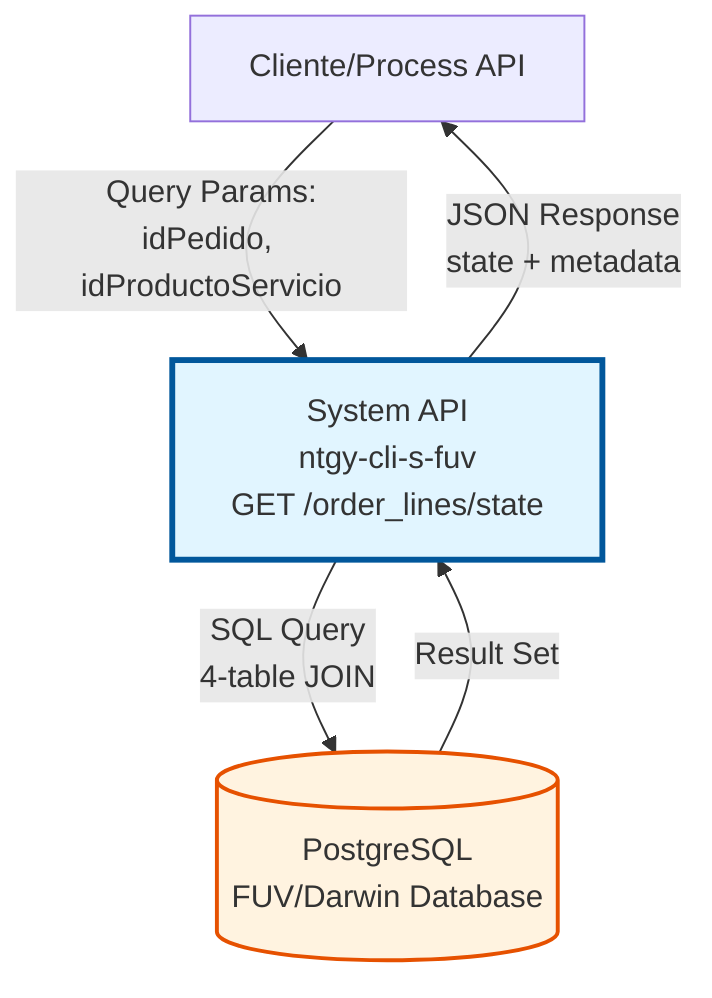
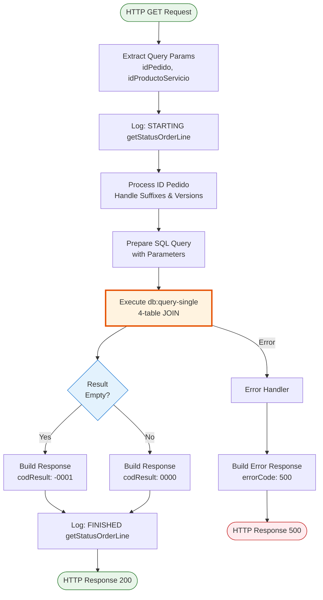
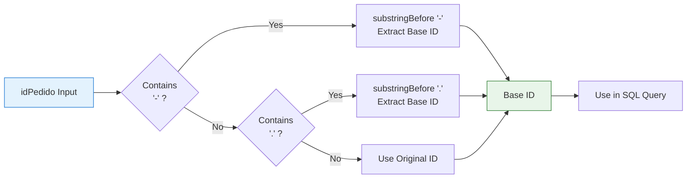
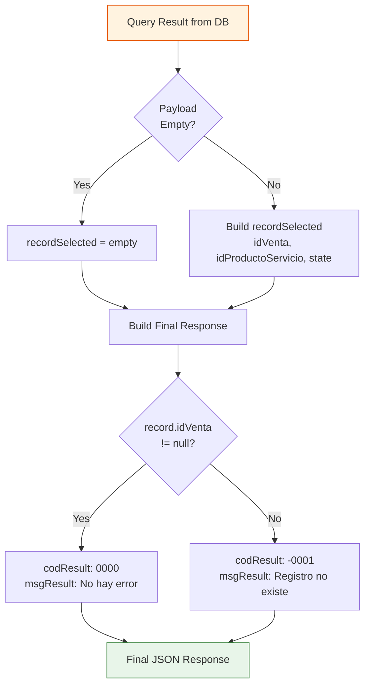
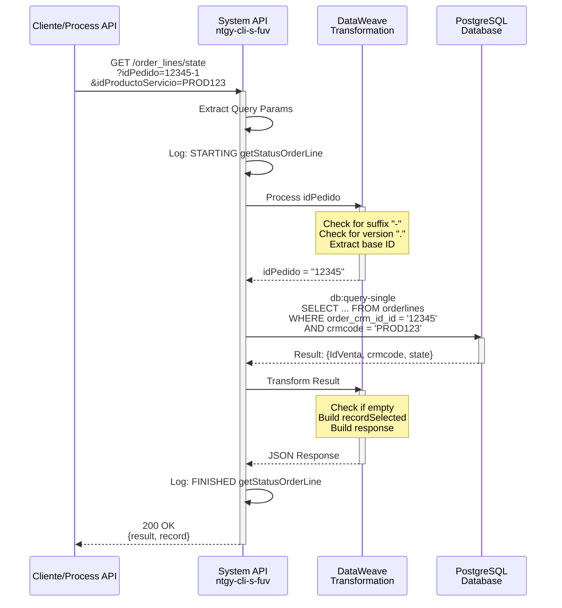

# GET /order_lines/state

## 📌 Descripción General

### Propósito del Endpoint

Consulta el estado actual de una línea de pedido específica en la base de datos PostgreSQL del sistema FUV/Darwin. Este endpoint permite verificar el estado de una línea de pedido identificada por su ID de pedido y el código del producto o servicio asociado.

El endpoint soporta:
- **Consulta de Estado**: Obtiene el estado actual de una línea de pedido específica
- **Manejo de IDs Complejos**: Procesa pedidos con sufijos (-1, -2) y versiones (.1, .2)
- **Productos y Servicios**: Busca tanto en variantes de productos como en servicios
- **Validación de Existencia**: Retorna código de resultado indicando si el registro existe

### Tipo de API

**Capa:** System API (API-Led Connectivity)

**Función:** Integración directa con base de datos PostgreSQL (FUV/Darwin) para consultar estados de líneas de pedido.

### Patrón de Integración

**Tipo:** Request-Reply Síncrono con SQL Query

**Descripción:** Recibe parámetros de consulta (ID de pedido y producto/servicio), ejecuta una query SQL con múltiples JOINs para obtener el estado de la línea de pedido, y retorna el resultado en formato JSON estructurado.

### Arquitectura API-Led Connectivity



---

## 💼 Propósito del Negocio

### Casos de Uso Principales

1. **Validación de Estado Antes de Cambios**
   - Verificar el estado actual antes de ejecutar un cambio de estado
   - Prevenir cambios de estado inválidos o duplicados
   - Asegurar consistencia en el flujo de estados

2. **Seguimiento de Pedidos**
   - Consultar el estado actual de líneas de pedido en tiempo real
   - Proporcionar información de estado a agentes de ventas
   - Facilitar troubleshooting de pedidos problemáticos

3. **Integración con Sistemas Externos**
   - Permitir que sistemas externos consulten estados de pedidos
   - Sincronizar estados entre FUV y otros sistemas
   - Proporcionar datos para reportes y análisis

4. **Validación de Datos**
   - Verificar que una línea de pedido existe antes de operaciones
   - Validar la relación entre pedido y producto/servicio
   - Confirmar la integridad de datos en el sistema

### Contexto Empresarial

- **Dominio:** Gestión de Pedidos y Ventas
- **Sector:** Energía - Utilities
- **División:** Naturgy España - Frontal Único de Ventas (FUV)
- **Proceso de Negocio:** Seguimiento y gestión del ciclo de vida de pedidos
- **Sistema Backend:** PostgreSQL (Darwin/FUV Database)

### Stakeholders

- **Agentes de Ventas**: Necesitan consultar estados de pedidos para seguimiento
- **Sistemas de Integración**: Requieren validar estados antes de operaciones
- **Equipos de Soporte**: Utilizan para troubleshooting de pedidos
- **Process APIs**: Consumen este endpoint para lógica de negocio

### Valor de Negocio

- **Trazabilidad**: Proporciona visibilidad completa del estado de líneas de pedido
- **Prevención de Errores**: Permite validar antes de ejecutar cambios de estado
- **Eficiencia Operativa**: Reduce tiempo de consulta de estados de pedidos
- **Integridad de Datos**: Asegura consistencia entre sistemas

### Consumidores Potenciales

Este endpoint puede ser consumido por:
- Process APIs de gestión de pedidos
- Process APIs de gestión de ventas
- Sistemas de monitoreo y reporting
- Herramientas de troubleshooting y soporte
- Integraciones con sistemas externos autorizados

---

## 🔧 Especificación Técnica

### URLs por Ambiente

| Ambiente | URL Base | URL Completa |
|----------|----------|--------------|
| **Local** | `http://localhost:8081` | `http://localhost:8081/api/order_lines/state?idPedido=12345&idProductoServicio=PROD123` |
| **Development** | `https://ntgy-cli-s-fuv-dev.cloudhub.io` | `https://ntgy-cli-s-fuv-dev.cloudhub.io/api/order_lines/state?idPedido=12345&idProductoServicio=PROD123` |
| **UAT** | `https://ntgy-cli-s-fuv-uat.cloudhub.io` | `https://ntgy-cli-s-fuv-uat.cloudhub.io/api/order_lines/state?idPedido=12345&idProductoServicio=PROD123` |
| **Production** | `https://ntgy-cli-s-fuv-pro.cloudhub.io` | `https://ntgy-cli-s-fuv-pro.cloudhub.io/api/order_lines/state?idPedido=12345&idProductoServicio=PROD123` |

### Método HTTP

```
GET /api/order_lines/state
```

### Parámetros de Entrada

#### Headers HTTP

| Header | Tipo | Requerido | Descripción | Ejemplo |
|--------|------|-----------|-------------|---------|
| `Accept` | string | ❌ No | Tipo de contenido esperado en response | `application/json` |

#### Query Parameters

| Parámetro | Tipo | Requerido | Descripción | Ejemplo |
|-----------|------|-----------|-------------|---------|
| `idPedido` | string | ✅ Sí | ID del pedido (puede incluir sufijos con "-" o versiones con ".") | `"12345"`, `"12345-1"`, `"12345.2"` |
| `idProductoServicio` | string | ✅ Sí | Código CRM del producto o servicio asociado a la línea de pedido | `"PROD123"`, `"SERV456"` |

**Notas sobre idPedido:**
- Soporta IDs simples: `"12345"`
- Soporta sufijos: `"12345-1"`, `"12345-2"` (el sistema extrae el ID base)
- Soporta versiones: `"12345.1"`, `"12345.2"` (el sistema extrae el ID base)
- El sistema procesa automáticamente estos formatos usando `substringBefore`

### Respuestas

#### Respuesta Exitosa - Registro Encontrado (200 OK)

```json
{
  "result": {
    "codResult": "0000",
    "msgResult": "No hay error"
  },
  "record": {
    "idVenta": "12345",
    "idProductoServicio": "PROD123",
    "state": "PENDING"
  }
}
```

**Campos del Response:**
- `result.codResult`: Código de resultado (`"0000"` = éxito)
- `result.msgResult`: Mensaje descriptivo del resultado
- `record.idVenta`: ID completo del pedido (construido con `full_crm_orderid`)
- `record.idProductoServicio`: Código CRM del producto o servicio
- `record.state`: Estado actual de la línea de pedido

**Estados Posibles:**
- `PENDING`: Pendiente de procesamiento
- `CONFIRMED`: Confirmado
- `CANCELLED`: Cancelado
- `COMPLETED`: Completado
- (Otros estados según configuración del sistema)

#### Respuesta Exitosa - Registro No Encontrado (200 OK)

```json
{
  "result": {
    "codResult": "-0001",
    "msgResult": "Registro no existe"
  },
  "record": {}
}
```

**Nota:** El endpoint retorna 200 OK incluso cuando no encuentra el registro, pero con `codResult = "-0001"` y `record` vacío.

#### Respuesta de Error Técnico (500)

```json
{
  "callId": "550e8400-e29b-41d4-a716-446655440000",
  "errorDescription": "Error al ejecutar query en base de datos",
  "errorCode": 500,
  "time": "2026-07-13T12:30:00+02:00"
}
```

### Autenticación y Autorización

- **Tipo:** Client ID & Client Secret (Anypoint Platform)
- **Autorización PostgreSQL:** El usuario de base de datos debe tener permisos para:
  - SELECT en tabla `orderlines`
  - SELECT en tabla `product_variants`
  - SELECT en tabla `services`
  - SELECT en tabla `orders`
  - EXECUTE en función `full_crm_orderid`

### Timeouts

| Tipo | Valor | Descripción |
|------|-------|-------------|
| **Request Timeout** | 10 segundos | Tiempo máximo de espera para la respuesta de la query |
| **Connection Timeout** | 5 segundos | Tiempo máximo para establecer conexión con PostgreSQL |

---

## 🏗️ Implementación Técnica

### Arquitectura del Flow



### Query SQL Ejecutada

**Ubicación en código:** `s-fuv-cambioEstado.xml`, línea 89  
**Referencia a propiedad:** `${queries.getOrderLineStatus}`  
**Definición real:** `s-fuv-global-config.yaml`, línea 6

```sql
SELECT 
    full_crm_orderid(o.order_crm_id_id, o.order_crm_id_suffix, o.order_retry_version) AS IdVenta,
    COALESCE(pv.crmcode, s.crmcode) AS crmcode,
    ol.state
FROM orderlines ol
LEFT JOIN product_variants pv ON pv.id = ol.product_variant_id
LEFT JOIN services s ON s.id = ol.service_id
LEFT JOIN orders o ON o.id = ol.order_id
WHERE 
    o.order_crm_id_id = :idPedido
    AND (pv.crmcode = :idProductoServicio OR s.crmcode = :idProductoServicio)
    AND full_crm_orderid(o.order_crm_id_id, o.order_crm_id_suffix, o.order_retry_version) = :idFullPedido
```

**Explicación de la Query:**
1. **Función `full_crm_orderid`**: Construye el ID completo del pedido combinando ID base, sufijo y versión
2. **COALESCE**: Maneja tanto productos (product_variants) como servicios (services)
3. **LEFT JOINs**: Permite encontrar líneas de pedido independientemente de si tienen producto o servicio
4. **Filtros**:
   - Por ID base del pedido (`order_crm_id_id`)
   - Por código CRM del producto o servicio
   - Por ID completo del pedido (incluyendo sufijos/versiones)

### Procesamiento de ID de Pedido

**Ubicación en código:** `s-fuv-cambioEstado.xml`, líneas 79-86



**Lógica DataWeave:**
```dataweave
%dw 2.0
output application/java
import * from dw::core::Strings

var suffix = contains(vars.idFullPedido, "-")
var version = contains(vars.idFullPedido, ".")
var idpedido = if (suffix) 
    substringBefore(vars.idFullPedido, "-") 
  else if (version) 
    substringBefore(vars.idFullPedido, ".") 
  else 
    vars.idFullPedido
---
idpedido
```

**Ejemplos de Procesamiento:**
- Input: `"12345"` → Output: `"12345"` (sin cambios)
- Input: `"12345-1"` → Output: `"12345"` (extrae base)
- Input: `"12345-2"` → Output: `"12345"` (extrae base)
- Input: `"12345.1"` → Output: `"12345"` (extrae base)
- Input: `"12345.2"` → Output: `"12345"` (extrae base)

### Transformación de Respuesta

**Ubicación en código:** `s-fuv-cambioEstado.xml`, líneas 104-132



**Transformación DataWeave - Variable `recordSelected`:**
```dataweave
%dw 2.0
output application/json
---
if (isEmpty(payload)) payload
else {
    "idVenta": payload.'idVenta',
    "idProductoServicio": payload.'crmcode',
    "state": payload.'state'
}
```

**Transformación DataWeave - Response Final:**
```dataweave
%dw 2.0
output application/json
---
{
    "result": {
        "codResult": if (payload.'idVenta' != null) "0000" else "-0001",
        "msgResult": if (payload.'idVenta' != null) "No hay error" else "Registro no existe"
    },
    "record": vars.recordSelected
}
```

### Diagrama de Secuencia Completo



### Manejo de Errores

**Error Handler:** `s-fuv-cambioEstado.xml`, líneas 26-46

**Tipos de Errores Manejados:**
1. **Database Connection Error**: Error al conectar con PostgreSQL
2. **Query Execution Error**: Error al ejecutar la query SQL
3. **Transformation Error**: Error en transformaciones DataWeave
4. **Timeout Error**: Query excede el timeout configurado

**Response de Error:**
```json
{
  "callId": "correlation-id-uuid",
  "errorDescription": "Descripción del error técnico",
  "errorCode": 500,
  "time": "2026-07-13T12:30:00+02:00"
}
```

### Logging

**Logs Generados:**
1. **Log Entrada** (INFO): `STARTING getStatusOrderLine METHOD. REQUEST: {params}`
2. **Log Salida** (INFO): `FINISHED getStatusOrderLine METHOD. {request} RESPONSE: {response}`
3. **Log Error** (ERROR): `s-fuv-cambioEstado.logError ## payload: {error}`

**Información Loggeada:**
- Parámetros de entrada (idPedido, idProductoServicio)
- Resultado de la query
- Respuesta final generada
- Errores técnicos con stack trace

---

## 💻 Ejemplos de Uso

### Ejemplo 1: Consulta con ID Simple

**Request:**
```bash
curl -X GET "https://ntgy-cli-s-fuv-dev.cloudhub.io/api/order_lines/state?idPedido=12345&idProductoServicio=PROD123" \
  -H "Accept: application/json"
```

**Response (200 OK):**
```json
{
  "result": {
    "codResult": "0000",
    "msgResult": "No hay error"
  },
  "record": {
    "idVenta": "12345",
    "idProductoServicio": "PROD123",
    "state": "PENDING"
  }
}
```

---

### Ejemplo 2: Consulta con ID con Sufijo

**Request:**
```bash
curl -X GET "https://ntgy-cli-s-fuv-dev.cloudhub.io/api/order_lines/state?idPedido=12345-1&idProductoServicio=SERV456" \
  -H "Accept: application/json"
```

**Procesamiento Interno:**
- Input: `idPedido = "12345-1"`
- Procesamiento: Detecta sufijo "-", extrae base
- Query usa: `idPedido = "12345"`

**Response (200 OK):**
```json
{
  "result": {
    "codResult": "0000",
    "msgResult": "No hay error"
  },
  "record": {
    "idVenta": "12345-1",
    "idProductoServicio": "SERV456",
    "state": "CONFIRMED"
  }
}
```

---

### Ejemplo 3: Consulta con ID con Versión

**Request:**
```bash
curl -X GET "https://ntgy-cli-s-fuv-dev.cloudhub.io/api/order_lines/state?idPedido=12345.2&idProductoServicio=PROD789" \
  -H "Accept: application/json"
```

**Procesamiento Interno:**
- Input: `idPedido = "12345.2"`
- Procesamiento: Detecta versión ".", extrae base
- Query usa: `idPedido = "12345"`

**Response (200 OK):**
```json
{
  "result": {
    "codResult": "0000",
    "msgResult": "No hay error"
  },
  "record": {
    "idVenta": "12345.2",
    "idProductoServicio": "PROD789",
    "state": "COMPLETED"
  }
}
```

---

### Ejemplo 4: Registro No Encontrado

**Request:**
```bash
curl -X GET "https://ntgy-cli-s-fuv-dev.cloudhub.io/api/order_lines/state?idPedido=99999&idProductoServicio=INVALID" \
  -H "Accept: application/json"
```

**Response (200 OK):**
```json
{
  "result": {
    "codResult": "-0001",
    "msgResult": "Registro no existe"
  },
  "record": {}
}
```

**Nota:** El endpoint retorna 200 OK con `codResult = "-0001"` cuando no encuentra el registro, en lugar de retornar 404 Not Found.

---

### Ejemplo 5: Error de Base de Datos

**Request:**
```bash
curl -X GET "https://ntgy-cli-s-fuv-dev.cloudhub.io/api/order_lines/state?idPedido=12345&idProductoServicio=PROD123" \
  -H "Accept: application/json"
```

**Response (500 Internal Server Error):**
```json
{
  "callId": "550e8400-e29b-41d4-a716-446655440000",
  "errorDescription": "DB:CONNECTIVITY - Could not connect to database",
  "errorCode": 500,
  "time": "2026-07-13T12:30:00+02:00"
}
```

---

### Ejemplo 6: Parámetros Faltantes

**Request:**
```bash
curl -X GET "https://ntgy-cli-s-fuv-dev.cloudhub.io/api/order_lines/state?idPedido=12345" \
  -H "Accept: application/json"
```

**Response (400 Bad Request):**
```json
{
  "error": "Bad Request",
  "message": "Required query parameter 'idProductoServicio' is missing"
}
```

---

### Ejemplo 7: Uso desde JavaScript

```javascript
async function getOrderLineState(idPedido, idProductoServicio) {
  const baseUrl = 'https://ntgy-cli-s-fuv-dev.cloudhub.io';
  const endpoint = '/api/order_lines/state';
  
  const params = new URLSearchParams({
    idPedido: idPedido,
    idProductoServicio: idProductoServicio
  });
  
  try {
    const response = await fetch(`${baseUrl}${endpoint}?${params}`, {
      method: 'GET',
      headers: {
        'Accept': 'application/json'
      }
    });
    
    const data = await response.json();
    
    if (data.result.codResult === '0000') {
      console.log('Estado encontrado:', data.record.state);
      return data.record;
    } else {
      console.log('Registro no encontrado');
      return null;
    }
  } catch (error) {
    console.error('Error al consultar estado:', error);
    throw error;
  }
}

// Uso
getOrderLineState('12345-1', 'PROD123')
  .then(record => {
    if (record) {
      console.log('ID Venta:', record.idVenta);
      console.log('Producto/Servicio:', record.idProductoServicio);
      console.log('Estado:', record.state);
    }
  });
```

---

### Ejemplo 8: Uso desde Python

```python
import requests
from typing import Optional, Dict

def get_order_line_state(id_pedido: str, id_producto_servicio: str) -> Optional[Dict]:
    """
    Consulta el estado de una línea de pedido.
    
    Args:
        id_pedido: ID del pedido (puede incluir sufijos o versiones)
        id_producto_servicio: Código CRM del producto o servicio
        
    Returns:
        Dict con información del registro si existe, None si no existe
        
    Raises:
        requests.exceptions.RequestException: Si hay error en la petición
    """
    base_url = 'https://ntgy-cli-s-fuv-dev.cloudhub.io'
    endpoint = '/api/order_lines/state'
    
    params = {
        'idPedido': id_pedido,
        'idProductoServicio': id_producto_servicio
    }
    
    headers = {
        'Accept': 'application/json'
    }
    
    try:
        response = requests.get(
            f'{base_url}{endpoint}',
            params=params,
            headers=headers,
            timeout=10
        )
        response.raise_for_status()
        
        data = response.json()
        
        if data['result']['codResult'] == '0000':
            print(f"Estado encontrado: {data['record']['state']}")
            return data['record']
        else:
            print("Registro no encontrado")
            return None
            
    except requests.exceptions.RequestException as e:
        print(f"Error al consultar estado: {e}")
        raise

# Uso
if __name__ == '__main__':
    record = get_order_line_state('12345-1', 'PROD123')
    if record:
        print(f"ID Venta: {record['idVenta']}")
        print(f"Producto/Servicio: {record['idProductoServicio']}")
        print(f"Estado: {record['state']}")
```

---

## 📊 Consideraciones Adicionales

### Performance

- **Query Optimizada**: Usa índices en `order_crm_id_id` y `crmcode` para búsquedas rápidas
- **Connection Pooling**: Reutiliza conexiones a PostgreSQL para mejor performance
- **Timeout Configurado**: 10 segundos para prevenir queries lentas

### Seguridad

- **SQL Injection Prevention**: Usa parámetros preparados (`:idPedido`, `:idProductoServicio`)
- **No Logging de Datos Sensibles**: Los logs no contienen información confidencial
- **Autenticación**: Requiere credenciales válidas de Anypoint Platform

### Escalabilidad

- **Read-Only Operation**: No modifica datos, permite alto volumen de consultas
- **Stateless**: No mantiene estado entre requests
- **Cacheable**: Los resultados podrían cachearse si se implementa cache layer

### Limitaciones

- **Registro Único**: Solo retorna un registro (usa `db:query-single`)
- **Sin Paginación**: No soporta consulta de múltiples líneas de pedido
- **Dependencia de PostgreSQL**: Requiere que la base de datos esté disponible