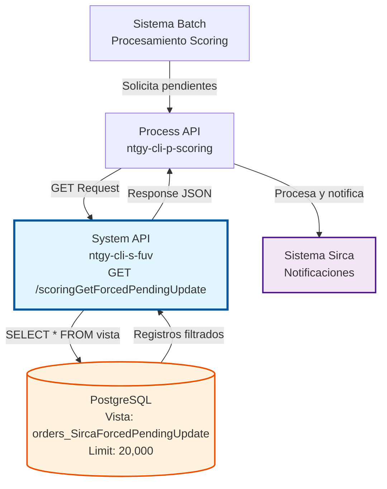
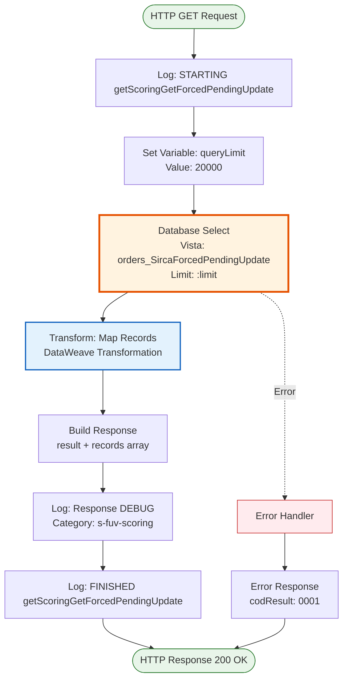
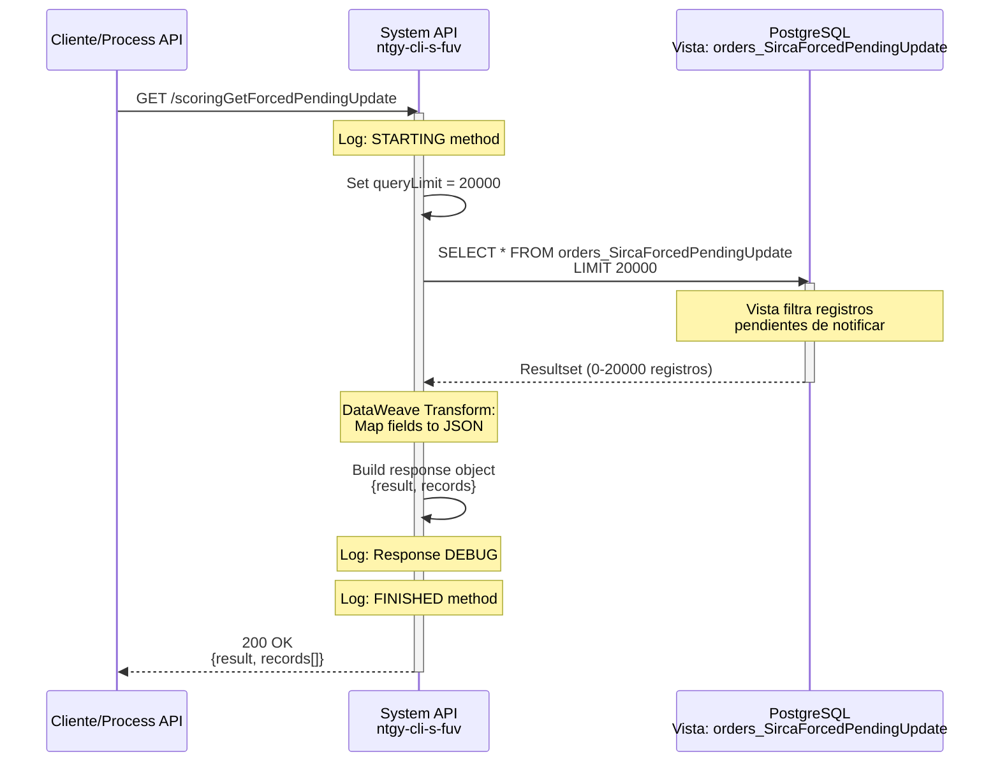

# GET /scoringGetForcedPendingUpdate

## 📌 Descripción General

### Propósito del Endpoint

Este endpoint recupera pedidos que tienen scoring forzado y están pendientes de ser notificados al sistema Sirca. A diferencia del endpoint `scoringGetPending` que obtiene Leads pendientes de evaluación inicial, este endpoint gestiona casos donde el scoring ya fue forzado manualmente y requiere sincronización con Sirca.

El endpoint soporta:
- **Consulta de Scoring Forzado**: Recupera pedidos con scoring forzado pendiente de notificación
- **Procesamiento Batch**: Diseñado para procesamiento masivo con límite de 20,000 registros
- **Integración con Sirca**: Proporciona datos necesarios para notificar cambios de scoring a Sirca

### Tipo de API

**Capa:** System API (API-Led Connectivity)

**Función:** Consulta directa a vista de base de datos PostgreSQL para obtener pedidos con scoring forzado pendientes de actualización en Sirca.

### Patrón de Integración

**Tipo:** Request-Reply Síncrono con consulta SQL a vista de base de datos

**Descripción:** El endpoint ejecuta una consulta SQL contra la vista `orders_SircaForcedPendingUpdate` que encapsula la lógica de filtrado de pedidos con scoring forzado pendientes. La vista retorna los registros que necesitan ser notificados a Sirca, y el endpoint transforma la respuesta a formato JSON estándar.

### Arquitectura API-Led Connectivity



---

## 💼 Propósito del Negocio

### Casos de Uso Principales

1. **Sincronización de Scoring Forzado con Sirca**
   - Un agente o sistema fuerza manualmente el scoring de un pedido
   - El cambio queda registrado como pendiente de notificar a Sirca
   - Este endpoint permite recuperar todos los casos pendientes para procesamiento batch
   - **Beneficio:** Mantiene sincronizados los sistemas FUV y Sirca

2. **Procesamiento Batch de Notificaciones**
   - Sistema batch consulta periódicamente pedidos pendientes
   - Recupera hasta 20,000 registros en una sola llamada
   - Procesa notificaciones a Sirca de forma masiva
   - **Beneficio:** Eficiencia en procesamiento de grandes volúmenes

3. **Auditoría de Scoring Forzado**
   - Permite identificar qué pedidos tienen scoring forzado pendiente
   - Incluye información de usuario y fecha de acción
   - Facilita seguimiento y trazabilidad de cambios manuales
   - **Beneficio:** Transparencia y control en gestión de excepciones

### Contexto Empresarial

- **Dominio:** Gestión de Scoring de Clientes
- **Sector:** Energía - Utilities
- **División:** Naturgy España - Clientes
- **Proceso de Negocio:** Evaluación crediticia y gestión de excepciones en proceso de alta
- **Sistema Externo:** Sirca (Sistema de notificaciones de scoring)

### Stakeholders

- **Equipos de Scoring**: Necesitan visibilidad de casos forzados pendientes
- **Sistemas Batch**: Consumen este endpoint para procesamiento automatizado
- **Equipo de Operaciones**: Monitorean volumen de pendientes y tiempos de procesamiento
- **Sistema Sirca**: Receptor final de las notificaciones de scoring forzado

### Valor de Negocio

- **Sincronización Automática**: Mantiene consistencia entre FUV y Sirca sin intervención manual
- **Procesamiento Eficiente**: Manejo de grandes volúmenes (hasta 20,000 registros)
- **Trazabilidad Completa**: Registro de usuario, fecha y comentarios de cada acción
- **Gestión de Excepciones**: Permite seguimiento de casos de scoring forzado

### Consumidores Potenciales

Este endpoint puede ser consumido por:
- Process APIs de gestión de scoring
- Sistemas batch de sincronización con Sirca
- Herramientas de monitoreo y auditoría
- Dashboards de operaciones

---

## 🔧 Especificación Técnica

### URLs por Ambiente

| Ambiente | URL Base | URL Completa |
|----------|----------|--------------|
| **Local** | `http://localhost:8081` | `http://localhost:8081/api/scoringGetForcedPendingUpdate` |
| **Development** | `https://ntgy-cli-s-fuv-dev.cloudhub.io` | `https://ntgy-cli-s-fuv-dev.cloudhub.io/api/scoringGetForcedPendingUpdate` |
| **UAT** | `https://ntgy-cli-s-fuv-uat.cloudhub.io` | `https://ntgy-cli-s-fuv-uat.cloudhub.io/api/scoringGetForcedPendingUpdate` |
| **Production** | `https://ntgy-cli-s-fuv-pro.cloudhub.io` | `https://ntgy-cli-s-fuv-pro.cloudhub.io/api/scoringGetForcedPendingUpdate` |

### Método HTTP

```
GET /api/scoringGetForcedPendingUpdate
```

### Parámetros de Entrada

#### Headers HTTP

| Header | Tipo | Requerido | Descripción | Ejemplo |
|--------|------|-----------|-------------|---------|
| `Accept` | string | ❌ No | Tipo de contenido esperado en response | `application/json` |

#### Query Parameters

Este endpoint no requiere query parameters. El límite de registros está configurado internamente en 20,000.

### Respuestas

#### Respuesta Exitosa (200 OK)

```json
{
  "result": {
    "codResult": "0000",
    "msgResult": "No hay error. Registros recuperados: 3"
  },
  "records": [
    {
      "idOferta": "12345",
      "status": "FORZADO_APROBADO",
      "usuarioAccion": "usuario.agente",
      "fechaAccion": "2026-07-13T10:30:00",
      "comentarios": "Scoring forzado por excepción comercial"
    },
    {
      "idOferta": "12346",
      "status": "FORZADO_RECHAZADO",
      "usuarioAccion": "usuario.supervisor",
      "fechaAccion": "2026-07-13T11:15:00",
      "comentarios": "Cliente no cumple requisitos mínimos"
    },
    {
      "idOferta": "12347",
      "status": "FORZADO_APROBADO",
      "usuarioAccion": "usuario.agente",
      "fechaAccion": "2026-07-13T12:00:00",
      "comentarios": "Aprobación excepcional por dirección comercial"
    }
  ]
}
```

**Campos de la Respuesta:**

| Campo | Tipo | Descripción |
|-------|------|-------------|
| `result.codResult` | string | Código de resultado ("0000" = éxito) |
| `result.msgResult` | string | Mensaje descriptivo con número de registros recuperados |
| `records` | array | Array de pedidos con scoring forzado pendiente |
| `records[].idOferta` | string | Identificador único de la oferta/pedido |
| `records[].status` | string | Estado del scoring forzado |
| `records[].usuarioAccion` | string | Usuario que realizó la acción de forzar scoring |
| `records[].fechaAccion` | string | Fecha y hora de la acción (formato ISO 8601) |
| `records[].comentarios` | string | Comentarios o justificación de la acción |

#### Respuesta Sin Registros (200 OK)

```json
{
  "result": {
    "codResult": "0000",
    "msgResult": "No hay error. Registros recuperados: 0"
  },
  "records": []
}
```

#### Respuesta de Error Técnico (500)

```json
{
  "result": {
    "codResult": "0001",
    "msgResult": "Error al consultar base de datos"
  }
}
```

### Autenticación y Autorización

- **Tipo:** Client ID & Client Secret (Anypoint Platform)
- **Autorización Base de Datos:** El usuario de conexión debe tener permisos de:
  - SELECT en vista `orders_SircaForcedPendingUpdate`
  - Acceso al schema `public` de la base de datos FUV

### Timeouts

| Tipo | Valor | Descripción |
|------|-------|-------------|
| **Response Timeout** | 30 segundos | Tiempo máximo de espera para la respuesta de base de datos |
| **Connection Timeout** | 10 segundos | Tiempo máximo para establecer conexión con base de datos |

---

## 🏗️ Implementación Técnica

### Arquitectura del Flow



### Flujo de Datos Detallado



### Componentes Clave

#### 1. Database Connector

**Configuración:**
```xml
<db:select config-ref="Database_Config">
    <db:sql><![CDATA[${queries.getOrdersScoringForcedPendingUpdate}]]></db:sql>
    <db:input-parameters><![CDATA[#[{
        limit: vars.queryLimit
    }]]]></db:input-parameters>
</db:select>
```

**Query SQL Real (desde configuración):**
```sql
select * from orders_SircaForcedPendingUpdate Limit :limit
```

**Ubicación:** `s-fuv-global-config.yaml` línea 9

**Características:**
- Consulta a vista de base de datos (no tabla directa)
- La vista encapsula la lógica de filtrado
- Límite parametrizado: 20,000 registros
- Connection pooling habilitado para performance

#### 2. DataWeave Transformation

**Transformación de Registros:**
```dataweave
%dw 2.0
output application/json
---
payload map (record, findex) -> {
    "idOferta": record.idOferta,
    "status": record.status,
    "usuarioAccion": record.usuarioAccion,
    "fechaAccion": record.fechaAccion,
    "comentarios": record.comentarios	
}
```

**Ubicación:** `s-fuv-scoring.xml` líneas 113-122

**Propósito:** Mapea los campos de la base de datos a la estructura JSON de respuesta.

**Construcción de Respuesta:**
```dataweave
%dw 2.0
output application/json
---
{
    "result": {
        "codResult": "0000",
        "msgResult": "No hay error. Registros recuperados: " ++ sizeOf(vars.recordsSelected) as String,
    }, 
    "records": vars.recordsSelected
}
```

**Ubicación:** `s-fuv-scoring.xml` líneas 127-135

#### 3. Logging Strategy

**Log de Inicio:**
```
STARTING getScoringGetForcedPendingUpdate METHOD. 
REQUEST: Recuperar Orders con Scoring Forçado para informar a Sirca
```

**Log de Respuesta (DEBUG):**
```
FINISHED getScoringGetForcedPendingUpdate METHOD. 
RESPONSE: [JSON normalizado]
```
**Category:** `s-fuv-scoring`

**Log de Fin (INFO):**
```
FINISHED getScoringGetForcedPendingUpdate METHOD. 
RESPONSE: No hay error. Registros recuperados: X   Registros: X
```

### Configuración

#### Variables de Configuración

**Archivo:** `s-fuv-global-config.yaml`

```yaml
queries:
  getOrdersScoringForcedPendingUpdate: "select * from orders_SircaForcedPendingUpdate Limit :limit"
  getOrdersScoringForcedPendingUpdateLimit: "20000"
```

#### Database Connection

**Connection Pooling:**
- Min pool size: 5 conexiones
- Max pool size: 20 conexiones
- Connection timeout: 10 segundos
- Idle timeout: 30 minutos

### Manejo de Errores

#### Estrategia de Error Handling

1. **Error de Conexión a Base de Datos:**
   - Retry automático por connection pool
   - Log de error con stack trace
   - Response 500 con mensaje genérico

2. **Error en Query SQL:**
   - Log de error con detalles de query
   - Response 500 con código de error

3. **Error en Transformación:**
   - Log de error con payload problemático
   - Response 500 con mensaje de error interno

#### Formato de Error

```json
{
  "result": {
    "codResult": "0001",
    "msgResult": "Error al procesar solicitud"
  }
}
```

### Consideraciones de Performance

#### Optimizaciones Implementadas

1. **Vista de Base de Datos:**
   - Lógica de filtrado encapsulada en vista
   - Índices optimizados (gestionados por DBA)
   - Query simple: `SELECT *` sin joins complejos

2. **Connection Pooling:**
   - Reutilización de conexiones
   - Reducción de overhead de conexión
   - Mejor throughput en procesamiento batch

3. **Límite Configurable:**
   - Previene sobrecarga de memoria
   - 20,000 registros es balance entre eficiencia y volumen
   - Ajustable por ambiente si es necesario

#### Métricas Esperadas

- **Response Time P50:** < 1s (consultas típicas)
- **Response Time P95:** < 2s
- **Response Time P99:** < 3s (volúmenes altos)
- **Throughput:** 50+ requests/min

### Notas Técnicas Importantes

#### Sobre la Vista de Base de Datos

⚠️ **Importante:** Este endpoint consulta la vista `orders_SircaForcedPendingUpdate`, no una tabla directa. La implementación interna de la vista (tablas base, joins, filtros) está gestionada por el equipo de base de datos y no es visible en el código de la API.

**Lo que sabemos:**
- La vista retorna al menos 5 campos específicos
- Filtra automáticamente registros pendientes de notificar a Sirca
- Está optimizada para consultas de gran volumen

**Lo que NO está en el código de la API:**
- Estructura interna de la vista
- Tablas base utilizadas
- Lógica de filtrado específica
- Posibles campos adicionales no mapeados

#### Diferencia con scoringGetPending

| Aspecto | scoringGetPending | scoringGetForcedPendingUpdate |
|---------|-------------------|-------------------------------|
| **Propósito** | Leads pendientes de scoring inicial | Scoring forzado pendiente de notificar |
| **Vista** | orders_SircaPending | orders_SircaForcedPendingUpdate |
| **Límite** | 20,000 | 20,000 |
| **Campos** | 5 campos (docNumber, usuarioAgente, etc.) | 5 campos (idOferta, status, etc.) |
| **Uso** | Procesamiento inicial de scoring | Sincronización con Sirca |

---

## 💻 Ejemplos de Uso

### Ejemplo 1: Consulta Básica con curl

```bash
curl -X GET "https://ntgy-cli-s-fuv-dev.cloudhub.io/api/scoringGetForcedPendingUpdate" \
  -H "Accept: application/json" \
  -H "client_id: YOUR_CLIENT_ID" \
  -H "client_secret: YOUR_CLIENT_SECRET"
```

**Respuesta Esperada:**
```json
{
  "result": {
    "codResult": "0000",
    "msgResult": "No hay error. Registros recuperados: 2"
  },
  "records": [
    {
      "idOferta": "12345",
      "status": "FORZADO_APROBADO",
      "usuarioAccion": "usuario.agente",
      "fechaAccion": "2026-07-13T10:30:00",
      "comentarios": "Scoring forzado por excepción comercial"
    },
    {
      "idOferta": "12346",
      "status": "FORZADO_RECHAZADO",
      "usuarioAccion": "usuario.supervisor",
      "fechaAccion": "2026-07-13T11:15:00",
      "comentarios": "Cliente no cumple requisitos mínimos"
    }
  ]
}
```

### Ejemplo 2: Integración desde JavaScript/Node.js

```javascript
const axios = require('axios');

async function getScoringForcedPendingUpdate() {
  try {
    const response = await axios.get(
      'https://ntgy-cli-s-fuv-dev.cloudhub.io/api/scoringGetForcedPendingUpdate',
      {
        headers: {
          'Accept': 'application/json',
          'client_id': process.env.CLIENT_ID,
          'client_secret': process.env.CLIENT_SECRET
        }
      }
    );

    console.log(`Registros recuperados: ${response.data.records.length}`);
    
    // Procesar cada registro
    response.data.records.forEach(record => {
      console.log(`Oferta: ${record.idOferta}, Status: ${record.status}`);
      console.log(`Usuario: ${record.usuarioAccion}, Fecha: ${record.fechaAccion}`);
      console.log(`Comentarios: ${record.comentarios}`);
      console.log('---');
    });

    return response.data;
  } catch (error) {
    console.error('Error al consultar scoring forzado:', error.message);
    throw error;
  }
}

// Uso
getScoringForcedPendingUpdate()
  .then(data => console.log('Proceso completado'))
  .catch(err => console.error('Error:', err));
```

### Ejemplo 3: Procesamiento Batch en Python

```python
import requests
import os
from datetime import datetime

def get_scoring_forced_pending():
    """
    Recupera pedidos con scoring forzado pendientes de notificar a Sirca
    """
    url = "https://ntgy-cli-s-fuv-dev.cloudhub.io/api/scoringGetForcedPendingUpdate"
    
    headers = {
        "Accept": "application/json",
        "client_id": os.getenv("CLIENT_ID"),
        "client_secret": os.getenv("CLIENT_SECRET")
    }
    
    try:
        response = requests.get(url, headers=headers, timeout=30)
        response.raise_for_status()
        
        data = response.json()
        records = data.get("records", [])
        
        print(f"Registros recuperados: {len(records)}")
        
        # Procesar registros para notificación a Sirca
        for record in records:
            process_sirca_notification(record)
        
        return data
        
    except requests.exceptions.Timeout:
        print("Error: Timeout al consultar API")
        raise
    except requests.exceptions.RequestException as e:
        print(f"Error en request: {e}")
        raise

def process_sirca_notification(record):
    """
    Procesa notificación individual a Sirca
    """
    print(f"Procesando oferta: {record['idOferta']}")
    print(f"  Status: {record['status']}")
    print(f"  Usuario: {record['usuarioAccion']}")
    print(f"  Fecha: {record['fechaAccion']}")
    print(f"  Comentarios: {record['comentarios']}")
    
    # Aquí iría la lógica de notificación a Sirca
    # notify_sirca(record)

# Ejecución
if __name__ == "__main__":
    try:
        get_scoring_forced_pending()
        print("Procesamiento batch completado")
    except Exception as e:
        print(f"Error en procesamiento: {e}")
```

### Ejemplo 4: Respuesta Sin Registros Pendientes

```bash
curl -X GET "https://ntgy-cli-s-fuv-dev.cloudhub.io/api/scoringGetForcedPendingUpdate" \
  -H "Accept: application/json" \
  -H "client_id: YOUR_CLIENT_ID" \
  -H "client_secret: YOUR_CLIENT_SECRET"
```

**Respuesta:**
```json
{
  "result": {
    "codResult": "0000",
    "msgResult": "No hay error. Registros recuperados: 0"
  },
  "records": []
}
```

**Interpretación:** No hay pedidos con scoring forzado pendientes de notificar a Sirca en este momento.

### Ejemplo 5: Manejo de Errores

```javascript
async function getScoringWithErrorHandling() {
  try {
    const response = await axios.get(
      'https://ntgy-cli-s-fuv-dev.cloudhub.io/api/scoringGetForcedPendingUpdate',
      {
        headers: {
          'Accept': 'application/json',
          'client_id': process.env.CLIENT_ID,
          'client_secret': process.env.CLIENT_SECRET
        },
        timeout: 30000 // 30 segundos
      }
    );

    // Verificar código de resultado
    if (response.data.result.codResult !== "0000") {
      throw new Error(`Error de negocio: ${response.data.result.msgResult}`);
    }

    return response.data.records;

  } catch (error) {
    if (error.response) {
      // Error de respuesta del servidor
      console.error(`Error ${error.response.status}: ${error.response.statusText}`);
      console.error('Detalles:', error.response.data);
    } else if (error.request) {
      // No se recibió respuesta
      console.error('No se recibió respuesta del servidor');
      console.error('Timeout o problema de red');
    } else {
      // Error en configuración del request
      console.error('Error:', error.message);
    }
    throw error;
  }
}
```

### Ejemplo 6: Integración con Sistema Batch

```python
import requests
import time
from typing import List, Dict

class ScoringForcedBatchProcessor:
    def __init__(self, api_url: str, client_id: str, client_secret: str):
        self.api_url = api_url
        self.headers = {
            "Accept": "application/json",
            "client_id": client_id,
            "client_secret": client_secret
        }
    
    def fetch_pending_records(self) -> List[Dict]:
        """Recupera registros pendientes"""
        endpoint = f"{self.api_url}/api/scoringGetForcedPendingUpdate"
        
        response = requests.get(endpoint, headers=self.headers, timeout=30)
        response.raise_for_status()
        
        data = response.json()
        return data.get("records", [])
    
    def process_batch(self):
        """Procesa batch completo"""
        print("Iniciando procesamiento batch...")
        start_time = time.time()
        
        try:
            records = self.fetch_pending_records()
            total = len(records)
            
            print(f"Total de registros a procesar: {total}")
            
            success_count = 0
            error_count = 0
            
            for idx, record in enumerate(records, 1):
                try:
                    self.notify_sirca(record)
                    success_count += 1
                    print(f"[{idx}/{total}] Procesado: {record['idOferta']}")
                except Exception as e:
                    error_count += 1
                    print(f"[{idx}/{total}] Error en {record['idOferta']}: {e}")
            
            elapsed = time.time() - start_time
            
            print(f"\nResumen del procesamiento:")
            print(f"  Total: {total}")
            print(f"  Exitosos: {success_count}")
            print(f"  Errores: {error_count}")
            print(f"  Tiempo: {elapsed:.2f}s")
            
        except Exception as e:
            print(f"Error crítico en batch: {e}")
            raise
    
    def notify_sirca(self, record: Dict):
        """Notifica a Sirca (implementación específica)"""
        # Aquí iría la lógica real de notificación
        pass

# Uso
processor = ScoringForcedBatchProcessor(
    api_url="https://ntgy-cli-s-fuv-dev.cloudhub.io",
    client_id=os.getenv("CLIENT_ID"),
    client_secret=os.getenv("CLIENT_SECRET")
)

processor.process_batch()
```

---

**Documentación generada:** 2026-07-13  
**Versión del API:** 1.22.0-SNAPSHOT  
**Basado en código fuente verificado**