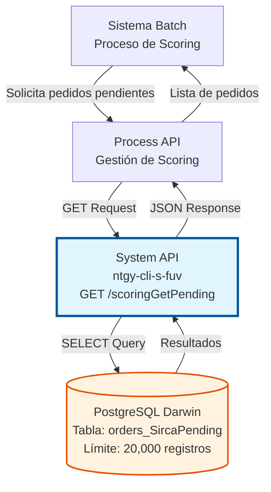
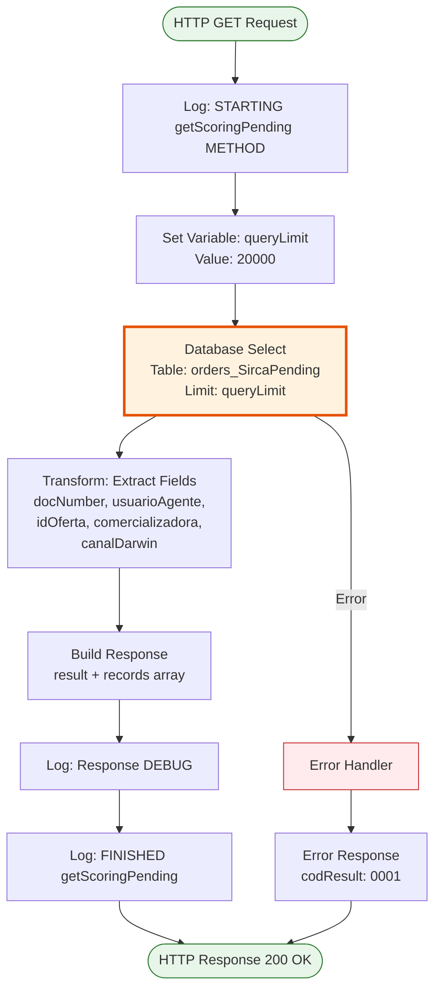
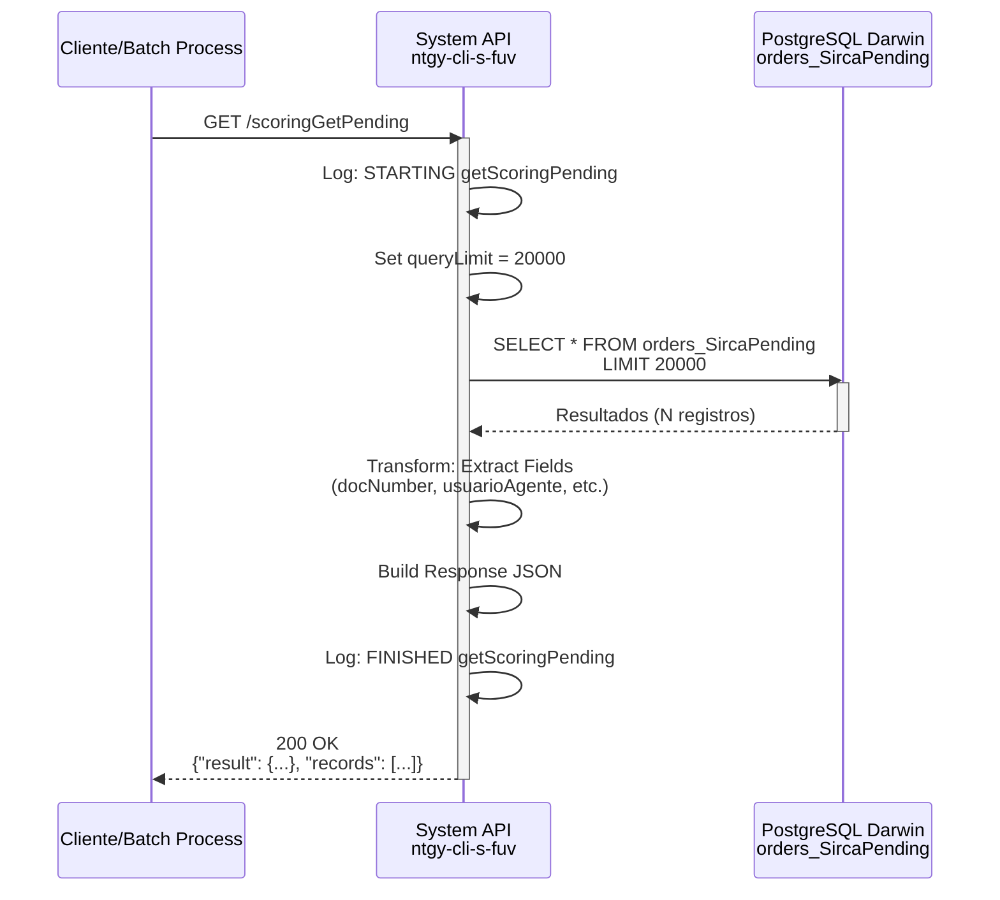

# GET /scoringGetPending

## 📌 Descripción General

### Propósito del Endpoint

Este endpoint consulta la lista de pedidos (orders) que están pendientes de validación de scoring por el sistema Sirca. Es utilizado principalmente en procesos batch para obtener los registros que requieren validación de scoring de clientes antes de continuar con el proceso de venta.

El endpoint soporta:
- **Consulta masiva**: Recupera hasta 20,000 registros en una sola llamada
- **Datos esenciales**: Retorna solo los campos necesarios para el proceso de scoring
- **Procesamiento batch**: Diseñado para ser consumido por procesos automatizados

### Tipo de API

**Capa:** System API (API-Led Connectivity)

**Función:** Acceso directo a base de datos PostgreSQL (Darwin) para consultar pedidos pendientes de scoring.

### Patrón de Integración

**Tipo:** Request-Reply Síncrono con consulta SQL

**Descripción:** El endpoint ejecuta una consulta SQL directa a la tabla/vista `orders_SircaPending` en la base de datos Darwin, transforma los resultados a formato JSON y retorna la lista de pedidos pendientes con sus datos esenciales.

### Arquitectura API-Led Connectivity



---

## 💼 Propósito del Negocio

### Casos de Uso Principales

1. **Procesamiento Batch de Scoring**
   - Sistema batch consulta periódicamente pedidos pendientes
   - Envía datos a Sirca para validación de scoring
   - Actualiza estados según resultado de scoring
   - **Beneficio:** Automatización completa del proceso de validación

2. **Monitoreo de Cola de Scoring**
   - Supervisores consultan cantidad de pedidos pendientes
   - Identifican cuellos de botella en el proceso
   - Toman decisiones sobre priorización
   - **Beneficio:** Visibilidad del estado del proceso

3. **Reintento de Scoring Fallidos**
   - Sistema identifica pedidos que requieren revalidación
   - Procesa pedidos que fallaron en intentos anteriores
   - Gestiona reintentos de forma controlada
   - **Beneficio:** Resiliencia en el proceso de scoring

### Contexto Empresarial

- **Dominio:** Gestión de Ventas y Scoring de Clientes
- **Sector:** Energía - Utilities (Gas y Electricidad)
- **División:** Naturgy España - Frontal Único de Ventas (FUV)
- **Proceso de Negocio:** Validación de scoring de clientes mediante Sirca
- **Sistema Externo:** Sirca (Sistema de scoring crediticio)

### Stakeholders

- **Equipo de Scoring**: Gestiona el proceso de validación de clientes
- **Sistemas Batch**: Consumen el endpoint para procesamiento automatizado
- **Equipo de Ventas**: Dependen de scoring aprobado para continuar ventas
- **Equipo de Operaciones**: Monitorean el proceso y resuelven incidencias

### Valor de Negocio

- **Automatización**: Elimina intervención manual en consulta de pedidos pendientes
- **Eficiencia**: Procesamiento batch de hasta 20,000 registros simultáneos
- **Trazabilidad**: Registro completo de pedidos en proceso de scoring
- **Compliance**: Asegura validación de scoring antes de formalizar contratos

### Consumidores Potenciales

Este endpoint puede ser consumido por:
- Process APIs de gestión de scoring
- Sistemas batch de procesamiento de scoring
- Herramientas de monitoreo y reporting
- Integraciones con Sirca u otros sistemas de scoring

---

## 🔧 Especificación Técnica

### URLs por Ambiente

| Ambiente | URL Base | URL Completa |
|----------|----------|--------------|
| **Local** | `http://localhost:8081` | `http://localhost:8081/api/scoringGetPending` |
| **Development** | `https://ntgy-cli-s-fuv-dev.cloudhub.io` | `https://ntgy-cli-s-fuv-dev.cloudhub.io/api/scoringGetPending` |
| **UAT** | `https://ntgy-cli-s-fuv-uat.cloudhub.io` | `https://ntgy-cli-s-fuv-uat.cloudhub.io/api/scoringGetPending` |
| **UAT01** | `https://ntgy-cli-s-fuv-uat01.cloudhub.io` | `https://ntgy-cli-s-fuv-uat01.cloudhub.io/api/scoringGetPending` |
| **Production** | `https://ntgy-cli-s-fuv-pro.cloudhub.io` | `https://ntgy-cli-s-fuv-pro.cloudhub.io/api/scoringGetPending` |

### Método HTTP

```
GET /api/scoringGetPending
```

### Parámetros de Entrada

#### Headers HTTP

| Header | Tipo | Requerido | Descripción | Ejemplo |
|--------|------|-----------|-------------|---------|
| `Accept` | string | ❌ No | Tipo de contenido esperado en response | `application/json` |

#### Query Parameters

Este endpoint **no requiere parámetros**. El límite de registros está configurado internamente en 20,000.

### Respuestas

#### Respuesta Exitosa (200 OK)

```json
{
  "result": {
    "codResult": "0000",
    "msgResult": "No hay error. Registros recuperados: 150"
  },
  "records": [
    {
      "docNumber": "12345678A",
      "usuarioAgente": "agent001",
      "idOferta": "OFF-2026-001234",
      "comercializadora": "NATURGY",
      "canalDarwin": "WEB"
    },
    {
      "docNumber": "87654321B",
      "usuarioAgente": "agent002",
      "idOferta": "OFF-2026-001235",
      "comercializadora": "NATURGY",
      "canalDarwin": "MOBILE"
    }
  ]
}
```

#### Respuesta Sin Registros (200 OK)

```json
{
  "result": {
    "codResult": "0000",
    "msgResult": "No hay error. Registros recuperados: 0"
  },
  "records": []
}
```

#### Respuesta de Error Técnico (500)

```json
{
  "result": {
    "codResult": "0001",
    "msgResult": "Error al consultar base de datos"
  }
}
```

### Estructura de Campos de Respuesta

| Campo | Tipo | Descripción |
|-------|------|-------------|
| `result.codResult` | string | Código de resultado ("0000" = éxito, "0001" = error) |
| `result.msgResult` | string | Mensaje descriptivo del resultado |
| `records` | array | Lista de pedidos pendientes de scoring |
| `records[].docNumber` | string | Número de documento del cliente |
| `records[].usuarioAgente` | string | Usuario del agente que gestionó el pedido |
| `records[].idOferta` | string | Identificador de la oferta |
| `records[].comercializadora` | string | Nombre de la comercializadora |
| `records[].canalDarwin` | string | Canal de origen del pedido (WEB, MOBILE, CALL_CENTER, etc.) |

### Autenticación y Autorización

- **Tipo:** Client ID & Client Secret (Anypoint Platform)
- **Autorización DB:** El usuario de base de datos debe tener permisos para:
  - Ejecutar SELECT en tabla/vista `orders_SircaPending`
  - Acceso de lectura al schema `public`

### Límites y Restricciones

| Límite | Valor | Descripción |
|--------|-------|-------------|
| **Registros Máximos** | 20,000 | Límite configurado en `getOrdersPendingScoringLimit` |
| **Request Timeout** | 30 segundos | Tiempo máximo de espera para la respuesta |
| **Connection Timeout** | 10 segundos | Tiempo máximo para establecer conexión con DB |

### Timeouts

| Tipo | Valor | Descripción |
|------|-------|-------------|
| **Request Timeout** | 30 segundos | Tiempo máximo de espera para la respuesta |
| **Connection Timeout** | 10 segundos | Tiempo máximo para establecer conexión |
| **Query Timeout** | 20 segundos | Tiempo máximo de ejecución de la query SQL |

---

## 🏗️ Implementación Técnica

### Arquitectura del Flow



### Diagrama de Secuencia



### Componentes Técnicos

#### 1. Flow Principal

**Nombre:** `s-fuv-scoring-getScoringPending_Flow`

**Ubicación:** `src/main/mule/s-fuv-scoring.xml` (líneas 54-100)

**Responsabilidades:**
- Logging de inicio de operación
- Configuración de límite de registros
- Ejecución de consulta SQL
- Transformación de resultados
- Construcción de respuesta JSON
- Logging de finalización

#### 2. Consulta SQL

**Query Configurada:**
```sql
select * from orders_SircaPending Limit :limit
```

**Ubicación:** `src/main/resources/s-fuv-global-config.yaml` (línea 7)

**Parámetros:**
- `:limit` - Límite de registros (valor: 20000)

**Tabla/Vista:** `orders_SircaPending`
- Vista o tabla que contiene pedidos pendientes de scoring
- Filtrado ya aplicado a nivel de base de datos
- Optimizada para consultas frecuentes

#### 3. Transformación DataWeave - Extracción de Campos

**Ubicación:** `s-fuv-scoring.xml` (líneas 63-77)

```dataweave
%dw 2.0
output application/json
---
payload map (record, findex) -> {
    "docNumber": record.'docNumber',
    "usuarioAgente": record.'usuarioAgente',
    "idOferta": record.'idOferta',
    "comercializadora": record.'comercializadora',
    "canalDarwin": record.'canalDarwin'
}
```

**Propósito:**
- Extrae solo los campos necesarios de cada registro
- Normaliza nombres de campos
- Convierte a formato JSON
- Almacena en variable `recordsSelected`

#### 4. Transformación DataWeave - Respuesta Final

**Ubicación:** `s-fuv-scoring.xml` (líneas 78-97)

```dataweave
%dw 2.0
output application/json
---
{
    "result": {
        "codResult": "0000",
        "msgResult": "No hay error. Registros recuperados: " ++ sizeOf(vars.recordsSelected) as String,
    }, 
    "records": vars.recordsSelected
}
```

**Propósito:**
- Construye estructura de respuesta estándar
- Incluye código de resultado exitoso
- Calcula y reporta cantidad de registros
- Incluye array de registros transformados

### Configuración

#### Database Connector

**Config Reference:** `Database_Config`

**Configuración:**
```xml
<db:select config-ref="Database_Config">
    <db:sql><![CDATA[${queries.getOrdersPendingScoring}]]></db:sql>
    <db:input-parameters><![CDATA[#[{
        limit: vars.queryLimit
    }]]]></db:input-parameters>
</db:select>
```

**Propiedades:**
- Connection pooling habilitado
- Max pool size: Configurable por ambiente
- Query timeout: 20 segundos
- Prepared statements para seguridad

#### Propiedades de Configuración

**Archivo:** `s-fuv-global-config.yaml`

```yaml
queries:
  getOrdersPendingScoring: "select * from orders_SircaPending Limit :limit"
  getOrdersPendingScoringLimit: "20000"
```

### Logging

#### Log de Inicio
```
STARTING getScoringPending METHOD. REQUEST: Recuperar Registros pendientes de pasar Scoring
```

#### Log de Finalización (INFO)
```
FINISHED getScoringPending METHOD. RESPONSE: No hay error. Registros recuperados: [N]   Registros: [N]
```

#### Log de Finalización (DEBUG)
```
FINISHED getScoringPending METHOD. RESPONSE: [JSON completo de respuesta]
```

**Categoría de Log:** `s-fuv-scoring`

### Manejo de Errores

#### Errores de Base de Datos

**Tipo:** `DB:CONNECTIVITY`, `DB:QUERY_EXECUTION`

**Manejo:**
- Log del error con stack trace
- Respuesta con código 500
- Mensaje genérico al cliente
- correlationId para troubleshooting

#### Errores de Transformación

**Tipo:** `EXPRESSION`, `TRANSFORMATION`

**Manejo:**
- Log del error con detalles
- Respuesta con código 500
- No expone detalles internos

### Performance

#### Métricas Esperadas

- **Response Time P50:** < 1s (consulta simple)
- **Response Time P95:** < 2s
- **Response Time P99:** < 3s
- **Throughput:** 50+ requests/min

#### Optimizaciones

- **Connection Pooling:** Reutilización de conexiones DB
- **Query Optimizada:** Vista pre-filtrada en base de datos
- **Límite Configurado:** Evita sobrecarga con límite de 20,000
- **Campos Selectivos:** Solo campos necesarios en transformación

---

## 💻 Ejemplos de Uso

### Ejemplo 1: Consulta Básica con curl

```bash
curl -X GET "https://ntgy-cli-s-fuv-dev.cloudhub.io/api/scoringGetPending" \
  -H "Accept: application/json" \
  -H "client_id: YOUR_CLIENT_ID" \
  -H "client_secret: YOUR_CLIENT_SECRET"
```

**Respuesta Esperada:**
```json
{
  "result": {
    "codResult": "0000",
    "msgResult": "No hay error. Registros recuperados: 3"
  },
  "records": [
    {
      "docNumber": "12345678A",
      "usuarioAgente": "agent001",
      "idOferta": "OFF-2026-001234",
      "comercializadora": "NATURGY",
      "canalDarwin": "WEB"
    },
    {
      "docNumber": "87654321B",
      "usuarioAgente": "agent002",
      "idOferta": "OFF-2026-001235",
      "comercializadora": "NATURGY",
      "canalDarwin": "MOBILE"
    },
    {
      "docNumber": "11223344C",
      "usuarioAgente": "agent003",
      "idOferta": "OFF-2026-001236",
      "comercializadora": "NATURGY",
      "canalDarwin": "CALL_CENTER"
    }
  ]
}
```

### Ejemplo 2: Consulta con JavaScript/Node.js

```javascript
const axios = require('axios');

async function getScoringPending() {
  try {
    const response = await axios.get(
      'https://ntgy-cli-s-fuv-dev.cloudhub.io/api/scoringGetPending',
      {
        headers: {
          'Accept': 'application/json',
          'client_id': process.env.CLIENT_ID,
          'client_secret': process.env.CLIENT_SECRET
        }
      }
    );
    
    console.log(`Registros recuperados: ${response.data.result.msgResult}`);
    console.log(`Total de pedidos pendientes: ${response.data.records.length}`);
    
    // Procesar cada pedido
    response.data.records.forEach(order => {
      console.log(`Oferta: ${order.idOferta}, Cliente: ${order.docNumber}`);
    });
    
    return response.data;
  } catch (error) {
    console.error('Error al consultar scoring pendiente:', error.message);
    throw error;
  }
}

// Uso
getScoringPending()
  .then(data => console.log('Proceso completado'))
  .catch(err => console.error('Error:', err));
```

### Ejemplo 3: Procesamiento Batch en Python

```python
import requests
import os
from typing import List, Dict

def get_scoring_pending() -> Dict:
    """
    Consulta pedidos pendientes de scoring
    """
    url = "https://ntgy-cli-s-fuv-dev.cloudhub.io/api/scoringGetPending"
    headers = {
        "Accept": "application/json",
        "client_id": os.getenv("CLIENT_ID"),
        "client_secret": os.getenv("CLIENT_SECRET")
    }
    
    try:
        response = requests.get(url, headers=headers, timeout=30)
        response.raise_for_status()
        return response.json()
    except requests.exceptions.RequestException as e:
        print(f"Error al consultar API: {e}")
        raise

def process_scoring_batch():
    """
    Procesa lote de pedidos pendientes de scoring
    """
    data = get_scoring_pending()
    
    if data['result']['codResult'] != '0000':
        print(f"Error en respuesta: {data['result']['msgResult']}")
        return
    
    records = data['records']
    print(f"Procesando {len(records)} pedidos pendientes...")
    
    for record in records:
        # Enviar a Sirca para scoring
        print(f"Procesando oferta {record['idOferta']} - Cliente {record['docNumber']}")
        # ... lógica de envío a Sirca ...
    
    print("Procesamiento batch completado")

# Ejecución
if __name__ == "__main__":
    process_scoring_batch()
```

### Ejemplo 4: Respuesta Sin Registros Pendientes

```bash
curl -X GET "https://ntgy-cli-s-fuv-pro.cloudhub.io/api/scoringGetPending" \
  -H "Accept: application/json" \
  -H "client_id: YOUR_CLIENT_ID" \
  -H "client_secret: YOUR_CLIENT_SECRET"
```

**Respuesta:**
```json
{
  "result": {
    "codResult": "0000",
    "msgResult": "No hay error. Registros recuperados: 0"
  },
  "records": []
}
```

### Ejemplo 5: Manejo de Errores

```javascript
const axios = require('axios');

async function getScoringPendingWithRetry(maxRetries = 3) {
  let lastError;
  
  for (let attempt = 1; attempt <= maxRetries; attempt++) {
    try {
      const response = await axios.get(
        'https://ntgy-cli-s-fuv-dev.cloudhub.io/api/scoringGetPending',
        {
          headers: {
            'Accept': 'application/json',
            'client_id': process.env.CLIENT_ID,
            'client_secret': process.env.CLIENT_SECRET
          },
          timeout: 30000
        }
      );
      
      // Verificar código de resultado
      if (response.data.result.codResult === '0000') {
        return response.data;
      } else {
        throw new Error(`Error de negocio: ${response.data.result.msgResult}`);
      }
      
    } catch (error) {
      lastError = error;
      console.error(`Intento ${attempt} fallido:`, error.message);
      
      if (attempt < maxRetries) {
        // Esperar antes de reintentar (backoff exponencial)
        const delay = Math.pow(2, attempt) * 1000;
        console.log(`Reintentando en ${delay}ms...`);
        await new Promise(resolve => setTimeout(resolve, delay));
      }
    }
  }
  
  throw new Error(`Falló después de ${maxRetries} intentos: ${lastError.message}`);
}

// Uso con manejo de errores
getScoringPendingWithRetry()
  .then(data => {
    console.log(`Éxito: ${data.records.length} registros recuperados`);
  })
  .catch(error => {
    console.error('Error final:', error.message);
    // Notificar al equipo de operaciones
  });
```

### Notas de Implementación

1. **Límite de Registros**: El endpoint retorna máximo 20,000 registros. Si hay más pedidos pendientes, se deben implementar múltiples llamadas o ajustar el límite en configuración.

2. **Frecuencia de Consulta**: Para procesos batch, se recomienda consultar cada 5-10 minutos para evitar sobrecarga.

3. **Timeout**: Configurar timeout de al menos 30 segundos para permitir consultas con muchos registros.

4. **Retry Policy**: Implementar reintentos con backoff exponencial para manejar fallos temporales.

5. **Monitoreo**: Registrar cantidad de pedidos pendientes para detectar cuellos de botella en el proceso de scoring.