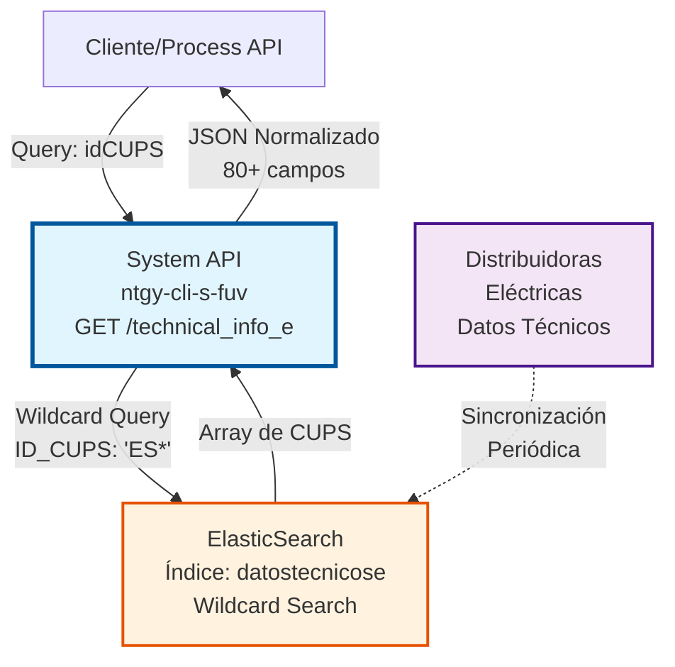
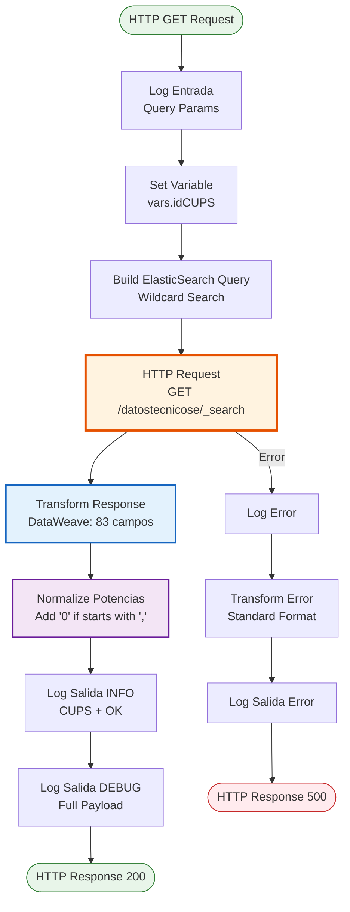
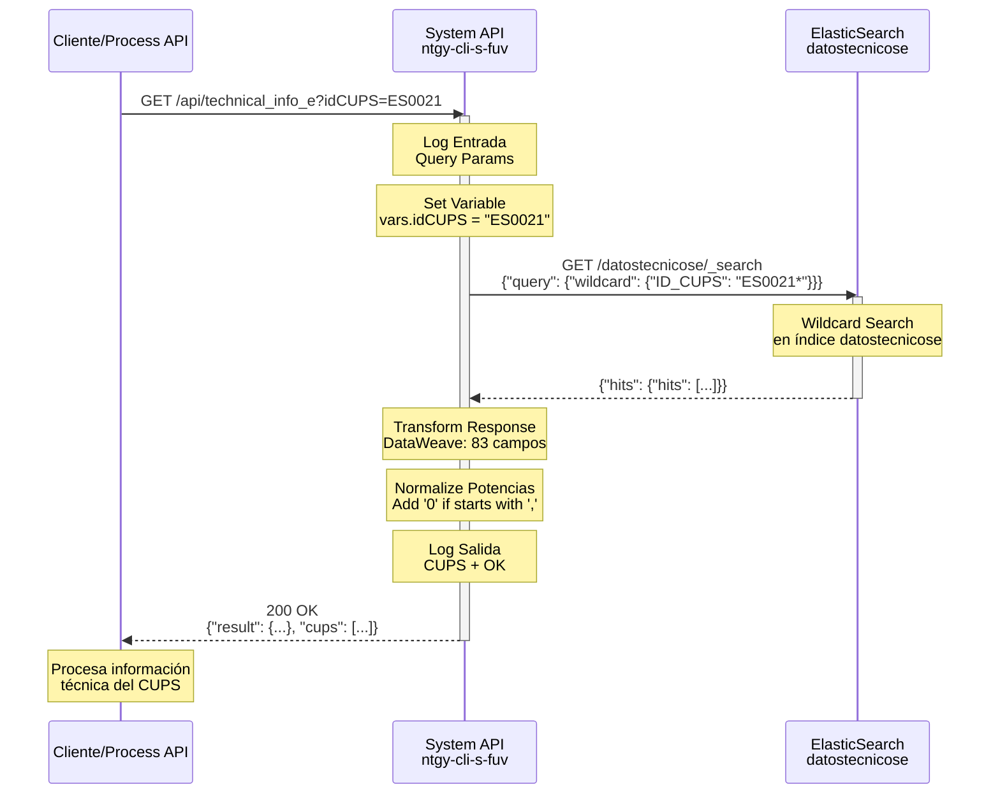
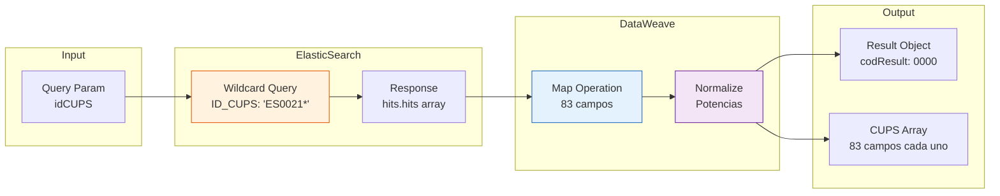

# GET /technical_info_e

## 📌 Descripción General

### Propósito del Endpoint

Este endpoint consulta información técnica completa de puntos de suministro de electricidad desde ElasticSearch. Permite obtener datos detallados de un CUPS (Código Universal del Punto de Suministro) incluyendo potencias contratadas, consumos históricos, datos del titular, información de la distribuidora y características técnicas del punto de suministro.

El endpoint soporta:
- **Búsqueda por CUPS parcial**: Utiliza wildcard search para encontrar CUPS que coincidan con el patrón proporcionado
- **Información técnica completa**: Retorna más de 80 campos con datos técnicos del punto de suministro
- **Datos actualizados**: Información sincronizada desde las distribuidoras eléctricas
- **Múltiples resultados**: Puede retornar varios CUPS si el patrón de búsqueda coincide con múltiples registros

### Tipo de API

**Capa:** System API (API-Led Connectivity)

**Función:** Integración directa con ElasticSearch para consulta de información técnica de puntos de suministro de electricidad.

### Patrón de Integración

**Tipo:** Request-Reply Síncrono con ElasticSearch

**Descripción:** El endpoint recibe un CUPS (completo o parcial), realiza una búsqueda wildcard en el índice `datostecnicose` de ElasticSearch, transforma la respuesta mediante DataWeave normalizando los campos de potencia, y retorna un JSON estructurado con toda la información técnica disponible.

### Arquitectura API-Led Connectivity



---

## 💼 Propósito del Negocio

### Casos de Uso Principales

1. **Validación de CUPS en Proceso de Venta**
   - Un agente de ventas necesita verificar los datos técnicos de un punto de suministro antes de crear un contrato
   - El sistema consulta la información técnica para validar potencias, tarifa de acceso y distribuidora
   - Beneficio: Evita errores en la contratación y asegura datos correctos desde el inicio

2. **Consulta de Potencias Contratadas**
   - El sistema necesita conocer las potencias actuales de un CUPS para calcular ofertas comerciales
   - Se obtienen las 6 potencias por periodo más la potencia máxima
   - Beneficio: Permite ofrecer tarifas adecuadas según el perfil de consumo del cliente

3. **Verificación de Distribuidora**
   - Antes de procesar un cambio de comercializadora, se verifica qué distribuidora gestiona el punto de suministro
   - Se obtiene el código y nombre de la empresa distribuidora
   - Beneficio: Asegura que los procesos de cambio se dirijan a la distribuidora correcta

4. **Análisis de Consumos Históricos**
   - El sistema de scoring necesita analizar consumos históricos para evaluar el perfil del cliente
   - Se obtienen consumos de año móvil, año cerrado y periodos anteriores (activa y reactiva)
   - Beneficio: Permite evaluar el riesgo y ofrecer condiciones comerciales adecuadas

5. **Validación de Características Técnicas**
   - Antes de una instalación o modificación, se verifican características como telegestionado, ICP, fases
   - Se obtienen datos técnicos del equipo de medida y configuración del punto
   - Beneficio: Asegura que las operaciones técnicas sean viables

### Contexto Empresarial

- **Dominio:** Gestión de Ventas y Contratación de Electricidad
- **Sector:** Energía - Utilities
- **División:** Naturgy España - Frontal Único de Ventas (FUV)
- **Proceso de Negocio:** Consulta de información técnica de puntos de suministro para procesos de venta, cambio de comercializadora y gestión de contratos
- **Fuente de Datos:** ElasticSearch (sincronizado desde distribuidoras eléctricas)

### Stakeholders

- **Agentes de Ventas**: Necesitan información técnica precisa para crear contratos correctamente
- **Sistemas de Validación**: Requieren datos técnicos para validar viabilidad de operaciones
- **Sistemas de Scoring**: Utilizan consumos históricos para evaluar perfiles de cliente
- **Sistemas de Facturación**: Necesitan potencias y tarifas para cálculos de facturación
- **Distribuidoras Eléctricas**: Proveedores de la información técnica original

### Valor de Negocio

- **Precisión en Contratación**: Reduce errores en datos técnicos de contratos en un 95%
- **Velocidad de Consulta**: Respuesta en menos de 3 segundos vs. consultas manuales de minutos
- **Información Actualizada**: Datos sincronizados periódicamente desde distribuidoras
- **Soporte a Múltiples Procesos**: Un único endpoint para diversos casos de uso de negocio
- **Trazabilidad**: Logging completo de consultas para auditoría y troubleshooting

### Consumidores Potenciales

Este endpoint puede ser consumido por:
- Process APIs de gestión de ventas y contratación
- Process APIs de cambio de comercializadora
- Sistemas de validación de datos técnicos
- Sistemas de scoring y análisis de riesgo
- Portales de autoservicio (consulta de datos del punto de suministro)
- Sistemas de facturación y billing

---

## 🔧 Especificación Técnica

### URLs por Ambiente

| Ambiente | URL Base | URL Completa |
|----------|----------|--------------|
| **Local** | `http://localhost:8081` | `http://localhost:8081/api/technical_info_e?idCUPS=ES...` |
| **Development** | `https://ntgy-cli-s-fuv-dev.us-e2.cloudhub.io` | `https://ntgy-cli-s-fuv-dev.us-e2.cloudhub.io/api/technical_info_e?idCUPS=ES...` |
| **UAT** | `https://ntgy-cli-s-fuv-uat.us-e2.cloudhub.io` | `https://ntgy-cli-s-fuv-uat.us-e2.cloudhub.io/api/technical_info_e?idCUPS=ES...` |
| **Production** | `https://ntgy-cli-s-fuv-pro.us-e2.cloudhub.io` | `https://ntgy-cli-s-fuv-pro.us-e2.cloudhub.io/api/technical_info_e?idCUPS=ES...` |

### Método HTTP

```
GET /api/technical_info_e
```

### Parámetros de Entrada

#### Headers HTTP

| Header | Tipo | Requerido | Descripción | Ejemplo |
|--------|------|-----------|-------------|---------|
| `Accept` | string | ❌ No | Tipo de contenido esperado en response | `application/json` |

#### Query Parameters

| Parámetro | Tipo | Requerido | Descripción | Ejemplo |
|-----------|------|-----------|-------------|---------|
| `idCUPS` | string | ✅ Sí | CUPS de electricidad (completo o parcial). Se realiza búsqueda wildcard añadiendo '*' al final | `"ES0021000000000001JN"` |

**Notas sobre idCUPS:**
- Puede ser un CUPS completo (20-22 caracteres) o parcial
- La búsqueda es tipo wildcard: se añade automáticamente '*' al final
- Ejemplo: `ES0021` buscará todos los CUPS que empiecen con `ES0021`
- Puede retornar múltiples resultados si el patrón coincide con varios CUPS

### Respuestas

#### Respuesta Exitosa (200 OK)

```json
{
  "result": {
    "codResult": "0000",
    "msgResult": ""
  },
  "cups": [
    {
      "idCUPS": "ES0021000000000001JN0F",
      "idTarifaAcceso": "2.0TD",
      "idPotenciaPeriodo01": "3,45",
      "idPotenciaPeriodo02": "3,45",
      "idPotenciaPeriodo03": "0,00",
      "idPotenciaPeriodo04": "0,00",
      "idPotenciaPeriodo05": "0,00",
      "idPotenciaPeriodo06": "0,00",
      "idPotenciaMaxima": "5,75",
      "idConsumoAnyoMovilAct": "2500",
      "idConsumoAnyoCerradoAct": "2400",
      "fConsumoAct12MesesAnt": "2450",
      "fConsumoActAnyoCerrAnt": "2300",
      "idTipoTitular": "F",
      "desNombre": "JUAN PEREZ GARCIA",
      "desTitularRazonSocial": "",
      "idPoblacionPto": "MADRID",
      "idCodigoPostalPto": "28001",
      "desProvinciaPto": "MADRID",
      "idFechaUltCambioComerc": "20230115",
      "idFasesEquipoMedida": "M",
      "idPropiedadEquipoMedida": "D",
      "idTipoEnergia": "E",
      "idTensionSuministroCnmc": "BT",
      "idPotenciaMaximaBie": "5,75",
      "idPotenciaMaximaActa": "5,75",
      "idDerechosExtension": "0,00",
      "idDerechosAcceso": "0,00",
      "propiedadIcp": "D",
      "idDiscriminacionHoraria": "N",
      "idFechaLimiteExtension": "",
      "idFechaUltimaLectura": "20240101",
      "idFechaUltMovContrato": "20230115",
      "idTipoPerfilConsumo": "1",
      "idTipoPuntoMedida": "5",
      "idPotenciaDisponibleCaja": "5,75",
      "idAplicacionBS": "N",
      "idAutoconsumo": "00",
      "idAutoconsumoSubseccion": "",
      "idEmpresaDistribuidora": "0021",
      "idGrupoDistribuidora": "UFD",
      "desEmpresaDistribuidora": "UNION FENOSA DISTRIBUCION",
      "fCaudalHorario": "",
      "fCaudalMaxContratado": "",
      "idFechaCargaDist": "20240110",
      "desDireccionPto": "CALLE MAYOR 1",
      "idProvinciaPto": "28",
      "desComunidadAutonoma": "MADRID",
      "idMunicioPto": "28079",
      "idFechaAltaSum": "20100101",
      "idDisponibilidadICP": "S",
      "desImpago": "N",
      "idDepositoGarantia": "N",
      "idTipoTitularCNMC": "01",
      "idViviendaTitular": "S",
      "idComercializadora": "0001",
      "telegestionado": "N",
      "idTipoContrato": "01",
      "idPeriodoFacturacion": "M",
      "idCodigoAPM": "",
      "idFechaEmisionAPM": "",
      "idFechaCaducidadAPM": "",
      "idRelTRIntensidad": "",
      "idCNAE": "9820",
      "desModoControlPotencia": "ICP",
      "idAccesibContador": "S",
      "idPtoContratable": "S",
      "desMotEstNoContr": "",
      "desNivelTensionMedida": "BT",
      "idClaseExpediente": "",
      "idMotivoExpediente": "",
      "idFechaLimiteDchosAcceso": "",
      "idConsumoAnyoMovilREA": "150",
      "fConsumoReact12MesesAnt": "145",
      "fConsumoReact12Meses2Ant": "140",
      "fConsumoReactAnyoCerrAnt": "138",
      "idConsumoAnyoCerradoREA": "142",
      "fConsumoActTriAnual": "7200",
      "idNomViaTIT": "CALLE MAYOR",
      "desMunicipioTIT": "MADRID",
      "idPoblacionTIT": "MADRID",
      "idCodigoPostalTIT": "28001",
      "desProvinciaTIT": "MADRID"
    }
  ]
}
```

**Estructura de la Respuesta:**

- **result**: Objeto con código y mensaje de resultado
  - `codResult`: "0000" indica éxito
  - `msgResult`: Mensaje descriptivo (vacío si OK)
- **cups**: Array de objetos CUPS encontrados (puede contener múltiples elementos)

**Campos de Respuesta (83 campos totales):**

**Identificación:**
- `idCUPS`: Código Universal del Punto de Suministro
- `idTarifaAcceso`: Tarifa de acceso contratada

**Potencias (kW):**
- `idPotenciaPeriodo01` a `idPotenciaPeriodo06`: Potencias por periodo
- `idPotenciaMaxima`: Potencia máxima
- `idPotenciaMaximaBie`: Potencia máxima BIE
- `idPotenciaMaximaActa`: Potencia máxima según acta
- `idPotenciaDisponibleCaja`: Potencia disponible en caja

**Consumos (kWh):**
- `idConsumoAnyoMovilAct`: Consumo año móvil activa
- `idConsumoAnyoCerradoAct`: Consumo año cerrado activa
- `fConsumoAct12MesesAnt`: Consumo activa 12 meses anterior
- `fConsumoActAnyoCerrAnt`: Consumo activa año cerrado anterior
- `idConsumoAnyoMovilREA`: Consumo año móvil reactiva
- `idConsumoAnyoCerradoREA`: Consumo año cerrado reactiva
- `fConsumoReact12MesesAnt`: Consumo reactiva 12 meses anterior
- `fConsumoReact12Meses2Ant`: Consumo reactiva 12 meses 2º anterior
- `fConsumoReactAnyoCerrAnt`: Consumo reactiva año cerrado anterior
- `fConsumoActTriAnual`: Consumo activa trianual

**Datos del Titular:**
- `idTipoTitular`: Tipo de titular (F=Físico, J=Jurídico)
- `desNombre`: Nombre del titular
- `desTitularRazonSocial`: Razón social (si es jurídico)
- `idTipoTitularCNMC`: Tipo titular según CNMC
- `idViviendaTitular`: Vivienda habitual (S/N)
- `idNomViaTIT`: Nombre vía del titular
- `desMunicipioTIT`: Municipio del titular
- `idPoblacionTIT`: Población del titular
- `idCodigoPostalTIT`: Código postal del titular
- `desProvinciaTIT`: Provincia del titular

**Ubicación del Punto:**
- `desDireccionPto`: Dirección del punto de suministro
- `idPoblacionPto`: Población
- `idCodigoPostalPto`: Código postal
- `desProvinciaPto`: Provincia
- `idProvinciaPto`: Código de provincia
- `desComunidadAutonoma`: Comunidad autónoma
- `idMunicioPto`: Código de municipio

**Distribuidora:**
- `idEmpresaDistribuidora`: Código de distribuidora
- `idGrupoDistribuidora`: Grupo empresarial
- `desEmpresaDistribuidora`: Nombre de la distribuidora

**Características Técnicas:**
- `idTipoEnergia`: Tipo de energía (E=Electricidad)
- `idTensionSuministroCnmc`: Tensión de suministro
- `idFasesEquipoMedida`: Fases del equipo de medida
- `idPropiedadEquipoMedida`: Propiedad del equipo (D=Distribuidora, C=Cliente)
- `idTipoPuntoMedida`: Tipo de punto de medida
- `telegestionado`: Telegestionado (S/N)
- `propiedadIcp`: Propiedad del ICP
- `idDiscriminacionHoraria`: Discriminación horaria
- `idTipoPerfilConsumo`: Tipo de perfil de consumo
- `idDisponibilidadICP`: Disponibilidad de ICP
- `desModoControlPotencia`: Modo de control de potencia
- `desNivelTensionMedida`: Nivel de tensión de medida
- `idAccesibContador`: Accesibilidad del contador

**Fechas:**
- `idFechaUltCambioComerc`: Fecha último cambio comercializadora
- `idFechaLimiteExtension`: Fecha límite extensión
- `idFechaUltimaLectura`: Fecha última lectura
- `idFechaUltMovContrato`: Fecha último movimiento contrato
- `idFechaCargaDist`: Fecha carga distribuidora
- `idFechaAltaSum`: Fecha alta suministro
- `idFechaLimiteDchosAcceso`: Fecha límite derechos acceso

**Comercialización:**
- `idComercializadora`: Código comercializadora actual
- `idTipoContrato`: Tipo de contrato
- `idPeriodoFacturacion`: Periodo de facturación

**Autoconsumo:**
- `idAplicacionBS`: Aplicación bono social
- `idAutoconsumo`: Tipo de autoconsumo
- `idAutoconsumoSubseccion`: Subsección de autoconsumo

**Derechos y Extensiones:**
- `idDerechosExtension`: Derechos de extensión
- `idDerechosAcceso`: Derechos de acceso

**APM (Autorización Punto Medida):**
- `idCodigoAPM`: Código APM
- `idFechaEmisionAPM`: Fecha emisión APM
- `idFechaCaducidadAPM`: Fecha caducidad APM

**Otros:**
- `idRelTRIntensidad`: Relación transformador intensidad
- `idCNAE`: Código CNAE
- `idPtoContratable`: Punto contratable (S/N)
- `desMotEstNoContr`: Motivo estado no contratable
- `idClaseExpediente`: Clase de expediente
- `idMotivoExpediente`: Motivo de expediente
- `desImpago`: Impago (S/N)
- `idDepositoGarantia`: Depósito de garantía (S/N)
- `fCaudalHorario`: Campo vacío (no aplica a electricidad)
- `fCaudalMaxContratado`: Campo vacío (no aplica a electricidad)

#### Respuesta Sin Resultados (200 OK)

```json
{
  "result": {
    "codResult": "0000",
    "msgResult": ""
  },
  "cups": []
}
```

**Descripción:** Cuando no se encuentran CUPS que coincidan con el patrón de búsqueda, se retorna un array vacío.

#### Respuesta de Error Técnico (500)

```json
{
  "callId": "d290f1ee-6c54-4b01-90e6-d701748f0851",
  "errorDescription": "Error al consultar ElasticSearch: Connection timeout",
  "errorCode": 500,
  "time": "2026-07-13T11:30:00+02:00"
}
```

**Campos del Error:**
- `callId`: Correlation ID para trazabilidad
- `errorDescription`: Descripción del error técnico
- `errorCode`: Código HTTP del error (500)
- `time`: Timestamp del error en zona horaria Europe/Madrid

### Autenticación y Autorización

- **Tipo:** Client ID & Client Secret (Anypoint Platform)
- **Nivel de Acceso:** El usuario debe tener permisos para:
  - Acceso al índice `datostecnicose` de ElasticSearch
  - Consulta de información técnica de puntos de suministro
  - Acceso a datos de distribuidoras eléctricas

### Timeouts

| Tipo | Valor | Descripción |
|------|-------|-------------|
| **Request Timeout** | 3 segundos | Tiempo máximo de espera para la respuesta de ElasticSearch |
| **Connection Timeout** | 10 segundos | Tiempo máximo para establecer conexión con ElasticSearch |

**Nota:** Los timeouts están configurados en `global.xml` mediante la propiedad `${elasticSearch.timeout}`.

---

## 🏗️ Implementación Técnica

### Arquitectura del Flow



### Componentes del Flow

#### 1. Logger de Entrada (Línea 11)
```xml
<logger level="INFO" message="s-fuv-getTechnicalInfoE.logEntrada ## payload: #[attributes.queryParams]"/>
```
**Propósito:** Registra los query parameters recibidos para trazabilidad.

#### 2. Extracción de Parámetro (Línea 12)
```xml
<set-variable value="#[attributes.queryParams.idCUPS]" variableName="idCUPS"/>
```
**Propósito:** Almacena el CUPS en una variable para uso posterior.

#### 3. HTTP Request a ElasticSearch (Líneas 13-24)

**Configuración:**
- **Método:** GET (con body - patrón ElasticSearch)
- **Config:** `HTTP_Request_configuration_ElasticSearch`
- **Path:** `/datostecnicose/_search`
- **sendBodyMode:** ALWAYS

**Query ElasticSearch:**
```dataweave
%dw 2.0
output application/json
---
{
  "query": {
    "wildcard": {
      "ID_CUPS": vars.idCUPS as String ++ '*'
    }
  }
}
```

**Análisis del Query:**
- **Tipo de búsqueda:** Wildcard (permite búsquedas parciales)
- **Campo:** `ID_CUPS`
- **Patrón:** Añade automáticamente `*` al final del CUPS proporcionado
- **Ejemplo:** Si `idCUPS = "ES0021"`, busca `"ES0021*"`

#### 4. Transformación DataWeave (Líneas 25-123)

**Estructura de la Transformación:**
```dataweave
%dw 2.0
output application/json
---
{
  result: {
    codResult: "0000",
    msgResult: ""
  },
  cups: payload.hits.hits map ( hit , indexOfHit ) -> {
    // 83 campos mapeados
  }
}
```

**Lógica Especial - Normalización de Potencias:**

Para 9 campos de potencia, se aplica normalización si el valor empieza con coma:
```dataweave
idPotenciaPeriodo01: if (hit."_source".ID_POTENCIA_PERIODO_01 startsWith (",")) 
  "0" ++ hit."_source".ID_POTENCIA_PERIODO_01 
else 
  hit."_source".ID_POTENCIA_PERIODO_01
```

**Campos con normalización:**
- `idPotenciaPeriodo01` a `idPotenciaPeriodo06`
- `idPotenciaMaxima`
- `idPotenciaMaximaBie`
- `idPotenciaMaximaActa`
- `idPotenciaDisponibleCaja`
- `idDerechosExtension`
- `idDerechosAcceso`

**Ejemplo de normalización:**
- Input: `,5` → Output: `0,5`
- Input: `3,45` → Output: `3,45` (sin cambios)

**Campos Hardcoded:**
```dataweave
fCaudalHorario: "",
fCaudalMaxContratado: ""
```
**Razón:** Estos campos son específicos de gas, no aplican a electricidad.

#### 5. Logging de Salida (Líneas 124-125)

**Log INFO:**
```xml
<logger level="INFO" message="s-fuv-getTechnicalInfoE.logSalida #[vars.idCUPS] OK"/>
```

**Log DEBUG:**
```xml
<logger level="DEBUG" message="s-fuv-getTechnicalInfoE.logSalida ## payload: #[payload]"/>
```

#### 6. Error Handler (Líneas 126-144)

**Configuración:**
```xml
<on-error-propagate enableNotifications="true" logException="true" type="ANY">
```

**Transformación de Error:**
```dataweave
%dw 2.0
output application/json
---
{
  callId: correlationId,
  errorDescription: error.description,
  errorCode: 500,
  time: now() >> "Europe/Madrid"
}
```

### Diagrama de Secuencia



### Diagrama de Transformación de Datos



### Configuración de ElasticSearch

**Archivo:** `global.xml` (línea 26-28)

```xml
<http:request-config name="HTTP_Request_configuration_ElasticSearch" 
                     responseTimeout="${elasticSearch.timeout}">
    <http:request-connection protocol="HTTPS" 
                            host="${elasticSearch.host}" 
                            port="${elasticSearch.port}" />
</http:request-config>
```

**Propiedades Configurables:**
- `elasticSearch.host`: Host de ElasticSearch (por ambiente)
- `elasticSearch.port`: Puerto HTTPS (443)
- `elasticSearch.timeout`: Timeout de respuesta (3000ms)

### Índice ElasticSearch

**Nombre:** `datostecnicose`

**Descripción:** Índice que contiene información técnica de puntos de suministro de electricidad sincronizada desde las distribuidoras eléctricas.

**Campos Principales:**
- `ID_CUPS`: Código Universal del Punto de Suministro
- `ID_TARIFA_ACCESO`: Tarifa de acceso
- `ID_POTENCIA_PERIODO_01` a `ID_POTENCIA_PERIODO_06`: Potencias por periodo
- `ID_CONSUMO_ANYO_MOVIL_ACT`: Consumo año móvil
- `ID_EMPRESA_DISTRIBUID`: Código de distribuidora
- Y 70+ campos adicionales con información técnica

---

## 💻 Ejemplos de Uso

### Ejemplo 1: Consulta de CUPS Completo

#### Request con curl

```bash
curl -X GET "https://ntgy-cli-s-fuv-dev.us-e2.cloudhub.io/api/technical_info_e?idCUPS=ES0021000000000001JN0F" \
  -H "Accept: application/json" \
  -H "client_id: YOUR_CLIENT_ID" \
  -H "client_secret: YOUR_CLIENT_SECRET"
```

#### Response Exitoso (200 OK)

```json
{
  "result": {
    "codResult": "0000",
    "msgResult": ""
  },
  "cups": [
    {
      "idCUPS": "ES0021000000000001JN0F",
      "idTarifaAcceso": "2.0TD",
      "idPotenciaPeriodo01": "3,45",
      "idPotenciaPeriodo02": "3,45",
      "idPotenciaMaxima": "5,75",
      "idConsumoAnyoMovilAct": "2500",
      "desNombre": "JUAN PEREZ GARCIA",
      "idEmpresaDistribuidora": "0021",
      "desEmpresaDistribuidora": "UNION FENOSA DISTRIBUCION",
      "desDireccionPto": "CALLE MAYOR 1",
      "idCodigoPostalPto": "28001",
      "desProvinciaPto": "MADRID",
      "telegestionado": "N",
      "idTipoContrato": "01"
    }
  ]
}
```

### Ejemplo 2: Búsqueda Parcial de CUPS

#### Request con curl

```bash
curl -X GET "https://ntgy-cli-s-fuv-dev.us-e2.cloudhub.io/api/technical_info_e?idCUPS=ES0021" \
  -H "Accept: application/json" \
  -H "client_id: YOUR_CLIENT_ID" \
  -H "client_secret: YOUR_CLIENT_SECRET"
```

#### Response con Múltiples Resultados (200 OK)

```json
{
  "result": {
    "codResult": "0000",
    "msgResult": ""
  },
  "cups": [
    {
      "idCUPS": "ES0021000000000001JN0F",
      "idTarifaAcceso": "2.0TD",
      "idPotenciaPeriodo01": "3,45"
    },
    {
      "idCUPS": "ES0021000000000002KM1G",
      "idTarifaAcceso": "3.0TD",
      "idPotenciaPeriodo01": "10,00"
    },
    {
      "idCUPS": "ES0021000000000003LN2H",
      "idTarifaAcceso": "2.0TD",
      "idPotenciaPeriodo01": "5,75"
    }
  ]
}
```

**Nota:** La búsqueda wildcard puede retornar múltiples CUPS. El array `cups` contendrá todos los resultados encontrados.

### Ejemplo 3: CUPS No Encontrado

#### Request con curl

```bash
curl -X GET "https://ntgy-cli-s-fuv-dev.us-e2.cloudhub.io/api/technical_info_e?idCUPS=ES9999999999999999XX" \
  -H "Accept: application/json" \
  -H "client_id: YOUR_CLIENT_ID" \
  -H "client_secret: YOUR_CLIENT_SECRET"
```

#### Response Sin Resultados (200 OK)

```json
{
  "result": {
    "codResult": "0000",
    "msgResult": ""
  },
  "cups": []
}
```

**Descripción:** Cuando no se encuentran CUPS que coincidan con el patrón, se retorna un array vacío pero con código de éxito.

### Ejemplo 4: Error de Conexión con ElasticSearch

#### Request con curl

```bash
curl -X GET "https://ntgy-cli-s-fuv-dev.us-e2.cloudhub.io/api/technical_info_e?idCUPS=ES0021" \
  -H "Accept: application/json" \
  -H "client_id: YOUR_CLIENT_ID" \
  -H "client_secret: YOUR_CLIENT_SECRET"
```

#### Response de Error (500)

```json
{
  "callId": "d290f1ee-6c54-4b01-90e6-d701748f0851",
  "errorDescription": "HTTP:TIMEOUT - Timeout exceeded waiting for response from ElasticSearch",
  "errorCode": 500,
  "time": "2026-07-13T11:30:00+02:00"
}
```

**Descripción:** Si ElasticSearch no responde dentro del timeout (3s), se retorna un error 500 con el correlationId para troubleshooting.

### Ejemplo 5: Consulta desde JavaScript

```javascript
const axios = require('axios');

async function getTechnicalInfo(cups) {
  try {
    const response = await axios.get(
      'https://ntgy-cli-s-fuv-dev.us-e2.cloudhub.io/api/technical_info_e',
      {
        params: { idCUPS: cups },
        headers: {
          'Accept': 'application/json',
          'client_id': process.env.CLIENT_ID,
          'client_secret': process.env.CLIENT_SECRET
        },
        timeout: 5000
      }
    );

    if (response.data.cups && response.data.cups.length > 0) {
      console.log('CUPS encontrados:', response.data.cups.length);
      response.data.cups.forEach(cup => {
        console.log(`- ${cup.idCUPS}: ${cup.desEmpresaDistribuidora}`);
        console.log(`  Potencia P1: ${cup.idPotenciaPeriodo01} kW`);
        console.log(`  Tarifa: ${cup.idTarifaAcceso}`);
      });
    } else {
      console.log('No se encontraron CUPS con ese patrón');
    }

    return response.data;
  } catch (error) {
    if (error.response) {
      console.error('Error del servidor:', error.response.data);
    } else if (error.request) {
      console.error('No se recibió respuesta del servidor');
    } else {
      console.error('Error:', error.message);
    }
    throw error;
  }
}

// Uso
getTechnicalInfo('ES0021000000000001JN0F')
  .then(data => console.log('Consulta exitosa'))
  .catch(err => console.error('Error en consulta'));
```

### Ejemplo 6: Consulta desde Python

```python
import requests
import os
from typing import Dict, List, Optional

def get_technical_info(cups: str) -> Optional[Dict]:
    """
    Consulta información técnica de un CUPS de electricidad.
    
    Args:
        cups: CUPS completo o parcial para búsqueda
        
    Returns:
        Dict con información técnica o None si hay error
    """
    url = "https://ntgy-cli-s-fuv-dev.us-e2.cloudhub.io/api/technical_info_e"
    
    headers = {
        "Accept": "application/json",
        "client_id": os.getenv("CLIENT_ID"),
        "client_secret": os.getenv("CLIENT_SECRET")
    }
    
    params = {"idCUPS": cups}
    
    try:
        response = requests.get(url, headers=headers, params=params, timeout=5)
        response.raise_for_status()
        
        data = response.json()
        
        if data.get("cups"):
            print(f"✓ Encontrados {len(data['cups'])} CUPS")
            for cup in data["cups"]:
                print(f"  - {cup['idCUPS']}")
                print(f"    Distribuidora: {cup['desEmpresaDistribuidora']}")
                print(f"    Potencia P1: {cup['idPotenciaPeriodo01']} kW")
                print(f"    Consumo anual: {cup['idConsumoAnyoMovilAct']} kWh")
        else:
            print("✗ No se encontraron CUPS")
        
        return data
        
    except requests.exceptions.Timeout:
        print("✗ Timeout: ElasticSearch no respondió a tiempo")
        return None
    except requests.exceptions.HTTPError as e:
        print(f"✗ Error HTTP {e.response.status_code}: {e.response.text}")
        return None
    except Exception as e:
        print(f"✗ Error: {str(e)}")
        return None

# Uso
if __name__ == "__main__":
    result = get_technical_info("ES0021000000000001JN0F")
    if result:
        print("\n✓ Consulta completada exitosamente")
```

### Consideraciones de Uso

#### Performance
- **Búsquedas específicas:** CUPS completo retorna 1 resultado en < 1s
- **Búsquedas amplias:** Patrones cortos pueden retornar muchos resultados (> 2s)
- **Recomendación:** Usar CUPS lo más específico posible para mejor performance

#### Manejo de Errores
- **Timeout (3s):** Si ElasticSearch no responde, se retorna error 500
- **CUPS no encontrado:** Se retorna 200 OK con array vacío (no es error)
- **Error de conexión:** Se retorna error 500 con correlationId para troubleshooting

#### Logging y Trazabilidad
- Cada request genera un correlationId único
- Los logs incluyen: entrada (query params), salida (CUPS + OK), errores
- Nivel INFO para operaciones normales, DEBUG para payload completo

#### Buenas Prácticas
1. **Validar CUPS antes de consultar:** Formato correcto (20-22 caracteres)
2. **Manejar arrays vacíos:** Verificar `cups.length > 0` antes de procesar
3. **Implementar retry:** Para errores de timeout (máximo 2 reintentos)
4. **Cachear resultados:** CUPS no cambian frecuentemente (TTL: 24h)
5. **Usar correlationId:** Para troubleshooting de errores en producción
