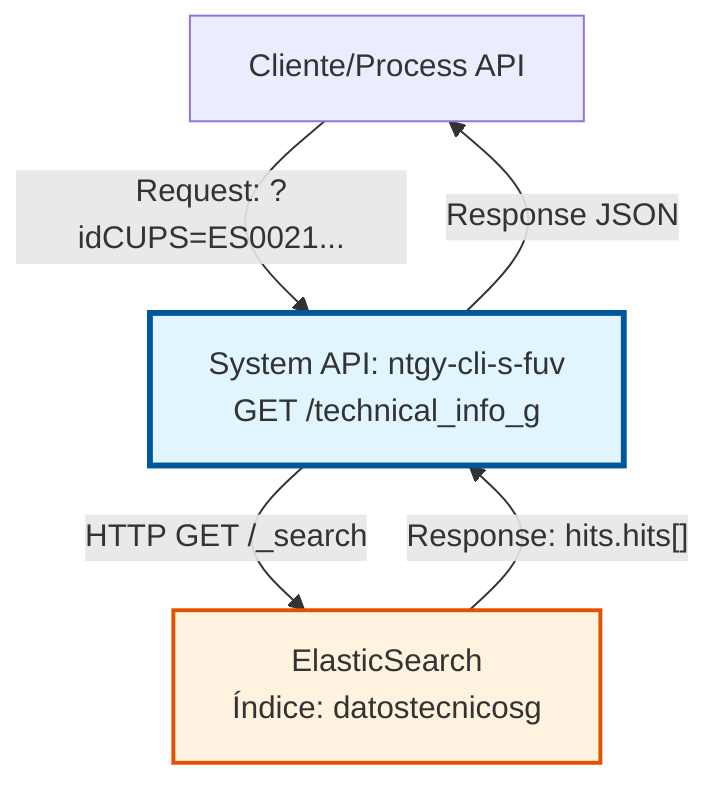
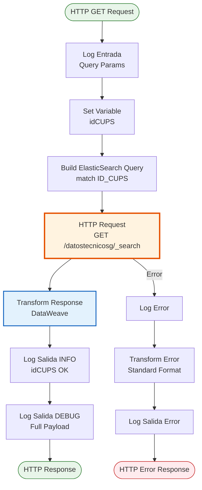

# GET /technical_info_g

## 📌 Descripción General

### Propósito del Endpoint

Consulta información técnica detallada de puntos de suministro de **gas** mediante el CUPS (Código Universal del Punto de Suministro) desde el índice de ElasticSearch `datostecnicosg`.

El endpoint proporciona:
- **Datos de Distribuidora**: Empresa distribuidora, grupo, código
- **Datos de Consumo**: Consumo anual, consumo 12 meses, perfil de consumo
- **Datos Técnicos**: Caudal horario, caudal máximo contratado, presión, calibre contador
- **Datos de Ubicación**: Dirección completa del punto de suministro
- **Datos de Instalación**: Tipo de contador, telemedida, corrector, fecha última inspección

### Tipo de API

**Capa:** System API (API-Led Connectivity)

**Función:** Integración directa con ElasticSearch para consulta de información técnica de suministros de gas.

### Patrón de Integración

**Tipo:** Request-Reply Síncrono con ElasticSearch

**Descripción:** Recibe el CUPS como query parameter, construye una query de búsqueda en ElasticSearch, ejecuta la búsqueda en el índice `datostecnicosg`, transforma la respuesta de ElasticSearch a formato JSON normalizado y retorna los datos técnicos del suministro de gas.

### Arquitectura API-Led Connectivity



---

## 💼 Propósito del Negocio

### Casos de Uso Principales

1. **Validación Técnica de Suministro de Gas**
   - Agente de ventas necesita verificar características técnicas del punto de suministro
   - Se consulta caudal contratado, presión, tipo de contador
   - Permite validar viabilidad de contratación según características técnicas

2. **Configuración de Contrato de Gas**
   - Sistema de contratación necesita datos técnicos para configurar nuevo contrato
   - Se obtiene tarifa normalizada, consumo histórico, perfil de consumo
   - Facilita cálculo de precios y condiciones comerciales

3. **Identificación de Distribuidora**
   - Proceso de alta necesita identificar empresa distribuidora del punto de suministro
   - Se consulta código y nombre de distribuidora
   - Permite enrutamiento correcto de solicitudes a distribuidora correspondiente

4. **Análisis de Consumo Histórico**
   - Sistema de scoring necesita evaluar consumo histórico del punto de suministro
   - Se obtiene consumo año natural, consumo 12 meses, consumo años anteriores
   - Permite estimación de consumo futuro y evaluación de riesgo

### Contexto Empresarial

- **Dominio:** Gestión de Suministros de Gas
- **Sector:** Energía - Utilities (Gas Natural)
- **División:** Naturgy España - Clientes
- **Proceso de Negocio:** Consulta de información técnica de puntos de suministro
- **Sistema Backend:** ElasticSearch (índice datostecnicosg)

### Stakeholders

- **Agentes de Ventas**: Necesitan información técnica para validar viabilidad de contratación
- **Sistemas de Contratación**: Requieren datos técnicos para configurar contratos
- **Sistemas de Scoring**: Utilizan consumo histórico para evaluación de riesgo
- **Equipos de Operaciones**: Consultan datos de instalación para gestión técnica

### Valor de Negocio

- **Reducción de Errores**: Validación técnica previa evita contratos inviables
- **Agilidad Comercial**: Información técnica inmediata acelera proceso de venta
- **Mejora en Scoring**: Datos de consumo histórico mejoran evaluación de riesgo
- **Optimización de Procesos**: Identificación automática de distribuidora agiliza gestiones

### Consumidores Potenciales

Este endpoint puede ser consumido por:
- Process APIs de gestión de ventas de gas
- Process APIs de alta de suministros
- Process APIs de scoring y evaluación de riesgo
- Sistemas de contratación y configuración de contratos
- Portales de agentes y autoservicio

---

## 🔧 Especificación Técnica

### URLs por Ambiente

| Ambiente | URL Base | URL Completa |
|----------|----------|--------------|
| **Local** | `http://localhost:8081` | `http://localhost:8081/api/technical_info_g?idCUPS=ES0021000000000001AB` |
| **Development** | `https://ntgy-cli-s-fuv-dev.cloudhub.io` | `https://ntgy-cli-s-fuv-dev.cloudhub.io/api/technical_info_g?idCUPS=ES0021000000000001AB` |
| **UAT** | `https://ntgy-cli-s-fuv-uat.cloudhub.io` | `https://ntgy-cli-s-fuv-uat.cloudhub.io/api/technical_info_g?idCUPS=ES0021000000000001AB` |
| **UAT01** | `https://ntgy-cli-s-fuv-uat01.cloudhub.io` | `https://ntgy-cli-s-fuv-uat01.cloudhub.io/api/technical_info_g?idCUPS=ES0021000000000001AB` |
| **Production** | `https://ntgy-cli-s-fuv-pro.cloudhub.io` | `https://ntgy-cli-s-fuv-pro.cloudhub.io/api/technical_info_g?idCUPS=ES0021000000000001AB` |

### Método HTTP

```
GET /api/technical_info_g
```

### Parámetros de Entrada

#### Headers HTTP

| Header | Tipo | Requerido | Descripción | Ejemplo |
|--------|------|-----------|-------------|---------|
| `Accept` | string | ❌ No | Tipo de contenido esperado en response | `application/json` |

#### Query Parameters

| Parámetro | Tipo | Requerido | Descripción | Ejemplo |
|-----------|------|-----------|-------------|---------|
| `idCUPS` | string | ✅ Sí | Código Universal del Punto de Suministro de gas | `"ES0021000000000001AB"` |

**Formato del CUPS:**
- Longitud: 20-22 caracteres
- Formato: ES + 16 dígitos + 2 letras de control (+ opcional 2 caracteres adicionales)
- Ejemplo: `ES0021000000000001AB`

### Respuestas

#### Respuesta Exitosa (200 OK)

```json
{
  "result": {
    "codResult": "0000",
    "msgResult": ""
  },
  "cups": [
    {
      "idCUPS": "ES0021000000000001AB",
      "idProvinciaPto": "28",
      "idCodigoPostalPto": "28001",
      "idMunicipioPto": "079",
      "idTarifaNormalizada": "3.1",
      "idConsumoAnyoNatural": "5000",
      "idConsumo12MesesAnt": "4800",
      "idFechaUltCambioComerc": "2023-01-15",
      "idPropiedadEquipoMedida": "D",
      "idConsumo12Meses": "5200",
      "idTipoEnergia": "G",
      "idEmpresaDistribuidora": "0021",
      "idGrupoDistribuidora": "NEDGIA",
      "desEmpresaDistribuidora": "NEDGIA MADRID",
      "fCaudalHorario": "2.5",
      "fCaudalMaxContratado": "10.0",
      "desMunicipioPto": "MADRID",
      "idTipoViaPto": "CL",
      "idNomViaPto": "GRAN VIA",
      "idNumeroFincaPto": "25",
      "idBloque": "",
      "idPortalFincaPto": "1",
      "idEscaleraPto": "A",
      "idPisoPto": "3",
      "idPuertaPto": "B",
      "idIndDerechoTUR": "S",
      "idFechaUltInsp": "2023-06-15",
      "idResultadoUltInsp": "FAVORABLE",
      "idPerfilConsumo": "D3",
      "idContador": "12345678",
      "idCalibreContador": "G4",
      "desTipoContador": "MEMBRANA",
      "idIndTelemedida": "N",
      "desPrimerApellido": "GARCIA",
      "desSegundoApellido": "LOPEZ",
      "idTipoCorrector": "ELECTRONICO",
      "idAccessContador": "INTERIOR",
      "idConectadoPtaSatelite": "N",
      "desPCTD": "MADRID CENTRO",
      "idPresionPto": "20",
      "idIndOrigenPropano": "N",
      "idFecTrans": "2023-01-15",
      "idAnyoMesConsumo": "202312",
      "fConsumo12mes2Ant": "4600",
      "fConsumoAnyoCerr": "5100",
      "fConsumoAnyoCerrAnterior": "4900",
      "idCUPSEle": "ES0031000000000001AB",
      "idUnidadOrganizativa": "MAD01",
      "idCNAE": "4711"
    }
  ]
}
```

**Descripción de Campos Principales:**

| Campo | Tipo | Descripción |
|-------|------|-------------|
| `result.codResult` | string | Código de resultado ("0000" = éxito) |
| `result.msgResult` | string | Mensaje de resultado |
| `cups` | array | Array de puntos de suministro encontrados |
| `idCUPS` | string | CUPS del punto de suministro |
| `idEmpresaDistribuidora` | string | Código de empresa distribuidora |
| `desEmpresaDistribuidora` | string | Nombre de empresa distribuidora |
| `fCaudalHorario` | string | Caudal horario en m³/h |
| `fCaudalMaxContratado` | string | Caudal máximo contratado en m³/h |
| `idPresionPto` | string | Presión del punto de suministro en mbar |
| `idTarifaNormalizada` | string | Tarifa normalizada del suministro |
| `idConsumo12Meses` | string | Consumo últimos 12 meses en kWh |
| `idPerfilConsumo` | string | Perfil de consumo del suministro |
| `idContador` | string | Número de contador |
| `idCalibreContador` | string | Calibre del contador (G4, G6, G10, etc.) |
| `desTipoContador` | string | Tipo de contador (MEMBRANA, TURBINA, etc.) |

#### Respuesta Sin Resultados (200 OK)

```json
{
  "result": {
    "codResult": "0000",
    "msgResult": ""
  },
  "cups": []
}
```

#### Respuesta de Error Técnico (500)

```json
{
  "callId": "550e8400-e29b-41d4-a716-446655440000",
  "errorDescription": "Error al consultar ElasticSearch",
  "errorCode": 500,
  "time": "2026-07-13T11:30:00+02:00"
}
```

### Códigos de Estado HTTP

| Código | Descripción | Cuándo Ocurre |
|--------|-------------|---------------|
| `200` | OK | Consulta exitosa (con o sin resultados) |
| `400` | Bad Request | Query parameter `idCUPS` faltante o inválido |
| `500` | Internal Server Error | Error en conexión con ElasticSearch o error interno |
| `503` | Service Unavailable | ElasticSearch no disponible |

### Autenticación y Autorización

- **Tipo:** Client ID & Client Secret (Anypoint Platform)
- **Nivel:** System API - No requiere autenticación adicional a nivel de endpoint
- **Autorización ElasticSearch:** El usuario de conexión debe tener permisos de lectura en índice `datostecnicosg`

### Timeouts

| Tipo | Valor | Descripción |
|------|-------|-------------|
| **Request Timeout** | 30 segundos | Tiempo máximo de espera para respuesta de ElasticSearch |
| **Connection Timeout** | 10 segundos | Tiempo máximo para establecer conexión con ElasticSearch |

---

## 🏗️ Implementación Técnica

### Arquitectura del Flow



### Componentes del Flow

#### 1. Logger Entrada
```xml
<logger level="INFO" 
        message="s-fuv-getTechnicalInfoG.logEntrada ## payload: #[attributes.queryParams]"/>
```
- Registra query parameters recibidos
- Nivel INFO para trazabilidad

#### 2. Set Variable idCUPS
```xml
<set-variable value="#[attributes.queryParams.idCUPS]" 
              variableName="idCUPS"/>
```
- Extrae CUPS de query parameters
- Almacena en variable para uso posterior

#### 3. HTTP Request a ElasticSearch
```xml
<http:request method="GET" 
              config-ref="HTTP_Request_configuration_ElasticSearch" 
              path="/datostecnicosg/_search"
              sendBodyMode="ALWAYS">
    <http:body>
        {
          "query": {
            "match": {
              "ID_CUPS": vars.idCUPS
            }
          }
        }
    </http:body>
</http:request>
```

**Configuración:**
- **Método:** GET
- **Path:** `/datostecnicosg/_search`
- **Body:** Query ElasticSearch con match en campo `ID_CUPS`
- **Config:** `HTTP_Request_configuration_ElasticSearch`

#### 4. Transform Message (DataWeave)
```dataweave
%dw 2.0
output application/json
---
{
  result: {
    codResult: "0000",
    msgResult: ""
  },
  cups: payload.hits.hits map ( hit , indexOfHit ) -> {
    idCUPS: hit."_source".ID_CUPS,
    idEmpresaDistribuidora: hit."_source".ID_EMPRESA_DISTRIBUID,
    desEmpresaDistribuidora: hit."_source".DES_EMPRESA_DISTRIBUID,
    fCaudalHorario: hit."_source".F_CAUDAL_HORARIO,
    fCaudalMaxContratado: hit."_source".F_CAUDAL_MAX_CONTRATADO,
    idPresionPto: hit."_source".ID_PRESION_PTO,
    // ... mapeo de 50+ campos
  }
}
```

**Transformación:**
- Extrae hits de respuesta ElasticSearch
- Mapea campos de `_source` a estructura normalizada
- Convierte nombres de campos de ElasticSearch a camelCase
- Retorna array de CUPS encontrados

#### 5. Error Handler
```xml
<on-error-propagate type="ANY">
    <logger level="INFO" 
            message="s-fuv-getTechnicalInfoG.logError ## message : #[message] ## payload: #[payload]"/>
    <ee:transform>
        {
          callId: correlationId,
          errorDescription: error.description,
          errorCode: 500,
          time: now() >> "Europe/Madrid"
        }
    </ee:transform>
</on-error-propagate>
```

### Diagrama de Secuencia

```mermaid
sequenceDiagram
    participant C as Cliente
    participant API as System API<br/>ntgy-cli-s-fuv
    participant ES as ElasticSearch<br/>datostecnicosg
    
    C->>API: GET /technical_info_g?idCUPS=ES0021...
    activate API
    
    API->>API: Log Entrada
    API->>API: Set Variable idCUPS
    API->>API: Build Query Match
    
    API->>ES: GET /datostecnicosg/_search<br/>{query: {match: {ID_CUPS: "ES0021..."}}}
    activate ES
    
    ES->>ES: Search Index
    ES->>ES: Match ID_CUPS
    
    alt CUPS Encontrado
        ES-->>API: 200 OK<br/>{hits: {hits: [{_source: {...}}]}}
        deactivate ES
        
        API->>API: Transform Response<br/>Map 50+ Fields
        API->>API: Log Salida OK
        API-->>C: 200 OK<br/>{result: {codResult: "0000"}, cups: [...]}
    else CUPS No Encontrado
        ES-->>API: 200 OK<br/>{hits: {hits: []}}
        deactivate ES
        
        API->>API: Transform Response
        API->>API: Log Salida OK
        API-->>C: 200 OK<br/>{result: {codResult: "0000"}, cups: []}
    else Error ElasticSearch
        ES-->>API: 500 Error
        deactivate ES
        
        API->>API: Error Handler
        API->>API: Log Error
        API->>API: Transform Error
        API-->>C: 500 Error<br/>{callId, errorDescription, ...}
    end
    
    deactivate API
```

### Configuración de ElasticSearch

**Connector Configuration:**
```xml
<http:request-config name="HTTP_Request_configuration_ElasticSearch">
    <http:request-connection 
        host="${elasticsearch.host}" 
        port="${elasticsearch.port}"
        protocol="HTTP"/>
</http:request-config>
```

**Índice:** `datostecnicosg`

**Query Type:** Match Query

**Campos Indexados:** 50+ campos técnicos de suministros de gas

### Transformación de Datos

#### Mapeo de Campos ElasticSearch → JSON

| Campo ElasticSearch | Campo JSON | Tipo | Descripción |
|---------------------|------------|------|-------------|
| `ID_CUPS` | `idCUPS` | string | CUPS del suministro |
| `ID_EMPRESA_DISTRIBUID` | `idEmpresaDistribuidora` | string | Código distribuidora |
| `DES_EMPRESA_DISTRIBUID` | `desEmpresaDistribuidora` | string | Nombre distribuidora |
| `F_CAUDAL_HORARIO` | `fCaudalHorario` | string | Caudal horario (m³/h) |
| `F_CAUDAL_MAX_CONTRATADO` | `fCaudalMaxContratado` | string | Caudal máximo (m³/h) |
| `ID_PRESION_PTO` | `idPresionPto` | string | Presión (mbar) |
| `ID_TARIFA_NORMALIZADA` | `idTarifaNormalizada` | string | Tarifa normalizada |
| `ID_CONSUMO_12_MESES` | `idConsumo12Meses` | string | Consumo 12 meses (kWh) |
| `ID_PERFIL_CONSUMO` | `idPerfilConsumo` | string | Perfil de consumo |
| `ID_CONTADOR` | `idContador` | string | Número de contador |
| `ID_CALIBRE_CONTADOR` | `idCalibreContador` | string | Calibre contador |
| `DES_TIPO_CONTADOR` | `desTipoContador` | string | Tipo de contador |

**Total de campos mapeados:** 50+ campos

### Manejo de Errores

#### Tipos de Error

1. **Error de Conexión ElasticSearch**
   - Código: 500
   - Mensaje: "Error al consultar ElasticSearch"
   - Acción: Retry automático (si configurado)

2. **Error de Query Parameter**
   - Código: 400
   - Mensaje: "Query parameter idCUPS es requerido"
   - Acción: Retornar error inmediatamente

3. **Error de Timeout**
   - Código: 500
   - Mensaje: "Timeout al consultar ElasticSearch"
   - Acción: Retornar error con correlationId

#### Logging de Errores

```
s-fuv-getTechnicalInfoG.logError ## message : [error.description] ## payload: [payload]
```

---

## 💻 Ejemplos de Uso

### Ejemplo 1: Consulta Exitosa con Resultados

#### Request

```bash
curl -X GET "https://ntgy-cli-s-fuv-dev.cloudhub.io/api/technical_info_g?idCUPS=ES0021000000000001AB" \
  -H "Accept: application/json"
```

#### Response (200 OK)

```json
{
  "result": {
    "codResult": "0000",
    "msgResult": ""
  },
  "cups": [
    {
      "idCUPS": "ES0021000000000001AB",
      "idProvinciaPto": "28",
      "idCodigoPostalPto": "28001",
      "idMunicipioPto": "079",
      "idTarifaNormalizada": "3.1",
      "idConsumoAnyoNatural": "5000",
      "idConsumo12MesesAnt": "4800",
      "idFechaUltCambioComerc": "2023-01-15",
      "idPropiedadEquipoMedida": "D",
      "idConsumo12Meses": "5200",
      "idTipoEnergia": "G",
      "idEmpresaDistribuidora": "0021",
      "idGrupoDistribuidora": "NEDGIA",
      "desEmpresaDistribuidora": "NEDGIA MADRID",
      "fCaudalHorario": "2.5",
      "fCaudalMaxContratado": "10.0",
      "desMunicipioPto": "MADRID",
      "idTipoViaPto": "CL",
      "idNomViaPto": "GRAN VIA",
      "idNumeroFincaPto": "25",
      "idBloque": "",
      "idPortalFincaPto": "1",
      "idEscaleraPto": "A",
      "idPisoPto": "3",
      "idPuertaPto": "B",
      "idIndDerechoTUR": "S",
      "idFechaUltInsp": "2023-06-15",
      "idResultadoUltInsp": "FAVORABLE",
      "idPerfilConsumo": "D3",
      "idContador": "12345678",
      "idCalibreContador": "G4",
      "desTipoContador": "MEMBRANA",
      "idIndTelemedida": "N",
      "desPrimerApellido": "GARCIA",
      "desSegundoApellido": "LOPEZ",
      "idTipoCorrector": "ELECTRONICO",
      "idAccessContador": "INTERIOR",
      "idConectadoPtaSatelite": "N",
      "desPCTD": "MADRID CENTRO",
      "idPresionPto": "20",
      "idIndOrigenPropano": "N",
      "idFecTrans": "2023-01-15",
      "idAnyoMesConsumo": "202312",
      "fConsumo12mes2Ant": "4600",
      "fConsumoAnyoCerr": "5100",
      "fConsumoAnyoCerrAnterior": "4900",
      "idCUPSEle": "ES0031000000000001AB",
      "idUnidadOrganizativa": "MAD01",
      "idCNAE": "4711"
    }
  ]
}
```

### Ejemplo 2: Consulta Sin Resultados

#### Request

```bash
curl -X GET "https://ntgy-cli-s-fuv-dev.cloudhub.io/api/technical_info_g?idCUPS=ES0021999999999999ZZ" \
  -H "Accept: application/json"
```

#### Response (200 OK)

```json
{
  "result": {
    "codResult": "0000",
    "msgResult": ""
  },
  "cups": []
}
```

### Ejemplo 3: Error - Query Parameter Faltante

#### Request

```bash
curl -X GET "https://ntgy-cli-s-fuv-dev.cloudhub.io/api/technical_info_g" \
  -H "Accept: application/json"
```

#### Response (400 Bad Request)

```json
{
  "message": "Bad request"
}
```

### Ejemplo 4: Error de ElasticSearch

#### Request

```bash
curl -X GET "https://ntgy-cli-s-fuv-dev.cloudhub.io/api/technical_info_g?idCUPS=ES0021000000000001AB" \
  -H "Accept: application/json"
```

#### Response (500 Internal Server Error)

```json
{
  "callId": "550e8400-e29b-41d4-a716-446655440000",
  "errorDescription": "HTTP GET on resource 'http://elasticsearch:9200/datostecnicosg/_search' failed: Connection refused.",
  "errorCode": 500,
  "time": "2026-07-13T11:30:00+02:00"
}
```

### Ejemplo 5: Uso desde JavaScript

```javascript
async function getTechnicalInfoGas(cups) {
  const url = `https://ntgy-cli-s-fuv-dev.cloudhub.io/api/technical_info_g?idCUPS=${cups}`;
  
  try {
    const response = await fetch(url, {
      method: 'GET',
      headers: {
        'Accept': 'application/json'
      }
    });
    
    if (!response.ok) {
      throw new Error(`HTTP error! status: ${response.status}`);
    }
    
    const data = await response.json();
    
    if (data.cups && data.cups.length > 0) {
      const suministro = data.cups[0];
      console.log(`CUPS: ${suministro.idCUPS}`);
      console.log(`Distribuidora: ${suministro.desEmpresaDistribuidora}`);
      console.log(`Caudal Horario: ${suministro.fCaudalHorario} m³/h`);
      console.log(`Caudal Máximo: ${suministro.fCaudalMaxContratado} m³/h`);
      console.log(`Presión: ${suministro.idPresionPto} mbar`);
      console.log(`Consumo 12 meses: ${suministro.idConsumo12Meses} kWh`);
      return suministro;
    } else {
      console.log('No se encontró información para el CUPS proporcionado');
      return null;
    }
  } catch (error) {
    console.error('Error al consultar información técnica:', error);
    throw error;
  }
}

// Uso
getTechnicalInfoGas('ES0021000000000001AB')
  .then(data => console.log('Datos obtenidos:', data))
  .catch(error => console.error('Error:', error));
```

### Ejemplo 6: Uso desde Python

```python
import requests
from typing import Optional, Dict, List

def get_technical_info_gas(cups: str) -> Optional[Dict]:
    """
    Consulta información técnica de suministro de gas por CUPS
    
    Args:
        cups: Código Universal del Punto de Suministro
        
    Returns:
        Diccionario con información técnica del suministro o None si no se encuentra
    """
    url = f"https://ntgy-cli-s-fuv-dev.cloudhub.io/api/technical_info_g"
    params = {"idCUPS": cups}
    
    try:
        response = requests.get(url, params=params, headers={"Accept": "application/json"})
        response.raise_for_status()
        
        data = response.json()
        
        if data.get("cups") and len(data["cups"]) > 0:
            suministro = data["cups"][0]
            print(f"CUPS: {suministro['idCUPS']}")
            print(f"Distribuidora: {suministro['desEmpresaDistribuidora']}")
            print(f"Caudal Horario: {suministro['fCaudalHorario']} m³/h")
            print(f"Caudal Máximo: {suministro['fCaudalMaxContratado']} m³/h")
            print(f"Presión: {suministro['idPresionPto']} mbar")
            print(f"Consumo 12 meses: {suministro['idConsumo12Meses']} kWh")
            return suministro
        else:
            print("No se encontró información para el CUPS proporcionado")
            return None
            
    except requests.exceptions.RequestException as e:
        print(f"Error al consultar información técnica: {e}")
        raise

# Uso
if __name__ == "__main__":
    try:
        datos = get_technical_info_gas("ES0021000000000001AB")
        if datos:
            print(f"\nDatos obtenidos: {datos}")
    except Exception as e:
        print(f"Error: {e}")
```

---

**Última actualización:** 2026-07-13  
**Versión del API:** 1.22.0-SNAPSHOT  
**Estado:** ✅ Operativo en todos los ambientes
