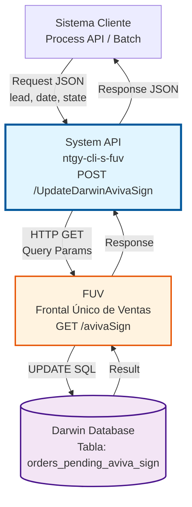
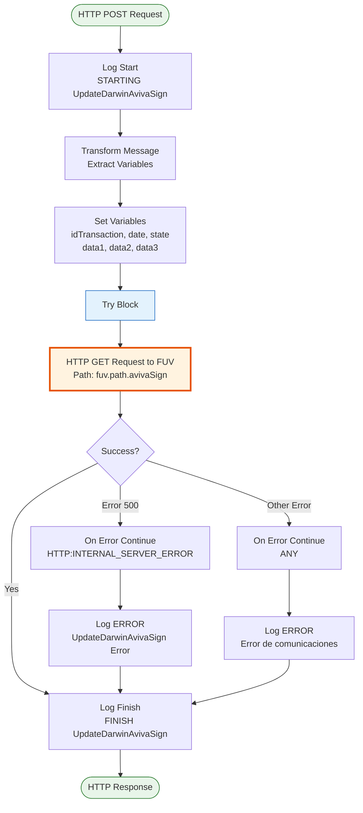
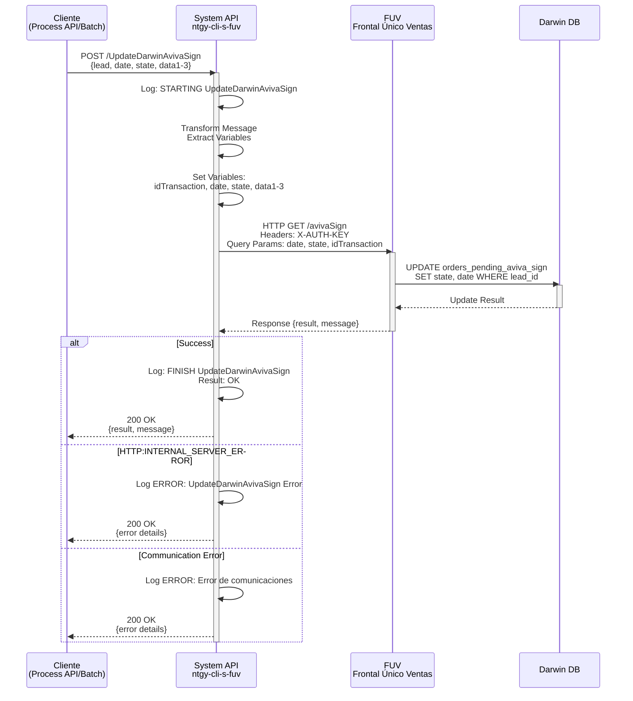
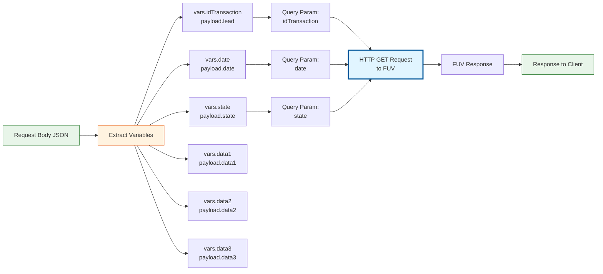
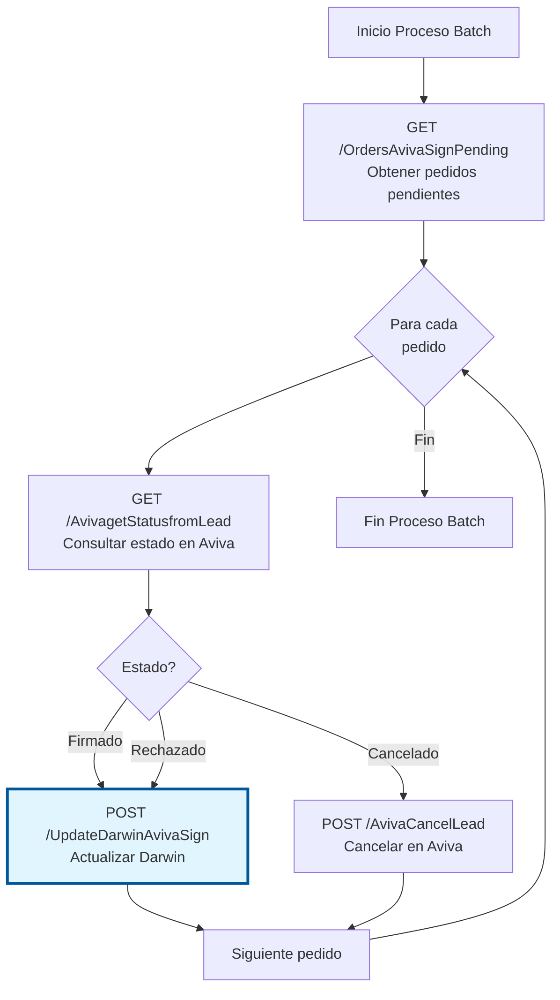

# POST /UpdateDarwinAvivaSign

## 📌 Descripción General

### Propósito del Endpoint

Este endpoint actualiza en Darwin el estado de la solicitud de firma digital a Aviva, actuando como proxy hacia el sistema FUV. Permite sincronizar el estado de firma entre Aviva y Darwin cuando un cliente completa, rechaza o cancela el proceso de firma digital de un contrato.

El endpoint soporta:
- **Actualización de Estado de Firma**: Sincroniza el estado de firma desde Aviva hacia Darwin
- **Registro de Fecha de Firma**: Almacena la fecha en que se completó la firma
- **Tracking de Transacciones**: Mantiene trazabilidad del proceso de firma mediante ID de transacción
- **Gestión de Datos Adicionales**: Permite almacenar hasta 3 campos de datos adicionales (data1, data2, data3)

### Tipo de API

**Capa:** System API (API-Led Connectivity)

**Función:** Proxy HTTP hacia FUV para actualizar estados de firma digital Aviva en Darwin.

### Patrón de Integración

**Tipo:** Request-Reply Síncrono con HTTP Request a FUV

**Descripción:** Recibe datos de actualización de firma, transforma los parámetros, realiza una llamada HTTP GET a FUV (que internamente actualiza Darwin), y retorna el resultado de la operación.

### Arquitectura API-Led Connectivity



---

## 💼 Propósito del Negocio

### Casos de Uso Principales

1. **Actualización de Firma Completada**
   - Cliente completa firma digital en plataforma Aviva
   - Sistema actualiza estado en Darwin a "Firmado"
   - Se registra fecha y URL del documento firmado
   - **Beneficio:** Automatización del proceso de firma sin intervención manual

2. **Registro de Firma Rechazada**
   - Cliente rechaza o cancela proceso de firma
   - Sistema actualiza estado en Darwin a "Rechazado" o "Cancelado"
   - Se mantiene trazabilidad del rechazo
   - **Beneficio:** Visibilidad completa del estado de contratos

3. **Sincronización Batch de Estados**
   - Proceso batch consulta pedidos pendientes de firma
   - Para cada pedido, actualiza estado según respuesta de Aviva
   - Sincronización masiva de estados
   - **Beneficio:** Reducción de tiempos de procesamiento y errores manuales

### Contexto Empresarial

- **Dominio:** Gestión de Ventas y Contratos
- **Sector:** Energía - Utilities
- **División:** Naturgy España - Clientes
- **Proceso de Negocio:** Firma Digital de Contratos con Aviva
- **Sistema Integrado:** FUV (Frontal Único de Ventas) → Darwin

### Stakeholders

- **Equipo de Ventas**: Seguimiento en tiempo real del estado de firmas de contratos
- **Equipo Aviva**: Sincronización automática de estados entre plataformas
- **Equipo Darwin**: Mantenimiento de integridad de datos de pedidos
- **Sistemas de Reporting**: Trazabilidad completa del proceso de firma

### Valor de Negocio

- **Automatización Completa**: Eliminación de actualización manual de estados
- **Trazabilidad Total**: Registro completo del ciclo de vida de firma digital
- **Reducción de Errores**: Sincronización automática previene inconsistencias
- **Mejora de Tiempos**: Actualización inmediata vs. procesos manuales
- **Visibilidad de Negocio**: Métricas en tiempo real de conversión de firmas

### Consumidores Potenciales

Este endpoint puede ser consumido por:
- Process APIs de gestión de pedidos y contratos
- Procesos batch de sincronización con Aviva
- Sistemas de workflow de firma digital
- Integraciones de terceros autorizados (con autenticación)

---

## 🔧 Especificación Técnica

### URLs por Ambiente

| Ambiente | URL Base | URL Completa |
|----------|----------|--------------|
| **Local** | `http://localhost:8081` | `http://localhost:8081/api/UpdateDarwinAvivaSign` |
| **Development** | `https://ntgy-cli-s-fuv-dev.cloudhub.io` | `https://ntgy-cli-s-fuv-dev.cloudhub.io/api/UpdateDarwinAvivaSign` |
| **UAT** | `https://ntgy-cli-s-fuv-uat.cloudhub.io` | `https://ntgy-cli-s-fuv-uat.cloudhub.io/api/UpdateDarwinAvivaSign` |
| **Production** | `https://ntgy-cli-s-fuv-pro.cloudhub.io` | `https://ntgy-cli-s-fuv-pro.cloudhub.io/api/UpdateDarwinAvivaSign` |

### Método HTTP

```
POST /api/UpdateDarwinAvivaSign
```

### Parámetros de Entrada

#### Headers HTTP

| Header | Tipo | Requerido | Descripción | Ejemplo |
|--------|------|-----------|-------------|---------|
| `Content-Type` | string | ✅ Sí | Tipo de contenido del request | `application/json` |
| `Accept` | string | ❌ No | Tipo de contenido esperado en response | `application/json` |

#### Body Parameters

**Estructura del Request Body:**

| Campo | Tipo | Requerido | Descripción | Ejemplo |
|-------|------|-----------|-------------|---------|
| `lead` | string | ✅ Sí | ID de transacción del Lead en Aviva | `"LEAD-12345"` |
| `date` | string | ✅ Sí | Fecha de la firma (formato ISO 8601) | `"2026-07-13T10:30:00Z"` |
| `state` | string | ✅ Sí | Estado de la firma (Firmado, Rechazado, Cancelado) | `"Firmado"` |
| `data1` | string | ❌ No | Campo de datos adicional 1 | `"URL_documento"` |
| `data2` | string | ❌ No | Campo de datos adicional 2 | `"IP_cliente"` |
| `data3` | string | ❌ No | Campo de datos adicional 3 | `"metadata"` |

**Ejemplo de Request Body:**

```json
{
  "lead": "LEAD-12345",
  "date": "2026-07-13T10:30:00Z",
  "state": "Firmado",
  "data1": "https://aviva.com/docs/signed/12345.pdf",
  "data2": "192.168.1.100",
  "data3": "additional_metadata"
}
```

### Respuestas

#### Respuesta Exitosa (200 OK)

```json
{
  "result": "OK",
  "message": "Estado actualizado correctamente en Darwin",
  "lead": "LEAD-12345",
  "state": "Firmado"
}
```

**Nota:** La estructura exacta de la respuesta depende de la implementación de FUV. El endpoint actúa como proxy y retorna la respuesta de FUV.

#### Respuesta de Error de Comunicación (200 OK con error)

```json
{
  "result": "ERROR",
  "message": "Error de comunicación con FUV",
  "errorDescription": "HTTP:INTERNAL_SERVER_ERROR"
}
```

#### Respuesta de Error Técnico (500)

```json
{
  "error": "Internal Server Error",
  "message": "Error al procesar la solicitud"
}
```

### Autenticación y Autorización

- **Tipo:** Client ID & Client Secret (Anypoint Platform)
- **Autenticación FUV:** El System API incluye automáticamente:
  - Header `X-AUTH-KEY` con API Key de FUV (secure property)
  - Header `Content-Type: application/x-www-form-urlencoded`

### Timeouts

| Tipo | Valor | Descripción |
|------|-------|-------------|
| **Request Timeout** | 30 segundos | Tiempo máximo de espera para respuesta de FUV |
| **Connection Timeout** | 10 segundos | Tiempo máximo para establecer conexión con FUV |

### Manejo de Errores

El endpoint implementa manejo de errores específico:

1. **HTTP:INTERNAL_SERVER_ERROR**: Error del servidor FUV
   - Se registra en logs con nivel ERROR
   - Se continúa el flujo (on-error-continue)
   - Se retorna respuesta con información del error

2. **ANY (Otros errores)**: Errores de comunicación
   - Se registra en logs con nivel ERROR y stack trace completo
   - Se continúa el flujo (on-error-continue)
   - Se retorna respuesta indicando error de comunicación

---

## 🏗️ Implementación Técnica

### Arquitectura del Flow



### Diagrama de Secuencia Detallado



### Componentes del Flow

#### 1. Sub-flow Principal
**Nombre:** `UpdateDarwinAvivaSignSub_Flow`
**Archivo:** `s-fuv-UpdateDarwinAvivaSign.xml` (líneas 8-66)

#### 2. Logging de Entrada
**Línea:** 9
```xml
<logger level="INFO" message="STARTING UpdateDarwinAvivaSign METHOD. REQUEST: #[payload.lead] #[payload.state]"/>
```

#### 3. Transformación de Variables
**Líneas:** 10-39
```dataweave
%dw 2.0
output application/java
---
{
    idTransaction: payload."lead",
    date: payload."date",
    state: payload."state",
    data1: payload."data1",
    data2: payload."data2",
    data3: payload."data3"
}
```

**Variables Extraídas:**
- `vars.idTransaction`: ID del Lead en Aviva
- `vars.date`: Fecha de firma
- `vars.state`: Estado de firma
- `vars.data1`, `vars.data2`, `vars.data3`: Datos adicionales

#### 4. HTTP Request a FUV
**Líneas:** 41-55

**Configuración:**
- **Método:** GET
- **Config:** `HTTP_Request_configuration_FUV_Sin_Tls`
- **Path:** `${fuv.path.avivaSign}` (configurado en properties)

**Headers:**
```dataweave
{
    "X-AUTH-KEY": Mule::p('fuv.apiKey'),
    "Content-Type": "application/x-www-form-urlencoded"
}
```

**Query Parameters:**
```dataweave
{
    "date": vars.date,
    "state": vars.state,
    "idTransaction": vars.idTransaction
}
```

#### 5. Error Handlers
**Líneas:** 56-63

**Handler 1 - HTTP:INTERNAL_SERVER_ERROR:**
```xml
<on-error-continue type="HTTP:INTERNAL_SERVER_ERROR">
    <logger level="ERROR" message="UpdateDarwinAvivaSign Error: [error.description]"/>
</on-error-continue>
```

**Handler 2 - ANY:**
```xml
<on-error-continue type="ANY">
    <logger level="ERROR" message="UpdateDarwinAvivaSign Error de comunicaciones: [error.description]"/>
</on-error-continue>
```

#### 6. Logging de Salida
**Línea:** 65
```xml
<logger level="INFO" message="FINISH UpdateDarwinAvivaSign METHOD. Result: #[payload.result]"/>
```

### Configuración de Integración con FUV

**Archivo de Configuración:** `s-fuv-[env]-config.yaml`

**Propiedades Requeridas:**
```yaml
fuv:
  apiKey: "[SECURE_PROPERTY]"  # API Key para autenticación en FUV
  path:
    avivaSign: "/api/aviva/sign/update"  # Path del endpoint en FUV
```

**HTTP Connector Configuration:**
- **Name:** `HTTP_Request_configuration_FUV_Sin_Tls`
- **Protocol:** HTTP (red interna segura)
- **Host:** Configurado por ambiente
- **Port:** Configurado por ambiente
- **Connection Timeout:** 10 segundos
- **Response Timeout:** 30 segundos

### Diagrama de Transformación de Datos



### Consideraciones Técnicas

#### Seguridad
- **API Key Management**: La API Key de FUV se gestiona mediante Secure Properties
- **No Logging de Datos Sensibles**: Los datos de firma no se loggean en detalle
- **Headers Automáticos**: El System API añade automáticamente headers de autenticación

#### Performance
- **Timeout Configurado**: 30 segundos para operaciones de actualización
- **Error Handling Robusto**: Continúa el flujo incluso con errores para no bloquear procesos batch
- **Logging Estructurado**: Logs con información suficiente para troubleshooting

#### Resiliencia
- **On-Error-Continue**: Los errores no detienen el flujo, permitiendo procesamiento batch
- **Logging Detallado**: Todos los errores se registran con descripción completa
- **Retry Policy**: No implementado (operación idempotente, puede reintentarse desde cliente)

---

## 💻 Ejemplos de Uso

### Ejemplo 1: Actualización de Firma Completada

**Request:**
```bash
curl -X POST "https://ntgy-cli-s-fuv-dev.cloudhub.io/api/UpdateDarwinAvivaSign" \
  -H "Content-Type: application/json" \
  -H "client_id: YOUR_CLIENT_ID" \
  -H "client_secret: YOUR_CLIENT_SECRET" \
  -d '{
    "lead": "LEAD-2026-12345",
    "date": "2026-07-13T10:30:00Z",
    "state": "Firmado",
    "data1": "https://aviva.com/docs/signed/12345.pdf",
    "data2": "192.168.1.100",
    "data3": "Firma completada desde portal web"
  }'
```

**Response (200 OK):**
```json
{
  "result": "OK",
  "message": "Estado actualizado correctamente en Darwin",
  "lead": "LEAD-2026-12345",
  "state": "Firmado",
  "timestamp": "2026-07-13T10:30:15Z"
}
```

### Ejemplo 2: Actualización de Firma Rechazada

**Request:**
```bash
curl -X POST "https://ntgy-cli-s-fuv-uat.cloudhub.io/api/UpdateDarwinAvivaSign" \
  -H "Content-Type: application/json" \
  -H "client_id: YOUR_CLIENT_ID" \
  -H "client_secret: YOUR_CLIENT_SECRET" \
  -d '{
    "lead": "LEAD-2026-67890",
    "date": "2026-07-13T11:45:00Z",
    "state": "Rechazado",
    "data1": "Cliente rechazó términos y condiciones",
    "data2": "192.168.1.101"
  }'
```

**Response (200 OK):**
```json
{
  "result": "OK",
  "message": "Estado actualizado correctamente en Darwin",
  "lead": "LEAD-2026-67890",
  "state": "Rechazado",
  "timestamp": "2026-07-13T11:45:10Z"
}
```

### Ejemplo 3: Error de Comunicación con FUV

**Request:**
```bash
curl -X POST "https://ntgy-cli-s-fuv-pro.cloudhub.io/api/UpdateDarwinAvivaSign" \
  -H "Content-Type: application/json" \
  -H "client_id: YOUR_CLIENT_ID" \
  -H "client_secret: YOUR_CLIENT_SECRET" \
  -d '{
    "lead": "LEAD-2026-11111",
    "date": "2026-07-13T12:00:00Z",
    "state": "Firmado"
  }'
```

**Response (200 OK con error):**
```json
{
  "result": "ERROR",
  "message": "Error de comunicación con FUV",
  "errorType": "HTTP:CONNECTIVITY",
  "errorDescription": "Connection timeout after 10 seconds",
  "timestamp": "2026-07-13T12:00:15Z"
}
```

### Ejemplo 4: Procesamiento Batch (JavaScript)

```javascript
// Ejemplo de procesamiento batch de actualizaciones de firma
const axios = require('axios');

const API_BASE_URL = 'https://ntgy-cli-s-fuv-pro.cloudhub.io/api';
const CLIENT_ID = process.env.CLIENT_ID;
const CLIENT_SECRET = process.env.CLIENT_SECRET;

async function updateDarwinAvivaSign(lead, date, state, additionalData = {}) {
  try {
    const response = await axios.post(
      `${API_BASE_URL}/UpdateDarwinAvivaSign`,
      {
        lead: lead,
        date: date,
        state: state,
        data1: additionalData.data1 || null,
        data2: additionalData.data2 || null,
        data3: additionalData.data3 || null
      },
      {
        headers: {
          'Content-Type': 'application/json',
          'client_id': CLIENT_ID,
          'client_secret': CLIENT_SECRET
        },
        timeout: 35000 // 35 segundos
      }
    );
    
    console.log(`✅ Lead ${lead} actualizado: ${response.data.result}`);
    return response.data;
  } catch (error) {
    console.error(`❌ Error actualizando Lead ${lead}:`, error.message);
    throw error;
  }
}

// Procesamiento batch de múltiples actualizaciones
async function processBatchUpdates(updates) {
  const results = [];
  
  for (const update of updates) {
    try {
      const result = await updateDarwinAvivaSign(
        update.lead,
        update.date,
        update.state,
        {
          data1: update.signUrl,
          data2: update.clientIp,
          data3: update.metadata
        }
      );
      results.push({ lead: update.lead, success: true, result });
    } catch (error) {
      results.push({ lead: update.lead, success: false, error: error.message });
    }
    
    // Pequeña pausa entre requests para no saturar el sistema
    await new Promise(resolve => setTimeout(resolve, 100));
  }
  
  return results;
}

// Ejemplo de uso
const pendingUpdates = [
  {
    lead: 'LEAD-2026-001',
    date: '2026-07-13T10:00:00Z',
    state: 'Firmado',
    signUrl: 'https://aviva.com/docs/001.pdf',
    clientIp: '192.168.1.100',
    metadata: 'Firma web'
  },
  {
    lead: 'LEAD-2026-002',
    date: '2026-07-13T10:15:00Z',
    state: 'Firmado',
    signUrl: 'https://aviva.com/docs/002.pdf',
    clientIp: '192.168.1.101',
    metadata: 'Firma móvil'
  }
];

processBatchUpdates(pendingUpdates)
  .then(results => {
    const successful = results.filter(r => r.success).length;
    const failed = results.filter(r => !r.success).length;
    console.log(`\n📊 Resumen: ${successful} exitosos, ${failed} fallidos`);
  })
  .catch(error => {
    console.error('Error en procesamiento batch:', error);
  });
```

### Ejemplo 5: Integración con Process API (DataWeave)

```dataweave
%dw 2.0
output application/json
---
{
  // Preparar request para System API
  lead: payload.avivaLeadId,
  date: now() as String {format: "yyyy-MM-dd'T'HH:mm:ss'Z'"},
  state: if (payload.signatureCompleted) "Firmado" 
         else if (payload.signatureRejected) "Rechazado"
         else "Cancelado",
  data1: payload.signedDocumentUrl,
  data2: payload.clientIpAddress,
  data3: "Procesado por Process API: " ++ payload.processApiName
}
```

---

## 📚 Información Adicional

### Relación con Otros Endpoints

Este endpoint forma parte del flujo completo de firma digital con Aviva:

1. **GET /OrdersAvivaSignPending**: Consulta pedidos pendientes de firma
2. **GET /AvivagetStatusfromLead**: Consulta estado actual en Aviva
3. **POST /UpdateDarwinAvivaSign**: ⭐ **Este endpoint** - Actualiza estado en Darwin
4. **POST /AvivaCancelLead**: Cancela Lead en Aviva si es necesario

### Flujo Típico de Procesamiento Batch



### Mejores Prácticas

1. **Idempotencia**: El endpoint puede llamarse múltiples veces con los mismos datos sin efectos adversos
2. **Timeout Handling**: Implementar timeouts en el cliente (35-40 segundos recomendado)
3. **Error Handling**: Capturar y loggear errores, pero continuar con siguiente registro en batch
4. **Retry Logic**: Implementar retry con backoff exponencial en caso de errores de comunicación
5. **Monitoring**: Monitorear tasa de éxito/error para detectar problemas con FUV

### Troubleshooting

**Problema:** Timeout en requests
- **Causa:** FUV puede estar lento o no disponible
- **Solución:** Verificar estado de FUV, aumentar timeout si es necesario

**Problema:** Error HTTP:INTERNAL_SERVER_ERROR
- **Causa:** Error en FUV al procesar la actualización
- **Solución:** Revisar logs de FUV, verificar formato de datos

**Problema:** Lead no encontrado
- **Causa:** El Lead no existe en Darwin o ya fue procesado
- **Solución:** Verificar que el Lead existe antes de actualizar

---

**Última Actualización:** 2026-07-13  
**Versión del API:** 1.22.0-SNAPSHOT  
**Mantenido por:** Equipo MuleSoft Naturgy