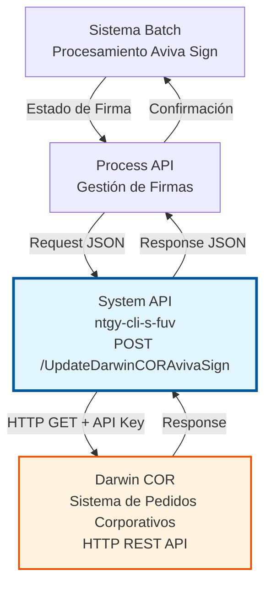
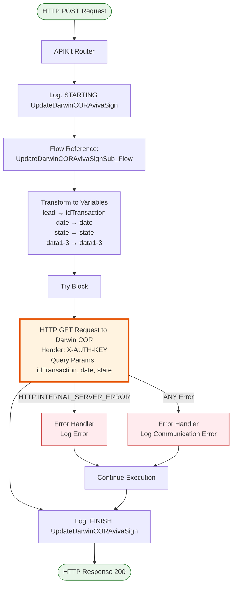
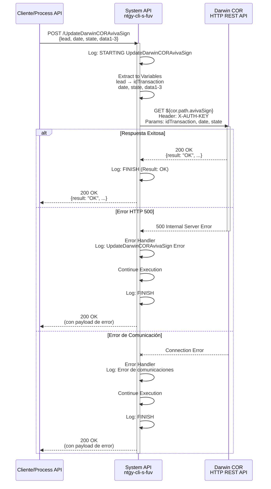
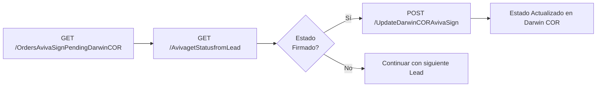

# POST /UpdateDarwinCORAvivaSign

## 📌 Descripción General

### Propósito del Endpoint

Este endpoint actualiza el estado de firma digital Aviva Sign en el sistema Darwin COR para pedidos corporativos. Actúa como proxy hacia Darwin COR, enviando la información de estado de firma mediante una petición HTTP GET con query parameters.

El endpoint soporta:
- **Actualización de Estado de Firma**: Sincroniza el estado de firma digital desde Aviva hacia Darwin COR
- **Trazabilidad de Firma Digital**: Mantiene registro del estado de firma en Darwin COR
- **Integración Darwin COR**: Específico para pedidos corporativos gestionados en Darwin COR
- **Datos Adicionales**: Permite enviar hasta 3 campos de datos adicionales (data1, data2, data3)

### Tipo de API

**Capa:** System API (API-Led Connectivity)

**Función:** Integración directa con Darwin COR mediante HTTP REST para actualizar estados de firma digital en pedidos corporativos.

### Patrón de Integración

**Tipo:** Request-Reply Síncrono con HTTP REST

**Descripción:** Recibe los datos de firma (lead, date, state, data1-3), extrae los valores a variables, realiza una petición HTTP GET a Darwin COR con query parameters y API Key, y retorna el resultado de la operación.

### Arquitectura API-Led Connectivity



---

## 💼 Propósito del Negocio

### Casos de Uso Principales

1. **Sincronización de Estado de Firma Digital**
   - Un pedido corporativo en Darwin COR requiere firma digital mediante Aviva Sign
   - El sistema Aviva procesa la firma y genera un estado
   - Este endpoint actualiza el estado en Darwin COR para mantener sincronización

2. **Procesamiento Batch de Firmas Pendientes**
   - Un proceso batch consulta pedidos pendientes de firma en Darwin COR
   - Para cada pedido firmado, se actualiza el estado mediante este endpoint
   - Permite trazabilidad completa del proceso de firma

3. **Gestión de Ciclo de Vida de Contratos Corporativos**
   - Los contratos corporativos requieren firma digital
   - El estado de firma se registra en Darwin COR para seguimiento
   - Facilita reportes y auditoría del proceso de contratación

### Contexto Empresarial

- **Dominio:** Gestión de Firmas Digitales y Contratos Corporativos
- **Sector:** Energía - Utilities
- **División:** Naturgy España - Clientes Corporativos
- **Proceso de Negocio:** Contratación y Firma Digital de Servicios Energéticos
- **Sistema Backend:** Darwin COR (Pedidos Corporativos)

### Stakeholders

- **Equipo de Ventas Corporativas**: Necesita visibilidad del estado de firma de contratos
- **Equipo de Operaciones**: Gestiona el procesamiento de pedidos corporativos
- **Equipo de Aviva**: Proporciona el servicio de firma digital
- **Equipo de Darwin COR**: Mantiene el sistema de pedidos corporativos

### Valor de Negocio

- **Trazabilidad Completa**: Registro centralizado del estado de firma en Darwin COR
- **Automatización**: Sincronización automática sin intervención manual
- **Visibilidad**: Los equipos pueden consultar el estado de firma en tiempo real
- **Auditoría**: Historial completo de cambios de estado para cumplimiento normativo
- **Flexibilidad**: Campos adicionales (data1-3) para información complementaria

### Consumidores Potenciales

Este endpoint puede ser consumido por:
- Process APIs de gestión de firmas digitales
- Procesos batch de sincronización Aviva-Darwin COR
- Sistemas de orquestación de workflows de contratación
- Integraciones de terceros autorizados para gestión de contratos corporativos

---

## 🔧 Especificación Técnica

### URLs por Ambiente

| Ambiente | URL Base | URL Completa |
|----------|----------|--------------|
| **Local** | `http://localhost:8081` | `http://localhost:8081/api/UpdateDarwinCORAvivaSign` |
| **Development** | `https://ntgy-cli-s-fuv-dev.cloudhub.io` | `https://ntgy-cli-s-fuv-dev.cloudhub.io/api/UpdateDarwinCORAvivaSign` |
| **UAT** | `https://ntgy-cli-s-fuv-uat.cloudhub.io` | `https://ntgy-cli-s-fuv-uat.cloudhub.io/api/UpdateDarwinCORAvivaSign` |
| **Production** | `https://ntgy-cli-s-fuv-pro.cloudhub.io` | `https://ntgy-cli-s-fuv-pro.cloudhub.io/api/UpdateDarwinCORAvivaSign` |

### Método HTTP

```
POST /api/UpdateDarwinCORAvivaSign
```

### Parámetros de Entrada

#### Headers HTTP

| Header | Tipo | Requerido | Descripción | Ejemplo |
|--------|------|-----------|-------------|---------|
| `Content-Type` | string | ✅ Sí | Tipo de contenido del request | `application/json` |
| `Accept` | string | ❌ No | Tipo de contenido esperado en response | `application/json` |

#### Body Parameters

| Campo | Tipo | Requerido | Descripción | Ejemplo |
|-------|------|-----------|-------------|---------|
| `lead` | string | ✅ Sí | ID del Lead/Transacción en Darwin COR | `"LEAD-12345"` |
| `date` | string | ✅ Sí | Fecha de la actualización | `"2026-07-13"` |
| `state` | string | ✅ Sí | Estado de firma Aviva Sign | `"Firmado"` |
| `data1` | string | ❌ No | Campo de datos adicional 1 | `"info adicional"` |
| `data2` | string | ❌ No | Campo de datos adicional 2 | `"info adicional"` |
| `data3` | string | ❌ No | Campo de datos adicional 3 | `"info adicional"` |

**Estructura del Request:**

```json
{
  "lead": "LEAD-12345",
  "date": "2026-07-13",
  "state": "Firmado",
  "data1": "opcional",
  "data2": "opcional",
  "data3": "opcional"
}
```

### Respuestas

#### Respuesta Exitosa (200 OK)

La respuesta depende del sistema Darwin COR. Típicamente incluye un campo `result`:

```json
{
  "result": "OK",
  "message": "Estado actualizado correctamente"
}
```

#### Respuesta de Error (200 OK con error)

```json
{
  "result": "ERROR",
  "message": "Descripción del error"
}
```

#### Respuesta de Error Técnico (500)

En caso de error de comunicación, el endpoint continúa y registra el error en logs.

### Códigos de Estado HTTP

| Código | Descripción | Cuándo Ocurre |
|--------|-------------|---------------|
| `200` | OK | Operación completada (verificar campo `result` en el body) |
| `400` | Bad Request | Request malformado o campos requeridos faltantes |
| `500` | Internal Server Error | Error en la conexión con Darwin COR |

### Autenticación y Autorización

#### Autenticación del Cliente
- **Tipo:** Client ID & Client Secret (Anypoint Platform)

#### Autenticación con Darwin COR
- **Tipo:** API Key
- **Header:** `X-AUTH-KEY`
- **Valor:** Configurado en `cor.apiKey` (secure property)
- **Descripción:** El System API incluye automáticamente la API Key en el header al comunicarse con Darwin COR

### Timeouts

| Tipo | Valor | Descripción |
|------|-------|-------------|
| **Request Timeout** | 30 segundos | Tiempo máximo de espera para la respuesta de Darwin COR |
| **Connection Timeout** | 10 segundos | Tiempo máximo para establecer conexión con Darwin COR |

---

## 🏗️ Implementación Técnica

### Arquitectura del Flow



### Componentes del Flow

#### 1. APIKit Router (s-fuv.xml)

**Ubicación:** Línea 175-178 en `s-fuv.xml`

```xml
<flow name="post:\UpdateDarwinCORAvivaSign:application\json:s-fuv-router">
    <logger level="INFO" message="post:\UpdateDarwinCORAvivaSign:application\json:s-fuv-router" />
    <flow-ref doc:name="Flow Reference" name="UpdateDarwinCORAvivaSignSub_Flow"/>
</flow>
```

**Función:** Enruta las peticiones POST a `/UpdateDarwinCORAvivaSign` hacia el subflow de implementación.

#### 2. Subflow Principal (s-fuv-UpdateDarwinCORAvivaSign.xml)

**Ubicación:** Líneas 8-66 en `s-fuv-UpdateDarwinCORAvivaSign.xml`

##### 2.1. Log de Entrada (Línea 9)

```xml
<logger level="INFO" message="STARTING UpdateDarwinCORAvivaSign METHOD. REQUEST: #[payload.&quot;lead&quot;] #[payload.&quot;state&quot;]"/>
```

##### 2.2. Transformación a Variables (Líneas 10-39)

```xml
<ee:transform>
    <ee:variables>
        <ee:set-variable variableName="idTransaction">
            %dw 2.0
            output application/java
            ---
            payload."lead"
        </ee:set-variable>
        <ee:set-variable variableName="date">
            %dw 2.0
            output application/java
            ---
            payload."date"
        </ee:set-variable>
        <ee:set-variable variableName="state">
            %dw 2.0
            output application/java
            ---
            payload."state"
        </ee:set-variable>
        <ee:set-variable variableName="data1">
            %dw 2.0
            output application/java
            ---
            payload."data1"
        </ee:set-variable>
        <ee:set-variable variableName="data2">
            %dw 2.0
            output application/java
            ---
            payload."data2"
        </ee:set-variable>
        <ee:set-variable variableName="data3">
            %dw 2.0
            output application/java
            ---
            payload."data3"
        </ee:set-variable>
    </ee:variables>
</ee:transform>
```

**Propósito:** Extrae los campos del payload JSON a variables de Mule para su uso posterior.

**Mapeo:**
- `payload.lead` → `vars.idTransaction`
- `payload.date` → `vars.date`
- `payload.state` → `vars.state`
- `payload.data1` → `vars.data1`
- `payload.data2` → `vars.data2`
- `payload.data3` → `vars.data3`

##### 2.3. HTTP Request a Darwin COR (Líneas 40-55)

```xml
<try>
    <http:request method="GET" 
                  config-ref="HTTP_Request_configuration_COR_Sin_Tls" 
                  path="${cor.path.avivaSign}">
        <http:headers>
            <![CDATA[#[output application/java
            ---
            {
                "X-AUTH-KEY" : Mule::p('cor.apiKey')
            }]]]>
        </http:headers>
        <http:query-params>
            <![CDATA[#[output application/java
            ---
            {
                "date" : vars.date,
                "state" : vars.state,
                "idTransaction" : vars.idTransaction
            }]]]>
        </http:query-params>
    </http:request>
</try>
```

**Configuración:**
- **Método:** GET
- **Config:** `HTTP_Request_configuration_COR_Sin_Tls`
- **Path:** Configurado en `cor.path.avivaSign`
- **Header:** `X-AUTH-KEY` con valor de `cor.apiKey` (secure property)
- **Query Parameters:** `date`, `state`, `idTransaction`

**Nota Importante:** Aunque el endpoint expuesto es POST, internamente realiza un GET a Darwin COR con query parameters.

##### 2.4. Error Handlers (Líneas 56-63)

```xml
<error-handler>
    <on-error-continue type="HTTP:INTERNAL_SERVER_ERROR">
        <logger level="ERROR" 
                message="#['UpdateDarwinCORAvivaSign Error: ' ++ (error.description default &quot;null&quot; as String)]"/>
    </on-error-continue>
    <on-error-continue type="ANY">
        <logger level="ERROR" 
                message="#['UpdateDarwinCORAvivaSign Error de comunicaciones: ' ++ (error.description default &quot;null&quot; as String)]"/>
    </on-error-continue>
</error-handler>
```

**Estrategia:** `on-error-continue` - El flow continúa ejecutándose incluso si hay error, registrando el error en logs.

##### 2.5. Log de Salida (Línea 65)

```xml
<logger level="INFO" message="FINISH UpdateDarwinCORAvivaSign METHOD. REQUEST: Result: #[payload.&quot;result&quot;]"/>
```

### Integración HTTP con Darwin COR

#### Configuración HTTP

**Config Reference:** `HTTP_Request_configuration_COR_Sin_Tls`

**Características:**
- Conexión sin TLS (red interna segura)
- Host y puerto configurados por ambiente
- Connection pooling habilitado
- Timeouts configurables

#### Autenticación con API Key

**Header:** `X-AUTH-KEY`

**Valor:** `Mule::p('cor.apiKey')`

**Descripción:** 
- La API Key se obtiene de las secure properties
- Se configura por ambiente (dev, uat, pro)
- Es específica para Darwin COR (diferente de `fuv.apiKey`)

#### Query Parameters Enviados

| Parámetro | Origen | Descripción |
|-----------|--------|-------------|
| `idTransaction` | `vars.idTransaction` (del campo `lead`) | ID del Lead/Transacción |
| `date` | `vars.date` | Fecha de actualización |
| `state` | `vars.state` | Estado de firma |

**Nota:** Los campos `data1`, `data2`, `data3` se extraen a variables pero NO se envían en los query parameters a Darwin COR.

### Diagrama de Secuencia Completo



### Configuración por Ambiente

#### Propiedades Configurables

| Propiedad | Descripción | Ejemplo |
|-----------|-------------|---------|
| `cor.apiKey` | API Key para Darwin COR | `"abc123xyz..."` (secure) |
| `cor.path.avivaSign` | Path del endpoint en Darwin COR | `"/api/v1/avivaSign"` |

**Ubicación:** Archivos de configuración por ambiente (`s-fuv-{env}-config.yaml`)

### Logging y Trazabilidad

**Puntos de Logging:**

1. **Entrada del Flow:**
   ```
   STARTING UpdateDarwinCORAvivaSign METHOD. REQUEST: [lead] [state]
   ```

2. **Error HTTP 500:**
   ```
   UpdateDarwinCORAvivaSign Error: [error description]
   ```

3. **Error de Comunicación:**
   ```
   UpdateDarwinCORAvivaSign Error de comunicaciones: [error description]
   ```

4. **Salida del Flow:**
   ```
   FINISH UpdateDarwinCORAvivaSign METHOD. REQUEST: Result: [result]
   ```

**Nivel de Log:** INFO para operaciones normales, ERROR para excepciones

---

## 💻 Ejemplos de Uso

### Ejemplo 1: Actualización Exitosa de Estado de Firma

#### Request

```bash
curl -X POST "https://ntgy-cli-s-fuv-dev.cloudhub.io/api/UpdateDarwinCORAvivaSign" \
  -H "Content-Type: application/json" \
  -H "client_id: YOUR_CLIENT_ID" \
  -H "client_secret: YOUR_CLIENT_SECRET" \
  -d '{
    "lead": "LEAD-12345",
    "date": "2026-07-13",
    "state": "Firmado"
  }'
```

#### Response (200 OK)

```json
{
  "result": "OK",
  "message": "Estado actualizado correctamente en Darwin COR"
}
```

### Ejemplo 2: Actualización con Datos Adicionales

#### Request

```bash
curl -X POST "https://ntgy-cli-s-fuv-uat.cloudhub.io/api/UpdateDarwinCORAvivaSign" \
  -H "Content-Type: application/json" \
  -H "client_id: YOUR_CLIENT_ID" \
  -H "client_secret: YOUR_CLIENT_SECRET" \
  -d '{
    "lead": "LEAD-67890",
    "date": "2026-07-13",
    "state": "Pendiente",
    "data1": "Información adicional 1",
    "data2": "Información adicional 2",
    "data3": "Información adicional 3"
  }'
```

#### Response (200 OK)

```json
{
  "result": "OK",
  "message": "Estado actualizado correctamente"
}
```

### Ejemplo 3: Error - Lead No Encontrado

#### Request

```bash
curl -X POST "https://ntgy-cli-s-fuv-dev.cloudhub.io/api/UpdateDarwinCORAvivaSign" \
  -H "Content-Type: application/json" \
  -H "client_id: YOUR_CLIENT_ID" \
  -H "client_secret: YOUR_CLIENT_SECRET" \
  -d '{
    "lead": "LEAD-INVALID",
    "date": "2026-07-13",
    "state": "Firmado"
  }'
```

#### Response (200 OK)

```json
{
  "result": "ERROR",
  "message": "Lead no encontrado en Darwin COR"
}
```

### Ejemplo 4: Error - Campo Requerido Faltante

#### Request

```bash
curl -X POST "https://ntgy-cli-s-fuv-dev.cloudhub.io/api/UpdateDarwinCORAvivaSign" \
  -H "Content-Type: application/json" \
  -H "client_id: YOUR_CLIENT_ID" \
  -H "client_secret: YOUR_CLIENT_SECRET" \
  -d '{
    "lead": "LEAD-12345",
    "date": "2026-07-13"
  }'
```

#### Response (400 Bad Request)

```json
{
  "message": "Bad request"
}
```

### Ejemplo 5: Integración desde JavaScript (Node.js)

```javascript
const axios = require('axios');

async function updateDarwinCORAvivaSign(lead, date, state, additionalData = {}) {
  try {
    const payload = {
      lead: lead,
      date: date,
      state: state
    };
    
    // Agregar datos adicionales si existen
    if (additionalData.data1) payload.data1 = additionalData.data1;
    if (additionalData.data2) payload.data2 = additionalData.data2;
    if (additionalData.data3) payload.data3 = additionalData.data3;
    
    const response = await axios.post(
      'https://ntgy-cli-s-fuv-pro.cloudhub.io/api/UpdateDarwinCORAvivaSign',
      payload,
      {
        headers: {
          'Content-Type': 'application/json',
          'client_id': process.env.CLIENT_ID,
          'client_secret': process.env.CLIENT_SECRET
        }
      }
    );
    
    if (response.data.result === 'OK') {
      console.log('Estado actualizado exitosamente:', response.data.message);
      return true;
    } else {
      console.error('Error al actualizar estado:', response.data.message);
      return false;
    }
  } catch (error) {
    console.error('Error en la petición:', error.message);
    return false;
  }
}

// Uso básico
updateDarwinCORAvivaSign('LEAD-12345', '2026-07-13', 'Firmado');

// Uso con datos adicionales
updateDarwinCORAvivaSign(
  'LEAD-67890', 
  '2026-07-13', 
  'Pendiente',
  {
    data1: 'Info adicional 1',
    data2: 'Info adicional 2',
    data3: 'Info adicional 3'
  }
);
```

### Ejemplo 6: Integración desde Python

```python
import requests
import os
from datetime import datetime

def update_darwin_cor_aviva_sign(lead, state, date=None, data1=None, data2=None, data3=None):
    """
    Actualiza el estado de firma Aviva Sign en Darwin COR
    
    Args:
        lead (str): ID del Lead
        state (str): Estado de firma
        date (str, optional): Fecha de actualización. Default: fecha actual
        data1 (str, optional): Dato adicional 1
        data2 (str, optional): Dato adicional 2
        data3 (str, optional): Dato adicional 3
    
    Returns:
        bool: True si exitoso, False si error
    """
    url = "https://ntgy-cli-s-fuv-pro.cloudhub.io/api/UpdateDarwinCORAvivaSign"
    
    headers = {
        "Content-Type": "application/json",
        "client_id": os.getenv("CLIENT_ID"),
        "client_secret": os.getenv("CLIENT_SECRET")
    }
    
    # Usar fecha actual si no se proporciona
    if date is None:
        date = datetime.now().strftime("%Y-%m-%d")
    
    payload = {
        "lead": lead,
        "date": date,
        "state": state
    }
    
    # Agregar datos adicionales si existen
    if data1:
        payload["data1"] = data1
    if data2:
        payload["data2"] = data2
    if data3:
        payload["data3"] = data3
    
    try:
        response = requests.post(url, json=payload, headers=headers)
        response.raise_for_status()
        
        result = response.json()
        if result.get("result") == "OK":
            print(f"Estado actualizado exitosamente: {result.get('message')}")
            return True
        else:
            print(f"Error al actualizar estado: {result.get('message')}")
            return False
            
    except requests.exceptions.RequestException as e:
        print(f"Error en la petición: {str(e)}")
        return False

# Uso básico
update_darwin_cor_aviva_sign("LEAD-12345", "Firmado")

# Uso con fecha específica
update_darwin_cor_aviva_sign("LEAD-67890", "Pendiente", date="2026-07-15")

# Uso con datos adicionales
update_darwin_cor_aviva_sign(
    lead="LEAD-99999",
    state="Firmado",
    date="2026-07-13",
    data1="Información adicional 1",
    data2="Información adicional 2",
    data3="Información adicional 3"
)
```

### Ejemplo 7: Procesamiento Batch

```javascript
// Procesamiento batch de múltiples Leads
const leadsToUpdate = [
  { lead: "LEAD-12345", date: "2026-07-13", state: "Firmado" },
  { lead: "LEAD-67890", date: "2026-07-13", state: "Firmado" },
  { lead: "LEAD-99999", date: "2026-07-13", state: "Cancelado" }
];

async function processBatchUpdates(leads) {
  const results = {
    success: [],
    failed: []
  };
  
  for (const leadData of leads) {
    const success = await updateDarwinCORAvivaSign(
      leadData.lead,
      leadData.date,
      leadData.state
    );
    
    if (success) {
      results.success.push(leadData.lead);
    } else {
      results.failed.push(leadData.lead);
    }
    
    // Esperar 100ms entre llamadas para evitar sobrecarga
    await new Promise(resolve => setTimeout(resolve, 100));
  }
  
  console.log(`Procesamiento completado:`);
  console.log(`- Exitosos: ${results.success.length}`);
  console.log(`- Fallidos: ${results.failed.length}`);
  
  if (results.failed.length > 0) {
    console.log(`Leads fallidos:`, results.failed);
  }
  
  return results;
}

// Ejecutar batch
processBatchUpdates(leadsToUpdate)
  .then(results => {
    console.log('Batch completado:', results);
  })
  .catch(error => {
    console.error('Error en batch:', error);
  });
```

### Estados Válidos de Firma

Los valores típicos para el campo `state` incluyen:

| Estado | Descripción | Cuándo se Usa |
|--------|-------------|---------------|
| `Pendiente` | Firma pendiente de completar | Estado inicial cuando se crea el Lead |
| `Firmado` | Firma completada exitosamente | Después de que el cliente firma el contrato |
| `Cancelado` | Proceso de firma cancelado | Cuando se cancela el proceso de contratación |
| `Rechazado` | Firma rechazada | Cuando el cliente rechaza firmar |
| `Expirado` | Plazo de firma expirado | Cuando vence el tiempo límite para firmar |

---

## 🔗 Relación con Otros Endpoints

### Endpoints Relacionados

Este endpoint forma parte del flujo de gestión de firma digital Aviva Sign para Darwin COR:

1. **GET /OrdersAvivaSignPendingDarwinCOR**
   - Consulta pedidos corporativos pendientes de firma
   - Proporciona los Leads que necesitan actualización
   - Se ejecuta antes de este endpoint en procesos batch

2. **POST /UpdateDarwinAvivaSign**
   - Endpoint equivalente para Darwin (no corporativo)
   - Misma implementación pero usa `fuv.apiKey` en lugar de `cor.apiKey`
   - Misma lógica pero para pedidos no corporativos

3. **GET /AvivagetStatusfromLead**
   - Consulta el estado actual de firma en Aviva
   - Se usa para obtener el estado antes de actualizar Darwin COR

### Flujo Típico de Integración



### Diferencias con UpdateDarwinAvivaSign

| Aspecto | UpdateDarwinAvivaSign | UpdateDarwinCORAvivaSign |
|---------|----------------------|--------------------------|
| **Sistema Backend** | Darwin (FUV) | Darwin COR |
| **API Key** | `fuv.apiKey` | `cor.apiKey` |
| **Path Config** | `fuv.path.avivaSign` | `cor.path.avivaSign` |
| **HTTP Config** | `HTTP_Request_configuration_FUV_Sin_Tls` | `HTTP_Request_configuration_COR_Sin_Tls` |
| **Tipo de Pedidos** | Pedidos estándar | Pedidos corporativos |
| **Implementación** | Idéntica | Idéntica |

### Notas Importantes

1. **Campos data1, data2, data3**: Aunque se reciben en el request y se extraen a variables, NO se envían a Darwin COR en los query parameters. Solo se envían `idTransaction`, `date` y `state`.

2. **API Key Automática**: El System API gestiona automáticamente la inclusión de la API Key en el header `X-AUTH-KEY`. Los consumidores NO necesitan proporcionar esta API Key.

3. **Error Handling**: El endpoint usa `on-error-continue`, lo que significa que incluso si hay un error en la comunicación con Darwin COR, el flow continúa y retorna una respuesta (posiblemente con información del error).

4. **Método HTTP Interno**: Aunque el endpoint expuesto es POST, internamente realiza un GET a Darwin COR. Esto es una decisión de diseño del sistema Darwin COR.
