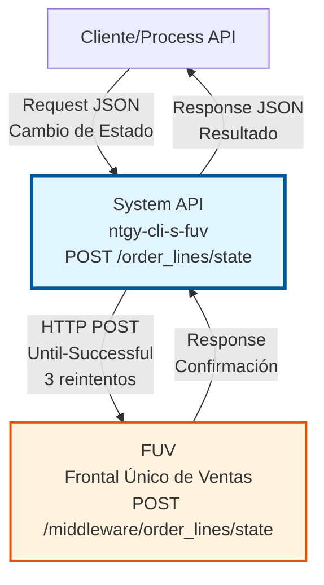
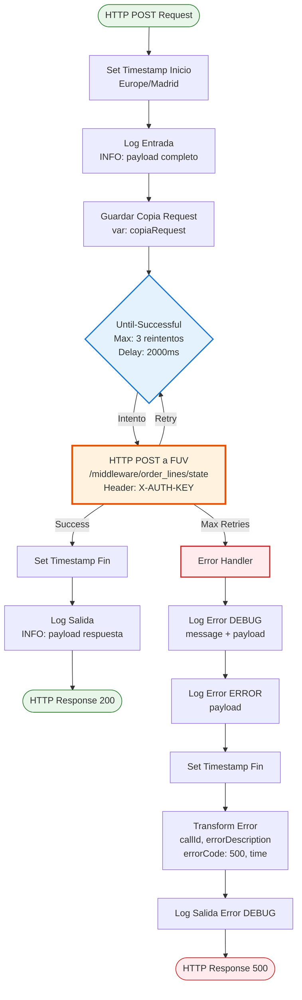
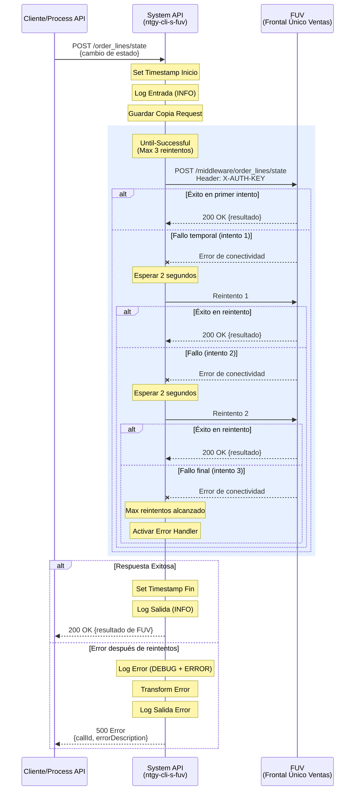

# POST /order_lines/state

## 📌 Descripción General

### Propósito del Endpoint

Este endpoint permite actualizar el estado de una línea de pedido en el sistema FUV (Frontal Único de Ventas). Actúa como un proxy resiliente que garantiza la entrega del cambio de estado mediante una política de reintentos automáticos.

El endpoint soporta:
- **Actualización de Estados**: Cambio de estado de líneas de pedido en FUV
- **Resiliencia**: Política de reintentos automáticos ante fallos temporales
- **Trazabilidad**: Logging completo de entrada, salida y errores con correlationId
- **Sincronización**: Garantiza que los cambios de estado se propaguen correctamente

### Tipo de API

**Capa:** System API (API-Led Connectivity)

**Función:** Integración directa con FUV (Frontal Único de Ventas) para actualización de estados de líneas de pedido.

### Patrón de Integración

**Tipo:** Request-Reply Síncrono con Retry Policy (Until-Successful)

**Descripción:** El endpoint recibe una solicitud de cambio de estado, la reenvía al sistema FUV mediante HTTP POST, y aplica una política de reintentos automáticos (3 intentos con 2 segundos entre cada uno) para garantizar la entrega en caso de fallos temporales de red o disponibilidad.

### Arquitectura API-Led Connectivity



---

## 💼 Propósito del Negocio

### Casos de Uso Principales

1. **Actualización de Estado en Proceso de Venta**
   - Un pedido cambia de estado durante el flujo de ventas (ej: de "Pendiente" a "En Proceso")
   - El sistema necesita notificar a FUV del cambio de estado
   - Se garantiza la sincronización mediante reintentos automáticos

2. **Sincronización de Estados entre Sistemas**
   - Múltiples sistemas necesitan mantener estados consistentes
   - FUV actúa como sistema maestro de estados de pedidos
   - Este endpoint garantiza que los cambios se propaguen correctamente

3. **Gestión del Ciclo de Vida de Pedidos**
   - Los pedidos pasan por diferentes estados durante su ciclo de vida
   - Cada cambio de estado debe registrarse en FUV
   - Se mantiene trazabilidad completa de todos los cambios

### Contexto Empresarial

- **Dominio:** Gestión de Pedidos y Ventas
- **Sector:** Energía - Utilities
- **División:** Naturgy España - Clientes
- **Proceso de Negocio:** Gestión del ciclo de vida de pedidos de gas y electricidad
- **Sistema Principal:** FUV (Frontal Único de Ventas)

### Stakeholders

- **Agentes de Ventas**: Necesitan visibilidad del estado actual de los pedidos
- **Gestores de Pedidos**: Requieren trazabilidad de cambios de estado
- **Sistemas de Integración**: Necesitan sincronizar estados entre múltiples plataformas
- **Equipos de Operaciones**: Monitorean el flujo de pedidos y detectan bloqueos

### Valor de Negocio

- **Consistencia de Datos**: Garantiza que todos los sistemas tengan la misma visión del estado de los pedidos
- **Resiliencia Operacional**: Los reintentos automáticos reducen fallos por problemas temporales de red
- **Trazabilidad Completa**: Cada cambio de estado queda registrado con timestamp y correlationId
- **Reducción de Errores Manuales**: Automatización del proceso de actualización de estados

### Consumidores Potenciales

Este endpoint puede ser consumido por:
- Process APIs de gestión de pedidos
- Process APIs de gestión de ventas
- Sistemas de workflow de pedidos
- Integraciones con sistemas de terceros (Darwin, Aviva)
- Procesos batch de sincronización

---

## 🔧 Especificación Técnica

### URLs por Ambiente

| Ambiente | URL Completa |
|----------|--------------|
| **Local** | `http://localhost:8081/api/order_lines/state` |
| **Development** | `https://ntgy-cli-s-fuv-dev.cloudhub.io/api/order_lines/state` |
| **UAT** | `https://ntgy-cli-s-fuv-uat.cloudhub.io/api/order_lines/state` |
| **UAT01** | `https://ntgy-cli-s-fuv-uat01.cloudhub.io/api/order_lines/state` |
| **Production** | `https://ntgy-cli-s-fuv-pro.cloudhub.io/api/order_lines/state` |

### Método HTTP

```
POST /api/order_lines/state
```

### Parámetros de Entrada

#### Headers HTTP

| Header | Tipo | Requerido | Descripción | Ejemplo |
|--------|------|-----------|-------------|---------|
| `Content-Type` | string | ✅ Sí | Tipo de contenido del request | `application/json` |
| `Accept` | string | ❌ No | Tipo de contenido esperado en response | `application/json` |

#### Body Parameters

**⚠️ IMPORTANTE - Pass-Through Pattern:**

Este endpoint actúa como un **proxy transparente** hacia FUV. El payload JSON recibido se envía **directamente a FUV sin ninguna transformación ni validación** en el System API.

**Características del Body:**
- **Formato:** JSON (application/json)
- **Validación:** No hay validación de estructura en este System API
- **Transformación:** Ninguna - pass-through completo
- **Estructura:** Definida por FUV (sistema destino)

**Implementación en el Código:**
```xml
<!-- El payload se guarda y se envía sin modificación -->
<set-variable value="#[payload]" variableName="copiaRequest"/>
<http:request method="POST" path="${fuv.path.cambioEstado}">
    <!-- Payload se envía tal cual a FUV -->
</http:request>
```

**Campos Requeridos:**
Consultar la documentación de FUV para conocer:
- Campos obligatorios del payload
- Tipos de datos esperados
- Validaciones de negocio
- Valores permitidos para estados

**Nota Técnica:** Este System API no impone ninguna restricción sobre la estructura del payload. Cualquier JSON válido será enviado a FUV, donde se realizarán las validaciones correspondientes.

### Respuestas

#### Respuesta Exitosa (200 OK)

**⚠️ IMPORTANTE - Pass-Through Response:**

La respuesta exitosa retorna **exactamente lo que FUV devuelve**, sin ninguna transformación en el System API.

**Características de la Respuesta:**
- **Formato:** JSON (application/json)
- **Transformación:** Ninguna - pass-through completo
- **Estructura:** Definida por FUV (sistema origen)
- **Status Code:** El mismo que retorna FUV (típicamente 200)

**Implementación en el Código:**
```xml
<!-- La respuesta de FUV se retorna sin modificación -->
<http:request method="POST" path="${fuv.path.cambioEstado}">
    <!-- Response de FUV se propaga directamente -->
</http:request>
<logger message="s-fuv-cambioEstado.logSalida ## payload: #[payload]" />
<!-- El payload de FUV se retorna tal cual -->
```

**Estructura de Respuesta:**
La estructura exacta depende de la implementación de FUV. Consultar documentación de FUV para conocer:
- Campos incluidos en la respuesta
- Códigos de resultado
- Mensajes de confirmación
- Datos adicionales retornados

**Ejemplo Genérico (puede variar):**
```json
{
  "status": "success",
  "data": {
    "orderId": "12345",
    "newState": "EN_PROCESO"
  }
}
```

**Nota Técnica:** Este System API actúa como proxy transparente. La respuesta que recibe el consumidor es idéntica a la que FUV genera.

#### Respuesta de Error Técnico (500)

En caso de error después de agotar los reintentos:

```json
{
  "callId": "550e8400-e29b-41d4-a716-446655440000",
  "errorDescription": "HTTP:CONNECTIVITY - Connection refused",
  "errorCode": 500,
  "time": "2026-07-13T11:45:00+02:00"
}
```

**Campos de Error:**
- `callId`: Correlation ID para trazabilidad (UUID)
- `errorDescription`: Descripción técnica del error
- `errorCode`: Código HTTP del error (500)
- `time`: Timestamp del error en zona horaria Europe/Madrid

### Autenticación y Autorización

- **Tipo:** Client ID & Client Secret (Anypoint Platform)
- **Autorización FUV:** 
  - El System API se autentica con FUV mediante API Key
  - Header `X-AUTH-KEY` con valor de secure property
  - La autenticación es transparente para el consumidor del API

### Timeouts y Retry Policy

| Tipo | Valor | Descripción |
|------|-------|-------------|
| **Max Retries** | 3 | Número máximo de reintentos en caso de fallo |
| **Millis Between Retries** | 2000ms (2s) | Tiempo de espera entre reintentos |
| **Total Max Time** | ~6 segundos | Tiempo máximo total (3 intentos × 2s) |
| **Response Timeout** | Configurable | Timeout de respuesta de FUV |

**Política de Reintentos:**
- Se aplica Until-Successful para garantizar entrega
- Los reintentos se activan ante errores de conectividad o timeouts
- No se reintenta ante errores de validación (4xx)

---

## 🏗️ Implementación Técnica

### Arquitectura del Flow



### Componentes Principales

#### 1. Flow Principal: `cambioEstado`

**Ubicación:** `src/main/mule/s-fuv-cambioEstado.xml` (líneas 11-47)

**Responsabilidades:**
- Capturar timestamp de inicio
- Loggear request de entrada
- Guardar copia del request original
- Ejecutar HTTP POST con retry policy
- Capturar timestamp de fin
- Loggear respuesta
- Manejar errores

#### 2. Until-Successful Component

**Configuración:**
```xml
<until-successful maxRetries="${fuv.reintentos}" 
                  millisBetweenRetries="${fuv.tiempoReintentos}">
```

**Valores por Ambiente:**
- `fuv.reintentos`: 3 (configurable)
- `fuv.tiempoReintentos`: 2000ms (configurable)

**Comportamiento:**
- Reintenta automáticamente ante fallos de conectividad
- Espera 2 segundos entre cada intento
- Después de 3 fallos, propaga el error al error handler

#### 3. HTTP Request a FUV

**Configuración:**
```xml
<http:request method="POST" 
              config-ref="HTTP_Request_configuration_FUV_Sin_Tls" 
              path="${fuv.path.cambioEstado}">
    <http:headers>
        "X-AUTH-KEY" : Mule::p('fuv.apiKey')
    </http:headers>
</http:request>
```

**Detalles:**
- **Método:** POST
- **Path:** `/middleware/order_lines/state` (configurado en `fuv.path.cambioEstado`)
- **Protocolo:** HTTP (sin TLS - red interna segura)
- **Autenticación:** API Key en header `X-AUTH-KEY`
- **Config:** `HTTP_Request_configuration_FUV_Sin_Tls`

#### 4. Error Handler

**Estrategia:**
- Captura todos los tipos de error (type="ANY")
- Loggea error en múltiples niveles (DEBUG + ERROR)
- Transforma error a formato estándar
- Incluye correlationId para trazabilidad
- Captura timestamp del error

**Transformación de Error:**
```dataweave
%dw 2.0
output application/json
---
{
    callId: correlationId,
    errorDescription: error.description,
    errorCode: 500,
    time: now() >> "Europe/Madrid"
}
```

### Diagrama de Secuencia Detallado



### Configuración por Ambiente

**Archivos de Configuración:**
- `s-fuv-local-config.yaml`
- `s-fuv-dev-config.yaml`
- `s-fuv-uat-config.yaml`
- `s-fuv-uat01-config.yaml`
- `s-fuv-pro-config.yaml`

**Propiedades Configurables:**

```yaml
fuv:
  reintentos: 3
  tiempoReintentos: 2000
  path:
    cambioEstado: "/middleware/order_lines/state"
  apiKey: ${secure::fuv.apiKey}  # Secure property
```

### Logging y Trazabilidad

**Logs Generados:**

1. **Log de Entrada (INFO):**
   ```
   s-fuv-cambioEstado.logEntrada ## payload: {request completo}
   ```

2. **Log de Salida (INFO):**
   ```
   s-fuv-cambioEstado.logSalida ## payload: {response completo}
   ```

3. **Log de Error (DEBUG):**
   ```
   s-fuv-cambioEstado.logError ## message: {error message} ## payload: {payload}
   ```

4. **Log de Error (ERROR):**
   ```
   s-fuv-cambioEstado.logError ## payload: {payload}
   ```

5. **Log de Salida Error (DEBUG):**
   ```
   s-fuv-cambioEstado.logSalidaError ## message: {error message} ## payload: {error response}
   ```

**Trazabilidad:**
- Cada request tiene un `correlationId` único generado por Mule
- El `correlationId` se incluye en las respuestas de error
- Los timestamps se capturan al inicio y fin de cada operación
- Zona horaria: Europe/Madrid

### Performance y Métricas

**Tiempos Esperados:**
- **Caso Óptimo (1er intento exitoso):** < 3 segundos
- **Con 1 Reintento:** < 5 segundos
- **Con 2 Reintentos:** < 7 segundos
- **Máximo (3 reintentos fallidos):** ~6-8 segundos

**Métricas Monitoreadas:**
- Número de reintentos por request
- Tasa de éxito en primer intento
- Tasa de éxito después de reintentos
- Tiempo promedio de respuesta
- Tasa de errores después de agotar reintentos

---

## 💻 Ejemplos de Uso

### Ejemplo 1: Request Básico

**Request:**
```bash
curl -X POST "https://ntgy-cli-s-fuv-dev.cloudhub.io/api/order_lines/state" \
  -H "Content-Type: application/json" \
  -H "client_id: YOUR_CLIENT_ID" \
  -H "client_secret: YOUR_CLIENT_SECRET" \
  -d '{
    "orderId": "12345",
    "productId": "PROD-001",
    "newState": "EN_PROCESO"
  }'
```

**Nota:** La estructura del payload es un ejemplo genérico. Consultar documentación de FUV para campos exactos.

**Response Exitosa (200 OK):**
```json
{
  "status": "success",
  "message": "Estado actualizado correctamente",
  "timestamp": "2026-07-13T11:45:00+02:00"
}
```

**Nota:** La estructura de la respuesta es un ejemplo genérico. La respuesta real depende de FUV.

### Ejemplo 2: Request con Datos Adicionales

**Request:**
```bash
curl -X POST "https://ntgy-cli-s-fuv-uat.cloudhub.io/api/order_lines/state" \
  -H "Content-Type: application/json" \
  -H "client_id: YOUR_CLIENT_ID" \
  -H "client_secret: YOUR_CLIENT_SECRET" \
  -d '{
    "orderId": "67890",
    "productId": "PROD-002",
    "newState": "COMPLETADO",
    "notes": "Pedido completado satisfactoriamente",
    "user": "agent001"
  }'
```

**Nota:** Este ejemplo muestra un payload con campos adicionales. La estructura exacta depende de los requisitos de FUV.

**Response Exitosa (200 OK):**
```json
{
  "status": "success",
  "message": "Estado actualizado correctamente",
  "timestamp": "2026-07-13T11:46:00+02:00"
}
```

**Nota:** La respuesta real puede incluir campos adicionales según la implementación de FUV.

### Ejemplo 3: Error de Conectividad (después de reintentos)

**Request:**
```bash
curl -X POST "https://ntgy-cli-s-fuv-pro.cloudhub.io/api/order_lines/state" \
  -H "Content-Type: application/json" \
  -H "client_id: YOUR_CLIENT_ID" \
  -H "client_secret: YOUR_CLIENT_SECRET" \
  -d '{
    "idVenta": "11111",
    "idProductoServicio": "PROD-003",
    "state": "CANCELADO"
  }'
```

**Response de Error (500):**
```json
{
  "callId": "550e8400-e29b-41d4-a716-446655440000",
  "errorDescription": "HTTP:CONNECTIVITY - Connection refused: connect. Failed after 3 retries.",
  "errorCode": 500,
  "time": "2026-07-13T11:47:00+02:00"
}
```

### Ejemplo 4: Integración desde JavaScript

**Código JavaScript (Node.js):**
```javascript
const axios = require('axios');

async function updateOrderLineState(orderId, productId, newState) {
  try {
    // Nota: La estructura del payload debe coincidir con los requisitos de FUV
    const payload = {
      orderId: orderId,
      productId: productId,
      newState: newState
    };
    
    const response = await axios.post(
      'https://ntgy-cli-s-fuv-dev.cloudhub.io/api/order_lines/state',
      payload,
      {
        headers: {
          'Content-Type': 'application/json',
          'client_id': process.env.CLIENT_ID,
          'client_secret': process.env.CLIENT_SECRET
        },
        timeout: 10000 // 10 segundos timeout
      }
    );
    
    console.log('Estado actualizado:', response.data);
    return response.data;
    
  } catch (error) {
    if (error.response) {
      // Error de respuesta del servidor
      console.error('Error del servidor:', error.response.status);
      console.error('Detalles:', error.response.data);
      console.error('Correlation ID:', error.response.data.callId);
    } else if (error.request) {
      // No se recibió respuesta
      console.error('No se recibió respuesta del servidor');
    } else {
      // Error en la configuración del request
      console.error('Error:', error.message);
    }
    throw error;
  }
}

// Uso
// Nota: Ajustar los parámetros según la estructura requerida por FUV
updateOrderLineState('12345', 'PROD-001', 'EN_PROCESO')
  .then(result => console.log('Éxito:', result))
  .catch(error => console.error('Fallo:', error));
```

### Ejemplo 5: Integración desde Python

**Código Python:**
```python
import requests
import os
from datetime import datetime

def update_order_line_state(order_id, product_id, new_state):
    """
    Actualiza el estado de una línea de pedido en FUV
    
    Nota: La estructura del payload debe coincidir con los requisitos de FUV.
    Este es un ejemplo genérico que debe adaptarse según la documentación de FUV.
    
    Args:
        order_id (str): ID del pedido
        product_id (str): ID del producto/servicio
        new_state (str): Nuevo estado
        
    Returns:
        dict: Respuesta del API
        
    Raises:
        requests.exceptions.RequestException: Si hay error en la comunicación
    """
    url = "https://ntgy-cli-s-fuv-dev.cloudhub.io/api/order_lines/state"
    
    headers = {
        "Content-Type": "application/json",
        "client_id": os.getenv("CLIENT_ID"),
        "client_secret": os.getenv("CLIENT_SECRET")
    }
    
    # Nota: Ajustar la estructura del payload según requisitos de FUV
    payload = {
        "orderId": order_id,
        "productId": product_id,
        "newState": new_state
    }
    
    try:
        response = requests.post(
            url,
            json=payload,
            headers=headers,
            timeout=10  # 10 segundos timeout
        )
        
        response.raise_for_status()  # Lanza excepción si status >= 400
        
        result = response.json()
        print(f"Estado actualizado exitosamente: {result}")
        return result
        
    except requests.exceptions.HTTPError as e:
        error_data = e.response.json()
        print(f"Error HTTP {e.response.status_code}")
        print(f"Correlation ID: {error_data.get('callId')}")
        print(f"Descripción: {error_data.get('errorDescription')}")
        raise
        
    except requests.exceptions.Timeout:
        print("Timeout: El servidor no respondió a tiempo")
        raise
        
    except requests.exceptions.ConnectionError:
        print("Error de conexión: No se pudo conectar al servidor")
        raise
        
    except Exception as e:
        print(f"Error inesperado: {str(e)}")
        raise

# Uso
if __name__ == "__main__":
    try:
        # Nota: Ajustar los parámetros según la estructura requerida por FUV
        result = update_order_line_state(
            order_id="12345",
            product_id="PROD-001",
            new_state="EN_PROCESO"
        )
        print(f"Resultado: {result}")
    except Exception as e:
        print(f"Fallo en la actualización: {str(e)}")
```

### Ejemplo 6: Testing con Postman

**Configuración de Postman:**

1. **Crear Request:**
   - Método: POST
   - URL: `{{base_url}}/api/order_lines/state`
   - Headers:
     - `Content-Type`: `application/json`
     - `client_id`: `{{client_id}}`
     - `client_secret`: `{{client_secret}}`

2. **Body (raw JSON):**
```json
{
  "orderId": "{{$randomInt}}",
  "productId": "PROD-TEST-{{$randomInt}}",
  "newState": "EN_PROCESO"
}
```

**Nota:** Ajustar la estructura del JSON según los requisitos específicos de FUV.

3. **Tests (JavaScript):**
```javascript
// Validar status code
pm.test("Status code is 200", function () {
    pm.response.to.have.status(200);
});

// Validar tiempo de respuesta
pm.test("Response time is less than 5000ms", function () {
    pm.expect(pm.response.responseTime).to.be.below(5000);
});

// Validar que la respuesta es JSON válido
pm.test("Response is valid JSON", function () {
    pm.response.to.be.json;
});

// Nota: Ajustar validaciones según la estructura real de respuesta de FUV
// pm.test("Response has expected field", function () {
//     var jsonData = pm.response.json();
//     pm.expect(jsonData).to.have.property('status');
// });

// Guardar correlation ID si hay error
if (pm.response.code >= 400) {
    var jsonData = pm.response.json();
    pm.environment.set("last_correlation_id", jsonData.callId);
    console.log("Error - Correlation ID:", jsonData.callId);
}
```

4. **Variables de Entorno:**
```json
{
  "base_url": "https://ntgy-cli-s-fuv-dev.cloudhub.io",
  "client_id": "your_client_id_here",
  "client_secret": "your_client_secret_here"
}
```

---

## 🔍 Notas Técnicas Adicionales

### Consideraciones de Implementación

1. **Pass-Through Pattern (CRÍTICO):**
   - ⚠️ **Este endpoint NO transforma el payload de entrada**
   - ⚠️ **Este endpoint NO transforma la respuesta de FUV**
   - ⚠️ **NO hay validación de estructura en el System API**
   - El JSON recibido se envía **directamente a FUV sin modificación**
   - La respuesta de FUV se retorna **sin modificación**
   - Solo se transforma en caso de **error** (formato estándar con correlationId)
   - **Responsabilidad del Consumidor:** Validar estructura del payload antes de enviar
   - **Responsabilidad de FUV:** Validar y procesar el payload recibido
   
   **Código de Implementación:**
   ```xml
   <!-- Línea 14: Se guarda copia del request -->
   <set-variable value="#[payload]" variableName="copiaRequest"/>
   
   <!-- Líneas 15-23: Se envía directamente a FUV -->
   <until-successful maxRetries="${fuv.reintentos}" millisBetweenRetries="${fuv.tiempoReintentos}">
       <http:request method="POST" path="${fuv.path.cambioEstado}">
           <!-- Payload se envía tal cual, sin transformación -->
       </http:request>
   </until-successful>
   
   <!-- Línea 25: Se loggea la respuesta de FUV -->
   <logger message="s-fuv-cambioEstado.logSalida ## payload: #[payload]" />
   <!-- La respuesta de FUV se retorna sin modificación -->
   ```

2. **Idempotencia:**
   - El endpoint NO es idempotente por diseño
   - Múltiples llamadas con el mismo payload pueden generar múltiples cambios de estado
   - Los consumidores deben implementar lógica de deduplicación si es necesario

3. **Reintentos Automáticos:**
   - Los reintentos son transparentes para el consumidor
   - El consumidor solo ve el resultado final (éxito o fallo)
   - Los logs internos registran cada intento de reintento

4. **Zona Horaria:**
   - Todos los timestamps usan zona horaria Europe/Madrid
   - Formato: ISO 8601 con offset (+02:00 en verano, +01:00 en invierno)

### Troubleshooting

**Problema: Timeout después de 6-8 segundos**
- **Causa:** FUV no responde y se agotan los 3 reintentos
- **Solución:** Verificar disponibilidad de FUV, revisar logs con correlationId

**Problema: Error 500 con "Connection refused"**
- **Causa:** FUV no está disponible o hay problema de red
- **Solución:** Verificar conectividad con FUV, revisar configuración de red

**Problema: Response vacío o inesperado**
- **Causa:** FUV retorna formato diferente al esperado
- **Solución:** Revisar logs de FUV, validar contrato de integración

### Monitoreo y Alertas

**Métricas Clave a Monitorear:**
- Tasa de éxito en primer intento (objetivo: > 95%)
- Tasa de éxito después de reintentos (objetivo: > 98%)
- Tiempo promedio de respuesta (objetivo: < 3s)
- Número de errores 500 (objetivo: < 1%)

**Alertas Recomendadas:**
- Alerta si tasa de reintentos > 10% en 5 minutos
- Alerta si tasa de errores 500 > 5% en 5 minutos
- Alerta si tiempo promedio > 5s en 5 minutos
- Alerta si FUV no responde en 3 intentos consecutivos

### Mejores Prácticas para Consumidores

1. **Implementar Timeout del Cliente:**
   - Configurar timeout de al menos 10 segundos
   - Considerar el tiempo máximo de reintentos (~8s)

2. **Manejar Errores Apropiadamente:**
   - Capturar y loggear el `callId` para troubleshooting
   - Implementar lógica de retry a nivel de aplicación si es crítico
   - No asumir que un timeout significa fallo (puede haber sido exitoso)

3. **Validar Payload Antes de Enviar:**
   - Validar estructura del JSON localmente
   - Asegurar que campos requeridos estén presentes
   - Evitar enviar datos inválidos que FUV rechazará

4. **Logging y Trazabilidad:**
   - Loggear el request antes de enviar