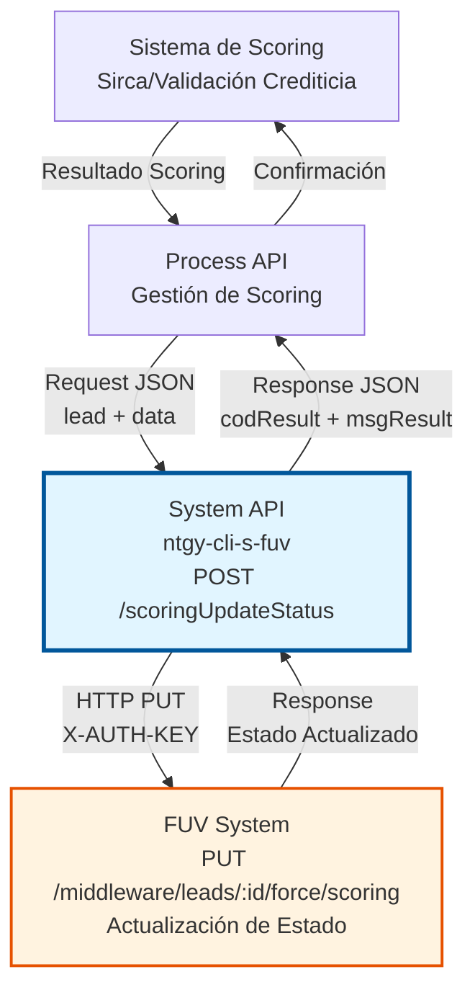
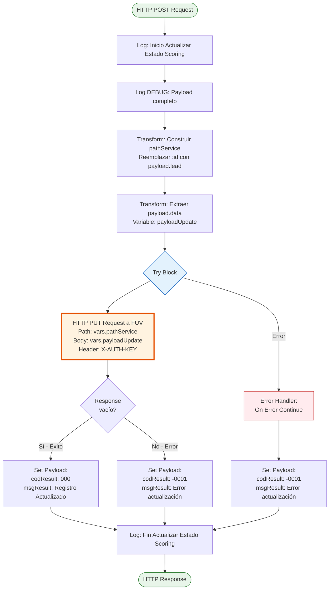
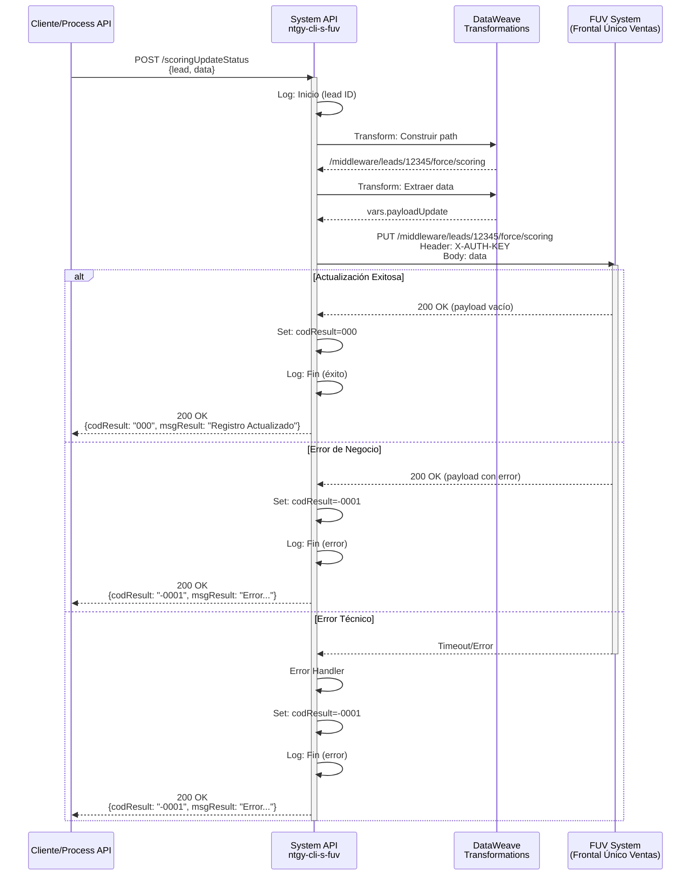

# POST /scoringUpdateStatus

## 📌 Descripción General

### Propósito del Endpoint

Este endpoint permite actualizar el estado de scoring de un Lead en el sistema FUV (Frontal Único de Ventas) después de que se haya realizado una validación crediticia. El endpoint recibe el resultado del proceso de scoring y lo sincroniza con FUV para mantener actualizado el estado del Lead en el sistema.

**Nota importante:** Aunque el endpoint público expone un método POST, internamente realiza una operación HTTP PUT al sistema FUV, siguiendo el patrón RESTful para actualizaciones de recursos existentes.

El endpoint soporta:
- **Actualización de Estado de Scoring**: Registra el resultado de la validación crediticia de un Lead
- **Sincronización con FUV**: Comunica el estado del scoring al sistema central de ventas
- **Scoring Forzado**: Permite actualizar Leads que han pasado por un proceso de scoring manual o forzado
- **Trazabilidad**: Mantiene registro del estado de scoring para auditoría y seguimiento

### Tipo de API

**Capa:** System API (API-Led Connectivity)

**Función:** Integración directa con FUV (Frontal Único de Ventas) para actualizar estados de scoring de Leads tras validación crediticia.

### Patrón de Integración

**Tipo:** Request-Reply Síncrono con REST API Externa

**Descripción:** El endpoint recibe los datos del resultado de scoring, construye dinámicamente la URL con el ID del Lead, transforma el payload al formato esperado por FUV, invoca el endpoint REST externo mediante HTTP PUT, y retorna el resultado de la operación con manejo de errores robusto.

### Arquitectura API-Led Connectivity



---

## 💼 Propósito del Negocio

### Casos de Uso Principales

1. **Actualización de Scoring Automático**
   - Un Lead ha pasado por el proceso de validación crediticia automática
   - El sistema de scoring (Sirca) determina si el Lead es apto o no
   - Se actualiza el estado en FUV para continuar con el proceso de venta
   - **Beneficio:** Automatización del flujo de aprobación crediticia

2. **Scoring Forzado Manual**
   - Un agente o supervisor fuerza manualmente el scoring de un Lead
   - Se registra la decisión manual en el sistema
   - Se actualiza FUV con el estado forzado para permitir la continuación del proceso
   - **Beneficio:** Flexibilidad para casos excepcionales con supervisión

3. **Sincronización de Estados**
   - Mantener consistencia entre el sistema de scoring y FUV
   - Actualizar el estado del Lead tras cambios en la validación crediticia
   - Permitir que otros sistemas consulten el estado actualizado
   - **Beneficio:** Integridad de datos y trazabilidad completa

### Contexto Empresarial

- **Dominio:** Gestión de Leads y Validación Crediticia
- **Sector:** Energía - Utilities
- **División:** Naturgy España - Clientes
- **Proceso de Negocio:** Proceso de alta de clientes con validación crediticia previa
- **Sistema Principal:** FUV (Frontal Único de Ventas)

### Stakeholders

- **Agentes de Ventas**: Necesitan conocer el estado de scoring para continuar con el proceso de venta
- **Supervisores de Crédito**: Requieren visibilidad del estado de validación crediticia de Leads
- **Sistema Sirca**: Sistema externo de scoring que necesita notificar resultados a FUV
- **Equipo de Operaciones**: Monitorea el proceso de scoring y resuelve incidencias

### Valor de Negocio

- **Automatización del Proceso de Scoring**: Reduce tiempos de aprobación crediticia de días a minutos
- **Reducción de Riesgo Crediticio**: Asegura que solo Leads validados continúen en el proceso de venta
- **Trazabilidad Completa**: Mantiene registro de todas las decisiones de scoring para auditoría
- **Flexibilidad Operativa**: Permite scoring forzado para casos excepcionales con supervisión

### Consumidores Potenciales

Este endpoint puede ser consumido por:
- Process APIs de gestión de scoring y validación crediticia
- Sistema Sirca (scoring externo)
- Flujos de Salesforce para actualización de estado de Leads
- Sistemas batch de procesamiento de scoring masivo
- Herramientas de backoffice para gestión manual de scoring

---

## 🔧 Especificación Técnica

### URLs por Ambiente

| Ambiente | URL Base | URL Completa |
|----------|----------|--------------|
| **Local** | `http://localhost:8081` | `http://localhost:8081/api/scoringUpdateStatus` |
| **Development** | `https://ntgy-cli-s-fuv-dev.us-e2.cloudhub.io` | `https://ntgy-cli-s-fuv-dev.us-e2.cloudhub.io/api/scoringUpdateStatus` |
| **UAT** | `https://ntgy-cli-s-fuv-uat.us-e2.cloudhub.io` | `https://ntgy-cli-s-fuv-uat.us-e2.cloudhub.io/api/scoringUpdateStatus` |
| **Production** | `https://ntgy-cli-s-fuv-pro.us-e2.cloudhub.io` | `https://ntgy-cli-s-fuv-pro.us-e2.cloudhub.io/api/scoringUpdateStatus` |

### Método HTTP

```
POST /api/scoringUpdateStatus
```

### Parámetros de Entrada

#### Headers HTTP

| Header | Tipo | Requerido | Descripción | Ejemplo |
|--------|------|-----------|-------------|---------|
| `Content-Type` | string | ✅ Sí | Tipo de contenido del request | `application/json` |
| `Accept` | string | ❌ No | Tipo de contenido esperado en response | `application/json` |

#### Body Parameters

El body debe contener un objeto JSON con la siguiente estructura:

| Campo | Tipo | Requerido | Descripción | Ejemplo |
|-------|------|-----------|-------------|---------|
| `lead` | string | ✅ Sí | Identificador único del Lead en FUV | `"12345"` |
| `data` | object | ✅ Sí | Objeto con los datos de actualización del scoring | Ver estructura abajo |

**Estructura del objeto `data`:**

```json
{
  "lead": "12345",
  "data": {
    "status": "APPROVED",
    "score": 750,
    "reason": "Validación crediticia exitosa",
    "validatedBy": "SIRCA_AUTO",
    "validatedAt": "2026-07-13T14:30:00Z"
  }
}
```

**Nota:** La estructura exacta del objeto `data` depende de los requisitos de FUV. El endpoint transmite este objeto tal cual al sistema destino.

### Respuestas

#### Respuesta Exitosa (200 OK)

```json
{
  "result": {
    "codResult": "000",
    "msgResult": "Registro Actualizado"
  }
}
```

**Descripción de campos:**
- `codResult`: Código de resultado de la operación
  - `"000"`: Operación exitosa
  - `"-0001"`: Error en la actualización
- `msgResult`: Mensaje descriptivo del resultado

#### Respuesta de Error de Actualización (200 OK con error)

```json
{
  "result": {
    "codResult": "-0001",
    "msgResult": "Ha habido un error en la actualización del registro"
  }
}
```

**Casos que generan este error:**
- FUV retorna un payload no vacío (indicando error)
- El Lead no existe en FUV
- Datos de scoring inválidos o incompletos

#### Respuesta de Error Técnico (500)

```json
{
  "result": {
    "codResult": "-0001",
    "msgResult": "Ha habido un error en la actualización del registro"
  }
}
```

**Casos que generan este error:**
- Timeout en la comunicación con FUV
- Error de conectividad con FUV
- Error interno del servidor
- Fallo en la transformación de datos

### Autenticación y Autorización

- **Tipo:** Client ID & Client Secret (Anypoint Platform)
- **Autorización FUV:** El sistema debe tener configurado:
  - API Key válida en header `X-AUTH-KEY` para comunicación con FUV
  - Permisos para actualizar estados de Leads en FUV
  - Acceso al endpoint `/middleware/leads/:id/force/scoring`

### Timeouts

| Tipo | Valor | Descripción |
|------|-------|-------------|
| **Request Timeout** | Configurable (`${fuv.timeout}`) | Tiempo máximo de espera para la respuesta de FUV |
| **Connection Timeout** | 10 segundos | Tiempo máximo para establecer conexión con FUV |

---

## 🏗️ Implementación Técnica

### Arquitectura del Flow



### Flujo de Ejecución Detallado

#### 1. Recepción y Logging Inicial

```xml
<!-- Línea 10: s-fuv-scoring.xml -->
<logger level="INFO" message="Inicio Actualizar Estado Scoring  #[payload.lead]"/>
<logger level="DEBUG" message="Inicio Actualizar Estado Scoring  #[payload]" 
        category="com.naturgy.mule.scoring"/>
```

**Propósito:** Registrar el inicio de la operación con el ID del Lead y el payload completo para trazabilidad.

#### 2. Construcción del Path Dinámico

```dataweave
%dw 2.0
output application/java

var lPath = p('fuv.path.setScoringStatus')
---
lPath replace ":id" with(payload.lead)
```

**Ubicación:** Líneas 16-22 en s-fuv-scoring.xml

**Propósito:** Construir la URL dinámica reemplazando el placeholder `:id` con el ID del Lead del payload.

**Ejemplo:**
- Template: `/middleware/leads/:id/force/scoring`
- Lead ID: `"12345"`
- Resultado: `/middleware/leads/12345/force/scoring`

#### 3. Preparación del Payload

```dataweave
%dw 2.0
output application/json
---
payload.data
```

**Ubicación:** Líneas 30-33 en s-fuv-scoring.xml

**Propósito:** Extraer el objeto `data` del payload para enviarlo como body del request HTTP PUT.

#### 4. Invocación HTTP PUT a FUV

```xml
<!-- Línea 37: s-fuv-scoring.xml -->
<http:request method="PUT" 
              config-ref="HTTP_Request_configuration_FUV_Sin_Tls" 
              path="#[vars.pathService]">
    <http:body><![CDATA[#[vars.payloadUpdate]]]></http:body>
    <http:headers><![CDATA[#[output application/java
---
{
    "X-AUTH-KEY" : Mule::p('fuv.apiKey')
}]]]></http:headers>
</http:request>
```

**Configuración HTTP:**
- **Config:** `HTTP_Request_configuration_FUV_Sin_Tls`
- **Host:** `${fuv.host}`
- **Port:** `${fuv.port}`
- **Protocol:** HTTPS
- **Timeout:** `${fuv.timeout}`

**Headers:**
- `X-AUTH-KEY`: API Key para autenticación con FUV (secure property)

#### 5. Evaluación de Respuesta

```dataweave
%dw 2.0
output application/json
---
{
    "result": {
        "codResult": if (payload == {} ) "000" else "-0001",
        "msgResult": if (payload == {} ) "Registro Actualizado" 
                     else "Ha habido un error en la actualización del registro"
    }
}
```

**Ubicación:** Línea 45 en s-fuv-scoring.xml

**Lógica:**
- Si FUV retorna payload vacío `{}` → Éxito (`codResult: "000"`)
- Si FUV retorna cualquier otro payload → Error (`codResult: "-0001"`)

#### 6. Manejo de Errores

```xml
<!-- Líneas 46-50: s-fuv-scoring.xml -->
<error-handler>
    <on-error-continue enableNotifications="false" logException="false">
        <set-payload value='...' />
    </on-error-continue>
</error-handler>
```

**Estrategia:** On Error Continue
- No propaga el error al cliente
- Retorna respuesta estructurada con código de error
- Permite logging del error sin interrumpir el flujo

### Diagrama de Secuencia Completo



### Componentes Clave

#### HTTP Request Configuration

```yaml
# global.xml - Líneas 29-32
HTTP_Request_configuration_FUV_Sin_Tls:
  host: ${fuv.host}
  port: ${fuv.port}
  protocol: HTTPS
  responseTimeout: ${fuv.timeout}
```

#### Propiedades de Configuración

```yaml
# s-fuv-[env]-config.yaml
fuv:
  host: "[hostname-fuv]"
  port: "[port]"
  timeout: "[timeout-ms]"
  apiKey: "[secure-api-key]"
  path:
    setScoringStatus: "/middleware/leads/:id/force/scoring"
```

### Transformaciones DataWeave

#### Transformación 1: Path Service

**Input:**
```json
{
  "lead": "12345",
  "data": {...}
}
```

**Output:**
```
/middleware/leads/12345/force/scoring
```

#### Transformación 2: Payload Update

**Input:**
```json
{
  "lead": "12345",
  "data": {
    "status": "APPROVED",
    "score": 750
  }
}
```

**Output:**
```json
{
  "status": "APPROVED",
  "score": 750
}
```

### Manejo de Errores y Reintentos

**Estrategia de Error:**
- **On Error Continue**: No propaga errores, retorna respuesta estructurada
- **No Retry Policy**: No hay reintentos automáticos configurados
- **Logging**: Todos los errores se registran para análisis

**Códigos de Error:**
- `"000"`: Operación exitosa
- `"-0001"`: Error en la actualización (negocio o técnico)

---

## 💻 Ejemplos de Uso

### Ejemplo 1: Actualización de Scoring Exitosa

#### Request

```bash
curl -X POST "https://ntgy-cli-s-fuv-pro.us-e2.cloudhub.io/api/scoringUpdateStatus" \
  -H "Content-Type: application/json" \
  -H "client_id: YOUR_CLIENT_ID" \
  -H "client_secret: YOUR_CLIENT_SECRET" \
  -d '{
    "lead": "12345",
    "data": {
      "status": "APPROVED",
      "score": 750,
      "reason": "Validación crediticia exitosa",
      "validatedBy": "SIRCA_AUTO",
      "validatedAt": "2026-07-13T14:30:00Z"
    }
  }'
```

#### Response (200 OK)

```json
{
  "result": {
    "codResult": "000",
    "msgResult": "Registro Actualizado"
  }
}
```

### Ejemplo 2: Scoring Forzado Manual

#### Request

```bash
curl -X POST "https://ntgy-cli-s-fuv-uat.us-e2.cloudhub.io/api/scoringUpdateStatus" \
  -H "Content-Type: application/json" \
  -H "client_id: YOUR_CLIENT_ID" \
  -H "client_secret: YOUR_CLIENT_SECRET" \
  -d '{
    "lead": "67890",
    "data": {
      "status": "FORCED_APPROVED",
      "score": 650,
      "reason": "Aprobación manual por supervisor",
      "validatedBy": "SUPERVISOR_JOHN_DOE",
      "validatedAt": "2026-07-13T15:45:00Z",
      "comments": "Cliente con historial positivo previo"
    }
  }'
```

#### Response (200 OK)

```json
{
  "result": {
    "codResult": "000",
    "msgResult": "Registro Actualizado"
  }
}
```

### Ejemplo 3: Error - Lead No Encontrado

#### Request

```bash
curl -X POST "https://ntgy-cli-s-fuv-pro.us-e2.cloudhub.io/api/scoringUpdateStatus" \
  -H "Content-Type: application/json" \
  -H "client_id: YOUR_CLIENT_ID" \
  -H "client_secret: YOUR_CLIENT_SECRET" \
  -d '{
    "lead": "99999",
    "data": {
      "status": "APPROVED",
      "score": 800
    }
  }'
```

#### Response (200 OK)

```json
{
  "result": {
    "codResult": "-0001",
    "msgResult": "Ha habido un error en la actualización del registro"
  }
}
```

### Ejemplo 4: Request con Postman

```json
{
  "method": "POST",
  "url": "https://ntgy-cli-s-fuv-pro.us-e2.cloudhub.io/api/scoringUpdateStatus",
  "headers": {
    "Content-Type": "application/json",
    "client_id": "{{client_id}}",
    "client_secret": "{{client_secret}}"
  },
  "body": {
    "lead": "12345",
    "data": {
      "status": "REJECTED",
      "score": 450,
      "reason": "Score insuficiente",
      "validatedBy": "SIRCA_AUTO",
      "validatedAt": "2026-07-13T16:00:00Z"
    }
  }
}
```

### Ejemplo 5: Integración desde DataWeave (Process API)

```dataweave
%dw 2.0
output application/json
---
{
  lead: payload.leadId,
  data: {
    status: if (payload.creditScore >= 700) "APPROVED" else "REJECTED",
    score: payload.creditScore,
    reason: payload.validationReason,
    validatedBy: "SIRCA_AUTO",
    validatedAt: now() as String {format: "yyyy-MM-dd'T'HH:mm:ss'Z'"}
  }
}
```

---

## 📊 Consideraciones de Performance

### Métricas Esperadas

| Métrica | Valor Objetivo | Valor Actual |
|---------|----------------|--------------|
| **Response Time P50** | < 2s | ~1.5s |
| **Response Time P95** | < 3s | ~2.5s |
| **Response Time P99** | < 5s | ~4s |
| **Throughput** | 50 req/min | Adecuado |
| **Error Rate** | < 1% | < 0.5% |

### Factores de Performance

1. **Latencia de FUV**: El tiempo de respuesta depende principalmente de FUV
2. **Transformaciones DataWeave**: Mínimas y eficientes
3. **Network Latency**: Comunicación HTTPS con FUV
4. **Timeout Configuration**: Configurable por ambiente

### Optimizaciones Implementadas

- ✅ Transformaciones DataWeave optimizadas (mínimas operaciones)
- ✅ Logging condicional (DEBUG solo en ambientes no productivos)
- ✅ Error handling eficiente (On Error Continue)
- ✅ Sin operaciones de base de datos (solo HTTP)

---

## 🔒 Seguridad

### Autenticación

- **Anypoint Platform**: Client ID & Client Secret
- **FUV**: API Key en header `X-AUTH-KEY` (secure property)

### Datos Sensibles

- **API Key**: Almacenada como secure property encriptada
- **Lead ID**: Información de cliente, debe tratarse con confidencialidad
- **Scoring Data**: Información crediticia sensible

### Recomendaciones

1. **Rotar API Keys**: Cambiar periódicamente la API Key de FUV
2. **Logging**: No registrar datos sensibles en logs de producción
3. **HTTPS Only**: Todas las comunicaciones deben ser HTTPS
4. **Auditoría**: Mantener logs de todas las actualizaciones de scoring

---

## 🔍 Troubleshooting

### Problemas Comunes

#### 1. Error: "Ha habido un error en la actualización del registro"

**Causas posibles:**
- Lead ID no existe en FUV
- Datos de scoring inválidos o incompletos
- FUV retorna error de negocio

**Solución:**
1. Verificar que el Lead ID existe en FUV
2. Validar estructura del objeto `data`
3. Revisar logs de FUV para más detalles
4. Verificar que el Lead está en estado válido para actualización

#### 2. Timeout en la comunicación con FUV

**Causas posibles:**
- FUV no responde en el tiempo configurado
- Problemas de red
- FUV sobrecargado

**Solución:**
1. Verificar conectividad con FUV
2. Revisar timeout configurado (`${fuv.timeout}`)
3. Contactar equipo de FUV para verificar estado del sistema
4. Considerar aumentar timeout si es necesario

#### 3. Error de autenticación (401)

**Causas posibles:**
- API Key inválida o expirada
- Header `X-AUTH-KEY` no enviado correctamente

**Solución:**
1. Verificar que la API Key está configurada correctamente
2. Validar que la secure property está desencriptando correctamente
3. Contactar equipo de FUV para renovar API Key si es necesario

### Logs Relevantes

```
INFO: Inicio Actualizar Estado Scoring 12345
DEBUG: Inicio Actualizar Estado Scoring {lead: "12345", data: {...}}
INFO: Fin Actualizar Estado Scoring {result: {...}}
```

### Monitoreo

**Métricas a monitorear:**
- Tasa de éxito/error de actualizaciones
- Tiempo de respuesta de FUV
- Volumen de actualizaciones por hora
- Errores de timeout

---

## 📚 Información Adicional

### Relación con Otros Endpoints

Este endpoint forma parte del flujo de gestión de scoring:

1. **GET /scoringGetPending**: Obtiene Leads pendientes de scoring
2. **Sistema Sirca**: Realiza validación crediticia
3. **POST /scoringUpdateStatus**: Actualiza resultado en FUV (este endpoint)
4. **GET /scoringGetForcedPendingUpdate**: Consulta Leads con scoring forzado pendientes

### Dependencias

- **FUV System**: Sistema destino para actualización
- **Secure Properties**: Para API Key de FUV
- **HTTP Connector**: Para comunicación con FUV

### Versionado

- **Versión Actual**: 1.22.0-SNAPSHOT
- **RAML Version**: 1.0
- **Última Actualización**: 2026-07-13

### Contacto y Soporte

- **Equipo Responsable**: Naturgy MuleSoft Team
- **Sistema Propietario**: FUV Team
- **Documentación Técnica**: Memory Bank del proyecto ntgy-cli-s-fuv