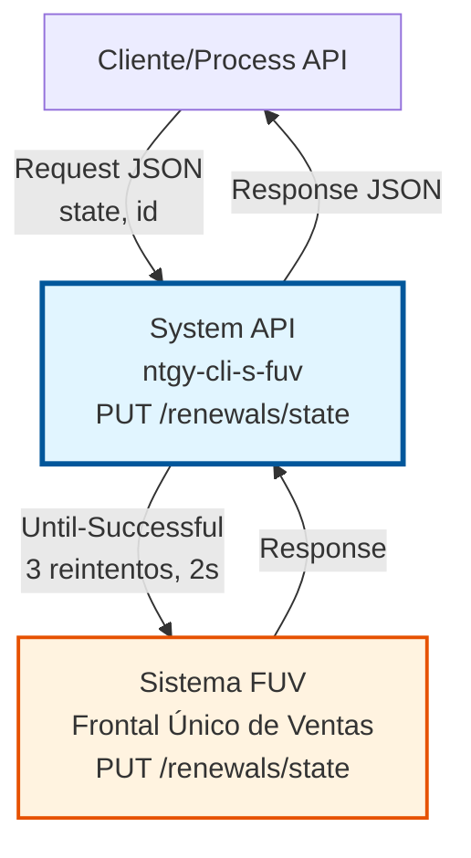
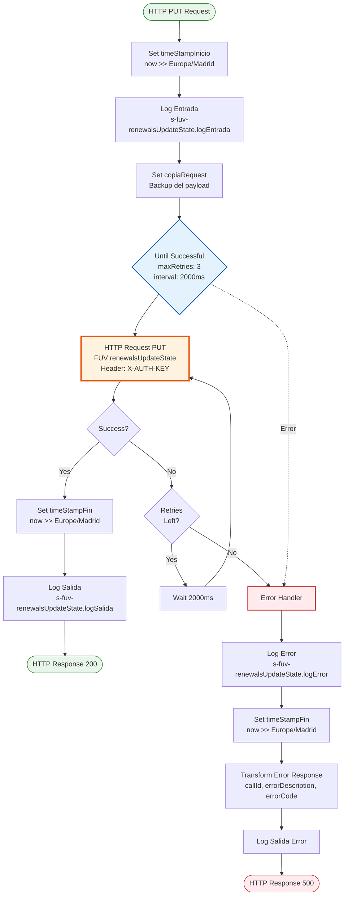
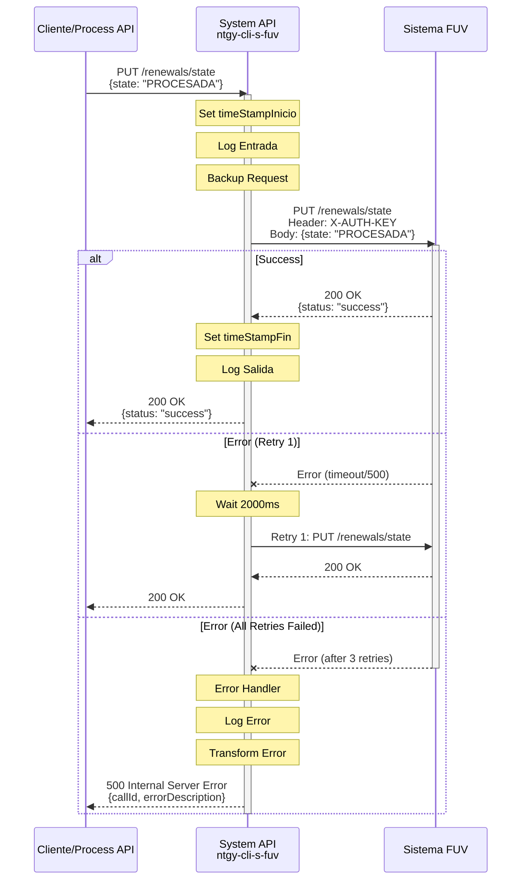

# PUT /renewals/state

## 📌 Descripción General

### Propósito del Endpoint

Este endpoint permite actualizar el estado de una renovación específica en el sistema FUV (Frontal Único de Ventas). Proporciona una interfaz REST para modificar el estado de renovaciones de contratos de manera individual, asegurando la sincronización con el sistema FUV mediante una política de reintentos robusta.

El endpoint soporta:
- **Actualización Individual de Estado**: Modifica el estado de una renovación específica
- **Integración Resiliente con FUV**: Utiliza Until-Successful con reintentos configurables
- **Trazabilidad Completa**: Logging de entrada, salida y errores con timestamps
- **Manejo de Errores Robusto**: Gestión de errores con respuestas estandarizadas

### Tipo de API

**Capa:** System API (API-Led Connectivity)

**Función:** Integración directa con FUV para actualización de estados de renovaciones de contratos.

### Patrón de Integración

**Tipo:** Request-Reply Síncrono con HTTP Request y Retry Policy

**Descripción:** El endpoint recibe una solicitud de actualización de estado, la transforma y la envía al sistema FUV mediante HTTP PUT. Implementa una política de reintentos (Until-Successful) para garantizar la entrega del mensaje incluso ante fallos temporales de red o disponibilidad del sistema FUV.

### Arquitectura API-Led Connectivity



---

## 💼 Propósito del Negocio

### Casos de Uso Principales

1. **Actualización de Estado de Renovación Individual**
   - Un proceso de negocio necesita cambiar el estado de una renovación específica
   - El sistema actualiza el estado en FUV de manera controlada
   - Se garantiza la entrega mediante política de reintentos

2. **Gestión del Ciclo de Vida de Renovaciones**
   - Seguimiento de estados de renovaciones (pendiente, procesada, cancelada, etc.)
   - Actualización de estados según el progreso del proceso de renovación
   - Sincronización de estados entre sistemas

3. **Corrección de Estados**
   - Corrección manual de estados incorrectos
   - Actualización de estados tras validaciones o aprobaciones
   - Gestión de excepciones en el proceso de renovación

### Contexto Empresarial

- **Dominio:** Gestión de Renovaciones de Contratos
- **Sector:** Energía - Utilities
- **División:** Naturgy España - Clientes
- **Proceso de Negocio:** Renovación de contratos de suministro energético
- **Sistema Integrado:** FUV (Frontal Único de Ventas)

### Stakeholders

- **Equipos de Renovaciones**: Necesitan actualizar estados de renovaciones en proceso
- **Sistemas de Gestión de Contratos**: Requieren sincronizar estados con FUV
- **Equipos de Operaciones**: Monitorean y gestionan el proceso de renovaciones

### Valor de Negocio

- **Sincronización en Tiempo Real**: Actualización inmediata de estados en FUV
- **Resiliencia Operacional**: Política de reintentos garantiza entrega de actualizaciones
- **Trazabilidad Completa**: Logging detallado de todas las operaciones
- **Gestión Individual**: Permite actualizaciones granulares de renovaciones específicas

### Consumidores Potenciales

Este endpoint puede ser consumido por:
- Process APIs de gestión de renovaciones
- Sistemas de workflow de renovaciones
- Aplicaciones de gestión de contratos
- Procesos batch de actualización de estados

---

## 🔧 Especificación Técnica

### URLs por Ambiente

| Ambiente | URL Base | URL Completa |
|----------|----------|--------------|
| **Local** | `http://localhost:8081` | `http://localhost:8081/api/renewals/state` |
| **Development** | `https://ntgy-cli-s-fuv-dev.cloudhub.io` | `https://ntgy-cli-s-fuv-dev.cloudhub.io/api/renewals/state` |
| **UAT** | `https://ntgy-cli-s-fuv-uat.cloudhub.io` | `https://ntgy-cli-s-fuv-uat.cloudhub.io/api/renewals/state` |
| **Production** | `https://ntgy-cli-s-fuv-pro.cloudhub.io` | `https://ntgy-cli-s-fuv-pro.cloudhub.io/api/renewals/state` |

### Método HTTP

```
PUT /api/renewals/state
```

### Parámetros de Entrada

#### Headers HTTP

| Header | Tipo | Requerido | Descripción | Ejemplo |
|--------|------|-----------|-------------|---------|
| `Content-Type` | string | ✅ Sí | Tipo de contenido del request | `application/json` |
| `X-AUTH-KEY` | string | ✅ Sí | API Key para autenticación en FUV | `[secure-api-key]` |

#### Body Parameters

**Estructura del Request:**

```json
{
  "state": "string"
}
```

**Campos del Body:**

| Campo | Tipo | Requerido | Descripción | Ejemplo |
|-------|------|-----------|-------------|---------|
| `state` | string | ✅ Sí | Nuevo estado de la renovación | `"PROCESADA"` |

**Estados Válidos:**
- `PENDIENTE`: Renovación pendiente de procesamiento
- `PROCESADA`: Renovación procesada exitosamente
- `CANCELADA`: Renovación cancelada
- `ERROR`: Renovación con error en procesamiento

### Respuestas

#### Respuesta Exitosa (200 OK)

```json
{
  "status": "success",
  "message": "Estado de renovación actualizado correctamente"
}
```

#### Respuesta de Error Técnico (500 Internal Server Error)

```json
{
  "callId": "550e8400-e29b-41d4-a716-446655440000",
  "errorDescription": "Error al actualizar estado en FUV",
  "errorCode": 500,
  "time": "2026-07-13T17:10:00+02:00"
}
```

### Autenticación y Autorización

- **Tipo:** API Key (X-AUTH-KEY header)
- **Autorización FUV:** El API Key debe tener permisos para:
  - Actualizar estados de renovaciones en FUV
  - Acceso al endpoint de actualización de renovaciones

### Timeouts y Retry Policy

| Configuración | Valor | Descripción |
|---------------|-------|-------------|
| **Max Retries** | 3 | Número máximo de reintentos |
| **Retry Interval** | 2000 ms | Tiempo entre reintentos |
| **Request Timeout** | 30 segundos | Tiempo máximo de espera por intento |
| **Connection Timeout** | 10 segundos | Tiempo máximo para establecer conexión |

---

## 🏗️ Implementación Técnica

### Arquitectura del Flow



### Componentes del Flow

#### 1. Flow Principal: `s-fuv-renewalsUpdateStateFlow`

**Ubicación:** `src/main/mule/s-fuv-renewalsUpdateState.xml` (líneas 12-49)

**Responsabilidades:**
- Recibir request HTTP PUT
- Registrar timestamp de inicio
- Logging de entrada con payload
- Backup del request original
- Invocar integración con FUV mediante Until-Successful
- Registrar timestamp de fin
- Logging de salida
- Manejo de errores

#### 2. Integración con FUV (Until-Successful)

**Configuración:** (líneas 16-24)

```xml
<until-successful 
    maxRetries="${fuv.reintentos}" 
    millisBetweenRetries="${fuv.tiempoReintentos}">
    <http:request 
        method="PUT" 
        config-ref="HTTP_Request_configuration_FUV_Sin_Tls" 
        path="${fuv.path.updateRenewalState}">
        <http:headers>
            X-AUTH-KEY: ${fuv.apiKey}
        </http:headers>
    </http:request>
</until-successful>
```

**Características:**
- **Método:** PUT
- **Path:** Configurado en `${fuv.path.updateRenewalState}`
- **Headers:** X-AUTH-KEY con API Key segura
- **Retry Policy:** Until-Successful con reintentos configurables
- **Configuración:** HTTP_Request_configuration_FUV_Sin_Tls

#### 3. Error Handler

**Ubicación:** (líneas 27-47)

**Tipo:** On Error Propagate

**Acciones:**
1. Log de error en nivel DEBUG con mensaje y payload
2. Log de error en nivel ERROR con payload
3. Set timestamp de fin
4. Transformación de error a formato estándar
5. Log de salida de error

**Formato de Error:**

```dataweave
%dw 2.0
output application/json
---
{
    callId: correlationId,
    errorDescription: error.description,
    errorCode: 500,
    time: now() >> "Europe/Madrid"
}
```

### Diagrama de Secuencia Completo



### Configuración del Sistema

#### Variables de Configuración

**Archivo:** `s-fuv-[env]-config.yaml`

```yaml
fuv:
  reintentos: 3                    # Número de reintentos
  tiempoReintentos: 2000          # Milisegundos entre reintentos
  apiKey: ${secure::fuv.apiKey}   # API Key segura
  path:
    updateRenewalState: "/renewals/state"  # Path del endpoint
```

#### HTTP Request Configuration

**Nombre:** `HTTP_Request_configuration_FUV_Sin_Tls`

**Características:**
- Protocolo: HTTP (red interna segura)
- Host: Configurado por ambiente
- Port: Configurado por ambiente
- Base Path: Configurado por ambiente

### Logging Strategy

#### Log de Entrada (línea 14)

```
s-fuv-renewalsUpdateState.logEntrada ## payload: [payload]
```

#### Log de Salida (línea 26)

```
s-fuv-renewalsUpdateState.logSalida ## payload: [payload]
```

#### Log de Error (líneas 29-30)

```
s-fuv-renewalsUpdateState.logError ## message: [message] ## payload: [payload]
s-fuv-renewalsUpdateState.logError ## payload: [payload]
```

### Manejo de Timestamps

**Zona Horaria:** Europe/Madrid (UTC+2)

**Timestamps Registrados:**
1. `timeStampInicio`: Al inicio del flow (línea 13)
2. `timeStampFin`: Al finalizar exitosamente (línea 25)
3. `timeStampFin`: Al finalizar con error (línea 31)

**Formato:**

```dataweave
now() >> "Europe/Madrid"
```

---

## 💻 Ejemplos de Uso

### Ejemplo 1: Actualización Exitosa de Estado

#### Request

```bash
curl -X PUT "https://ntgy-cli-s-fuv-dev.cloudhub.io/api/renewals/state" \
  -H "Content-Type: application/json" \
  -H "X-AUTH-KEY: your-api-key-here" \
  -d '{
    "state": "PROCESADA"
  }'
```

#### Response (200 OK)

```json
{
  "status": "success",
  "message": "Estado de renovación actualizado correctamente"
}
```

### Ejemplo 2: Actualización con Estado Cancelado

#### Request

```bash
curl -X PUT "https://ntgy-cli-s-fuv-uat.cloudhub.io/api/renewals/state" \
  -H "Content-Type: application/json" \
  -H "X-AUTH-KEY: your-api-key-here" \
  -d '{
    "state": "CANCELADA"
  }'
```

#### Response (200 OK)

```json
{
  "status": "success",
  "message": "Estado de renovación actualizado correctamente"
}
```

### Ejemplo 3: Error de Conexión (Después de Reintentos)

#### Request

```bash
curl -X PUT "https://ntgy-cli-s-fuv-pro.cloudhub.io/api/renewals/state" \
  -H "Content-Type: application/json" \
  -H "X-AUTH-KEY: your-api-key-here" \
  -d '{
    "state": "PROCESADA"
  }'
```

#### Response (500 Internal Server Error)

```json
{
  "callId": "550e8400-e29b-41d4-a716-446655440000",
  "errorDescription": "HTTP:CONNECTIVITY - Error al conectar con FUV después de 3 reintentos",
  "errorCode": 500,
  "time": "2026-07-13T17:10:00+02:00"
}
```

### Ejemplo 4: Uso desde JavaScript/Node.js

```javascript
const axios = require('axios');

async function updateRenewalState(state) {
  try {
    const response = await axios.put(
      'https://ntgy-cli-s-fuv-pro.cloudhub.io/api/renewals/state',
      {
        state: state
      },
      {
        headers: {
          'Content-Type': 'application/json',
          'X-AUTH-KEY': process.env.FUV_API_KEY
        },
        timeout: 30000 // 30 segundos
      }
    );
    
    console.log('Estado actualizado:', response.data);
    return response.data;
  } catch (error) {
    if (error.response) {
      console.error('Error del servidor:', error.response.data);
      console.error('Código de estado:', error.response.status);
    } else if (error.request) {
      console.error('No se recibió respuesta del servidor');
    } else {
      console.error('Error al configurar la solicitud:', error.message);
    }
    throw error;
  }
}

// Uso
updateRenewalState('PROCESADA')
  .then(result => console.log('Éxito:', result))
  .catch(error => console.error('Error:', error));
```

### Ejemplo 5: Uso desde Python

```python
import requests
import os
from datetime import datetime

def update_renewal_state(state):
    """
    Actualiza el estado de una renovación en FUV
    
    Args:
        state (str): Nuevo estado de la renovación
        
    Returns:
        dict: Respuesta del servidor
    """
    url = "https://ntgy-cli-s-fuv-pro.cloudhub.io/api/renewals/state"
    
    headers = {
        "Content-Type": "application/json",
        "X-AUTH-KEY": os.environ.get("FUV_API_KEY")
    }
    
    payload = {
        "state": state
    }
    
    try:
        response = requests.put(
            url,
            json=payload,
            headers=headers,
            timeout=30
        )
        
        response.raise_for_status()
        
        print(f"Estado actualizado exitosamente: {response.json()}")
        return response.json()
        
    except requests.exceptions.HTTPError as http_err:
        print(f"Error HTTP: {http_err}")
        print(f"Respuesta del servidor: {response.text}")
        raise
    except requests.exceptions.ConnectionError as conn_err:
        print(f"Error de conexión: {conn_err}")
        raise
    except requests.exceptions.Timeout as timeout_err:
        print(f"Timeout: {timeout_err}")
        raise
    except requests.exceptions.RequestException as req_err:
        print(f"Error en la solicitud: {req_err}")
        raise

# Uso
if __name__ == "__main__":
    try:
        result = update_renewal_state("PROCESADA")
        print(f"Resultado: {result}")
    except Exception as e:
        print(f"Error al actualizar estado: {e}")
```

### Ejemplo 6: Manejo de Reintentos desde el Cliente

```javascript
const axios = require('axios');

async function updateRenewalStateWithRetry(state, maxRetries = 3) {
  let lastError;
  
  for (let attempt = 1; attempt <= maxRetries; attempt++) {
    try {
      console.log(`Intento ${attempt} de ${maxRetries}...`);
      
      const response = await axios.put(
        'https://ntgy-cli-s-fuv-pro.cloudhub.io/api/renewals/state',
        { state: state },
        {
          headers: {
            'Content-Type': 'application/json',
            'X-AUTH-KEY': process.env.FUV_API_KEY
          },
          timeout: 30000
        }
      );
      
      console.log('✓ Estado actualizado exitosamente');
      return response.data;
      
    } catch (error) {
      lastError = error;
      console.error(`✗ Intento ${attempt} falló:`, error.message);
      
      if (attempt < maxRetries) {
        const waitTime = 2000 * attempt; // Backoff exponencial
        console.log(`Esperando ${waitTime}ms antes del siguiente intento...`);
        await new Promise(resolve => setTimeout(resolve, waitTime));
      }
    }
  }
  
  throw new Error(`Falló después de ${maxRetries} intentos: ${lastError.message}`);
}

// Uso
updateRenewalStateWithRetry('PROCESADA')
  .then(result => console.log('Éxito final:', result))
  .catch(error => console.error('Error final:', error.message));
```

### Notas de Implementación

1. **Retry Policy del Servidor**: El endpoint ya implementa reintentos automáticos (3 intentos con 2s de intervalo), por lo que normalmente no es necesario implementar reintentos en el cliente.

2. **Timeout Recomendado**: Configurar timeout del cliente en al menos 30 segundos para permitir que el servidor complete sus reintentos.

3. **Manejo de Errores**: Siempre verificar el `callId` en respuestas de error para facilitar troubleshooting.

4. **API Key Security**: Nunca hardcodear el API Key, usar variables de entorno o gestores de secretos.

5. **Estados Válidos**: Validar el estado antes de enviar la solicitud para evitar errores innecesarios.