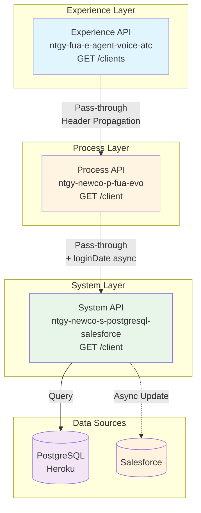
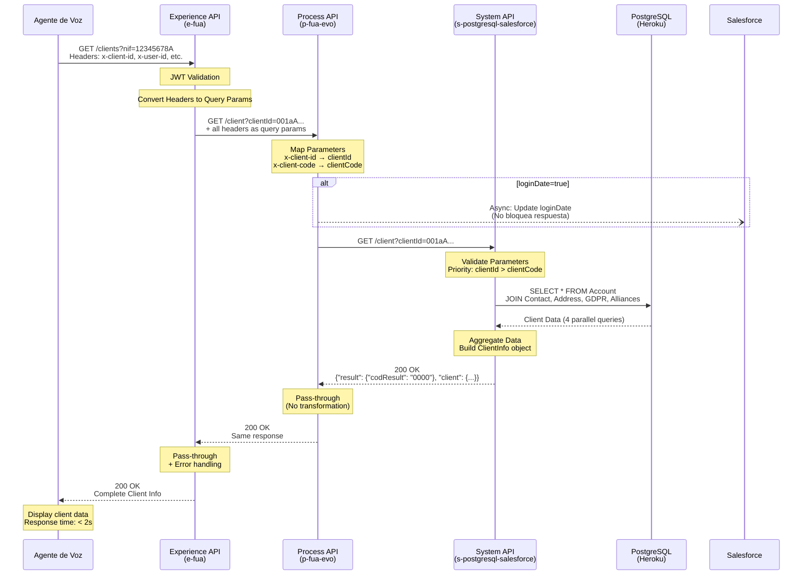
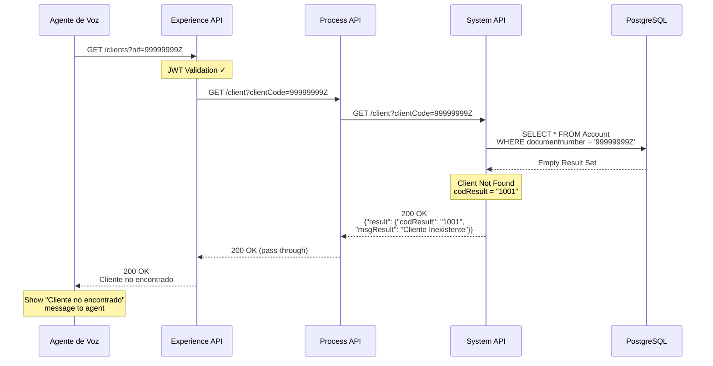
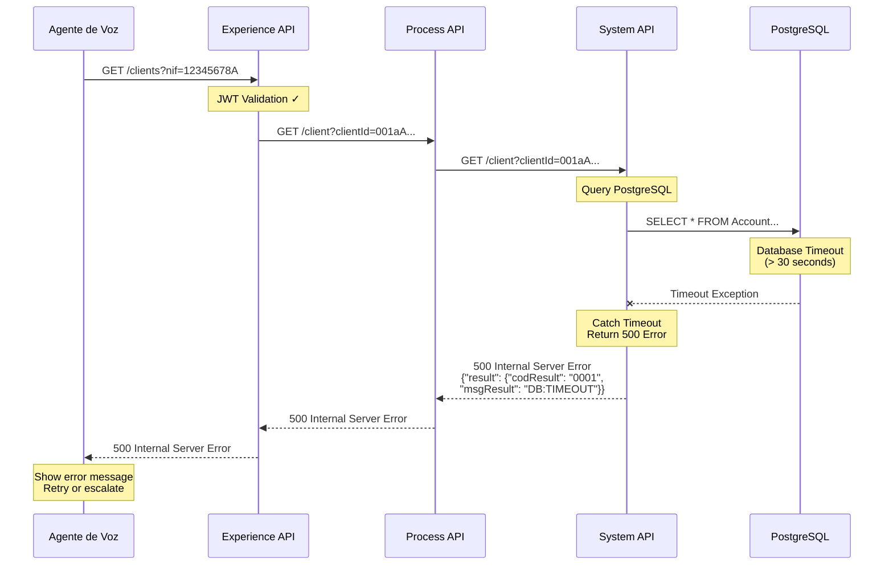
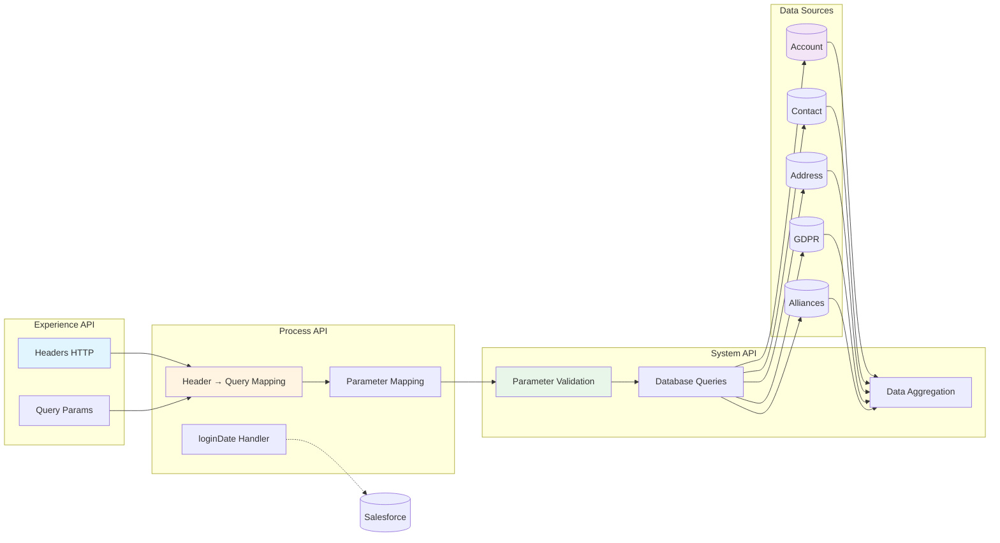
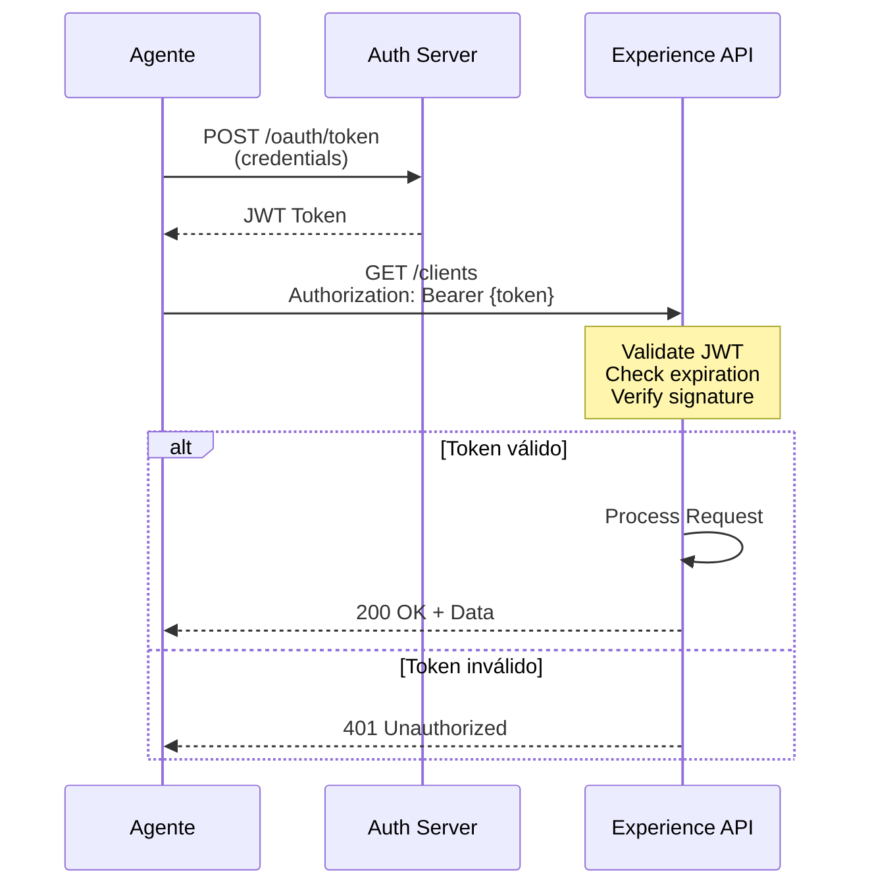

# 📋 Documentación Técnica: Endpoint GET /clients

---

## 📌 Información General

### Propósito
Obtiene información completa de clientes del sistema Naturgy, incluyendo datos personales, contactos asociados, direcciones fiscales, preferencias GDPR y alianzas comerciales. Este endpoint está optimizado para operaciones de agentes de voz y sistemas ATC (Air Traffic Control) en call centers.

### Contexto de Negocio
- **Industria**: Energía - Utilities
- **Empresa**: Naturgy España
- **Proceso de Negocio**: Atención al cliente vía agentes de voz
- **Caso de Uso Principal**: Consulta rápida de información de cliente durante llamadas telefónicas

### Arquitectura API-Led Connectivity



### Patrón de Integración
- **Experience API**: Pass-through con propagación de headers
- **Process API**: Pass-through con actualización asíncrona opcional de loginDate
- **System API**: SOURCE OF TRUTH - Consulta directa a PostgreSQL/Salesforce

---

## 🔧 Especificación Técnica

### Método HTTP
```
GET /clients
```

### URLs por Ambiente

| Ambiente | URL Base | URL Completa |
|----------|----------|--------------|
| **Local** | `http://localhost:8081` | `http://localhost:8081/fua/api/clients` |
| **Dev** | `http://e-fua-dev.de-c1.cloudhub.io` | `http://e-fua-dev.de-c1.cloudhub.io/fua/api/clients` |
| **Test** | `http://e-fua-test.de-c1.cloudhub.io` | `http://e-fua-test.de-c1.cloudhub.io/fua/api/clients` |
| **Prod** | `https://e-fua-prod.de-c1.cloudhub.io` | `https://e-fua-prod.de-c1.cloudhub.io/fua/api/clients` |

### Autenticación
- **Tipo**: OAuth 2.0 con JWT tokens
- **Header**: `Authorization: Bearer {token}`
- **Validación**: JWT validation flow en Experience API
- **Roles**: Agent, Supervisor, System

### Timeout Configurado
- **Experience → Process**: `${newco-p-fua-evo.timeout}` (configurado en properties)
- **Process → System**: `${s-postgresql-salesforce.timeout}`
- **Target para Agentes**: < 2 segundos (optimizado para voz)

### Protocolo
- **Local/Dev/Test**: HTTP
- **Producción**: HTTPS (TLS 1.2+)

---

## 📥 Parámetros de Entrada

### Headers HTTP (Propagados como Query Parameters)

El Experience API convierte automáticamente los siguientes headers HTTP en query parameters para el Process API:

| Header | Tipo | Obligatorio | Descripción | Ejemplo |
|--------|------|-------------|-------------|---------|
| `x-interaction-id` | string | No | ID de interacción para trazabilidad (generado automáticamente si no se proporciona) | `550e8400-e29b-41d4-a716-446655440000` |
| `x-user-id` | string | No | ID del usuario autenticado | `user123` |
| `x-client-id` | string | No | ID del cliente en Salesforce (SFID) | `001aA000001234567` |
| `x-client-doc-number` | string | No | Número de documento del cliente | `12345678A` |
| `x-client-code` | string | No | Código de cliente (documento) | `12345678A` |
| `x-origin` | string | No | Origen de la petición | `mobile-app`, `agent-desktop` |
| `x-user-role` | string | No | Rol del usuario | `agent`, `supervisor` |
| `traceparent` | string | No | Header de trazabilidad distribuida W3C | `00-0af7651916cd43dd8448eb211c80319c-b7ad6b7169203331-01` |
| `x-agent-mail` | string | No | Email del agente (específico para agentes) | `agent@naturgy.com` |
| `x-language` | string | No | Idioma preferido | `es`, `ca`, `eu`, `gl`, `en` |
| `x-contact-id` | string | No | ID de contacto | `112233` |

### Query Parameters (Experience API)

| Parámetro | Tipo | Obligatorio | Descripción | Validación | Ejemplo |
|-----------|------|-------------|-------------|------------|---------|
| `nif` | string | No | NIF del cliente para búsqueda específica | Formato NIF español | `12345678A` |
| `limit` | integer | No | Límite de resultados para paginación | Min: 1, Max: 100, Default: 10 | `20` |
| `offset` | integer | No | Offset para paginación | Min: 0, Default: 0 | `0` |

### Query Parameters (Process/System API)

Estos parámetros son utilizados internamente por el Process y System API:

| Parámetro | Tipo | Obligatorio | Descripción | Prioridad | Ejemplo |
|-----------|------|-------------|-------------|-----------|---------|
| `clientId` | string | No* | Salesforce Account ID (SFID) | **Alta** - Usado primero si está presente | `001aA000001234567` |
| `clientCode` | string | No* | Número de documento del cliente | Baja - Usado solo si clientId no está presente | `12345678A` |
| `loginDate` | string | No | Flag para actualizar fecha de último login | Valores: `"true"`, `"false"` | `"true"` |

**Nota**: Al menos uno de `clientId` o `clientCode` debe ser proporcionado. Si ambos están presentes, `clientId` tiene prioridad.

---

## 📤 Respuestas

### ✅ Respuesta Exitosa (200 OK)

#### Estructura de Respuesta

⚠️ **RESPONSE SCHEMA - SINGLE SOURCE OF TRUTH:**

Este endpoint retorna la respuesta del System API **SIN MODIFICACIONES**. El schema completo y autoritativo está definido en:

📖 **System API: `ntgy-newco-s-postgresql-salesforce` endpoint `/client`**

#### Schema Completo (ClientInfo)

```json
{
  "result": {
    "codResult": "0000",
    "msgResult": "No hay error"
  },
  "client": {
    "clientId": "string",
    "clientType": "string",
    "addressId": "string",
    "isIndividualClient": boolean,
    "name": "string",
    "email": "string",
    "phone": "string",
    "surname": "string",
    "surname2": "string",
    "docTypeId": "string",
    "docNumber": "string",
    "nationalityId": "string",
    "birthDate": "date-only",
    "businessName": "string",
    "cnae": "string",
    "idEnergyUseType": "string",
    "preferredLanguage": "string",
    "areacliente": boolean,
    "bypassSign": boolean,
    "gdprPreferences": {
      "keepData": boolean,
      "commercialCommunications": boolean,
      "dataTransfer": boolean,
      "communications": boolean,
      "profile": boolean,
      "advertising": boolean,
      "survey": boolean,
      "market": boolean,
      "alianzas": boolean
    },
    "naturgyManagement": boolean,
    "mainManagement": {
      "name": "string",
      "phone": "string",
      "email": "string"
    },
    "backUpManagement": {
      "name": "string",
      "phone": "string",
      "email": "string"
    },
    "contacts": [
      {
        "contactId": "string",
        "clientId": "string",
        "name": "string",
        "surname": "string",
        "surname2": "string",
        "docTypeId": "string",
        "docNumber": "string",
        "nationalityId": "string",
        "birthdate": "date-only",
        "scheduleId": "string",
        "preferredPhone": {
          "prefix": "string",
          "number": "string"
        },
        "phone2": {
          "prefix": "string",
          "number": "string"
        },
        "channel": "string",
        "preferredEmail": "string",
        "mailStatus": "string",
        "isValidated": boolean,
        "vlocity_cmt__Type__c": "string",
        "isHolder": boolean,
        "isPreferred": boolean,
        "representationTypeId": "string",
        "activeAgent": boolean,
        "newcoEstado": "string",
        "preferredLanguage": "string"
      }
    ],
    "address": {
      "zipCode": "string",
      "province": "string",
      "city": "string",
      "way": "string",
      "number": "string",
      "floor": "string",
      "door": "string",
      "portal": "string",
      "stairs": "string",
      "provinceCode": "string",
      "codMunIne": "string",
      "premiseTypeCode": "string",
      "viaId": "string"
    },
    "alianzas": [
      {
        "id": "string",
        "name": "string",
        "size": "string",
        "idGow": "string",
        "startDate": "date-only",
        "endDate": "date-only",
        "type": "string",
        "updateDate": "datetime",
        "accountId": "string"
      }
    ]
  }
}
```

#### Descripción de Campos Principales

| Campo | Tipo | Descripción |
|-------|------|-------------|
| `result.codResult` | string | Código de resultado: `"0000"` = éxito, `"1001"` = cliente no encontrado |
| `result.msgResult` | string | Mensaje descriptivo del resultado |
| `client.clientId` | string | ID de cuenta en Salesforce (SFID) - Identificador único |
| `client.clientType` | string | Tipo de cliente (ej: "Residencial", "Empresarial") |
| `client.isIndividualClient` | boolean | `true` si es consumidor individual, `false` si es empresa |
| `client.docTypeId` | string | Tipo de documento: `"nif"`, `"nie"`, `"passport"`, `"cif"` |
| `client.docNumber` | string | Número de documento de identidad |
| `client.preferredLanguage` | string | Idioma preferido: `"es"`, `"ca"`, `"eu"`, `"gl"`, `"en"` |
| `client.areacliente` | boolean | Usuario del área de clientes activo |
| `client.bypassSign` | boolean | Omitir firma en sistema Omega |
| `client.gdprPreferences` | object | Consentimientos GDPR (9 tipos diferentes) |
| `client.contacts[]` | array | Lista de contactos asociados al cliente |
| `client.address` | object | Dirección fiscal del cliente |
| `client.alianzas[]` | array | Alianzas comerciales del cliente |

#### Ejemplo de Respuesta Exitosa

```json
{
  "result": {
    "codResult": "0000",
    "msgResult": "No hay error"
  },
  "client": {
    "clientId": "001aA000001234567",
    "clientType": "Residencial",
    "addressId": "a0X0900000123456",
    "isIndividualClient": true,
    "name": "María",
    "email": "maria.gonzalez@example.com",
    "phone": "+34912345678",
    "surname": "González",
    "surname2": "López",
    "docTypeId": "nif",
    "docNumber": "12345678A",
    "nationalityId": "ES",
    "birthDate": "1985-03-15",
    "preferredLanguage": "es",
    "areacliente": true,
    "bypassSign": false,
    "gdprPreferences": {
      "keepData": true,
      "commercialCommunications": false,
      "dataTransfer": false,
      "communications": true,
      "profile": false,
      "advertising": false,
      "survey": true,
      "market": false,
      "alianzas": true
    },
    "naturgyManagement": true,
    "mainManagement": {
      "name": "Juan García",
      "phone": "+34912345678",
      "email": "juan.garcia@naturgy.com"
    },
    "backUpManagement": {
      "name": "Ana Martínez",
      "phone": "+34912345679",
      "email": "ana.martinez@naturgy.com"
    },
    "contacts": [
      {
        "contactId": "003aA000001234567",
        "clientId": "001aA000001234567",
        "name": "María",
        "surname": "González",
        "surname2": "López",
        "docTypeId": "nif",
        "docNumber": "12345678A",
        "nationalityId": "ES",
        "birthdate": "1985-03-15",
        "scheduleId": "morning",
        "preferredPhone": {
          "prefix": "+34",
          "number": "912345678"
        },
        "channel": "mail",
        "preferredEmail": "maria.gonzalez@example.com",
        "isValidated": true,
        "vlocity_cmt__Type__c": "01",
        "isHolder": true,
        "isPreferred": true,
        "representationTypeId": "holder",
        "activeAgent": true,
        "newcoEstado": "Activo",
        "preferredLanguage": "es"
      }
    ],
    "address": {
      "zipCode": "28001",
      "province": "Madrid",
      "city": "Madrid",
      "way": "Calle Gran Vía",
      "number": "123",
      "floor": "3",
      "door": "A",
      "portal": "1",
      "provinceCode": "28",
      "codMunIne": "28079"
    },
    "alianzas": [
      {
        "id": "ALI-001",
        "name": "Alianza Energía Verde",
        "size": "L",
        "startDate": "2024-01-01",
        "endDate": "2025-12-31",
        "type": "Alianza_Comercial",
        "updateDate": "2024-03-15T10:30:00Z",
        "accountId": "001aA000001234567"
      }
    ]
  }
}
```

### ❌ Respuestas de Error

#### 200 OK - Cliente No Encontrado (Error de Negocio)

**Importante**: Este es un HTTP 200 con código de negocio `"1001"`.

```json
{
  "result": {
    "codResult": "1001",
    "msgResult": "Cliente Inexistente"
  }
}
```

#### 400 Bad Request - Parámetros Inválidos

```json
{
  "result": {
    "codResult": "0001",
    "msgResult": "Parámetro 'nif' tiene formato inválido"
  }
}
```

**Causas comunes:**
- Parámetros mal formateados
- Valores fuera de rango (ej: `limit > 100`)
- Formato de NIF incorrecto

#### 404 Not Found - Cliente No Encontrado

```json
{
  "result": {
    "codResult": "0404",
    "msgResult": "Cliente no encontrado"
  }
}
```

#### 500 Internal Server Error

```json
{
  "result": {
    "codResult": "0001",
    "msgResult": "HTTP:TIMEOUT - Timeout exceeded calling Process API"
  }
}
```

**Causas comunes:**
- Timeout en comunicación con Process API
- Error en Process API downstream
- Fallo de conectividad con PostgreSQL
- Error en transformación DataWeave

#### 503 Service Unavailable

```json
{
  "result": {
    "codResult": "0503",
    "msgResult": "Process API ntgy-newco-p-fua-evo no disponible"
  }
}
```

### Códigos de Resultado (codResult)

| Código | Significado | HTTP Status | Descripción |
|--------|-------------|-------------|-------------|
| `0000` | Éxito | 200 | Cliente encontrado correctamente |
| `1001` | Cliente no existe | 200 | Cliente no encontrado en base de datos |
| `0001` | Error genérico | 400/500 | Error de validación o sistema |
| `0404` | No encontrado | 404 | Recurso no encontrado |
| `0503` | Servicio no disponible | 503 | API downstream no disponible |

---

## 💻 Ejemplos de Invocación

### cURL - Ejemplo Básico

```bash
curl -X GET "http://localhost:8081/fua/api/clients?nif=12345678A&limit=10&offset=0" \
  -H "Authorization: Bearer YOUR_JWT_TOKEN" \
  -H "x-client-id: 001aA000001234567" \
  -H "x-interaction-id: 550e8400-e29b-41d4-a716-446655440000" \
  -H "x-user-id: user123" \
  -H "x-language: es" \
  -H "Content-Type: application/json"
```

### cURL - Ejemplo Completo con Todos los Headers

```bash
curl -X GET "http://localhost:8081/fua/api/clients?nif=12345678A&limit=20&offset=0" \
  -H "Authorization: Bearer YOUR_JWT_TOKEN" \
  -H "x-client-id: 001aA000001234567" \
  -H "x-client-doc-number: 12345678A" \
  -H "x-client-code: 12345678A" \
  -H "x-interaction-id: 550e8400-e29b-41d4-a716-446655440000" \
  -H "x-user-id: user123" \
  -H "x-origin: agent-desktop" \
  -H "x-user-role: agent" \
  -H "x-agent-mail: agent@naturgy.com" \
  -H "x-language: es" \
  -H "x-contact-id: 112233" \
  -H "traceparent: 00-0af7651916cd43dd8448eb211c80319c-b7ad6b7169203331-01" \
  -H "Content-Type: application/json"
```

### Postman Collection Snippet

```json
{
  "name": "GET /clients",
  "request": {
    "method": "GET",
    "header": [
      {
        "key": "Authorization",
        "value": "Bearer {{jwt_token}}",
        "type": "text"
      },
      {
        "key": "x-client-id",
        "value": "001aA000001234567",
        "type": "text"
      },
      {
        "key": "x-interaction-id",
        "value": "{{$guid}}",
        "type": "text"
      },
      {
        "key": "x-user-id",
        "value": "user123",
        "type": "text"
      },
      {
        "key": "x-language",
        "value": "es",
        "type": "text"
      }
    ],
    "url": {
      "raw": "{{base_url}}/fua/api/clients?nif=12345678A&limit=10&offset=0",
      "host": ["{{base_url}}"],
      "path": ["fua", "api", "clients"],
      "query": [
        {
          "key": "nif",
          "value": "12345678A"
        },
        {
          "key": "limit",
          "value": "10"
        },
        {
          "key": "offset",
          "value": "0"
        }
      ]
    }
  }
}
```

### JavaScript (Fetch API)

```javascript
const getClients = async (nif, clientId) => {
  const baseUrl = 'http://localhost:8081/fua/api';
  const token = 'YOUR_JWT_TOKEN';
  
  const headers = {
    'Authorization': `Bearer ${token}`,
    'Content-Type': 'application/json',
    'x-client-id': clientId,
    'x-interaction-id': crypto.randomUUID(),
    'x-user-id': 'user123',
    'x-language': 'es'
  };
  
  const queryParams = new URLSearchParams({
    nif: nif,
    limit: 10,
    offset: 0
  });
  
  try {
    const response = await fetch(`${baseUrl}/clients?${queryParams}`, {
      method: 'GET',
      headers: headers
    });
    
    if (!response.ok) {
      throw new Error(`HTTP error! status: ${response.status}`);
    }
    
    const data = await response.json();
    
    // Verificar código de resultado de negocio
    if (data.result.codResult === '0000') {
      console.log('Cliente encontrado:', data.client);
      return data.client;
    } else if (data.result.codResult === '1001') {
      console.warn('Cliente no encontrado');
      return null;
    } else {
      throw new Error(`Error de negocio: ${data.result.msgResult}`);
    }
  } catch (error) {
    console.error('Error al obtener cliente:', error);
    throw error;
  }
};

// Uso
getClients('12345678A', '001aA000001234567')
  .then(client => console.log(client))
  .catch(error => console.error(error));
```

### JavaScript (Axios)

```javascript
const axios = require('axios');

const getClients = async (nif, clientId) => {
  const config = {
    method: 'get',
    url: 'http://localhost:8081/fua/api/clients',
    headers: {
      'Authorization': 'Bearer YOUR_JWT_TOKEN',
      'Content-Type': 'application/json',
      'x-client-id': clientId,
      'x-interaction-id': crypto.randomUUID(),
      'x-user-id': 'user123',
      'x-language': 'es'
    },
    params: {
      nif: nif,
      limit: 10,
      offset: 0
    }
  };
  
  try {
    const response = await axios(config);
    
    if (response.data.result.codResult === '0000') {
      return response.data.client;
    } else if (response.data.result.codResult === '1001') {
      console.warn('Cliente no encontrado');
      return null;
    } else {
      throw new Error(`Error: ${response.data.result.msgResult}`);
    }
  } catch (error) {
    if (error.response) {
      console.error('Error response:', error.response.data);
    } else if (error.request) {
      console.error('No response received:', error.request);
    } else {
      console.error('Error:', error.message);
    }
    throw error;
  }
};
```

### Python (requests)

```python
import requests
import uuid

def get_clients(nif, client_id, token):
    """
    Obtiene información de cliente desde la API de Naturgy
    
    Args:
        nif (str): NIF del cliente
        client_id (str): ID de Salesforce del cliente
        token (str): JWT token de autenticación
    
    Returns:
        dict: Información del cliente o None si no se encuentra
    """
    base_url = 'http://localhost:8081/fua/api'
    
    headers = {
        'Authorization': f'Bearer {token}',
        'Content-Type': 'application/json',
        'x-client-id': client_id,
        'x-interaction-id': str(uuid.uuid4()),
        'x-user-id': 'user123',
        'x-language': 'es'
    }
    
    params = {
        'nif': nif,
        'limit': 10,
        'offset': 0
    }
    
    try:
        response = requests.get(
            f'{base_url}/clients',
            headers=headers,
            params=params,
            timeout=5
        )
        
        response.raise_for_status()
        data = response.json()
        
        # Verificar código de resultado de negocio
        if data['result']['codResult'] == '0000':
            print(f"Cliente encontrado: {data['client']['name']}")
            return data['client']
        elif data['result']['codResult'] == '1001':
            print("Cliente no encontrado")
            return None
        else:
            raise Exception(f"Error de negocio: {data['result']['msgResult']}")
            
    except requests.exceptions.Timeout:
        print("Error: Timeout en la petición")
        raise
    except requests.exceptions.HTTPError as e:
        print(f"Error HTTP: {e}")
        raise
    except requests.exceptions.RequestException as e:
        print(f"Error en la petición: {e}")
        raise

# Uso
if __name__ == '__main__':
    token = 'YOUR_JWT_TOKEN'
    client = get_clients('12345678A', '001aA000001234567', token)
    if client:
        print(f"Email: {client.get('email')}")
        print(f"Teléfono: {client.get('phone')}")
```

---

## 📊 Diagramas de Secuencia

### Flujo Normal de Éxito



### Flujo con Error - Cliente No Encontrado



### Flujo con Error - Timeout



---

## 🏗️ Arquitectura de Datos

### Flujo de Datos Entre Capas



### Mapeo de Campos Entre Capas

#### Experience API → Process API

| Experience API | Process API | Transformación |
|----------------|-------------|----------------|
| Header: `x-client-id` | Query: `x-client-id` | Propagación directa |
| Header: `x-client-code` | Query: `x-client-code` | Propagación directa |
| Header: `x-user-id` | Query: `x-user-id` | Propagación directa |
| Query: `nif` | Query: `nif` | Pass-through |
| Query: `limit` | Query: `limit` | Pass-through |
| Query: `offset` | Query: `offset` | Pass-through |

#### Process API → System API

| Process API | System API | Transformación |
|-------------|------------|----------------|
| Query: `x-client-id` | Query: `clientId` | Renombrado |
| Query: `x-client-code` | Query: `clientCode` | Renombrado |
| Query: `loginDate` | Async: Salesforce Update | Procesamiento asíncrono |

#### System API → Response

| PostgreSQL Table | Response Field | Descripción |
|------------------|----------------|-------------|
| `Account.Id` | `client.clientId` | Salesforce Account ID |
| `Account.acn_fld_documentnumber__c` | `client.docNumber` | Número de documento |
| `Account.PersonEmail` | `client.email` | Email del cliente |
| `Contact.*` | `client.contacts[]` | Array de contactos |
| `Premises.*` | `client.address` | Dirección fiscal |
| `GDPR_Consent__c.*` | `client.gdprPreferences` | Consentimientos GDPR |
| `NewCo_Alianza__c.*` | `client.alianzas[]` | Alianzas comerciales |

### Schema del System API (SOURCE OF TRUTH)

El System API `ntgy-newco-s-postgresql-salesforce` define el schema completo en su RAML:

**Tipos Principales:**
- `ClientInfo` - Objeto principal con información completa del cliente
- `ClientContact` - Información de contactos asociados
- `ClientAddress` - Dirección fiscal
- `GDPRPreferences` - Consentimientos GDPR
- `ClientAlliance` - Alianzas comerciales
- `ManagementInfo` - Gestión personalizada
- `FormattedPhone` - Teléfono formateado
- `OperationResult` - Resultado de operación

**Fuente de Datos:**
- PostgreSQL en Heroku (AWS)
- Schema: `newcosalesforce`
- Tablas: Account, Contact, AccountContactRelation, Premises, GDPR_Consent__c, NewCo_Alianza__c

---

## ⚡ Performance y Optimización

### Tiempos de Respuesta Esperados

| Escenario | Tiempo Objetivo | Tiempo Máximo |
|-----------|-----------------|---------------|
| **Consulta exitosa** | < 1.5s | < 2s |
| **Cliente no encontrado** | < 1s | < 1.5s |
| **Error de validación** | < 500ms | < 1s |
| **Timeout** | 30s | 30s |

### Estrategia de Caching (Optimizada para Agentes)

#### Experience API
- **No implementa caching** - Pass-through directo
- **Razón**: Datos deben ser siempre actuales para agentes

#### Process API
- **No implementa caching** - Pass-through con loginDate async
- **Razón**: Mantiene datos frescos del System API

#### System API
- **Caching a nivel de base de datos**: PostgreSQL query cache
- **TTL**: Configurado en PostgreSQL
- **Invalidación**: Automática por PostgreSQL

### Connection Pooling

#### Experience API → Process API
```yaml
HTTP_FUA_PROCESS_NEWCO_EVO:
  maxConnections: 100  # Optimizado para agentes
  minConnections: 10
  connectionTimeout: 20000  # 20 segundos
  idleTimeout: 180000  # 3 minutos
```

#### Process API → System API
```yaml
HTTP_Request_s_postgresql-salesforce:
  maxConnections: 50
  minConnections: 5
  connectionTimeout: 30000  # 30 segundos
  idleTimeout: 300000  # 5 minutos
```

### Optimizaciones para Agentes de Voz

1. **Timeouts Agresivos**: < 2s para evitar pausas en llamadas
2. **Connection Pooling Ampliado**: 100 conexiones máximas
3. **Retry Mínimo**: 1-2 intentos para fallo rápido
4. **Logging Optimizado**: Logs estructurados con correlation IDs
5. **Error Messages Simplificados**: Mensajes claros para agentes

---

## 🔐 Seguridad

### Autenticación y Autorización

#### OAuth 2.0 Flow


#### Roles y Permisos

| Rol | Permisos | Descripción |
|-----|----------|-------------|
| **agent** | Lectura de clientes | Agentes de call center |
| **supervisor** | Lectura + Escritura | Supervisores de call center |
| **system** | Acceso completo | Integraciones sistema-a-sistema |

### Protección de Datos (GDPR)

#### Datos Sensibles
- **Datos Personales**: Nombre, apellidos, fecha de nacimiento
- **Datos de Contacto**: Email, teléfono, dirección
- **Datos Financieros**: Información de cuenta bancaria (no expuesta en este endpoint)
- **Consentimientos**: Preferencias GDPR del cliente

#### Medidas de Seguridad
1. **Encriptación en Tránsito**: HTTPS/TLS 1.2+ en producción
2. **Encriptación en Reposo**: PostgreSQL con encriptación de datos
3. **Audit Logging**: Registro de todos los accesos a datos de cliente
4. **Data Minimization**: Solo se exponen datos necesarios
5. **Access Control**: Role-based access control (RBAC)

### Headers de Seguridad

```http
Authorization: Bearer {jwt_token}
x-interaction-id: {uuid}  # Para auditoría
x-user-id: {user_id}      # Identificación del usuario
x-user-role: {role}       # Rol del usuario
traceparent: {trace_id}   # Trazabilidad distribuida
```

### Audit Logging

Cada petición registra:
- **Timestamp**: Fecha y hora de la petición
- **User ID**: Identificador del usuario
- **Client ID**: Cliente consultado
- **Action**: Acción realizada (GET /clients)
- **Result**: Resultado de la operación (éxito/error)
- **IP Address**: Dirección IP del origen
- **Correlation ID**: ID de interacción para trazabilidad

---

## 📈 Monitorización y Trazabilidad

### Headers de Trazabilidad

| Header | Propósito | Ejemplo |
|--------|-----------|---------|
| `x-interaction-id` | ID único de interacción | `550e8400-e29b-41d4-a716-446655440000` |
| `traceparent` | Trazabilidad distribuida W3C | `00-0af7651916cd43dd8448eb211c80319c-b7ad6b7169203331-01` |
| `x-user-id` | Identificación del usuario | `user123` |
| `x-origin` | Origen de la petición | `agent-desktop` |

### Métricas Clave (CloudWatch)

#### Métricas de Performance
- **Response Time**: Tiempo de respuesta por percentil (p50, p95, p99)
- **Throughput**: Requests por segundo
- **Error Rate**: Porcentaje de errores
- **Availability**: Uptime del servicio

#### Métricas de Negocio
- **Client Lookups**: Consultas de cliente por hora
- **Success Rate**: Porcentaje de clientes encontrados
- **Agent Activity**: Actividad de agentes por turno
- **Peak Hours**: Horas pico de uso

#### Métricas de Agentes
- **Average Handling Time (AHT)**: Tiempo promedio de manejo
- **API Calls per Agent**: Llamadas API por agente
- **Error Rate per Agent**: Tasa de error por agente

### Logging Estructurado

```json
{
  "timestamp": "2026-05-13T10:55:00Z",
  "level": "INFO",
  "service": "ntgy-fua-e-agent-voice-atc",
  "endpoint": "GET /clients",
  "interactionId": "550e8400-e29b-41d4-a716-446655440000",
  "userId": "user123",
  "clientId": "001aA000001234567",
  "responseTime": 1234,
  "statusCode": 200,
  "codResult": "0000",
  "message": "Client retrieved successfully"
}
```

### Alertas Configuradas

| Alerta | Condición | Acción |
|--------|-----------|--------|
| **High Error Rate** | Error rate > 5% durante 5 minutos | Notificar equipo de soporte |
| **Slow Response** | p95 > 3s durante 10 minutos | Notificar equipo de performance |
| **Service Down** | Availability < 99% | Notificar equipo de operaciones |
| **High Load** | Throughput > 1000 req/s | Escalar workers automáticamente |

---

## 🔧 Troubleshooting

### Problemas Comunes y Soluciones

#### 1. Error 401 Unauthorized

**Síntoma**: `{"result": {"codResult": "0401", "msgResult": "Unauthorized"}}`

**Causas Posibles:**
- Token JWT expirado
- Token JWT inválido
- Token JWT mal formateado

**Solución:**
```bash
# Verificar token
curl -X POST "http://auth-server/oauth/token" \
  -H "Content-Type: application/x-www-form-urlencoded" \
  -d "grant_type=client_credentials&client_id=YOUR_CLIENT_ID&client_secret=YOUR_SECRET"

# Usar nuevo token
curl -X GET "http://localhost:8081/fua/api/clients?nif=12345678A" \
  -H "Authorization: Bearer NEW_TOKEN"
```

#### 2. Error 500 - Timeout

**Síntoma**: `{"result": {"codResult": "0001", "msgResult": "HTTP:TIMEOUT"}}`

**Causas Posibles:**
- Process API no responde
- System API no responde
- PostgreSQL lento o no disponible

**Solución:**
1. Verificar salud del Process API:
   ```bash
   curl http://process-api-host:port/health
   ```

2. Verificar salud del System API:
   ```bash
   curl http://system-api-host:port/health
   ```

3. Revisar logs de CloudWatch para identificar el punto de fallo

#### 3. Cliente No Encontrado (codResult: 1001)

**Síntoma**: `{"result": {"codResult": "1001", "msgResult": "Cliente Inexistente"}}`

**Causas Posibles:**
- Cliente no existe en la base de datos
- NIF/clientId incorrecto
- Cliente dado de baja

**Solución:**
1. Verificar que el NIF/clientId sea correcto
2. Consultar directamente en PostgreSQL:
   ```sql
   SELECT * FROM newcosalesforce.Account 
   WHERE acn_fld_documentnumber__c = '12345678A';
   ```

#### 4. Respuesta Lenta (> 3 segundos)

**Síntoma**: Tiempo de respuesta excesivo

**Causas Posibles:**
- Consultas PostgreSQL lentas
- Connection pool saturado
- Red lenta entre APIs

**Solución:**
1. Revisar métricas de CloudWatch
2. Analizar query performance en PostgreSQL
3. Aumentar connection pool si es necesario
4. Verificar latencia de red entre servicios
