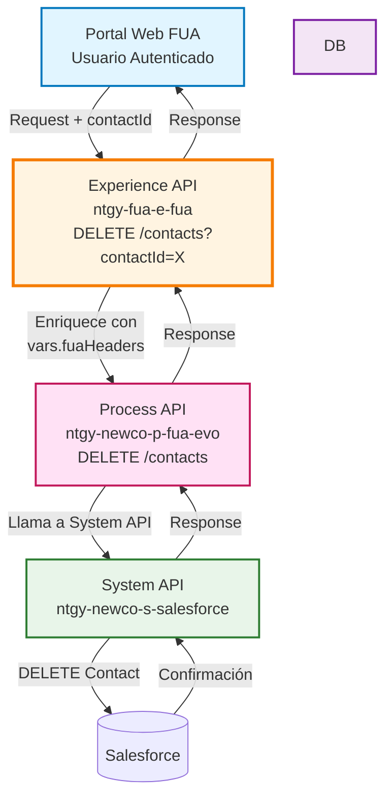
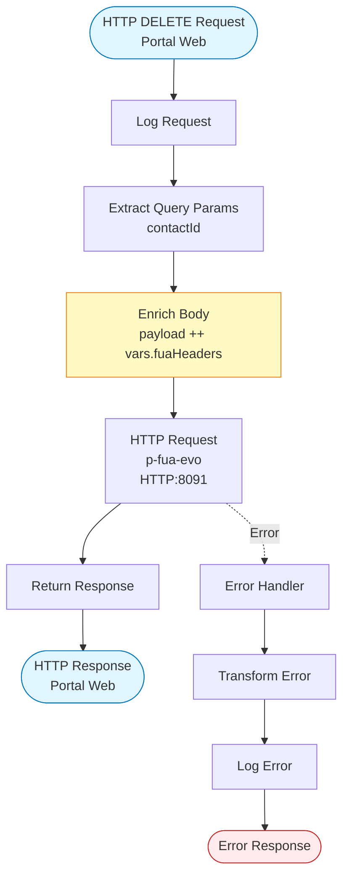
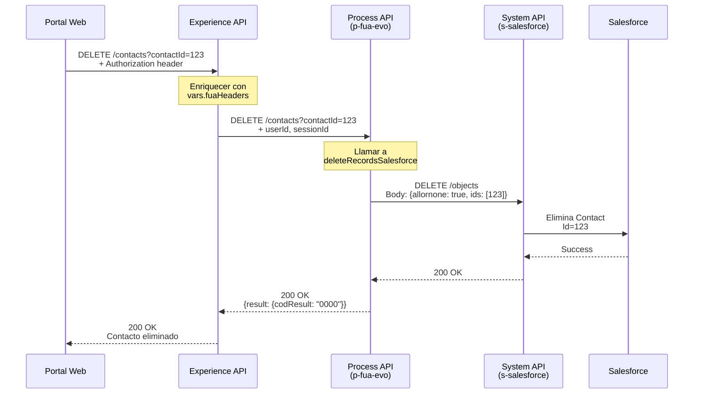
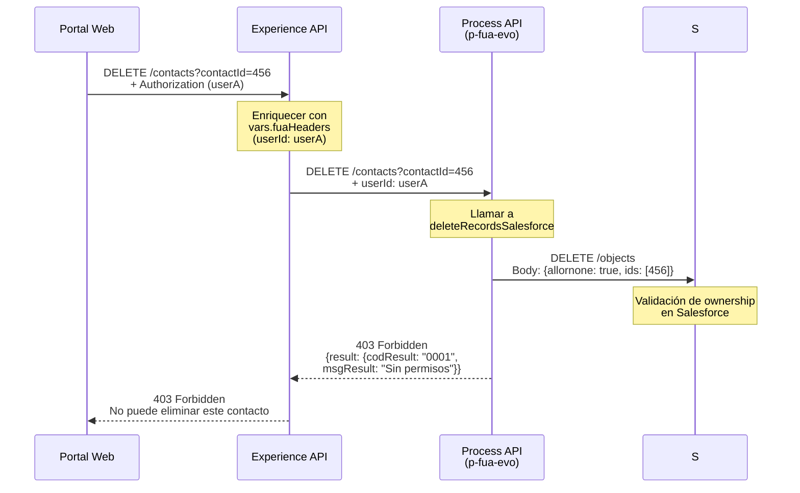
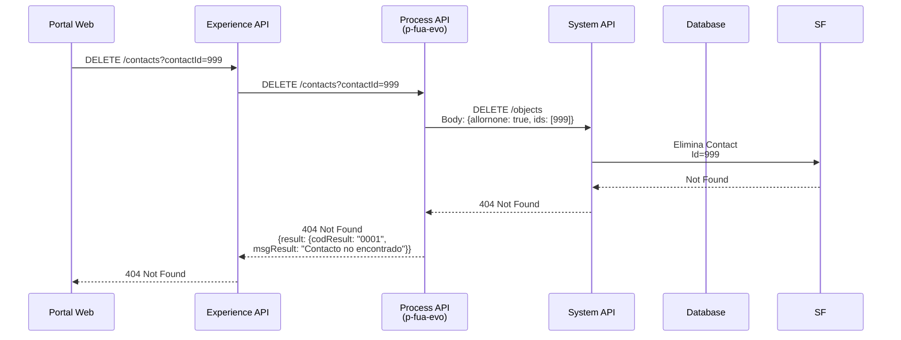
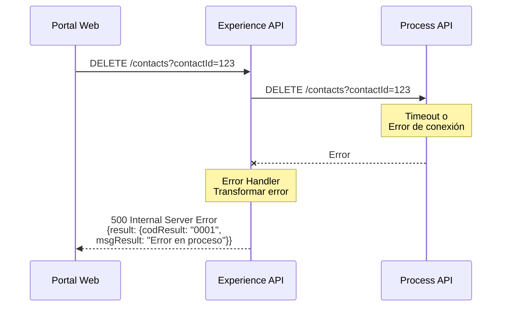

# DELETE /contacts

## 📌 Descripción General

### Propósito del Endpoint

Este endpoint permite a los usuarios eliminar contactos asociados a su cuenta en el portal FUA de Naturgy. Implementa un mecanismo de eliminación segura que valida la propiedad del contacto antes de proceder con la operación, asegurando que los usuarios solo puedan eliminar sus propios contactos.

### Tipo de API

**Capa:** Experience API (API-Led Connectivity)

**Función:** Proxy con enriquecimiento de contexto de usuario para eliminación de contactos

### Patrón de Integración

**Tipo:** Pass-Through con Enriquecimiento de Headers

**Descripción:** Este Experience API:
- Recibe la solicitud de eliminación con el ID del contacto
- Enriquece el request con información de contexto del usuario (`vars.fuaHeaders`)
- Reenvía la petición al Process API para validación y procesamiento
- Retorna la respuesta al cliente

### Arquitectura API-Led Connectivity



---

## 💼 Propósito del Negocio

### Casos de Uso Principales

1. **Eliminación de Contacto Secundario**
   - Usuario elimina contacto autorizado que ya no necesita acceso
   - Gestión de permisos de acceso a la cuenta
   - Mantenimiento de lista de contactos actualizada

2. **Gestión de Contactos Autorizados**
   - Revocación de acceso a terceros
   - Actualización de contactos tras cambios organizacionales
   - Control de quién puede acceder a información de la cuenta

3. **Limpieza de Datos**
   - Eliminación de contactos obsoletos o duplicados
   - Mantenimiento de base de datos limpia
   - Cumplimiento con políticas de retención de datos

### 📱 Canal y Audiencia

#### Canal de Consumo

**Canal:** Web

**Características del Canal:**
- **Plataforma**: Portal web FUA (Frontal Único de Atención)
- **Dispositivos**: Navegadores web (desktop y mobile)
- **Conectividad**: Conexión estable requerida
- **Experiencia de Usuario**: Confirmación antes de eliminación, operación irreversible

#### Audiencia Objetivo

**Usuarios Finales:**
- **Titulares de Cuenta**: Clientes que gestionan contactos autorizados
- **Administradores de Cuenta**: Usuarios con permisos de gestión
- **Usuarios Empresariales**: Empresas que gestionan múltiples contactos

**Contexto de Uso:**
- **Gestión de Permisos**: Control de acceso a información de cuenta
- **Actualización de Contactos**: Mantenimiento de lista actualizada
- **Seguridad**: Revocación de acceso cuando sea necesario

#### Adaptaciones del Canal

**Optimizaciones Aplicadas:**
- **Enriquecimiento de Contexto**: `vars.fuaHeaders` incluye información de usuario autenticado
- **Validación de Ownership**: Solo se pueden eliminar contactos propios
- **Timeout Estándar**: 60 segundos para operación completa
- **Confirmación Requerida**: UI debe solicitar confirmación antes de llamar

### 🔗 Endpoints Dependientes

Este Experience API consume el siguiente Process API:

| Process API | Endpoint | Método | Propósito |
|-------------|----------|--------|-----------|
| `ntgy-newco-p-fua-evo` | `/contacts` | DELETE | Eliminación de contacto en Salesforce mediante System API (ntgy-newco-s-salesforce) |

### Contexto Empresarial

- **Dominio:** Gestión de Contactos y Permisos
- **Sector:** Energía - Utilities
- **División:** Naturgy España - Portal FUA NewCo
- **Canal:** Web

### Stakeholders

- **Clientes Finales**: Necesitan control sobre quién accede a su información
- **Equipo de Seguridad**: Requieren trazabilidad de eliminaciones
- **Equipo de Soporte**: Necesitan auditoría de cambios en contactos

### Valor de Negocio

- **Control de Acceso**: Usuario gestiona sus propios permisos
- **Seguridad**: Validación de ownership previene eliminaciones no autorizadas
- **Cumplimiento**: Trazabilidad completa de operaciones
- **Experiencia de Usuario**: Gestión autónoma sin intervención de soporte

---

## 🔧 Especificación Técnica

### URLs por Ambiente

| Ambiente | URL Base | URL Completa |
|----------|----------|--------------|
| **Local** | `http://localhost:8081` | `http://localhost:8081/fua/api/contacts?contactId={id}` |
| **Development** | `https://ntgy-fua-e-fua-dev.de-c1.cloudhub.io` | `https://ntgy-fua-e-fua-dev.de-c1.cloudhub.io/fua/api/contacts?contactId={id}` |
| **Production** | `https://ntgy-fua-e-fua-pro.de-c1.cloudhub.io` | `https://ntgy-fua-e-fua-pro.de-c1.cloudhub.io/fua/api/contacts?contactId={id}` |

### Método HTTP

```
DELETE /fua/api/contacts?contactId={contactId}
```

### 🎯 Consideraciones del Canal

#### Limitaciones del Canal

| Aspecto | Limitación | Razón |
|---------|------------|-------|
| **Timeout** | 60 segundos | Operación puede incluir validaciones y sincronización |
| **Rate Limiting** | Según política API Gateway | Prevenir eliminaciones masivas accidentales |
| **Validación** | Ownership obligatorio | Solo se pueden eliminar contactos propios |
| **Operación** | Irreversible | No hay recuperación automática |

#### Enriquecimiento con vars.fuaHeaders

**Información de Contexto Incluida:**

El Experience API enriquece automáticamente el request con `vars.fuaHeaders`, que típicamente incluye:

| Header | Descripción | Uso |
|--------|-------------|-----|
| `userId` | ID del usuario autenticado | Validación de ownership |
| `sessionId` | ID de sesión activa | Trazabilidad |
| `clientId` | ID de cliente OAuth | Auditoría |
| `timestamp` | Timestamp de la operación | Logging |

**Transformación Aplicada:**
```dataweave
%dw 2.2
output application/json
---
payload ++ vars.fuaHeaders
```

### Parámetros de Entrada

#### Headers

| Header | Tipo | Requerido | Descripción |
|--------|------|-----------|-------------|
| `Content-Type` | string | Sí | Debe ser `application/json` |
| `client_id` | string | Sí | Identificador de cliente OAuth 2.0 |
| `client_secret` | string | Sí | Secreto de cliente OAuth 2.0 |
| `Authorization` | string | Sí | Token de autenticación del usuario |

**⚠️ Nota:** El trait `header.hasHeaders` indica que se requieren headers adicionales específicos de FUA.

#### Query Parameters

| Parámetro | Tipo | Requerido | Descripción | Validaciones |
|-----------|------|-----------|-------------|--------------|
| `contactId` | string | Sí | Identificador único del contacto a eliminar | UUID o ID numérico válido |

**Ejemplo de URL:**
```
DELETE /fua/api/contacts?contactId=12345
```

#### Body

**No se requiere body** para este endpoint. La información del contacto a eliminar se especifica mediante el query parameter `contactId`.

### Respuestas

#### 200 OK - Eliminación Exitosa

```json
{
  "result": {
    "codResult": "0000",
    "msgResult": "Contacto eliminado correctamente"
  }
}
```

| Campo | Tipo | Descripción |
|-------|------|-------------|
| `result` | object | Objeto con resultado de la operación |
| `result.codResult` | string | Código de resultado ("0000" = éxito) |
| `result.msgResult` | string | Mensaje descriptivo del resultado |

#### 400 Bad Request - Error de Validación

```json
{
  "result": {
    "codResult": "0001",
    "msgResult": "contactId es obligatorio"
  }
}
```

**Errores Comunes:**
- contactId faltante o inválido
- Formato de ID incorrecto
- Parámetros adicionales no permitidos

#### 403 Forbidden - Sin Permisos

```json
{
  "result": {
    "codResult": "0001",
    "msgResult": "No tiene permisos para eliminar este contacto"
  }
}
```

**Razones:**
- El contacto no pertenece al usuario autenticado
- Usuario sin permisos de gestión de contactos
- Intento de eliminar contacto protegido

#### 404 Not Found - Contacto No Existe

```json
{
  "result": {
    "codResult": "0001",
    "msgResult": "Contacto no encontrado"
  }
}
```

#### 500 Internal Server Error - Error del Sistema

```json
{
  "result": {
    "codResult": "0001",
    "msgResult": "Error en el proceso de eliminación"
  }
}
```

### Autenticación

- **Tipo:** OAuth 2.0 Bearer Token
- **Headers Requeridos:** `Authorization`, `client_id`, `client_secret`
- **Scope:** Gestión de contactos propios
- **Validación:** Token debe estar activo y asociado al usuario

### Timeouts

| Tipo | Valor | Razón |
|------|-------|-------|
| **Request Timeout** | 60 segundos | Incluye validación, eliminación y sincronización |
| **Connection Idle Timeout** | 60 segundos | Mantener conexión durante proceso completo |

---

## 🏗️ Implementación Técnica

### Arquitectura del Flow



### Configuración del Conector HTTP

#### Conector: ntgy-newco-p-fua-evo

```xml
<http:request-config 
    name="HTTP_FUA_PROCESS_NEWCO_EVO"
    basePath="/api"
    responseTimeout="${newco-p-fua-evo.timeout}">
    <http:request-connection 
        host="${newco-p-fua-evo.host}"
        port="${newco-p-fua-evo.port}"
        connectionIdleTimeout="${newco-p-fua-evo.timeout}"/>
</http:request-config>
```

**Configuración (Producción):**
- Host: `mule-worker-internal-ntgy-newco-p-fua-evo.de-c1.cloudhub.io`
- Puerto: `8091`
- Protocolo: `HTTP`
- Base Path: `/api`
- Timeout: `60000` ms (60 segundos)

### Implementación del Flow

**Implementación XML:**

```xml
<flow name="delete-contacts">
    <http:request 
        method="DELETE" 
        path="/contacts" 
        config-ref="HTTP_FUA_PROCESS_NEWCO_EVO">
        
        <!-- Enriquecimiento del body con headers FUA -->
        <http:body><![CDATA[%dw 2.2
output application/json
---
payload
++
vars.fuaHeaders]]></http:body>
        
        <!-- Extracción y paso del query parameter -->
        <http:query-params><![CDATA[%dw 2.0
output application/java
---
{
    "contactId": attributes.queryParams.contactId
}]]></http:query-params>
    </http:request>
    
    <error-handler>
        <on-error-propagate>
            <ee:transform doc:name="Set Error Message">
                <ee:set-payload><![CDATA[%dw 2.0
output application/json
---
{
    "result": {
        "codResult": "0001",
        "msgResult": error.description as String replace /\"/ with("")
    }
}]]></ee:set-payload>
            </ee:transform>
            <logger level="ERROR" doc:name="Error" />
        </on-error-propagate>
    </error-handler>
</flow>
```

**Características de la Implementación:**
- ✅ **Enriquecimiento de contexto**: Combina payload con vars.fuaHeaders
- ✅ **Extracción de parámetros**: Pasa contactId al Process API
- ✅ **Manejo de errores estándar**: Mismo patrón que otros endpoints
- ✅ **Logging completo**: Trazabilidad de operaciones

### Transformaciones DataWeave

#### 1. Enriquecimiento del Body

```dataweave
%dw 2.2
output application/json
---
payload
++
vars.fuaHeaders
```

**Propósito:** Combinar el payload original (puede estar vacío) con información de contexto del usuario almacenada en `vars.fuaHeaders`.

**Resultado Típico:**
```json
{
  "userId": "user123",
  "sessionId": "session456",
  "clientId": "client789",
  "timestamp": "2024-01-15T10:30:00Z"
}
```

#### 2. Extracción de Query Parameters

```dataweave
%dw 2.0
output application/java
---
{
  "contactId": attributes.queryParams.contactId
}
```

**Propósito:** Extraer el parámetro `contactId` de la URL y pasarlo al Process API.

### Patrones de Diseño

**Patrón:** Pass-Through con Context Enrichment

**Justificación:** 
- Añade información de contexto de usuario necesaria para validación
- Mantiene simplicidad del proxy
- Delega validación de ownership al Process API
- Facilita auditoría y trazabilidad

**Ventajas:**
- 🔒 Seguridad mejorada (contexto de usuario siempre presente)
- 📊 Trazabilidad completa de operaciones
- 🎯 Separación clara de responsabilidades
- ⚡ Mínimo overhead de procesamiento

### Diagramas de Secuencia

#### 1. Flujo Normal de Éxito



#### 2. Flujo con Error - Sin Permisos



#### 3. Flujo con Error - Contacto No Existe



#### 4. Flujo con Error Técnico



### Manejo de Errores

#### Estrategia de Error Handling

**Global Error Handler:**

```dataweave
%dw 2.0
output application/json
---
{
  "result": {
    "codResult": "0001",
    "msgResult": error.description as String replace /\"/ with("")
  }
}
```

**Comportamiento:**
1. Capturar cualquier error del Process API
2. Transformar a formato estándar de respuesta
3. Logging de error en nivel ERROR
4. Propagación del error al cliente con información útil

#### Tipos de Errores

| Tipo Error | Código HTTP | Código Result | Origen | Acción |
|------------|-------------|---------------|--------|--------|
| contactId faltante | 400 | 0001 | Experience API | Validar parámetros antes de llamar |
| Sin permisos | 403 | 0001 | Process API | Verificar ownership |
| Contacto no existe | 404 | 0001 | System API | Verificar ID antes de eliminar |
| Timeout | 500 | 0001 | Experience API | Reintentar operación |
| Error de conexión | 500 | 0001 | Experience API | Verificar conectividad |

### Configuración de Propiedades

**Archivo:** `e-fua-pro-config.yaml`

```yaml
# Configuración p-fua-evo
newco-p-fua-evo:
  host: "mule-worker-internal-ntgy-newco-p-fua-evo.de-c1.cloudhub.io"
  port: "8091"
  timeout: "60000"
  recordtypeid: "0125I00000056X4QAI"
```

**Características:**
- ✅ Timeout de 60 segundos para operaciones complejas
- ✅ Protocolo HTTP estándar
- ✅ Puerto CloudHub interno (8091)
- ✅ Sin configuración condicional (destino único)

---

## 💻 Ejemplos de Uso

### Ejemplo 1: Eliminación Exitosa

#### cURL

```bash
curl -X DELETE "https://ntgy-fua-e-fua-pro.de-c1.cloudhub.io/fua/api/contacts?contactId=12345" \
  -H "Content-Type: application/json" \
  -H "Authorization: Bearer YOUR_ACCESS_TOKEN" \
  -H "client_id: YOUR_CLIENT_ID" \
  -H "client_secret: YOUR_CLIENT_SECRET"
```

#### Respuesta (200 OK)

```json
{
  "result": {
    "codResult": "0000",
    "msgResult": "Contacto eliminado correctamente"
  }
}
```

### Ejemplo 2: Error - Contacto No Encontrado

#### cURL

```bash
curl -X DELETE "https://ntgy-fua-e-fua-pro.de-c1.cloudhub.io/fua/api/contacts?contactId=99999" \
  -H "Content-Type: application/json" \
  -H "Authorization: Bearer YOUR_ACCESS_TOKEN" \
  -H "client_id: YOUR_CLIENT_ID" \
  -H "client_secret: YOUR_CLIENT_SECRET"
```

#### Respuesta (404 Not Found)

```json
{
  "result": {
    "codResult": "0001",
    "msgResult": "Contacto no encontrado"
  }
}
```

### Ejemplo 3: Error - Sin Permisos

#### cURL

```bash
curl -X DELETE "https://ntgy-fua-e-fua-pro.de-c1.cloudhub.io/fua/api/contacts?contactId=67890" \
  -H "Content-Type: application/json" \
  -H "Authorization: Bearer YOUR_ACCESS_TOKEN" \
  -H "client_id: YOUR_CLIENT_ID" \
  -H "client_secret: YOUR_CLIENT_SECRET"
```

#### Respuesta (403 Forbidden)

```json
{
  "result": {
    "codResult": "0001",
    "msgResult": "No tiene permisos para eliminar este contacto"
  }
}
```

### Ejemplo 4: JavaScript (Portal Web con Confirmación)

```javascript
async function eliminarContacto(contactId) {
  // Solicitar confirmación al usuario
  const confirmacion = confirm(
    '¿Está seguro de que desea eliminar este contacto? Esta acción no se puede deshacer.'
  );
  
  if (!confirmacion) {
    return { success: false, cancelled: true };
  }
  
  try {
    const response = await fetch(
      `https://ntgy-fua-e-fua-pro.de-c1.cloudhub.io/fua/api/contacts?contactId=${contactId}`,
      {
        method: 'DELETE',
        headers: {
          'Content-Type': 'application/json',
          'Authorization': `Bearer ${getAccessToken()}`,
          'client_id': 'YOUR_CLIENT_ID',
          'client_secret': 'YOUR_CLIENT_SECRET'
        }
      }
    );

    const resultado = await response.json();
    
    if (response.ok && resultado.result.codResult === '0000') {
      console.log('✓ Contacto eliminado:', resultado.result.msgResult);
      return { success: true, data: resultado };
    } else {
      console.error('✗ Error al eliminar:', resultado.result.msgResult);
      return { 
        success: false, 
        error: resultado.result.msgResult,
        statusCode: response.status
      };
    }
  } catch (error) {
    console.error('✗ Error de conexión:', error);
    return { success: false, error: 'Error de conexión con el servidor' };
  }
}

// Ejemplo de uso con manejo de UI
document.getElementById('btnEliminarContacto').addEventListener('click', async () => {
  const contactId = document.getElementById('contactId').value;
  
  if (!contactId) {
    alert('Por favor, seleccione un contacto');
    return;
  }
  
  // Deshabilitar botón durante la operación
  const btn = document.getElementById('btnEliminarContacto');
  btn.disabled = true;
  btn.textContent = 'Eliminando...';
  
  const resultado = await eliminarContacto(contactId);
  
  // Rehabilitar botón
  btn.disabled = false;
  btn.textContent = 'Eliminar Contacto';
  
  if (resultado.success) {
    alert('Contacto eliminado correctamente');
    // Recargar lista de contactos
    cargarListaContactos();
  } else if (resultado.cancelled) {
    console.log('Operación cancelada por el usuario');
  } else {
    alert(`Error: ${resultado.error}`);
  }
});

// Función auxiliar para obtener token
function getAccessToken() {
  // Implementar según tu sistema de autenticación
  return localStorage.getItem('access_token');
}
```

### Ejemplo 5: Python

```python
import requests
from typing import Dict, Optional

def eliminar_contacto(contact_id: str, access_token: str) -> Dict:
    """
    Elimina un contacto del portal FUA
    
    Args:
        contact_id (str): ID del contacto a eliminar
        access_token (str): Token de autenticación del usuario
        
    Returns:
        dict: Resultado de la operación
    """
    url = 'https://ntgy-fua-e-fua-pro.de-c1.cloudhub.io/fua/api/contacts'
    
    headers = {
        'Content-Type': 'application/json',
        'Authorization': f'Bearer {access_token}',
        'client_id': 'YOUR_CLIENT_ID',
        'client_secret': 'YOUR_CLIENT_SECRET'
    }
    
    params = {
        'contactId': contact_id
    }
    
    try:
        response = requests.delete(url, headers=headers, params=params, timeout=30)
        resultado = response.json()
        
        if response.ok and resultado['result']['codResult'] == '0000':
            print(f"✓ Contacto eliminado: {resultado['result']['msgResult']}")
            return {'success': True, 'data': resultado}
        else:
            print(f"✗ Error al eliminar: {resultado['result']['msgResult']}")
            return {
                'success': False, 
                'error': resultado['result']['msgResult'],
                'status_code': response.status_code
            }
            
    except requests.exceptions.Timeout:
        print("✗ Error: Timeout en la petición")
        return {'success': False, 'error': 'Timeout'}
    except requests.exceptions.RequestException as e:
        print(f"✗ Error de conexión: {str(e)}")
        return {'success': False, 'error': str(e)}

# Ejemplo de uso con confirmación
def eliminar_contacto_con_confirmacion(contact_id: str, access_token: str) -> Dict:
    """
    Elimina un contacto con confirmación del usuario
    """
    # Solicitar confirmación
    confirmacion = input(
        f"¿Está seguro de eliminar el contacto {contact_id}? (s/n): "
    ).lower()
    
    if confirmacion != 's':
        print("Operación cancelada")
        return {'success': False, 'cancelled': True}
    
    return eliminar_contacto(contact_id, access_token)

# Ejemplo de uso
if __name__ == "__main__":
    contact_id = "12345"
    access_token = "your_access_token_here"
    
    resultado = eliminar_contacto_con_confirmacion(contact_id, access_token)
    
    if resultado.get('success'):
        print("Contacto eliminado correctamente")
    elif resultado.get('cancelled'):
        print("Operación cancelada por el usuario")
    else:
        print(f"Error: {resultado.get('error')}")
```

### Ejemplo 6: Gestión de Lista de Contactos

```javascript
// Componente completo de gestión de contactos
class GestorContactos {
  constructor(apiUrl, accessToken) {
    this.apiUrl = apiUrl;
    this.accessToken = accessToken;