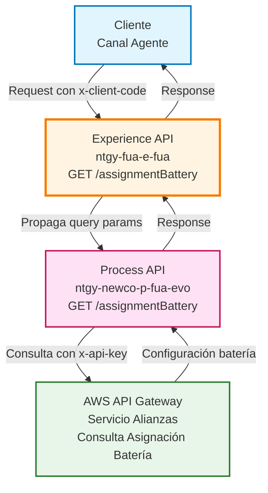
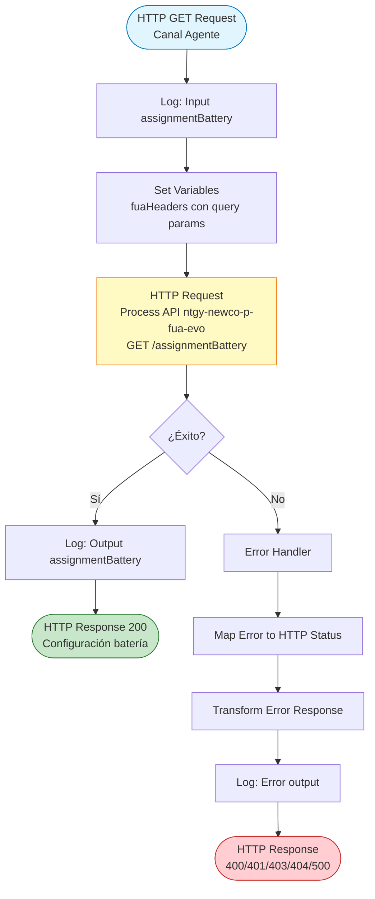
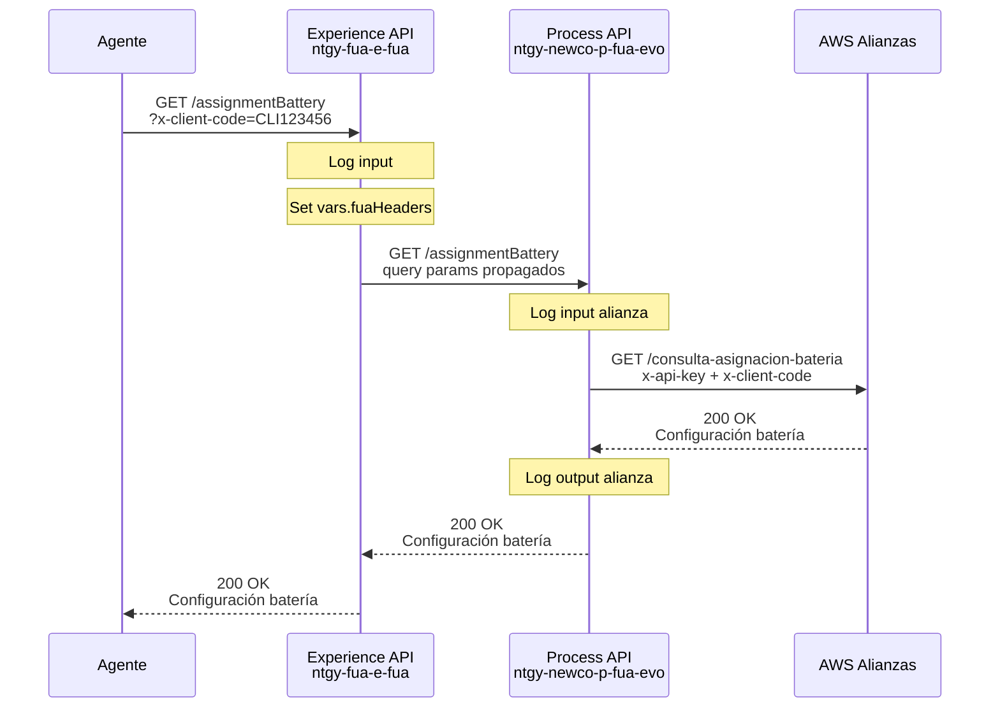
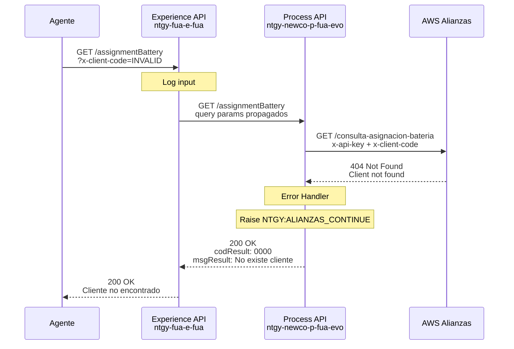
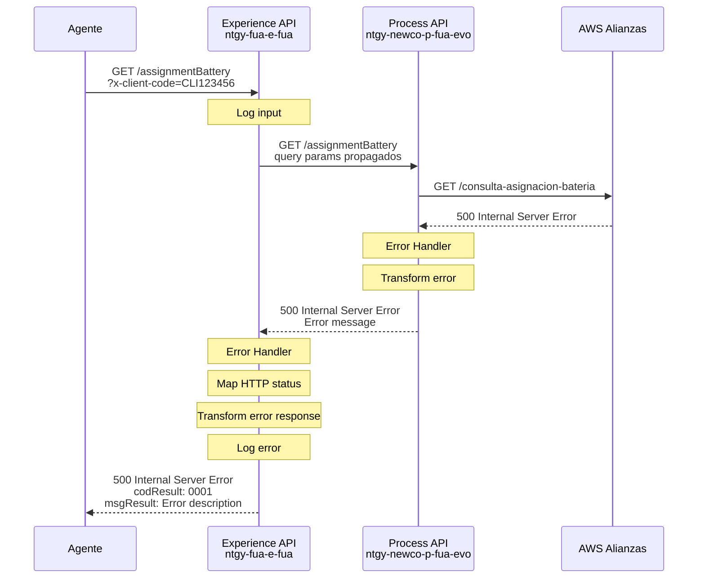

# GET /assignmentBattery

## 📌 Descripción General

### Propósito del Endpoint

Este endpoint permite consultar el tipo de configuración en batería asociada a un cliente específico. La consulta se realiza a través del servicio de alianzas AWS, proporcionando información sobre la asignación de baterías del cliente en el sistema.

### Tipo de API

**Capa:** Experience API (API-Led Connectivity)

**Función:** Orquestación de consulta de configuración de batería para canal de agentes

### Patrón de Integración

**Tipo:** Pass-Through con Propagación de Headers

**Descripción:** Este endpoint actúa como un pass-through que propaga los query parameters al Process API, el cual a su vez consulta el servicio AWS de alianzas. No realiza transformaciones de datos, solo orquestación y manejo de errores.

### Arquitectura API-Led Connectivity



---

## 💼 Propósito del Negocio

### Casos de Uso Principales

1. **Consulta de Configuración de Batería por Agente**
   - Agentes de atención al cliente consultan la configuración de batería asignada a un cliente
   - Permite verificar el tipo de batería asociada al cliente en el sistema de alianzas
   - Facilita la gestión y seguimiento de servicios de batería

2. **Validación de Asignación de Batería**
   - Verificación de la existencia de configuración de batería para un cliente específico
   - Identificación de clientes sin configuración de batería asignada
   - Soporte para procesos de alta y modificación de servicios de batería

3. **Gestión de Servicios de Alianzas**
   - Consulta de información relacionada con servicios de alianzas del cliente
   - Base para operaciones posteriores de gestión de baterías
   - Integración con el ecosistema de servicios AWS de Naturgy

### 📱 Canal y Audiencia

#### Canal de Consumo

**Canal:** Agente (Call Center / Atención al Cliente)

**Características del Canal:**
- **Plataforma**: Aplicaciones de escritorio para agentes
- **Dispositivos**: Estaciones de trabajo de call center
- **Conectividad**: Red corporativa interna de alta disponibilidad
- **Experiencia de Usuario**: Interfaz orientada a consultas rápidas y eficientes

#### Audiencia Objetivo

**Usuarios Finales:**
- **Agentes de Atención al Cliente**: Personal de call center que requiere consultar información de configuración de batería de clientes
- **Supervisores de Atención**: Personal que supervisa y gestiona casos relacionados con servicios de batería

**Contexto de Uso:**
- **Atención Telefónica**: Durante llamadas de clientes consultando sobre servicios de batería
- **Gestión de Casos**: Al crear o actualizar casos relacionados con servicios de alianzas
- **Verificación de Servicios**: Validación de configuraciones antes de realizar cambios

#### Adaptaciones del Canal

**Optimizaciones Aplicadas:**
- **Pass-Through de Datos**: No se aplican transformaciones, se devuelve la respuesta completa del backend
- **Propagación de Headers**: Los query parameters se propagan directamente al Process API
- **Manejo de Errores Específico**: Gestión de errores con códigos HTTP apropiados (400, 401, 403, 404, 500)
- **Timeout Configurado**: 60 segundos para operaciones de consulta a AWS

### 🔗 Endpoints Dependientes

Este Experience API consume el siguiente Process API:

| Process API | Endpoint | Método | Propósito |
|-------------|----------|--------|-----------|
| `ntgy-newco-p-fua-evo` | `/assignmentBattery` | GET | Orquesta la consulta de configuración de batería del cliente en el servicio AWS de alianzas |

### Contexto Empresarial

- **Dominio:** Gestión de Servicios de Alianzas
- **Sector:** Energía - Utilities
- **División:** Naturgy España - NewCo
- **Canal:** Agente (Call Center)
- **Servicio:** Consulta de Configuración de Batería

### Stakeholders

- **Agentes de Atención al Cliente**: Requieren acceso rápido a información de configuración de batería para atender consultas
- **Supervisores de Call Center**: Necesitan visibilidad de servicios de alianzas para gestión de casos
- **Equipo de Alianzas**: Responsables de la gestión y mantenimiento de servicios de batería

### Valor de Negocio

- **Eficiencia Operativa**: Consulta rápida de configuración de batería sin necesidad de acceder a múltiples sistemas
- **Mejora en Atención al Cliente**: Información inmediata sobre servicios de batería durante interacciones con clientes
- **Integración de Servicios**: Conexión transparente con el ecosistema de servicios AWS de alianzas
- **Gestión Centralizada**: Punto único de consulta para información de configuración de batería

---

## 🔧 Especificación Técnica

### URLs por Ambiente

| Ambiente | URL Base | URL Completa |
|----------|----------|--------------|
| **Local** | `http://localhost:8081` | `http://localhost:8081/fua/api/assignmentBattery` |
| **Development** | `https://ntgy-fua-e-fua-dev.de-c1.cloudhub.io` | `https://ntgy-fua-e-fua-dev.de-c1.cloudhub.io/fua/api/assignmentBattery` |
| **UAT** | `https://ntgy-fua-e-fua-uat.de-c1.cloudhub.io` | `https://ntgy-fua-e-fua-uat.de-c1.cloudhub.io/fua/api/assignmentBattery` |
| **Production** | `https://ntgy-fua-e-fua-pro.de-c1.cloudhub.io` | `https://ntgy-fua-e-fua-pro.de-c1.cloudhub.io/fua/api/assignmentBattery` |

### Método HTTP

```
GET /fua/api/assignmentBattery
```

### 🎯 Consideraciones del Canal

#### Limitaciones del Canal

| Aspecto | Limitación | Razón |
|---------|------------|-------|
| **Timeout** | 60 segundos | Consulta a servicio AWS externo puede requerir tiempo adicional |
| **Rate Limiting** | Según políticas de API Gateway | Protección del servicio backend AWS |
| **Autenticación** | OAuth 2.0 + API Key | Seguridad en acceso a servicios de alianzas |

#### Campos Específicos del Canal

**Campos Propagados al Process API:**

| Campo | Tipo | Ubicación | Descripción |
|-------|------|-----------|-------------|
| `x-client-code` | string | Query Parameter | Código identificador del cliente |
| `year` | string | Query Parameter (opcional) | Año de consulta de configuración |

**Nota:** Este endpoint es pass-through, por lo que no añade ni omite campos. La estructura de respuesta es la misma que devuelve el Process API.

### Parámetros de Entrada

#### Query Parameters

| Parámetro | Tipo | Requerido | Descripción | Ejemplo |
|-----------|------|-----------|-------------|---------|
| `x-client-code` | string | ✅ Sí | Código identificador del cliente en el sistema de alianzas | `"CLI123456"` |
| `year` | string | ❌ No | Año para filtrar la configuración de batería | `"2024"` |

**Validaciones:**
- `x-client-code`: Obligatorio, debe ser un código válido de cliente
- `year`: Opcional, formato de año de 4 dígitos si se proporciona

### Respuestas

#### ✅ 200 OK - Consulta Exitosa

**Descripción:** Configuración de batería encontrada y devuelta exitosamente

**Estructura de Respuesta:**

```json
{
  "result": {
    "codResult": "0000",
    "msgResult": "Operación exitosa"
  },
  "data": {
    "clientCode": "CLI123456",
    "batteryType": "TYPE_A",
    "assignmentDate": "2024-01-15",
    "status": "ACTIVE",
    "configuration": {
      "capacity": "10kWh",
      "model": "Battery Model X"
    }
  }
}
```

**Campos de Respuesta:**

| Campo | Tipo | Descripción |
|-------|------|-------------|
| `result.codResult` | string | Código de resultado de la operación |
| `result.msgResult` | string | Mensaje descriptivo del resultado |
| `data` | object | Datos de configuración de batería (estructura definida por AWS Alianzas) |

#### ❌ 400 Bad Request - Parámetros Inválidos

**Descripción:** Los parámetros de entrada no son válidos

**Estructura de Respuesta:**

```json
{
  "result": {
    "codResult": "0001",
    "msgResult": "Bad Request: Parámetros inválidos"
  }
}
```

#### ❌ 401 Unauthorized - No Autorizado

**Descripción:** Credenciales de autenticación inválidas o ausentes

**Estructura de Respuesta:**

```json
{
  "result": {
    "codResult": "0001",
    "msgResult": "Unauthorized: Credenciales inválidas"
  }
}
```

#### ❌ 403 Forbidden - Acceso Prohibido

**Descripción:** El usuario no tiene permisos para acceder a este recurso

**Estructura de Respuesta:**

```json
{
  "result": {
    "codResult": "0001",
    "msgResult": "Forbidden: Acceso denegado"
  }
}
```

#### ❌ 404 Not Found - Cliente No Encontrado

**Descripción:** No se encontró configuración de batería para el cliente especificado

**Estructura de Respuesta:**

```json
{
  "result": {
    "codResult": "0001",
    "msgResult": "Not Found: Cliente no encontrado"
  }
}
```

#### ❌ 500 Internal Server Error - Error del Servidor

**Descripción:** Error interno del servidor o del servicio AWS

**Estructura de Respuesta:**

```json
{
  "result": {
    "codResult": "0001",
    "msgResult": "Internal Server Error: Error en el servicio"
  }
}
```

### Autenticación

- **Tipo:** OAuth 2.0 (Experience API) + API Key (AWS Alianzas)
- **Headers Requeridos:**
  - `Authorization: Bearer {token}` (Experience API)
  - `x-api-key` (propagado internamente al servicio AWS)

### Timeouts

| Tipo | Valor | Razón |
|------|-------|-------|
| **Request Timeout (Experience → Process)** | 60 segundos | Configurado para consultas a servicios AWS externos |
| **Connection Idle Timeout** | 60 segundos | Mantiene conexión activa durante consultas largas |

---

## 🏗️ Implementación Técnica

### Arquitectura del Flow



### Transformaciones de Canal

⚠️ **Este Experience API NO transforma la respuesta del Process API.**

**Patrón:** Pass-Through con Propagación de Query Parameters

**Implementación:**
- Los query parameters recibidos se almacenan en la variable `fuaHeaders`
- Esta variable se propaga directamente al Process API mediante `<http:query-params>`
- La respuesta del Process API se devuelve sin modificaciones al cliente

Para el schema completo de la respuesta, consultar:
📖 **Process API: `ntgy-newco-p-fua-evo` endpoint `/assignmentBattery`**

### Configuración del HTTP Request

**Archivo:** `src/main/mule/alliances.xml`

**Flow Principal:**
```xml
<flow name="get:\assignmentBattery:e-fua-config">
    <flow-ref name="get-alianza-assignmentBattery"/>
</flow>
```

**Subflow de Implementación:**
```xml
<flow name="get-alianza-assignmentBattery">
    <http:request 
        method="GET" 
        config-ref="HTTP_FUA_PROCESS_NEWCO_EVO" 
        path="/assignmentBattery" 
        responseTimeout="${newco-p-fua-evo.timeout}">
        <http:query-params>
            #[output application/java
            ---
            vars.fuaHeaders]
        </http:query-params>
    </http:request>
    <error-handler>
        <on-error-propagate>
            <!-- Manejo de errores -->
        </on-error-propagate>
    </error-handler>
</flow>
```

**Configuración HTTP (global.xml):**
```xml
<http:request-config 
    name="HTTP_FUA_PROCESS_NEWCO_EVO" 
    basePath="/api" 
    responseTimeout="${newco-p-fua-evo.timeout}">
    <http:request-connection 
        host="${newco-p-fua-evo.host}" 
        port="${newco-p-fua-evo.port}" 
        connectionIdleTimeout="${newco-p-fua-evo.timeout}"/>
</http:request-config>
```

**Properties (e-fua-pro-config.yaml):**
```yaml
newco-p-fua-evo:
  host: "mule-worker-internal-ntgy-newco-p-fua-evo.de-c1.cloudhub.io"
  port: "8091"
  timeout: "60000"
```

### Patrones de Diseño

**Patrón:** Pass-Through con Error Handling Robusto

**Justificación:** 
- El Experience API actúa como punto de entrada unificado para el canal de agentes
- No requiere transformaciones de datos, solo orquestación y gestión de errores
- Permite centralizar el manejo de errores y logging sin añadir complejidad innecesaria
- Facilita el mantenimiento al mantener la lógica de negocio en el Process API

### Diagramas de Secuencia

#### 1. Flujo Normal de Éxito



#### 2. Flujo con Cliente No Encontrado



#### 3. Flujo con Error Técnico



### Manejo de Errores

#### Error Handler del Experience API

**Ubicación:** `src/main/mule/alliances.xml` - Flow `get-alianza-assignmentBattery`

**Estrategia:**
1. **Captura de Error:** `<on-error-propagate>` captura cualquier error del Process API
2. **Transformación de Error:** DataWeave transforma el error a formato estándar
3. **Mapeo de HTTP Status:** Lógica condicional determina el código HTTP apropiado
4. **Logging:** Se registra el error para trazabilidad

**Transformación de Error:**
```dataweave
%dw 2.0
output application/json
---
{
    "result": {
        "codResult": "0001",
        "msgResult": if(error.errorMessage.payload.result.msgResult != null) 
                        error.errorMessage.payload.result.msgResult 
                     else 
                        error.description
    }
}
```

**Mapeo de HTTP Status:**
```dataweave
%dw 2.0
output application/java
---
if((error.errorMessage.payload.result.msgResult contains ("400")) or (error.description contains ("400")))
    400
else if((error.errorMessage.payload.result.msgResult contains ("401")) or (error.description contains ("401")))
    401
else if((error.errorMessage.payload.result.msgResult contains ("403")) or (error.description contains ("403")))
    403
else if((error.errorMessage.payload.result.msgResult contains ("404")) or (error.description contains ("404")))
    404
else
    500
```

#### Códigos de Error

| Código HTTP | Código Resultado | Descripción | Acción |
|-------------|------------------|-------------|--------|
| 200 | 0000 | Cliente no encontrado (caso especial) | Continuar con respuesta informativa |
| 400 | 0001 | Bad Request | Verificar parámetros de entrada |
| 401 | 0001 | Unauthorized | Verificar credenciales de autenticación |
| 403 | 0001 | Forbidden | Verificar permisos de acceso |
| 404 | 0001 | Not Found | Cliente no existe en el sistema |
| 500 | 0001 | Internal Server Error | Contactar soporte técnico |

#### Caso Especial: Cliente No Encontrado

El Process API maneja el error "Client not found" de manera especial:
- **Error Original:** AWS devuelve error con mensaje "Client not found"
- **Transformación:** Se convierte en respuesta exitosa (200 OK) con código 0000
- **Mensaje:** "No existe cliente"
- **Razón:** Permite al agente distinguir entre error técnico y cliente inexistente

---

## 💻 Ejemplos de Uso

### Ejemplo 1: Consulta Exitosa de Configuración de Batería

#### cURL

```bash
curl -X GET "https://ntgy-fua-e-fua-pro.de-c1.cloudhub.io/fua/api/assignmentBattery?x-client-code=CLI123456&year=2024" \
  -H "Content-Type: application/json" \
  -H "Authorization: Bearer YOUR_ACCESS_TOKEN" \
  -H "client_id: YOUR_CLIENT_ID"
```

#### Respuesta (200 OK)

```json
{
  "result": {
    "codResult": "0000",
    "msgResult": "Operación exitosa"
  },
  "data": {
    "clientCode": "CLI123456",
    "batteryType": "TYPE_A",
    "assignmentDate": "2024-01-15",
    "status": "ACTIVE",
    "configuration": {
      "capacity": "10kWh",
      "model": "Battery Model X",
      "installationDate": "2024-01-15",
      "warrantyExpiration": "2029-01-15"
    }
  }
}
```

### Ejemplo 2: Cliente No Encontrado

#### cURL

```bash
curl -X GET "https://ntgy-fua-e-fua-pro.de-c1.cloudhub.io/fua/api/assignmentBattery?x-client-code=INVALID123" \
  -H "Content-Type: application/json" \
  -H "Authorization: Bearer YOUR_ACCESS_TOKEN" \
  -H "client_id: YOUR_CLIENT_ID"
```

#### Respuesta (200 OK - Caso Especial)

```json
{
  "result": {
    "codResult": "0000",
    "msgResult": "No existe cliente"
  }
}
```

### Ejemplo 3: Error de Parámetros Inválidos

#### cURL

```bash
curl -X GET "https://ntgy-fua-e-fua-pro.de-c1.cloudhub.io/fua/api/assignmentBattery" \
  -H "Content-Type: application/json" \
  -H "Authorization: Bearer YOUR_ACCESS_TOKEN" \
  -H "client_id: YOUR_CLIENT_ID"
```

#### Respuesta (400 Bad Request)

```json
{
  "result": {
    "codResult": "0001",
    "msgResult": "Bad Request: Parámetro x-client-code es obligatorio"
  }
}
```

### Ejemplo 4: JavaScript (para Aplicaciones Web de Agentes)

```javascript
async function getAssignmentBattery(clientCode, year = null) {
  const baseUrl = 'https://ntgy-fua-e-fua-pro.de-c1.cloudhub.io/fua/api/assignmentBattery';
  const params = new URLSearchParams({
    'x-client-code': clientCode
  });
  
  if (year) {
    params.append('year', year);
  }
  
  try {
    const response = await fetch(`${baseUrl}?${params}`, {
      method: 'GET',
      headers: {
        'Content-Type': 'application/json',
        'Authorization': `Bearer ${getAccessToken()}`,
        'client_id': 'YOUR_CLIENT_ID'
      }
    });
    
    const data = await response.json();
    
    if (response.ok) {
      if (data.result.codResult === '0000' && data.result.msgResult === 'No existe cliente') {
        console.log('Cliente no encontrado en el sistema de alianzas');
        return null;
      }
      console.log('Configuración de batería:', data.data);
      return data.data;
    } else {
      console.error('Error al consultar configuración:', data.result.msgResult);
      throw new Error(data.result.msgResult);
    }
  } catch (error) {
    console.error('Error en la petición:', error);
    throw error;
  }
}

// Uso
getAssignmentBattery('CLI123456', '2024')
  .then(config => {
    if (config) {
      console.log('Tipo de batería:', config.batteryType);
      console.log('Estado:', config.status);
    }
  })
  .catch(error => {
    console.error('Error:', error);
  });
```

### Ejemplo 5: Python (para Scripts de Integración)

```python
import requests
from typing import Optional, Dict, Any

def get_assignment_battery(
    client_code: str, 
    year: Optional[str] = None,
    access_token: str = None
) -> Dict[str, Any]:
    """
    Consulta la configuración de batería de un cliente.
    
    Args:
        client_code: Código del cliente
        year: Año de consulta (opcional)
        access_token: Token de autenticación
        
    Returns:
        Diccionario con la configuración de batería o None si no existe
        
    Raises:
        requests.exceptions.RequestException: Si hay error en la petición
    """
    base_url = 'https://ntgy-fua-e-fua-pro.de-c1.cloudhub.io/fua/api/assignmentBattery'
    
    params = {'x-client-code': client_code}
    if year:
        params['year'] = year
    
    headers = {
        'Content-Type': 'application/json',
        'Authorization': f'Bearer {access_token}',
        'client_id': 'YOUR_CLIENT_ID'
    }
    
    try:
        response = requests.get(base_url, params=params, headers=headers)
        data = response.json()
        
        if response.status_code == 200:
            if data['result']['codResult'] == '0000' and \
               data['result']['msgResult'] == 'No existe cliente':
                print('Cliente no encontrado en el sistema de alianzas')
                return None
            
            print(f"Configuración encontrada: {data['data']}")
            return data['data']
        else:
            print(f"Error {response.status_code}: {data['result']['msgResult']}")
            raise Exception(data['result']['msgResult'])
            
    except requests.exceptions.RequestException as e:
        print(f"Error en la petición: {e}")
        raise

# Uso
if __name__ == '__main__':
    try:
        config = get_assignment_battery(
            client_code='CLI123456',
            year='2024',
            access_token='your_token_here'
        )
        
        if config:
            print(f"Tipo de batería: {config['batteryType']}")
            print(f"Estado: {config['status']}")
            print(f"Capacidad: {config['configuration']['capacity']}")
    except Exception as e:
        print(f"Error: {e}")
```
