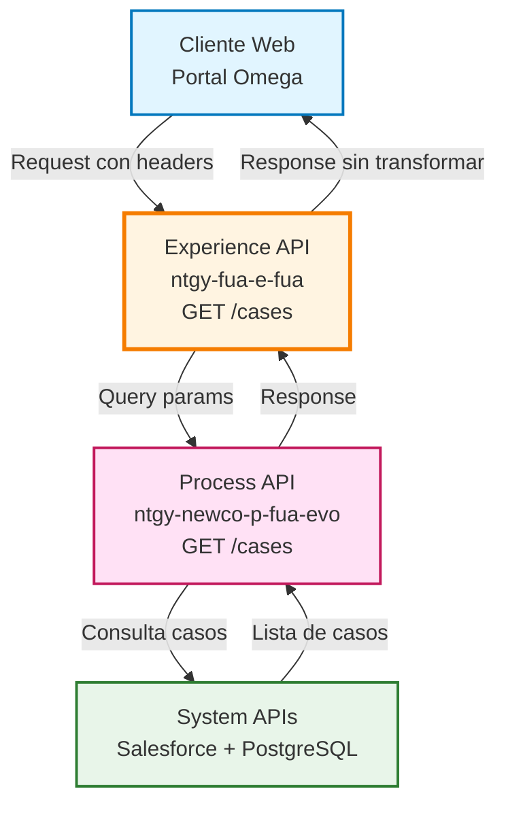
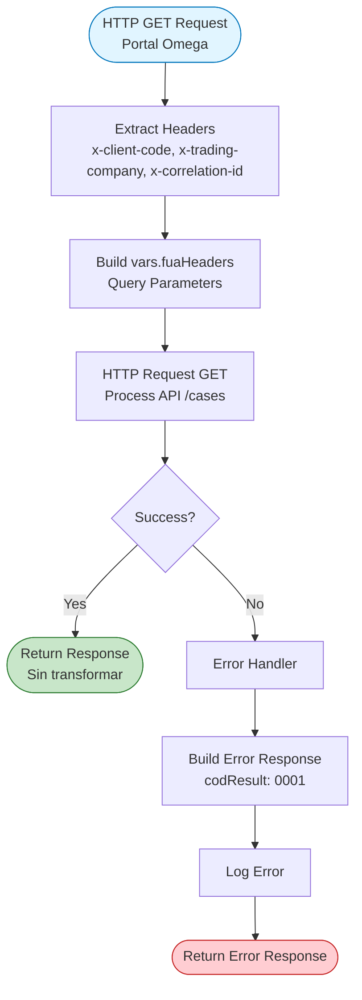
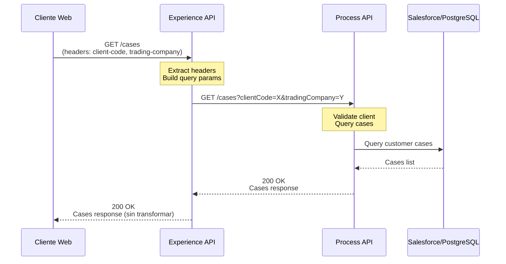
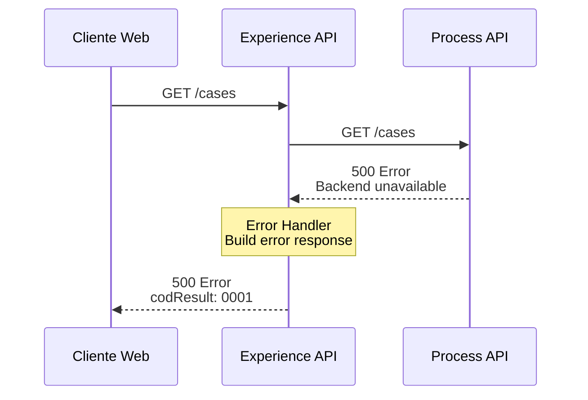
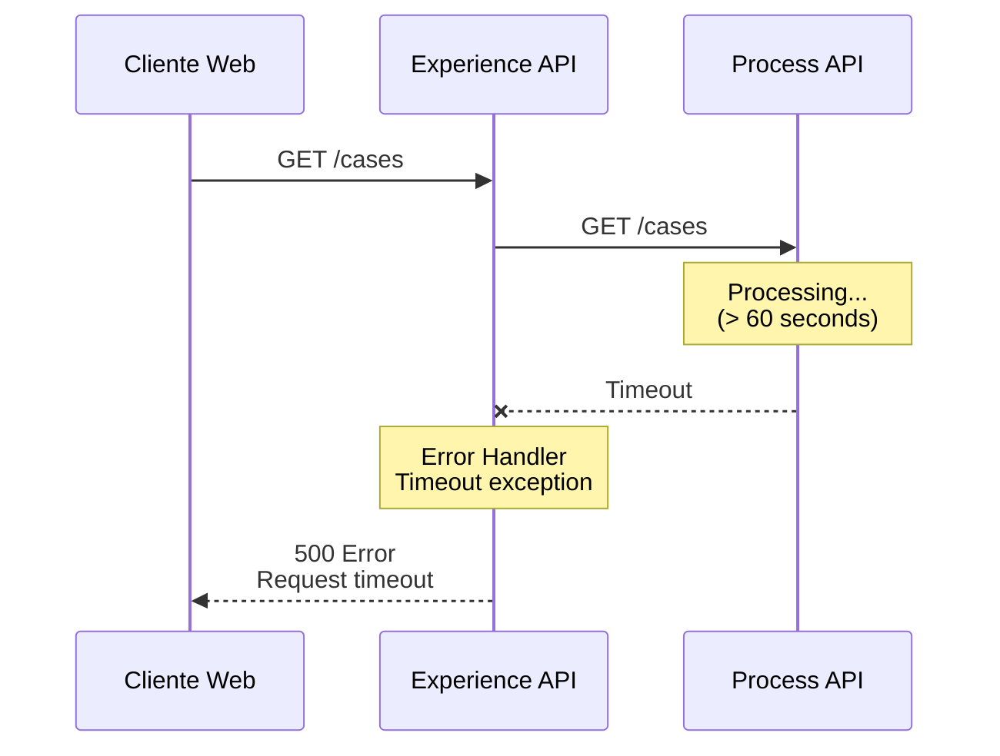

# GET /cases

## 📌 Descripción General

### Propósito del Endpoint

Este endpoint permite obtener el listado completo de solicitudes y gestiones del cliente, incluyendo consultas, peticiones y reclamaciones. Proporciona información detallada sobre el estado, tipo y fechas de cada caso, permitiendo al cliente hacer seguimiento de sus gestiones desde el portal web FUA (Frontal Único de Atención).

### Tipo de API

**Capa:** Experience API (API-Led Connectivity)

**Función:** Adaptación de experiencia para canal web (Portal Omega)

### Patrón de Integración

**Tipo:** Pass-Through

**Descripción:** Este endpoint actúa como proxy directo hacia el Process API, sin realizar transformaciones en la respuesta. La información se obtiene tal cual del Process API y se devuelve al cliente.

### Arquitectura API-Led Connectivity



---

## 💼 Propósito del Negocio

### Casos de Uso Principales

1. **Consulta de Gestiones Activas**
   - El cliente accede al portal para ver el estado de sus solicitudes en curso
   - Permite hacer seguimiento de reclamaciones, peticiones y consultas
   - Visualización del estado actual y fechas relevantes

2. **Historial de Gestiones**
   - Consulta de gestiones cerradas y finalizadas
   - Revisión de casos históricos para referencia
   - Análisis de gestiones previas relacionadas con contratos o facturas

3. **Identificación de Casos Cancelables**
   - Determinar qué gestiones pueden ser canceladas por el cliente
   - Verificar si existen documentos adjuntos en las gestiones
   - Identificar casos SVA (Servicios de Valor Añadido)

### 📱 Canal y Audiencia

#### Canal de Consumo

**Canal:** Web (Portal Omega)

**Características del Canal:**
- **Plataforma**: Portal web de autoservicio FUA
- **Dispositivos**: Navegadores web (desktop y mobile responsive)
- **Conectividad**: Conexión estable requerida
- **Experiencia de Usuario**: Interfaz visual con listado de casos y filtros

#### Audiencia Objetivo

**Usuarios Finales:**
- **Clientes Residenciales**: Consultan sus gestiones personales relacionadas con contratos de energía
- **Clientes Empresariales**: Revisan gestiones de múltiples contratos y cuentas

**Contexto de Uso:**
- **Seguimiento Proactivo**: Cliente verifica el estado de una gestión iniciada previamente
- **Consulta Histórica**: Cliente busca información sobre gestiones pasadas
- **Preparación para Nueva Gestión**: Cliente revisa casos existentes antes de crear uno nuevo

#### Adaptaciones del Canal

**Optimizaciones Aplicadas:**
- **Sin Transformación**: La respuesta del Process API se devuelve directamente
- **Formato de Respuesta**: JSON estándar optimizado para consumo web
- **Paginación**: No implementada en este nivel (manejada por el cliente si es necesario)
- **Caché**: No implementado (datos en tiempo real)

### 🔗 Endpoints Dependientes

Este Experience API consume el siguiente Process API:

| Process API | Endpoint | Método | Propósito |
|-------------|----------|--------|-----------|
| `ntgy-newco-p-fua-evo` | `/cases` | GET | Obtiene el listado completo de casos del cliente desde Salesforce y PostgreSQL |

### Contexto Empresarial

- **Dominio:** Gestión de Casos y Atención al Cliente
- **Sector:** Energía - Utilities
- **División:** Naturgy España - NewCo
- **Canal:** Web (Portal Omega)

### Stakeholders

- **Clientes Finales**: Necesitan visibilidad completa de sus gestiones y su estado
- **Agentes de Atención al Cliente**: Utilizan la misma información para dar soporte
- **Área de Calidad**: Monitorea tiempos de resolución y estados de casos

### Valor de Negocio

- **Transparencia**: Cliente tiene visibilidad completa de sus gestiones
- **Reducción de Llamadas**: Cliente puede consultar estado sin contactar call center
- **Mejora de Experiencia**: Información actualizada en tiempo real
- **Trazabilidad**: Historial completo de interacciones con la compañía

---

## 🔧 Especificación Técnica

### URLs por Ambiente

| Ambiente | URL Base | URL Completa |
|----------|----------|--------------|
| **Local** | `http://localhost:8081` | `http://localhost:8081/fua/api/cases` |
| **Development** | `https://ntgy-fua-e-fua-dev.de-c1.cloudhub.io` | `https://ntgy-fua-e-fua-dev.de-c1.cloudhub.io/fua/api/cases` |
| **Production** | `https://ntgy-fua-e-fua-pro.de-c1.cloudhub.io` | `https://ntgy-fua-e-fua-pro.de-c1.cloudhub.io/fua/api/cases` |

### Método HTTP

```
GET /fua/api/cases
```

### 🎯 Consideraciones del Canal

#### Limitaciones del Canal

| Aspecto | Limitación | Razón |
|---------|------------|-------|
| **Timeout** | 60 segundos | Tiempo máximo para consulta de casos en Process API |
| **Tamaño de Respuesta** | Sin límite específico | Depende del número de casos del cliente |
| **Rate Limiting** | Según API Gateway | Protección contra abuso |

#### Headers Requeridos

| Header | Tipo | Obligatorio | Descripción |
|--------|------|-------------|-------------|
| `x-client-code` | string | Sí | Código de identificación del cliente (DNI/NIE) |
| `x-trading-company` | string | Sí | Compañía comercializadora (newco/imp) |
| `x-correlation-id` | string | Sí | ID de correlación para trazabilidad |
| `Content-Type` | string | Sí | Debe ser `application/json` |

### Parámetros de Query

Este endpoint utiliza los headers como parámetros de consulta que se pasan al Process API:

| Parámetro (Header) | Tipo | Descripción |
|-------------------|------|-------------|
| `clientCode` | string | Extraído de `x-client-code` |
| `tradingCompany` | string | Extraído de `x-trading-company` |
| `correlationId` | string | Extraído de `x-correlation-id` |

### Respuestas

#### 200 OK - Consulta Exitosa

```json
{
  "result": {
    "codResult": "0000",
    "msgResult": "No hay error"
  },
  "case": [
    {
      "caseCode": "P2200006417",
      "caseId": "5007Y00000JrJGOQA3",
      "typeId": "1801A06",
      "step": "01",
      "subStep": "AD-SOLARFV01",
      "state": "Enviada a BackOffice",
      "contractAccountId": "a6L7Y000000sZBs",
      "contractId": "1234",
      "startDate": "04-11-2021",
      "endDate": "",
      "channel": "Portal GNS",
      "hasFiles": false,
      "isCancelable": false,
      "updateDate": "01-01-2022",
      "isSva": true
    }
  ]
}
```

**Campos de Respuesta:**

| Campo | Tipo | Descripción |
|-------|------|-------------|
| `result.codResult` | string | Código de resultado ("0000" = éxito) |
| `result.msgResult` | string | Mensaje descriptivo del resultado |
| `case` | array | Lista de casos del cliente |
| `case[].caseCode` | string | Código único del caso |
| `case[].caseId` | string | ID del caso en Salesforce |
| `case[].typeId` | string | Tipo de gestión |
| `case[].step` | string | Paso actual del proceso |
| `case[].subStep` | string | Sub-paso del proceso |
| `case[].state` | string | Estado actual del caso |
| `case[].contractAccountId` | string | ID de la cuenta contrato |
| `case[].contractId` | string | ID del contrato asociado |
| `case[].startDate` | string | Fecha de inicio (formato DD-MM-YYYY) |
| `case[].endDate` | string | Fecha de finalización (vacío si activo) |
| `case[].channel` | string | Canal de origen del caso |
| `case[].hasFiles` | boolean | Indica si tiene documentos adjuntos |
| `case[].isCancelable` | boolean | Indica si puede ser cancelado |
| `case[].updateDate` | string | Fecha de última actualización |
| `case[].isSva` | boolean | Indica si es un caso SVA |

#### 400 Bad Request - Error de Validación

```json
{
  "result": {
    "codResult": "0001",
    "msgResult": "Headers requeridos faltantes"
  }
}
```

#### 500 Internal Server Error - Error del Sistema

```json
{
  "result": {
    "codResult": "0001",
    "msgResult": "Error al consultar casos del cliente"
  }
}
```

### Autenticación

- **Tipo:** OAuth 2.0 (gestionado por API Gateway)
- **Scope:** Acceso a información del cliente autenticado

### Timeouts

| Tipo | Valor | Razón |
|------|-------|-------|
| **Request Timeout** | 60 segundos | Configurado para Process API ntgy-newco-p-fua-evo |
| **Connection Idle Timeout** | 60 segundos | Mantiene conexión activa durante consultas |

---

## 🏗️ Implementación Técnica

### Arquitectura del Flow



### Código del Flow Principal

**Ubicación:** `src/main/mule/implementation/get-cases.xml`

```xml
<flow name="get-cases" doc:id="513d2016-8016-476c-9b74-46ad676eab35">
    <!-- Llamada HTTP al Process API -->
    <http:request 
        method="GET" 
        doc:name="Newco Get Cases Request" 
        config-ref="HTTP_FUA_PROCESS_NEWCO_EVO" 
        path="/cases">
        <http:query-params><![CDATA[#[vars.fuaHeaders]]]></http:query-params>
    </http:request>
    
    <!-- Error Handler -->
    <error-handler>
        <on-error-propagate 
            enableNotifications="true" 
            logException="true" 
            doc:name="On Error Propagate">
            <ee:transform doc:name="Set Error Message">
                <ee:message>
                    <ee:set-payload><![CDATA[%dw 2.0
output application/json
---
{
    "result": {
        "codResult": "0001",
        "msgResult": error.description as String replace /\"/ with("")
    }
}]]></ee:set-payload>
                </ee:message>
            </ee:transform>
            <logger level="ERROR" doc:name="Error" message="#[payload]" />
        </on-error-propagate>
    </error-handler>
</flow>
```

### Transformaciones de Canal

⚠️ **Este Experience API NO transforma la respuesta del Process API.**

**Patrón Pass-Through:**
- La respuesta del Process API se devuelve directamente al cliente
- No hay mapeo de campos ni transformaciones DataWeave
- Los headers se extraen y se pasan como query parameters

**Variables Utilizadas:**

| Variable | Origen | Descripción |
|----------|--------|-------------|
| `vars.fuaHeaders` | Headers HTTP | Contiene clientCode, tradingCompany, correlationId |

Para el schema completo, consultar:
📖 **Process API: `ntgy-newco-p-fua-evo` endpoint `/cases`**

### Patrones de Diseño

**Patrón:** API Gateway Pattern + Pass-Through

**Justificación:** 
- El Experience API actúa como punto de entrada único para el canal web
- No requiere transformación ya que el Process API ya proporciona el formato adecuado
- Simplifica el mantenimiento al delegar la lógica de negocio al Process API

### Diagramas de Secuencia

#### 1. Flujo Normal de Éxito



#### 2. Flujo con Error de Backend



#### 3. Flujo con Timeout



### Configuración HTTP

**Connector:** `HTTP_FUA_PROCESS_NEWCO_EVO`

```yaml
# Configuración en e-fua-pro-config.yaml
newco-p-fua-evo:
  host: "mule-worker-internal-ntgy-newco-p-fua-evo.de-c1.cloudhub.io"
  port: "8091"
  timeout: "60000"
```

**Características:**
- **Base Path:** `/api`
- **Response Timeout:** 60 segundos
- **Connection Idle Timeout:** 60 segundos
- **Protocol:** HTTP (interno CloudHub)

### Manejo de Errores

**Estrategia:** Error Handler Global con transformación estándar

**Tipos de Errores Manejados:**

1. **HTTP Connectivity Errors**
   - Timeout del Process API
   - Connection refused
   - Host unreachable

2. **HTTP Response Errors**
   - 4xx Client errors del Process API
   - 5xx Server errors del Process API

3. **Transformation Errors**
   - Error al construir query parameters
   - Error al procesar headers

**Respuesta de Error Estándar:**

```json
{
  "result": {
    "codResult": "0001",
    "msgResult": "[Descripción del error]"
  }
}
```

---

## 💻 Ejemplos de Uso

### Ejemplo 1: Consulta Exitosa de Casos

#### cURL

```bash
curl -X GET "https://ntgy-fua-e-fua-pro.de-c1.cloudhub.io/fua/api/cases" \
  -H "Content-Type: application/json" \
  -H "x-client-code: 12345678A" \
  -H "x-trading-company: newco" \
  -H "x-correlation-id: 550e8400-e29b-41d4-a716-446655440000" \
  -H "client_id: YOUR_CLIENT_ID" \
  -H "client_secret: YOUR_CLIENT_SECRET"
```

#### Respuesta (200 OK)

```json
{
  "result": {
    "codResult": "0000",
    "msgResult": "No hay error"
  },
  "case": [
    {
      "caseCode": "P2200006417",
      "caseId": "5007Y00000JrJGOQA3",
      "typeId": "1801A06",
      "step": "01",
      "subStep": "AD-SOLARFV01",
      "state": "Enviada a BackOffice",
      "contractAccountId": "a6L7Y000000sZBs",
      "contractId": "1234",
      "startDate": "04-11-2021",
      "endDate": "",
      "channel": "Portal GNS",
      "hasFiles": false,
      "isCancelable": false,
      "updateDate": "01-01-2022",
      "isSva": true
    },
    {
      "caseCode": "P2200006418",
      "caseId": "5007Y00000JrJGOQA4",
      "typeId": "1801I04",
      "step": "",
      "subStep": "",
      "state": "Cerrada",
      "contractAccountId": "a6L7Y000000sZBs",
      "startDate": "03-11-2021",
      "endDate": "17-11-2021",
      "channel": "Portal GNS",
      "hasFiles": false,
      "isCancelable": false,
      "updateDate": "02-01-2022",
      "isSva": false
    }
  ]
}
```

### Ejemplo 2: JavaScript (Portal Web)

```javascript
async function getCases() {
  try {
    const response = await fetch('https://ntgy-fua-e-fua-pro.de-c1.cloudhub.io/fua/api/cases', {
      method: 'GET',
      headers: {
        'Content-Type': 'application/json',
        'x-client-code': '12345678A',
        'x-trading-company': 'newco',
        'x-correlation-id': generateCorrelationId(),
        'client_id': 'YOUR_CLIENT_ID',
        'client_secret': 'YOUR_CLIENT_SECRET'
      }
    });

    if (!response.ok) {
      throw new Error(`HTTP error! status: ${response.status}`);
    }

    const data = await response.json();
    
    if (data.result.codResult === "0000") {
      console.log(`Se encontraron ${data.case.length} casos`);
      return data.case;
    } else {
      console.error('Error:', data.result.msgResult);
      return [];
    }
  } catch (error) {
    console.error('Error al obtener casos:', error);
    return [];
  }
}

function generateCorrelationId() {
  return 'xxxxxxxx-xxxx-4xxx-yxxx-xxxxxxxxxxxx'.replace(/[xy]/g, function(c) {
    const r = Math.random() * 16 | 0;
    const v = c === 'x' ? r : (r & 0x3 | 0x8);
    return v.toString(16);
  });
}

// Uso
getCases().then(cases => {
  cases.forEach(caso => {
    console.log(`Caso ${caso.caseCode}: ${caso.state}`);
  });
});
```

### Ejemplo 3: Python

```python
import requests
import uuid

def get_cases(client_code, trading_company):
    """
    Obtiene el listado de casos del cliente
    
    Args:
        client_code (str): Código del cliente (DNI/NIE)
        trading_company (str): Compañía (newco/imp)
    
    Returns:
        list: Lista de casos o lista vacía en caso de error
    """
    url = 'https://ntgy-fua-e-fua-pro.de-c1.cloudhub.io/fua/api/cases'
    
    headers = {
        'Content-Type': 'application/json',
        'x-client-code': client_code,
        'x-trading-company': trading_company,
        'x-correlation-id': str(uuid.uuid4()),
        'client_id': 'YOUR_CLIENT_ID',
        'client_secret': 'YOUR_CLIENT_SECRET'
    }
    
    try:
        response = requests.get(url, headers=headers, timeout=60)
        response.raise_for_status()
        
        data = response.json()
        
        if data['result']['codResult'] == '0000':
            print(f"Se encontraron {len(data['case'])} casos")
            return data['case']
        else:
            print(f"Error: {data['result']['msgResult']}")
            return []
            
    except requests.exceptions.Timeout:
        print("Error: Timeout al consultar casos")
        return []
    except requests.exceptions.RequestException as e:
        print(f"Error en la petición: {e}")
        return []

# Uso
cases = get_cases('12345678A', 'newco')
for case in cases:
    print(f"Caso {case['caseCode']}: {case['state']}")
    if case['isSva']:
        print("  -> Es un caso SVA")
```

### Ejemplo 4: Error - Headers Faltantes

#### cURL (sin headers requeridos)

```bash
curl -X GET "https://ntgy-fua-e-fua-pro.de-c1.cloudhub.io/fua/api/cases" \
  -H "Content-Type: application/json"
```

#### Respuesta (400 Bad Request)

```json
{
  "result": {
    "codResult": "0001",
    "msgResult": "Required header 'x-client-code' is missing"
  }
}