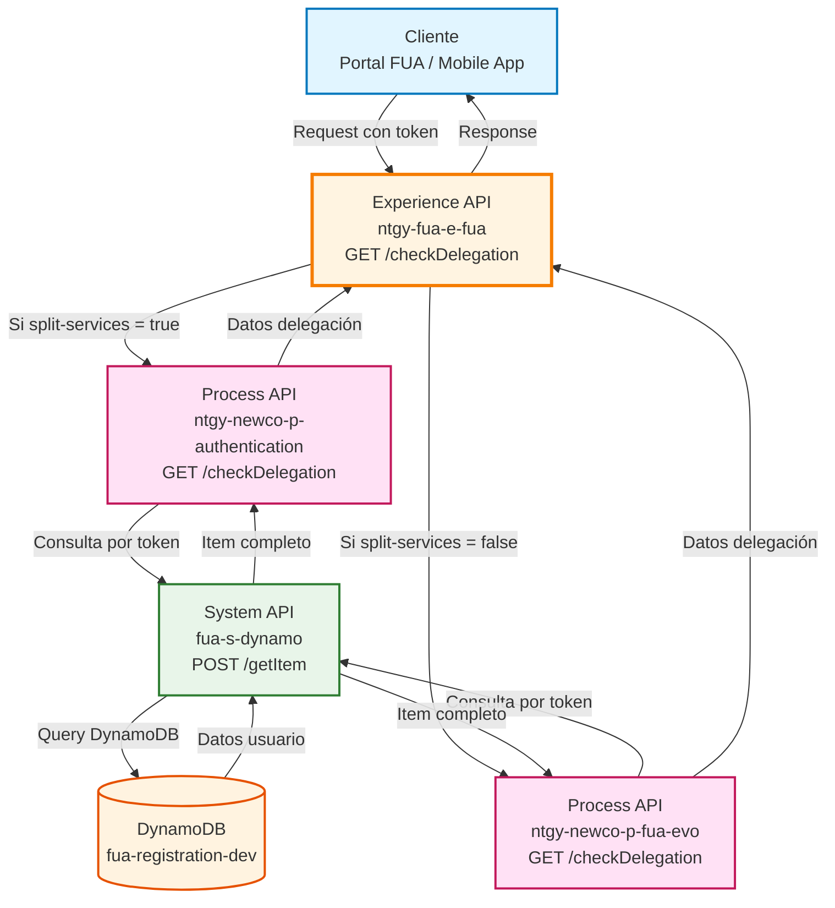
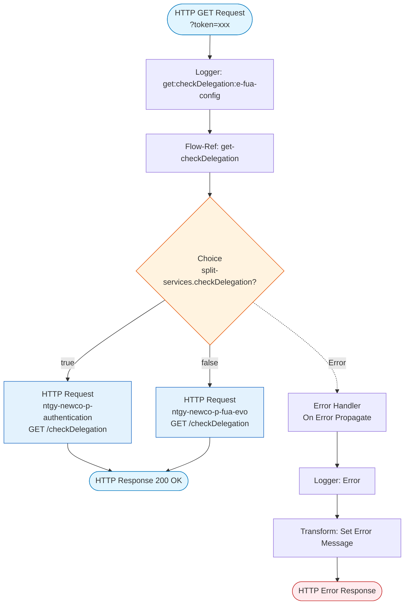
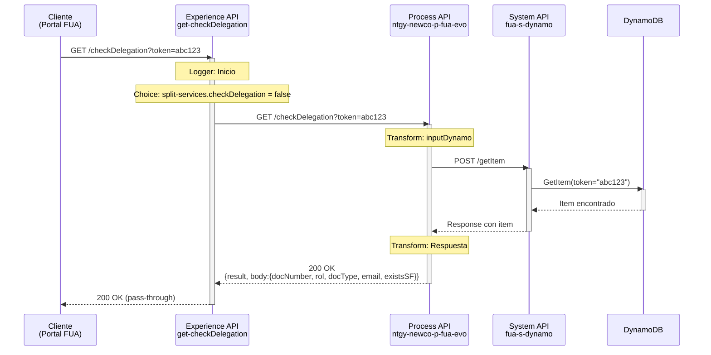
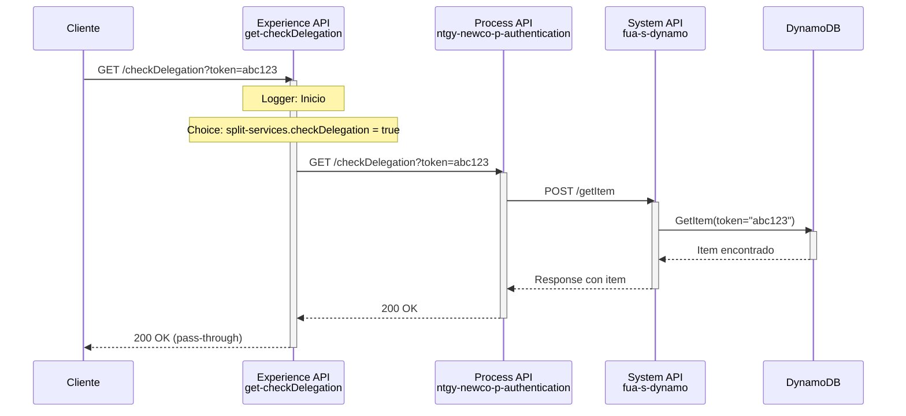
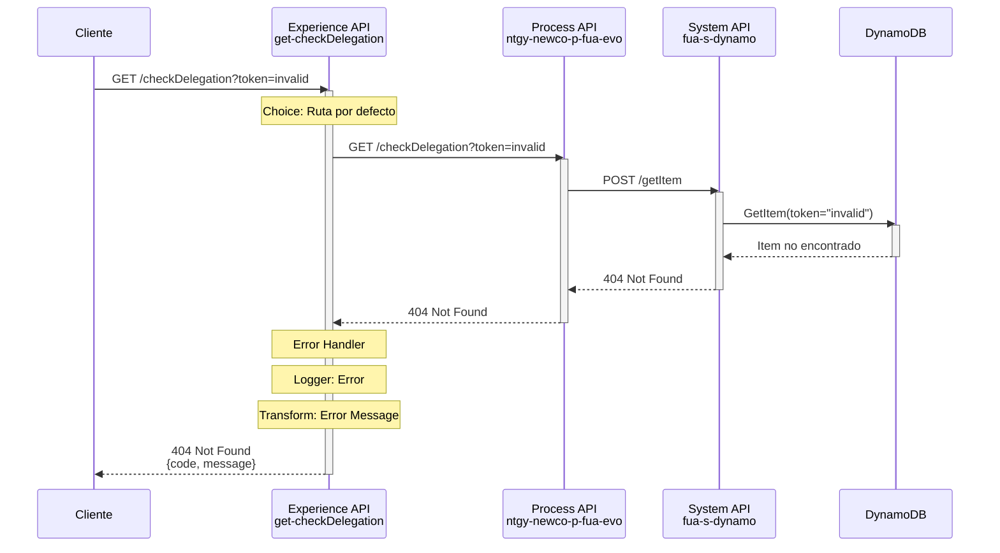
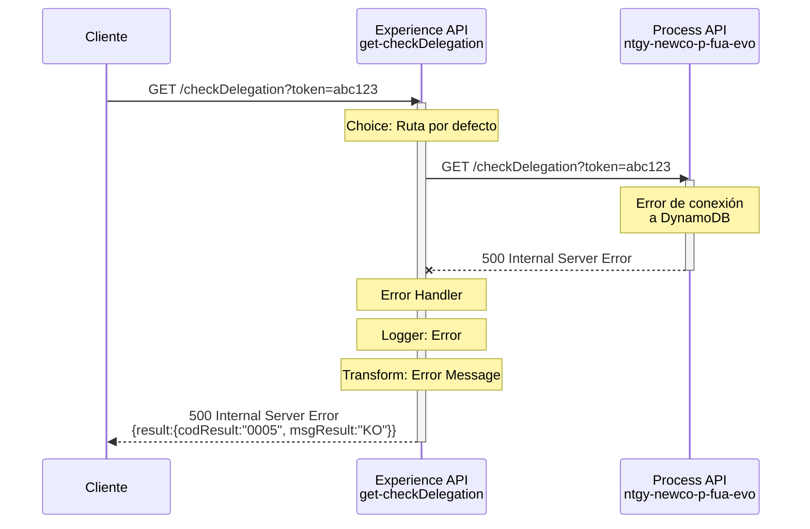

# GET /checkDelegation

## 📌 Descripción General

### Propósito del Endpoint

Este endpoint permite consultar los campos de un contacto autorizado mediante un token de sesión, validando que la información necesaria para el proceso de delegación esté completa y disponible. Actúa como punto de entrada para aplicaciones web y móviles que necesitan verificar el estado de un usuario antes de proceder con la delegación de cuenta.

### Tipo de API

**Capa:** Experience API (API-Led Connectivity)

**Función:** Adaptación de experiencia para canales web y móvil con routing condicional entre Process APIs

### Patrón de Integración

**Tipo:** Pass-Through con Routing Condicional

**Descripción:** El endpoint implementa un patrón de routing condicional basado en la configuración `split-services.checkDelegation`. Dependiendo del valor de esta propiedad, enruta la petición a uno de dos Process APIs diferentes:
- Si `split-services.checkDelegation = true`: Enruta a `ntgy-newco-p-authentication`
- Si `split-services.checkDelegation = false` (por defecto): Enruta a `ntgy-newco-p-fua-evo`

En ambos casos, el Experience API actúa como pass-through, delegando toda la lógica de negocio al Process API seleccionado.

### Arquitectura API-Led Connectivity



---

## 💼 Propósito del Negocio

### Casos de Uso Principales

1. **Validación de Datos para Delegación (Web/Mobile)**
   - Verifica que el usuario tenga todos los campos necesarios para delegar su cuenta
   - Valida la completitud de información personal (documento, tipo, email, rol)
   - Beneficio: Previene errores en el proceso de delegación y mejora la experiencia de usuario

2. **Verificación de Existencia en Salesforce**
   - Comprueba si el usuario ya existe como contacto en Salesforce
   - Determina si se requiere crear o actualizar el registro
   - Beneficio: Evita duplicados y optimiza el flujo de registro

3. **Soporte al Proceso de Registro Multicanal**
   - Proporciona información de estado del usuario durante el registro desde web o móvil
   - Facilita la toma de decisiones en el flujo de onboarding
   - Beneficio: Experiencia consistente entre canales

### 📱 Canal y Audiencia

#### Canal de Consumo

**Canal:** Web y Mobile

**Características del Canal:**
- **Plataforma**: Portal web FUA y aplicaciones móviles iOS/Android
- **Dispositivos**: Navegadores modernos, smartphones y tablets
- **Conectividad**: Requiere conexión a internet estable
- **Experiencia de Usuario**: Respuesta rápida para validación en tiempo real durante el flujo de registro

#### Audiencia Objetivo

**Usuarios Finales:**
- **Clientes de Naturgy**: Usuarios que se registran en el portal FUA y necesitan delegar su cuenta a un contacto autorizado
- **Contactos Autorizados**: Personas que recibirán la delegación y necesitan validar sus datos

**Contexto de Uso:**
- **Flujo de Registro**: Durante el proceso de alta de usuario en el portal FUA
- **Validación Pre-Delegación**: Antes de iniciar el proceso de delegación de cuenta
- **Verificación de Estado**: Consulta del estado actual del registro del usuario

#### Adaptaciones del Canal

**Optimizaciones Aplicadas:**
- **Pass-Through**: No se aplican transformaciones adicionales, se mantiene la respuesta del Process API
- **Routing Condicional**: Permite migración gradual entre Process APIs sin afectar a los clientes
- **Timeout Optimizado**: 60 segundos para garantizar respuesta en condiciones de red variable
- **Manejo de Errores**: Transformación de errores técnicos en mensajes amigables para el usuario

### 🔗 Endpoints Dependientes

Este Experience API consume uno de los siguientes Process APIs (según configuración):

| Process API | Endpoint | Método | Propósito |
|-------------|----------|--------|-----------|
| `ntgy-newco-p-fua-evo` | `/checkDelegation` | GET | Verifica campos necesarios para delegación consultando DynamoDB (por defecto) |
| `ntgy-newco-p-authentication` | `/checkDelegation` | GET | Verifica campos necesarios para delegación consultando DynamoDB (alternativo) |

**Nota:** La selección del Process API se realiza mediante la propiedad de configuración `split-services.checkDelegation` (actualmente `false`, por lo que se usa `ntgy-newco-p-fua-evo`).

### Contexto Empresarial

- **Dominio:** Gestión de Usuarios y Registro
- **Sector:** Energía - Utilities
- **División:** Naturgy España - NewCo
- **Canal:** Web y Mobile

### Stakeholders

- **Usuarios Finales**: Clientes de Naturgy que se registran en el portal FUA y necesitan delegar su cuenta
- **Equipo de Desarrollo FUA**: Desarrolladores del portal web y aplicaciones móviles que consumen este endpoint
- **Administradores de Salesforce**: Responsables de mantener la integridad de datos de contactos
- **Equipo de Operaciones**: Monitorean el correcto funcionamiento del proceso de registro y delegación

### Valor de Negocio

- **Prevención de Errores**: Valida datos antes de procesos críticos de delegación
- **Optimización de Flujos**: Evita pasos innecesarios si el usuario ya existe en Salesforce
- **Experiencia de Usuario**: Proporciona feedback inmediato sobre el estado del registro
- **Integridad de Datos**: Asegura que solo usuarios con datos completos puedan delegar
- **Flexibilidad Operacional**: Permite migración gradual entre Process APIs sin impacto en clientes

---

## 🔧 Especificación Técnica

### URLs por Ambiente

| Ambiente | URL Base | URL Completa |
|----------|----------|--------------|
| **Local** | `http://localhost:8081` | `http://localhost:8081/fua/api/checkDelegation?token={token}` |
| **Development** | `https://ntgy-fua-e-fua-dev.us-e2.cloudhub.io` | `https://ntgy-fua-e-fua-dev.us-e2.cloudhub.io/fua/api/checkDelegation?token={token}` |
| **UAT** | `https://ntgy-fua-e-fua-uat.us-e2.cloudhub.io` | `https://ntgy-fua-e-fua-uat.us-e2.cloudhub.io/fua/api/checkDelegation?token={token}` |
| **Production** | `https://ntgy-fua-e-fua-pro.us-e2.cloudhub.io` | `https://ntgy-fua-e-fua-pro.us-e2.cloudhub.io/fua/api/checkDelegation?token={token}` |

### Método HTTP

```
GET /fua/api/checkDelegation
```

### 🎯 Consideraciones del Canal

#### Limitaciones del Canal

| Aspecto | Limitación | Razón |
|---------|------------|-------|
| **Timeout** | 60 segundos | Optimizado para consultas a DynamoDB con posibles latencias de red |
| **Rate Limiting** | Según políticas de API Gateway | Protección contra abuso y garantía de disponibilidad |
| **Caché** | No aplica | Los datos de delegación deben ser siempre actuales |

#### Campos Específicos del Canal

**Este Experience API NO añade ni omite campos. Es un pass-through completo.**

Para el schema completo de request y response, consultar:
📖 **Process API: `ntgy-newco-p-fua-evo` endpoint `/checkDelegation`**

### Parámetros de Entrada

#### Query Parameters

| Parámetro | Tipo | Requerido | Descripción | Ejemplo |
|-----------|------|-----------|-------------|---------|
| `token` | string | ✅ Sí | Token de sesión del usuario registrado que identifica el registro en DynamoDB | `abc123xyz789` |

**Validaciones:**
- El token debe existir en la tabla `fua-registration-dev` de DynamoDB
- Si el token no existe, el Process API devolverá un error 404

### Respuestas

#### 200 OK - Consulta Exitosa

**Estructura de Respuesta:**

```json
{
  "result": {
    "codResult": "0000",
    "msgResult": "No hay error"
  },
  "body": {
    "docNumber": "string",
    "rol": "string",
    "docType": "string",
    "email": "string",
    "existsSF": boolean
  }
}
```

**Campos de Respuesta:**

| Campo | Tipo | Descripción |
|-------|------|-------------|
| `result.codResult` | string | Código de resultado (siempre "0000" en caso de éxito) |
| `result.msgResult` | string | Mensaje descriptivo del resultado |
| `body.docNumber` | string | Número de documento del usuario |
| `body.rol` | string | Rol del usuario en el sistema |
| `body.docType` | string | Tipo de documento (DNI, NIE, Pasaporte, etc.) |
| `body.email` | string | Correo electrónico del usuario |
| `body.existsSF` | boolean | Indica si el usuario existe en Salesforce (`true` si existe, `false` si no) |

#### 400 Bad Request - Token Inválido o Faltante

```json
{
  "code": "BAD_REQUEST",
  "message": "Token parameter is required",
  "timestamp": "2026-10-20T10:23:10Z"
}
```

#### 404 Not Found - Token No Encontrado en DynamoDB

```json
{
  "code": "NOT_FOUND",
  "message": "User not found for provided token",
  "timestamp": "2026-10-20T10:23:10Z"
}
```

#### 500 Internal Server Error - Error del Sistema

```json
{
  "result": {
    "codResult": "0005",
    "msgResult": "KO"
  }
}
```

### Autenticación

- **Tipo:** Client ID & Client Secret (Anypoint Platform)
- **Headers Requeridos:**
  - `client_id`: ID del cliente registrado en Anypoint Platform
  - `client_secret`: Secret del cliente

### Timeouts

| Tipo | Valor | Razón |
|------|-------|-------|
| **Request Timeout** | 60 segundos | Optimizado para consultas a DynamoDB a través de Process API |
| **Connection Timeout** | 10 segundos | Tiempo máximo para establecer conexión con Process API |

---

## 🏗️ Implementación Técnica

### Arquitectura del Flow



### Componentes del Flow

#### 1. Flow Principal: `get:\checkDelegation:e-fua-config`

**Ubicación:** `src/main/mule/e-fua.xml` (archivo principal del API)

**Componentes:**
- Logger de inicio (línea 2)
- Flow-ref a `get-checkDelegation` (línea 3)

#### 2. Sub-Flow: `get-checkDelegation`

**Ubicación:** `src/main/mule/implementation/get-checkDelegation.xml`

**Componentes:**

1. **Choice: Routing Condicional** (líneas 2-24)
   - Evalúa la propiedad `split-services.checkDelegation`
   - Enruta a uno de dos Process APIs según configuración

2. **When: Ruta a ntgy-newco-p-authentication** (líneas 3-10)
   - Condición: `split-services.checkDelegation = true`
   - HTTP Request a `HTTP_Request_newco-p-authentication`
   - Path: `/checkDelegation`
   - Query params: `token` + `fuaHeaders`

3. **Otherwise: Ruta a ntgy-newco-p-fua-evo** (líneas 11-17)
   - Condición: Por defecto (cuando `split-services.checkDelegation = false`)
   - HTTP Request a `HTTP_FUA_PROCESS_NEWCO_EVO`
   - Path: `/checkDelegation`
   - Query params: `token` + `fuaHeaders`

4. **Error Handler: On Error Propagate** (líneas 18-32)
   - Logger de error con payload del error
   - Transform para establecer mensaje de error estándar
   - Propaga el error al cliente

### Configuración de Routing

**Archivo:** `src/main/resources/e-fua-pro-config.yaml`

**Configuración de Split Services:**

```yaml
split-services:
  checkDelegation: "false"
```

**Configuración de Process APIs:**

```yaml
# Process API por defecto (ntgy-newco-p-fua-evo)
newco-p-fua-evo:
  host: "mule-worker-internal-ntgy-newco-p-fua-evo.de-c1.cloudhub.io"
  port: "8091"
  timeout: "60000"

# Process API alternativo (ntgy-newco-p-authentication)
p-authentication:
  host: "ntgy-newco-p-authentication-vx8fhl.internal-6bnlu3.irl-e1.cloudhub.io"
  port: "443"
  protocol: "HTTPS"
  timeout: "600000"
  basePath: "/api/v1"
```

### Transformaciones DataWeave

**Este Experience API NO aplica transformaciones DataWeave.**

El endpoint actúa como pass-through puro, delegando toda la lógica de transformación al Process API seleccionado.

**Query Parameters Forwarding:**

```dataweave
%dw 2.0
output application/java
---
{
	"token" : attributes.queryParams.token
} ++ vars.fuaHeaders
```

**Propósito:** Reenvía el token recibido como query parameter al Process API, añadiendo headers adicionales de FUA si existen.

### Patrones de Diseño

**Patrón 1: Pass-Through con Routing Condicional**

**Justificación:** 
- Permite migración gradual entre Process APIs sin afectar a los clientes
- Mantiene la simplicidad del Experience API
- Facilita pruebas A/B y rollback en caso de problemas

**Patrón 2: Error Propagation**

**Justificación:**
- Los errores del Process API se propagan al cliente con transformación mínima
- Mantiene consistencia en el manejo de errores
- Facilita debugging al preservar información del error original

### Diagramas de Secuencia

#### 1. Flujo Normal de Éxito (Ruta por Defecto)



#### 2. Flujo con Routing Alternativo



#### 3. Flujo con Error de Negocio



#### 4. Flujo con Error Técnico



### Manejo de Errores

**Error Handler:** `On Error Propagate`

**Ubicación:** Inline en `get-checkDelegation.xml` (líneas 18-32)

**Estrategia:**
1. Captura cualquier error del Process API
2. Registra el error en logs con nivel ERROR
3. Transforma el error en formato estándar si no tiene payload
4. Propaga el error al cliente

**Transformación de Error:**

```dataweave
%dw 2.0
output application/json
---
if ( !isEmpty(error.errorMessage.payload) ) error.errorMessage.payload
else 
{
	"result": {
		"codResult": "0005",
		"msgResult": "KO"
	}
}
```

**Códigos de Error:**

| Código HTTP | Escenario | Origen | Acción |
|-------------|-----------|--------|--------|
| 400 | Token no proporcionado | Validación de entrada | Error propagado del Process API |
| 404 | Token no encontrado en DynamoDB | Error de negocio | Error propagado del Process API |
| 500 | Error de conexión a DynamoDB | Error técnico | Transformado a formato estándar |
| 503 | Process API no disponible | Error de infraestructura | Error propagado con transformación |

### Optimizaciones del Canal

**1. Routing Condicional:**
- Permite migración gradual entre Process APIs
- Facilita pruebas A/B sin afectar a clientes
- Configuración centralizada en properties

**2. Pass-Through Puro:**
- Sin overhead de transformación
- Latencia mínima
- Simplicidad en mantenimiento

**3. Timeout Optimizado:**
- 60 segundos para garantizar respuesta en condiciones de red variable
- Suficiente para consultas a DynamoDB con latencias de red

**4. Error Handling Robusto:**
- Captura y transforma errores técnicos
- Propaga errores de negocio con información útil
- Logging completo para debugging

---

## 💻 Ejemplos de Uso

### Ejemplo 1: Consulta Exitosa desde Portal Web - Usuario Existe en Salesforce

#### cURL

```bash
curl -X GET "https://ntgy-fua-e-fua-dev.us-e2.cloudhub.io/fua/api/checkDelegation?token=abc123xyz789" \
  -H "Content-Type: application/json" \
  -H "client_id: YOUR_CLIENT_ID" \
  -H "client_secret: YOUR_CLIENT_SECRET"
```

#### Respuesta (200 OK)

```json
{
  "result": {
    "codResult": "0000",
    "msgResult": "No hay error"
  },
  "body": {
    "docNumber": "12345678A",
    "rol": "titular",
    "docType": "DNI",
    "email": "usuario@example.com",
    "existsSF": true
  }
}
```

**Interpretación:**
- Usuario encontrado en DynamoDB
- Tiene todos los campos necesarios para delegación
- Ya existe como contacto en Salesforce (`existsSF: true`)
- Puede proceder con el proceso de delegación

### Ejemplo 2: Consulta Exitosa desde App Móvil - Usuario NO Existe en Salesforce

#### cURL

```bash
curl -X GET "https://ntgy-fua-e-fua-dev.us-e2.cloudhub.io/fua/api/checkDelegation?token=def456uvw012" \
  -H "Content-Type: application/json" \
  -H "client_id: YOUR_CLIENT_ID" \
  -H "client_secret: YOUR_CLIENT_SECRET"
```

#### Respuesta (200 OK)

```json
{
  "result": {
    "codResult": "0000",
    "msgResult": "No hay error"
  },
  "body": {
    "docNumber": "87654321B",
    "rol": "autorizado",
    "docType": "NIE",
    "email": "nuevo.usuario@example.com",
    "existsSF": false
  }
}
```

**Interpretación:**
- Usuario encontrado en DynamoDB
- NO existe aún en Salesforce (`existsSF: false`)
- Será necesario crear el contacto en Salesforce antes de delegar

### Ejemplo 3: Error - Token No Encontrado

#### cURL

```bash
curl -X GET "https://ntgy-fua-e-fua-dev.us-e2.cloudhub.io/fua/api/checkDelegation?token=tokeninvalido" \
  -H "Content-Type: application/json" \
  -H "client_id: YOUR_CLIENT_ID" \
  -H "client_secret: YOUR_CLIENT_SECRET"
```

#### Respuesta (404 Not Found)

```json
{
  "code": "NOT_FOUND",
  "message": "User not found for provided token",
  "timestamp": "2026-10-20T10:23:10Z"
}
```

### Ejemplo 4: Error - Token Faltante

#### cURL

```bash
curl -X GET "https://ntgy-fua-e-fua-dev.us-e2.cloudhub.io/fua/api/checkDelegation" \
  -H "Content-Type: application/json" \
  -H "client_id: YOUR_CLIENT_ID" \
  -H "client_secret: YOUR_CLIENT_SECRET"
```

#### Respuesta (400 Bad Request)

```json
{
  "code": "BAD_REQUEST",
  "message": "Token parameter is required",
  "timestamp": "2026-10-20T10:23:10Z"
}
```

### Ejemplo 5: JavaScript (Fetch API) - Portal Web

```javascript
const checkDelegation = async (token) => {
  try {
    const response = await fetch(
      `https://ntgy-fua-e-fua-dev.us-e2.cloudhub.io/fua/api/checkDelegation?token=${token}`,
      {
        method: 'GET',
        headers: {
          'Content-Type': 'application/json',
          'client_id': 'YOUR_CLIENT_ID',
          'client_secret': 'YOUR_CLIENT_SECRET'
        }
      }
    );

    if (!response.ok) {
      throw new Error(`HTTP error! status: ${response.status}`);
    }

    const data = await response.json();
    
    // Verificar si el usuario existe en Salesforce
    if (data.body.existsSF) {
      console.log('Usuario ya existe en Salesforce');
      // Continuar con el flujo de delegación
    } else {
      console.log('Usuario NO existe en Salesforce - crear contacto primero');
      // Redirigir a flujo de creación de contacto
    }
    
    return data;
  } catch (error) {
    console.error('Error al verificar delegación:', error);
    throw error;
  }
};

// Uso en el portal web
checkDelegation('abc123xyz789')
  .then(data => {
    console.log('Datos de delegación:', data);
    // Actualizar UI con los datos del usuario
    document.getElementById('docNumber').textContent = data.body.docNumber;
    document.getElementById('email').textContent = data.body.email;
  })
  .catch(error => {
    console.error('Error:', error);
    // Mostrar mensaje de error al usuario
    alert('No se pudo verificar la delegación. Por favor, intente nuevamente.');
  });
```

### Ejemplo 6: React Native - App Móvil

```javascript
import React, { useState, useEffect } from 'react';
import { View, Text, ActivityIndicator, Alert } from 'react-native';

const DelegationCheck = ({ token }) => {
  const [loading, setLoading] = useState(true);
  const [delegationData, setDelegationData] = useState(null);
  const [error, setError] = useState(null);

  useEffect(() => {
    const checkDelegation = async () => {
      try {
        const response = await fetch(
          `https://ntgy-fua-e-fua-dev.us-e2.cloudhub.io/fua/api/checkDelegation?token=${token}`,
          {
            method: 'GET',
            headers: {
              'Content-Type': 'application/json',
              'client_id': 'YOUR_CLIENT_ID',
              'client_secret': 'YOUR_CLIENT_SECRET'
            }
          }
        );

        if (!response.ok) {
          throw new Error(`HTTP error! status: ${response.status}`);
        }

        const data = await response.json();
        setDelegationData(data);
        setLoading(false);
      } catch (err) {
        setError(err.message);
        setLoading(false);
        Alert.alert(
          'Error',
          'No se pudo verificar la delegación. Por favor, intente nuevamente.'
        );
      }
    };

    checkDelegation();
  }, [token]);

  if (loading) {
    return (
      <View style={{ flex: 1, justifyContent: 'center', alignItems: 'center' }}>
        <ActivityIndicator size="large" color="#0000ff" />
        <Text>Verificando delegación...</Text>
      </View>
    );
  }

  if (error) {
    return (
      <View style={{ flex: 1, justifyContent: 'center', alignItems: 'center' }}>
        <Text style={{ color: 'red' }}>Error: {error}</Text>
      </View>
    );
  }

  return (
    <View style={{ padding: 20 }}>
      <Text style={{ fontSize: 18, fontWeight: 'bold' }}>Datos de Delegación</Text>
      <Text>Documento: {delegationData?.body?.docNumber}</Text>
      <Text>Tipo: {delegationData?.body?.docType}</Text>
      <Text>Email: {delegationData?.body?.email}</Text>
      <Text>Rol: {delegationData?.body?.rol}</Text>
      <Text>
        Existe en Salesforce: {delegationData?.body?.existsSF ? 'Sí' : 'No'}
      </Text>
    </View>
  );
};

export default DelegationCheck;
```

### Ejemplo 7: Python (Requests)

```python
import requests
from typing import Dict, Optional

def check_delegation(token: str) -> Optional[Dict]:
    """
    Verifica los datos de delegación de un usuario
    
    Args:
        token (str): Token de sesión del usuario
        
    Returns:
        dict: Datos de delegación del usuario o None si hay error
    """
    url = "https://ntgy-fua-e-fua-dev.us-e2.cloudhub.io/fua/api/checkDelegation"
    
    headers = {
        'Content-Type': 'application/json',
        'client_id': 'YOUR_CLIENT_ID',
        'client_secret': 'YOUR_CLIENT_SECRET'
    }
    
    params = {
        'token': token
    }
    
    try:
        response = requests.get(url, headers=headers, params=params, timeout=30)
        response.raise_for_status()
        
        data = response.json()
        
        # Verificar existencia en Salesforce
        if data['body']['existsSF']:
            print(f"Usuario {data['body']['email']} existe en Salesforce")
        else:
            print(f"Usuario {data['body']['email']} NO existe en Salesforce")
        
        return data
        
    except requests.exceptions.HTTPError as http_err:
        print(f"HTTP error occurred: {http_err}")
        return None
    except requests.exceptions.RequestException as req_err:
        print(f"Request error occurred: {req_err}")
        return None

# Uso
if __name__ == "__main__":
    result = check_delegation('abc123xyz789')
    if result:
        print(f"Delegación verificada exitosamente")
        print(f"Documento: {result['body']['docNumber']}")
        print(f"Email: {result['body']['email']}")
        print(f"Rol: {result['body']['rol']}")
    else:
        print("Error al verificar delegación")
```
