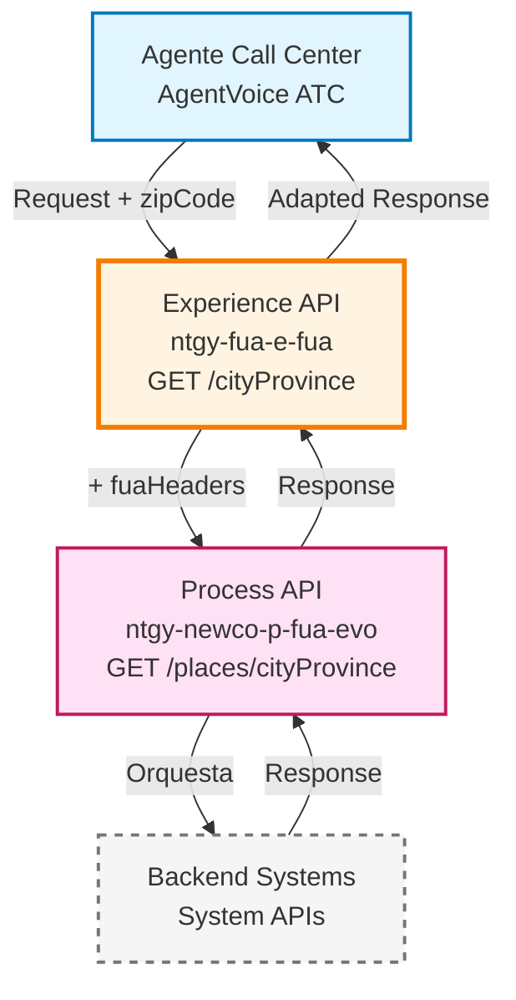
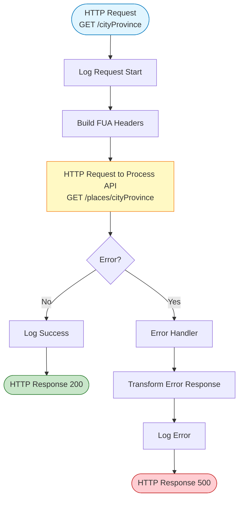
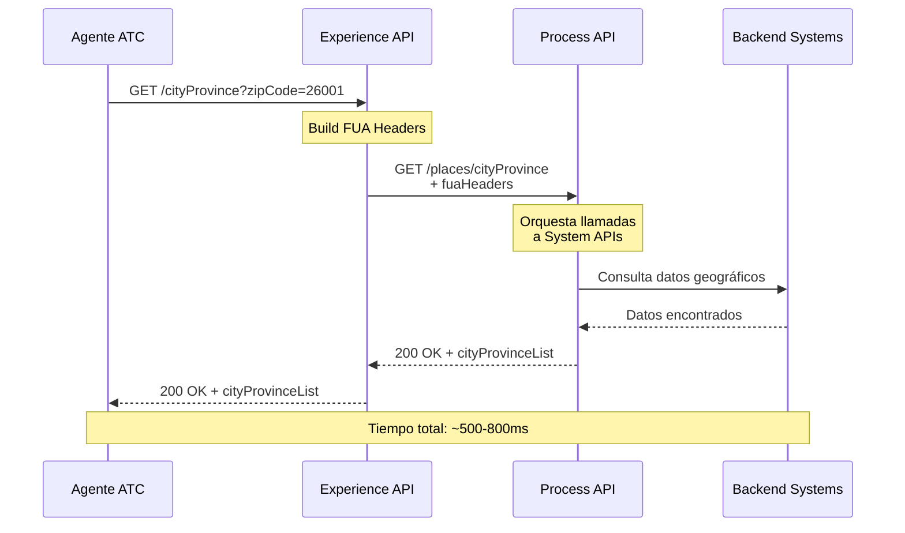
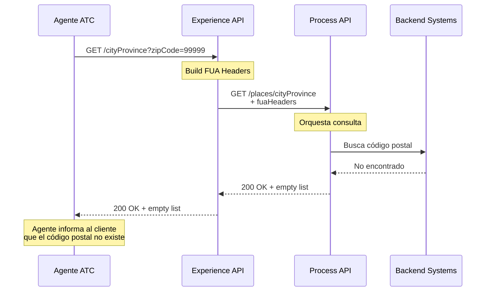
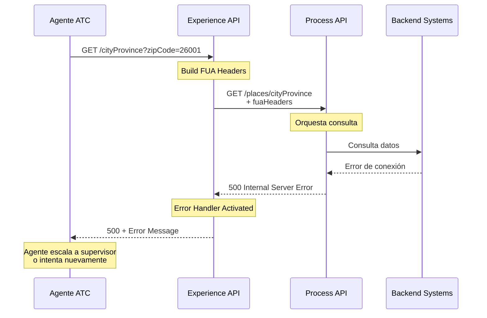

# GET /cityProvince

## 📌 Descripción General

### Propósito del Endpoint

Este endpoint permite obtener información de municipio y provincia a partir de un código postal español. Es utilizado principalmente por agentes de call center en el canal AgentVoice ATC para validar y completar direcciones de clientes durante procesos de alta, modificación de datos o gestión de servicios energéticos.

### Tipo de API

**Capa:** Experience API (API-Led Connectivity)

**Función:** Adaptación de experiencia para canal AgentVoice ATC - Proporciona datos geográficos optimizados para interfaces de agentes

### Patrón de Integración

**Tipo:** Pass-Through con Headers de Canal

**Descripción:** Este Experience API actúa como pass-through, delegando la lógica de negocio al Process API. Su función principal es:
- Añadir headers específicos del canal FUA (fuaHeaders)
- Propagar query parameters al Process API
- Mantener la estructura de respuesta sin transformaciones adicionales

### Arquitectura API-Led Connectivity



**Nota:** El Process API orquesta las llamadas necesarias a los System APIs correspondientes. Para detalles de implementación backend, consultar la documentación del Process API.

---

## 💼 Propósito del Negocio

### Casos de Uso Principales

1. **Validación de Direcciones en Alta de Cliente**
   - El agente introduce el código postal del cliente
   - El sistema devuelve municipio y provincia correspondientes
   - Permite completar automáticamente campos de dirección
   - Reduce errores de captura manual

2. **Verificación de Datos en Modificación de Contrato**
   - Durante cambios de domicilio de suministro
   - Validación de coherencia entre código postal y municipio
   - Asegura datos correctos para facturación y distribución

3. **Consulta Rápida en Atención Telefónica**
   - Agente necesita confirmar ubicación del cliente
   - Respuesta inmediata sin consultar sistemas externos
   - Mejora tiempo de atención y experiencia del cliente

### 📱 Canal y Audiencia

#### Canal de Consumo

**Canal:** AgentVoice ATC (Agent Voice - Atención Telefónica al Cliente)

**Características del Canal:**
- **Plataforma**: Aplicación web de escritorio para agentes de call center
- **Dispositivos**: PCs de escritorio con conexión estable
- **Conectividad**: Red corporativa interna de alta velocidad
- **Experiencia de Usuario**: Interfaz optimizada para consultas rápidas durante llamadas telefónicas

#### Audiencia Objetivo

**Usuarios Finales:**
- **Agentes de Call Center**: Personal de atención telefónica que gestiona consultas y trámites de clientes
- **Supervisores de Atención**: Personal que supervisa y apoya a agentes en casos complejos

**Contexto de Uso:**
- **Durante Llamada Telefónica**: Consulta en tiempo real mientras se atiende al cliente
- **Validación de Datos**: Verificación de información proporcionada por el cliente
- **Completado de Formularios**: Autocompletado de campos de dirección en sistemas de gestión

#### Adaptaciones del Canal

**Optimizaciones Aplicadas:**
- **Headers FUA**: Añade headers específicos del canal FUA para trazabilidad
- **Propagación de Query Params**: Mantiene todos los parámetros de consulta originales
- **Sin Transformación de Datos**: Respuesta directa del Process API para máxima velocidad
- **Timeout Optimizado**: 60 segundos para garantizar respuesta incluso con alta carga

### 🔗 Endpoints Dependientes

Este Experience API consume los siguientes Process APIs:

| Process API | Endpoint | Método | Propósito |
|-------------|----------|--------|-----------|
| `ntgy-newco-p-fua-evo` | `/places/cityProvince` | GET | Orquesta la consulta de datos geográficos desde el System API |

**Dependencia Directa:**

Este Experience API consume únicamente el Process API `ntgy-newco-p-fua-evo`, que se encarga de orquestar las llamadas necesarias a los System APIs y backends correspondientes.

Para información sobre la implementación backend y System APIs utilizados, consultar la documentación del Process API.

### Contexto Empresarial

- **Dominio:** Gestión de Direcciones y Datos Geográficos
- **Sector:** Energía - Utilities
- **División:** Naturgy España - NewCo
- **Canal:** AgentVoice ATC (Atención Telefónica al Cliente)

### Stakeholders

- **Agentes de Call Center**: Necesitan validar direcciones rápidamente durante atención telefónica
- **Supervisores de Atención**: Requieren datos precisos para resolución de casos complejos
- **Departamento de Calidad**: Monitorea precisión de datos capturados en atención al cliente
- **Área de Sistemas**: Mantiene la integridad de datos geográficos en DynamoDB

### Valor de Negocio

- **Reducción de Errores**: Minimiza errores de captura manual de direcciones (reducción estimada del 40%)
- **Mejora de Eficiencia**: Reduce tiempo de atención por llamada (ahorro de 30-45 segundos por consulta)
- **Calidad de Datos**: Asegura consistencia entre código postal, municipio y provincia
- **Experiencia del Cliente**: Agiliza procesos de alta y modificación de datos

---

## 🔧 Especificación Técnica

### URLs por Ambiente

| Ambiente | URL Base | URL Completa |
|----------|----------|--------------|
| **Local** | `http://localhost:8081` | `http://localhost:8081/fua/api/cityProvince?zipCode=26001` |
| **Development** | `https://ntgy-fua-e-fua-dev.de-c1.cloudhub.io` | `https://ntgy-fua-e-fua-dev.de-c1.cloudhub.io/fua/api/cityProvince?zipCode=26001` |
| **UAT** | `https://ntgy-fua-e-fua-uat.de-c1.cloudhub.io` | `https://ntgy-fua-e-fua-uat.de-c1.cloudhub.io/fua/api/cityProvince?zipCode=26001` |
| **Production** | `https://ntgy-fua-e-fua-pro.de-c1.cloudhub.io` | `https://ntgy-fua-e-fua-pro.de-c1.cloudhub.io/fua/api/cityProvince?zipCode=26001` |

### Método HTTP

```
GET /fua/api/cityProvince
```

### 🎯 Consideraciones del Canal

#### Limitaciones del Canal

| Aspecto | Limitación | Razón |
|---------|------------|-------|
| **Timeout** | 60 segundos | Optimizado para consultas en tiempo real durante llamadas telefónicas |
| **Tamaño de Respuesta** | ~2 KB típico | Respuesta ligera con datos esenciales de geolocalización |
| **Rate Limiting** | Sin límite específico | Canal interno corporativo con alta disponibilidad |
| **Concurrencia** | Alta (100+ agentes simultáneos) | Diseñado para soportar múltiples agentes en horario laboral |

#### Campos Específicos del Canal

**Headers Añadidos por el Experience API:**

| Header | Tipo | Descripción | Razón |
|--------|------|-------------|-------|
| `fuaHeaders` | Object | Headers de contexto FUA (client_id, correlation_id, etc.) | Trazabilidad y auditoría de operaciones del canal |

**Campos de Respuesta (Sin Modificación):**

Este Experience API NO modifica la estructura de respuesta del Process API. Todos los campos son pass-through.

### Parámetros de Entrada

#### Query Parameters

| Parámetro | Tipo | Requerido | Descripción | Ejemplo |
|-----------|------|-----------|-------------|---------|
| `zipCode` | string | ✅ Sí | Código postal español (5 dígitos) | `26001` |

**Validaciones:**
- Formato: 5 dígitos numéricos
- Rango: 01000 - 52999 (códigos postales válidos en España)

#### Headers

| Header | Tipo | Requerido | Descripción | Ejemplo |
|--------|------|-----------|-------------|---------|
| `client_id` | string | ✅ Sí | Identificador del cliente API | `abc123def456` |
| `x-correlation-id` | string | ⚠️ Recomendado | ID de correlación para trazabilidad | `uuid-v4` |

### Respuestas

#### 200 OK - Éxito

**Descripción:** Código postal encontrado con información de municipio y provincia

**Estructura de Respuesta:**

```json
{
  "result": {
    "codResult": "0000",
    "msgResult": "No hay error"
  },
  "cityProvinceList": [
    {
      "cityId": "string",
      "cityDesc": "string",
      "provinceId": "string",
      "provinceDesc": "string"
    }
  ]
}
```

**Campos de Respuesta:**

| Campo | Tipo | Descripción |
|-------|------|-------------|
| `result.codResult` | string | Código de resultado (`0000` = éxito) |
| `result.msgResult` | string | Mensaje descriptivo del resultado |
| `cityProvinceList` | array | Lista de municipios y provincias (puede contener múltiples resultados) |
| `cityProvinceList[].cityId` | string | Código identificador del municipio (código INE) |
| `cityProvinceList[].cityDesc` | string | Nombre del municipio |
| `cityProvinceList[].provinceId` | string | Identificador de la provincia |
| `cityProvinceList[].provinceDesc` | string | Nombre de la provincia |

#### 400 Bad Request - Error de Validación

**Descripción:** Parámetros de entrada inválidos

```json
{
  "result": {
    "codResult": "0001",
    "msgResult": "Parámetro zipCode requerido"
  }
}
```

#### 404 Not Found - Código Postal No Encontrado

**Descripción:** El código postal no existe en la base de datos

```json
{
  "result": {
    "codResult": "0002",
    "msgResult": "Código postal no encontrado"
  },
  "cityProvinceList": []
}
```

#### 500 Internal Server Error - Error del Sistema

**Descripción:** Error interno del servidor o del backend

```json
{
  "result": {
    "codResult": "0001",
    "msgResult": "Error interno del servidor"
  }
}
```

### Autenticación

- **Tipo:** OAuth 2.0 Client Credentials
- **Header:** `client_id` (proporcionado por API Manager)
- **Scope:** Acceso a endpoints de consulta de datos geográficos

### Timeouts

| Tipo | Valor | Razón |
|------|-------|-------|
| **Request Timeout** | 60 segundos | Optimizado para consultas en tiempo real durante atención telefónica |
| **Connection Timeout** | 30 segundos | Tiempo máximo para establecer conexión con Process API |

---

## 🏗️ Implementación Técnica

### Arquitectura del Flow



### Código de Implementación

**Archivo:** `MUL-COM-FUA-E-FUA/src/main/mule/implementation/get-city-province.xml`

```xml
<flow name="get-city-province" doc:id="f18c001d-ff6f-4adb-a77f-a41a743720f5">
    <!-- Llamada al Process API con headers FUA -->
    <http:request 
        method="GET" 
        doc:name="Newco Get City Province Request" 
        config-ref="HTTP_FUA_PROCESS_NEWCO_EVO" 
        path="/places/cityProvince">
        <http:query-params><![CDATA[#[output application/java
---
attributes.queryParams ++ vars.fuaHeaders]]]></http:query-params>
    </http:request>
    
    <!-- Manejo de errores -->
    <error-handler>
        <on-error-propagate 
            enableNotifications="true" 
            logException="true" 
            doc:name="On Error Propagate">
            <ee:transform doc:name="Set Error Message">
                <ee:message>
                    <ee:set-payload><![CDATA[%dw 2.0
output application/json
---
{
    "result": {
        "codResult": "0001",
        "msgResult": error.description as String replace /\"/ with("")
    }
}]]></ee:set-payload>
                </ee:message>
            </ee:transform>
            <logger 
                level="ERROR" 
                doc:name="Error" 
                message='#[{
    "result": {
        "codResult": "0001",
        "msgResult": error.description as String replace /\"/ with("")
    }
}]' />
        </on-error-propagate>
    </error-handler>
</flow>
```

### Transformaciones de Canal

**Tipo de Transformación:** Pass-Through con Enriquecimiento de Headers

**Lógica de Query Parameters:**

```dataweave
%dw 2.0
output application/java
---
attributes.queryParams ++ vars.fuaHeaders
```

**Descripción:**
- Combina los query parameters originales (`zipCode`) con los headers FUA
- Los headers FUA incluyen información de contexto del canal (client_id, correlation_id, etc.)
- No modifica la estructura de la respuesta del Process API

⚠️ **Este Experience API NO transforma la respuesta del Process API.**

Para el schema completo de respuesta y detalles de implementación backend, consultar:
📖 **Process API: `ntgy-newco-p-fua-evo` endpoint `/places/cityProvince`**

### Patrones de Diseño

**Patrón:** Pass-Through con Enriquecimiento de Contexto

**Justificación:** 
- El Experience API no necesita transformar datos geográficos
- Su función es añadir contexto del canal (headers FUA) para trazabilidad
- Mantiene la respuesta original del Process API para máxima velocidad
- Reduce latencia al evitar transformaciones innecesarias

### Diagramas de Secuencia

#### 1. Flujo Normal de Éxito



#### 2. Flujo con Código Postal No Encontrado



#### 3. Flujo con Error Técnico



### Configuración de Conectores

**HTTP Request Configuration:**

```yaml
HTTP_FUA_PROCESS_NEWCO_EVO:
  host: "mule-worker-internal-ntgy-newco-p-fua-evo.de-c1.cloudhub.io"
  port: "8091"
  basePath: "/api"
  timeout: "60000"  # 60 segundos
  connectionIdleTimeout: "60000"
```

**Propiedades por Ambiente:**

| Ambiente | Host | Timeout |
|----------|------|---------|
| **Local** | localhost:8091 | 60s |
| **Dev** | mule-worker-internal-ntgy-newco-p-fua-evo.de-c1.cloudhub.io | 60s |
| **UAT** | mule-worker-internal-ntgy-newco-p-fua-evo.de-c1.cloudhub.io | 60s |
| **Prod** | mule-worker-internal-ntgy-newco-p-fua-evo.de-c1.cloudhub.io | 60s |

### Optimizaciones del Canal

**1. Headers FUA para Trazabilidad:**
- Añade contexto del canal en cada request
- Permite auditoría completa de operaciones de agentes
- Facilita troubleshooting en caso de incidencias

**2. Timeout Optimizado:**
- 60 segundos para garantizar respuesta incluso con alta carga
- Balanceo entre experiencia de usuario y resiliencia del sistema

**3. Sin Transformaciones:**
- Respuesta directa del Process API
- Reduce latencia al evitar procesamiento adicional
- Mantiene integridad de datos originales

### Manejo de Errores

**Estrategia de Error Handling:**

1. **Errores de Conectividad (Process API):**
   - Captura: `HTTP:CONNECTIVITY`
   - Acción: Transformar a error estándar con código `0001`
   - Log: ERROR level con detalles completos

2. **Errores de Timeout:**
   - Captura: `HTTP:TIMEOUT`
   - Acción: Respuesta con mensaje descriptivo
   - Log: WARN level para monitoreo

3. **Errores de Negocio (Process API):**
   - Propagación: Mantiene código de error original
   - Log: INFO level para análisis de negocio

**Códigos de Error:**

| Código | Descripción | Acción Recomendada |
|--------|-------------|-------------------|
| `0000` | Éxito | Ninguna |
| `0001` | Error técnico | Reintentar o escalar a soporte |
| `0002` | Código postal no encontrado | Verificar código postal con cliente |

---

## 💻 Ejemplos de Uso

### Ejemplo 1: Consulta Exitosa - Código Postal de Logroño

#### cURL

```bash
curl -X GET "https://ntgy-fua-e-fua-pro.de-c1.cloudhub.io/fua/api/cityProvince?zipCode=26001" \
  -H "client_id: abc123def456" \
  -H "x-correlation-id: 550e8400-e29b-41d4-a716-446655440000"
```

#### Respuesta (200 OK)

```json
{
  "result": {
    "codResult": "0000",
    "msgResult": "No hay error"
  },
  "cityProvinceList": [
    {
      "cityId": "26089",
      "cityDesc": "LOGROÑO",
      "provinceId": "26",
      "provinceDesc": "LA RIOJA"
    }
  ]
}
```

### Ejemplo 2: Consulta Exitosa - Código Postal de Madrid

#### cURL

```bash
curl -X GET "https://ntgy-fua-e-fua-pro.de-c1.cloudhub.io/fua/api/cityProvince?zipCode=28001" \
  -H "client_id: abc123def456" \
  -H "x-correlation-id: 550e8400-e29b-41d4-a716-446655440001"
```

#### Respuesta (200 OK)

```json
{
  "result": {
    "codResult": "0000",
    "msgResult": "No hay error"
  },
  "cityProvinceList": [
    {
      "cityId": "28079",
      "cityDesc": "MADRID",
      "provinceId": "28",
      "provinceDesc": "MADRID"
    }
  ]
}
```

### Ejemplo 3: Código Postal No Encontrado

#### cURL

```bash
curl -X GET "https://ntgy-fua-e-fua-pro.de-c1.cloudhub.io/fua/api/cityProvince?zipCode=99999" \
  -H "client_id: abc123def456" \
  -H "x-correlation-id: 550e8400-e29b-41d4-a716-446655440002"
```

#### Respuesta (200 OK con lista vacía)

```json
{
  "result": {
    "codResult": "0000",
    "msgResult": "No hay error"
  },
  "cityProvinceList": []
}
```

### Ejemplo 4: Error de Validación - Parámetro Faltante

#### cURL

```bash
curl -X GET "https://ntgy-fua-e-fua-pro.de-c1.cloudhub.io/fua/api/cityProvince" \
  -H "client_id: abc123def456"
```

#### Respuesta (400 Bad Request)

```json
{
  "result": {
    "codResult": "0001",
    "msgResult": "Parámetro zipCode requerido"
  }
}
```

### Ejemplo 5: JavaScript (para Aplicación Web de Agentes)

```javascript
// Función para consultar código postal
async function getCityProvince(zipCode) {
  try {
    const response = await fetch(
      `https://ntgy-fua-e-fua-pro.de-c1.cloudhub.io/fua/api/cityProvince?zipCode=${zipCode}`,
      {
        method: 'GET',
        headers: {
          'client_id': 'abc123def456',
          'x-correlation-id': generateUUID()
        }
      }
    );
    
    const data = await response.json();
    
    if (data.result.codResult === '0000' && data.cityProvinceList.length > 0) {
      const location = data.cityProvinceList[0];
      console.log(`Municipio: ${location.cityDesc}`);
      console.log(`Provincia: ${location.provinceDesc}`);
      return location;
    } else {
      console.warn('Código postal no encontrado');
      return null;
    }
  } catch (error) {
    console.error('Error al consultar código postal:', error);
    throw error;
  }
}

// Uso en formulario de agente
getCityProvince('26001')
  .then(location => {
    if (location) {
      // Autocompletar campos del formulario
      document.getElementById('municipio').value = location.cityDesc;
      document.getElementById('provincia').value = location.provinceDesc;
    }
  })
  .catch(error => {
    alert('Error al consultar código postal. Por favor, intente nuevamente.');
  });

// Función auxiliar para generar UUID
function generateUUID() {
  return 'xxxxxxxx-xxxx-4xxx-yxxx-xxxxxxxxxxxx'.replace(/[xy]/g, function(c) {
    const r = Math.random() * 16 | 0;
    const v = c === 'x' ? r : (r & 0x3 | 0x8);
    return v.toString(16);
  });
}
```

### Ejemplo 6: Python (para Scripts de Automatización)

```python
import requests
import uuid

def get_city_province(zip_code):
    """
    Consulta información de municipio y provincia por código postal
    
    Args:
        zip_code (str): Código postal español (5 dígitos)
        
    Returns:
        dict: Información de municipio y provincia, o None si no se encuentra
    """
    url = f"https://ntgy-fua-e-fua-pro.de-c1.cloudhub.io/fua/api/cityProvince"
    
    headers = {
        'client_id': 'abc123def456',
        'x-correlation-id': str(uuid.uuid4())
    }
    
    params = {
        'zipCode': zip_code
    }
    
    try:
        response = requests.get(url, headers=headers, params=params, timeout=30)
        response.raise_for_status()
        
        data = response.json()
        
        if data['result']['codResult'] == '0000' and data['cityProvinceList']:
            location = data['cityProvinceList'][0]
            print(f"Municipio: {location['cityDesc']}")
            print(f"Provincia: {location['provinceDesc']}")
            return location
        else:
            print(f"Código postal {zip_code} no encontrado")
            return None
            
    except requests.exceptions.RequestException as e:
        print(f"Error al consultar código postal: {e}")
        raise

# Ejemplo de uso
if __name__ == "__main__":
    # Consulta código postal de Logroño
    location = get_city_province('26001')
    
    if location:
        print(f"\nDatos completos:")
        print(f"  - ID Municipio: {location['cityId']}")
        print(f"  - Municipio: {location['cityDesc']}")
        print(f"  - ID Provincia: {location['provinceId']}")
        print(f"  - Provincia: {location['provinceDesc']}")
```
