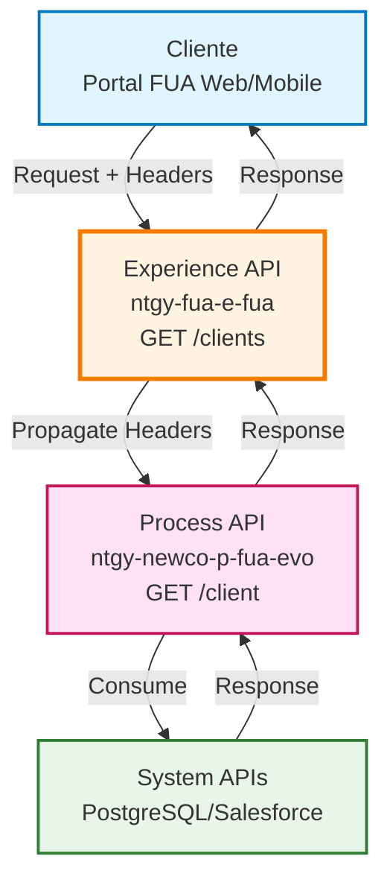
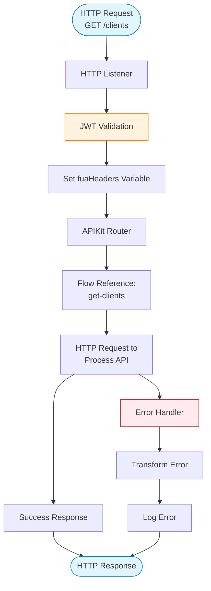
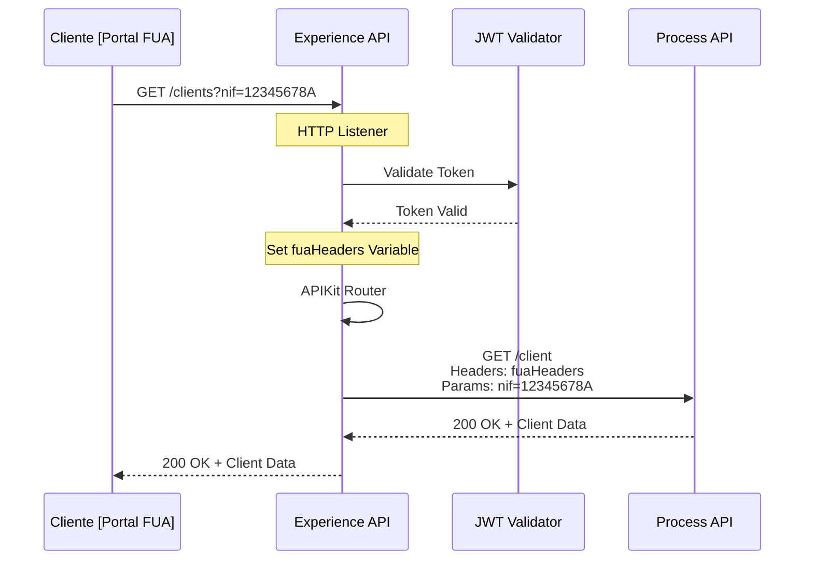
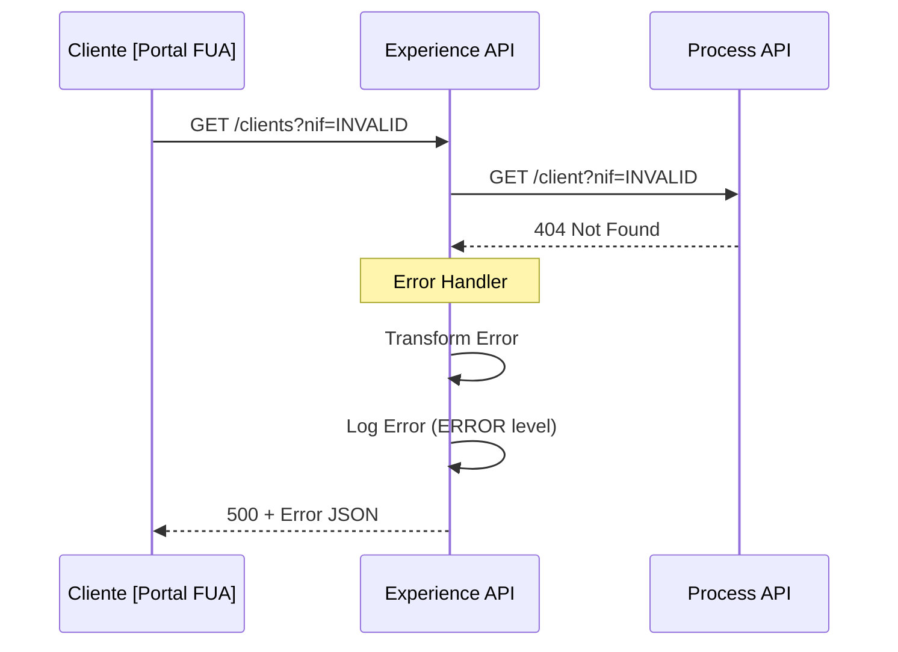
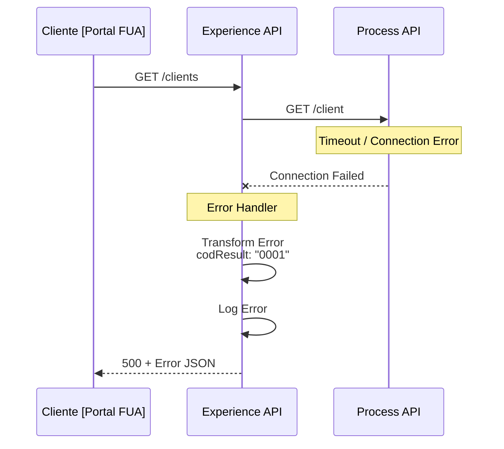

# GET /clients

## 📌 Descripción General

### Propósito del Endpoint

Este endpoint permite obtener información de clientes aplicando diferentes criterios de búsqueda y soportando paginación para manejar grandes volúmenes de resultados. Está diseñado para proporcionar una experiencia optimizada en canales web y móviles del portal FUA (Frontal Único de Atención).

### Tipo de API

**Capa:** Experience API (API-Led Connectivity)

**Función:** Orquestación y adaptación de experiencia para canales digitales (web/móvil)

### Patrón de Integración

**Tipo:** Pass-Through con Propagación de Headers

**Descripción:** Este endpoint actúa como un proxy inteligente que propaga los headers de contexto del usuario (x-interaction-id, x-user-id, x-client-id, etc.) al Process API subyacente, manteniendo la trazabilidad completa de la petición.

### Arquitectura API-Led Connectivity



---

## 💼 Propósito del Negocio

### Casos de Uso Principales

1. **Búsqueda de Cliente por NIF**
   - Permite localizar un cliente específico mediante su número de identificación fiscal
   - Útil para agentes de atención al cliente y procesos de validación

2. **Listado de Clientes con Paginación**
   - Obtiene listados de clientes aplicando límites y offsets para navegación eficiente
   - Optimizado para interfaces de usuario que requieren scroll infinito o paginación

3. **Consulta General de Clientes**
   - Permite obtener información de clientes sin filtros específicos
   - Soporta diferentes criterios de búsqueda según necesidades del negocio

### 📱 Canal y Audiencia

#### Canal de Consumo

**Canal:** Web | Mobile

**Características del Canal:**
- **Plataforma**: Portal FUA (Frontal Único de Atención)
- **Dispositivos**: Navegadores web, aplicaciones móviles iOS/Android
- **Conectividad**: Requiere conexión a internet estable
- **Experiencia de Usuario**: Interfaz responsive con soporte para búsqueda y paginación

#### Audiencia Objetivo

**Usuarios Finales:**
- **Clientes Residenciales**: Consultan su propia información de cliente
- **Clientes Empresariales**: Acceden a datos de sus cuentas corporativas
- **Agentes de Atención al Cliente**: Buscan y consultan información de clientes para soporte

**Contexto de Uso:**
- **Autoservicio**: Clientes accediendo a su información personal
- **Soporte al Cliente**: Agentes buscando información para resolver consultas
- **Gestión de Cuenta**: Usuarios verificando o actualizando sus datos

#### Adaptaciones del Canal

**Optimizaciones Aplicadas:**
- **Propagación de Headers**: Mantiene contexto de usuario y trazabilidad
- **Paginación**: Soporta limit/offset para cargas eficientes
- **Manejo de Errores**: Transformación de errores a formato estándar JSON
- **Logging**: Registro de errores para troubleshooting

### 🔗 Endpoints Dependientes

Este Experience API consume el siguiente Process API:

| Process API | Endpoint | Método | Propósito |
|-------------|----------|--------|-----------|
| `ntgy-newco-p-fua-evo` | `/client` | GET | Obtiene información detallada del cliente desde sistemas backend (PostgreSQL/Salesforce) |

### Contexto Empresarial

- **Dominio:** Gestión de Clientes y Autoservicio
- **Sector:** Energía - Utilities
- **División:** Naturgy España - NewCo
- **Canal:** Web/Móvil

### Stakeholders

- **Clientes de Energía**: Necesitan acceso rápido y confiable a su información
- **Agentes de Call Center**: Requieren búsqueda eficiente de clientes
- **Equipo de Desarrollo FUA**: Mantienen y evolucionan el portal de autoservicio

### Valor de Negocio

- **Autoservicio Mejorado**: Reduce carga en call center al permitir consultas self-service
- **Eficiencia Operativa**: Búsqueda rápida de clientes mejora tiempos de atención
- **Experiencia de Usuario**: Paginación y búsqueda optimizada para interfaces modernas
- **Trazabilidad**: Headers de contexto permiten seguimiento completo de operaciones

---

## 🔧 Especificación Técnica

### URLs por Ambiente

| Ambiente | URL Base | URL Completa |
|----------|----------|--------------|
| **Local** | `http://localhost:8081` | `http://localhost:8081/fua/api/clients` |
| **Development** | `https://ntgy-fua-e-fua-dev.us-e2.cloudhub.io` | `https://ntgy-fua-e-fua-dev.us-e2.cloudhub.io/fua/api/clients` |
| **UAT** | `https://ntgy-fua-e-fua-uat.us-e2.cloudhub.io` | `https://ntgy-fua-e-fua-uat.us-e2.cloudhub.io/fua/api/clients` |
| **Production** | `https://ntgy-fua-e-fua-pro.us-e2.cloudhub.io` | `https://ntgy-fua-e-fua-pro.us-e2.cloudhub.io/fua/api/clients` |

### Método HTTP

```
GET /fua/api/clients
```

### 🎯 Consideraciones del Canal

#### Limitaciones del Canal

| Aspecto | Limitación | Razón |
|---------|------------|-------|
| **Timeout** | 30 segundos | Timeout estándar del Process API |
| **Tamaño de Respuesta** | Variable según paginación | Controlado por parámetros limit/offset |
| **Rate Limiting** | Según políticas de API Manager | Protección contra abuso |
| **Paginación** | Configurable vía query params | Optimización de rendimiento |

#### Headers de Contexto Propagados

**Headers Propagados al Process API:**

| Header | Tipo | Descripción | Obligatorio |
|--------|------|-------------|-------------|
| `x-interaction-id` | String | ID único de la interacción | No |
| `x-interaction-origin` | String | Origen de la interacción | No |
| `x-user-id` | String | ID del usuario autenticado | No |
| `x-client-id` | String | ID del cliente | No |
| `x-client-doc-number` | String | Número de documento del cliente | No |
| `x-client-code` | String | Código del cliente | No |
| `x-origin` | String | Origen de la petición | No |
| `x-user-role` | String | Rol del usuario (customer/agent) | No |
| `traceparent` | String | Header de trazabilidad distribuida | No |
| `x-agent-mail` | String | Email del agente (si aplica) | No |
| `x-language` | String | Idioma preferido | No |
| `x-contact-id` | String | ID del contacto | No |

### Parámetros de Entrada

#### Query Parameters

| Parámetro | Tipo | Obligatorio | Descripción | Ejemplo |
|-----------|------|-------------|-------------|---------|
| `nif` | String | No | NIF del cliente a buscar | `12345678A` |
| `limit` | Integer | No | Límite de resultados para paginación | `10` |
| `offset` | Integer | No | Offset para paginación | `0` |

**Notas:**
- Todos los query parameters son opcionales
- Si no se proporciona ningún parámetro, se obtiene un listado general
- La paginación se controla mediante `limit` y `offset`

### Respuestas

#### 200 OK - Consulta Exitosa

**Estructura de Respuesta:**

```json
{
  "result": {
    "codResult": "0000",
    "msgResult": "Operación exitosa"
  },
  "client": {
    "clientId": "string",
    "nif": "string",
    "name": "string",
    "email": "string",
    "phone": "string",
    // ... más campos según Process API
  }
}
```

**Campos de Respuesta:**

| Campo | Tipo | Descripción |
|-------|------|-------------|
| `result` | Object | Objeto con resultado de la operación |
| `result.codResult` | String | Código de resultado ("0000" = éxito) |
| `result.msgResult` | String | Mensaje descriptivo del resultado |
| `client` | Object | Objeto con información del cliente |

⚠️ **Nota sobre Schema Completo:**

Este Experience API actúa como pass-through. Para el schema completo del objeto `client`, consultar:

📖 **Process API: `ntgy-newco-p-fua-evo` endpoint `/client`**

#### 400 Bad Request - Error de Validación

```json
{
  "result": {
    "codResult": "0001",
    "msgResult": "Bad request"
  }
}
```

#### 404 Not Found - Recurso No Encontrado

```json
{
  "message": "Resource not found"
}
```

#### 500 Internal Server Error - Error del Servidor

```json
{
  "result": {
    "codResult": "0001",
    "msgResult": "[Descripción del error]"
  }
}
```

### Autenticación

- **Tipo:** OAuth 2.0 con JWT
- **Validación:** El flow `jwt-validation` valida el token antes de procesar la petición
- **Headers:** El token debe incluirse en el header `Authorization: Bearer {token}`

### Timeouts

| Tipo | Valor | Razón |
|------|-------|-------|
| **Request Timeout** | 30 segundos | Configurado en HTTP Request al Process API |
| **Response Timeout** | 30 segundos | Timeout estándar para operaciones de consulta |

---

## 🏗️ Implementación Técnica

### Arquitectura del Flow



### Flujo Principal (e-fua.xml)

**Ubicación:** `src/main/mule/e-fua.xml` (línea 178-180)

```xml
<flow name="get:\clients:e-fua-config">
    <flow-ref doc:name="get-clients" name="get-clients" />
</flow>
```

### Implementación del Subflow (get-clients)

**Ubicación:** `src/main/mule/e-fua.xml` (implementación inline)

```xml
<flow name="get-clients">
    <http:request method="GET" 
                  doc:name="Request p-fua-evo /client" 
                  config-ref="HTTP_FUA_PROCESS_NEWCO_EVO" 
                  path="/client">
        <http:query-params>
            <![CDATA[#[vars.fuaHeaders ++ attributes.queryParams]]]>
        </http:query-params>
    </http:request>
    <error-handler>
        <on-error-propagate enableNotifications="true" logException="true">
            <ee:transform doc:name="Set Error Message">
                <ee:message>
                    <ee:set-payload><![CDATA[%dw 2.0
output application/json
---
{
    "result": {
        "codResult": "0001",
        "msgResult": error.description as String replace /\"/ with("")
    }
}]]></ee:set-payload>
                </ee:message>
            </ee:transform>
            <logger level="ERROR" doc:name="Error" message='#[{
    "result": {
        "codResult": "0001",
        "msgResult": error.description as String replace /\"/ with("")
    }
}]' />
        </on-error-propagate>
    </error-handler>
</flow>
```

### Componentes Clave

#### 1. HTTP Request al Process API

**Configuración:**
- **Config Reference:** `HTTP_FUA_PROCESS_NEWCO_EVO`
- **Method:** GET
- **Path:** `/client`
- **Query Params:** Combina `vars.fuaHeaders` con `attributes.queryParams`

**Lógica de Query Parameters:**

```dataweave
vars.fuaHeaders ++ attributes.queryParams
```

Esta expresión combina:
- **fuaHeaders:** Headers de contexto del usuario (x-interaction-id, x-user-id, etc.)
- **queryParams:** Parámetros de la petición original (nif, limit, offset)

#### 2. Variable fuaHeaders

**Ubicación:** `src/main/mule/e-fua.xml` (líneas 15-37)

La variable `fuaHeaders` se establece en el flow principal `e-fua-main` y contiene todos los headers de contexto que deben propagarse:

```dataweave
%dw 2.2
output application/java
---
{
    ("x-interaction-id": attributes.headers['x-interaction-id']) 
        if (attributes.headers['x-interaction-id'] != "null" and !isEmpty(attributes.headers['x-interaction-id'])),
    ("x-interaction-origin": attributes.headers['x-interaction-origin']) 
        if (attributes.headers['x-interaction-origin'] != "null" and !isEmpty(attributes.headers['x-interaction-origin'])),
    ("x-user-id": attributes.headers['x-user-id']) 
        if (attributes.headers['x-user-id'] != "null" and !isEmpty(attributes.headers['x-user-id'])),
    // ... más headers
}
```

#### 3. Error Handler

**Estrategia:** On-Error-Propagate

**Transformación de Error:**
- Convierte cualquier error a formato JSON estándar
- Código de error: "0001"
- Mensaje: Descripción del error sin comillas

**Logging:**
- Nivel: ERROR
- Contenido: Objeto JSON con resultado del error

### Patrones de Diseño

**Patrón:** API Gateway con Propagación de Contexto

**Justificación:** 
- Mantiene trazabilidad completa de las peticiones
- Permite auditoría y debugging efectivo
- Facilita correlación de logs entre capas
- Soporta diferentes roles de usuario (customer/agent)

### Diagramas de Secuencia

#### 1. Flujo Normal de Éxito



#### 2. Flujo con Error de Negocio



#### 3. Flujo con Error Técnico



### Configuración HTTP

**HTTP Request Configuration:**

```yaml
HTTP_FUA_PROCESS_NEWCO_EVO:
  host: "${newco-p-fua-evo.host}"
  port: "${newco-p-fua-evo.port}"
  basePath: "/api"
  timeout: "${newco-p-fua-evo.timeout}"
```

**Propiedades por Ambiente:**

```yaml
# e-fua-local-config.yaml
newco-p-fua-evo:
  host: "localhost"
  port: "8082"
  timeout: "30000"
```

### Manejo de Errores

**Estrategia Global:**

1. **Captura:** `on-error-propagate` captura cualquier error
2. **Transformación:** DataWeave convierte error a formato estándar
3. **Logging:** Logger registra error con nivel ERROR
4. **Respuesta:** Retorna JSON con código "0001" y descripción

**Formato de Error Estándar:**

```json
{
  "result": {
    "codResult": "0001",
    "msgResult": "[Descripción del error sin comillas]"
  }
}
```

**Tipos de Errores Manejados:**
- Errores de conexión al Process API
- Timeouts
- Errores HTTP (4xx, 5xx)
- Errores de transformación

---

## 💻 Ejemplos de Uso

### Ejemplo 1: Búsqueda de Cliente por NIF

#### cURL

```bash
curl -X GET "https://ntgy-fua-e-fua-pro.us-e2.cloudhub.io/fua/api/clients?nif=12345678A" \
  -H "Content-Type: application/json" \
  -H "Authorization: Bearer YOUR_JWT_TOKEN" \
  -H "x-interaction-id: 550e8400-e29b-41d4-a716-446655440000" \
  -H "x-user-id: user123" \
  -H "x-client-id: client456"
```

#### Respuesta (200 OK)

```json
{
  "result": {
    "codResult": "0000",
    "msgResult": "Operación exitosa"
  },
  "client": {
    "clientId": "client456",
    "nif": "12345678A",
    "name": "Juan Pérez García",
    "email": "juan.perez@example.com",
    "phone": "+34600123456",
    "address": {
      "street": "Calle Mayor 123",
      "city": "Madrid",
      "postalCode": "28001"
    },
    "contractAccounts": [
      {
        "accountId": "1234567890",
        "status": "active"
      }
    ]
  }
}
```

### Ejemplo 2: Listado con Paginación

#### cURL

```bash
curl -X GET "https://ntgy-fua-e-fua-pro.us-e2.cloudhub.io/fua/api/clients?limit=10&offset=0" \
  -H "Content-Type: application/json" \
  -H "Authorization: Bearer YOUR_JWT_TOKEN" \
  -H "x-interaction-id: 550e8400-e29b-41d4-a716-446655440001" \
  -H "x-user-role: agent" \
  -H "x-agent-mail: agent@naturgy.com"
```

#### Respuesta (200 OK)

```json
{
  "result": {
    "codResult": "0000",
    "msgResult": "Operación exitosa"
  },
  "clients": [
    {
      "clientId": "client001",
      "nif": "11111111A",
      "name": "Cliente Uno"
    },
    {
      "clientId": "client002",
      "nif": "22222222B",
      "name": "Cliente Dos"
    }
  ],
  "pagination": {
    "limit": 10,
    "offset": 0,
    "total": 150
  }
}
```

### Ejemplo 3: JavaScript (para Web/Mobile)

```javascript
// Función para obtener cliente por NIF
async function getClientByNif(nif, token) {
  const response = await fetch(
    `https://ntgy-fua-e-fua-pro.us-e2.cloudhub.io/fua/api/clients?nif=${nif}`,
    {
      method: 'GET',
      headers: {
        'Content-Type': 'application/json',
        'Authorization': `Bearer ${token}`,
        'x-interaction-id': generateUUID(),
        'x-user-id': getCurrentUserId(),
        'x-client-id': getCurrentClientId()
      }
    }
  );

  if (!response.ok) {
    throw new Error(`HTTP error! status: ${response.status}`);
  }

  const data = await response.json();
  
  if (data.result.codResult === "0000") {
    return data.client;
  } else {
    throw new Error(data.result.msgResult);
  }
}

// Uso
try {
  const client = await getClientByNif('12345678A', userToken);
  console.log('Cliente encontrado:', client);
} catch (error) {
  console.error('Error al buscar cliente:', error);
}
```

### Ejemplo 4: Python

```python
import requests
from typing import Optional, Dict

def get_clients(
    nif: Optional[str] = None,
    limit: Optional[int] = None,
    offset: Optional[int] = None,
    token: str = None
) -> Dict:
    """
    Obtiene información de clientes desde el Experience API.
    
    Args:
        nif: NIF del cliente a buscar
        limit: Límite de resultados
        offset: Offset para paginación
        token: JWT token de autenticación
    
    Returns:
        Dict con información del cliente o lista de clientes
    """
    url = "https://ntgy-fua-e-fua-pro.us-e2.cloudhub.io/fua/api/clients"
    
    # Construir query parameters
    params = {}
    if nif:
        params['nif'] = nif
    if limit:
        params['limit'] = limit
    if offset:
        params['offset'] = offset
    
    # Headers
    headers = {
        'Content-Type': 'application/json',
        'Authorization': f'Bearer {token}',
        'x-interaction-id': generate_uuid(),
        'x-user-id': get_current_user_id()
    }
    
    # Realizar petición
    response = requests.get(url, params=params, headers=headers)
    response.raise_for_status()
    
    data = response.json()
    
    # Validar resultado
    if data['result']['codResult'] == '0000':
        return data
    else:
        raise Exception(f"Error: {data['result']['msgResult']}")

# Uso
try:
    # Buscar cliente por NIF
    result = get_clients(nif='12345678A', token='your_jwt_token')
    print(f"Cliente encontrado: {result['client']['name']}")
    
    # Obtener listado con paginación
    result = get_clients(limit=10, offset=0, token='your_jwt_token')
    print(f"Total de clientes: {len(result.get('clients', []))}")
    
except requests.exceptions.HTTPError as e:
    print(f"Error HTTP: {e}")
except Exception as e:
    print(f"Error: {e}")
```

### Ejemplo 5: Error - Cliente No Encontrado

#### cURL

```bash
curl -X GET "https://ntgy-fua-e-fua-pro.us-e2.cloudhub.io/fua/api/clients?nif=99999999Z" \
  -H "Content-Type: application/json" \
  -H "Authorization: Bearer YOUR_JWT_TOKEN"
```

#### Respuesta (500 Internal Server Error)

```json
{
  "result": {
    "codResult": "0001",
    "msgResult": "Cliente no encontrado en el sistema"
  }
}