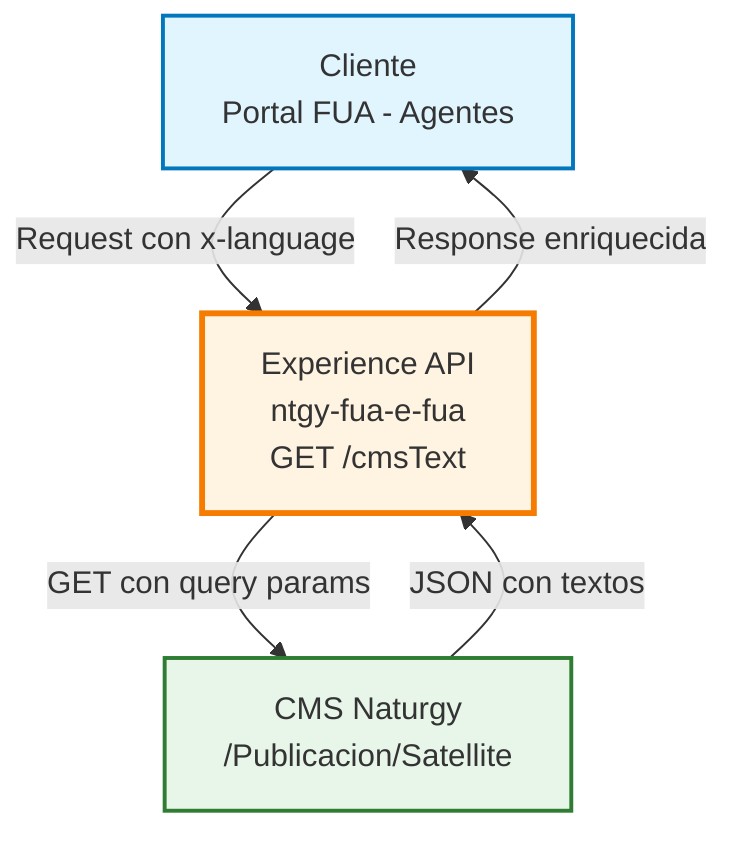
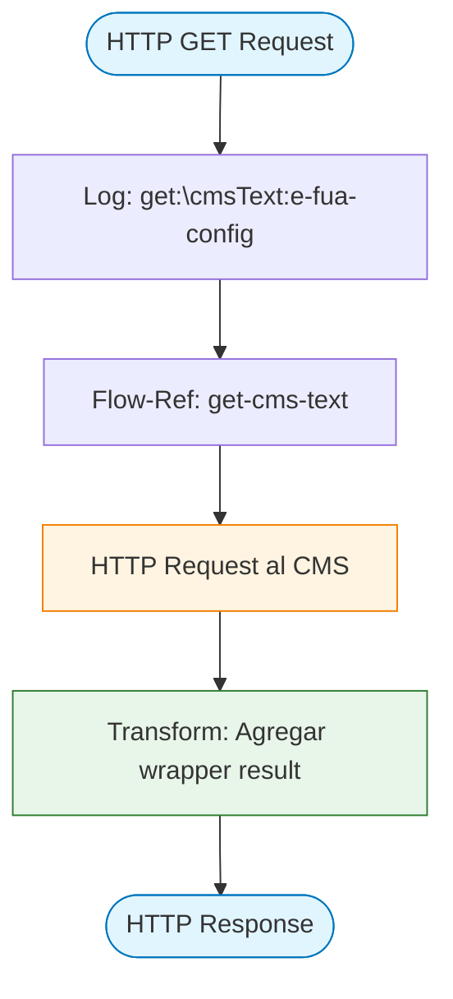
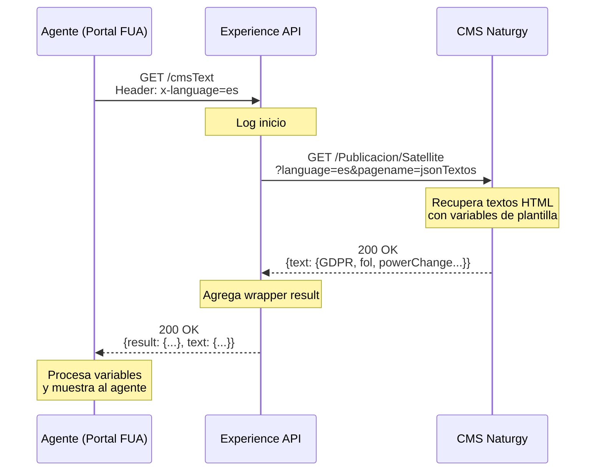
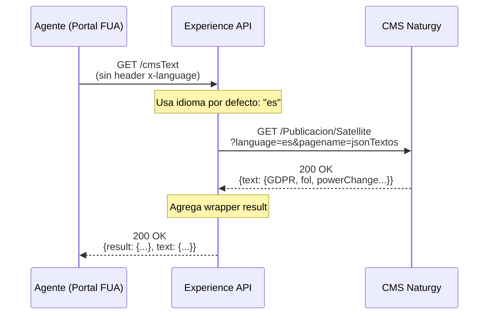
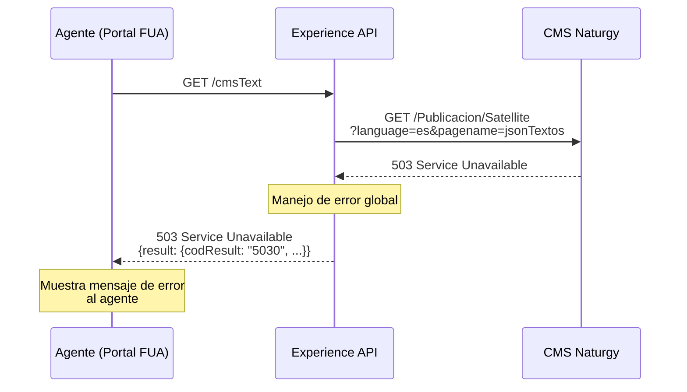

# GET /cmsText

## 📌 Descripción General

### Propósito del Endpoint

Este endpoint recupera textos dinámicos desde el CMS corporativo de Naturgy que son utilizados por los agentes de atención al cliente durante diversos procesos de gestión de clientes. Los textos obtenidos son locuciones en formato HTML con variables de plantilla que los agentes utilizan como guiones durante la interacción con los clientes.

### Tipo de API

**Capa:** Experience API (API-Led Connectivity)

**Función:** Integración con CMS externo para obtención de contenido dinámico

### Patrón de Integración

**Tipo:** Pass-Through con Enriquecimiento

**Descripción:** El endpoint realiza una llamada directa al CMS corporativo de Naturgy y enriquece la respuesta con el wrapper estándar de resultado. No transforma la estructura de los textos del CMS, solo agrega metadatos de respuesta. Los textos se devuelven en formato HTML con variables de plantilla.

### Arquitectura API-Led Connectivity



---

## 💼 Propósito del Negocio

### Casos de Uso Principales

1. **Obtención de Guiones para Agentes**
   - Los agentes acceden a textos predefinidos para diferentes etapas del proceso de alta
   - Garantiza consistencia en la comunicación con los clientes
   - Facilita el onboarding de nuevos agentes

2. **Soporte Multiidioma**
   - Permite obtener textos en diferentes idiomas según la preferencia del cliente
   - Soporta la internacionalización del servicio de atención al cliente
   - Mejora la experiencia del cliente en su idioma nativo

3. **Gestión Centralizada de Contenido**
   - Los textos se gestionan centralizadamente en el CMS
   - Permite actualizaciones sin necesidad de redespliegues
   - Facilita la gobernanza del contenido corporativo

### 📱 Canal y Audiencia

#### Canal de Consumo

**Canal:** Web - Portal de Agentes

**Características del Canal:**
- **Plataforma**: Aplicación web interna para agentes de atención al cliente
- **Dispositivos**: Estaciones de trabajo de escritorio
- **Conectividad**: Red corporativa interna de alta velocidad
- **Experiencia de Usuario**: Interfaz optimizada para consulta rápida de información

#### Audiencia Objetivo

**Usuarios Finales:**
- **Agentes de Atención al Cliente**: Personal que gestiona el proceso de alta de nuevos clientes
- **Supervisores de Call Center**: Personal que supervisa y valida procesos de atención

**Contexto de Uso:**
- **Durante Llamadas con Clientes**: Los agentes consultan los textos en tiempo real durante la interacción
- **Capacitación**: Los textos se utilizan como material de referencia para formación de nuevos agentes

#### Adaptaciones del Canal

**Optimizaciones Aplicadas:**
- **Formato de Respuesta**: JSON directo del CMS sin transformaciones complejas
- **Caché**: No se aplica caché para garantizar contenido actualizado
- **Timeout**: 30 segundos para garantizar respuesta rápida

### 🔗 Endpoints Dependientes

Este Experience API consume el siguiente sistema externo:

| Sistema Externo | Endpoint | Método | Propósito |
|-----------------|----------|--------|-----------|
| `CMS Naturgy` | `/Publicacion/Satellite` | GET | Obtención de textos dinámicos en formato HTML con variables de plantilla |

### Contexto Empresarial

- **Dominio:** Gestión de Contenido y Atención al Cliente
- **Sector:** Energía - Utilities
- **División:** Naturgy España - FUA (Formulario Único de Alta)
- **Canal:** Web - Portal de Agentes

### Stakeholders

- **Agentes de Atención al Cliente**: Necesitan acceso rápido a textos actualizados para guiar conversaciones
- **Equipo de Contenido**: Gestiona y actualiza los textos en el CMS sin intervención técnica
- **Supervisores de Calidad**: Utilizan los textos como referencia para evaluación de calidad

### Valor de Negocio

- **Consistencia en la Comunicación**: Garantiza que todos los agentes utilicen el mismo lenguaje corporativo
- **Agilidad en Actualizaciones**: Permite cambios de contenido sin redespliegues de aplicaciones
- **Reducción de Errores**: Minimiza errores de comunicación al proporcionar textos validados
- **Soporte Multiidioma**: Facilita la atención a clientes en diferentes idiomas

---

## 🔧 Especificación Técnica

### URLs por Ambiente

| Ambiente | URL Base | URL Completa |
|----------|----------|--------------|
| **Local** | `http://localhost:8081` | `http://localhost:8081/fua/api/cmsText` |
| **Development** | `https://ntgy-fua-e-fua-dev.de-c1.cloudhub.io` | `https://ntgy-fua-e-fua-dev.de-c1.cloudhub.io/fua/api/cmsText` |
| **UAT** | `https://ntgy-fua-e-fua-cc.de-c1.cloudhub.io` | `https://ntgy-fua-e-fua-cc.de-c1.cloudhub.io/fua/api/cmsText` |
| **Production** | `https://ntgy-fua-e-fua-pro.de-c1.cloudhub.io` | `https://ntgy-fua-e-fua-pro.de-c1.cloudhub.io/fua/api/cmsText` |

### Método HTTP

```
GET /fua/api/cmsText
```

### 🎯 Consideraciones del Canal

#### Limitaciones del Canal

| Aspecto | Limitación | Razón |
|---------|------------|-------|
| **Timeout** | 30 segundos | Tiempo suficiente para consulta al CMS externo |
| **Rate Limiting** | Sin límite específico | Uso interno por agentes autorizados |
| **Caché** | No aplica | Se requiere contenido siempre actualizado |

### Parámetros de Entrada

#### Headers

| Header | Tipo | Requerido | Descripción | Valor por Defecto |
|--------|------|-----------|-------------|-------------------|
| `x-language` | String | No | Código de idioma para los textos (ISO 639-1) | `es` (español) |
| `x-interaction-id` | String | No | ID de correlación para trazabilidad | - |
| `x-user-id` | String | No | ID del agente que realiza la consulta | - |

#### Query Parameters

No requiere query parameters.

#### Body

No aplica (método GET).

### Respuestas

#### Respuesta Exitosa (200 OK)

**Estructura:**

```json
{
  "result": {
    "codResult": "0000",
    "msgResult": "OK"
  },
  "text": {
    "GDPR": "string (HTML)",
    "contractAccountChange": "string (HTML)",
    "dropOutService": "string (HTML)",
    "dropOutSupply": "string (HTML)",
    "fol": "string (HTML)",
    "powerChange": "string (HTML)"
  }
}
```

**Descripción de Campos:**

| Campo | Tipo | Descripción |
|-------|------|-------------|
| `result` | Object | Wrapper estándar de respuesta |
| `result.codResult` | String | Código de resultado ("0000" = éxito) |
| `result.msgResult` | String | Mensaje de resultado ("OK" = éxito) |
| `text` | Object | Objeto con los textos del CMS en formato HTML |
| `text.GDPR` | String (HTML) | Locución consentimiento RGPD para nuevos clientes |
| `text.contractAccountChange` | String (HTML) | Locución para modificación de datos bancarios (MDB) |
| `text.dropOutService` | String (HTML) | Locución de baja de servicio Naturgy Clientes |
| `text.dropOutSupply` | String (HTML) | Locución de cese de energía Naturgy Clientes |
| `text.fol` | String (HTML) | Locución para alta de factura online (FOL) |
| `text.powerChange` | String (HTML) | Locución para cambios contractuales (ajuste de potencia) |

**Nota sobre Variables de Plantilla:**

Los textos HTML contienen variables de plantilla que deben ser reemplazadas por valores reales antes de su uso:
- `{name}` - Nombre del cliente
- `{nif}` - Documento de identidad (DNI/NIF/CIF)
- `{address}` - Dirección del suministro
- `{cups}` - Código CUPS del punto de suministro
- `{email}` - Correo electrónico del cliente
- `{date}` - Fecha de la operación
- `{day}`, `{hours}` - Día y hora de la grabación
- Y otras variables específicas según el tipo de locución

#### Respuestas de Error

##### Error 401 - No Autorizado

```json
{
  "message": "Unauthorized"
}
```

##### Error 404 - Recurso No Encontrado

```json
{
  "message": "Resource not found"
}
```

##### Error 500 - Error Interno del Servidor

```json
{
  "result": {
    "codResult": "5000",
    "msgResult": "Error al obtener textos del CMS"
  }
}
```

##### Error 503 - Servicio No Disponible

```json
{
  "result": {
    "codResult": "5030",
    "msgResult": "CMS no disponible temporalmente"
  }
}
```

### Autenticación

- **Tipo:** OAuth 2.0 con JWT
- **Scope:** Acceso restringido a agentes autorizados
- **Header:** `Authorization: Bearer {token}`

### Timeouts

| Tipo | Valor | Razón |
|------|-------|-------|
| **Request Timeout** | 30 segundos | Tiempo suficiente para consulta al CMS externo |
| **Connection Timeout** | 30 segundos | Alineado con el request timeout |

---

## 🏗️ Implementación Técnica

### Arquitectura del Flow



### Configuración del Conector HTTP

**Conector:** `HTTP_Request_CMS`

**Configuración (global.xml):**

```xml
<http:request-config 
    name="HTTP_Request_CMS" 
    responseTimeout="${cms.timeout}">
    <http:request-connection 
        host="${cms.host}" 
        port="${cms.port}" 
        connectionIdleTimeout="${cms.timeout}" 
        protocol="HTTPS"/>
</http:request-config>
```

**Propiedades (e-fua-properties.yaml):**

```yaml
cms:
  host: "www.naturgy.es"
  port: "443"
  timeout: "30000"
```

### Implementación del Flow Principal

**Archivo:** `e-fua.xml` (líneas 454-457)

```xml
<flow name="get:\cmsText:e-fua-config">
    <logger level="DEBUG" message="get:\cmsText:e-fua-config" 
            doc:name="get:\cmsText:e-fua-config" />
    <flow-ref doc:name="get-cms-text" 
              doc:id="bdf82778-b8ab-4d29-aedb-7174e46b6dcd" 
              name="get-cms-text" />
</flow>
```

### Implementación del Subflow

**Archivo:** `get-cms-text.xml`

```xml
<flow name="get-cms-text" doc:id="2dfaf57d-2a1b-4412-8ed9-795137e233da">
    <!-- Llamada HTTP al CMS -->
    <http:request 
        method="GET" 
        doc:name="Request" 
        doc:id="710eab37-1e30-4887-b6ef-ef4fbe188e3e" 
        config-ref="HTTP_Request_CMS" 
        path="/Publicacion/Satellite">
        <http:query-params>
            <![CDATA[#[output application/java
            ---
            {
                "language": if (attributes.headers["x-language"] != null) 
                           attributes.headers["x-language"] 
                           else "es",
                "pagename": "jsonTextos"
            }]]]>
        </http:query-params>
    </http:request>
    
    <!-- Transformación: Agregar wrapper result -->
    <ee:transform doc:name="Transform Message" 
                  doc:id="9a9702ca-ba32-450b-a08e-42cc7fdda914">
        <ee:message>
            <ee:set-payload>
                <![CDATA[%dw 2.0
                output application/json
                ---
                {
                    "result": {
                        "codResult": "0000",
                        "msgResult": "OK"
                    }
                }
                ++
                payload]]>
            </ee:set-payload>
        </ee:message>
    </ee:transform>
</flow>
```

### Transformaciones de Canal

**Transformación Aplicada:**

| Operación | Descripción |
|-----------|-------------|
| **Enriquecimiento** | Se agrega el objeto `result` con `codResult` y `msgResult` |
| **Preservación** | El contenido del CMS (`text`) se mantiene sin modificaciones |
| **Merge** | Se combinan ambos objetos usando el operador `++` de DataWeave |

**Lógica de Transformación:**

```dataweave
%dw 2.0
output application/json
---
{
  "result": {
    "codResult": "0000",
    "msgResult": "OK"
  }
}
++
payload  // Contenido original del CMS
```

**Resultado:** El payload del CMS se combina con el wrapper estándar de resultado.

### Patrones de Diseño

**Patrón:** Integration Pattern - Content Enricher

**Justificación:** 
- El endpoint actúa como un Content Enricher al agregar metadatos estándar (result) al contenido del CMS
- Mantiene la estructura original del CMS para preservar la flexibilidad del contenido
- Proporciona consistencia con otros endpoints del API que utilizan el mismo wrapper de resultado

### Diagramas de Secuencia

#### 1. Flujo Normal de Éxito



#### 2. Flujo con Idioma por Defecto



#### 3. Flujo con Error del CMS



### Optimizaciones del Canal

**Optimizaciones Aplicadas:**

1. **Conexión HTTPS Persistente**
   - Se utiliza `connectionIdleTimeout` para mantener conexiones abiertas
   - Reduce latencia en llamadas sucesivas al CMS

2. **Timeout Configurado**
   - 30 segundos de timeout para garantizar respuesta rápida
   - Evita bloqueos prolongados en caso de problemas con el CMS

3. **Idioma por Defecto**
   - Si no se proporciona `x-language`, se usa "es" (español)
   - Garantiza que siempre se obtenga contenido

### Manejo de Errores

**Estrategia de Manejo de Errores:**

1. **Errores del CMS (HTTP 4xx, 5xx)**
   - Se propagan al cliente con el código de estado original
   - El error handler global transforma la respuesta al formato estándar

2. **Timeout del CMS**
   - Después de 30 segundos, se retorna error 503
   - Mensaje: "CMS no disponible temporalmente"

3. **Errores de Transformación**
   - Poco probable dado que es una transformación simple
   - Se manejan con el error handler global

**Error Handler Global:**

El API utiliza el error handler global definido en `e-fua.xml` que maneja:
- `APIKIT:BAD_REQUEST` → 400
- `APIKIT:NOT_FOUND` → 404
- `APIKIT:METHOD_NOT_ALLOWED` → 405
- `APIKIT:NOT_ACCEPTABLE` → 406
- `APIKIT:UNSUPPORTED_MEDIA_TYPE` → 415
- `APIKIT:NOT_IMPLEMENTED` → 501

---

## 💻 Ejemplos de Uso

### Ejemplo 1: Llamada Exitosa con Idioma Español (por defecto)

#### cURL

```bash
curl -X GET "https://ntgy-fua-e-fua-pro.de-c1.cloudhub.io/fua/api/cmsText" \
  -H "Content-Type: application/json" \
  -H "Authorization: Bearer YOUR_JWT_TOKEN" \
  -H "client_id: YOUR_CLIENT_ID"
```

#### Respuesta (200 OK)

```json
{
  "result": {
    "codResult": "0000",
    "msgResult": "OK"
  },
  "text": {
    "GDPR": "<h4>Locución consentimiento RGPD NClientes</h4>\r\n\r\n<p>Hoy día {day}, a las {hours}</p>\r\n\r\n<p>- {name}, como titular actual del punto de suministro/usuario con justo título [en el caso de empresas, debe indicar el nombre de la empresa y el nombre y su DNI como apoderado] {pruebanuevatag}</p>\r\n\r\n<p>- DNI (NIF-CIF) {nif}</p>...",
    "contractAccountChange": "<h4>Modificación Datos Bancarios (MDB)</h4>\r\n\r\n<p>Gracias Sr/Sra. {name}, con DNI {nif}, respecto al número de cuenta {iban} ¿nos autorizas, como titular de la misma, a iniciar los cobros asociados a los productos que tienes contratados?</p>\r\n\r\n<p>Gracias por la confianza</p>\r\n\r\n<p>Fin de la grabación</p>\r\n",
    "dropOutService": "<h4>Locución de baja de servicio Naturgy Clientes</h4>\\n<Divider />\\n<p>Sr/Sra {name}, con DNI {nif}, ¿estás de acuerdo con la baja del producto {product} de la dirección {address}?\\n</p><p>Fin de la grabación</p>",
    "dropOutSupply": "<h4>Locución de cese de energía Naturgy Clientes</h4>\\n<Divider />\\n<p>Gracias Sr/Sra {name}, con DNI {nif},</p>\\n<p>¿solicitas el cese del suministro de {productType} de la dirección {address} y los servicios de mantenimiento asociados {serviceProducts}? El cese implica que la dirección se queda sin este suministro.</p>\\n<p>La baja se realizará en {date}</p>...",
    "fol": "<h4>Alta Factura Online (FOL)</h4>\r\n<p>Gracias {name}, con documento de identificación {nif}, ¿Confirmas tu voluntad de acogerte a la facturación electrónica? [Sí/No].</p>\r\n<p>Te informamos que estás aceptando las condiciones para el alta de factura online y que así marcamos en tu área clientes, y que recibirás un correo de aviso cuando tengas tus facturas disponibles en el correo electrónico siguiente {email}.</p>...",
    "powerChange": "<h4>Locución para Cambios Contractuales (Ajuste de Potencia)</h4>\r\n\r\n<p>Sr./Sra. {name}, de acuerdo con la conversación previa, vamos a proceder a la grabación del ajuste de potencia en el punto de suministro ubicado en {address} con el código CUPS {cups}. Las nuevas potencias por periodo son las siguientes: {newPower}.</p>..."
  }
}
```

**Nota:** Los textos HTML contienen variables de plantilla (ej: `{name}`, `{nif}`, `{address}`) que deben ser reemplazadas con valores reales antes de presentarlos al agente.

### Ejemplo 2: Llamada con Idioma Inglés

#### cURL

```bash
curl -X GET "https://ntgy-fua-e-fua-pro.de-c1.cloudhub.io/fua/api/cmsText" \
  -H "Content-Type: application/json" \
  -H "Authorization: Bearer YOUR_JWT_TOKEN" \
  -H "client_id: YOUR_CLIENT_ID" \
  -H "x-language: en"
```

#### Respuesta (200 OK)

```json
{
  "result": {
    "codResult": "0000",
    "msgResult": "OK"
  },
  "text": {
    "GDPR": "<h4>GDPR Consent Script for New Customers</h4>\r\n\r\n<p>Today {day}, at {hours}</p>\r\n\r\n<p>- {name}, as current holder of the supply point/user with just title...</p>...",
    "contractAccountChange": "<h4>Bank Account Modification (MDB)</h4>\r\n\r\n<p>Thank you Mr/Mrs. {name}, with ID {nif}, regarding account number {iban}, do you authorize us, as the account holder, to initiate charges associated with the products you have contracted?</p>...",
    "fol": "<h4>Online Invoice Registration (FOL)</h4>\r\n<p>Thank you {name}, with identification document {nif}, do you confirm your willingness to opt for electronic invoicing? [Yes/No].</p>...",
    "powerChange": "<h4>Script for Contractual Changes (Power Adjustment)</h4>\r\n\r\n<p>Mr./Mrs. {name}, according to the previous conversation, we will proceed with recording the power adjustment at the supply point located at {address} with CUPS code {cups}...</p>..."
  }
}
```

**Nota:** Los textos en inglés también contienen variables de plantilla que deben ser reemplazadas con valores reales.

### Ejemplo 3: JavaScript (para Portal Web de Agentes)

```javascript
// Función para obtener textos del CMS
async function getCmsTexts(language = 'es') {
  try {
    const response = await fetch(
      'https://ntgy-fua-e-fua-pro.de-c1.cloudhub.io/fua/api/cmsText',
      {
        method: 'GET',
        headers: {
          'Content-Type': 'application/json',
          'Authorization': `Bearer ${getAuthToken()}`,
          'client_id': 'YOUR_CLIENT_ID',
          'x-language': language,
          'x-interaction-id': generateInteractionId(),
          'x-user-id': getCurrentUserId()
        }
      }
    );

    if (!response.ok) {
      throw new Error(`HTTP error! status: ${response.status}`);
    }

    const data = await response.json();
    
    // Verificar resultado exitoso
    if (data.result.codResult === '0000') {
      return data.text;
    } else {
      throw new Error(data.result.msgResult);
    }
  } catch (error) {
    console.error('Error al obtener textos del CMS:', error);
    throw error;
  }
}

// Uso en la aplicación
getCmsTexts('es')
  .then(texts => {
    // Mostrar textos en la interfaz del agente
    // Los textos vienen en formato HTML con variables de plantilla
    document.getElementById('gdpr-text').innerHTML = texts.GDPR;
    document.getElementById('fol-text').innerHTML = texts.fol;
    document.getElementById('contract-change-text').innerHTML = texts.contractAccountChange;
    document.getElementById('power-change-text').innerHTML = texts.powerChange;
    document.getElementById('dropout-service-text').innerHTML = texts.dropOutService;
    document.getElementById('dropout-supply-text').innerHTML = texts.dropOutSupply;
    
    // Nota: Las variables de plantilla ({name}, {nif}, etc.) deben ser 
    // reemplazadas con valores reales antes de mostrar al agente
  })
  .catch(error => {
    // Mostrar mensaje de error al agente
    showErrorNotification('No se pudieron cargar los textos de ayuda');
  });
```

### Ejemplo 4: Python (para Scripts de Automatización)

```python
import requests
import json

def get_cms_texts(language='es', auth_token=None):
    """
    Obtiene textos del CMS para agentes
    
    Args:
        language (str): Código de idioma (ISO 639-1)
        auth_token (str): Token JWT de autenticación
    
    Returns:
        dict: Objeto con los textos del CMS
    """
    url = 'https://ntgy-fua-e-fua-pro.de-c1.cloudhub.io/fua/api/cmsText'
    
    headers = {
        'Content-Type': 'application/json',
        'Authorization': f'Bearer {auth_token}',
        'client_id': 'YOUR_CLIENT_ID',
        'x-language': language
    }
    
    try:
        response = requests.get(url, headers=headers, timeout=30)
        response.raise_for_status()
        
        data = response.json()
        
        # Verificar resultado exitoso
        if data['result']['codResult'] == '0000':
            return data['text']
        else:
            raise Exception(f"Error del API: {data['result']['msgResult']}")
            
    except requests.exceptions.Timeout:
        raise Exception('Timeout al consultar el CMS')
    except requests.exceptions.RequestException as e:
        raise Exception(f'Error de conexión: {str(e)}')

# Ejemplo de uso
if __name__ == '__main__':
    try:
        texts = get_cms_texts(language='es', auth_token='YOUR_JWT_TOKEN')
        
        print("Textos obtenidos del CMS:")
        print(f"GDPR: {texts['GDPR'][:100]}...")  # Primeros 100 caracteres
        print(f"FOL: {texts['fol'][:100]}...")
        print(f"Cambio de Cuenta: {texts['contractAccountChange'][:100]}...")
        print(f"Cambio de Potencia: {texts['powerChange'][:100]}...")
        print(f"Baja de Servicio: {texts['dropOutService'][:100]}...")
        print(f"Cese de Suministro: {texts['dropOutSupply'][:100]}...")
        
        # Nota: Los textos contienen HTML con variables de plantilla
        # que deben ser procesadas antes de su uso
        
    except Exception as e:
        print(f"Error: {str(e)}")
```

### Ejemplo 5: Manejo de Errores

#### Error 503 - CMS No Disponible

```bash
curl -X GET "https://ntgy-fua-e-fua-pro.de-c1.cloudhub.io/fua/api/cmsText" \
  -H "Authorization: Bearer YOUR_JWT_TOKEN" \
  -H "client_id: YOUR_CLIENT_ID"
```

**Respuesta (503 Service Unavailable):**

```json
{
  "result": {
    "codResult": "5030",
    "msgResult": "CMS no disponible temporalmente. Por favor, intente nuevamente en unos minutos."
  }
}
```

#### Error 401 - No Autorizado

```bash
curl -X GET "https://ntgy-fua-e-fua-pro.de-c1.cloudhub.io/fua/api/cmsText" \
  -H "client_id: YOUR_CLIENT_ID"
```

**Respuesta (401 Unauthorized):**

```json
{
  "message": "Unauthorized"
}