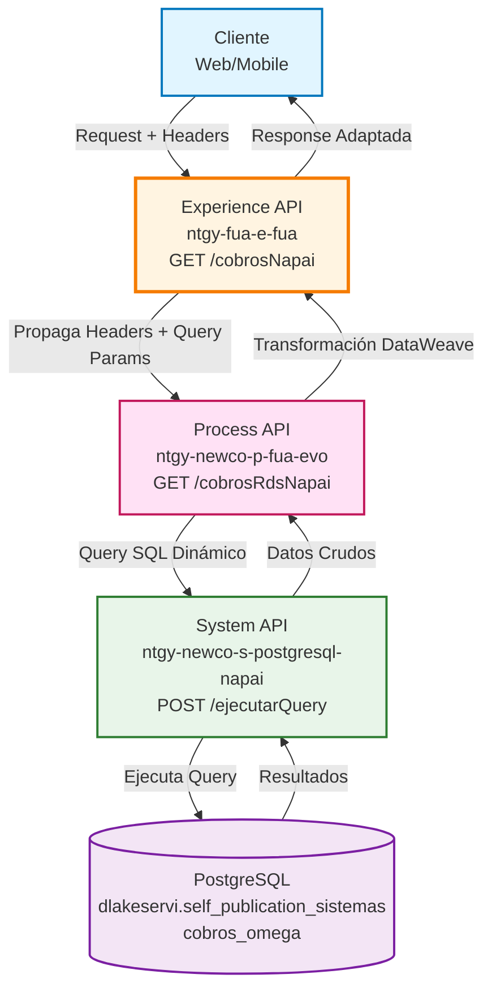
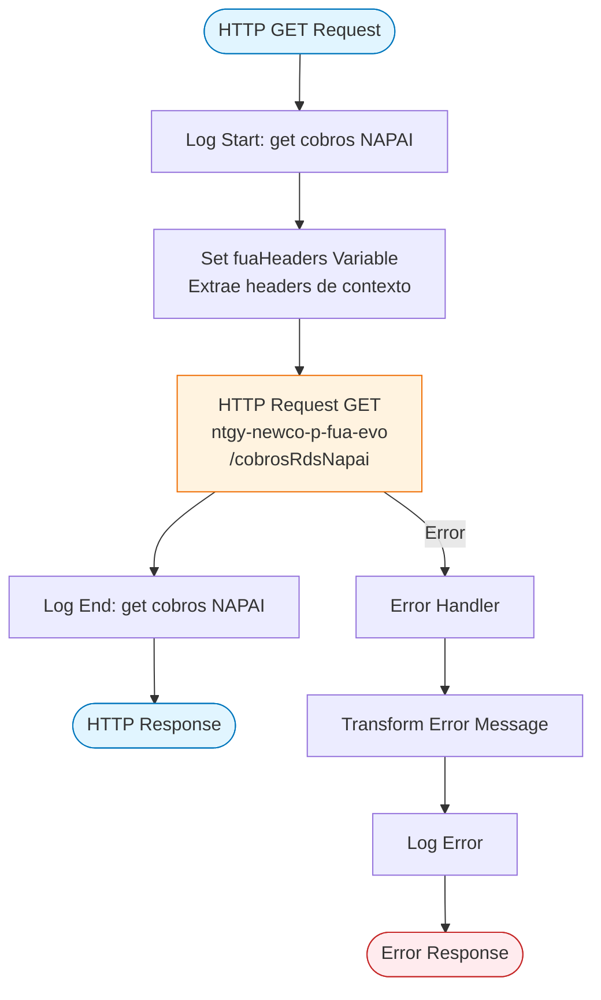
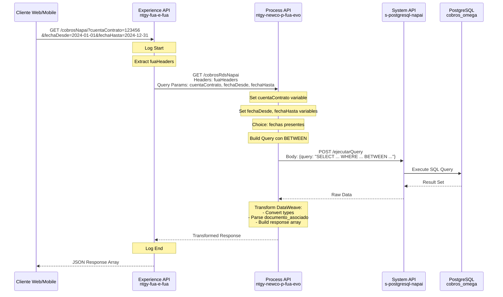
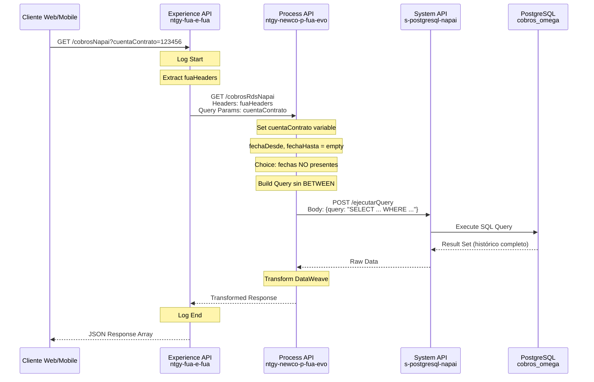
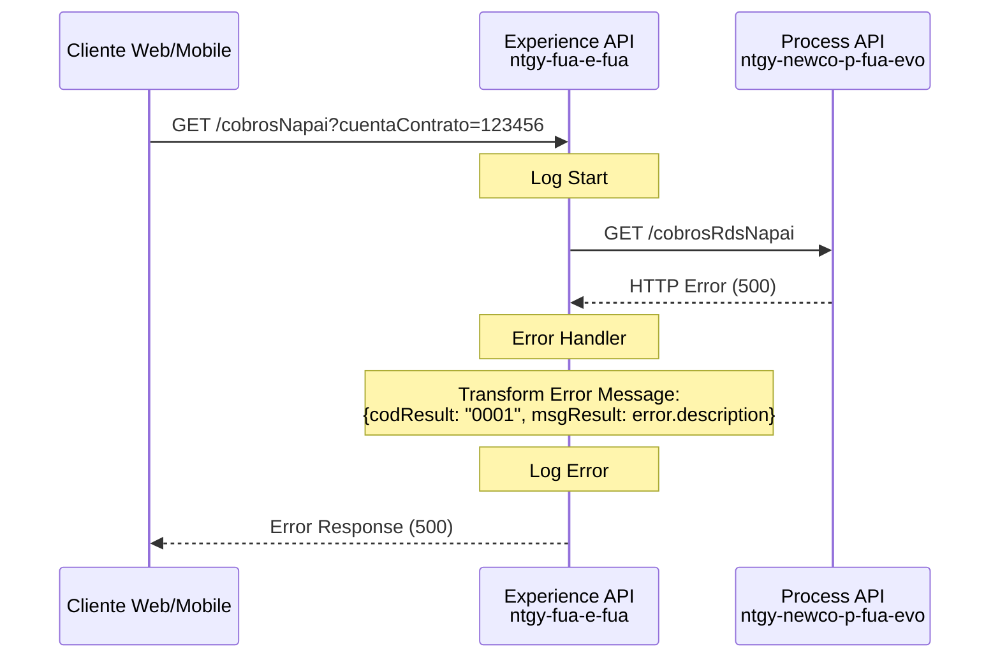

# GET /cobrosNapai

## 📌 Descripción General

### Propósito del Endpoint

Este endpoint permite consultar el histórico de cobros del sistema NAPAI asociados a una cuenta contrato específica. Proporciona información detallada sobre documentos de cobro, importes, medios de pago y saldos, con la capacidad de filtrar por rango de fechas.

### Tipo de API

**Capa:** Experience API (API-Led Connectivity)

**Función:** Adaptación de experiencia para canales web y móvil, proporcionando acceso simplificado al histórico financiero de cobros.

### Patrón de Integración

**Tipo:** Pass-Through con Propagación de Headers

**Descripción:** Este Experience API actúa como un pass-through que propaga los headers de contexto (x-interaction-id, x-user-id, etc.) y los query parameters al Process API. No realiza transformaciones en la respuesta, delegando toda la lógica de negocio y transformación de datos al Process API.

### Arquitectura API-Led Connectivity



---

## 💼 Propósito del Negocio

### Casos de Uso Principales

1. **Consulta de Histórico de Cobros**
   - Permite a los clientes visualizar todos los cobros realizados en su cuenta contrato
   - Facilita la reconciliación de pagos y seguimiento de transacciones financieras
   - Beneficio: Transparencia financiera y control de pagos

2. **Análisis de Cobros por Período**
   - Permite filtrar cobros por rango de fechas específico
   - Útil para análisis financieros y reportes periódicos
   - Beneficio: Facilita la gestión financiera y planificación de pagos

3. **Detalle de Documentos Asociados**
   - Proporciona información sobre facturas y cuotas fraccionadas asociadas a cada cobro
   - Permite identificar qué documentos fueron pagados en cada transacción
   - Beneficio: Trazabilidad completa de pagos y documentos

### 📱 Canal y Audiencia

#### Canal de Consumo

**Canal:** Web / Mobile

**Características del Canal:**
- **Plataforma**: Portal FUA (Frontal Único de Atención) y aplicaciones móviles
- **Dispositivos**: Navegadores web modernos, smartphones iOS/Android
- **Conectividad**: Requiere conexión a internet estable
- **Experiencia de Usuario**: Interfaz optimizada para visualización de datos financieros tabulares

#### Audiencia Objetivo

**Usuarios Finales:**
- **Clientes Residenciales**: Consultan su histórico de pagos para control personal
- **Clientes Empresariales**: Revisan cobros para conciliación contable
- **Agentes de Atención al Cliente**: Consultan cobros para resolver incidencias

**Contexto de Uso:**
- **Consulta de Saldo**: Verificar cobros recientes y saldo actual
- **Resolución de Incidencias**: Identificar cobros específicos ante reclamaciones
- **Análisis Financiero**: Revisar histórico de pagos para planificación

#### Adaptaciones del Canal

**Optimizaciones Aplicadas:**
- **Propagación de Headers**: Mantiene contexto de usuario y sesión a través de las capas
- **Filtrado Opcional**: Permite consultas sin fechas (histórico completo) o con rango específico
- **Formato JSON**: Respuesta estructurada optimizada para consumo web/móvil

### 🔗 Endpoints Dependientes

Este Experience API consume el siguiente Process API:

| Process API | Endpoint | Método | Propósito |
|-------------|----------|--------|-----------|
| `ntgy-newco-p-fua-evo` | `/cobrosRdsNapai` | GET | Construye query SQL dinámico para consultar cobros NAPAI según parámetros de fecha |

### Contexto Empresarial

- **Dominio:** Gestión Financiera y Cobros
- **Sector:** Energía - Utilities
- **División:** Naturgy España - NewCo
- **Canal:** Web/Móvil

### Stakeholders

- **Clientes Finales**: Necesitan transparencia en sus cobros y pagos realizados
- **Área de Atención al Cliente**: Requieren acceso rápido al histórico de cobros para resolver consultas
- **Área Financiera**: Utilizan la información para conciliación y análisis de cobros

### Valor de Negocio

- **Transparencia Financiera**: Proporciona visibilidad completa del histórico de cobros
- **Reducción de Consultas**: Los clientes pueden autogestionar la consulta de sus cobros
- **Mejora en Atención al Cliente**: Los agentes tienen acceso inmediato a información de cobros
- **Trazabilidad**: Permite seguimiento detallado de cada transacción de cobro

---

## 🔧 Especificación Técnica

### URLs por Ambiente

| Ambiente | URL Base | URL Completa |
|----------|----------|--------------|
| **Local** | `http://localhost:8081` | `http://localhost:8081/fua/api/cobrosNapai` |
| **Development** | `https://ntgy-fua-e-fua-dev.de-c1.cloudhub.io` | `https://ntgy-fua-e-fua-dev.de-c1.cloudhub.io/fua/api/cobrosNapai` |
| **Production** | `https://ntgy-fua-e-fua-pro.de-c1.cloudhub.io` | `https://ntgy-fua-e-fua-pro.de-c1.cloudhub.io/fua/api/cobrosNapai` |

### Método HTTP

```
GET /fua/api/cobrosNapai
```

### 🎯 Consideraciones del Canal

#### Limitaciones del Canal

| Aspecto | Limitación | Razón |
|---------|------------|-------|
| **Timeout** | 60 segundos | Consultas pueden involucrar grandes volúmenes de datos históricos |
| **Rate Limiting** | Según política de API Gateway | Protección contra uso excesivo |
| **Paginación** | No implementada | Se retorna el conjunto completo de resultados |

#### Campos Específicos del Canal

**Campos Propagados por el Experience API:**

| Campo (Header) | Tipo | Descripción | Razón |
|----------------|------|-------------|-------|
| `x-interaction-id` | string | ID de interacción para trazabilidad | Seguimiento de requests a través de las capas |
| `x-user-id` | string | ID del usuario autenticado | Contexto de seguridad |
| `x-client-code` | string | Código del cliente | Identificación del cliente |
| `x-origin` | string | Origen de la petición | Identificación del canal |

### Parámetros de Entrada

#### Query Parameters

| Parámetro | Tipo | Requerido | Descripción | Ejemplo |
|-----------|------|-----------|-------------|---------|
| `cuentaContrato` | string | ✅ Sí | Identificador de la cuenta contrato (sin prefijo VTY) | `"123456"` |
| `fechaDesde` | string | ❌ No | Fecha inicio del rango de búsqueda (formato: YYYY-MM-DD) | `"2024-01-01"` |
| `fechaHasta` | string | ❌ No | Fecha fin del rango de búsqueda (formato: YYYY-MM-DD) | `"2024-12-31"` |

**Notas:**
- Si `fechaDesde` y `fechaHasta` se proporcionan, se aplica filtro por rango de fechas
- Si no se proporcionan fechas, se retorna el histórico completo de cobros
- El prefijo "VTY" se añade automáticamente en el Process API

#### Headers Requeridos

| Header | Tipo | Requerido | Descripción |
|--------|------|-----------|-------------|
| `x-interaction-id` | string | ❌ No | ID de interacción para trazabilidad |
| `x-interaction-origin` | string | ❌ No | Origen de la interacción |
| `x-user-id` | string | ❌ No | ID del usuario |
| `x-client-id` | string | ❌ No | ID del cliente |
| `x-client-doc-number` | string | ❌ No | Número de documento del cliente |
| `x-client-code` | string | ❌ No | Código del cliente |
| `x-origin` | string | ❌ No | Origen de la petición |
| `x-user-role` | string | ❌ No | Rol del usuario |
| `x-agent-mail` | string | ❌ No | Email del agente (si aplica) |
| `x-language` | string | ❌ No | Idioma preferido |
| `x-contact-id` | string | ❌ No | ID del contacto |

### Respuestas

#### Respuesta Exitosa (200 OK)

**Estructura de la Respuesta:**

```json
[
  {
    "id_cob_documento_cobro": "string",
    "id_cuenta_contrato": "string",
    "plan_pagos_asociado": "string",
    "des_tipo_documento_cobro": "string",
    "fec_cob_emision": "string",
    "info_medio_pago": "string",
    "saldo": number,
    "fecha_carga": "string",
    "id": number,
    "cod_cliente_sap": number,
    "haber": number,
    "debe": number,
    "documento_asociado": [
      {
        "numFactura": "string",
        "tipo": "string",
        "importeFact": "string"
      }
    ]
  }
]
```

**Descripción de Campos:**

| Campo | Tipo | Descripción |
|-------|------|-------------|
| `id` | number | ID único del registro de cobro |
| `id_cob_documento_cobro` | string | Identificador del documento de cobro |
| `id_cuenta_contrato` | string | Identificador de la cuenta contrato (con prefijo VTY) |
| `cod_cliente_sap` | number | Código del cliente en SAP |
| `plan_pagos_asociado` | string | Plan de pagos asociado al cobro |
| `des_tipo_documento_cobro` | string | Descripción del tipo de documento de cobro |
| `fec_cob_emision` | string | Fecha de emisión del cobro |
| `info_medio_pago` | string | Información del medio de pago utilizado |
| `debe` | number | Importe en el debe |
| `haber` | number | Importe en el haber |
| `saldo` | number | Saldo resultante |
| `fecha_carga` | string | Fecha de carga del registro |
| `documento_asociado` | array | Array de documentos asociados al cobro |
| `documento_asociado[].numFactura` | string | Número de factura o cuota |
| `documento_asociado[].tipo` | string | Tipo de documento: "factura" o "cuota_frac" |
| `documento_asociado[].importeFact` | string | Importe de la factura (si aplica) |

#### Respuesta de Error (500)

```json
{
  "result": {
    "codResult": "0001",
    "msgResult": "Error description"
  }
}
```

### Autenticación

- **Tipo:** Headers de contexto (x-user-id, x-client-code, etc.)
- **Validación:** JWT validation en el flow principal (jwt-validation)

### Timeouts

| Tipo | Valor | Razón |
|------|-------|-------|
| **Request Timeout** | 60 segundos | Configurado en Process API para consultas complejas |

---

## 🏗️ Implementación Técnica

### Arquitectura del Flow



### Transformaciones de Canal

**Este Experience API NO transforma la respuesta del Process API.**

⚠️ **Pass-Through Pattern**: La respuesta del Process API se retorna directamente al cliente sin transformaciones adicionales.

Para el schema completo de la respuesta, consultar:
📖 **Process API: `ntgy-newco-p-fua-evo` endpoint `/cobrosRdsNapai`**

**Propagación de Headers:**

El Experience API extrae y propaga los siguientes headers al Process API:

```dataweave
%dw 2.2
output application/java
---
{
  ("x-interaction-id": attributes.headers['x-interaction-id']) if (attributes.headers['x-interaction-id'] != "null" and !isEmpty(attributes.headers['x-interaction-id'])),
  ("x-interaction-origin": attributes.headers['x-interaction-origin']) if (attributes.headers['x-interaction-origin'] != "null" and !isEmpty(attributes.headers['x-interaction-origin'])),
  ("x-user-id": attributes.headers['x-user-id']) if (attributes.headers['x-user-id'] != "null" and !isEmpty(attributes.headers['x-user-id'])),
  ("x-client-id": attributes.headers['x-client-id']) if (attributes.headers['x-client-id'] != "null" and !isEmpty(attributes.headers['x-client-id'])),
  ("x-client-doc-number": attributes.headers['x-client-doc-number']) if (attributes.headers['x-client-doc-number'] != "null" and !isEmpty(attributes.headers['x-client-doc-number'])),
  ("x-client-code": attributes.headers['x-client-code']) if (attributes.headers['x-client-code'] != "null" and !isEmpty(attributes.headers['x-client-code'])),
  ("x-origin": attributes.headers['x-origin']) if (attributes.headers['x-origin'] != "null" and !isEmpty(attributes.headers['x-origin'])),
  ("x-user-role": attributes.headers['x-user-role']) if (attributes.headers['x-user-role'] != "null" and !isEmpty(attributes.headers['x-user-role'])),
  ("traceparent": attributes.headers['traceparent']) if (attributes.headers['traceparent'] != "null" and !isEmpty(attributes.headers['traceparent'])),
  ("x-agent-mail": attributes.headers['x-agent-mail']) if (attributes.headers['x-agent-mail'] != "null" and !isEmpty(attributes.headers['x-agent-mail'])),
  ("x-language": attributes.headers['x-language']) if (attributes.headers['x-language'] != "null" and !isEmpty(attributes.headers['x-language'])),
  ("x-contact-id": attributes.headers['x-contact-id']) if (attributes.headers['x-contact-id'] != "null" and !isEmpty(attributes.headers['x-contact-id']))
}
```

### Patrones de Diseño

**Patrón:** Pass-Through con Propagación de Contexto

**Justificación:** 
- Mantiene la separación de responsabilidades: el Experience API se enfoca en la adaptación de canal
- La lógica de negocio y transformación de datos permanece en el Process API
- Facilita el mantenimiento y evolución independiente de cada capa
- Permite reutilización del Process API por otros canales

### Diagramas de Secuencia

#### 1. Flujo Normal de Éxito (Con Filtro de Fechas)



#### 2. Flujo Normal de Éxito (Sin Filtro de Fechas)



#### 3. Flujo con Error Técnico



### Lógica del Process API (Referencia)

El Process API `ntgy-newco-p-fua-evo` implementa la siguiente lógica:

#### 1. Extracción de Parámetros

```dataweave
// Set cuentaContrato variable
vars.cuentaContrato = attributes.queryParams.cuentaContrato

// Set fechaDesde y fechaHasta variables
vars.fechaDesde = attributes.queryParams.fechaDesde
vars.fechaHasta = attributes.queryParams.fechaHasta
```

#### 2. Construcción de Query SQL Dinámico

**Caso A: Con Fechas**
```sql
SELECT 
  cobros.id,
  cobros.id_cob_documento_cobro,
  cobros.id_cuenta_contrato,
  cobros.cod_cliente_sap,
  cobros.imp_cob_importe,
  cobros.plan_pagos_asociado,
  cobros.des_tipo_documento_cobro,
  cobros.documento_asociado,
  cobros.fec_cob_emision,
  cobros.info_medio_pago,
  cobros.debe,
  cobros.haber,
  cobros.saldo,
  cobros.fecha_carga
FROM dlakeservi.self_publication_sistemas.cobros_omega cobros
WHERE cobros.id_cuenta_contrato='VTY{cuentaContrato}'
  AND cobros.fec_cob_emision BETWEEN '{fechaDesde}' AND '{fechaHasta}'
ORDER BY fec_cob_emision, id_cob_documento_cobro DESC
```

**Caso B: Sin Fechas**
```sql
SELECT 
  cobros.id,
  cobros.id_cob_documento_cobro,
  cobros.id_cuenta_contrato,
  cobros.cod_cliente_sap,
  cobros.imp_cob_importe,
  cobros.plan_pagos_asociado,
  cobros.des_tipo_documento_cobro,
  cobros.documento_asociado,
  cobros.fec_cob_emision,
  cobros.info_medio_pago,
  cobros.debe,
  cobros.haber,
  cobros.saldo,
  cobros.fecha_carga
FROM dlakeservi.self_publication_sistemas.cobros_omega cobros
WHERE cobros.id_cuenta_contrato='VTY{cuentaContrato}'
ORDER BY fec_cob_emision, id_cob_documento_cobro DESC
```

#### 3. Transformación DataWeave Compleja

El Process API aplica una transformación DataWeave que:

1. **Convierte tipos de datos:**
   - `id`: String → Number
   - `cod_cliente_sap`: String → Number
   - `haber`, `debe`, `saldo`: String → Number

2. **Parsea el campo `documento_asociado`:**
   - Identifica cuotas fraccionadas (patrón: "Cuota Frac.")
   - Identifica facturas con importes (patrón: "Facturas: ")
   - Genera un array estructurado de documentos

3. **Elimina campos internos:**
   - Remueve campos no necesarios para el cliente

**Lógica de Parsing de `documento_asociado`:**

```dataweave
documento_asociado: do {
  var text = item.documento_asociado default ""
  var parteCuota = if (text contains "Cuota Frac.") 
                     (text scan /Cuota Frac.\s*((?:\d+\s*,?\s*)+)/)[0][1] 
                   else ""
  var parteFactura = if (text contains "Facturas: ") 
                       (text splitBy "Facturas: ")[1] 
                     else ""
  ---
  flatten([
    // Cuotas fraccionadas
    if (parteCuota != "") 
      (parteCuota scan /\d+/) map ((c) -> {
        numFactura: c[0],
        tipo: "cuota_frac",
        importeFact: null
      }) 
    else [],
    
    // Facturas con importes
    if (parteFactura != "") 
      (parteFactura splitBy '\n') map ((m) -> {
        numFactura: (m splitBy "(")[0] replace " " with "",
        tipo: "factura",
        importeFact: (m splitBy "(")[1] replace ")" with ""
      }) 
    else [],
    
    // Caso sin indicadores
    if (parteCuota == "" and parteFactura == "" and text != "") 
      (text splitBy '\n') map ((m) -> {
        numFactura: (m splitBy "(")[0] replace " " with "",
        tipo: "factura",
        importeFact: (m splitBy "(")[1] replace ")" with ""
      }) 
    else []
  ])
} default []
```

### Manejo de Errores

**Error Handler en Experience API:**

```dataweave
%dw 2.0
output application/json
---
{
  "result": {
    "codResult": "0001",
    "msgResult": error.description as String replace /\"/ with("")
  }
}
```

**Tipos de Errores:**
- **Errores de Conectividad**: Timeout o fallo en conexión con Process API
- **Errores de Validación**: Parámetros inválidos o faltantes
- **Errores de Backend**: Fallos en la base de datos PostgreSQL

---

## 💻 Ejemplos de Uso

### Ejemplo 1: Consulta con Rango de Fechas

#### cURL

```bash
curl -X GET "https://ntgy-fua-e-fua-pro.de-c1.cloudhub.io/fua/api/cobrosNapai?cuentaContrato=123456&fechaDesde=2024-01-01&fechaHasta=2024-12-31" \
  -H "Content-Type: application/json" \
  -H "x-interaction-id: 550e8400-e29b-41d4-a716-446655440000" \
  -H "x-user-id: user123" \
  -H "x-client-code: CLI123456" \
  -H "x-origin: web"
```

#### Respuesta (200 OK)

```json
[
  {
    "id_cob_documento_cobro": "DOC123456",
    "id_cuenta_contrato": "VTY123456",
    "plan_pagos_asociado": "PLAN001",
    "des_tipo_documento_cobro": "Factura Eléctrica",
    "fec_cob_emision": "2024-06-15",
    "info_medio_pago": "Domiciliación Bancaria",
    "saldo": 0.00,
    "fecha_carga": "2024-06-16",
    "id": 789012,
    "cod_cliente_sap": 1234567890,
    "haber": 85.50,
    "debe": 0.00,
    "documento_asociado": [
      {
        "numFactura": "FAC202406001",
        "tipo": "factura",
        "importeFact": "85.50"
      }
    ]
  },
  {
    "id_cob_documento_cobro": "DOC123457",
    "id_cuenta_contrato": "VTY123456",
    "plan_pagos_asociado": "PLAN002",
    "des_tipo_documento_cobro": "Cuota Fraccionada",
    "fec_cob_emision": "2024-05-10",
    "info_medio_pago": "Tarjeta de Crédito",
    "saldo": 150.00,
    "fecha_carga": "2024-05-11",
    "id": 789013,
    "cod_cliente_sap": 1234567890,
    "haber": 50.00,
    "debe": 0.00,
    "documento_asociado": [
      {
        "numFactura": "1",
        "tipo": "cuota_frac",
        "importeFact": null
      },
      {
        "numFactura": "2",
        "tipo": "cuota_frac",
        "importeFact": null
      }
    ]
  }
]
```

### Ejemplo 2: Consulta sin Filtro de Fechas (Histórico Completo)

#### cURL

```bash
curl -X GET "https://ntgy-fua-e-fua-pro.de-c1.cloudhub.io/fua/api/cobrosNapai?cuentaContrato=123456" \
  -H "Content-Type: application/json" \
  -H "x-interaction-id: 550e8400-e29b-41d4-a716-446655440001" \
  -H "x-user-id: user123" \
  -H "x-client-code: CLI123456" \
  -H "x-origin: web"
```

#### Respuesta (200 OK)

```json
[
  {
    "id_cob_documento_cobro": "DOC123456",
    "id_cuenta_contrato": "VTY123456",
    "plan_pagos_asociado": "PLAN001",
    "des_tipo_documento_cobro": "Factura Eléctrica",
    "fec_cob_emision": "2024-06-15",
    "info_medio_pago": "Domiciliación Bancaria",
    "saldo": 0.00,
    "fecha_carga": "2024-06-16",
    "id": 789012,
    "cod_cliente_sap": 1234567890,
    "haber": 85.50,
    "debe": 0.00,
    "documento_asociado": [
      {
        "numFactura": "FAC202406001",
        "tipo": "factura",
        "importeFact": "85.50"
      }
    ]
  },
  {
    "id_cob_documento_cobro": "DOC123458",
    "id_cuenta_contrato": "VTY123456",
    "plan_pagos_asociado": "PLAN001",
    "des_tipo_documento_cobro": "Factura Gas",
    "fec_cob_emision": "2023-12-10",
    "info_medio_pago": "Transferencia",
    "saldo": 0.00,
    "fecha_carga": "2023-12-11",
    "id": 789014,
    "cod_cliente_sap": 1234567890,
    "haber": 120.75,
    "debe": 0.00,
    "documento_asociado": [
      {
        "numFactura": "FAC202312001",
        "tipo": "factura",
        "importeFact": "120.75"
      }
    ]
  }
]
```

### Ejemplo 3: JavaScript (Frontend Web)

```javascript
// Función para obtener cobros NAPAI
async function getCobrosNapai(cuentaContrato, fechaDesde = null, fechaHasta = null) {
  const baseUrl = 'https://ntgy-fua-e-fua-pro.de-c1.cloudhub.io/fua/api/cobrosNapai';
  
  // Construir query parameters
  const params = new URLSearchParams({
    cuentaContrato: cuentaContrato
  });
  
  if (fechaDesde && fechaHasta) {
    params.append('fechaDesde', fechaDesde);
    params.append('fechaHasta', fechaHasta);
  }
  
  try {
    const response = await fetch(`${baseUrl}?${params.toString()}`, {
      method: 'GET',
      headers: {
        'Content-Type': 'application/json',
        'x-interaction-id': generateInteractionId(),
        'x-user-id': getUserId(),
        'x-client-code': getClientCode(),
        'x-origin': 'web'
      }
    });
    
    if (!response.ok) {
      throw new Error(`HTTP error! status: ${response.status}`);
    }
    
    const cobros = await response.json();
    return cobros;
  } catch (error) {
    console.error('Error al obtener cobros NAPAI:', error);
    throw error;
  }
}

// Ejemplo de uso
getCobrosNapai('123456', '2024-01-01', '2024-12-31')
  .then(cobros => {
    console.log('Cobros obtenidos:', cobros);
    // Procesar cobros...
  })
  .catch(error => {
    console.error('Error:', error);
  });
```

### Ejemplo 4: Python

```python
import requests
from datetime import datetime

def get_cobros_napai(cuenta_contrato, fecha_desde=None, fecha_hasta=None):
    """
    Obtiene el histórico de cobros NAPAI para una cuenta contrato.
    
    Args:
        cuenta_contrato (str): Identificador de la cuenta contrato
        fecha_desde (str, optional): Fecha inicio (YYYY-MM-DD)
        fecha_hasta (str, optional): Fecha fin (YYYY-MM-DD)
    
    Returns:
        list: Lista de cobros
    """
    base_url = 'https://ntgy-fua-e-fua-pro.de-c1.cloudhub.io/fua/api/cobrosNapai'
    
    # Construir parámetros
    params = {
        'cuentaContrato': cuenta_contrato
    }
    
    if fecha_desde and fecha_hasta:
        params['fechaDesde'] = fecha_desde
        params['fechaHasta'] = fecha_hasta
    
    # Headers
    headers = {
        'Content-Type': 'application/json',
        'x-interaction-id': '550e8400-e29b-41d4-a716-446655440002',
        'x-user-id': 'user123',
        'x-client-code': 'CLI123456',
        'x-origin': 'python-client'
    }
    
    try:
        response = requests.get(base_url, params=params, headers=headers)
        response.raise_for_status()
        return response.json()
    except requests.exceptions.RequestException as e:
        print(f'Error al obtener cobros NAPAI: {e}')
        raise

# Ejemplo de uso
if __name__ == '__main__':
    # Consulta con rango de fechas
    cobros = get_cobros_napai(
        cuenta_contrato='123456',
        fecha_desde='2024-01-01',
        fecha_hasta='2024-12-31'
    )
    
    print(f'Total de cobros: {len(cobros)}')
    
    # Mostrar resumen
    for cobro in cobros:
        print(f"Documento: {cobro['id_cob_documento_cobro']}")
        print(f"Fecha: {cobro['fec_cob_emision']}")
        print(f"Haber: {cobro['haber']}")
        print(f"Saldo: {cobro['saldo']}")
        print('---')
```

### Ejemplo 5: Respuesta de Error

#### Request

```bash
curl -X GET "https://ntgy-fua-e-fua-pro.de-c1.cloudhub.io/fua/api/cobrosNapai?cuentaContrato=999999" \
  -H "Content-Type: application/json" \
  -H "x-interaction-id: 550e8400-e29b-41d4-a716-446655440003" \
  -H "x-user-id: user123"
```

#### Respuesta (500 Internal Server Error)

```json
{
  "result": {
    "codResult": "0001",
    "msgResult": "Error al ejecutar query en base de datos: Connection timeout"
  }
}
```

### Ejemplo 6: Análisis de Documentos Asociados

Este ejemplo muestra cómo interpretar el campo `documento_asociado`:

```javascript
// Función para analizar documentos asociados
function analizarDocumentosAsociados(cobro) {
  const documentos = cobro.documento_asociado;
  
  const facturas = documentos.filter(doc => doc.tipo === 'factura');
  const cuotasFrac = documentos.filter(doc => doc.tipo === 'cuota_frac');
  
  console.log(`Cobro: ${cobro.id_cob_documento_cobro}`);
  console.log(`Fecha: ${cobro.fec_cob_emision}`);
  console.log(`Importe: ${cobro.haber}`);
  
  if (facturas.length > 0) {
    console.log('Facturas pagadas:');
    facturas.forEach(factura => {
      console.log(`  - ${factura.numFactura}: ${factura.importeFact}`);
    });
  }
  
  if (cuotasFrac.length > 0) {
    console.log('Cuotas fraccionadas:');
    cuotasFrac.forEach(cuota => {
      console.log(`  - Cuota ${cuota.numFactura}`);
    });
  }
}

// Ejemplo de uso
const cobro = {
  "id_cob_documento_cobro": "DOC123457",
  "fec_cob_emision": "2024-05-10",
  "haber": 50.00,
  "documento_asociado": [
    {
      "numFactura": "1",
      "tipo": "cuota_frac",
      "importeFact": null
    },
    {
      "numFactura": "2",
      "tipo": "cuota_frac",
      "importeFact": null
    }
  ]
};

analizarDocumentosAsociados(cobro);
// Output:
// Cobro: DOC123457
// Fecha: 2024-05-10
// Importe: 50.00
// Cuotas fraccionadas:
//   - Cuota 1
//   - Cuota 2
```
