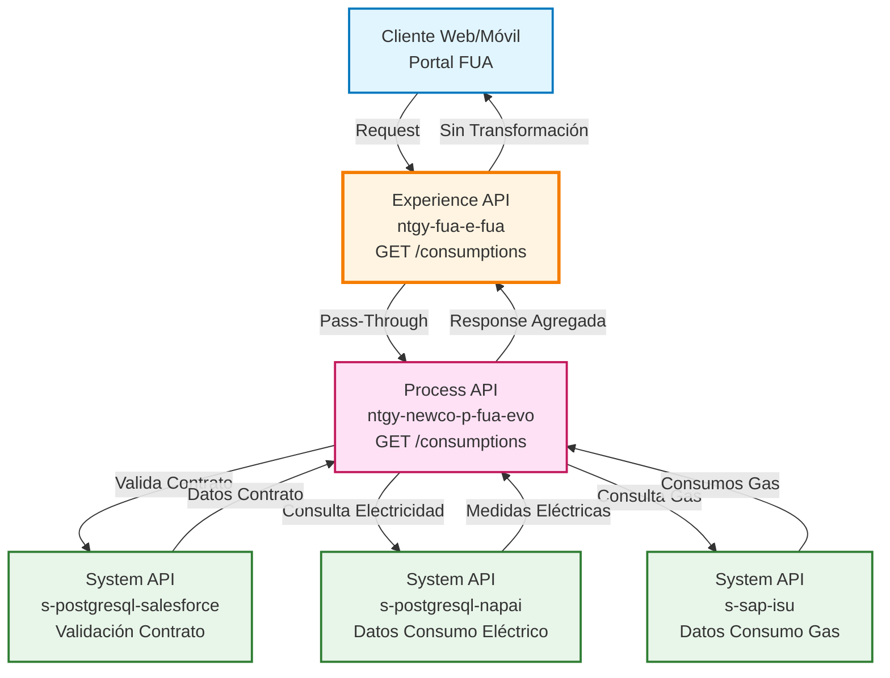
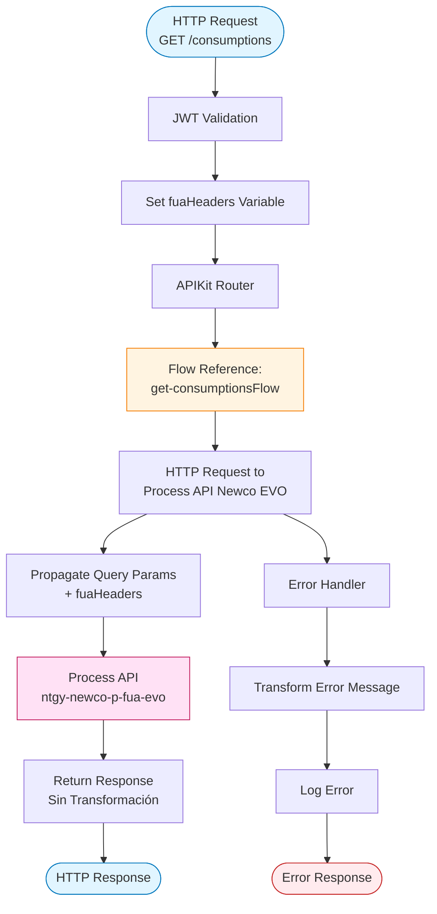
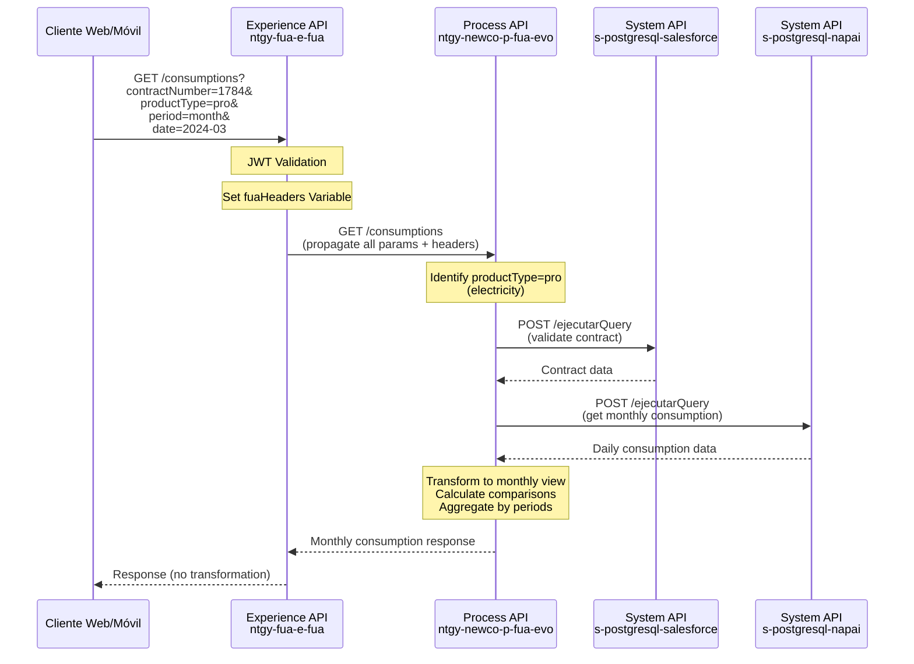
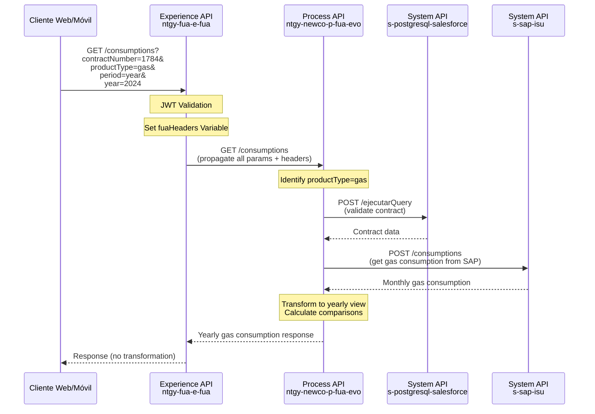
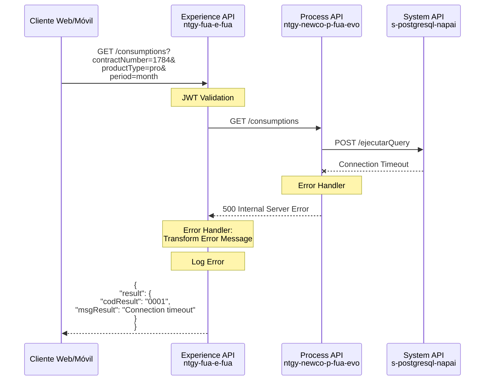
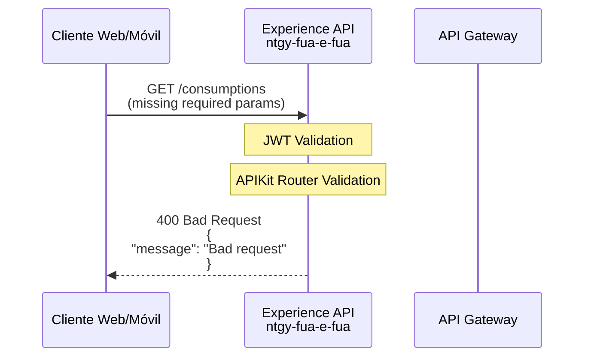

# GET /consumptions

## 📌 Descripción General

### Propósito del Endpoint

Obtiene datos detallados de consumo energético (electricidad y gas) con diferentes niveles de agregación temporal (día, mes, año) y permite comparaciones con períodos anteriores. Este endpoint proporciona información completa sobre consumos activos, reactivos (para electricidad), estados de facturación y análisis de variaciones.

### Tipo de API

**Capa:** Experience API (API-Led Connectivity)

**Función:** Proxy transparente que adapta la experiencia para canales web y móvil, delegando toda la lógica de negocio al Process API downstream.

### Patrón de Integración

**Tipo:** Pass-Through (Proxy Transparente)

**Descripción:** Este Experience API actúa como un proxy transparente que:
- Recibe la petición del cliente (web/móvil)
- Propaga todos los query parameters y headers al Process API
- Retorna la respuesta sin transformaciones
- Maneja errores de forma estandarizada

**⚠️ Importante:** Este endpoint NO transforma datos. Para el schema completo de respuesta, consultar la documentación del Process API `ntgy-newco-p-fua-evo`.

### Arquitectura API-Led Connectivity



---

## 💼 Propósito del Negocio

### Casos de Uso Principales

1. **Visualización de Consumo Diario (Electricidad)**
   - Consulta de consumos horarios de electricidad para un día específico
   - Comparación con el día anterior
   - Análisis por períodos tarifarios (punta, llano, valle)
   - Identificación de consumos activos y reactivos

2. **Análisis de Consumo Mensual**
   - Agregación de consumos diarios en vista mensual
   - Comparación con mes anterior o mismo mes del año anterior
   - Seguimiento de evolución de consumo
   - Identificación de días con mayor consumo

3. **Resumen Anual de Consumo**
   - Vista consolidada de consumos por mes
   - Comparación año actual vs año anterior
   - Cálculo de promedios mensuales
   - Análisis de tendencias anuales

4. **Gestión de Consumo de Gas**
   - Consulta de consumos mensuales de gas
   - Datos agregados desde SAP ISU
   - Comparación interanual
   - Seguimiento de facturación

### 📱 Canal y Audiencia

#### Canal de Consumo

**Canal:** Web y Mobile

**Características del Canal:**
- **Plataforma**: Portal web FUA y aplicaciones móviles iOS/Android
- **Dispositivos**: Navegadores modernos, smartphones, tablets
- **Conectividad**: Requiere conexión estable para cargar datos históricos
- **Experiencia de Usuario**: Visualización gráfica de consumos con comparativas

#### Audiencia Objetivo

**Usuarios Finales:**
- **Clientes Residenciales**: Consulta de consumos para control de gasto energético
- **Clientes Empresariales**: Análisis detallado de consumos para optimización
- **Agentes de Atención**: Soporte en consultas sobre facturación y consumos

**Contexto de Uso:**
- **Consulta de Factura**: Verificación de consumos antes de recibir factura
- **Análisis de Eficiencia**: Identificación de patrones de consumo
- **Reclamaciones**: Validación de consumos facturados
- **Planificación**: Estimación de consumos futuros

#### Adaptaciones del Canal

**Optimizaciones Aplicadas:**
- **Timeout Extendido**: 60 segundos para permitir consultas de grandes volúmenes de datos
- **Propagación de Headers**: Todos los headers de contexto se propagan al Process API
- **Sin Transformación**: Respuesta directa del Process API para máxima fidelidad de datos
- **Manejo de Errores**: Formato estandarizado de errores para mejor UX

### 🔗 Endpoints Dependientes

Este Experience API consume el siguiente Process API:

| Process API | Endpoint | Método | Propósito |
|-------------|----------|--------|-----------|
| `ntgy-newco-p-fua-evo` | `/consumptions` | GET | Obtención de datos de consumo con agregación temporal (horaria, diaria, mensual, anual), validación de contratos, consulta a PostgreSQL-Napai para electricidad y SAP ISU para gas, cálculo de comparaciones y estados de facturación |

**Nota:** El Process API a su vez consume múltiples System APIs según el tipo de energía consultada.

### Contexto Empresarial

- **Dominio:** Gestión de Consumos Energéticos
- **Sector:** Energía - Utilities
- **División:** Naturgy España - NewCo
- **Canal:** Web y Móvil (Portal FUA)

### Stakeholders

- **Clientes Finales**: Necesitan transparencia en sus consumos energéticos
- **Departamento de Atención al Cliente**: Requieren datos precisos para resolver consultas
- **Área de Facturación**: Validan consumos antes de emitir facturas
- **Equipo de Desarrollo**: Mantienen la integración con sistemas backend

### Valor de Negocio

- **Transparencia**: Acceso en tiempo real a datos de consumo
- **Autoservicio**: Reducción de llamadas al call center por consultas de consumo
- **Satisfacción del Cliente**: Mejor comprensión de su factura energética
- **Eficiencia Operativa**: Automatización de consultas de consumo

---

## 🔧 Especificación Técnica

### URLs por Ambiente

| Ambiente | URL Base | URL Completa |
|----------|----------|--------------|
| **Local** | `http://localhost:8081` | `http://localhost:8081/fua/api/consumptions` |
| **Development** | `https://ntgy-fua-e-fua-dev.de-c1.cloudhub.io` | `https://ntgy-fua-e-fua-dev.de-c1.cloudhub.io/fua/api/consumptions` |
| **UAT** | `https://ntgy-fua-e-fua-uat.de-c1.cloudhub.io` | `https://ntgy-fua-e-fua-uat.de-c1.cloudhub.io/fua/api/consumptions` |
| **Production** | `https://ntgy-fua-e-fua-pro.de-c1.cloudhub.io` | `https://ntgy-fua-e-fua-pro.de-c1.cloudhub.io/fua/api/consumptions` |

### Método HTTP

```
GET /fua/api/consumptions
```

### 🎯 Consideraciones del Canal

#### Limitaciones del Canal

| Aspecto | Limitación | Razón |
|---------|------------|-------|
| **Timeout** | 60 segundos | Consultas de grandes volúmenes de datos históricos |
| **Tamaño de Respuesta** | Variable (puede ser grande) | Datos horarios de un mes completo pueden ser extensos |
| **Rate Limiting** | Según política API Gateway | Protección del backend |
| **Caché** | No implementado | Datos en tiempo real requeridos |

#### Campos Específicos del Canal

**Campos Propagados por el Experience API:**

Este endpoint propaga todos los headers de contexto al Process API sin modificación:

| Header | Tipo | Descripción | Obligatorio |
|--------|------|-------------|-------------|
| `x-client-id` | string | ID del cliente en Salesforce | ✅ Sí |
| `x-client-doc-number` | string | Número de documento del cliente | ✅ Sí |
| `x-interaction-id` | string | ID de correlación de la petición | ❌ No |
| `x-access-token` | string | Token de autenticación OAuth 2.0 | ✅ Sí |
| `x-trading-company` | string | Compañía comercializadora | ❌ No |
| `x-user-id` | string | ID del usuario autenticado | ❌ No |
| `x-language` | string | Idioma preferido (es, en, ca) | ❌ No |
| `x-client-code` | string | Código de cliente | ❌ No |

### Parámetros de Entrada

#### Query Parameters

| Parámetro | Tipo | Obligatorio | Descripción | Ejemplo |
|-----------|------|-------------|-------------|---------|
| `contractAccountId` | string | ✅ Sí | ID de la cuenta contrato | `"1678"` |
| `contractNumber` | string | ✅ Sí | Número de contrato | `"1784"` |
| `productType` | string | ✅ Sí | Tipo de producto: `"pro"` (electricidad) o `"gas"` | `"pro"` |
| `cups` | string | ✅ Sí | Código CUPS del punto de suministro | `"ES0021000000000001JN"` |
| `period` | string | ✅ Sí | Tipo de período: `"day"`, `"month"`, `"year"` | `"month"` |
| `startDate` | date-only \| string | ❌ No | Fecha inicio (formato: YYYY-MM-DD) | `"2024-01-01"` |
| `endDate` | date-only \| string | ❌ No | Fecha fin (formato: YYYY-MM-DD) | `"2024-01-31"` |
| `date` | string | ❌ No* | Fecha específica para consultas day/month (YYYY-MM-DD) | `"2024-03-15"` |
| `year` | string | ❌ No* | Año para consultas anuales (YYYY) | `"2024"` |
| `type` | string | ❌ No | Tipo de vista: `"day"`, `"month"`, `"year"` | `"month"` |
| `compareWith` | string | ❌ No | Habilita comparación: `"previous"` | `"previous"` |

**Notas:**
- `*` El parámetro `date` es obligatorio cuando `period="day"` o `period="month"`
- `*` El parámetro `year` es obligatorio cuando `period="year"`
- Para electricidad con `period="day"`, se obtienen datos horarios
- Para gas, solo están disponibles datos anuales agregados por mes

#### Headers

| Header | Tipo | Obligatorio | Descripción |
|--------|------|-------------|-------------|
| `x-client-id` | string | ✅ Sí | ID del cliente en Salesforce |
| `x-client-doc-number` | string | ✅ Sí | Número de documento del cliente |
| `x-interaction-id` | string | ❌ No | ID de correlación para trazabilidad |
| `x-access-token` | string | ✅ Sí | Token de autenticación OAuth 2.0 |
| `x-trading-company` | string | ❌ No | Compañía comercializadora (imp/newco) |
| `x-user-id` | string | ❌ No | ID del usuario autenticado |
| `x-language` | string | ❌ No | Idioma preferido (es, en, ca) |
| `x-client-code` | string | ❌ No | Código de cliente |

### Respuestas

#### Respuesta Exitosa (200 OK)

**Nota Importante:** Este Experience API retorna la respuesta del Process API sin transformaciones. La respuesta proviene de SAP ISU vía Uptility.

**Content-Type:** `application/json`

**Estructura de Respuesta:**

```json
{
  "contractId": "1000123456",
  "productTypeFamily": "luz",
  "productGraphicResume": {
    "anualSelfConsumption": 0,
    "anualEstimatedProduction": 0,
    "anualPowerGridContribution": 0,
    "anualClearedAmount": 0,
    "anualTotalConsumption": 3250.5,
    "anualPointConsumption": 1200.0,
    "anualValleyConsumption": 2050.5,
    "anualComparative": 5.2
  },
  "consumptionValues": [
    {
      "date": "2024-01-15",
      "invoiceRef": "100012345678",
      "valueTotal": 250.5,
      "P1": 100.2,
      "P2": 80.3,
      "P3": 70.0,
      "P4": 0,
      "P5": 0,
      "P6": 0,
      "aported": 0,
      "consumed": 250.5
    },
    {
      "date": "2024-01-16",
      "invoiceRef": "100012345679",
      "valueTotal": 245.8,
      "P1": 98.5,
      "P2": 78.3,
      "P3": 69.0,
      "P4": 0,
      "P5": 0,
      "P6": 0,
      "aported": 0,
      "consumed": 245.8
    }
  ],
  "result": {
    "codResult": "0",
    "msgResult": "Consulta exitosa"
  }
}
```

**Descripción de Campos:**

| Campo | Tipo | Descripción |
|-------|------|-------------|
| `contractId` | String | Número de contrato |
| `productTypeFamily` | String | Tipo de producto: "luz" o "gas" |
| `productGraphicResume` | Object | Resumen anual de consumos |
| `productGraphicResume.anualSelfConsumption` | Number | Autoconsumo anual en kWh |
| `productGraphicResume.anualEstimatedProduction` | Number | Producción estimada anual en kWh |
| `productGraphicResume.anualPowerGridContribution` | Number | Contribución a red anual en kWh |
| `productGraphicResume.anualClearedAmount` | Number | Importe compensado anual |
| `productGraphicResume.anualTotalConsumption` | Number | Consumo total anual en kWh |
| `productGraphicResume.anualPointConsumption` | Number | Consumo en horas punta anual en kWh |
| `productGraphicResume.anualValleyConsumption` | Number | Consumo en horas valle anual en kWh |
| `productGraphicResume.anualComparative` | Number | Comparativa anual (porcentaje) |
| `consumptionValues` | Array | Array de consumos por período |
| `consumptionValues[].date` | String | Fecha del consumo (yyyy-MM-dd) |
| `consumptionValues[].invoiceRef` | String | Referencia de factura (si está facturado) |
| `consumptionValues[].valueTotal` | Number | Consumo total del período en kWh |
| `consumptionValues[].P1` | Number | Consumo período tarifario P1 (punta) en kWh |
| `consumptionValues[].P2` | Number | Consumo período tarifario P2 (llano) en kWh |
| `consumptionValues[].P3` | Number | Consumo período tarifario P3 (valle) en kWh |
| `consumptionValues[].P4` | Number | Consumo período tarifario P4 en kWh |
| `consumptionValues[].P5` | Number | Consumo período tarifario P5 en kWh |
| `consumptionValues[].P6` | Number | Consumo período tarifario P6 en kWh |
| `consumptionValues[].aported` | Number | Energía aportada (autoconsumo) en kWh |
| `consumptionValues[].consumed` | Number | Energía consumida en kWh |
| `result` | Object | Resultado de la operación |
| `result.codResult` | String | Código de resultado ("0" = éxito) |
| `result.msgResult` | String | Mensaje descriptivo del resultado |

**Notas sobre la Respuesta:**
- Los campos `P4`, `P5`, `P6` solo tienen valores para tarifas de 6 períodos
- El campo `invoiceRef` solo aparece cuando el consumo está facturado
- Los campos `aported` y `consumed` son relevantes para instalaciones con autoconsumo
- La frecuencia de los datos en `consumptionValues` depende del parámetro `period` (diario, mensual, anual)

#### Respuesta de Error (500 Internal Server Error)

```json
{
  "result": {
    "codResult": "0001",
    "msgResult": "Error al consultar consumos: Connection timeout"
  }
}
```

### Códigos de Estado HTTP

| Código | Descripción | Cuándo Ocurre |
|--------|-------------|---------------|
| `200` | OK | Consulta exitosa de consumos |
| `400` | Bad Request | Parámetros inválidos o faltantes |
| `401` | Unauthorized | Token de autenticación inválido o expirado |
| `404` | Not Found | Endpoint no encontrado |
| `500` | Internal Server Error | Error en Process API o System APIs downstream |
| `504` | Gateway Timeout | Timeout de 60 segundos excedido |

### Autenticación

- **Tipo:** OAuth 2.0 Bearer Token
- **Header:** `x-access-token`
- **Validación:** Realizada por API Gateway y JWT validation flow

### Timeouts

| Tipo | Valor | Razón |
|------|-------|-------|
| **Request Timeout** | 60 segundos | Consultas de grandes volúmenes de datos históricos (especialmente para vistas anuales con datos horarios) |
| **Connection Idle Timeout** | 60 segundos | Mantiene conexión abierta durante procesamiento de datos |

---

## 🏗️ Implementación Técnica

### Arquitectura del Flow



### Transformaciones de Canal

**⚠️ Este Experience API NO transforma datos.**

**Patrón:** Pass-Through Completo

**Justificación:** 
- El Process API ya proporciona la estructura optimizada para consumo web/móvil
- Mantener la respuesta original garantiza fidelidad de datos
- Simplifica el mantenimiento al centralizar la lógica en el Process API

**Para el schema completo de respuesta, consultar:**
📖 **Process API: `ntgy-newco-p-fua-evo` endpoint `/consumptions`**

### Propagación de Parámetros

**Query Parameters:**
```dataweave
output application/java
---
attributes.queryParams ++ vars.fuaHeaders
```

Todos los query parameters recibidos se propagan al Process API, junto con los headers de contexto transformados en la variable `fuaHeaders`.

**Headers Propagados (como Query Params):**
- `x-interaction-id`
- `x-interaction-origin`
- `x-user-id`
- `x-client-id`
- `x-client-doc-number`
- `x-client-code`
- `x-origin`
- `x-user-role`
- `traceparent`
- `x-agent-mail`
- `x-language`
- `x-contact-id`

### Patrones de Diseño

**Patrón:** API Gateway Pattern + Pass-Through Proxy

**Justificación:** 
- Separa la capa de presentación (Experience) de la lógica de negocio (Process)
- Permite evolucionar el Process API sin afectar a los clientes
- Facilita la implementación de políticas transversales (seguridad, logging, rate limiting)

### Diagramas de Secuencia

#### 1. Flujo Normal de Éxito (Electricidad - Vista Mensual)



#### 2. Flujo Normal de Éxito (Gas - Vista Anual)



#### 3. Flujo con Error de Backend



#### 4. Flujo con Error de Validación



### Configuración HTTP

**Connector:** `HTTP_FUA_PROCESS_NEWCO_EVO`

**Configuración (desde global.xml):**
```xml
<http:request-config 
    name="HTTP_FUA_PROCESS_NEWCO_EVO" 
    basePath="/api" 
    responseTimeout="${newco-p-fua-evo.timeout}">
    <http:request-connection 
        host="${newco-p-fua-evo.host}" 
        port="${newco-p-fua-evo.port}" 
        connectionIdleTimeout="${newco-p-fua-evo.timeout}"/>
</http:request-config>
```

**Properties (e-fua-pro-config.yaml):**
```yaml
newco-p-fua-evo:
  host: "mule-worker-internal-ntgy-newco-p-fua-evo.de-c1.cloudhub.io"
  port: "8091"
  timeout: "60000"
```

### Manejo de Errores

**Error Handler Global:**

```xml
<error-handler>
    <on-error-propagate>
        <ee:transform doc:name="Set Error Message">
            <ee:message>
                <ee:set-payload>
                    {
                        "result": {
                            "codResult": "0001",
                            "msgResult": error.description as String replace /\"/ with("")
                        }
                    }
                </ee:set-payload>
            </ee:message>
        </ee:transform>
        <logger level="ERROR" doc:name="Error" message="Error details"/>
    </on-error-propagate>
</error-handler>
```

**Tipos de Errores Manejados:**
- **HTTP:TIMEOUT**: Timeout de 60 segundos excedido
- **HTTP:CONNECTIVITY**: Error de conexión con Process API
- **HTTP:UNAUTHORIZED**: Error de autenticación
- **ANY**: Cualquier otro error no esperado

### Logging y Trazabilidad

**Correlation ID:**
- Se propaga el header `x-interaction-id` para trazabilidad end-to-end
- Si no se proporciona, se genera automáticamente en el API Gateway

**Niveles de Log:**
- **DEBUG**: Request/Response completos (solo en desarrollo)
- **INFO**: Inicio y fin de peticiones
- **ERROR**: Errores con stack trace completo

---

## 💻 Ejemplos de Uso

### Ejemplo 1: Consumo Eléctrico Diario con Comparación

Consulta de consumos horarios de electricidad para un día específico, comparando con el día anterior.

#### cURL

```bash
curl -X GET "https://ntgy-fua-e-fua-pro.de-c1.cloudhub.io/fua/api/consumptions?contractAccountId=1678&contractNumber=1784&productType=pro&cups=ES0021000000000001JN&period=day&date=2024-03-15&type=day&compareWith=previous" \
  -H "Content-Type: application/json" \
  -H "x-client-id: 0015I00000XYZ123QAD" \
  -H "x-client-doc-number: 12345678A" \
  -H "x-access-token: eyJhbGciOiJIUzI1NiIsInR5cCI6IkpXVCJ9..." \
  -H "x-client-code: VTY12345"
```

#### Respuesta (200 OK)

```json
{
  "contractId": "1000123456",
  "productTypeFamily": "luz",
  "productGraphicResume": {
    "anualSelfConsumption": 0,
    "anualEstimatedProduction": 0,
    "anualPowerGridContribution": 0,
    "anualClearedAmount": 0,
    "anualTotalConsumption": 3250.5,
    "anualPointConsumption": 1200.0,
    "anualValleyConsumption": 2050.5,
    "anualComparative": 5.2
  },
  "consumptionValues": [
    {
      "date": "2024-03-15",
      "invoiceRef": "100012345678",
      "valueTotal": 14.52,
      "P1": 4.85,
      "P2": 5.82,
      "P3": 3.85,
      "P4": 0,
      "P5": 0,
      "P6": 0,
      "aported": 0,
      "consumed": 14.52
    }
  ],
  "result": {
    "codResult": "0",
    "msgResult": "Consulta exitosa"
  }
}
```

---

### Ejemplo 2: Consumo Eléctrico Mensual con Comparación

Consulta de consumos diarios agregados para un mes completo, con comparación respecto al mes anterior y mismo mes del año anterior.

#### cURL

```bash
curl -X GET "https://ntgy-fua-e-fua-pro.de-c1.cloudhub.io/fua/api/consumptions?contractAccountId=1678&contractNumber=1784&productType=pro&cups=ES0021000000000001JN&period=month&date=2024-03-01&type=month&compareWith=previous" \
  -H "Content-Type: application/json" \
  -H "x-client-id: 0015I00000XYZ123QAD" \
  -H "x-client-doc-number: 12345678A" \
  -H "x-access-token: eyJhbGciOiJIUzI1NiIsInR5cCI6IkpXVCJ9..." \
  -H "x-client-code: VTY12345"
```

#### Respuesta (200 OK)

```json
{
  "contractId": "1000123456",
  "productTypeFamily": "luz",
  "productGraphicResume": {
    "anualSelfConsumption": 0,
    "anualEstimatedProduction": 0,
    "anualPowerGridContribution": 0,
    "anualClearedAmount": 0,
    "anualTotalConsumption": 450.75,
    "anualPointConsumption": 150.25,
    "anualValleyConsumption": 180.50,
    "anualComparative": 7.2
  },
  "consumptionValues": [
    {
      "date": "2024-03-01",
      "invoiceRef": "100012345678",
      "valueTotal": 14.52,
      "P1": 4.85,
      "P2": 5.82,
      "P3": 3.85,
      "P4": 0,
      "P5": 0,
      "P6": 0,
      "aported": 0,
      "consumed": 14.52
    },
    {
      "date": "2024-03-02",
      "invoiceRef": "100012345679",
      "valueTotal": 15.20,
      "P1": 5.10,
      "P2": 6.00,
      "P3": 4.10,
      "P4": 0,
      "P5": 0,
      "P6": 0,
      "aported": 0,
      "consumed": 15.20
    }
  ],
  "result": {
    "codResult": "0",
    "msgResult": "Consulta exitosa"
  }
}
```

---

### Ejemplo 3: Consumo de Gas Anual

Consulta de consumos mensuales de gas para un año completo, con comparación respecto al año anterior.

#### cURL

```bash
curl -X GET "https://ntgy-fua-e-fua-pro.de-c1.cloudhub.io/fua/api/consumptions?contractAccountId=1678&contractNumber=1784&productType=gas&cups=ES0021000000000001JN&period=year&year=2024&compareWith=previous" \
  -H "Content-Type: application/json" \
  -H "x-client-id: 0015I00000XYZ123QAD" \
  -H "x-client-doc-number: 12345678A" \
  -H "x-access-token: eyJhbGciOiJIUzI1NiIsInR5cCI6IkpXVCJ9..." \
  -H "x-client-code: VTY12345"
```

#### Respuesta (200 OK)

```json
{
  "contractId": "1000123456",
  "productTypeFamily": "gas",
  "productGraphicResume": {
    "anualSelfConsumption": 0,
    "anualEstimatedProduction": 0,
    "anualPowerGridContribution": 0,
    "anualClearedAmount": 0,
    "anualTotalConsumption": 12500.50,
    "anualPointConsumption": 0,
    "anualValleyConsumption": 0,
    "anualComparative": -3.5
  },
  "consumptionValues": [
    {
      "date": "2024-01-31",
      "invoiceRef": "100012345678",
      "valueTotal": 1250.50,
      "P1": 0,
      "P2": 0,
      "P3": 0,
      "P4": 0,
      "P5": 0,
      "P6": 0,
      "aported": 0,
      "consumed": 1250.50
    },
    {
      "date": "2024-02-29",
      "invoiceRef": "100012345679",
      "valueTotal": 1180.25,
      "P1": 0,
      "P2": 0,
      "P3": 0,
      "P4": 0,
      "P5": 0,
      "P6": 0,
      "aported": 0,
      "consumed": 1180.25
    },
    {
      "date": "2024-03-31",
      "invoiceRef": "100012345680",
      "valueTotal": 980.75,
      "P1": 0,
      "P2": 0,
      "P3": 0,
      "P4": 0,
      "P5": 0,
      "P6": 0,
      "aported": 0,
      "consumed": 980.75
    }
  ],
  "result": {
    "codResult": "0",
    "msgResult": "Consulta exitosa"
  }
}
```

---

### Ejemplo 4: Error - Parámetros Faltantes

#### cURL

```bash
curl -X GET "https://ntgy-fua-e-fua-pro.de-c1.cloudhub.io/fua/api/consumptions?contractNumber=1784" \
  -H "Content-Type: application/json" \
  -H "x-client-id: 0015I00000XYZ123QAD" \
  -H "x-access-token: eyJhbGciOiJIUzI1NiIsInR5cCI6IkpXVCJ9..."
```

#### Respuesta (400 Bad Request)

```json
{
  "message": "Bad request"
}
```

---

### Ejemplo 5: JavaScript (Fetch API)

```javascript
const getConsumptions = async () => {
  const params = new URLSearchParams({
    contractAccountId: '1678',
    contractNumber: '1784',
    productType: 'pro',
    cups: 'ES0021000000000001JN',
    period: 'month',
    date: '2024-03-01',
    type: 'month',
    compareWith: 'previous'
  });

  const response = await fetch(
    `https://ntgy-fua-e-fua-pro.de-c1.cloudhub.io/fua/api/consumptions?${params}`,
    {
      method: 'GET',
      headers: {
        'Content-Type': 'application/json',
        'x-client-id': '0015I00000XYZ123QAD',
        'x-client-doc-number': '12345678A',
        'x-access-token': 'eyJhbGciOiJIUzI1NiIsInR5cCI6IkpXVCJ9...',
        'x-client-code': 'VTY12345'
      }
    }
  );

  if (!response.ok) {
    throw new Error(`HTTP error! status: ${response.status}`);
  }

  const data = await response.json();
  console.log('Consumption data:', data);
  return data;
};

// Uso
getConsumptions()
  .then(data => {
    console.log('Total consumption:', data.consumptionSummary.activeEnergy.totalConsumption);
  })
  .catch(error => {
    console.error('Error fetching consumptions:', error);
  });
```

---

### Ejemplo 6: Python (Requests)

```python
import requests
from datetime import datetime

def get_consumptions(
    contract_account_id: str,
    contract_number: str,
    product_type: str,
    cups: str,
    period: str,
    date: str = None,
    year: str = None,
    compare_with: str = None
):
    """
    Obtiene datos de consumo energético.
    
    Args:
        contract_account_id: ID de cuenta contrato
        contract_number: Número de contrato
        product_type: Tipo de producto ('pro' o 'gas')
        cups: Código CUPS
        period: Período ('day', 'month', 'year')
        date: Fecha específica (YYYY-MM-DD) para day/month
        year: Año (YYYY) para year
        compare_with: 'previous' para habilitar comparación
    
    Returns:
        dict: Datos de consumo
    """
    url = "https://ntgy-fua-e-fua-pro.de-c1.cloudhub.io/fua/api/consumptions"
    
    params = {
        'contractAccountId': contract_account_id,
        'contractNumber': contract_number,
        'productType': product_type,
        'cups': cups,
        'period': period
    }
    
    if date:
        params['date'] = date
        params['type'] = period
    
    if year:
        params['year'] = year
    
    if compare_with:
        params['compareWith'] = compare_with
    
    headers = {
        'Content-Type': 'application/json',
        'x-client-id': '0015I00000XYZ123QAD',
        'x-client-doc-number': '12345678A',
        'x-access-token': 'eyJhbGciOiJIUzI1NiIsInR5cCI6IkpXVCJ9...',
        'x-client-code': 'VTY12345'
    }
    
    try:
        response = requests.get(url, params=params, headers=headers, timeout=65)
        response.raise_for_status()
        return response.json()
    except requests.exceptions.Timeout:
        print("Error: Request timeout (>60s)")
        raise
    except requests.exceptions.HTTPError as e:
        print(f"HTTP Error: {e.response.status_code}")
        print(f"Response: {e.response.text}")
        raise
    except requests.exceptions.RequestException as e:
        print(f"Error: {e}")
        raise

# Ejemplo de uso: Consumo mensual de electricidad
if __name__ == "__main__":
    try:
        data = get_consumptions(
            contract_account_id='1678',
            contract_number='1784',
            product_type='pro',
            cups='ES0021000000000001JN',
            period='month',
            date='2024-03-01',
            compare_with='previous'
        )
        
        print(f"Tipo de vista: {data['viewType']}")
        print(f"Mes: {data['monthName']} {data['year']}")
        print(f"Consumo total: {data['consumptionSummary']['activeEnergy']['totalConsumption']} kWh")
        
        if 'comparisonData' in data:
            prev_month = data['comparisonData']['previousMonthComparison']
            if prev_month['comparisonEnabled']:
                variation = prev_month['activeEnergy']['consumptionVariation']
                print(f"Variación vs mes anterior: {variation:.2f}%")
    
    except Exception as e:
        print(f"Error al obtener consumos: {e}")
```

---

### Ejemplo 7: Error de Timeout

#### cURL

```bash
curl -X GET "https://ntgy-fua-e-fua-pro.de-c1.cloudhub.io/fua/api/consumptions?contractAccountId=1678&contractNumber=1784&productType=pro&cups=ES0021000000000001JN&period=year&year=2024" \
  -H "Content-Type: application/json" \
  -H "x-client-id: 0015I00000XYZ123QAD" \
  -H "x-access-token: eyJhbGciOiJIUzI1NiIsInR5cCI6IkpXVCJ9..."
```

#### Respuesta (500 Internal Server Error)

```json
{
  "result": {
    "codResult": "0001",
    "msgResult": "HTTP:TIMEOUT - Read timed out"
  }
}
```
