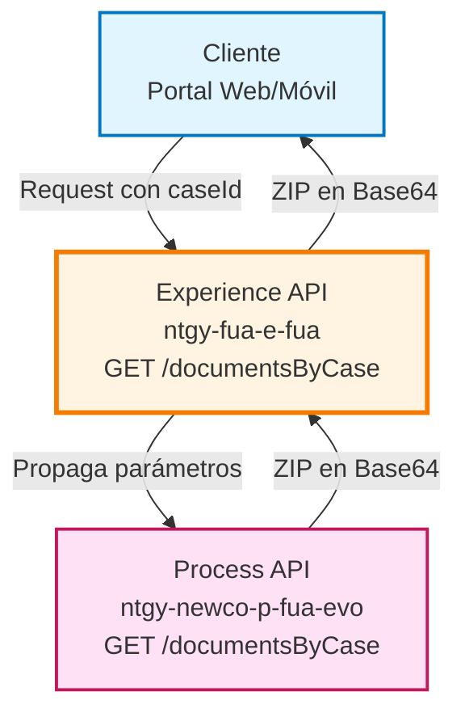
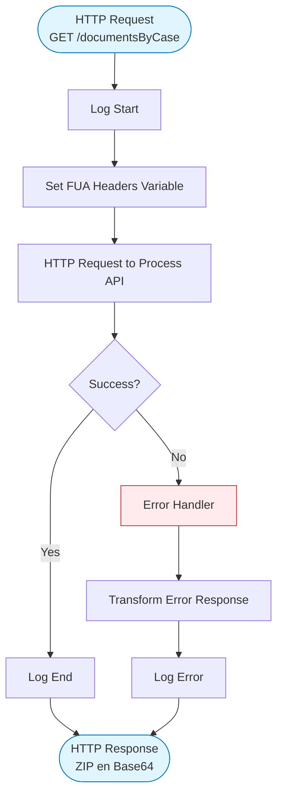
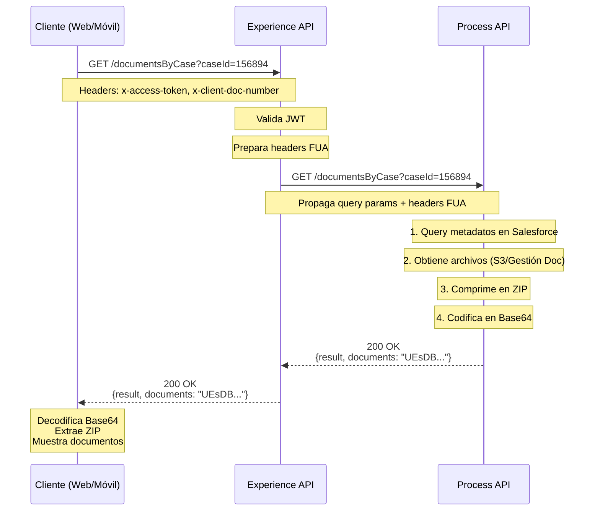
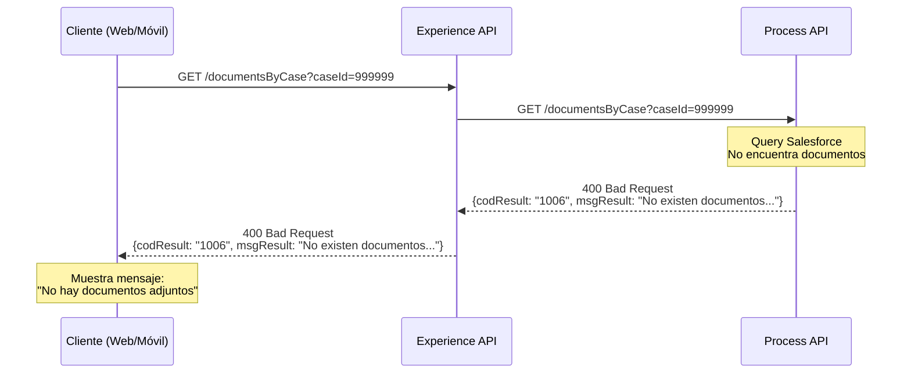
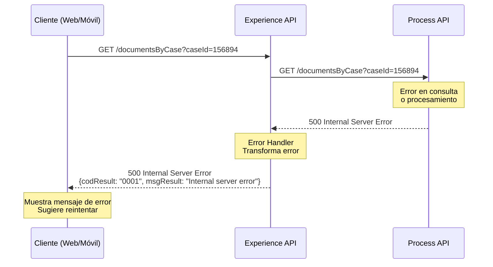

# GET /documentsByCase

## 📌 Descripción General

### Propósito del Endpoint

Este endpoint permite obtener todos los documentos adjuntos a una gestión (caso) específica en formato ZIP. Los documentos se devuelven codificados en Base64 para facilitar su transporte a través de JSON.

### Tipo de API

**Capa:** Experience API (API-Led Connectivity)

**Función:** Punto de entrada para canales web y móvil que necesitan acceder a documentos de gestiones

### Patrón de Integración

**Tipo:** Pass-Through

**Descripción:** Este Experience API actúa como un pass-through completo, propagando la petición directamente al Process API sin realizar transformaciones. Propaga los query parameters y headers FUA estándar necesarios para la autenticación y trazabilidad.

### Arquitectura API-Led Connectivity



---

## 💼 Propósito del Negocio

### Casos de Uso Principales

1. **Descarga de Documentos de Gestión desde Portal Web**
   - Cliente accede a su área privada
   - Consulta el detalle de una gestión (consulta, petición, reclamación)
   - Descarga todos los documentos adjuntos en un solo archivo ZIP

2. **Consulta de Documentos desde Aplicación Móvil**
   - Cliente visualiza sus gestiones activas
   - Selecciona una gestión específica
   - Descarga documentos adjuntos para revisión offline

3. **Acceso de Agentes a Documentación de Casos**
   - Agente de atención al cliente consulta caso
   - Necesita revisar documentación adjunta
   - Descarga ZIP con todos los documentos para análisis

### 📱 Canal y Audiencia

#### Canal de Consumo

**Canal:** Web y Mobile

**Características del Canal:**
- **Plataforma**: Portal web FUA y aplicaciones móviles iOS/Android
- **Dispositivos**: Navegadores modernos, smartphones, tablets
- **Conectividad**: Requiere conexión estable debido al tamaño de archivos
- **Experiencia de Usuario**: Descarga directa de archivo ZIP

#### Audiencia Objetivo

**Usuarios Finales:**
- **Clientes Residenciales**: Necesitan acceder a documentación de sus gestiones
- **Clientes Empresariales**: Requieren documentación para auditorías y registros
- **Agentes de Atención**: Necesitan revisar documentación para resolver casos

**Contexto de Uso:**
- **Seguimiento de Gestiones**: Cliente revisa estado y documentación de sus solicitudes
- **Resolución de Casos**: Agente necesita documentación completa para resolver incidencias
- **Auditoría y Compliance**: Cliente empresarial descarga documentación para registros

#### Adaptaciones del Canal

**Optimizaciones Aplicadas:**
- **Formato ZIP**: Compresión de múltiples archivos para reducir tamaño de descarga
- **Codificación Base64**: Permite transporte de binarios a través de JSON
- **Timeout Extendido**: 60 segundos para permitir procesamiento de archivos grandes
- **Headers FUA**: Propagación de headers de autenticación y trazabilidad

### 🔗 Endpoints Dependientes

Este Experience API consume el siguiente Process API:

| Process API | Endpoint | Método | Propósito |
|-------------|----------|--------|-----------|
| `ntgy-newco-p-fua-evo` | `/documentsByCase` | GET | Obtención de documentos adjuntos a una gestión en formato ZIP codificado en Base64 |

**Nota:** El Process API se encarga de consultar metadatos en Salesforce, obtener archivos de múltiples fuentes (S3, Gestión Documental), comprimirlos en ZIP y codificarlos en Base64.

### Contexto Empresarial

- **Dominio:** Gestión de Casos y Documentación
- **Sector:** Energía - Utilities
- **División:** Naturgy España - FUA (Frontal Único de Atención)
- **Canal:** Multi-canal (Web, Móvil)

### Stakeholders

- **Clientes Finales**: Necesitan acceso a documentación de sus gestiones
- **Agentes de Atención**: Requieren documentación para resolver casos
- **Equipo de Compliance**: Necesitan trazabilidad de documentación

### Valor de Negocio

- **Autoservicio**: Cliente puede descargar documentación sin llamar al call center
- **Eficiencia Operativa**: Agentes acceden rápidamente a documentación completa
- **Transparencia**: Cliente tiene acceso completo a documentación de sus gestiones
- **Reducción de Costes**: Menos llamadas al call center por solicitud de documentos

---

## 🔧 Especificación Técnica

### URLs por Ambiente

| Ambiente | URL Base | URL Completa |
|----------|----------|--------------|
| **Local** | `http://localhost:8081` | `http://localhost:8081/fua/api/documentsByCase?caseId=156894` |
| **Development** | `https://e-fua-dev.de-c1.cloudhub.io` | `https://e-fua-dev.de-c1.cloudhub.io/fua/api/documentsByCase?caseId=156894` |
| **Production** | `https://e-fua-pro.de-c1.cloudhub.io` | `https://e-fua-pro.de-c1.cloudhub.io/fua/api/documentsByCase?caseId=156894` |

### Método HTTP

```
GET /fua/api/documentsByCase
```

### 🎯 Consideraciones del Canal

#### Limitaciones del Canal

| Aspecto | Limitación | Razón |
|---------|------------|-------|
| **Timeout** | 60 segundos | Procesamiento de múltiples archivos y compresión ZIP |
| **Tamaño de Respuesta** | Variable (depende de documentos) | ZIP codificado en Base64 puede ser grande |
| **Rate Limiting** | Según políticas API Manager | Protección del servicio |

#### Campos Específicos del Canal

**Campos Propagados por el Experience API:**

| Campo | Tipo | Descripción | Origen |
|-------|------|-------------|--------|
| `caseId` | Query Param | ID del caso | Cliente |
| `x-client-id` | Header | ID del cliente | Headers FUA |
| `x-client-doc-number` | Header | Documento del cliente | Headers FUA |
| `x-interaction-id` | Header | ID de interacción | Headers FUA |
| `x-access-token` | Header | Token de acceso | Headers FUA |
| `x-language` | Header | Idioma | Headers FUA |
| `x-trading-company` | Header | Comercializadora | Headers FUA |
| `x-user-id` | Header | ID de usuario | Headers FUA |
| `x-client-code` | Header | Código de cliente | Headers FUA |

### Parámetros de Entrada

#### Query Parameters

| Parámetro | Tipo | Requerido | Descripción | Ejemplo |
|-----------|------|-----------|-------------|---------|
| `caseId` | string | ✅ Sí | Identificador único del caso/gestión | `"156894"` |

#### Headers

| Header | Tipo | Requerido | Descripción |
|--------|------|-----------|-------------|
| `x-client-id` | string | ⚠️ Condicional | ID del cliente en el sistema |
| `x-client-doc-number` | string | ✅ Sí | Número de documento del cliente |
| `x-interaction-id` | string | ❌ No | ID de interacción para trazabilidad |
| `x-access-token` | string | ✅ Sí | Token de autenticación OAuth 2.0 |
| `x-language` | string | ❌ No | Código de idioma (es, en, ca) |
| `x-trading-company` | string | ⚠️ Condicional | Comercializadora (imp/newco) |
| `x-user-id` | string | ⚠️ Condicional | ID de usuario |
| `x-client-code` | string | ⚠️ Condicional | Código de cliente |

### Respuestas

#### Respuesta Exitosa (200 OK)

```json
{
  "result": {
    "codResult": "0000",
    "msgResult": "No hay error"
  },
  "documents": "UEsDBBQACAgIAAAAIQAAAAAAAAAAAAAAAA..." 
}
```

**Campos de Respuesta:**

| Campo | Tipo | Descripción |
|-------|------|-------------|
| `result.codResult` | string | Código de resultado (`"0000"` = éxito) |
| `result.msgResult` | string | Mensaje descriptivo del resultado |
| `documents` | string | Archivo ZIP codificado en Base64 |

**Nota:** El campo `documents` contiene un archivo ZIP en Base64 que incluye todos los documentos adjuntos al caso.

#### Respuesta Sin Documentos (400 Bad Request)

```json
{
  "result": {
    "codResult": "1006",
    "msgResult": "No existen documentos adjuntos para la Gestión"
  }
}
```

#### Respuesta de Error (500 Internal Server Error)

```json
{
  "result": {
    "codResult": "0001",
    "msgResult": "Internal server error"
  }
}
```

**Códigos de Error:**

| Código | Descripción | HTTP Status |
|--------|-------------|-------------|
| `0000` | Operación exitosa | 200 |
| `1006` | No existen documentos adjuntos | 400 |
| `0001` | Error interno del servidor | 500 |

### Autenticación

- **Tipo:** OAuth 2.0
- **Header:** `x-access-token`
- **Validación:** JWT validation en el flow principal

### Timeouts

| Tipo | Valor | Razón |
|------|-------|-------|
| **Request Timeout** | 60 segundos | Procesamiento de múltiples archivos, compresión ZIP y codificación Base64 |
| **Connection Timeout** | 60 segundos | Optimizado para operaciones de descarga de archivos |

---

## 🏗️ Implementación Técnica

### Arquitectura del Flow



### Transformaciones de Canal

**⚠️ Este Experience API NO transforma la respuesta del Process API.**

Es un **pass-through completo** que:
1. Recibe el query parameter `caseId`
2. Propaga headers FUA estándar
3. Llama al Process API
4. Devuelve la respuesta sin modificaciones

Para el schema completo y detalles de procesamiento, consultar:
📖 **Process API: `ntgy-newco-p-fua-evo` endpoint `/documentsByCase`**

### Implementación del Flow

#### Flow Principal

**Archivo:** `src/main/mule/e-fua.xml`

```xml
<flow name="get:\documentsByCase:e-fua-config">
    <flow-ref doc:name="get-documents-by-case" 
              doc:id="56912e34-3f9e-44c8-a200-c79964d5bdc2" 
              name="get-documents-by-case" />
</flow>
```

#### Subflow de Implementación

**Archivo:** `src/main/mule/implementation/get-documents-by-case.xml`

```xml
<flow name="get-documents-by-case">
    <http:request method="GET" 
                  doc:name="Newco Get Documents By Case Request" 
                  config-ref="HTTP_FUA_PROCESS_NEWCO_EVO" 
                  path="/documentsByCase">
        <http:query-params>
            #[output application/java
            ---
            attributes.queryParams ++ vars.fuaHeaders]
        </http:query-params>
    </http:request>
    
    <error-handler>
        <on-error-propagate enableNotifications="true" 
                           logException="true" 
                           doc:name="On Error Propagate">
            <ee:transform doc:name="Set Error Message">
                <ee:message>
                    <ee:set-payload>
                        %dw 2.0
                        output application/json
                        ---
                        {
                            "result": {
                                "codResult": "0001",
                                "msgResult": error.description as String replace /\"/ with("")
                            }
                        }
                    </ee:set-payload>
                </ee:message>
            </ee:transform>
            <logger level="ERROR" doc:name="Error" message='...' />
        </on-error-propagate>
    </error-handler>
</flow>
```

### Configuración del Conector HTTP

**Archivo:** `src/main/mule/global.xml`

```xml
<http:request-config name="HTTP_FUA_PROCESS_NEWCO_EVO" 
                     basePath="/api" 
                     responseTimeout="${newco-p-fua-evo.timeout}">
    <http:request-connection 
        host="${newco-p-fua-evo.host}" 
        port="${newco-p-fua-evo.port}" 
        connectionIdleTimeout="${newco-p-fua-evo.timeout}"/>
</http:request-config>
```

**Archivo:** `src/main/resources/e-fua-pro-config.yaml`

```yaml
newco-p-fua-evo:
  host: "mule-worker-internal-ntgy-newco-p-fua-evo.de-c1.cloudhub.io"
  port: "8091"
  timeout: "60000"
```

### Propagación de Headers FUA

El Experience API propaga automáticamente los headers FUA necesarios para autenticación y trazabilidad:

```dataweave
attributes.queryParams ++ vars.fuaHeaders
```

**Headers FUA incluidos:**
- `x-interaction-id`: Trazabilidad de la petición
- `x-user-id`: Identificador del usuario
- `x-client-id`: Identificador del cliente
- `x-client-doc-number`: Documento del cliente
- `x-client-code`: Código de cliente
- `x-origin`: Origen de la petición
- `x-user-role`: Rol del usuario
- `x-agent-mail`: Email del agente (si aplica)
- `x-language`: Idioma preferido
- `x-contact-id`: ID de contacto

### Patrones de Diseño

**Patrón:** Pass-Through con Propagación de Headers

**Justificación:** 
- El Experience API no necesita transformar los datos
- El Process API ya proporciona la respuesta en el formato correcto
- La propagación de headers FUA asegura autenticación y trazabilidad
- Simplifica el mantenimiento al centralizar la lógica en el Process API

### Diagramas de Secuencia

#### 1. Flujo Normal de Éxito



#### 2. Flujo Sin Documentos Adjuntos



#### 3. Flujo con Error Técnico



### Contexto del Process API

El Process API `ntgy-newco-p-fua-evo` realiza las siguientes operaciones:

1. **Consulta Metadatos**: Query SQL a PostgreSQL-Salesforce para obtener información de documentos adjuntos
2. **Obtención de Archivos**: Descarga archivos desde múltiples fuentes (AWS S3 o Sistema de Gestión Documental)
3. **Compresión**: Agrupa todos los archivos en un único archivo ZIP
4. **Codificación**: Convierte el ZIP a Base64 para transporte JSON
5. **Validación**: Verifica existencia de documentos y retorna código `1006` si no hay adjuntos

**Nota:** Para detalles completos de implementación del Process API, consultar su documentación específica.

### Manejo de Errores

#### Error Handler del Experience API

```dataweave
{
    "result": {
        "codResult": "0001",
        "msgResult": error.description as String replace /\"/ with("")
    }
}
```

**Estrategia:**
- Captura cualquier error del Process API
- Transforma a formato estándar con código `0001`
- Registra error en logs con nivel ERROR
- Propaga error al cliente con HTTP 500

#### Códigos de Error Propagados

| Código | Origen | Descripción |
|--------|--------|-------------|
| `0000` | Process API | Éxito - documentos obtenidos |
| `1006` | Process API | No existen documentos adjuntos |
| `0001` | Experience API | Error genérico capturado |

---

## 💻 Ejemplos de Uso

### Ejemplo 1: Llamada Exitosa desde Portal Web

#### cURL

```bash
curl -X GET "https://e-fua-pro.de-c1.cloudhub.io/fua/api/documentsByCase?caseId=156894" \
  -H "Content-Type: application/json" \
  -H "x-access-token: eyJhbGciOiJIUzI1NiIsInR5cCI6IkpXVCJ9..." \
  -H "x-client-doc-number: 12345678A" \
  -H "x-client-id: CLI123456" \
  -H "x-language: es"
```

#### Respuesta (200 OK)

```json
{
  "result": {
    "codResult": "0000",
    "msgResult": "No hay error"
  },
  "documents": "UEsDBBQACAgIAAAAIQAAAAAAAAAAAAAAAAkAAABkb2N1bWVudDEucGRmjVRdb9owFH0vlf+B8g6xnQQIqKq0bqt4qKZJ0/Y0GXKBqIkz26Hsv+/aBqYWtT0Qy/fcc+65Hz7Pzs/Ozs7Ozs7Ozs7Ozs7Ozs7Ozs7Ozs7Ozs7Ozs7Ozs7Ozs7Ozs7Ozs7Ozs7Ozs7Ozs7Ozs7Ozs7Ozs7Ozs7Ozs7Ozs7Ozs7Ozs7Ozs7Ozs7Ozs7Ozs7Ozs7Ozs7Ozs7Ozs7Ozs7Ozs7Ozs7Ozs7Ozs7Ozs7Ozs7Ozs7Ozs7Ozs7Ozs7Ozs7Ozs7Ozs7Ozs7Ozs7Ozs7Ozs7Ozs7Ozs7Ozs7Ozs7Ozs7Ozs7Ozs7Ozs7Ozs7Ozs7Ozs7Ozs7Ozs7Ozs7Ozs7Ozs7Ozs7Ozs7Ozs7Ozs7Ozs7Ozs7Ozs7Ozs7Ozs7Ozs7Ozs7Ozs7Ozs7Ozs7Ozs7Ozs7Ozs7Ozs7Ozs7Ozs7Ozs7Ozs7Ozs7Ozs7Ozs7Ozs7Ozs7Ozs7Ozs7Ozs7Ozs7Ozs7Ozs7Ozs7Ozs7Ozs7Ozs7Ozs7Ozs7Ozs7Ozs7Ozs7Ozs7Ozs7Ozs7Ozs7Ozs7Ozs7Ozs7Ozs7Ozs7Ozs7Ozs7Ozs7Ozs7Ozs7Ozs7Ozs7Ozs7Ozs7Ozs7Ozs7Ozs7Ozs7Ozs7Ozs7Ozs7Ozs7Ozs7Ozs7Ozs7Ozs7Ozs7Ozs7Ozs7Ozs7Ozs7Ozs7Ozs7Ozs7Ozs7Ozs7Ozs7Ozs7Ozs7Ozs7Ozs7Ozs7Ozs7Ozs7Ozs7Ozs7Ozs7Ozs7Ozs7Ozs7Ozs7Ozs7Ozs7Ozs7Ozs7Ozs7Ozs7Ozs7Ozs7Ozs7Ozs7Ozs7Ozs7Ozs7Ozs7Ozs7Ozs7Ozs7Ozs7Ozs7Ozs7Ozs7Ozs7Ozs7Ozs7Ozs7Ozs7Ozs7Ozs7Ozs7Ozs7Ozs7Ozs7Ozs7Ozs7Ozs7Ozs7Ozs7Ozs7Ozs7Ozs7Ozs7Ozs7Ozs7Ozs7Ozs7Ozs7Ozs7Ozs7Ozs7Ozs7Ozs7Ozs7Ozs7Ozs7Ozs7Ozs7Ozs7Ozs7Ozs7Ozs7Ozs7Ozs7Ozs7Ozs7Ozs7Ozs7Ozs7Ozs7Ozs7Ozs7Ozs7Ozs7Ozs7Ozs7Ozs7Ozs7Ozs7Ozs7Ozs7Ozs7Ozs7Ozs7Ozs7Ozs7Ozs7Ozs7Ozs7Ozs7Ozs7Ozs7Ozs7Ozs7Ozs7Ozs7Ozs7Ozs7Ozs7Ozs7Ozs7Ozs7Ozs7Ozs7Ozs7Ozs7Ozs7Ozs7Ozs7Ozs7Ozs7Ozs7Ozs7Ozs7Ozs7Ozs7Ozs7Ozs7Ozs7Ozs7Ozs7Ozs7Ozs7Ozs7Ozs7Ozs7Ozs7Ozs7Ozs7Ozs7Ozs7Ozs7Ozs7Ozs7Ozs7Ozs7Ozs7Ozs7Ozs7Ozs7Ozs7Ozs7Ozs7Ozs7Ozs7Ozs7Ozs7Ozs7Ozs7Ozs7Ozs7Ozs7Ozs7Ozs7Ozs7Ozs7Ozs7Ozs7Ozs7Ozs7Ozs7Ozs7Ozs7Ozs7Ozs7Ozs7Ozs7Ozs7Ozs7Ozs7Ozs7Ozs7Ozs7Ozs7Ozs7Ozs7Ozs7Ozs7Ozs7Ozs7Ozs7Ozs7Ozs7Ozs7Ozs7Ozs7Ozs7Ozs7Ozs7Ozs7Ozs7Ozs7Ozs7Ozs7Ozs7Ozs7Ozs7Ozs7Ozs7Ozs7Ozs7Ozs7Ozs7Ozs7Ozs7Ozs7Ozs7Ozs7Ozs7Ozs7Ozs7Ozs7Ozs7Ozs7Ozs7Ozs7Ozs7Ozs7Ozs7Ozs7Ozs7Ozs7Ozs7Ozs7Ozs7Ozs7Ozs7Ozs7Ozs7Ozs7Ozs7Ozs7Ozs7Ozs7Ozs7Ozs7Ozs7Ozs7Ozs7Ozs7Ozs7Ozs7Ozs7Ozs7Ozs7Ozs7Ozs7Ozs7Ozs7Ozs7Ozs7Ozs7Ozs7Ozs7Ozs7Ozs7Ozs7Ozs7Ozs7Ozs7Ozs7Ozs7Ozs7Ozs7Ozs7Ozs7Ozs7Ozs7Ozs7Ozs7Ozs7Ozs7Ozs7Ozs7Ozs7Ozs7Ozs7Ozs7Ozs7Ozs7Ozs7Ozs7Ozs7Ozs7Ozs7Ozs7Ozs7Ozs7Ozs7Ozs7Ozs7Ozs7Ozs7Ozs7Ozs7Ozs7Ozs7Ozs7Ozs7Ozs7Ozs7Ozs7Ozs7Ozs7Ozs7Ozs7Ozs7Ozs7Ozs7Ozs7Ozs7Ozs7Ozs7Ozs7Ozs7Ozs7Ozs7Ozs7Ozs7Ozs7Ozs7Ozs7Ozs7Ozs7Ozs7Ozs7Ozs7Ozs7Ozs7Ozs7Ozs7Ozs7Ozs7Ozs7Ozs7Ozs7Ozs7Ozs7Ozs7Ozs7Ozs7Ozs7Ozs7Ozs7Ozs7Ozs7Ozs7Ozs7Ozs7Ozs7Ozs7Ozs7Ozs7Ozs7Ozs7Ozs7Ozs7Ozs7Ozs7Ozs7Ozs7Ozs7Ozs7Ozs7Ozs7Ozs7Ozs7Ozs7Ozs7Ozs7