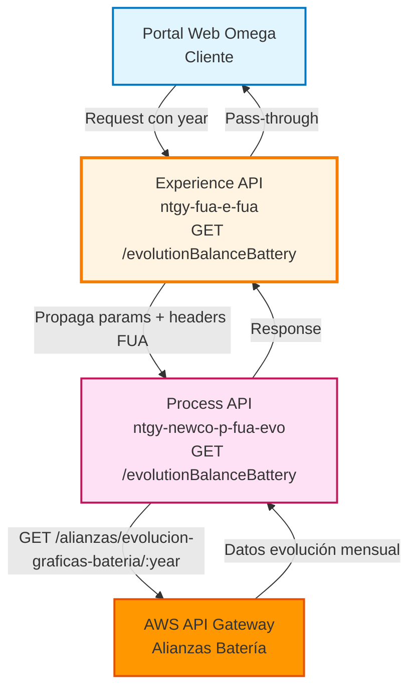
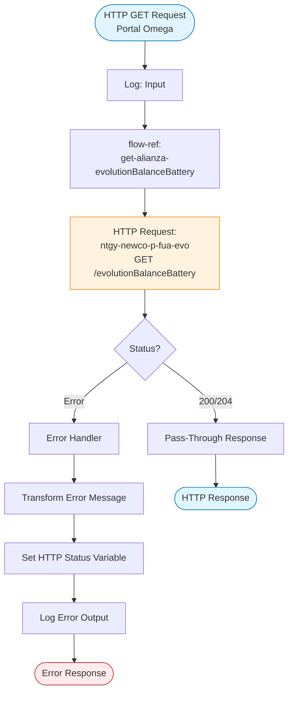
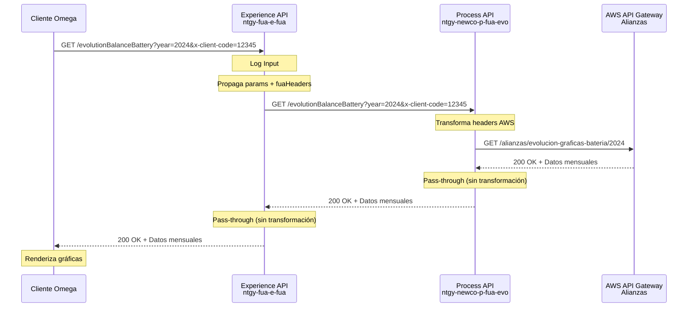
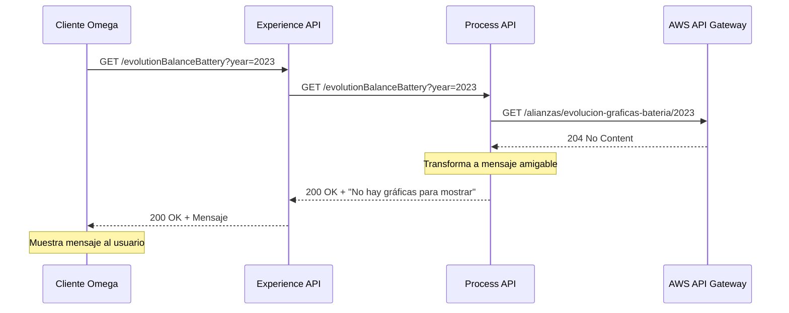
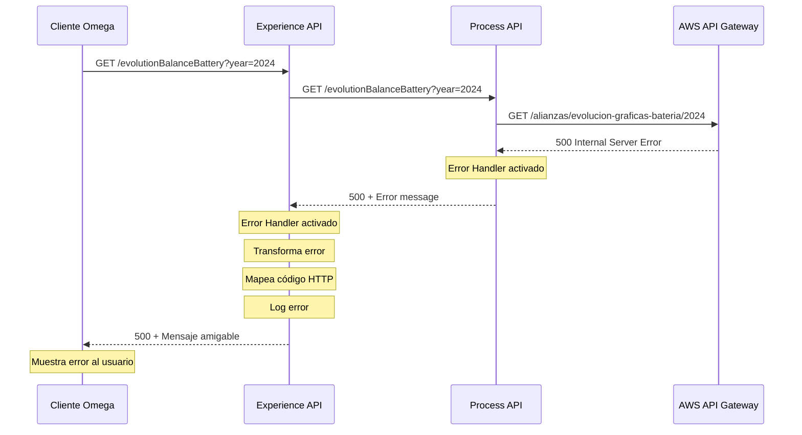

# GET /evolutionBalanceBattery

## 📌 Descripción General

### Propósito del Endpoint

Este endpoint consulta la evolución mensual del saldo generado en el programa de Batería (alianzas energéticas), proporcionando datos históricos para la generación de gráficas mensuales en la plataforma Omega. Permite a los clientes visualizar cómo ha evolucionado su saldo de batería a lo largo del año.

### Tipo de API

**Capa:** Experience API (API-Led Connectivity)

**Función:** Orquestación de consulta de datos de alianzas para canal web

### Patrón de Integración

**Tipo:** Pass-Through con Manejo de Errores

**Descripción:** El endpoint actúa como pass-through hacia el Process API, propagando los query parameters y agregando headers de contexto FUA. No transforma la respuesta exitosa del backend, pero implementa manejo de errores específico con transformación de códigos HTTP.

### Arquitectura API-Led Connectivity



---

## 💼 Propósito del Negocio

### Casos de Uso Principales

1. **Visualización de Evolución de Saldo**
   - Cliente accede a su área personal en Omega
   - Consulta la evolución mensual de su saldo de batería
   - Visualiza gráficas de tendencia del saldo acumulado

2. **Análisis de Consumo y Ahorro**
   - Cliente revisa el histórico de generación de saldo
   - Identifica patrones de consumo y ahorro
   - Toma decisiones sobre uso de energía

3. **Seguimiento de Programa de Alianzas**
   - Cliente monitorea el rendimiento de su participación en el programa
   - Verifica el cumplimiento de objetivos de ahorro
   - Planifica el uso futuro del saldo acumulado

### 📱 Canal y Audiencia

#### Canal de Consumo

**Canal:** Web

**Características del Canal:**
- **Plataforma**: Portal web Omega (autoservicio de clientes)
- **Dispositivos**: Desktop y tablets con navegadores modernos
- **Conectividad**: Conexión estable requerida para carga de gráficas
- **Experiencia de Usuario**: Visualización de datos históricos con gráficas interactivas

#### Audiencia Objetivo

**Usuarios Finales:**
- **Clientes Residenciales**: Clientes Newco participantes en el programa de Batería que desean visualizar su evolución de saldo
- **Clientes Business**: Empresas que participan en programas de eficiencia energética

**Contexto de Uso:**
- **Consulta Periódica**: Cliente revisa mensualmente su evolución de saldo
- **Planificación Energética**: Cliente analiza tendencias para planificar consumo futuro
- **Verificación de Beneficios**: Cliente valida los beneficios obtenidos del programa

#### Adaptaciones del Canal

**Optimizaciones Aplicadas:**
- **Pass-Through de Datos**: No se simplifica la respuesta, se envía completa para renderizado de gráficas
- **Formato de Respuesta**: JSON optimizado para librerías de gráficas (Chart.js, D3.js)
- **Manejo de Errores**: Transformación de errores técnicos a mensajes amigables para el usuario
- **Timeout Extendido**: 60 segundos para permitir procesamiento de datos históricos

### 🔗 Endpoints Dependientes

Este Experience API consume el siguiente Process API:

| Process API | Endpoint | Método | Propósito |
|-------------|----------|--------|-----------|
| `ntgy-newco-p-fua-evo` | `/evolutionBalanceBattery` | GET | Orquesta la consulta de evolución del saldo de batería desde AWS API Gateway |

**Backend Final:**
- **Sistema**: AWS API Gateway (Alianzas)
- **Endpoint**: `GET /alianzas/evolucion-graficas-bateria/{year}`
- **Propósito**: Consulta datos históricos mensuales del saldo de batería

### Contexto Empresarial

- **Dominio:** Alianzas Energéticas - Programa Batería
- **Sector:** Energía - Utilities
- **División:** Naturgy España - NewCo
- **Canal:** Web (Portal Omega)

### Stakeholders

- **Clientes Finales**: Necesitan visualizar la evolución de su saldo de batería para tomar decisiones de consumo
- **Equipo de Producto Omega**: Requiere datos históricos para renderizar gráficas mensuales en el portal
- **Equipo de Alianzas**: Monitorea el uso y adopción del programa de batería

### Valor de Negocio

- **Transparencia**: Proporciona visibilidad completa del saldo acumulado en el programa de batería
- **Engagement**: Fomenta la participación activa en programas de eficiencia energética
- **Retención**: Mejora la satisfacción del cliente al mostrar beneficios tangibles del programa
- **Autoservicio**: Reduce consultas al call center sobre estado de saldo de batería

---

## 🔧 Especificación Técnica

### URLs por Ambiente

| Ambiente | URL Base | URL Completa |
|----------|----------|--------------|
| **Local** | `http://localhost:8081` | `http://localhost:8081/fua/api/evolutionBalanceBattery` |
| **Development** | `https://ntgy-fua-e-fua-dev.de-c1.cloudhub.io` | `https://ntgy-fua-e-fua-dev.de-c1.cloudhub.io/fua/api/evolutionBalanceBattery` |
| **UAT** | `https://ntgy-fua-e-fua-uat.de-c1.cloudhub.io` | `https://ntgy-fua-e-fua-uat.de-c1.cloudhub.io/fua/api/evolutionBalanceBattery` |
| **Production** | `https://ntgy-fua-e-fua-pro.de-c1.cloudhub.io` | `https://ntgy-fua-e-fua-pro.de-c1.cloudhub.io/fua/api/evolutionBalanceBattery` |

### Método HTTP

```
GET /fua/api/evolutionBalanceBattery
```

### 🎯 Consideraciones del Canal

#### Limitaciones del Canal

| Aspecto | Limitación | Razón |
|---------|------------|-------|
| **Timeout** | 60 segundos | Procesamiento de datos históricos anuales puede requerir tiempo |
| **Tamaño de Respuesta** | Variable (datos mensuales) | Depende del año consultado (12 meses de datos) |
| **Rate Limiting** | Según política API Gateway | Protección contra abuso |
| **Caché** | No implementado | Datos pueden cambiar frecuentemente |

#### Campos Específicos del Canal

**Campos Propagados:**
- Todos los query parameters del cliente se propagan al Process API
- Headers de contexto FUA (`vars.fuaHeaders`) se añaden automáticamente

**Sin Transformación:**
- Este endpoint NO transforma la respuesta del Process API
- La respuesta se pasa directamente al cliente para renderizado de gráficas

### Parámetros de Entrada

#### Query Parameters

| Parámetro | Tipo | Requerido | Descripción | Ejemplo |
|-----------|------|-----------|-------------|---------|
| `year` | String | ✅ Sí | Año para consultar la evolución (formato YYYY) | `"2024"` |
| `x-client-code` | String | ✅ Sí | Código de cliente para identificación | `"12345678"` |

**Nota:** Los query parameters se propagan automáticamente al Process API junto con los headers FUA.

#### Headers

| Header | Tipo | Requerido | Descripción |
|--------|------|-----------|-------------|
| `Content-Type` | String | ✅ Sí | Tipo de contenido: `application/json` |
| `client_id` | String | ✅ Sí | Client ID de API Manager |

**Headers Internos (Añadidos por el Flow):**
- `vars.fuaHeaders`: Headers de contexto FUA propagados al Process API

### Respuestas

#### 200 OK - Consulta Exitosa

**Descripción:** Datos de evolución mensual del saldo de batería obtenidos correctamente.

**Estructura de Respuesta:**

⚠️ **Este Experience API NO transforma la respuesta del Process API.**

Para el schema completo de la respuesta, consultar:
📖 **Process API: `ntgy-newco-p-fua-evo` endpoint `/evolutionBalanceBattery`**

**Ejemplo de Respuesta (del Process API):**

```json
{
  "year": 2026,
  "clientCode": "CLI001",
  "monthlyData": [
    {
      "month": 1,
      "balance": 150.50,
      "generation": 200.00,
      "consumption": 49.50
    },
    {
      "month": 2,
      "balance": 180.25,
      "generation": 220.00,
      "consumption": 39.75
    }
  ]
}
```

**Nota:** La estructura proviene directamente de AWS Lambda sin transformación. Los campos disponibles son: `year`, `clientCode`, `monthlyData` (con `month`, `balance`, `generation`, `consumption`).

#### 204 No Content - Sin Datos

**Descripción:** No hay gráficas disponibles para el año consultado.

**Respuesta Transformada (por Process API):**

```json
{
  "result": {
    "codResult": "0000",
    "msgResult": "No hay gráficas para mostrar"
  }
}
```

#### 400 Bad Request - Error de Validación

**Descripción:** Parámetros de entrada inválidos o faltantes.

**Estructura de Error:**

```json
{
  "result": {
    "codResult": "0001",
    "msgResult": "Error: Parámetro 'year' es requerido"
  }
}
```

#### 401 Unauthorized - Error de Autenticación

**Descripción:** Credenciales inválidas o token expirado.

```json
{
  "result": {
    "codResult": "0001",
    "msgResult": "Error de autenticación: Token inválido o expirado"
  }
}
```

#### 403 Forbidden - Sin Permisos

**Descripción:** Cliente no tiene acceso al programa de batería.

```json
{
  "result": {
    "codResult": "0001",
    "msgResult": "Acceso denegado: Cliente no participa en programa de batería"
  }
}
```

#### 404 Not Found - Recurso No Encontrado

**Descripción:** Cliente o año no encontrado en el sistema.

```json
{
  "result": {
    "codResult": "0001",
    "msgResult": "Cliente no encontrado en el sistema"
  }
}
```

#### 500 Internal Server Error - Error del Servidor

**Descripción:** Error interno del servidor o del backend AWS.

```json
{
  "result": {
    "codResult": "0001",
    "msgResult": "Error interno del servidor"
  }
}
```

### Autenticación

- **Tipo:** OAuth 2.0 con Client Credentials
- **Header:** `client_id` en headers de la petición
- **Scope:** Acceso a datos de alianzas del cliente autenticado

### Timeouts

| Tipo | Valor | Razón |
|------|-------|-------|
| **Request Timeout** | 60 segundos | Procesamiento de datos históricos anuales en AWS |
| **Connection Idle Timeout** | 60 segundos | Mantener conexión para respuestas grandes |

---

## 🏗️ Implementación Técnica

### Arquitectura del Flow



### Flujo de Datos Detallado

#### 1. Recepción de Request

**Archivo:** `alliances.xml`
**Flow:** `get:\evolutionBalanceBattery:e-fua-config`

```xml
<flow name="get:\evolutionBalanceBattery:e-fua-config">
    <flow-ref name="get-alianza-evolutionBalanceBattery"/>
</flow>
```

#### 2. Orquestación Principal

**Archivo:** `alliances.xml`
**Flow:** `get-alianza-evolutionBalanceBattery`

**Componentes:**

1. **HTTP Request al Process API:**
   - **Config:** `HTTP_FUA_PROCESS_NEWCO_EVO`
   - **Método:** GET
   - **Path:** `/evolutionBalanceBattery`
   - **Timeout:** `${newco-p-fua-evo.timeout}` (60000 ms)

2. **Propagación de Query Parameters:**
   ```dataweave
   output application/java
   ---
   attributes.queryParams ++ vars.fuaHeaders
   ```
   - Combina query params del cliente con headers FUA
   - Propaga `year` y `x-client-code` al Process API

#### 3. Manejo de Errores

**Error Handler:** `on-error-propagate`

**Transformación de Error:**

```dataweave
%dw 2.0
output application/json
---
{
    "result": {
        "codResult": "0001",
        "msgResult": if(error.errorMessage.payload.result.msgResult != null) 
                        error.errorMessage.payload.result.msgResult 
                     else 
                        error.description
    }
}
```

**Mapeo de Códigos HTTP:**

```dataweave
%dw 2.0
output application/java
---
if((error.errorMessage.payload.result.msgResult contains ("400")) or (error.description contains ("400")))
    400
else if((error.errorMessage.payload.result.msgResult contains ("401")) or (error.description contains ("401")))
    401
else if((error.errorMessage.payload.result.msgResult contains ("403")) or (error.description contains ("403")))
    403
else if((error.errorMessage.payload.result.msgResult contains ("404")) or (error.description contains ("404")))
    404
else
    500
```

### Transformaciones de Canal

⚠️ **Este Experience API NO transforma la respuesta exitosa del Process API.**

**Razón:** Los datos de evolución mensual se envían directamente al frontend para renderizado de gráficas sin modificación.

**Única Transformación:** Manejo de errores para convertir errores técnicos en mensajes amigables.

### Configuración de Conectores

#### HTTP Request Configuration

**Nombre:** `HTTP_FUA_PROCESS_NEWCO_EVO`

**Configuración (global.xml):**

```xml
<http:request-config 
    name="HTTP_FUA_PROCESS_NEWCO_EVO" 
    basePath="/api" 
    responseTimeout="${newco-p-fua-evo.timeout}">
    <http:request-connection 
        host="${newco-p-fua-evo.host}" 
        port="${newco-p-fua-evo.port}" 
        connectionIdleTimeout="${newco-p-fua-evo.timeout}"/>
</http:request-config>
```

**Properties (e-fua-pro-config.yaml):**

```yaml
newco-p-fua-evo:
  host: "mule-worker-internal-ntgy-newco-p-fua-evo.de-c1.cloudhub.io"
  port: "8091"
  timeout: "60000"
```

### Patrones de Diseño

**Patrón:** Pass-Through con Error Handling

**Justificación:** 
- Los datos de evolución mensual no requieren transformación para el canal web
- El frontend (Omega) consume directamente la estructura del Process API
- Solo se transforman los errores para mejorar la experiencia del usuario

**Ventajas:**
- Menor latencia (sin transformación innecesaria)
- Menor complejidad de mantenimiento
- Consistencia de datos entre capas

### Diagramas de Secuencia

#### 1. Flujo Normal de Éxito



#### 2. Flujo con 204 No Content



#### 3. Flujo con Error Técnico



### Optimizaciones del Canal

#### 1. Pass-Through de Datos
- **Optimización:** No se transforma la respuesta exitosa
- **Beneficio:** Reduce latencia y complejidad
- **Uso:** Datos se envían directamente para renderizado de gráficas

#### 2. Timeout Extendido
- **Configuración:** 60 segundos
- **Razón:** Procesamiento de datos históricos anuales puede requerir tiempo
- **Beneficio:** Evita timeouts prematuros en consultas complejas

#### 3. Propagación de Headers
- **Mecanismo:** `attributes.queryParams ++ vars.fuaHeaders`
- **Beneficio:** Mantiene contexto de autenticación y trazabilidad
- **Uso:** Headers FUA se propagan automáticamente al Process API

### Manejo de Errores

#### Estrategia de Error Handling

**Nivel 1: Error Handler en Experience API**

```xml
<error-handler>
    <on-error-propagate enableNotifications="true" logException="true">
        <ee:transform doc:name="error message">
            <!-- Transformación de error -->
        </ee:transform>
        <logger level="INFO" message="Error output: #[payload]"/>
    </on-error-propagate>
</error-handler>
```

**Características:**
- Captura todos los errores del Process API
- Transforma errores técnicos a mensajes amigables
- Mapea códigos HTTP según el tipo de error
- Registra errores para troubleshooting

**Nivel 2: Propagación al Cliente**

- Errores se propagan con código HTTP apropiado
- Mensaje de error se extrae del payload o descripción
- Estructura consistente: `{ "result": { "codResult": "0001", "msgResult": "..." } }`

#### Códigos de Error

| Código HTTP | Origen | Acción |
|-------------|--------|--------|
| 400 | Validación de parámetros | Retornar mensaje de validación |
| 401 | Autenticación fallida | Retornar error de autenticación |
| 403 | Sin permisos | Retornar error de autorización |
| 404 | Recurso no encontrado | Retornar error de no encontrado |
| 500 | Error interno | Retornar error genérico |

---

## 💻 Ejemplos de Uso

### Ejemplo 1: Consulta Exitosa de Evolución Anual

#### cURL

```bash
curl -X GET "https://ntgy-fua-e-fua-pro.de-c1.cloudhub.io/fua/api/evolutionBalanceBattery?year=2024&x-client-code=12345678" \
  -H "Content-Type: application/json" \
  -H "client_id: YOUR_CLIENT_ID" \
  -H "Authorization: Bearer YOUR_ACCESS_TOKEN"
```

#### Respuesta (200 OK)

```json
{
  "year": 2024,
  "clientCode": "12345678",
  "monthlyData": [
    {
      "month": 1,
      "balance": 125.50,
      "generation": 180.00,
      "consumption": 54.50
    },
    {
      "month": 2,
      "balance": 98.30,
      "generation": 150.00,
      "consumption": 51.70
    },
    {
      "month": 3,
      "balance": 110.75,
      "generation": 165.00,
      "consumption": 54.25
    },
    {
      "month": 4,
      "balance": 95.20,
      "generation": 145.00,
      "consumption": 49.80
    },
    {
      "month": 5,
      "balance": 88.40,
      "generation": 135.00,
      "consumption": 46.60
    },
    {
      "month": 6,
      "balance": 102.60,
      "generation": 160.00,
      "consumption": 57.40
    }
  ]
}
```

### Ejemplo 2: Sin Datos Disponibles (204 transformado)

#### cURL

```bash
curl -X GET "https://ntgy-fua-e-fua-pro.de-c1.cloudhub.io/fua/api/evolutionBalanceBattery?year=2023&x-client-code=12345678" \
  -H "Content-Type: application/json" \
  -H "client_id: YOUR_CLIENT_ID" \
  -H "Authorization: Bearer YOUR_ACCESS_TOKEN"
```

#### Respuesta (200 OK)

```json
{
  "result": {
    "codResult": "0000",
    "msgResult": "No hay gráficas para mostrar"
  }
}
```

### Ejemplo 3: Error de Validación (400 Bad Request)

#### cURL

```bash
curl -X GET "https://ntgy-fua-e-fua-pro.de-c1.cloudhub.io/fua/api/evolutionBalanceBattery?x-client-code=12345678" \
  -H "Content-Type: application/json" \
  -H "client_id: YOUR_CLIENT_ID" \
  -H "Authorization: Bearer YOUR_ACCESS_TOKEN"
```

#### Respuesta (400 Bad Request)

```json
{
  "result": {
    "codResult": "0001",
    "msgResult": "Error: Parámetro 'year' es requerido"
  }
}
```

### Ejemplo 4: JavaScript (Frontend Web)

```javascript
// Función para obtener evolución del saldo de batería
async function getEvolutionBalanceBattery(year, clientCode, accessToken) {
  try {
    const response = await fetch(
      `https://ntgy-fua-e-fua-pro.de-c1.cloudhub.io/fua/api/evolutionBalanceBattery?year=${year}&x-client-code=${clientCode}`,
      {
        method: 'GET',
        headers: {
          'Content-Type': 'application/json',
          'client_id': 'YOUR_CLIENT_ID',
          'Authorization': `Bearer ${accessToken}`
        }
      }
    );

    if (!response.ok) {
      throw new Error(`HTTP error! status: ${response.status}`);
    }

const data = await response.json();
console.log(data);

// Procesar datos para gráficas
if (data.monthlyData && data.monthlyData.length > 0) {
  const months = data.monthlyData.map(item => `Mes ${item.month}`);
  const balances = data.monthlyData.map(item => item.balance);
  console.log('Meses:', months);
  console.log('Saldos:', balances);
} else if (data.result) {
  console.log(data.result.msgResult);
}
  } catch (error) {
    console.error('Error al obtener evolución de batería:', error);
    throw error;
  }
}

// Función para renderizar gráfica (ejemplo con Chart.js)
function renderBatteryChart(responseData) {
  const ctx = document.getElementById('batteryChart').getContext('2d');
  
  const monthNames = ['Ene', 'Feb', 'Mar', 'Abr', 'May', 'Jun', 'Jul', 'Ago', 'Sep', 'Oct', 'Nov', 'Dic'];
  const labels = responseData.monthlyData.map(item => monthNames[item.month - 1]);
  const balances = responseData.monthlyData.map(item => item.balance);
  const generation = responseData.monthlyData.map(item => item.generation);
  const consumption = responseData.monthlyData.map(item => item.consumption);
  
  new Chart(ctx, {
    type: 'line',
    data: {
      labels: labels,
      datasets: [
        {
          label: 'Saldo Mensual',
          data: balances,
          borderColor: 'rgb(75, 192, 192)',
          backgroundColor: 'rgba(75, 192, 192, 0.2)',
          tension: 0.1
        },
        {
          label: 'Generación',
          data: generation,
          borderColor: 'rgb(54, 162, 235)',
          backgroundColor: 'rgba(54, 162, 235, 0.2)',
          tension: 0.1
        },
        {
          label: 'Consumo',
          data: consumption,
          borderColor: 'rgb(255, 99, 132)',
          backgroundColor: 'rgba(255, 99, 132, 0.2)',
          tension: 0.1
        }
      ]
    },
    options: {
      responsive: true,
      plugins: {
        title: {
          display: true,
          text: `Evolución del Saldo de Batería ${responseData.year}`
        }
      },
      scales: {
        y: {
          beginAtZero: true,
          title: {
            display: true,
            text: 'Energía (kWh)'
          }
        }
      }
    }
  });
}

// Uso
getEvolutionBalanceBattery('2024', '12345678', 'your_access_token_here');
```

### Ejemplo 5: Python

```python
import requests
import json
from typing import Optional, Dict, List

def get_evolution_balance_battery(
    year: str,
    client_code: str,
    access_token: str,
    base_url: str = "https://ntgy-fua-e-fua-pro.de-c1.cloudhub.io"
) -> Optional[Dict]:
    """
    Consulta la evolución del saldo de batería para un año específico.
    
    Args:
        year: Año a consultar (formato YYYY)
        client_code: Código del cliente
        access_token: Token de acceso OAuth 2.0
        base_url: URL base del API
        
    Returns:
        Diccionario con los datos de evolución o None si hay error
    """
    url = f"{base_url}/fua/api/evolutionBalanceBattery"
    
    params = {
        'year': year,
        'x-client-code': client_code
    }
    
    headers = {
        'Content-Type': 'application/json',
        'client_id': 'YOUR_CLIENT_ID',
        'Authorization': f'Bearer {access_token}'
    }
    
    try:
        response = requests.get(url, params=params, headers=headers, timeout=65)
        response.raise_for_status()
        
        data = response.json()
        
        # Verificar si hay datos mensuales
        if 'monthlyData' in data and len(data['monthlyData']) > 0:
            print(f"✓ Datos obtenidos para año {data['year']}: {len(data['monthlyData'])} meses")
            return data
        elif 'result' in data:
            print(f"ℹ {data['result']['msgResult']}")
            return None
        else:
            print(f"✗ Error: Respuesta inesperada")
            return None
            
    except requests.exceptions.Timeout:
        print("✗ Error: Timeout al consultar el API")
        return None
    except requests.exceptions.RequestException as e:
        print(f"✗ Error en la petición: {str(e)}")
        return None
    except json.JSONDecodeError:
        print("✗ Error: Respuesta no es JSON válido")
        return None

# Ejemplo de uso
if __name__ == "__main__":
    result = get_evolution_balance_battery(
        year='2024',
        client_code='12345678',
        access_token='your_access_token_here'
    )
    
    if result and 'monthlyData' in result:
        # Procesar datos
        month_names = ['Enero', 'Febrero', 'Marzo', 'Abril', 'Mayo', 'Junio', 
                      'Julio', 'Agosto', 'Septiembre', 'Octubre', 'Noviembre', 'Diciembre']
        
        print(f"\nAño: {result['year']}")
        print(f"Cliente: {result['clientCode']}")
        print(f"Meses con datos: {len(result['monthlyData'])}\n")
        
        for month_data in result['monthlyData']:
            month_name = month_names[month_data['month'] - 1]
            print(f"{month_name}: "
                  f"Saldo: €{month_data['balance']:.2f}, "
                  f"Generación: {month_data['generation']:.2f} kWh, "
                  f"Consumo: {month_data['consumption']:.2f} kWh")
```

### Ejemplo 6: Error de Autenticación (401)

#### cURL

```bash
curl -X GET "https://ntgy-fua-e-fua-pro.de-c1.cloudhub.io/fua/api/evolutionBalanceBattery?year=2024&x-client-code=12345678" \
  -H "Content-Type: application/json" \
  -H "client_id: INVALID_CLIENT_ID"
```

#### Respuesta (401 Unauthorized)

```json
{
  "result": {
    "codResult": "0001",
    "msgResult": "Error de autenticación: Token inválido o expirado"
  }
}
```

### Ejemplo 7: Postman Collection

```json
{
  "info": {
    "name": "Evolution Balance Battery",
    "schema": "https://schema.getpostman.com/json/collection/v2.1.0/collection.json"
  },
  "item": [
    {
      "name": "Get Evolution Balance Battery - Success",
      "request": {
        "method": "GET",
        "header": [
          {
            "key": "Content-Type",
            "value": "application/json"
          },
          {
            "key": "client_id",
            "value": "{{client_id}}"
          },
          {
            "key": "Authorization",
            "value": "Bearer {{access_token}}"
          }
        ],
        "url": {
          "raw": "{{base_url}}/fua/api/evolutionBalanceBattery?year=2024&x-client-code={{client_code}}",
          "host": ["{{base_url}}"],
          "path": ["fua", "api", "evolutionBalanceBattery"],
          "query": [
            {
              "key": "year",
              "value": "2024"
            },
            {
              "key": "x-client-code",
              "value": "{{client_code}}"
            }
          ]
        }
      }
    }
  ]
}
```
