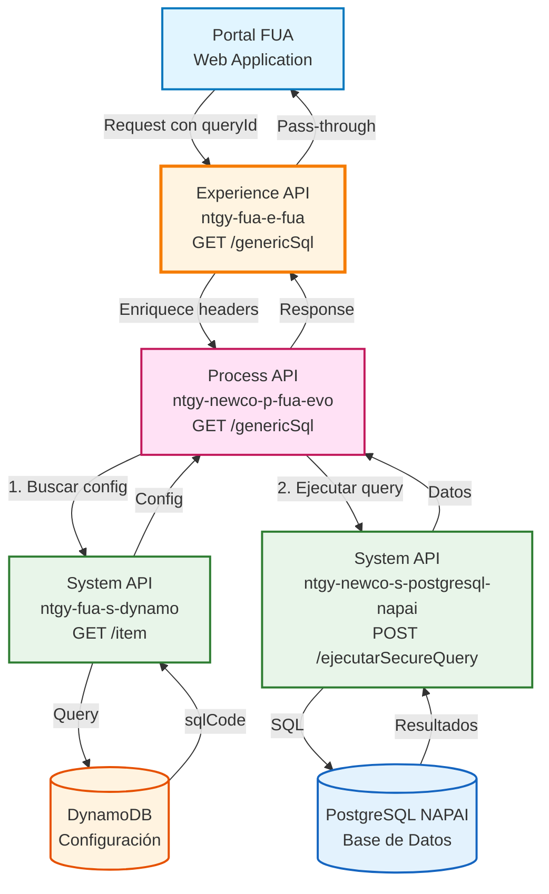
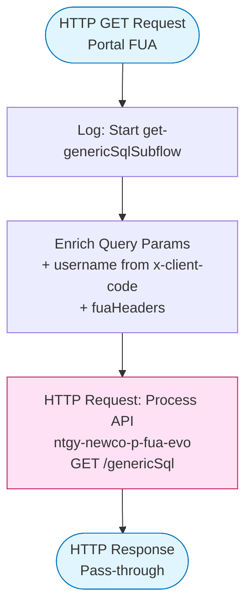
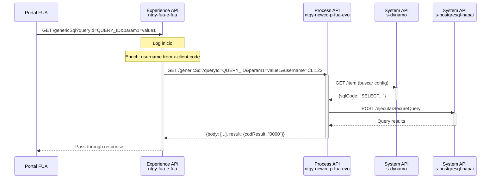
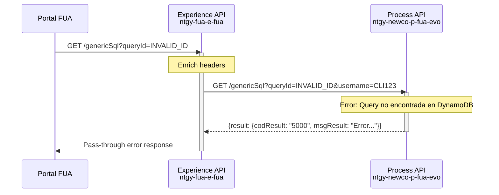
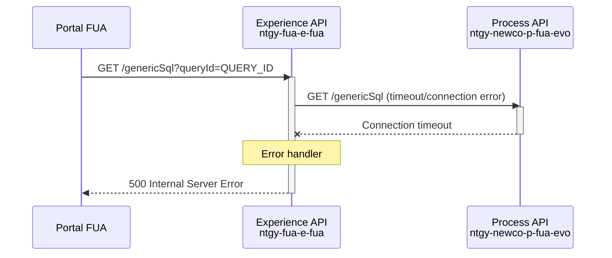

# GET /genericSql

## 📌 Descripción General

### Propósito del Endpoint

Este endpoint del Experience API permite a las aplicaciones del portal FUA ejecutar consultas SQL genéricas y seguras en la base de datos NAPAI (PostgreSQL). Actúa como una capa de adaptación que simplifica el acceso a datos operacionales mediante un sistema de queries pre-configuradas almacenadas en DynamoDB, garantizando seguridad y prevención de SQL injection.

### Tipo de API

**Capa:** Experience API (API-Led Connectivity)

**Función:** Adaptación de experiencia para canal web del portal FUA

### Patrón de Integración

**Tipo:** Pass-Through con Enriquecimiento de Headers

**Descripción:** 
- Recibe la petición del portal FUA con el `queryId` y parámetros dinámicos
- Enriquece la petición con headers específicos del canal (username desde `x-client-code`)
- Delega la ejecución al Process API sin transformar la respuesta
- Retorna los resultados tal como los proporciona el Process API

### Arquitectura API-Led Connectivity



---

## 💼 Propósito del Negocio

### Casos de Uso Principales

1. **Consultas Dinámicas desde Portal FUA**
   - Permite al portal web ejecutar consultas SQL sin exponer la estructura de la base de datos
   - Facilita el acceso a datos operacionales de forma segura y controlada
   - Soporta múltiples tipos de consultas mediante configuración centralizada

2. **Acceso Flexible a Datos NAPAI**
   - Proporciona acceso a información de clientes, contratos y operaciones
   - Permite agregar nuevas consultas sin modificar código del portal
   - Soporta consultas parametrizadas con validación de seguridad

3. **Gestión Centralizada de Queries**
   - Todas las queries están pre-configuradas en DynamoDB
   - Facilita auditoría y control de acceso a datos sensibles
   - Permite actualizar queries sin redesplegar aplicaciones

### 📱 Canal y Audiencia

#### Canal de Consumo

**Canal:** Web

**Características del Canal:**
- **Plataforma**: Portal FUA (Frontal Único de Atención)
- **Dispositivos**: Navegadores web (desktop y responsive)
- **Conectividad**: Conexión estable de banda ancha
- **Experiencia de Usuario**: Interfaz web completa con acceso a todas las funcionalidades

#### Audiencia Objetivo

**Usuarios Finales:**
- **Clientes de Energía**: Acceso a información de sus contratos y consumos
- **Agentes de Call Center**: Consulta de información para atención al cliente
- **Administradores**: Acceso a datos operacionales y reportes

**Contexto de Uso:**
- **Consultas de Información**: Búsqueda de datos específicos de clientes
- **Reportes y Análisis**: Generación de informes operacionales
- **Validaciones**: Verificación de datos antes de operaciones críticas

#### Adaptaciones del Canal

**Optimizaciones Aplicadas:**
- **Enriquecimiento de Headers**: Añade `username` desde `x-client-code` para trazabilidad
- **Pass-Through de Respuesta**: No transforma la respuesta para mantener toda la información
- **Propagación de Headers FUA**: Incluye headers específicos del portal (`fuaHeaders`)
- **Sin Paginación**: Retorna resultados completos (la paginación se maneja en el Process API si es necesario)

### 🔗 Endpoints Dependientes

Este Experience API consume el siguiente Process API:

| Process API | Endpoint | Método | Propósito |
|-------------|----------|--------|-----------|
| `ntgy-newco-p-fua-evo` | `/genericSql` | GET | Orquesta la ejecución de queries SQL genéricas consultando configuración en DynamoDB y ejecutando en PostgreSQL NAPAI |

### Contexto Empresarial

- **Dominio:** Gestión de Datos y Consultas Genéricas
- **Sector:** Energía - Utilities
- **División:** Naturgy España - NewCo
- **Canal:** Portal Web FUA

### Stakeholders

- **Usuarios del Portal FUA**: Necesitan acceso rápido y seguro a información operacional
- **Desarrolladores Frontend**: Requieren un endpoint flexible para diferentes tipos de consultas
- **Equipos de Seguridad**: Garantizan que no haya SQL injection mediante configuración centralizada
- **Administradores de Base de Datos**: Controlan y auditan las queries ejecutadas

### Valor de Negocio

- **Seguridad**: Previene SQL injection mediante queries pre-configuradas
- **Flexibilidad**: Permite agregar nuevas consultas sin modificar código del portal
- **Trazabilidad**: Identifica al usuario que ejecuta cada query mediante headers
- **Simplicidad**: Interfaz unificada para múltiples tipos de consultas
- **Mantenibilidad**: Centraliza la gestión de queries en DynamoDB

---

## 🔧 Especificación Técnica

### URLs por Ambiente

| Ambiente | URL Base | URL Completa |
|----------|----------|--------------|
| **Local** | `http://localhost:8081` | `http://localhost:8081/fua/api/genericSql?queryId=QUERY_ID` |
| **Development** | `https://ntgy-fua-e-fua-dev.de-c1.cloudhub.io` | `https://ntgy-fua-e-fua-dev.de-c1.cloudhub.io/fua/api/genericSql?queryId=QUERY_ID` |
| **UAT** | `https://ntgy-fua-e-fua-uat.de-c1.cloudhub.io` | `https://ntgy-fua-e-fua-uat.de-c1.cloudhub.io/fua/api/genericSql?queryId=QUERY_ID` |
| **Production** | `https://ntgy-fua-e-fua-pro.de-c1.cloudhub.io` | `https://ntgy-fua-e-fua-pro.de-c1.cloudhub.io/fua/api/genericSql?queryId=QUERY_ID` |

### Método HTTP

```
GET /fua/api/genericSql
```

### 🎯 Consideraciones del Canal

#### Limitaciones del Canal

| Aspecto | Limitación | Razón |
|---------|------------|-------|
| **Timeout** | 60 segundos | Queries complejas pueden requerir más tiempo de procesamiento |
| **Tamaño de Respuesta** | Sin límite específico | Depende de la query configurada en DynamoDB |
| **Rate Limiting** | Según políticas de API Manager | Protección contra abuso del servicio |
| **Autenticación** | OAuth 2.0 requerido | Seguridad y trazabilidad de accesos |

#### Campos Específicos del Canal

**Campos Añadidos por el Experience API:**

| Campo | Tipo | Descripción | Razón |
|-------|------|-------------|-------|
| `username` (query param) | string | Código del cliente desde header `x-client-code` | Trazabilidad de quién ejecuta la query |

**Headers Propagados:**
- `x-client-code`: Código del cliente (se convierte en query param `username`)
- `fuaHeaders`: Headers específicos del portal FUA (variable configurada)

### Parámetros de Entrada

#### Query Parameters

| Parámetro | Tipo | Requerido | Descripción | Ejemplo |
|-----------|------|-----------|-------------|---------|
| `queryId` | string | ✅ Sí | Identificador único de la query configurada en DynamoDB | `"QUERY_CUSTOMERS_BY_REGION"` |
| `[param1]` | string | ❌ No | Parámetros dinámicos para la query SQL (nombres definidos en la configuración) | `"Madrid"` |
| `[param2]` | string | ❌ No | Parámetros adicionales según la query | `"2024"` |

**Nota sobre parámetros dinámicos:**
- Los parámetros adicionales dependen de la query configurada en DynamoDB
- Se pueden pasar múltiples parámetros separados por `#` que serán convertidos a `,` por el Process API
- Ejemplo: `param=value1#value2#value3` → se convierte en `param=value1,value2,value3`

#### Headers Requeridos

| Header | Tipo | Requerido | Descripción |
|--------|------|-----------|-------------|
| `x-client-code` | string | ✅ Sí | Código del cliente (se propaga como `username` al Process API) |
| `x-access-token` | string | ✅ Sí | Token de autenticación OAuth 2.0 |
| `x-client-id` | string | ❌ No | ID del cliente |
| `x-client-doc-number` | string | ❌ No | Número de documento del cliente |
| `x-interaction-id` | string | ❌ No | ID de interacción para trazabilidad |
| `x-trading-company` | string | ❌ No | Compañía comercializadora (imp/newco) |
| `x-language` | string | ❌ No | Idioma preferido |

### Estructura de Request

**Ejemplo de URL con parámetros:**
```
GET /fua/api/genericSql?queryId=QUERY_CUSTOMERS&region=Madrid&year=2024
```

**Headers:**
```
x-client-code: CLI12345
x-access-token: eyJhbGciOiJIUzI1NiIsInR5cCI6IkpXVCJ9...
x-interaction-id: 550e8400-e29b-41d4-a716-446655440000
```

### Respuestas

#### ✅ Respuesta Exitosa (200 OK)

⚠️ **Este Experience API NO transforma la respuesta del Process API.**

Para el schema completo de la respuesta, consultar:
📖 **Process API: `ntgy-newco-p-fua-evo` endpoint `/genericSql`**

**Estructura de respuesta (pass-through desde Process API):**

```json
{
  "body": [
    {
      "column1": "value1",
      "column2": "value2",
      "column3": "value3"
    }
  ],
  "result": {
    "codResult": "0000",
    "msgResult": "Resultado correcto!"
  }
}
```

**Campos de la respuesta:**

| Campo | Tipo | Descripción |
|-------|------|-------------|
| `body` | array | Array de objetos con los resultados de la query SQL |
| `result.codResult` | string | Código de resultado (`"0000"` = éxito) |
| `result.msgResult` | string | Mensaje descriptivo del resultado |

#### ❌ Error - Query No Encontrada en DynamoDB (500)

```json
{
  "result": {
    "codResult": "5000",
    "msgResult": "Error al llamar la BBDD de dynamo"
  }
}
```

#### ❌ Error - Fallo en Ejecución de Query NAPAI (500)

```json
{
  "result": {
    "codResult": "5000",
    "msgResult": "Error al llamar la BBDD de napai"
  }
}
```

### Códigos de Estado HTTP

| Código | Descripción | Escenario |
|--------|-------------|-----------|
| `200` | OK | Query ejecutada exitosamente |
| `400` | Bad Request | Falta el parámetro `queryId` o headers requeridos |
| `401` | Unauthorized | Token de autenticación inválido o expirado |
| `500` | Internal Server Error | Error en Process API, DynamoDB o PostgreSQL NAPAI |

### Autenticación

- **Tipo:** OAuth 2.0 (definido en RAML)
- **Headers requeridos:**
  - `x-access-token`: Token de autenticación
  - `x-client-code`: Código del cliente para trazabilidad

### Timeouts

| Tipo | Valor | Razón |
|------|-------|-------|
| **Request Timeout** | 60 segundos | Configurado en `newco-p-fua-evo.timeout` |
| **Connection Timeout** | 60 segundos | Mismo valor que request timeout |

---

## 🏗️ Implementación Técnica

### Arquitectura del Flow



### Transformaciones de Canal

**Enriquecimiento de Query Parameters:**

| Campo Original | Campo Añadido | Transformación |
|----------------|---------------|----------------|
| `attributes.queryParams` | `attributes.queryParams` | Se mantienen todos los parámetros originales |
| `attributes.headers['x-client-code']` | `username` (query param) | Se añade como parámetro adicional |
| `vars.fuaHeaders` | Múltiples query params | Se añaden headers específicos del portal FUA |

**Lógica de Enriquecimiento:**

```dataweave
%dw 2.0
output application/java
---
attributes.queryParams ++ 
{"username": attributes.headers['x-client-code']} ++ 
vars.fuaHeaders
```

**Propósito:** 
- Añade el código del cliente como `username` para trazabilidad en el Process API
- Propaga headers específicos del portal FUA como query parameters
- Mantiene todos los parámetros originales de la petición

### Patrones de Diseño

**Patrón:** Pass-Through con Enriquecimiento de Contexto

**Justificación:** 
- El Experience API no necesita transformar la respuesta ya que el Process API proporciona el formato adecuado
- Solo añade contexto del canal (username) para trazabilidad
- Simplifica el mantenimiento al delegar la lógica compleja al Process API
- Permite que el portal FUA reciba toda la información sin pérdida de datos

### Diagramas de Secuencia

#### 1. Flujo Normal de Éxito



#### 2. Flujo con Error de Negocio



#### 3. Flujo con Error Técnico



### Optimizaciones del Canal

**Optimizaciones Aplicadas:**

1. **Enriquecimiento Eficiente**: Solo añade los headers necesarios sin transformaciones complejas
2. **Pass-Through**: No transforma la respuesta, reduciendo latencia
3. **Logging Mínimo**: Solo log de inicio para trazabilidad sin impactar performance
4. **Timeout Adecuado**: 60 segundos para permitir queries complejas

**No se aplican:**
- Caché (las queries son dinámicas y pueden cambiar frecuentemente)
- Compresión (manejada por el API Gateway)
- Paginación (se maneja en el Process API si es necesario)

### Manejo de Errores

**Estrategia de Manejo de Errores:**

El Experience API propaga los errores del Process API sin transformación, manteniendo la estructura de error estándar:

```json
{
  "result": {
    "codResult": "5000",
    "msgResult": "Descripción del error"
  }
}
```

**Tipos de Errores Propagados:**
- **Error DynamoDB**: Query no encontrada o error de conexión
- **Error NAPAI**: Fallo en ejecución de query SQL
- **Error de Timeout**: Timeout en llamada al Process API
- **Error de Autenticación**: Token inválido o expirado

---

## 💻 Ejemplos de Uso

### Ejemplo 1: Consulta Simple con Un Parámetro

#### cURL

```bash
curl -X GET "https://ntgy-fua-e-fua-dev.de-c1.cloudhub.io/fua/api/genericSql?queryId=QUERY_CUSTOMERS_BY_REGION&region=Madrid" \
  -H "Content-Type: application/json" \
  -H "x-client-code: CLI12345" \
  -H "x-access-token: eyJhbGciOiJIUzI1NiIsInR5cCI6IkpXVCJ9..." \
  -H "x-interaction-id: 550e8400-e29b-41d4-a716-446655440000"
```

#### Respuesta (200 OK)

```json
{
  "body": [
    {
      "customerId": "12345",
      "customerName": "Juan Pérez",
      "region": "Madrid",
      "contractCount": 3
    },
    {
      "customerId": "67890",
      "customerName": "María García",
      "region": "Madrid",
      "contractCount": 2
    }
  ],
  "result": {
    "codResult": "0000",
    "msgResult": "Resultado correcto!"
  }
}
```

### Ejemplo 2: Consulta con Múltiples Parámetros

#### cURL

```bash
curl -X GET "https://ntgy-fua-e-fua-dev.de-c1.cloudhub.io/fua/api/genericSql?queryId=QUERY_INVOICES_BY_DATE&startDate=2024-01-01&endDate=2024-12-31&status=PAID" \
  -H "Content-Type: application/json" \
  -H "x-client-code: CLI12345" \
  -H "x-access-token: eyJhbGciOiJIUzI1NiIsInR5cCI6IkpXVCJ9..." \
  -H "x-client-doc-number: 12345678A"
```

#### Respuesta (200 OK)

```json
{
  "body": [
    {
      "invoiceId": "INV-001",
      "invoiceDate": "2024-03-15",
      "amount": 125.50,
      "status": "PAID"
    },
    {
      "invoiceId": "INV-002",
      "invoiceDate": "2024-06-20",
      "amount": 89.75,
      "status": "PAID"
    }
  ],
  "result": {
    "codResult": "0000",
    "msgResult": "Resultado correcto!"
  }
}
```

### Ejemplo 3: Consulta con Parámetros Múltiples (usando #)

#### cURL

```bash
curl -X GET "https://ntgy-fua-e-fua-dev.de-c1.cloudhub.io/fua/api/genericSql?queryId=QUERY_CONTRACTS_BY_IDS&contractIds=C001#C002#C003" \
  -H "Content-Type: application/json" \
  -H "x-client-code: CLI12345" \
  -H "x-access-token: eyJhbGciOiJIUzI1NiIsInR5cCI6IkpXVCJ9..."
```

**Nota:** El parámetro `contractIds=C001#C002#C003` se transforma internamente a `contractIds=C001,C002,C003` en el Process API.

#### Respuesta (200 OK)

```json
{
  "body": [
    {
      "contractId": "C001",
      "contractType": "Electricity",
      "status": "Active"
    },
    {
      "contractId": "C002",
      "contractType": "Gas",
      "status": "Active"
    },
    {
      "contractId": "C003",
      "contractType": "Electricity",
      "status": "Suspended"
    }
  ],
  "result": {
    "codResult": "0000",
    "msgResult": "Resultado correcto!"
  }
}
```

### Ejemplo 4: Error - Query No Encontrada

#### cURL

```bash
curl -X GET "https://ntgy-fua-e-fua-dev.de-c1.cloudhub.io/fua/api/genericSql?queryId=INVALID_QUERY_ID" \
  -H "Content-Type: application/json" \
  -H "x-client-code: CLI12345" \
  -H "x-access-token: eyJhbGciOiJIUzI1NiIsInR5cCI6IkpXVCJ9..."
```

#### Respuesta (500 Internal Server Error)

```json
{
  "result": {
    "codResult": "5000",
    "msgResult": "Error al llamar la BBDD de dynamo"
  }
}
```

### Ejemplo 5: JavaScript (Fetch API) - Portal FUA

```javascript
// Función para ejecutar query genérica desde el portal FUA
async function executeGenericQuery(queryId, params = {}) {
  const queryString = new URLSearchParams({
    queryId,
    ...params
  }).toString();
  
  const response = await fetch(
    `https://ntgy-fua-e-fua-dev.de-c1.cloudhub.io/fua/api/genericSql?${queryString}`,
    {
      method: 'GET',
      headers: {
        'Content-Type': 'application/json',
        'x-client-code': sessionStorage.getItem('clientCode'),
        'x-access-token': sessionStorage.getItem('accessToken'),
        'x-interaction-id': generateUUID()
      }
    }
  );
  
  const data = await response.json();
  
  if (data.result.codResult === '0000') {
    console.log('Query ejecutada exitosamente');
    return data.body;
  } else {
    console.error('Error en la query:', data.result.msgResult);
    throw new Error(data.result.msgResult);
  }
}

// Ejemplo de uso
try {
  const customers = await executeGenericQuery('QUERY_CUSTOMERS_BY_REGION', {
    region: 'Madrid'
  });
  console.log('Clientes encontrados:', customers);
} catch (error) {
  console.error('Error:', error.message);
}

function generateUUID() {
  return 'xxxxxxxx-xxxx-4xxx-yxxx-xxxxxxxxxxxx'.replace(/[xy]/g, function(c) {
    const r = Math.random() * 16 | 0;
    const v = c === 'x' ? r : (r & 0x3 | 0x8);
    return v.toString(16);
  });
}
```

### Ejemplo 6: Python (Requests) - Script de Administración

```python
import requests
from typing import Dict, List, Any
import uuid

class FUAGenericQueryClient:
    def __init__(self, base_url: str, client_code: str, access_token: str):
        self.base_url = base_url
        self.client_code = client_code
        self.access_token = access_token
    
    def execute_query(self, query_id: str, params: Dict[str, str] = None) -> List[Dict[str, Any]]:
        """
        Ejecuta una query genérica en NAPAI
        
        Args:
            query_id: ID de la query configurada en DynamoDB
            params: Parámetros adicionales para la query
            
        Returns:
            Lista de resultados de la query
            
        Raises:
            Exception: Si la query falla
        """
        if params is None:
            params = {}
        
        # Construir query parameters
        query_params = {
            'queryId': query_id,
            **params
        }
        
        # Headers
        headers = {
            'Content-Type': 'application/json',
            'x-client-code': self.client_code,
            'x-access-token': self.access_token,
            'x-interaction-id': str(uuid.uuid4())
        }
        
        # Ejecutar request
        url = f'{self.base_url}/fua/api/genericSql'
        response = requests.get(url, params=query_params, headers=headers)
        
        # Procesar respuesta
        data = response.json()
        
        if data.get('result', {}).get('codResult') == '0000':
            print('Query ejecutada exitosamente')
            return data.get('body', [])
        else:
            error_msg = data.get('result', {}).get('msgResult', 'Error desconocido')
            raise Exception(f'Error en la query: {error_msg}')

# Ejemplo de uso
if __name__ == '__main__':
    client = FUAGenericQueryClient(
        base_url='https://ntgy-fua-e-fua-dev.de-c1.cloudhub.io',
        client_code='CLI12345',
        access_token='eyJhbGciOiJIUzI1NiIsInR5cCI6IkpXVCJ9...'
    )
    
    try:
        # Consulta simple
        customers = client.execute_query(
            query_id='QUERY_CUSTOMERS_BY_REGION',
            params={'region': 'Madrid'}
        )
        print(f'Clientes encontrados: {len(customers)}')
        for customer in customers:
            print(f"  - {customer.get('customerName')}: {customer.get('contractCount')} contratos")
        
        # Consulta con múltiples parámetros
        invoices = client.execute_query(
            query_id='QUERY_INVOICES_BY_DATE',
            params={
                'startDate': '2024-01-01',
                'endDate': '2024-12-31',
                'status': 'PAID'
            }
        )
        print(f'\nFacturas encontradas: {len(invoices)}')
        
    except Exception as e:
        print(f'Error: {e}')
```
