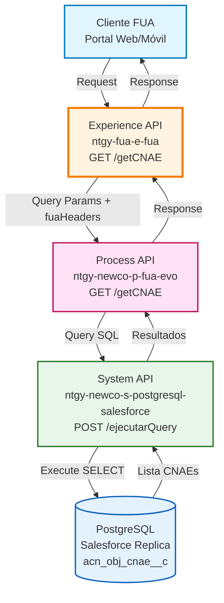
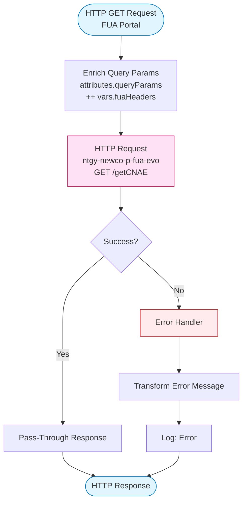
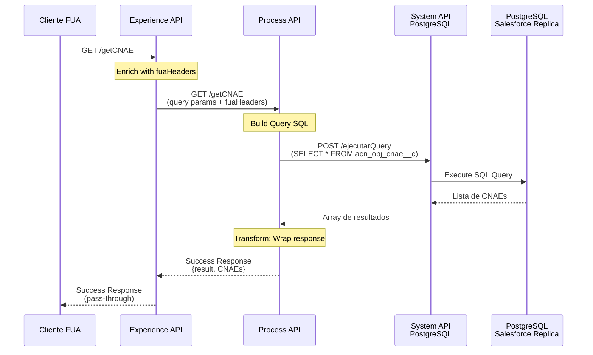
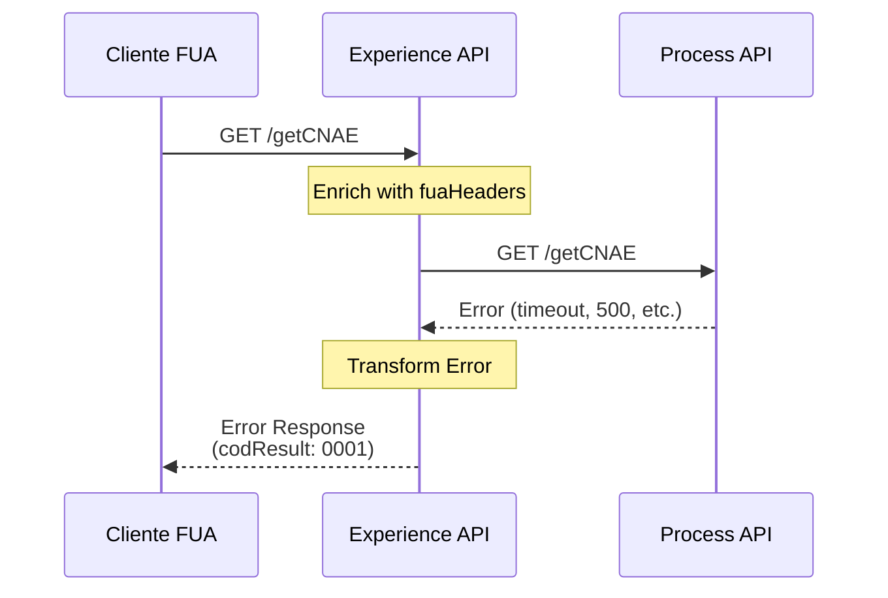

# GET /getCNAE

## 📌 Descripción General

### Propósito del Endpoint

Este endpoint consulta el catálogo completo de códigos CNAE (Clasificación Nacional de Actividades Económicas) disponibles en el sistema. Retorna una lista ordenada alfabéticamente de todos los códigos CNAE con sus descripciones, utilizada principalmente para poblar listas desplegables en formularios del portal FUA.

### Tipo de API

**Capa:** Experience API (API-Led Connectivity)

**Función:** Consulta de datos de referencia (catálogo)

### Patrón de Integración

**Tipo:** Pass-Through Simple

**Descripción:** El Experience API actúa como pass-through hacia el Process API, sin transformar la respuesta. Los query params del request se combinan con headers FUA para trazabilidad, pero NO afectan el resultado (siempre retorna el catálogo completo).

### Arquitectura API-Led Connectivity



---

## 💼 Propósito del Negocio

### Casos de Uso Principales

1. **Población de Formularios FUA**
   - Proporciona lista de CNAEs para listas desplegables
   - Permite selección de actividad económica en formularios de registro
   - Facilita la entrada de datos estandarizada

2. **Modificación de CNAE**
   - Soporta el flujo de cambio de CNAE (POST /changeCNAE)
   - Permite al usuario seleccionar el nuevo CNAE de una lista validada
   - Asegura que solo se usen códigos CNAE oficiales

3. **Consulta de Referencia**
   - Permite buscar descripciones de códigos CNAE
   - Facilita la comprensión de clasificaciones económicas
   - Soporta funcionalidades de búsqueda y filtrado en el frontend

### 📱 Canal y Audiencia

#### Canal de Consumo

**Canal:** FUA (Frontal Único de Atención)

**Características del Canal:**
- **Plataforma**: Portal web de autoservicio y aplicación móvil
- **Dispositivos**: Desktop, tablet, smartphone
- **Conectividad**: Requiere conexión para obtener catálogo actualizado
- **Experiencia de Usuario**: Lista desplegable con búsqueda/filtrado

#### Audiencia Objetivo

**Usuarios Finales:**
- **Clientes Pyme**: Empresas que necesitan seleccionar o actualizar su actividad económica
- **Agentes de Atención**: Personal de call center que asiste en la selección de CNAE

**Contexto de Uso:**
- **Registro de Cliente**: Selección de CNAE al dar de alta una empresa
- **Modificación de Datos**: Actualización de CNAE cuando cambia la actividad
- **Consulta**: Verificación de la clasificación económica actual

#### Adaptaciones del Canal

**Optimizaciones Aplicadas:**
- **Pass-Through**: Sin transformaciones, respuesta directa del Process API
- **Trazabilidad**: Headers FUA añadidos para auditoría (no afectan resultado)
- **Cacheable**: Respuesta puede ser cacheada en el frontend (datos estables)

### 🔗 Endpoints Dependientes

Este Experience API consume el siguiente Process API:

| Process API | Endpoint | Método | Propósito |
|-------------|----------|--------|-----------|
| `ntgy-newco-p-fua-evo` | `/getCNAE` | GET | Consulta el catálogo completo de códigos CNAE desde PostgreSQL |

### Contexto Empresarial

- **Dominio:** Datos de Referencia y Catálogos
- **Sector:** Energía - Utilities
- **División:** Naturgy España - NewCo
- **Canal:** FUA (Portal Web y Móvil)

### Stakeholders

- **Clientes Pyme**: Necesitan seleccionar su actividad económica de forma clara
- **Desarrolladores Frontend**: Requieren lista de CNAEs para formularios
- **Agentes de Call Center**: Consultan CNAEs al asistir a clientes
- **Equipo de Datos Maestros**: Mantienen el catálogo actualizado en Salesforce

### Valor de Negocio

- **Estandarización**: Garantiza uso de códigos CNAE oficiales
- **Usabilidad**: Facilita selección mediante descripciones claras
- **Consistencia**: Centraliza catálogo en una única fuente
- **Actualización Automática**: Cambios en Salesforce se reflejan inmediatamente

---

## 🔧 Especificación Técnica

### URLs por Ambiente

| Ambiente | URL Base | URL Completa |
|----------|----------|--------------|
| **Local** | `http://localhost:8081` | `http://localhost:8081/fua/api/getCNAE` |
| **Development** | `https://ntgy-fua-e-fua-dev.de-c1.cloudhub.io` | `https://ntgy-fua-e-fua-dev.de-c1.cloudhub.io/fua/api/getCNAE` |
| **UAT** | `https://ntgy-fua-e-fua-uat.de-c1.cloudhub.io` | `https://ntgy-fua-e-fua-uat.de-c1.cloudhub.io/fua/api/getCNAE` |
| **Production** | `https://ntgy-fua-e-fua-pro.de-c1.cloudhub.io` | `https://ntgy-fua-e-fua-pro.de-c1.cloudhub.io/fua/api/getCNAE` |

### Método HTTP

```
GET /fua/api/getCNAE
```

### 🎯 Consideraciones del Canal

#### Limitaciones del Canal

| Aspecto | Limitación | Razón |
|---------|------------|-------|
| **Timeout** | 60 segundos | Consulta de catálogo completo |
| **Paginación** | No disponible | Retorna lista completa (catálogo pequeño) |
| **Filtrado** | Solo en frontend | Backend retorna catálogo completo |
| **Caché** | Recomendado | Datos cambian poco frecuentemente |

#### Campos Específicos del Canal

**Headers FUA (Opcionales - Solo Trazabilidad):**

| Campo | Tipo | Descripción | Razón |
|-------|------|-------------|-------|
| `x-client-id` | string | ID del cliente en Salesforce | Auditoría |
| `x-contact-id` | string | ID del contacto | Trazabilidad |
| `x-interaction-id` | string | ID de la interacción | Seguimiento |

**⚠️ IMPORTANTE:** Estos headers NO afectan el resultado. El endpoint siempre retorna el catálogo completo de CNAEs, independientemente de los headers enviados.

### Parámetros de Entrada

**Este endpoint NO requiere parámetros de entrada.**

Retorna el catálogo completo de códigos CNAE sin filtros.

#### Headers (Opcionales)

| Header | Tipo | Obligatorio | Descripción |
|--------|------|-------------|-------------|
| `Authorization` | string | ✅ | Token OAuth 2.0 |
| `x-client-id` | string | ⚠️ | ID del cliente (solo trazabilidad) |
| `x-contact-id` | string | ⚠️ | ID del contacto (solo trazabilidad) |
| `x-interaction-id` | string | ⚠️ | ID de la interacción (solo trazabilidad) |

**Nota:** Los headers `x-*` son opcionales y se usan únicamente para trazabilidad. NO afectan el resultado de la consulta.

### Respuestas

#### 200 OK - Éxito

```json
{
  "result": {
    "codResult": "0000",
    "msgResult": "No hay error"
  },
  "CNAEs": [
    {
      "cnae": "0111",
      "description": "Cultivo de cereales (excepto arroz), leguminosas y semillas oleaginosas"
    },
    {
      "cnae": "0112",
      "description": "Cultivo de arroz"
    },
    {
      "cnae": "4711",
      "description": "Comercio al por menor en establecimientos no especializados, con predominio en productos alimenticios, bebidas y tabaco"
    },
    {
      "cnae": "5610",
      "description": "Restaurantes y puestos de comidas"
    }
  ]
}
```

**Campos de Respuesta:**

| Campo | Tipo | Descripción |
|-------|------|-------------|
| `result.codResult` | string | Código de resultado ("0000" = éxito) |
| `result.msgResult` | string | Mensaje descriptivo del resultado |
| `CNAEs` | array | Array de objetos con códigos CNAE |
| `CNAEs[].cnae` | string | Código CNAE (4 dígitos) |
| `CNAEs[].description` | string | Descripción de la actividad económica |

**Características de la respuesta:**
- Lista ordenada alfabéticamente por código CNAE
- Incluye todos los CNAEs disponibles en Salesforce
- Sin paginación (retorna lista completa)
- Respuesta cacheable (datos estables)

#### 500 Internal Server Error

```json
{
  "result": {
    "codResult": "0001",
    "msgResult": "HTTP:TIMEOUT - The request exceeded the configured timeout"
  }
}
```

### Autenticación

- **Tipo:** OAuth 2.0 (gestionado por API Gateway)
- **Headers Requeridos:** Token de autenticación en header `Authorization`

### Timeouts

| Tipo | Valor | Razón |
|------|-------|-------|
| **Request Timeout** | 60 segundos | Consulta de catálogo completo |
| **Connection Idle Timeout** | 60 segundos | Mantiene conexión para operaciones |

---

## 🏗️ Implementación Técnica

### Arquitectura del Flow



### Transformaciones de Canal

**Este Experience API NO transforma la respuesta.**

El Experience API actúa como pass-through, enriqueciendo los query params con headers FUA:

```dataweave
%dw 2.0
output application/java
---
attributes.queryParams ++ vars.fuaHeaders
```

**Query Params enviados al Process API:**
- Query params originales del request (si existen)
- Headers FUA añadidos: `x-client-id`, `x-contact-id`, `x-interaction-id`, etc.

**⚠️ IMPORTANTE:** Aunque se envían query params al Process API, este los ignora y siempre retorna el catálogo completo. Los params se usan solo para trazabilidad.

Para el schema completo de response, consultar:
📖 **Process API: `ntgy-newco-p-fua-evo` endpoint `/getCNAE`**

### Patrones de Diseño

**Patrón:** Pass-Through con Enriquecimiento de Contexto

**Justificación:** 
- El Experience API no necesita transformar datos de referencia
- Añade contexto específico del canal FUA (headers de trazabilidad)
- Permite que el Process API maneje la lógica de consulta
- Respuesta directa sin overhead de transformación

### Diagramas de Secuencia

#### 1. Flujo Normal de Éxito



#### 2. Flujo con Error



### Optimizaciones del Canal

1. **Pass-Through**: Sin transformaciones, respuesta directa del Process API
2. **Trazabilidad**: Headers FUA añadidos para auditoría
3. **Timeout Adecuado**: 60 segundos para consulta de catálogo completo
4. **Cacheable**: Respuesta puede ser cacheada en el frontend

### Manejo de Errores

#### Error Handler del Experience API

```dataweave
%dw 2.0
output application/json
---
{
  "result": {
    "codResult": "0001",
    "msgResult": error.description as String replace /\"/ with("")
  }
}
```

**Tipos de Errores:**
- **Timeout**: Si el Process API no responde en 60 segundos
- **Connection Error**: Si no se puede conectar con el Process API
- **System Error**: Errores internos del Process API o PostgreSQL

**Logging:**
- Todos los errores se registran con nivel ERROR
- Se incluye el mensaje de error completo para troubleshooting

---

## 💻 Ejemplos de Uso

### Ejemplo 1: Consulta Simple

#### cURL

```bash
curl -X GET "https://ntgy-fua-e-fua-pro.de-c1.cloudhub.io/fua/api/getCNAE" \
  -H "Authorization: Bearer YOUR_TOKEN"
```

#### Respuesta (200 OK)

```json
{
  "result": {
    "codResult": "0000",
    "msgResult": "No hay error"
  },
  "CNAEs": [
    {
      "cnae": "0111",
      "description": "Cultivo de cereales (excepto arroz), leguminosas y semillas oleaginosas"
    },
    {
      "cnae": "0112",
      "description": "Cultivo de arroz"
    },
    {
      "cnae": "4711",
      "description": "Comercio al por menor en establecimientos no especializados, con predominio en productos alimenticios, bebidas y tabaco"
    },
    {
      "cnae": "5610",
      "description": "Restaurantes y puestos de comidas"
    }
  ]
}
```

### Ejemplo 2: Consulta con Headers de Trazabilidad

#### cURL

```bash
curl -X GET "https://ntgy-fua-e-fua-pro.de-c1.cloudhub.io/fua/api/getCNAE" \
  -H "Authorization: Bearer YOUR_TOKEN" \
  -H "x-client-id: 0015I00000XXXXX" \
  -H "x-contact-id: 0035I00000XXXXX" \
  -H "x-interaction-id: 5005I00000XXXXX"
```

**Nota:** Los headers `x-*` son opcionales y NO afectan el resultado. Se usan solo para trazabilidad.

#### Respuesta (200 OK)

```json
{
  "result": {
    "codResult": "0000",
    "msgResult": "No hay error"
  },
  "CNAEs": [
    {
      "cnae": "0111",
      "description": "Cultivo de cereales (excepto arroz), leguminosas y semillas oleaginosas"
    }
  ]
}
```

### Ejemplo 3: JavaScript (Frontend FUA)

```javascript
async function getCNAEs() {
  try {
    const response = await fetch(
      'https://ntgy-fua-e-fua-pro.de-c1.cloudhub.io/fua/api/getCNAE',
      {
        method: 'GET',
        headers: {
          'Authorization': `Bearer ${authToken}`,
          'x-client-id': clientId,
          'x-contact-id': contactId,
          'x-interaction-id': interactionId
        }
      }
    );
    
    if (!response.ok) {
      throw new Error(`Error: ${response.status}`);
    }
    
    const data = await response.json();
    
    if (data.result.codResult === '0000') {
      console.log(`CNAEs obtenidos: ${data.CNAEs.length}`);
      
      // Poblar lista desplegable
      const selectElement = document.getElementById('cnae-select');
      data.CNAEs.forEach(cnae => {
        const option = document.createElement('option');
        option.value = cnae.cnae;
        option.textContent = `${cnae.cnae} - ${cnae.description}`;
        selectElement.appendChild(option);
      });
      
      return data.CNAEs;
    } else {
      console.error('Error:', data.result.msgResult);
      return [];
    }
  } catch (error) {
    console.error('Error al obtener CNAEs:', error);
    return [];
  }
}

// Uso
getCNAEs();
```

### Ejemplo 4: JavaScript con Filtrado en Frontend

```javascript
async function getCNAEsFiltered(searchTerm) {
  const cnaes = await getCNAEs();
  
  // Filtrar en el frontend
  const filtered = cnaes.filter(cnae => 
    cnae.cnae.includes(searchTerm) || 
    cnae.description.toLowerCase().includes(searchTerm.toLowerCase())
  );
  
  console.log(`CNAEs encontrados: ${filtered.length}`);
  return filtered;
}

// Buscar CNAEs relacionados con "comercio"
getCNAEsFiltered('comercio').then(results => {
  console.log('CNAEs de comercio:', results);
});
```

### Ejemplo 5: JavaScript con Caché

```javascript
// Implementación con caché en localStorage
class CNAEService {
  constructor() {
    this.cacheKey = 'cnaes_cache';
    this.cacheDuration = 24 * 60 * 60 * 1000; // 24 horas
  }
  
  async getCNAEs(forceRefresh = false) {
    // Verificar caché
    if (!forceRefresh) {
      const cached = this.getFromCache();
      if (cached) {
        console.log('CNAEs obtenidos desde caché');
        return cached;
      }
    }
    
    // Obtener desde API
    const response = await fetch(
      'https://ntgy-fua-e-fua-pro.de-c1.cloudhub.io/fua/api/getCNAE',
      {
        method: 'GET',
        headers: {
          'Authorization': `Bearer ${authToken}`
        }
      }
    );
    
    const data = await response.json();
    
    if (data.result.codResult === '0000') {
      // Guardar en caché
      this.saveToCache(data.CNAEs);
      console.log('CNAEs obtenidos desde API y guardados en caché');
      return data.CNAEs;
    }
    
    return [];
  }
  
  getFromCache() {
    const cached = localStorage.getItem(this.cacheKey);
    if (!cached) return null;
    
    const { data, timestamp } = JSON.parse(cached);
    const now = new Date().getTime();
    
    // Verificar si el caché ha expirado
    if (now - timestamp > this.cacheDuration) {
      localStorage.removeItem(this.cacheKey);
      return null;
    }
    
    return data;
  }
  
  saveToCache(data) {
    const cacheData = {
      data,
      timestamp: new Date().getTime()
    };
    localStorage.setItem(this.cacheKey, JSON.stringify(cacheData));
  }
  
  clearCache() {
    localStorage.removeItem(this.cacheKey);
  }
}

// Uso
const cnaeService = new CNAEService();

// Primera llamada: obtiene desde API
cnaeService.getCNAEs().then(cnaes => {
  console.log('CNAEs:', cnaes);
});

// Segunda llamada: obtiene desde caché
cnaeService.getCNAEs().then(cnaes => {
  console.log('CNAEs (desde caché):', cnaes);
});

// Forzar actualización
cnaeService.getCNAEs(true).then(cnaes => {
  console.log('CNAEs (actualizado):', cnaes);
});
```

### Ejemplo 6: Python

```python
import requests

def get_cnaes(auth_token, client_id=None, contact_id=None):
    """
    Obtiene el catálogo completo de CNAEs
    
    Args:
        auth_token: Token de autenticación OAuth 2.0
        client_id: ID del cliente (opcional, solo trazabilidad)
        contact_id: ID del contacto (opcional, solo trazabilidad)
    
    Returns:
        Lista de CNAEs o lista vacía en caso de error
    """
    url = 'https://ntgy-fua-e-fua-pro.de-c1.cloudhub.io/fua/api/getCNAE'
    
    headers = {
        'Authorization': f'Bearer {auth_token}'
    }
    
    # Añadir headers opcionales si se proporcionan
    if client_id:
        headers['x-client-id'] = client_id
    if contact_id:
        headers['x-contact-id'] = contact_id
    
    try:
        response = requests.get(url, headers=headers)
        response.raise_for_status()
        
        data = response.json()
        
        if data['result']['codResult'] == '0000':
            print(f"CNAEs obtenidos exitosamente: {len(data['CNAEs'])}")
            return data['CNAEs']
        else:
            print(f"Error: {data['result']['msgResult']}")
            return []
            
    except requests.exceptions.RequestException as e:
        print(f"Error al obtener CNAEs: {e}")
        return []

# Uso
cnaes = get_cnaes('YOUR_TOKEN', '0015I00000XXXXX', '0035I00000XXXXX')

# Mostrar primeros 5 CNAEs
for cnae in cnaes[:5]:
    print(f"{cnae['cnae']}: {cnae['description']}")
```

### Ejemplo 7: Error - Timeout

#### Respuesta (500 Internal Server Error)

```json
{
  "result": {
    "codResult": "0001",
    "msgResult": "HTTP:TIMEOUT - The request exceeded the configured timeout"
  }
}