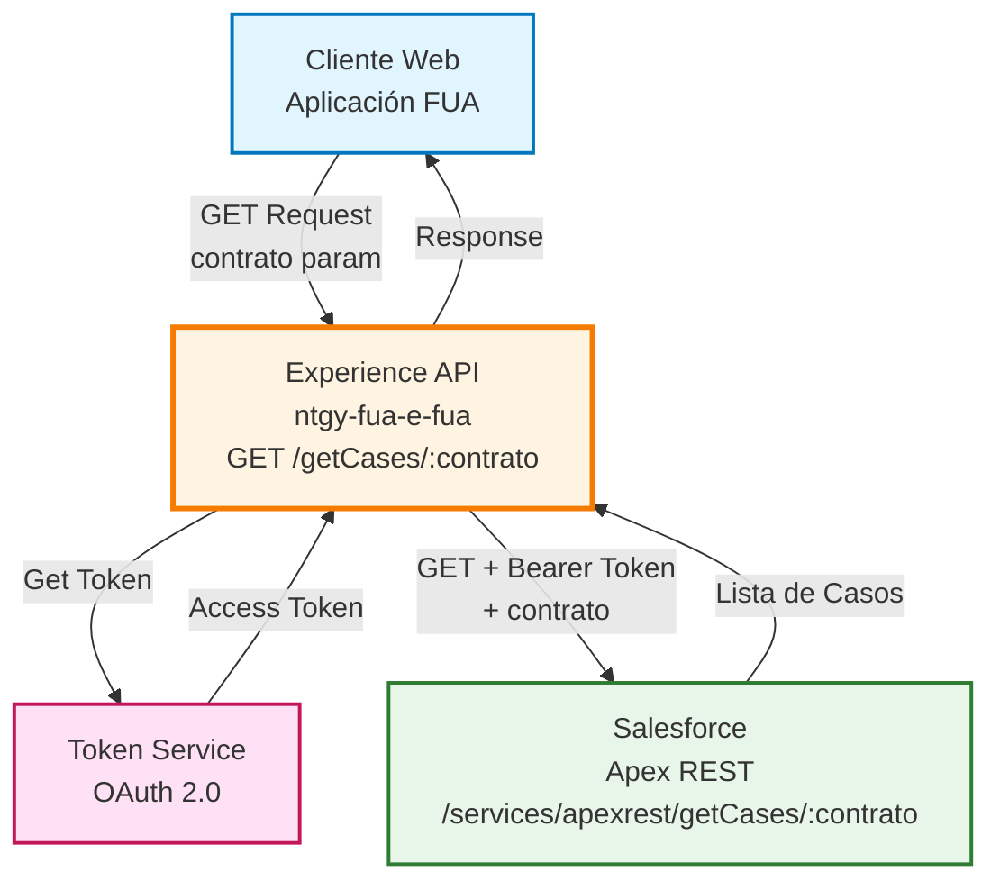
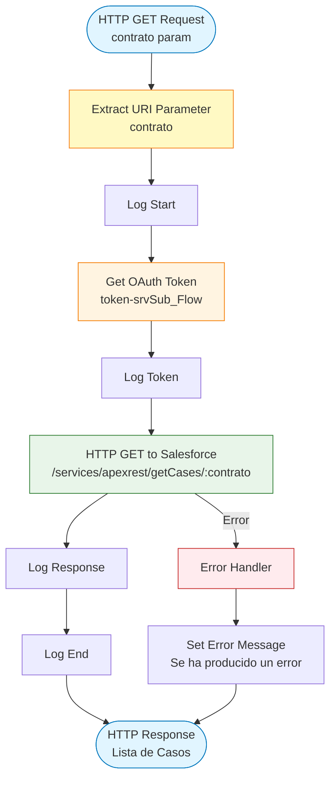
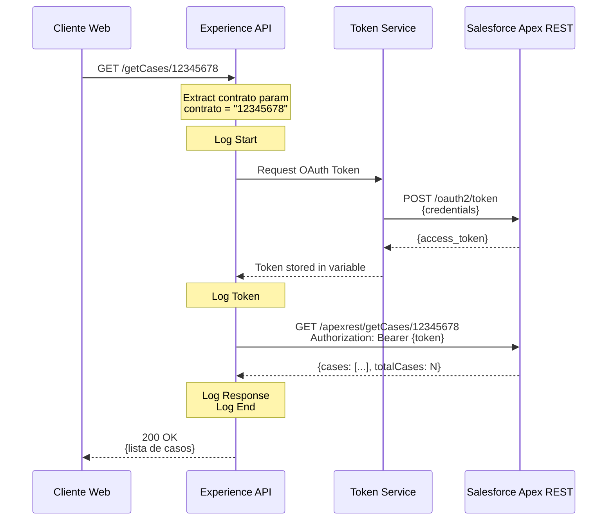

# GET /getCases/:contrato

## 📌 Descripción General

### Propósito del Endpoint

Este endpoint permite a los usuarios de la aplicación web FUA (Frontal Único de Atención) consultar todos los casos de soporte asociados a un contrato específico en Salesforce Service Cloud. Proporciona visibilidad completa del historial de casos, incluyendo solicitudes, quejas y consultas relacionadas con un contrato de energía.

### Tipo de API

**Capa:** Experience API (API-Led Connectivity)

**Función:** Consulta de casos de soporte por contrato con integración directa a Salesforce

### Patrón de Integración

**Tipo:** Pass-Through con Path Parameter y Autenticación OAuth

**Descripción:** El endpoint recibe el número de contrato como path parameter, obtiene un token OAuth de Salesforce y consulta los casos asociados sin transformación. La estructura de la respuesta está definida por el servicio Apex REST en Salesforce.

### Arquitectura API-Led Connectivity



---

## 💼 Propósito del Negocio

### Casos de Uso Principales

1. **Consulta de Historial de Casos**
   - Los clientes pueden ver todos los casos asociados a su contrato
   - Visualización de casos abiertos, en proceso y cerrados
   - Seguimiento del estado de solicitudes previas

2. **Gestión de Seguimiento**
   - Permite a los usuarios verificar el estado de sus casos
   - Consulta de resoluciones y respuestas del equipo de soporte
   - Trazabilidad completa de interacciones con el servicio

3. **Autoservicio de Información**
   - Acceso 24/7 al historial de casos sin necesidad de contactar al call center
   - Reducción de consultas repetitivas sobre el estado de casos
   - Mejora de la experiencia del cliente con información en tiempo real

### 📱 Canal y Audiencia

#### Canal de Consumo

**Canal:** Web

**Características del Canal:**
- **Plataforma**: Aplicación web FUA (Frontal Único de Atención)
- **Dispositivos**: Navegadores web (desktop y móvil)
- **Conectividad**: Requiere conexión estable para comunicación con Salesforce
- **Experiencia de Usuario**: Vista de lista de casos con filtros y detalles

#### Audiencia Objetivo

**Usuarios Finales:**
- **Clientes Residenciales**: Usuarios que consultan el historial de casos de su contrato de energía
- **Clientes Empresariales**: Empresas que necesitan revisar casos de múltiples contratos
- **Agentes de Soporte**: Personal que consulta casos para dar seguimiento

**Contexto de Uso:**
- **Consulta de Estado**: Verificar el progreso de casos abiertos
- **Revisión de Historial**: Consultar casos cerrados y sus resoluciones
- **Preparación de Contacto**: Revisar casos antes de contactar con soporte

### 🔗 Endpoints Dependientes

Este Experience API consume los siguientes servicios:

| Servicio | Endpoint | Método | Propósito |
|----------|----------|--------|-----------|
| `Salesforce OAuth` | `/services/oauth2/token` | POST | Obtención de token de acceso OAuth 2.0 |
| `Salesforce Apex REST` | `/services/apexrest/getCases/:contrato` | GET | Consulta de casos por número de contrato |

### Contexto Empresarial

- **Dominio:** Gestión de Casos de Soporte
- **Sector:** Energía - Utilities
- **División:** Naturgy España - NewCo
- **Canal:** Web (Aplicación FUA)

### Stakeholders

- **Clientes de Energía**: Necesitan visibilidad del historial de casos de su contrato
- **Equipo de Soporte**: Requieren acceso rápido al historial para dar mejor servicio
- **Administradores de Salesforce**: Mantienen la configuración del servicio Apex REST

### Valor de Negocio

- **Transparencia**: Los clientes pueden ver el estado de sus casos en tiempo real
- **Reducción de Consultas**: Menos llamadas al call center para preguntar por el estado
- **Mejora de Satisfacción**: Acceso inmediato a información de casos
- **Eficiencia Operativa**: Agentes pueden consultar historial rápidamente

---

## 🔧 Especificación Técnica

### URLs por Ambiente

| Ambiente | URL Base | URL Completa |
|----------|----------|--------------|
| **Local** | `http://localhost:8081` | `http://localhost:8081/fua/api/getCases/:contrato` |
| **Development** | `https://ntgy-fua-e-fua-dev.de-c1.cloudhub.io` | `https://ntgy-fua-e-fua-dev.de-c1.cloudhub.io/fua/api/getCases/:contrato` |
| **Production** | `https://ntgy-fua-e-fua-pro.de-c1.cloudhub.io` | `https://ntgy-fua-e-fua-pro.de-c1.cloudhub.io/fua/api/getCases/:contrato` |

### Método HTTP

```
GET /fua/api/getCases/:contrato
```

### Parámetros de Entrada

#### Path Parameters

| Parámetro | Tipo | Requerido | Descripción | Ejemplo |
|-----------|------|-----------|-------------|---------|
| `contrato` | string | ✅ | Número de contrato de energía | `"12345678"` |

**Validaciones:**
- El parámetro `contrato` debe ser un identificador válido de contrato
- No puede estar vacío
- Debe corresponder a un contrato existente en Salesforce

#### Headers

| Header | Tipo | Requerido | Descripción |
|--------|------|-----------|-------------|
| `x-interaction-id` | string | ⚠️ | ID de interacción para trazabilidad |
| `x-user-id` | string | ⚠️ | ID del usuario que consulta |
| `x-client-code` | string | ⚠️ | Código del cliente |

### Respuestas

#### Respuesta Exitosa (200 OK)

⚠️ **Nota**: La estructura de respuesta está definida por el servicio Apex REST en Salesforce.

**Estructura Típica:**

```json
{
  "cases": [
    {
      "caseId": "string",
      "caseNumber": "string",
      "subject": "string",
      "status": "string",
      "priority": "string",
      "type": "string",
      "createdDate": "string",
      "closedDate": "string",
      "description": "string"
    }
  ],
  "totalCases": "number"
}
```

#### Respuesta de Error (500)

```
Se ha producido un error en el proceso. Inténtelo mas tarde
```

### Autenticación

- **Tipo:** OAuth 2.0 (gestionado automáticamente por el API)
- **Flujo:** Password Grant Type
- **Token**: Bearer token obtenido de Salesforce

### Timeouts

| Tipo | Valor |
|------|-------|
| **Request Timeout** | 60 segundos |
| **Connection Timeout** | 60 segundos |

---

## 🏗️ Implementación Técnica

### Arquitectura del Flow



### Componentes del Flow

#### 1. Flow Principal: `get:\getCases\(contrato):e-fua-config`

**Ubicación:** `src/main/mule/e-fua.xml` (líneas 531-543)

**Responsabilidades:**
- Recibir request del cliente con path parameter
- Extraer parámetro `contrato` de la URI
- Invocar subflow de consulta de casos
- Manejar errores con mensaje personalizado

#### 2. Subflow: `get-cases-srvSub_Flow`

**Ubicación:** `src/main/mule/cases-srv.xml` (líneas 10-31)

**Responsabilidades:**
- Logging de inicio y fin
- Obtener token OAuth
- Realizar llamada GET a Salesforce con path parameter
- Retornar respuesta

### Diagramas de Secuencia

#### Flujo Normal de Éxito



---

## 💻 Ejemplos de Uso

### Ejemplo 1: Consulta de Casos de un Contrato

#### cURL

```bash
curl -X GET "https://ntgy-fua-e-fua-pro.de-c1.cloudhub.io/fua/api/getCases/12345678" \
  -H "x-interaction-id: 12345-67890-abcde" \
  -H "x-user-id: user123" \
  -H "x-client-code: CLI001"
```

#### Respuesta (200 OK)

```json
{
  "cases": [
    {
      "caseId": "500XXXXXXXXXXXXXXX",
      "caseNumber": "00001234",
      "subject": "Problema con facturación",
      "status": "In Progress",
      "priority": "Medium",
      "type": "Problem",
      "createdDate": "2024-01-15T10:30:00Z",
      "closedDate": null,
      "description": "No puedo acceder a mi última factura en el portal"
    },
    {
      "caseId": "500YYYYYYYYYYYYYYY",
      "caseNumber": "00001100",
      "subject": "Consulta sobre cambio de tarifa",
      "status": "Closed",
      "priority": "Low",
      "type": "Question",
      "createdDate": "2024-01-10T14:20:00Z",
      "closedDate": "2024-01-12T16:45:00Z",
      "description": "Información sobre tarifas disponibles"
    }
  ],
  "totalCases": 2
}
```

### Ejemplo 2: JavaScript (Fetch API)

```javascript
const getCasesByContract = async (contractNumber) => {
  try {
    const response = await fetch(
      `https://ntgy-fua-e-fua-pro.de-c1.cloudhub.io/fua/api/getCases/${contractNumber}`,
      {
        method: 'GET',
        headers: {
          'x-interaction-id': '12345-67890-abcde',
          'x-user-id': 'user123',
          'x-client-code': 'CLI001'
        }
      }
    );

    if (!response.ok) {
      throw new Error(`HTTP error! status: ${response.status}`);
    }

    const data = await response.json();
    console.log(`Casos encontrados: ${data.totalCases}`);
    
    return data;
  } catch (error) {
    console.error('Error al consultar casos:', error);
    throw error;
  }
};

// Uso
getCasesByContract('12345678')
  .then(result => console.log('Casos:', result))
  .catch(error => console.error('Error:', error));
```

### Ejemplo 3: Python

```python
import requests

def get_cases_by_contract(contract_number: str):
    url = f'https://ntgy-fua-e-fua-pro.de-c1.cloudhub.io/fua/api/getCases/{contract_number}'
    
    headers = {
        'x-interaction-id': '12345-67890-abcde',
        'x-user-id': 'user123',
        'x-client-code': 'CLI001'
    }
    
    try:
        response = requests.get(url, headers=headers, timeout=60)
        response.raise_for_status()
        return response.json()
    except requests.exceptions.RequestException as e:
        print(f"Error: {e}")
        return None

# Uso
cases = get_cases_by_contract('12345678')
if cases:
    print(f"Total de casos: {cases.get('totalCases', 0)}")
```

### Ejemplo 4: Respuesta de Error

#### Request con Contrato Inválido

```bash
curl -X GET "https://ntgy-fua-e-fua-pro.de-c1.cloudhub.io/fua/api/getCases/99999999"
```

#### Respuesta (500 Internal Server Error)

```
Se ha producido un error en el proceso. Inténtelo mas tarde
```

---

## 📋 Notas Adicionales

### Dependencias del Servicio Apex REST

⚠️ **Importante**: Este endpoint depende completamente de la implementación del servicio Apex REST `/services/apexrest/getCases/{contrato}` en Salesforce.

**Consideraciones:**
- La estructura exacta de la respuesta debe consultarse con el equipo de Salesforce
- Los campos disponibles pueden variar según la configuración del objeto Case
- El número de casos retornados puede estar limitado por Salesforce

### Mejores Prácticas

1. **Validación de Contrato**: Validar formato del contrato antes de enviar
2. **Manejo de Timeouts**: Implementar retry logic con backoff exponencial
3. **Logging**: Incluir `x-interaction-id` para trazabilidad
4. **Caché**: Considerar caché de respuestas para mejorar performance

### Limitaciones Conocidas

- **Estructura de Datos**: Definida por Salesforce, no por este API
- **Paginación**: Manejada por Salesforce, puede requerir múltiples llamadas
- **Rate Limiting**: Sujeto a límites de API de Salesforce
- **Manejo de Errores**: Respuesta genérica para todos los errores