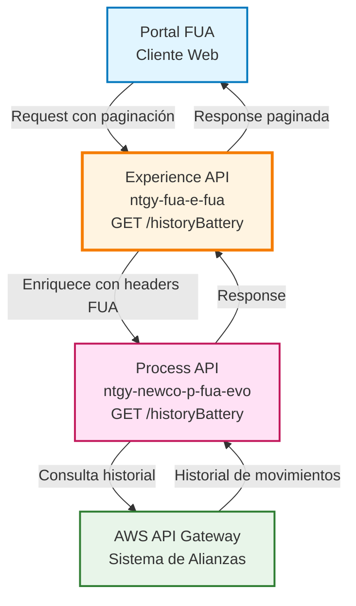
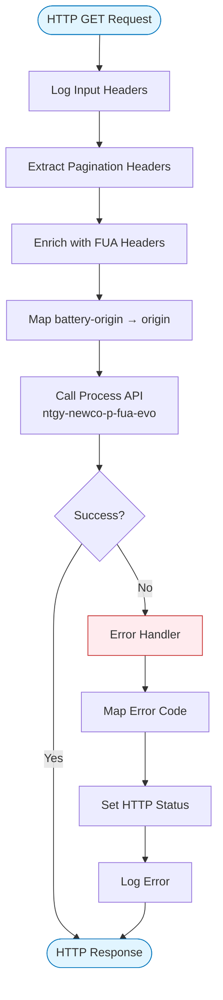
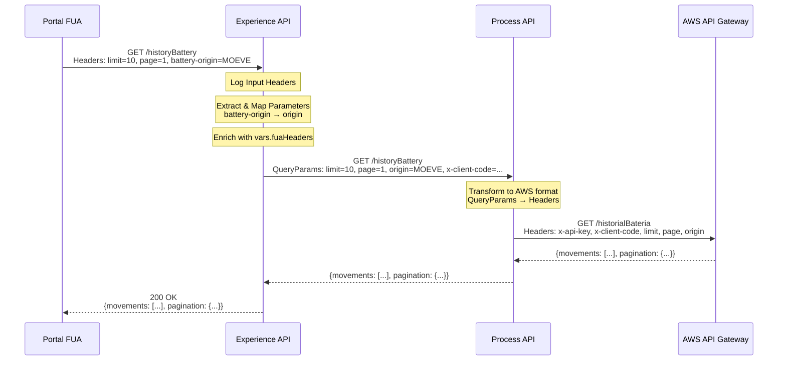
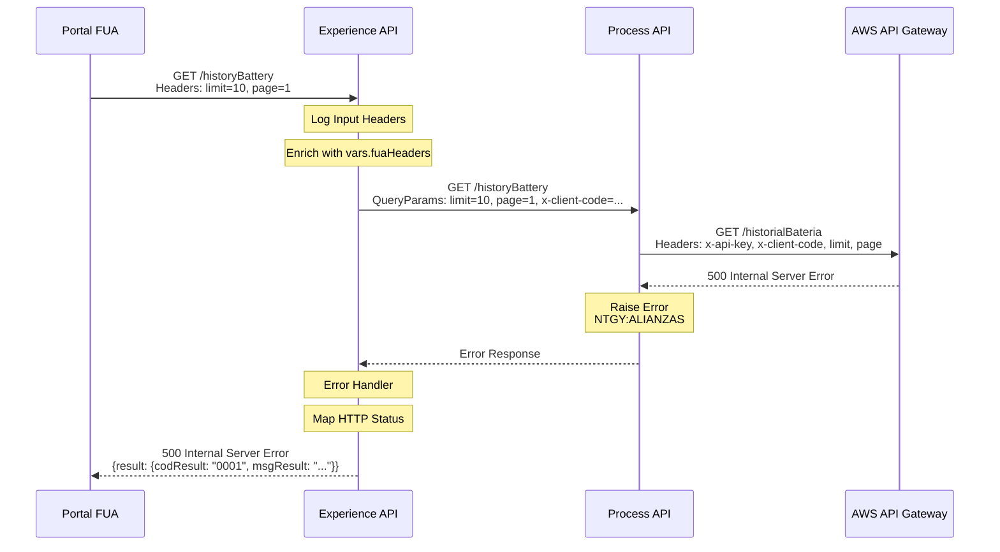
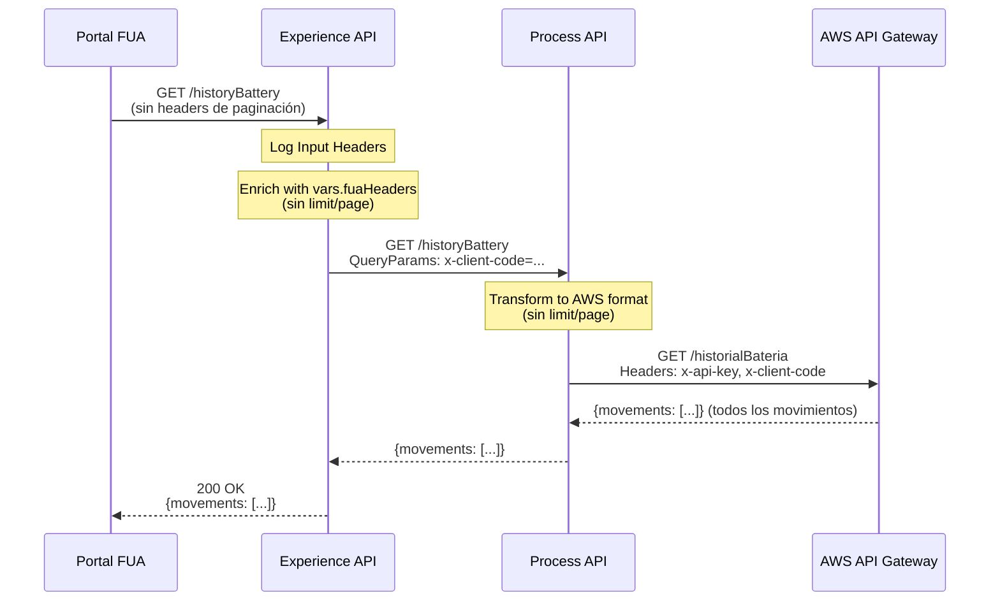

# GET /historyBattery

## 📌 Descripción General

### Propósito del Endpoint

Este endpoint permite consultar el historial de movimientos de batería de alianzas para un cliente específico. Proporciona un listado paginado de todas las transacciones y movimientos realizados en el programa de fidelización, permitiendo al usuario revisar su actividad histórica.

### Tipo de API

**Capa:** Experience API (API-Led Connectivity)

**Función:** Adaptación de experiencia para canal web del portal FUA

### Patrón de Integración

**Tipo:** Pass-Through con Enriquecimiento de Headers y Paginación

**Descripción:** El endpoint recibe parámetros de paginación y filtrado a través de headers HTTP, los enriquece con headers FUA (`vars.fuaHeaders`) y delega la consulta al Process API. La respuesta se devuelve de forma transparente al cliente.

### Arquitectura API-Led Connectivity



---

## 💼 Propósito del Negocio

### Casos de Uso Principales

1. **Consulta de Historial de Movimientos**
   - Cliente del portal FUA consulta su historial completo de movimientos de batería
   - Permite al usuario revisar todas las transacciones realizadas en el programa de alianzas

2. **Navegación Paginada de Movimientos**
   - Usuario navega por páginas de movimientos históricos
   - Facilita la revisión de grandes volúmenes de transacciones de forma eficiente

3. **Filtrado por Origen de Batería**
   - Usuario puede filtrar movimientos por origen específico
   - Permite análisis detallado de transacciones por fuente

### 📱 Canal y Audiencia

#### Canal de Consumo

**Canal:** Web

**Características del Canal:**
- **Plataforma**: Portal FUA (Frontal Único de Atención)
- **Dispositivos**: Navegadores web (desktop y responsive)
- **Conectividad**: Conexión estable requerida para consultas paginadas
- **Experiencia de Usuario**: Navegación por historial con controles de paginación

#### Audiencia Objetivo

**Usuarios Finales:**
- **Clientes Naturgy**: Clientes residenciales y empresariales con acceso al portal FUA
- **Participantes del Programa de Alianzas**: Usuarios registrados en el programa de fidelización

**Contexto de Uso:**
- **Revisión de Historial**: Cliente accede al portal para revisar su actividad histórica
- **Auditoría de Movimientos**: Usuario verifica transacciones específicas realizadas
- **Análisis de Actividad**: Cliente analiza patrones de uso de su batería

#### Adaptaciones del Canal

**Optimizaciones Aplicadas:**
- **Paginación**: Soporte para navegación eficiente de grandes volúmenes de datos
- **Enriquecimiento de Headers**: Añade automáticamente headers FUA para trazabilidad
- **Mapeo de Parámetros**: Transforma `battery-origin` a `origin` para el backend
- **Formato de Respuesta**: Mantiene formato JSON estándar del Process API

### 🔗 Endpoints Dependientes

Este Experience API consume el siguiente Process API:

| Process API | Endpoint | Método | Propósito |
|-------------|----------|--------|-----------|
| `ntgy-newco-p-fua-evo` | `/historyBattery` | GET | Obtiene el historial de movimientos de batería desde el sistema de alianzas AWS con soporte para paginación |

### Contexto Empresarial

- **Dominio:** Programa de Fidelización y Alianzas
- **Sector:** Energía - Utilities
- **División:** Naturgy España - NewCo
- **Canal:** Portal Web FUA

### Stakeholders

- **Clientes Naturgy**: Necesitan consultar su historial de movimientos de forma clara y organizada
- **Equipo de Marketing**: Analiza patrones de uso del programa de alianzas
- **Soporte al Cliente**: Requiere visibilidad del historial para atención al cliente
- **Auditoría**: Necesita trazabilidad completa de movimientos para cumplimiento

### Valor de Negocio

- **Transparencia**: Cliente puede revisar todo su historial de movimientos
- **Trazabilidad**: Registro completo de todas las transacciones realizadas
- **Autoservicio**: Reduce carga en call center al permitir consultas autónomas
- **Confianza**: Genera confianza al mostrar transparencia en las operaciones

---

## 🔧 Especificación Técnica

### URLs por Ambiente

| Ambiente | URL Base | URL Completa |
|----------|----------|--------------|
| **Local** | `http://localhost:8081` | `http://localhost:8081/fua/api/historyBattery` |
| **Development** | `https://ntgy-fua-e-fua-dev.de-c1.cloudhub.io` | `https://ntgy-fua-e-fua-dev.de-c1.cloudhub.io/fua/api/historyBattery` |
| **Production** | `https://ntgy-fua-e-fua-pro.de-c1.cloudhub.io` | `https://ntgy-fua-e-fua-pro.de-c1.cloudhub.io/fua/api/historyBattery` |

### Método HTTP

```
GET /fua/api/historyBattery
```

### 🎯 Consideraciones del Canal

#### Limitaciones del Canal

| Aspecto | Limitación | Razón |
|---------|------------|-------|
| **Timeout** | 60 segundos | Configurado en `newco-p-fua-evo.timeout` para operaciones de alianzas |
| **Paginación** | Controlada por parámetros limit/page | Optimiza rendimiento para grandes volúmenes de datos |
| **Rate Limiting** | Según política API Manager | Protección del sistema de alianzas externo |

#### Campos Específicos del Canal

**Campos Añadidos por el Experience API:**

| Campo | Tipo | Descripción | Razón |
|-------|------|-------------|-------|
| `vars.fuaHeaders` | Object | Headers de trazabilidad FUA | Permite tracking de requests desde el portal |

**Mapeo de Parámetros:**

| Header Original | Query Param Transformado | Razón |
|-----------------|-------------------------|-------|
| `battery-origin` | `origin` | Normalización para el backend AWS |

### Parámetros de Entrada

#### Headers HTTP

**Headers Opcionales:**

| Header | Tipo | Obligatorio | Descripción |
|--------|------|-------------|-------------|
| `limit` | integer | No | Número máximo de resultados por página (para paginación) |
| `page` | integer | No | Número de página a consultar (para paginación) |
| `battery-origin` | string | No | Filtro por origen específico de la batería |

**Headers Automáticos (de vars.fuaHeaders):**

| Header | Tipo | Descripción |
|--------|------|-------------|
| `x-client-code` | string | Código del cliente (añadido automáticamente por fuaHeaders) |
| `x-transaction-id` | string | ID de transacción para trazabilidad |
| `x-client-id` | string | ID del cliente |

**Nota:** Los headers de paginación y filtrado se envían como headers HTTP y se transforman a query parameters para el Process API.

### Respuestas

#### Respuesta Exitosa (200 OK)

**Content-Type:** `application/json`

⚠️ **Nota:** Este Experience API es pass-through para la respuesta exitosa. La estructura exacta de la respuesta proviene del System API AWS (a través del Process API) y no se transforma en ninguna capa.

**Estructura Mínima Confirmada:**

```json
{
  "movements": [
    {
      "date": "string",
      "type": "string",
      "amount": "number",
      "description": "string"
    }
  ],
  "pagination": {
    "currentPage": "number",
    "totalPages": "number",
    "totalItems": "number"
  }
}
```

**Nota:** La estructura real puede contener campos adicionales del System API AWS. Consultar documentación del backend de alianzas para estructura completa.

#### Respuesta de Error (400/401/403/404/500)

```json
{
  "result": {
    "codResult": "0001",
    "msgResult": "string"
  }
}
```

**Campos de Error:**

| Campo | Tipo | Descripción |
|-------|------|-------------|
| `result.codResult` | string | Código de error ("0001" = error genérico) |
| `result.msgResult` | string | Mensaje descriptivo del error |

### Códigos de Estado HTTP

| Código | Descripción | Cuándo se usa |
|--------|-------------|---------------|
| **200** | OK | Consulta exitosa del historial |
| **400** | Bad Request | Parámetros de paginación inválidos |
| **401** | Unauthorized | Error de autenticación |
| **403** | Forbidden | Error de autorización |
| **404** | Not Found | Cliente no encontrado |
| **500** | Internal Server Error | Error interno del sistema o del backend AWS |

### Autenticación

- **Tipo:** OAuth 2.0 (heredado de la configuración del API)
- **Headers requeridos:** `Authorization: Bearer {token}`

### Timeouts

| Tipo | Valor | Razón |
|------|-------|-------|
| **Request Timeout** | 60 segundos | Configurado para operaciones de alianzas que pueden requerir tiempo de procesamiento |

---

## 🏗️ Implementación Técnica

### Arquitectura del Flow



### Transformaciones de Canal

**Transformación de Headers a Query Parameters:**

El Experience API transforma los headers HTTP en query parameters para el Process API:

```dataweave
%dw 2.0
output application/java
---
vars.fuaHeaders ++ {
    ("limit": attributes.headers.'limit') if(attributes.headers.'limit' != ""),
    ("page": attributes.headers.'page') if(attributes.headers.'page' != ""),
    ("origin": attributes.headers.'battery-origin') if(attributes.headers.'battery-origin' != "")
}
```

**Mapeo de Parámetros:**

| Header de Entrada | Query Param de Salida | Transformación |
|-------------------|----------------------|----------------|
| `limit` | `limit` | Pass-through condicional (solo si no está vacío) |
| `page` | `page` | Pass-through condicional (solo si no está vacío) |
| `battery-origin` | `origin` | Renombrado para normalización del backend |
| `vars.fuaHeaders.*` | `*` | Todos los headers FUA se añaden automáticamente |

**Transformación en Process API:**

El Process API transforma los query parameters en headers para AWS API Gateway:

```dataweave
%dw 2.0
output application/json skipNullOn="everywhere"
---
{
    body: {},
    headers: {
        "x-api-key": p('aws.apiKey'),
        "x-client-code": attributes.queryParams.'x-client-code',
        ("limit": attributes.queryParams.'limit') if(attributes.queryParams.'limit' != ""),
        ("page": attributes.queryParams.'page') if(attributes.queryParams.'page' != ""),
        ("origin": attributes.queryParams.'origin') if(attributes.queryParams.'origin' != "")
    }
}
```

**Transformación de Response:**

⚠️ **Este Experience API NO transforma la respuesta del Process API.**

La respuesta del Process API se devuelve de forma transparente al cliente.

Para el schema completo de la respuesta, consultar:
📖 **Backend AWS API Gateway** - Sistema de Alianzas (Moeve)

### Patrones de Diseño

**Patrón:** Pass-Through con Enriquecimiento de Headers y Mapeo de Parámetros

**Justificación:** 
- El Experience API actúa como punto de entrada del portal FUA
- Añade contexto específico del canal (headers FUA) sin modificar la lógica de negocio
- Normaliza nombres de parámetros para el backend (battery-origin → origin)
- Delega la orquestación completa al Process API
- Mantiene separación de responsabilidades entre capas

### Diagramas de Secuencia

#### 1. Flujo Normal de Éxito con Paginación



#### 2. Flujo con Error del Backend



#### 3. Flujo sin Parámetros de Paginación



### Optimizaciones del Canal

**Enriquecimiento Automático:**
- Los headers FUA se añaden automáticamente desde `vars.fuaHeaders`
- No requiere configuración adicional por parte del cliente
- Facilita la trazabilidad de requests desde el portal

**Mapeo de Parámetros:**
- Normalización automática de `battery-origin` a `origin`
- Simplifica la integración con el backend AWS
- Mantiene compatibilidad con convenciones del portal FUA

**Logging:**
- Log de entrada con headers adicionales (limit, page, battery-origin)
- Log de salida en caso de error
- Facilita debugging y auditoría de consultas paginadas

### Manejo de Errores

#### Error Handler del Experience API

El Experience API implementa un error handler que:

1. **Captura errores del Process API**
2. **Extrae código y mensaje de error**
3. **Mapea a código HTTP apropiado**
4. **Transforma a formato estándar**
5. **Registra en logs**

#### Mapeo de Códigos HTTP

```dataweave
%dw 2.0
output application/java
---
if((error.errorMessage.payload.result.msgResult contains ("400")) or (error.description contains ("400")))
    400
else if((error.errorMessage.payload.result.msgResult contains ("401")) or (error.description contains ("401")))
    401
else if((error.errorMessage.payload.result.msgResult contains ("403")) or (error.description contains ("403")))
    403
else if((error.errorMessage.payload.result.msgResult contains ("404")) or (error.description contains ("404")))
    404
else
    500
```

#### Casos Especiales

**Error de Backend AWS:**
- El Process API maneja errores del AWS API Gateway con tipo `NTGY:ALIANZAS`
- Se propagan con código 0001
- Se mapean a HTTP 500
- Se registran en logs para análisis

---

## 💻 Ejemplos de Uso

### Ejemplo 1: Consulta con Paginación

#### cURL

```bash
curl -X GET "https://ntgy-fua-e-fua-pro.de-c1.cloudhub.io/fua/api/historyBattery" \
  -H "Authorization: Bearer YOUR_ACCESS_TOKEN" \
  -H "client_id: YOUR_CLIENT_ID" \
  -H "limit: 10" \
  -H "page: 1"
```

#### Respuesta (200 OK)

```json
{
  "movements": [
    {
      "date": "2026-10-15T10:30:00Z",
      "type": "CREDIT",
      "amount": 50.00,
      "description": "Transferencia desde Moeve"
    },
    {
      "date": "2026-10-10T14:20:00Z",
      "type": "DEBIT",
      "amount": 25.00,
      "description": "Canje de puntos"
    }
  ],
  "pagination": {
    "currentPage": 1,
    "totalPages": 5,
    "totalItems": 47
  }
}
```

### Ejemplo 2: Consulta con Filtro por Origen

#### cURL

```bash
curl -X GET "https://ntgy-fua-e-fua-pro.de-c1.cloudhub.io/fua/api/historyBattery" \
  -H "Authorization: Bearer YOUR_ACCESS_TOKEN" \
  -H "client_id: YOUR_CLIENT_ID" \
  -H "limit: 20" \
  -H "page: 1" \
  -H "battery-origin: MOEVE"
```

#### Respuesta (200 OK)

```json
{
  "movements": [
    {
      "date": "2026-10-15T10:30:00Z",
      "type": "CREDIT",
      "amount": 50.00,
      "description": "Transferencia desde Moeve",
      "origin": "MOEVE"
    }
  ],
  "pagination": {
    "currentPage": 1,
    "totalPages": 2,
    "totalItems": 15
  }
}
```

### Ejemplo 3: Consulta sin Paginación (Todos los Movimientos)

#### cURL

```bash
curl -X GET "https://ntgy-fua-e-fua-pro.de-c1.cloudhub.io/fua/api/historyBattery" \
  -H "Authorization: Bearer YOUR_ACCESS_TOKEN" \
  -H "client_id: YOUR_CLIENT_ID"
```

#### Respuesta (200 OK)

```json
{
  "movements": [
    {
      "date": "2026-10-15T10:30:00Z",
      "type": "CREDIT",
      "amount": 50.00,
      "description": "Transferencia desde Moeve"
    },
    {
      "date": "2026-10-10T14:20:00Z",
      "type": "DEBIT",
      "amount": 25.00,
      "description": "Canje de puntos"
    }
  ]
}
```

### Ejemplo 4: JavaScript (para Portal Web con Paginación)

```javascript
async function obtenerHistorialBateria(page = 1, limit = 10, origin = null) {
  try {
    const headers = {
      'Authorization': `Bearer ${accessToken}`,
      'client_id': 'YOUR_CLIENT_ID',
      'limit': limit.toString(),
      'page': page.toString()
    };
    
    // Añadir filtro de origen si se proporciona
    if (origin) {
      headers['battery-origin'] = origin;
    }
    
    const response = await fetch(
      'https://ntgy-fua-e-fua-pro.de-c1.cloudhub.io/fua/api/historyBattery',
      {
        method: 'GET',
        headers: headers
      }
    );

    if (!response.ok) {
      throw new Error(`HTTP error! status: ${response.status}`);
    }
    
    const data = await response.json();
    
    return {
      success: true,
      movements: data.movements || [],
      pagination: data.pagination || null
    };
    
  } catch (error) {
    console.error('Error al obtener historial:', error);
    return {
      success: false,
      error: error.message
    };
  }
}

// Uso: Primera página con 10 resultados
obtenerHistorialBateria(1, 10)
  .then(result => {
    if (result.success) {
      console.log(`Movimientos: ${result.movements.length}`);
      console.log(`Página ${result.pagination.currentPage} de ${result.pagination.totalPages}`);
      
      // Renderizar movimientos en la UI
      result.movements.forEach(mov => {
        console.log(`${mov.date}: ${mov.type} - ${mov.amount} - ${mov.description}`);
      });
    }
  });

// Uso: Filtrar por origen MOEVE
obtenerHistorialBateria(1, 20, 'MOEVE')
  .then(result => {
    if (result.success) {
      console.log(`Movimientos de MOEVE: ${result.movements.length}`);
    }
  });
```

### Ejemplo 5: Python con Paginación Automática

```python
import requests
from typing import List, Dict, Optional

def obtener_historial_bateria(
    access_token: str,
    page: int = 1,
    limit: int = 10,
    origin: Optional[str] = None
) -> Dict:
    """
    Obtiene el historial de movimientos de batería con paginación
    
    Args:
        access_token: Token de autenticación
        page: Número de página (default: 1)
        limit: Resultados por página (default: 10)
        origin: Filtro por origen (opcional)
    
    Returns:
        dict: Resultado con movimientos y paginación
    """
    url = 'https://ntgy-fua-e-fua-pro.de-c1.cloudhub.io/fua/api/historyBattery'
    
    headers = {
        'Authorization': f'Bearer {access_token}',
        'client_id': 'YOUR_CLIENT_ID',
        'limit': str(limit),
        'page': str(page)
    }
    
    # Añadir filtro de origen si se proporciona
    if origin:
        headers['battery-origin'] = origin
    
    try:
        response = requests.get(url, headers=headers, timeout=60)
        response.raise_for_status()
        
        data = response.json()
        
        return {
            'success': True,
            'movements': data.get('movements', []),
            'pagination': data.get('pagination', None)
        }
        
    except requests.exceptions.RequestException as e:
        print(f"Error en la petición: {e}")
        return {
            'success': False,
            'error': str(e)
        }

def obtener_todo_historial(access_token: str, origin: Optional[str] = None) -> List[Dict]:
    """
    Obtiene TODO el historial paginando automáticamente
    
    Args:
        access_token: Token de autenticación
        origin: Filtro por origen (opcional)
    
    Returns:
        list: Lista completa de todos los movimientos
    """
    all_movements = []
    page = 1
    
    while True:
        result = obtener_historial_bateria(access_token, page=page, limit=50, origin=origin)
        
        if not result['success']:
            print(f"Error en página {page}")
            break
        
        movements = result['movements']
        all_movements.extend(movements)
        
        pagination = result.get('pagination')
        if not pagination or page >= pagination.get('totalPages', 0):
            break
        
        page += 1
        print(f"Obtenida página {page-1} de {pagination['totalPages']}")
    
    return all_movements

# Uso: Obtener primera página
resultado = obtener_historial_bateria('your_access_token', page=1, limit=10)
if resultado['success']:
    print(f"✓ Obtenidos {len(resultado['movements'])} movimientos")
    print(f"  Página {resultado['pagination']['currentPage']} de {resultado['pagination']['totalPages']}")
    
    for mov in resultado['movements']:
        print(f"  {mov['date']}: {mov['type']} - {mov['amount']} - {mov['description']}")

# Uso: Obtener TODO el historial automáticamente
print("\nObteniendo historial completo...")
todos_movimientos = obtener_todo_historial('your_access_token')
print(f"✓ Total de movimientos obtenidos: {len(todos_movimientos)}")

# Uso: Filtrar por origen MOEVE
movimientos_moeve = obtener_todo_historial('your_access_token', origin='MOEVE')
print(f"✓ Movimientos de MOEVE: {len(movimientos_moeve)}")
```

### Ejemplo 6: Manejo de Errores

#### cURL con Error

```bash
curl -X GET "https://ntgy-fua-e-fua-pro.de-c1.cloudhub.io/fua/api/historyBattery" \
  -H "Authorization: Bearer INVALID_TOKEN" \
  -H "client_id: YOUR_CLIENT_ID"
```

#### Respuesta (401 Unauthorized)

```json
{
  "result": {
    "codResult": "0001",
    "msgResult": "Unauthorized: Invalid token"
  }
}