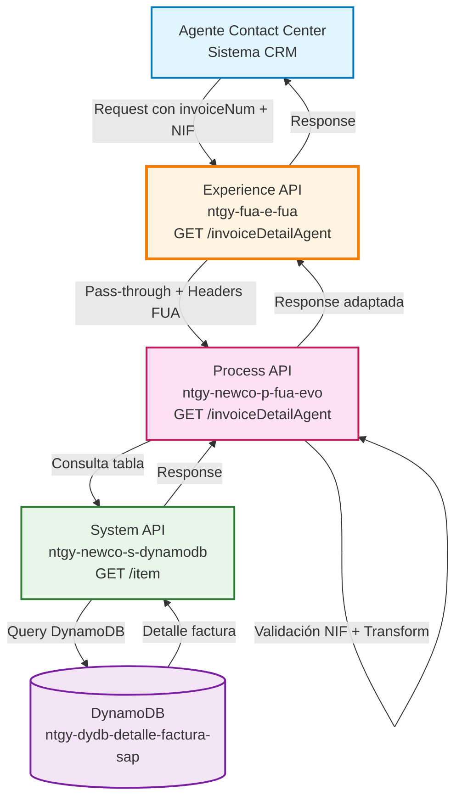
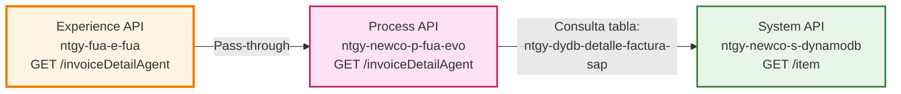
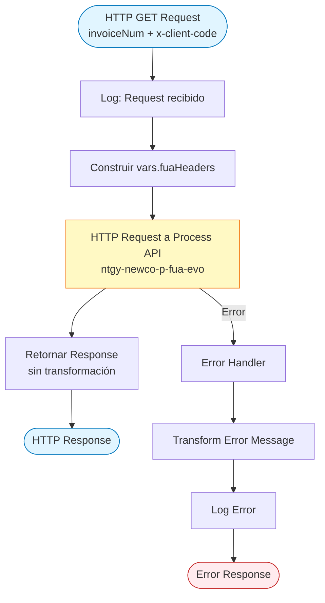
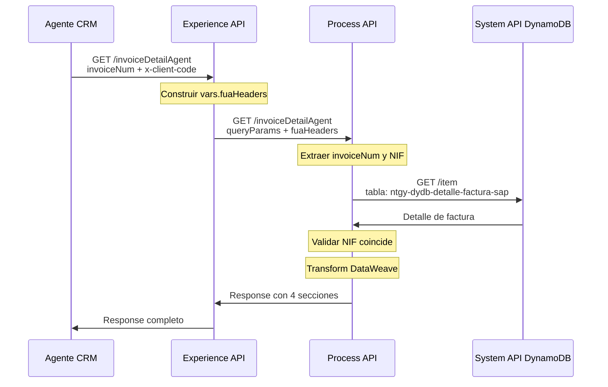
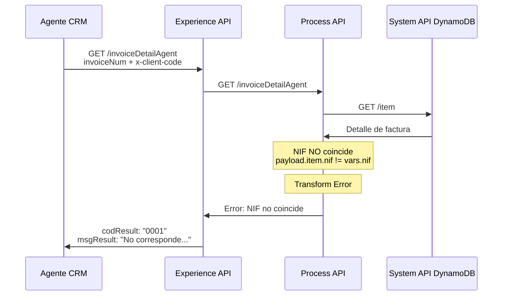
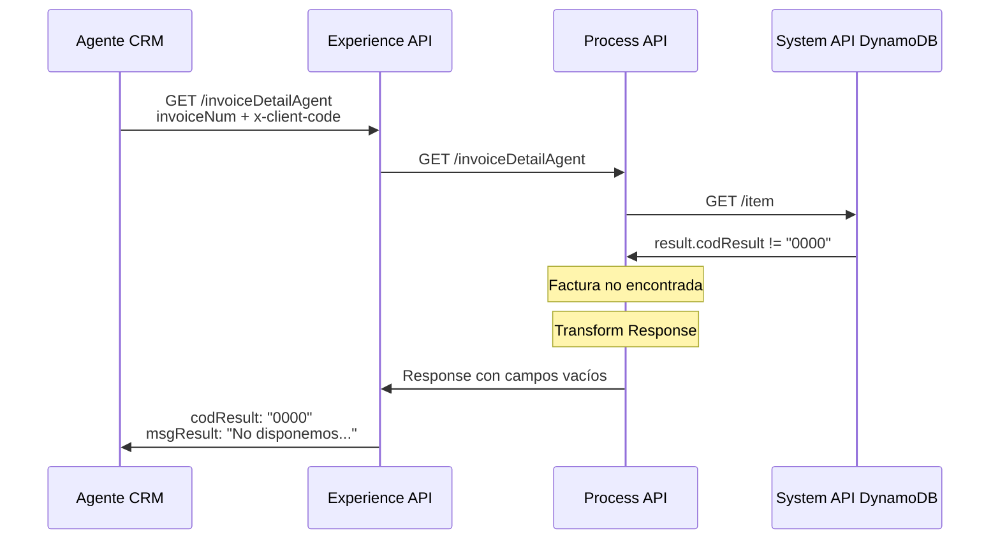
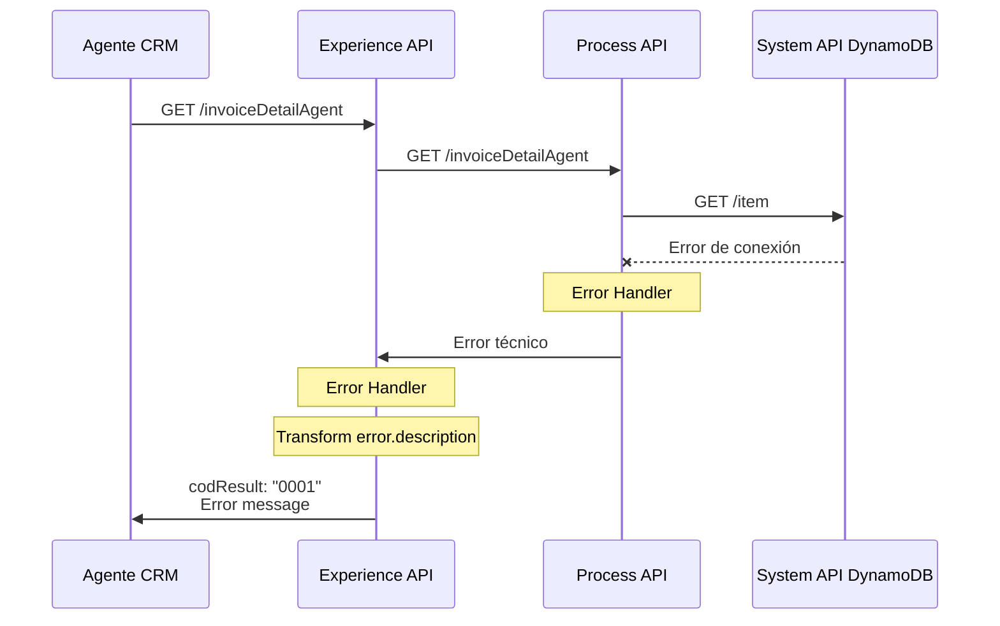

# GET /invoiceDetailAgent

## 📌 Descripción General

### Propósito del Endpoint

Este endpoint permite a los agentes del contact center consultar el detalle completo de una factura específica, incluyendo información general, desglose de cálculos, lecturas de gas y electricidad. Implementa validación de seguridad para garantizar que el NIF del cliente coincida con la factura solicitada.

### Tipo de API

**Capa:** Experience API (API-Led Connectivity)

**Función:** Adaptación de experiencia para canal Contact Center

### Patrón de Integración

**Tipo:** Pass-Through con Validación de Seguridad

**Descripción:** Este endpoint actúa como pass-through hacia el Process API, propagando los query parameters y headers necesarios. No realiza transformaciones de datos, pero añade headers de contexto FUA.

### Arquitectura API-Led Connectivity



---

## 💼 Propósito del Negocio

### Casos de Uso Principales

1. **Consulta de Detalle de Factura por Agente**
   - Agente recibe llamada de cliente con consulta sobre factura
   - Agente solicita número de factura y documento del cliente
   - Sistema valida que el cliente es propietario de la factura
   - Agente visualiza desglose completo para explicar al cliente

2. **Validación de Propiedad de Factura**
   - Cliente solicita información de una factura
   - Sistema verifica que el NIF del cliente coincida con la factura
   - Previene acceso no autorizado a información de facturación

3. **Análisis de Consumo y Cargos**
   - Agente necesita explicar conceptos de facturación
   - Accede a desglose detallado de cálculos
   - Visualiza lecturas de contadores (gas/electricidad)
   - Proporciona información clara al cliente

### 📱 Canal y Audiencia

#### Canal de Consumo

**Canal:** Contact Center

**Características del Canal:**
- **Plataforma**: Sistema CRM de agentes
- **Dispositivos**: Estaciones de trabajo de escritorio
- **Conectividad**: Red corporativa de alta velocidad
- **Experiencia de Usuario**: Interface de agente con múltiples pantallas

#### Audiencia Objetivo

**Usuarios Finales:**
- **Agentes de Contact Center**: Personal de atención al cliente que necesita consultar detalles de facturación para resolver consultas
- **Supervisores de Contact Center**: Personal que supervisa y apoya a agentes en casos complejos

**Contexto de Uso:**
- **Llamada Entrante**: Cliente llama con consulta sobre factura específica
- **Resolución de Incidencias**: Agente necesita información detallada para resolver reclamaciones
- **Verificación de Datos**: Validación de información antes de realizar gestiones

#### Adaptaciones del Canal

**Optimizaciones Aplicadas:**
- **Validación de Seguridad**: Verificación obligatoria de NIF para proteger datos del cliente
- **Timeout Extendido**: 60 segundos para permitir consultas complejas en DynamoDB
- **Headers de Contexto**: Propagación de headers FUA para trazabilidad
- **Response Completo**: Sin simplificación de datos, agente necesita toda la información

### 🔗 Endpoints Dependientes

Este Experience API consume el siguiente Process API:

| Process API | Endpoint | Método | Propósito |
|-------------|----------|--------|-----------|
| `ntgy-newco-p-fua-evo` | `/invoiceDetailAgent` | GET | Orquesta la consulta de detalle de factura con validación de cliente y transformación de datos |

#### Cadena de Dependencias Completa



**Nota:** El Process API internamente:
1. Extrae `invoiceNum` y `x-client-code` (NIF) de query params
2. Consulta DynamoDB tabla `ntgy-dydb-detalle-factura-sap`
3. Valida que el NIF coincida con la factura
4. Transforma respuesta con DataWeave (convierte objetos a arrays según necesidad)
5. Retorna 4 secciones: detalleGeneralECO, detalleCalculo, detalleLecturaGas, detalleLecturaLuz

### Contexto Empresarial

- **Dominio:** Atención al Cliente - Contact Center
- **Sector:** Energía - Utilities
- **División:** Naturgy España - FUA (Frontal Único de Atención)
- **Canal:** Contact Center (Agentes)

### Stakeholders

- **Agentes de Contact Center**: Necesitan acceso rápido y seguro a detalles de facturación para resolver consultas de clientes
- **Clientes Finales**: Beneficiarios indirectos que reciben mejor servicio gracias a información detallada disponible para agentes
- **Supervisores de Calidad**: Monitorean que se proporcione información correcta y completa a los clientes

### Valor de Negocio

- **Mejora en Tiempo de Resolución**: Acceso inmediato a detalles de factura reduce tiempo de llamada
- **Seguridad de Datos**: Validación de NIF previene acceso no autorizado a información sensible
- **Calidad de Servicio**: Agentes pueden explicar detalladamente conceptos de facturación
- **Reducción de Escalaciones**: Información completa permite resolver más casos en primera llamada

---

## 🔧 Especificación Técnica

### URLs por Ambiente

| Ambiente | URL Base | URL Completa |
|----------|----------|--------------|
| **Local** | `http://localhost:8081` | `http://localhost:8081/fua/api/invoiceDetailAgent?invoiceNum={numero}&x-client-code={nif}` |
| **Development** | `https://ntgy-fua-e-fua-dev.de-c1.cloudhub.io` | `https://ntgy-fua-e-fua-dev.de-c1.cloudhub.io/fua/api/invoiceDetailAgent?invoiceNum={numero}&x-client-code={nif}` |
| **UAT** | `https://ntgy-fua-e-fua-uat.de-c1.cloudhub.io` | `https://ntgy-fua-e-fua-uat.de-c1.cloudhub.io/fua/api/invoiceDetailAgent?invoiceNum={numero}&x-client-code={nif}` |
| **Production** | `https://ntgy-fua-e-fua-pro.de-c1.cloudhub.io` | `https://ntgy-fua-e-fua-pro.de-c1.cloudhub.io/fua/api/invoiceDetailAgent?invoiceNum={numero}&x-client-code={nif}` |

### Método HTTP

```
GET /fua/api/invoiceDetailAgent
```

### 🎯 Consideraciones del Canal

#### Limitaciones del Canal

| Aspecto | Limitación | Razón |
|---------|------------|-------|
| **Timeout** | 60 segundos | Consultas a DynamoDB pueden ser lentas con tablas grandes |
| **Rate Limiting** | Sin límite específico | Canal interno corporativo con alta confianza |
| **Autenticación** | OAuth 2.0 + Headers | Seguridad corporativa estándar |
| **Validación NIF** | Obligatoria | Protección de datos personales (GDPR) |

#### Campos Específicos del Canal

**Headers Añadidos por el Experience API:**

| Header | Tipo | Descripción | Razón |
|--------|------|-------------|-------|
| `vars.fuaHeaders` | Object | Headers de contexto FUA | Trazabilidad y contexto de sesión |

**Campos en Response (del Process API):**

| Campo | Tipo | Descripción |
|-------|------|-------------|
| `detalleGeneralECO` | Object | Información general económica de la factura |
| `detalleCalculo` | Object | Desglose detallado de cálculos y conceptos |
| `detalleLecturaGas` | Object | Lecturas de contadores de gas |
| `detalleLecturaLuz` | Object | Lecturas de contadores de electricidad |

### Parámetros de Entrada

#### Query Parameters (Obligatorios)

| Parámetro | Tipo | Obligatorio | Descripción | Ejemplo |
|-----------|------|-------------|-------------|---------|
| `invoiceNum` | String | ✅ Sí | Número de factura a consultar | `"1234567890"` |
| `x-client-code` | String | ✅ Sí | NIF/CIF del cliente (para validación) | `"12345678A"` |

**Nota Importante:** El parámetro `x-client-code` se usa para validar que el cliente es propietario de la factura solicitada. Si el NIF no coincide, se retorna un error de validación.

### Respuestas

#### Respuesta Exitosa (200 OK)

**Caso 1: Factura encontrada y NIF válido**

```json
{
  "detalleGeneralECO": {
    "numeroFactura": "FAC2024001234",
    "fechaEmision": "2024-01-15",
    "importeTotal": 125.75,
    "estado": "Pagada"
  },
  "detalleCalculo": {
    "DETALLE_PROD": [
      {
        "concepto": "Término de energía",
        "importe": 45.00,
        "unidad": "EUR"
      },
      {
        "concepto": "Término de potencia",
        "importe": 25.30,
        "unidad": "EUR"
      }
    ],
    "POSICION": [
      {
        "posicion": "001",
        "descripcion": "Término de energía"
      }
    ],
    "DETALLE_OTR": [
      {
        "concepto": "Impuesto eléctrico",
        "importe": 5.00
      }
    ]
  },
  "detalleLecturaGas": {
    "lectura_anterior": "12345",
    "lectura_actual": "12567",
    "consumo": "222"
  },
  "detalleLecturaLuz": {
    "lectura_anterior_p1": "45678",
    "lectura_actual_p1": "45890",
    "consumo_p1": "212"
  }
}
```

**Caso 2: Factura no encontrada en DynamoDB**

```json
{
  "result": {
    "codResult": "0000",
    "msgResult": "No disponemos del detalle de esta factura"
  },
  "detalleGeneralECO": "",
  "detalleCalculo": "",
  "detalleLecturaGas": "",
  "detalleLecturaLuz": ""
}
```

#### Respuesta de Error (200 OK con error de negocio)

**Caso: NIF no coincide con la factura**

```json
{
  "result": {
    "codResult": "0001",
    "msgResult": "No corresponde el documento del cliente con la factura solicitada"
  }
}
```

#### Respuesta de Error Técnico (500 Internal Server Error)

```json
{
  "result": {
    "codResult": "0001",
    "msgResult": "Error al consultar el detalle de la factura"
  }
}
```

### Códigos de Respuesta HTTP

| Código | Descripción | Cuándo Ocurre |
|--------|-------------|---------------|
| `200` | OK | Consulta exitosa (incluso si no hay datos o hay error de validación) |
| `400` | Bad Request | Parámetros faltantes o inválidos |
| `401` | Unauthorized | Token de autenticación inválido o expirado |
| `500` | Internal Server Error | Error técnico en el servidor o servicios downstream |

### Autenticación

- **Tipo:** OAuth 2.0
- **Header:** `Authorization: Bearer {token}`
- **Scope:** Acceso de agente de contact center

### Timeouts

| Tipo | Valor | Razón |
|------|-------|-------|
| **Request Timeout** | 60 segundos | Optimizado para consultas complejas en DynamoDB |
| **Connection Timeout** | 30 segundos | Tiempo estándar para establecer conexión |

---

## 🏗️ Implementación Técnica

### Arquitectura del Flow



### Implementación del Flow Principal

**Archivo:** `src/main/mule/implementation/get-invoice-detail-agent.xml`

```xml
<flow name="get-invoice-detail-agent">
    <http:request method="GET" 
                  doc:name="Get Invoice Detail Agent Request" 
                  config-ref="HTTP_FUA_PROCESS_NEWCO_EVO" 
                  path="/invoiceDetailAgent">
        <http:query-params><![CDATA[#[output application/java
---
attributes.queryParams ++ vars.fuaHeaders]]]></http:query-params>
    </http:request>
    
    <error-handler>
        <on-error-propagate enableNotifications="true" 
                           logException="true" 
                           doc:name="On Error Propagate">
            <ee:transform doc:name="Set Error Message">
                <ee:message>
                    <ee:set-payload><![CDATA[%dw 2.0
output application/json
---
{
    "result": {
        "codResult": "0001",
        "msgResult": error.description as String replace /\"/ with("")
    }
}]]></ee:set-payload>
                </ee:message>
            </ee:transform>
            <logger level="ERROR" 
                    doc:name="Error" 
                    message='#[{"result": {"codResult": "0001", "msgResult": error.description as String replace /\"/ with("")}}]' />
        </on-error-propagate>
    </error-handler>
</flow>
```

### Transformaciones de Canal

⚠️ **Este Experience API NO transforma la respuesta del Process API.**

**Patrón:** Pass-Through Completo

**Justificación:** 
- Los agentes de contact center necesitan toda la información disponible
- No hay restricciones de ancho de banda (red corporativa)
- La complejidad de la transformación se maneja en el Process API

Para el schema completo de la respuesta, consultar:
📖 **Process API: `ntgy-newco-p-fua-evo` endpoint `/invoiceDetailAgent`**

### Lógica de Negocio en Process API

El Process API (ntgy-newco-p-fua-evo) implementa la siguiente lógica:

1. **Extracción de Parámetros**
   ```dataweave
   vars.invoiceNumber = attributes.queryParams.invoiceNum
   vars.nif = attributes.queryParams.'x-client-code'
   ```

2. **Consulta a DynamoDB**
   - Endpoint: `GET /item`
   - Tabla: `ntgy-dydb-detalle-factura-sap`
   - Key: `numFactura`

3. **Validaciones**
   - Si `payload.result.codResult != "0000"` → Factura no encontrada
   - Si `payload.item.nif != vars.nif` → NIF no coincide

4. **Transformación DataWeave**
   - Convierte objetos a arrays para campos: `DETALLE_PROD`, `POSICION`, `DETALLE_OTR`
   - Extrae 4 secciones principales del detalle

### Patrones de Diseño

**Patrón:** Pass-Through con Error Handling

**Justificación:** 
- Simplicidad: El Experience API delega toda la lógica al Process API
- Separación de Responsabilidades: Validación y transformación en Process API
- Mantenibilidad: Cambios en lógica de negocio no afectan Experience API

### Diagramas de Secuencia

#### 1. Flujo Normal de Éxito (Factura Encontrada)



#### 2. Flujo con Error de Validación (NIF no coincide)



#### 3. Flujo con Factura No Encontrada



#### 4. Flujo con Error Técnico



### Configuración de Conectores

#### HTTP Request Configuration (Process API)

**Nombre:** `HTTP_FUA_PROCESS_NEWCO_EVO`

**Configuración (Production):**
```yaml
newco-p-fua-evo:
  host: "mule-worker-internal-ntgy-newco-p-fua-evo.de-c1.cloudhub.io"
  port: "8091"
  timeout: "60000"  # 60 segundos
```

**Connection Pooling:**
- Max Connections: 50
- Connection Timeout: 30000 ms
- Keep-Alive: Enabled

### Manejo de Errores

#### Error Handler Global

```dataweave
%dw 2.0
output application/json
---
{
    "result": {
        "codResult": "0001",
        "msgResult": error.description as String replace /\"/ with("")
    }
}
```

**Estrategia:**
- Captura cualquier error del Process API
- Transforma a formato estándar de respuesta
- Elimina comillas dobles del mensaje de error
- Registra en logs con nivel ERROR

#### Tipos de Errores Manejados

| Tipo de Error | Código | Mensaje | Acción |
|---------------|--------|---------|--------|
| **Factura no encontrada** | 0000 | "No disponemos del detalle de esta factura" | Retornar response con campos vacíos |
| **NIF no coincide** | 0001 | "No corresponde el documento del cliente..." | Retornar error de validación |
| **Error técnico** | 0001 | Descripción del error | Retornar error técnico |
| **Timeout** | 0001 | "Timeout al consultar detalle" | Retornar error de timeout |

---

## 💻 Ejemplos de Uso

### Ejemplo 1: Consulta Exitosa de Factura

#### cURL

```bash
curl -X GET "https://ntgy-fua-e-fua-pro.de-c1.cloudhub.io/fua/api/invoiceDetailAgent?invoiceNum=1234567890&x-client-code=12345678A" \
  -H "Authorization: Bearer YOUR_ACCESS_TOKEN" \
  -H "Content-Type: application/json"
```

#### Respuesta (200 OK)

```json
{
  "detalleGeneralECO": {
    "numeroFactura": "1234567890",
    "fechaEmision": "2024-01-15",
    "periodo": "01/01/2024 - 31/01/2024",
    "importeTotal": 85.50,
    "estado": "Pagada"
  },
  "detalleCalculo": {
    "DETALLE_PROD": [
      {
        "concepto": "Término de potencia",
        "importe": 25.50,
        "unidad": "EUR"
      },
      {
        "concepto": "Término de energía",
        "importe": 45.00,
        "unidad": "EUR"
      }
    ],
    "POSICION": [
      {
        "posicion": "1",
        "descripcion": "Suministro eléctrico",
        "cantidad": 200,
        "precio_unitario": 0.225
      }
    ],
    "DETALLE_OTR": [
      {
        "concepto": "Impuesto eléctrico",
        "importe": 5.00
      }
    ]
  },
  "detalleLecturaGas": "",
  "detalleLecturaLuz": {
    "lectura_anterior_p1": "5000",
    "fecha_anterior": "2023-12-31",
    "lectura_actual_p1": "5200",
    "fecha_actual": "2024-01-31",
    "consumo_p1": 200,
    "tipo_lectura": "Real"
  }
}
```

### Ejemplo 2: Factura No Encontrada

#### cURL

```bash
curl -X GET "https://ntgy-fua-e-fua-pro.de-c1.cloudhub.io/fua/api/invoiceDetailAgent?invoiceNum=9999999999&x-client-code=12345678A" \
  -H "Authorization: Bearer YOUR_ACCESS_TOKEN" \
  -H "Content-Type: application/json"
```

#### Respuesta (200 OK)

```json
{
  "result": {
    "codResult": "0000",
    "msgResult": "No disponemos del detalle de esta factura"
  },
  "detalleGeneralECO": "",
  "detalleCalculo": "",
  "detalleLecturaGas": "",
  "detalleLecturaLuz": ""
}
```

### Ejemplo 3: Error de Validación (NIF no coincide)

#### cURL

```bash
curl -X GET "https://ntgy-fua-e-fua-pro.de-c1.cloudhub.io/fua/api/invoiceDetailAgent?invoiceNum=1234567890&x-client-code=99999999Z" \
  -H "Authorization: Bearer YOUR_ACCESS_TOKEN" \
  -H "Content-Type: application/json"
```

#### Respuesta (200 OK)

```json
{
  "result": {
    "codResult": "0001",
    "msgResult": "No corresponde el documento del cliente con la factura solicitada"
  }
}
```

### Ejemplo 4: JavaScript (para Integración CRM)

```javascript
async function getInvoiceDetail(invoiceNum, clientNif, accessToken) {
  const url = `https://ntgy-fua-e-fua-pro.de-c1.cloudhub.io/fua/api/invoiceDetailAgent?invoiceNum=${invoiceNum}&x-client-code=${clientNif}`;
  
  try {
    const response = await fetch(url, {
      method: 'GET',
      headers: {
        'Authorization': `Bearer ${accessToken}`,
        'Content-Type': 'application/json'
      }
    });
    
    const data = await response.json();
    
    // Verificar si hay error de validación
    if (data.result && data.result.codResult === "0001") {
      console.error('Error de validación:', data.result.msgResult);
      return null;
    }
    
    // Verificar si la factura no existe
    if (data.result && data.result.codResult === "0000") {
      console.warn('Factura no encontrada:', data.result.msgResult);
      return null;
    }
    
    return data;
  } catch (error) {
    console.error('Error al consultar factura:', error);
    throw error;
  }
}

// Uso
const invoiceDetail = await getInvoiceDetail('1234567890', '12345678A', 'YOUR_TOKEN');
if (invoiceDetail) {
  console.log('Detalle General:', invoiceDetail.detalleGeneralECO);
  console.log('Detalle Cálculo:', invoiceDetail.detalleCalculo);
}
```

### Ejemplo 5: Python (para Scripts de Automatización)

```python
import requests

def get_invoice_detail(invoice_num, client_nif, access_token):
    """
    Consulta el detalle de una factura para agentes.
    
    Args:
        invoice_num (str): Número de factura
        client_nif (str): NIF del cliente
        access_token (str): Token de autenticación
        
    Returns:
        dict: Detalle de la factura o None si hay error
    """
    url = "https://ntgy-fua-e-fua-pro.de-c1.cloudhub.io/fua/api/invoiceDetailAgent"
    
    params = {
        'invoiceNum': invoice_num,
        'x-client-code': client_nif
    }
    
    headers = {
        'Authorization': f'Bearer {access_token}',
        'Content-Type': 'application/json'
    }
    
    try:
        response = requests.get(url, params=params, headers=headers)
        response.raise_for_status()
        
        data = response.json()
        
        # Verificar errores de negocio
        if 'result' in data:
            if data['result']['codResult'] == "0001":
                print(f"Error de validación: {data['result']['msgResult']}")
                return None
            elif data['result']['codResult'] == "0000":
                print(f"Factura no encontrada: {data['result']['msgResult']}")
                return None
        
        return data
        
    except requests.exceptions.RequestException as e:
        print(f"Error al consultar factura: {e}")
        return None

# Uso
invoice_detail = get_invoice_detail('1234567890', '12345678A', 'YOUR_TOKEN')
if invoice_detail:
    print(f"Detalle General: {invoice_detail['detalleGeneralECO']}")
    print(f"Lecturas Luz: {invoice_detail['detalleLecturaLuz']}")
```
