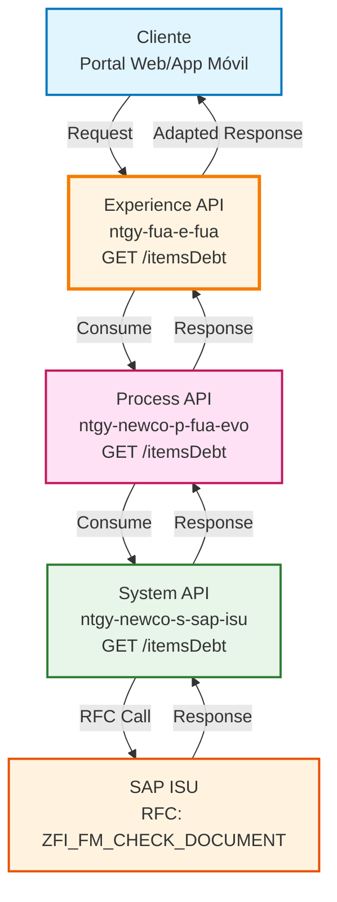
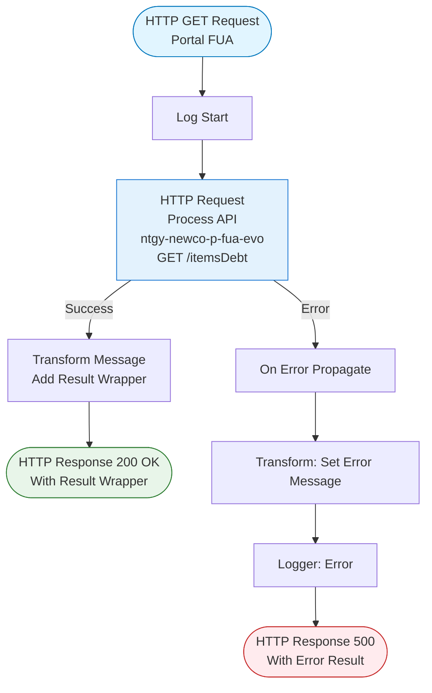
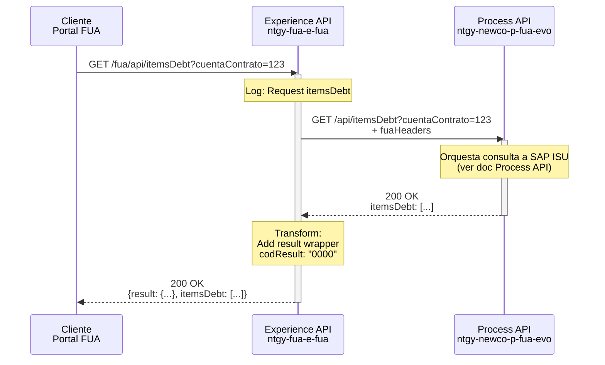
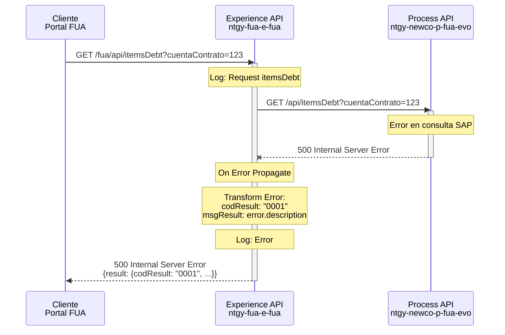
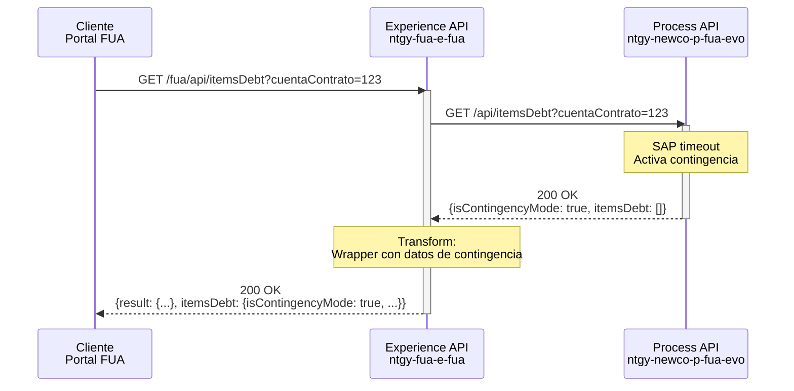

# GET /itemsDebt

## 📌 Descripción General

### Propósito del Endpoint

Este endpoint de Experience API proporciona acceso a las partidas de deuda asociadas a una cuenta contrato específica, adaptado para canales web y móviles del portal FUA (Frontal Único de Atención). Actúa como un wrapper que añade una estructura de respuesta estandarizada sobre los datos del Process API.

### Tipo de API

**Capa:** Experience API (API-Led Connectivity)

**Función:** Adaptación de experiencia para canales web y móviles

### Patrón de Integración

**Tipo:** Pass-Through con Wrapper de Respuesta

**Descripción:** Este endpoint consume directamente el Process API sin transformar los datos de negocio, pero añade una estructura de respuesta consistente con los estándares del portal FUA, incluyendo códigos de resultado y mensajes de error estandarizados.

### Arquitectura API-Led Connectivity



---

## 💼 Propósito del Negocio

### Casos de Uso Principales

1. **Consulta de Deuda Pendiente en Portal Web**
   - Los clientes acceden desde el portal FUA para visualizar sus partidas de deuda
   - Interfaz optimizada para navegadores desktop y móviles
   - Respuesta estructurada para fácil renderizado en componentes web

2. **Consulta de Deuda en Aplicación Móvil**
   - Clientes consultan su deuda desde apps iOS/Android
   - Respuesta optimizada para consumo móvil
   - Manejo de errores adaptado a experiencia móvil

3. **Gestión de Pagos y Fraccionamientos**
   - Información base para configurar planes de pago
   - Identificación de partidas elegibles para fraccionamiento
   - Visualización de deuda total y detalle por partida

### 📱 Canal y Audiencia

#### Canal de Consumo

**Canal:** Web/Mobile

**Características del Canal:**
- **Plataforma**: Portal FUA (web responsive) y aplicaciones móviles nativas
- **Dispositivos**: Navegadores modernos (Chrome, Firefox, Safari, Edge) y smartphones iOS/Android
- **Conectividad**: Optimizado para conexiones 3G/4G/5G y WiFi
- **Experiencia de Usuario**: Interfaz intuitiva con visualización clara de deuda pendiente

#### Audiencia Objetivo

**Usuarios Finales:**
- **Clientes Residenciales**: Consultan su deuda de suministros de energía (electricidad/gas)
- **Clientes Empresariales**: Gestionan deuda de múltiples contratos y cuentas

**Contexto de Uso:**
- **Consulta Proactiva**: Cliente revisa su estado de deuda antes de realizar pagos
- **Gestión de Pagos**: Cliente planifica pagos o solicita fraccionamientos
- **Verificación Post-Pago**: Cliente confirma que sus pagos se han aplicado correctamente

#### Adaptaciones del Canal

**Optimizaciones Aplicadas:**
- **Estructura de Respuesta Estandarizada**: Wrapper con `result` (codResult, msgResult) + `itemsDebt`
- **Manejo de Errores Consistente**: Códigos de error estandarizados para el portal FUA
- **Formato JSON Optimizado**: Estructura plana y fácil de consumir en frontend
- **Timeout Configurado**: 60 segundos para garantizar respuesta en condiciones normales

### 🔗 Endpoints Dependientes

Este Experience API consume el siguiente Process API:

| Process API | Endpoint | Método | Propósito |
|-------------|----------|--------|-----------|
| `ntgy-newco-p-fua-evo` | `/itemsDebt` | GET | Orquesta la consulta de partidas de deuda a SAP ISU con lógica de contingencia y transformación de datos |

**Flujo de Datos:**
```
Portal FUA → Experience API → Process API → System API → SAP ISU
```

### Contexto Empresarial

- **Dominio:** Autoservicio de Clientes - Gestión de Deuda
- **Sector:** Energía - Utilities
- **División:** Naturgy España - NewCo
- **Canal:** Web/Móvil

### Stakeholders

- **Clientes Finales**: Necesitan visibilidad clara de su deuda pendiente para gestionar pagos
- **Equipo de Desarrollo Frontend**: Consume este endpoint para renderizar información de deuda en el portal
- **Departamento de Cobros**: Indirectamente beneficiado por la transparencia que facilita pagos voluntarios
- **Soporte al Cliente**: Usa la misma información para asistir a clientes con consultas de deuda

### Valor de Negocio

- **Transparencia Financiera**: Clientes tienen acceso 24/7 a información detallada de su deuda
- **Reducción de Llamadas al Call Center**: Autoservicio reduce consultas telefónicas sobre estado de deuda
- **Facilitación de Pagos**: Información clara incentiva pagos proactivos
- **Experiencia de Usuario Consistente**: Estructura de respuesta estandarizada facilita desarrollo frontend

---

## 🔧 Especificación Técnica

### URLs por Ambiente

| Ambiente | URL Base | URL Completa |
|----------|----------|--------------|
| **Local** | `http://localhost:8081` | `http://localhost:8081/fua/api/itemsDebt?cuentaContrato=:cuentaContrato` |
| **Development** | `https://ntgy-fua-e-fua-dev.de-c1.cloudhub.io` | `https://ntgy-fua-e-fua-dev.de-c1.cloudhub.io/fua/api/itemsDebt?cuentaContrato=:cuentaContrato` |
| **UAT** | `https://ntgy-fua-e-fua-uat.de-c1.cloudhub.io` | `https://ntgy-fua-e-fua-uat.de-c1.cloudhub.io/fua/api/itemsDebt?cuentaContrato=:cuentaContrato` |
| **Production** | `https://ntgy-fua-e-fua-pro.de-c1.cloudhub.io` | `https://ntgy-fua-e-fua-pro.de-c1.cloudhub.io/fua/api/itemsDebt?cuentaContrato=:cuentaContrato` |

### Método HTTP

```
GET /fua/api/itemsDebt
```

### 🎯 Consideraciones del Canal

#### Limitaciones del Canal

| Aspecto | Limitación | Razón |
|---------|------------|-------|
| **Timeout** | 60 segundos | Configurado para garantizar respuesta incluso con latencia de SAP ISU |
| **Tamaño de Respuesta** | Variable (depende de partidas) | Sin límite específico, pero optimizado para carga rápida |
| **Rate Limiting** | Según políticas de API Gateway | Protección contra abuso y garantía de disponibilidad |

#### Campos Específicos del Canal

**Campos Añadidos por el Experience API:**

| Campo | Tipo | Descripción | Razón |
|-------|------|-------------|-------|
| `result` | Object | Objeto con codResult y msgResult | Estandarización de respuestas del portal FUA |
| `result.codResult` | String | Código de resultado ("0000" = éxito, "0001" = error) | Facilita manejo de errores en frontend |
| `result.msgResult` | String | Mensaje descriptivo del resultado | Proporciona contexto para logging y debugging |

**Estructura del Wrapper:**
```json
{
  "result": {
    "codResult": "0000",
    "msgResult": "No hay error"
  },
  "itemsDebt": [...]
}
```

### Parámetros de Entrada

#### Query Parameters

| Parámetro | Tipo | Requerido | Descripción | Ejemplo |
|-----------|------|-----------|-------------|---------|
| `cuentaContrato` | String | ✅ Sí | Identificador de la cuenta contrato en SAP ISU | `"1234567890"` |

**Nota:** Este parámetro se pasa directamente al Process API junto con los headers de FUA.

#### Headers

| Header | Tipo | Requerido | Descripción | Ejemplo |
|--------|------|-----------|-------------|---------|
| `Content-Type` | String | ✅ Sí | Tipo de contenido | `"application/json"` |
| `client_id` | String | ✅ Sí | ID de cliente de Anypoint Platform | `"your-client-id"` |
| `client_secret` | String | ✅ Sí | Secret de cliente de Anypoint Platform | `"your-client-secret"` |

**Headers Adicionales (propagados al Process API):**
- Todos los query parameters y headers de la request original se propagan al Process API
- Variables de FUA (`vars.fuaHeaders`) se incluyen automáticamente

### Respuestas

#### 200 OK - Éxito

**Estructura de Respuesta:**

```json
{
  "result": {
    "codResult": "0000",
    "msgResult": "No hay error"
  },
  "itemsDebt": [
    {
      "cuentaContrato": "1234567890",
      "pendingAmount": 150.75,
      "issuedDate": "2024-01-15 00:00:00",
      "dueDate": "2024-02-15 00:00:00",
      "opbel": "OP123456",
      "step": "1",
      "migrated": false,
      "items": [
        {
          "opupk": "ITEM001"
        }
      ]
    }
  ]
}
```

**Campos de Respuesta:**

| Campo | Tipo | Descripción |
|-------|------|-------------|
| `result` | Object | Objeto de resultado estandarizado del portal FUA |
| `result.codResult` | String | Código de resultado: "0000" = éxito, "0001" = error |
| `result.msgResult` | String | Mensaje descriptivo del resultado |
| `itemsDebt` | Array | Array de partidas de deuda (estructura del Process API) |

**Para el schema completo de `itemsDebt`, consultar:**
📖 **Process API: `ntgy-newco-p-fua-evo` endpoint `/itemsDebt`**

El Experience API NO transforma la estructura de `itemsDebt`, solo añade el wrapper `result`.

#### 200 OK - Modo Contingencia (desde Process API)

```json
{
  "result": {
    "codResult": "0000",
    "msgResult": "No hay error"
  },
  "itemsDebt": {
    "isContingencyMode": true,
    "itemsDebt": []
  }
}
```

**Nota:** Cuando el Process API activa modo contingencia por timeout de SAP, el Experience API envuelve la respuesta manteniendo la estructura de contingencia.

#### 500 Internal Server Error

```json
{
  "result": {
    "codResult": "0001",
    "msgResult": "Error description from backend"
  }
}
```

**Cuándo se devuelve:**
- Error en llamada al Process API
- Timeout en comunicación con Process API
- Error interno del Experience API

### Autenticación

- **Tipo:** Client ID & Client Secret (Anypoint Platform)
- **Método:** Headers HTTP
- **Headers requeridos:**
  - `client_id`: ID de la aplicación cliente
  - `client_secret`: Secret de la aplicación cliente

### Timeouts

| Tipo | Valor | Configuración |
|------|-------|---------------|
| **Request Timeout** | 60 segundos | `${newco-p-fua-evo.timeout}` |
| **Connection Idle Timeout** | 60 segundos | `${newco-p-fua-evo.timeout}` |

---

## 🏗️ Implementación Técnica

### Arquitectura del Flow



### Transformaciones de Canal

**Transformación Principal: Wrapper de Respuesta**

El Experience API añade un wrapper estandarizado sobre la respuesta del Process API:

| Campo Original (Process API) | Campo Transformado (Experience API) | Transformación |
|------------------------------|-------------------------------------|----------------|
| `payload` (completo) | `itemsDebt` | Pass-through sin modificación |
| N/A | `result.codResult` | Añadido: "0000" para éxito |
| N/A | `result.msgResult` | Añadido: "No hay error" para éxito |

**Lógica de Transformación (Éxito):**

**Ubicación:** `src/main/mule/implementation/get-itemsDebt.xml` (líneas 9-21)

```dataweave
%dw 2.0
output application/json
---
{
  "result": {
    "codResult": "0000",
    "msgResult": "No hay error"
  },
  "itemsDebt": payload
}
```

**Lógica de Transformación (Error):**

**Ubicación:** `src/main/mule/implementation/get-itemsDebt.xml` (líneas 25-35)

```dataweave
%dw 2.0
output application/json
---
{
  "result": {
    "codResult": "0001",
    "msgResult": error.description as String replace /\"/ with("")
  }
}
```

**Características de la Transformación:**
- **Wrapper Consistente**: Todas las respuestas incluyen objeto `result`
- **Código de Error Estandarizado**: "0000" = éxito, "0001" = error
- **Limpieza de Mensajes**: Elimina comillas dobles de mensajes de error
- **Pass-Through de Datos**: Los datos de `itemsDebt` no se modifican

### Patrones de Diseño

**Patrón: Wrapper Pattern (Adapter)**

**Justificación:** El portal FUA requiere una estructura de respuesta consistente en todos sus endpoints. Este patrón permite:
- Estandarizar respuestas de múltiples Process APIs
- Facilitar manejo de errores en frontend
- Mantener compatibilidad con componentes UI existentes
- Simplificar logging y debugging

**Implementación:**
- Wrapper añadido en transformación DataWeave
- Estructura `result` + `data` consistente
- Códigos de error estandarizados

### Diagramas de Secuencia

#### 1. Flujo Normal de Éxito



#### 2. Flujo con Error de Backend



#### 3. Flujo con Modo Contingencia (Pass-Through)



### Configuración HTTP

**HTTP Request Configuration:**

**Ubicación:** `src/main/mule/global.xml` (líneas 30-32)

```xml
<http:request-config 
    name="HTTP_FUA_PROCESS_NEWCO_EVO" 
    basePath="/api" 
    responseTimeout="${newco-p-fua-evo.timeout}">
    <http:request-connection 
        host="${newco-p-fua-evo.host}" 
        port="${newco-p-fua-evo.port}" 
        connectionIdleTimeout="${newco-p-fua-evo.timeout}"/>
</http:request-config>
```

**Propiedades (Producción):**

**Ubicación:** `src/main/resources/e-fua-pro-config.yaml` (líneas 25-28)

```yaml
newco-p-fua-evo:
  host: "mule-worker-internal-ntgy-newco-p-fua-evo.de-c1.cloudhub.io"
  port: "8091"
  timeout: "60000"
```

**Parámetros de Configuración:**
- **Host**: Worker interno de CloudHub (comunicación interna optimizada)
- **Port**: 8091 (puerto estándar de Process APIs)
- **Timeout**: 60 segundos (permite tiempo suficiente para consulta SAP con contingencia)
- **Base Path**: `/api` (prefijo estándar de Process APIs)

### Manejo de Errores

#### Estrategia de Error Handling

**Ubicación:** `src/main/mule/implementation/get-itemsDebt.xml` (líneas 23-38)

```xml
<error-handler>
    <on-error-propagate enableNotifications="true" logException="true">
        <ee:transform doc:name="Set Error Message">
            <ee:message>
                <ee:set-payload><![CDATA[%dw 2.0
output application/json
---
{
    "result": {
        "codResult": "0001",
        "msgResult": error.description as String replace /\"/ with("")
    }
}]]></ee:set-payload>
            </ee:message>
        </ee:transform>
        <logger level="ERROR" doc:name="Error" message='#[{
    "result": {
        "codResult": "0001",
        "msgResult": error.description as String replace /\"/ with("")
    }
}]' />
    </on-error-propagate>
</error-handler>
```

**Tipos de Error Manejados:**

| Error | Acción | Respuesta |
|-------|--------|-----------|
| **Timeout Process API** | Propagar con wrapper | 500 - codResult: "0001" |
| **Error de Conectividad** | Propagar con wrapper | 500 - codResult: "0001" |
| **Error de Validación** | Propagar con wrapper | 500 - codResult: "0001" |
| **Error Interno** | Propagar con wrapper | 500 - codResult: "0001" |

**Características del Manejo de Errores:**
- **On Error Propagate**: Los errores se propagan al cliente con código HTTP 500
- **Transformación de Error**: Convierte error en estructura estandarizada
- **Logging**: Registra error completo para debugging
- **Limpieza de Mensajes**: Elimina comillas dobles de descripciones de error

#### Logging

```xml
<!-- Log de error -->
<logger level="ERROR" 
    message='#[{
        "result": {
            "codResult": "0001",
            "msgResult": error.description as String replace /\"/ with("")
        }
    }]' />
```

**Nivel de Log:** ERROR (para todos los errores propagados)

---

## 💻 Ejemplos de Uso

### Ejemplo 1: Consulta Exitosa con Partidas de Deuda

#### cURL

```bash
curl -X GET "https://ntgy-fua-e-fua-pro.de-c1.cloudhub.io/fua/api/itemsDebt?cuentaContrato=1234567890" \
  -H "Content-Type: application/json" \
  -H "client_id: YOUR_CLIENT_ID" \
  -H "client_secret: YOUR_CLIENT_SECRET"
```

#### Respuesta (200 OK)

```json
{
  "result": {
    "codResult": "0000",
    "msgResult": "No hay error"
  },
  "itemsDebt": {
    "isContingencyMode": false,
    "itemsDebt": [
      {
        "cuentaContrato": "1234567890",
        "pendingAmount": 150.75,
        "issuedDate": "2024-01-15 00:00:00",
        "dueDate": "2024-02-15 00:00:00",
        "opbel": "OP123456",
        "step": "1",
        "migrated": false,
        "items": [
          {
            "opupk": "ITEM001"
          },
          {
            "opupk": "ITEM002"
          }
        ]
      },
      {
        "cuentaContrato": "1234567890",
        "pendingAmount": 89.50,
        "issuedDate": "2024-02-01 00:00:00",
        "dueDate": "2024-03-01 00:00:00",
        "opbel": "OP123457",
        "step": "2",
        "migrated": false,
        "items": [
          {
            "opupk": "ITEM003"
          }
        ]
      }
    ]
  }
}
```

### Ejemplo 2: Consulta con Modo Contingencia (SAP Timeout)

#### cURL

```bash
curl -X GET "https://ntgy-fua-e-fua-pro.de-c1.cloudhub.io/fua/api/itemsDebt?cuentaContrato=1234567890" \
  -H "Content-Type: application/json" \
  -H "client_id: YOUR_CLIENT_ID" \
  -H "client_secret: YOUR_CLIENT_SECRET"
```

#### Respuesta (200 OK - Contingencia)

```json
{
  "result": {
    "codResult": "0000",
    "msgResult": "No hay error"
  },
  "itemsDebt": {
    "isContingencyMode": true,
    "itemsDebt": []
  }
}
```

**Nota:** El Process API activó modo contingencia por timeout de SAP. El Experience API envuelve esta respuesta manteniendo la estructura de contingencia.

### Ejemplo 3: Error de Backend

#### cURL

```bash
curl -X GET "https://ntgy-fua-e-fua-pro.de-c1.cloudhub.io/fua/api/itemsDebt?cuentaContrato=INVALID" \
  -H "Content-Type: application/json" \
  -H "client_id: YOUR_CLIENT_ID" \
  -H "client_secret: YOUR_CLIENT_SECRET"
```

#### Respuesta (500 Internal Server Error)

```json
{
  "result": {
    "codResult": "0001",
    "msgResult": "Error processing request: Invalid account number"
  }
}
```

### Ejemplo 4: JavaScript (Fetch API) - Portal Web

```javascript
/**
 * Consulta las partidas de deuda de una cuenta contrato
 * @param {string} cuentaContrato - Identificador de la cuenta contrato
 * @returns {Promise<Object>} Respuesta con partidas de deuda
 */
const getItemsDebt = async (cuentaContrato) => {
  try {
    const response = await fetch(
      `https://ntgy-fua-e-fua-pro.de-c1.cloudhub.io/fua/api/itemsDebt?cuentaContrato=${cuentaContrato}`,
      {
        method: 'GET',
        headers: {
          'Content-Type': 'application/json',
          'client_id': process.env.CLIENT_ID,
          'client_secret': process.env.CLIENT_SECRET
        }
      }
    );

    const data = await response.json();
    
    // Verificar código de resultado
    if (data.result.codResult !== "0000") {
      throw new Error(`Error del servidor: ${data.result.msgResult}`);
    }
    
    // Verificar modo contingencia
    if (data.itemsDebt.isContingencyMode) {
      console.warn('⚠️ Sistema en modo contingencia - Datos limitados');
      return {
        success: true,
        contingency: true,
        items: [],
        message: 'Información de deuda temporalmente no disponible'
      };
    }
    
    // Procesar partidas de deuda
    const items = data.itemsDebt.itemsDebt || [];
    const totalDebt = items.reduce((sum, item) => sum + item.pendingAmount, 0);
    
    console.log(`✅ ${items.length} partidas de deuda encontradas`);
    console.log(`💰 Total deuda: ${totalDebt.toFixed(2)}€`);
    
    return {
      success: true,
      contingency: false,
      items: items,
      totalDebt: totalDebt
    };
    
  } catch (error) {
    console.error('❌ Error al consultar partidas de deuda:', error);
    throw error;
  }
};

// Uso en componente React
const DebtComponent = () => {
  const [debtData, setDebtData] = useState(null);
  const [loading, setLoading] = useState(false);
  const [error, setError] = useState(null);

  useEffect(() => {
    const fetchDebt = async () => {
      setLoading(true);
      try {
        const result = await getItemsDebt('1234567890');
        setDebtData(result);
      } catch (err) {
        setError(err.message);
      } finally {
        setLoading(false);
      }
    };

    fetchDebt();
  }, []);

  if (loading) return <div>Cargando partidas de deuda...</div>;
  if (error) return <div>Error: {error}</div>;
  if (!debtData) return null;

  if (debtData.contingency) {
    return (
      <div className="alert alert-warning">
        ⚠️ Información de deuda temporalmente no disponible
      </div>
    );
  }

  return (
    <div className="debt-container">
      <h2>Partidas de Deuda</h2>
      <p className="total-debt">Total: {debtData.totalDebt.toFixed(2)}€</p>
      <ul className="debt-list">
        {debtData.items.map((item, index) => (
          <li key={index}>
            <strong>{item.opbel}</strong>: {item.pendingAmount}€
            <br />
            Vencimiento: {item.dueDate}
            {item.migrated && <span className="badge">Migrada</span>}
          </li>
        ))}
      </ul>
    </div>
  );
};
```

### Ejemplo 5: Python (Requests) - Integración Backend

```python
import requests
from typing import Dict, List, Optional
from datetime import datetime

class FUADebtClient:
    """Cliente para consultar partidas de deuda del portal FUA"""
    
    def __init__(self, base_url: str, client_id: str, client_secret: str):
        self.base_url = base_url
        self.client_id = client_id
        self.client_secret = client_secret
        self.session = requests.Session()
        self.session.headers.update({
            'Content-Type': 'application/json',
            'client_id': client_id,
            'client_secret': client_secret
        })
    
    def get_items_debt(self, cuenta_contrato: str) -> Dict:
        """
        Consulta las partidas de deuda de una cuenta contrato
        
        Args:
            cuenta_contrato: Identificador de la cuenta contrato
            
        Returns:
            Dict con información de partidas de deuda
            
        Raises:
            requests.exceptions.RequestException: Error en la petición HTTP
            ValueError: Error en el formato de respuesta
        """
        url = f"{self.base_url}/fua/api/itemsDebt"
        params = {'cuentaContrato': cuenta_contrato}
        
        try:
            response = self.session.get(url, params=params, timeout=65)
            response.raise_for_status()
            
            data = response.json()
            
            # Verificar código de resultado
            if data.get('result', {}).get('codResult') != "0000":
                error_msg = data.get('result', {}).get('msgResult', 'Error desconocido')
                raise ValueError(f"Error del servidor: {error_msg}")
            
            # Extraer datos de deuda
            items_debt_data = data.get('itemsDebt', {})
            
            # Verificar modo contingencia
            if items_debt_data.get('isContingencyMode', False):
                print(f"⚠️ Modo contingencia activado para cuenta {cuenta_contrato}")
                return {
                    'success': True,
                    'contingency': True,
                    'cuenta_contrato': cuenta_contrato,
                    'items': [],
                    'total_debt': 0.0,
                    'message': 'Información temporalmente no disponible'
                }
            
            # Procesar partidas de deuda
            items = items_debt_data.get('itemsDebt', [])
            
            # Calcular estadísticas
            total_debt = sum(item.get('pendingAmount', 0) for item in items)
            migrated_items = [item for item in items if item.get('migrated', False)]
            
            print(f"✅ {len(items)} partidas encontradas para cuenta {cuenta_contrato}")
            print(f"💰 Total deuda: {total_debt:.2f}€")
            
            return {
                'success': True,
                'contingency': False,
                'cuenta_contrato': cuenta_contrato,
                'items': items,
                'total_debt': total_debt,
                'total_items': len(items),
                'migrated_count': len(migrated_items),
                'timestamp': datetime.now().isoformat()
            }
            
        except requests.exceptions.Timeout:
            print(f"❌ Timeout al consultar deuda de cuenta {cuenta_contrato}")
            raise
        except requests.exceptions.RequestException as e:
            print(f"❌ Error en petición HTTP: {e}")
            raise
        except (KeyError, ValueError) as e:
            print(f"❌ Error procesando respuesta: {e}")
            raise

# Uso del cliente
if __name__ == "__main__":
    # Configuración
    client = FUADebtClient(
        base_url="https://ntgy-fua-e-fua-pro.de-c1.cloudhub.io",
        client_id="YOUR_CLIENT_ID",
        client_secret="YOUR_CLIENT_SECRET"
    )
    
    # Consultar deuda
    try:
        result = client.get_items_debt('1234567890')
        
        if result['contingency']:
            print("\n⚠️ Sistema en modo contingencia")
            print(result['message'])
        else:
            print(f"\n📊 Resumen de Deuda - Cuenta {result['cuenta_contrato']}")
            print(f"Total partidas: {result['total_items']}")
            print(f"Total deuda: {result['total_debt']:.2f}€")
            print(f"Partidas migradas: {result['migrated_count']}")
            
            print("\n📋 Detalle de Partidas:")
            for item in result['items']:
                status = "🔴 MIGRADA" if item.get('migrated') else "🟢 ACTIVA"
                print(f"  {status} {item['opbel']}: {item['pendingAmount']:.2f}€")
                print(f"    Vencimiento: {item['dueDate']}")
                print(f"    Subitems: {len(item.get('items', []))}")
                
    except Exception as e:
        print(f"\n❌ Error: {e}")
```

### Ejemplo 6: Integración con React Native (Móvil)

```javascript
import React, { useState, useEffect } from 'react';
import { View, Text, FlatList, ActivityIndicator, StyleSheet, Alert } from 'react-native';
import AsyncStorage from '@react-native-async-storage/async-storage';

const DebtScreen = ({ route }) => {
  const { cuentaContrato } = route.params;
  const [loading, setLoading] = useState(true);
  const [debtData, setDebtData] = useState(null);
  const [error, setError] = useState(null);

  useEffect(() => {
    fetchDebtData();
  }, [cuentaContrato]);

  const fetchDebtData = async () => {
    try {
      setLoading(true);
      setError(null);

      // Obtener credenciales almacenadas
      const clientId = await AsyncStorage.getItem('client_id');
      const clientSecret = await AsyncStorage.getItem('client_secret');

      const response = await fetch(
        `https://ntgy-fua-e-fua-pro.de-c1.cloudhub.io/fua/api/itemsDebt?cuentaContrato=${cuentaContrato}`,
        {
          method: 'GET',
          headers: {
            'Content-Type': 'application/json',
            'client_id': clientId,
            'client_secret': clientSecret
          },
          timeout: 30000 // 30 segundos para móvil
        }
      );

      const data = await response.json();

      // Verificar resultado
      if (data.result.codResult !== "0000") {
        throw new Error(data.result.msgResult);
      }

      // Verificar contingencia
      if (data.itemsDebt.isContingencyMode) {
        Alert.alert(
          'Información Limitada',
          'El sistema está temporalmente en modo contingencia. Algunos datos pueden no estar disponibles.',
          [{ text: 'Entendido' }]
        );
      }

      // Procesar datos
      const items = data.itemsDebt.itemsDebt || [];
      const totalDebt = items.reduce((sum, item) => sum + item.pendingAmount, 0);

      setDebtData({
        items,
        totalDebt,
        contingency: data.itemsDebt.isContingencyMode
      });

    } catch (err) {
      console.error('Error fetching debt:', err);
      setError(err.message);
      Alert.alert('Error', 'No se pudo cargar la información de deuda. Por favor, intenta de nuevo.');
    } finally {
      setLoading(false);
    }
  };

  if (loading) {
    return (
      <View style={styles.centerContainer}>
        <ActivityIndicator size="large" color="#0066cc" />
        <Text style={styles.loadingText}>Cargando partidas de deuda...</Text>
      </View>
    );
  }

  if (error) {
    return (
      <View style={styles.centerContainer}>
        <Text style={styles.errorText}>❌ {error}</Text>
      </View>
    );
  }

  if (!debtData || debtData.items.length === 0) {
    return (
      <View style={styles.centerContainer}>
        <Text style={styles.emptyText}>
          {debtData?.contingency 
            ? '⚠️ Información temporalmente no disponible'
            : '✅ No tienes partidas de deuda pendientes'}
        </Text>
      </View>
    );
  }

  return (
    <View style={styles.container}>
      <View style={styles.header}>
        <Text style={styles.headerTitle}>Partidas de Deuda</Text>
        <Text style={styles.totalDebt}>
          Total: {debtData.totalDebt.toFixed(2)}€
        </Text>
      </View>

      <FlatList
        data={debtData.items}
        keyExtractor={(item, index) => `${item.opbel}-${index}`}
        renderItem={({ item }) => (
          <View style={styles.debtItem}>
            <View style={styles.debtHeader}>
              <Text style={styles.debtOpbel}>{item.opbel}</Text>
              {item.migrated && (
                <View style={styles.badge}>
                  <Text style={styles.badgeText}>MIGRADA</Text>
                </View>
              )}
            </View>
            <Text style={styles.debtAmount}>
              {item.pendingAmount.toFixed(2)}€
            </Text>
            <Text style={styles.debtDate}>
              Vencimiento: {new Date(item.dueDate).toLocaleDateString('es-ES')}
            </Text>
            <Text style={styles.debtSubitems}>
              {item.items.length} subitem(s)
            </Text>
          </View>
        )}
        refreshing={loading}
        onRefresh={fetchDebtData}
      />
    </View>
  );
};

const styles = StyleSheet.create({
  container: {
    flex: 1,
    backgroundColor: '#f5f5f5'
  },
  centerContainer: {
    flex: 1,
    justifyContent: 'center',
    alignItems: 'center',
    padding: 20
  },
  header: {
    backgroundColor: '#0066cc',
    padding: 20,
    alignItems: 'center'
  },
  headerTitle: {
    fontSize: 20,
    fontWeight: 'bold',
    color: 'white',
    marginBottom: 10
  },
  totalDebt: {
    fontSize: 24,
    fontWeight: 'bold',
    color: 'white'
  },
  debtItem: {
    backgroundColor: 'white',
    margin: 10,
    padding: 15,
    borderRadius: 8,
    shadowColor: '#000',
    shadowOffset: { width: 0, height: 2 },
    shadowOpacity: 0.1,
    shadowRadius: 4,
    elevation: 3
  },
  debtHeader: {
    flexDirection: 'row',
    justifyContent: 'space-between',
    alignItems: 'center',
    marginBottom: 10
  },
  debtOpbel: {
    fontSize: 16,
    fontWeight: 'bold',
    color: '#333'
  },
  badge: {
    backgroundColor: '#ff9800',
    paddingHorizontal: 8,
    paddingVertical: 4,
    borderRadius: 4
  },
  badgeText: {
    color: 'white',
    fontSize: 10,
    fontWeight: 'bold'
  },
  debtAmount: {
    fontSize: 20,
    fontWeight: 'bold',
    color: '#d32f2f',
    marginBottom: 5
  },
  debtDate: {
    fontSize: 14,
    color: '#666',
    marginBottom: 5
  },
  debtSubitems: {
    fontSize: 12,
    color: '#999'
  },
  loadingText: {
    marginTop: 10,
    fontSize: 16,
    color: '#666'
  },
  errorText: {
    fontSize: 16,
    color: '#d32f2f',
    textAlign: 'center'
  },
  emptyText: {
    fontSize: 16,
    color: '#666',
    textAlign: 'center'
  }
});

export default DebtScreen;
```
