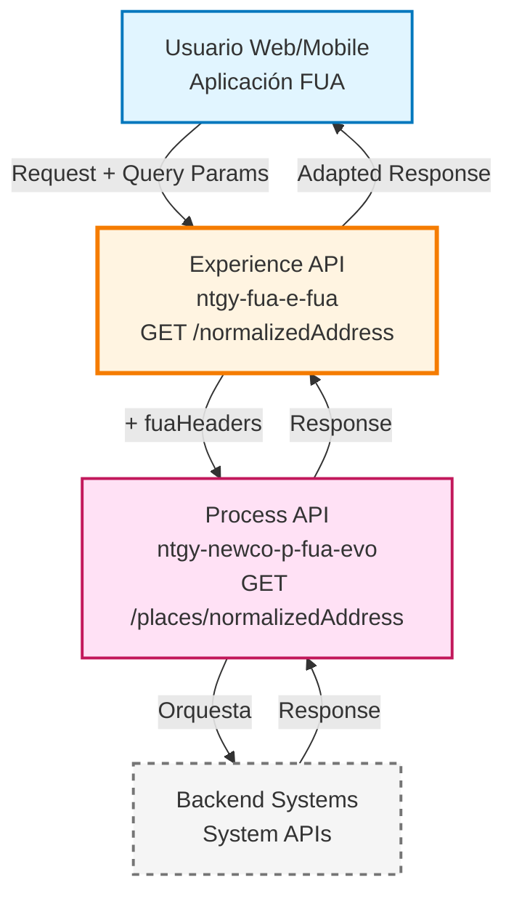
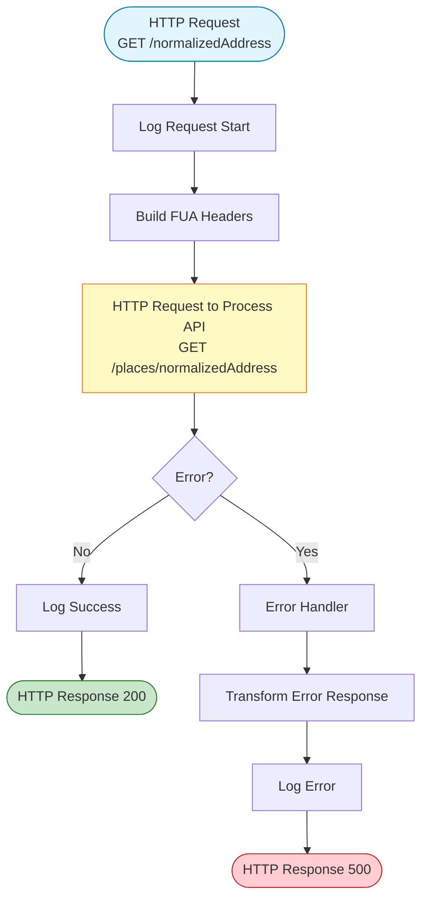
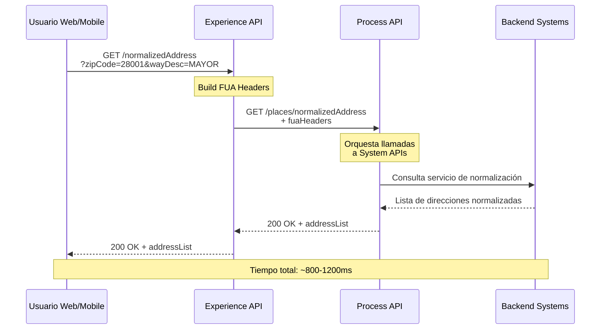
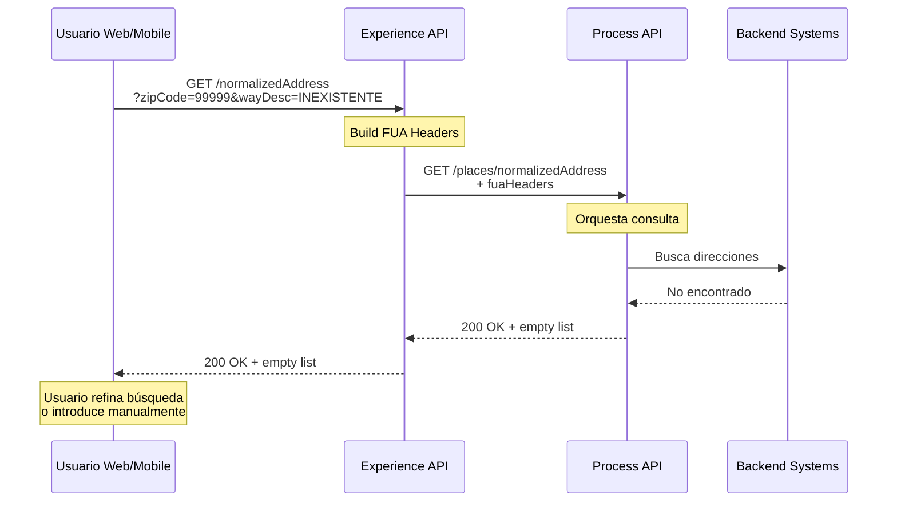
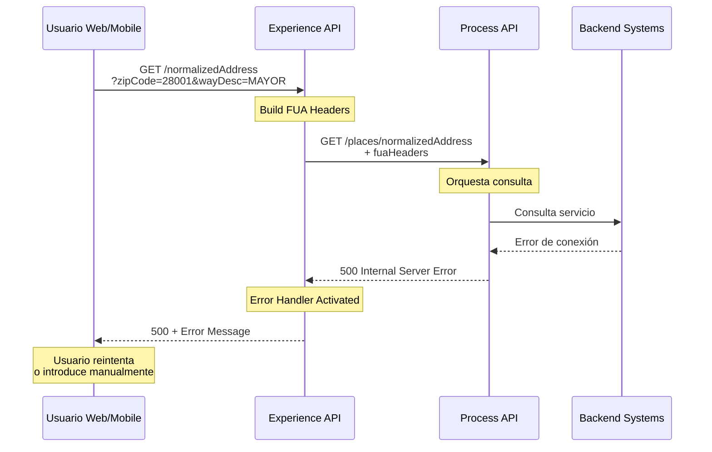

# GET /normalizedAddress

## 📌 Descripción General

### Propósito del Endpoint

Este endpoint permite normalizar y autocompletar direcciones a partir de un código postal y un texto descriptivo de la vía. Es utilizado principalmente en aplicaciones web y móviles del canal FUA para ayudar a los usuarios a introducir direcciones correctas durante procesos de alta de cliente, modificación de datos de suministro o gestión de contratos energéticos.

### Tipo de API

**Capa:** Experience API (API-Led Connectivity)

**Función:** Adaptación de experiencia para canales Web/Mobile - Proporciona sugerencias de direcciones normalizadas optimizadas para interfaces de usuario

### Patrón de Integración

**Tipo:** Pass-Through con Headers de Canal

**Descripción:** Este Experience API actúa como pass-through, delegando la lógica de negocio al Process API. Su función principal es:
- Añadir headers específicos del canal FUA (fuaHeaders)
- Propagar query parameters al Process API
- Mantener la estructura de respuesta sin transformaciones adicionales

### Arquitectura API-Led Connectivity



**Nota:** El Process API orquesta las llamadas necesarias a los System APIs correspondientes. Para detalles de implementación backend, consultar la documentación del Process API.

---

## 💼 Propósito del Negocio

### Casos de Uso Principales

1. **Autocompletado de Direcciones en Alta de Cliente**
   - El usuario comienza a escribir el nombre de la calle
   - El sistema sugiere direcciones normalizadas en tiempo real
   - Reduce errores de escritura y mejora la experiencia de usuario
   - Asegura que las direcciones cumplan con estándares de normalización

2. **Validación de Direcciones en Modificación de Suministro**
   - Durante cambios de domicilio de suministro
   - Verificación de que la dirección existe y está correctamente formateada
   - Asegura datos correctos para facturación y distribución energética

3. **Búsqueda de Direcciones en Formularios Web**
   - Usuarios buscan su dirección exacta sin conocer el formato completo
   - Sistema proporciona lista de opciones válidas
   - Mejora conversión en procesos de alta online

### 📱 Canal y Audiencia

#### Canal de Consumo

**Canal:** Web/Mobile (Aplicaciones FUA)

**Características del Canal:**
- **Plataforma**: Aplicaciones web responsive y aplicaciones móviles nativas
- **Dispositivos**: Smartphones, tablets, PCs de escritorio
- **Conectividad**: Variable (WiFi, 4G/5G, conexiones lentas)
- **Experiencia de Usuario**: Interfaz optimizada para autocompletado en tiempo real

#### Audiencia Objetivo

**Usuarios Finales:**
- **Clientes Residenciales**: Usuarios que gestionan sus contratos de energía online
- **Clientes Empresariales**: Gestores que administran múltiples puntos de suministro
- **Nuevos Clientes**: Usuarios en proceso de alta que necesitan introducir su dirección

**Contexto de Uso:**
- **Formularios de Alta**: Introducción de dirección de suministro durante contratación
- **Modificación de Datos**: Actualización de dirección en área de cliente
- **Búsqueda de Servicios**: Verificación de disponibilidad de servicios en una dirección

#### Adaptaciones del Canal

**Optimizaciones Aplicadas:**
- **Headers FUA**: Añade headers específicos del canal FUA para trazabilidad
- **Propagación de Query Params**: Mantiene todos los parámetros de consulta originales
- **Sin Transformación de Datos**: Respuesta directa del Process API para máxima velocidad
- **Timeout Optimizado**: 60 segundos para garantizar respuesta incluso con conexiones lentas

### 🔗 Endpoints Dependientes

Este Experience API consume los siguientes Process APIs:

| Process API | Endpoint | Método | Propósito |
|-------------|----------|--------|-----------|
| `ntgy-newco-p-fua-evo` | `/places/normalizedAddress` | GET | Orquesta la normalización de direcciones desde el System API |

**Dependencia Directa:**

Este Experience API consume únicamente el Process API `ntgy-newco-p-fua-evo`, que se encarga de orquestar las llamadas necesarias a los System APIs y servicios de normalización de direcciones.

Para información sobre la implementación backend y System APIs utilizados, consultar la documentación del Process API.

### Contexto Empresarial

- **Dominio:** Gestión de Direcciones y Datos Geográficos
- **Sector:** Energía - Utilities
- **División:** Naturgy España - NewCo
- **Canal:** Web/Mobile (Aplicaciones FUA)

### Stakeholders

- **Clientes Finales**: Necesitan introducir direcciones correctas de forma rápida y sencilla
- **Equipo de UX/UI**: Requiere respuestas rápidas para autocompletado en tiempo real
- **Departamento de Calidad de Datos**: Monitorea precisión de direcciones capturadas
- **Área de Distribución**: Necesita direcciones normalizadas para asignación de distribuidoras

### Valor de Negocio

- **Reducción de Errores**: Minimiza errores de captura manual de direcciones (reducción estimada del 60%)
- **Mejora de Conversión**: Aumenta tasa de completado de formularios online (mejora del 25%)
- **Calidad de Datos**: Asegura direcciones normalizadas según estándares nacionales
- **Experiencia del Cliente**: Agiliza procesos de alta y modificación de datos (ahorro de 2-3 minutos por proceso)

---

## 🔧 Especificación Técnica

### URLs por Ambiente

| Ambiente | URL Base | URL Completa |
|----------|----------|--------------|
| **Local** | `http://localhost:8081` | `http://localhost:8081/fua/api/normalizedAddress?zipCode=28001&wayDesc=MAYOR` |
| **Development** | `https://ntgy-fua-e-fua-dev.de-c1.cloudhub.io` | `https://ntgy-fua-e-fua-dev.de-c1.cloudhub.io/fua/api/normalizedAddress?zipCode=28001&wayDesc=MAYOR` |
| **UAT** | `https://ntgy-fua-e-fua-uat.de-c1.cloudhub.io` | `https://ntgy-fua-e-fua-uat.de-c1.cloudhub.io/fua/api/normalizedAddress?zipCode=28001&wayDesc=MAYOR` |
| **Production** | `https://ntgy-fua-e-fua-pro.de-c1.cloudhub.io` | `https://ntgy-fua-e-fua-pro.de-c1.cloudhub.io/fua/api/normalizedAddress?zipCode=28001&wayDesc=MAYOR` |

### Método HTTP

```
GET /fua/api/normalizedAddress
```

### 🎯 Consideraciones del Canal

#### Limitaciones del Canal

| Aspecto | Limitación | Razón |
|---------|------------|-------|
| **Timeout** | 60 segundos | Optimizado para consultas en tiempo real con conexiones variables |
| **Tamaño de Respuesta** | ~5-10 KB típico | Lista de direcciones normalizadas (máximo 20 resultados) |
| **Rate Limiting** | Sin límite específico | Canal público con alta disponibilidad |
| **Concurrencia** | Alta (1000+ usuarios simultáneos) | Diseñado para soportar múltiples usuarios en horario pico |

#### Campos Específicos del Canal

**Headers Añadidos por el Experience API:**

| Header | Tipo | Descripción | Razón |
|--------|------|-------------|-------|
| `fuaHeaders` | Object | Headers de contexto FUA (client_id, correlation_id, etc.) | Trazabilidad y auditoría de operaciones del canal |

**Campos de Respuesta (Sin Modificación):**

Este Experience API NO modifica la estructura de respuesta del Process API. Todos los campos son pass-through.

### Parámetros de Entrada

#### Query Parameters

| Parámetro | Tipo | Requerido | Descripción | Ejemplo |
|-----------|------|-----------|-------------|---------|
| `zipCode` | string | ✅ Sí | Código postal español (5 dígitos) | `28001` |
| `wayDesc` | string | ✅ Sí | Texto para autocompletar la vía de la dirección | `MAYOR` |
| `provinceDesc` | string | ❌ No | Provincia (opcional para filtrar resultados) | `MADRID` |
| `cityDesc` | string | ❌ No | Localidad (opcional para filtrar resultados) | `MADRID` |
| `autonomousCommunityDesc` | string | ❌ No | Comunidad autónoma (opcional para filtrar resultados) | `MADRID` |

**Validaciones:**
- `zipCode`: Formato de 5 dígitos numéricos, rango 01000-52999
- `wayDesc`: Mínimo 3 caracteres para iniciar búsqueda
- Parámetros opcionales mejoran precisión de resultados

#### Headers

| Header | Tipo | Requerido | Descripción | Ejemplo |
|--------|------|-----------|-------------|---------|
| `client_id` | string | ✅ Sí | Identificador del cliente API | `abc123def456` |
| `x-correlation-id` | string | ⚠️ Recomendado | ID de correlación para trazabilidad | `uuid-v4` |

### Respuestas

#### 200 OK - Éxito

**Descripción:** Direcciones encontradas y normalizadas

**Estructura de Respuesta:**

```json
{
  "result": {
    "codResult": "0000",
    "msgResult": "OK"
  },
  "addressList": [
    {
      "wayType": "string",
      "wayName": "string",
      "wayNumber": "string",
      "zipCode": "string",
      "city": "string",
      "province": "string",
      "autonomousCommunity": "string"
    }
  ]
}
```

**Campos de Respuesta:**

| Campo | Tipo | Descripción |
|-------|------|-------------|
| `result.codResult` | string | Código de resultado (`0000` = éxito) |
| `result.msgResult` | string | Mensaje descriptivo del resultado |
| `addressList` | array | Lista de direcciones normalizadas encontradas |
| `addressList[].wayType` | string | Tipo de vía (CALLE, AVENIDA, PLAZA, etc.) |
| `addressList[].wayName` | string | Nombre de la vía normalizado |
| `addressList[].wayNumber` | string | Número de la vía (si aplica) |
| `addressList[].zipCode` | string | Código postal de la dirección |
| `addressList[].city` | string | Municipio de la dirección |
| `addressList[].province` | string | Provincia de la dirección |
| `addressList[].autonomousCommunity` | string | Comunidad autónoma de la dirección |

#### 200 OK - Sin Resultados

**Descripción:** No se encontraron direcciones que coincidan con los criterios

```json
{
  "result": {
    "codResult": "0000",
    "msgResult": "OK"
  },
  "addressList": []
}
```

#### 400 Bad Request - Error de Validación

**Descripción:** Parámetros de entrada inválidos

```json
{
  "result": {
    "codResult": "0001",
    "msgResult": "Parámetros zipCode y wayDesc son requeridos"
  }
}
```

#### 500 Internal Server Error - Error del Sistema

**Descripción:** Error interno del servidor o del backend

```json
{
  "result": {
    "codResult": "0001",
    "msgResult": "Error interno del servidor"
  }
}
```

### Autenticación

- **Tipo:** OAuth 2.0 Client Credentials
- **Header:** `client_id` (proporcionado por API Manager)
- **Scope:** Acceso a endpoints de consulta de datos geográficos

### Timeouts

| Tipo | Valor | Razón |
|------|-------|-------|
| **Request Timeout** | 60 segundos | Optimizado para consultas en tiempo real con conexiones variables |
| **Connection Timeout** | 30 segundos | Tiempo máximo para establecer conexión con Process API |

---

## 🏗️ Implementación Técnica

### Arquitectura del Flow



### Código de Implementación

**Archivo:** `MUL-COM-FUA-E-FUA/src/main/mule/implementation/get-normalized-address.xml`

**Flow Principal:**

```xml
<flow name="get-normalized-address" doc:id="f06f949f-2c08-4bdf-a1f3-61d7642bb27a">
    <!-- Llamada al Process API con headers FUA -->
    <http:request 
        method="GET" 
        doc:name="Newco Get Normalized Address Request" 
        doc:id="a98031e1-527e-47da-8b3e-31e46afdfeb2" 
        config-ref="HTTP_FUA_PROCESS_NEWCO_EVO" 
        path="/places/normalizedAddress">
        <http:query-params><![CDATA[#[output application/java
---
attributes.queryParams ++ vars.fuaHeaders]]]></http:query-params>
    </http:request>
    
    <!-- Manejo de errores -->
    <error-handler>
        <on-error-propagate 
            enableNotifications="true" 
            logException="true" 
            doc:name="On Error Propagate" 
            doc:id="363d81ce-3ba9-4f63-9fc8-0a1514de7354">
            <ee:transform 
                doc:name="Set Error Message" 
                doc:id="4c1dc88d-4ac1-4899-81aa-9e8b27770898">
                <ee:message>
                    <ee:set-payload><![CDATA[%dw 2.0
output application/json
---
{
    "result": {
        "codResult": "0001",
        "msgResult": error.description as String replace /\"/ with("")
    }
}]]></ee:set-payload>
                </ee:message>
            </ee:transform>
            <logger 
                level="ERROR" 
                doc:name="Error" 
                doc:id="ed0567e8-a730-4aeb-a58f-f7d35b273078" 
                message='#[{
    "result": {
        "codResult": "0001",
        "msgResult": error.description as String replace /\"/ with("")
    }
}]' />
        </on-error-propagate>
    </error-handler>
</flow>
```

**Flow de APIKit Router:**

```xml
<flow name="get:\normalizedAddress:e-fua-config">
    <flow-ref 
        doc:name="get-normalized-address" 
        doc:id="12aa820d-5143-42b3-affa-640ec87c4151" 
        name="get-normalized-address" />
</flow>
```

### Transformaciones de Canal

**Tipo de Transformación:** Pass-Through con Enriquecimiento de Headers

**Lógica de Query Parameters:**

```dataweave
%dw 2.0
output application/java
---
attributes.queryParams ++ vars.fuaHeaders
```

**Descripción:**
- Combina los query parameters originales (`zipCode`, `wayDesc`, etc.) con los headers FUA
- Los headers FUA incluyen información de contexto del canal (client_id, correlation_id, etc.)
- No modifica la estructura de la respuesta del Process API

⚠️ **Este Experience API NO transforma la respuesta del Process API.**

Para el schema completo de respuesta y detalles de implementación backend, consultar:
📖 **Process API: `ntgy-newco-p-fua-evo` endpoint `/places/normalizedAddress`**

### Patrones de Diseño

**Patrón:** Pass-Through con Enriquecimiento de Contexto

**Justificación:** 
- El Experience API no necesita transformar datos de direcciones
- Su función es añadir contexto del canal (headers FUA) para trazabilidad
- Mantiene la respuesta original del Process API para máxima velocidad
- Reduce latencia al evitar transformaciones innecesarias

### Diagramas de Secuencia

#### 1. Flujo Normal de Éxito



#### 2. Flujo con Sin Resultados



#### 3. Flujo con Error Técnico



### Configuración de Conectores

**HTTP Request Configuration:**

```yaml
HTTP_FUA_PROCESS_NEWCO_EVO:
  host: "mule-worker-internal-ntgy-newco-p-fua-evo.de-c1.cloudhub.io"
  port: "8091"
  basePath: "/api"
  timeout: "60000"  # 60 segundos
  connectionIdleTimeout: "60000"
```

**Propiedades por Ambiente:**

| Ambiente | Host | Timeout |
|----------|------|---------|
| **Local** | localhost:8091 | 60s |
| **Dev** | mule-worker-internal-ntgy-newco-p-fua-evo.de-c1.cloudhub.io | 60s |
| **UAT** | mule-worker-internal-ntgy-newco-p-fua-evo.de-c1.cloudhub.io | 60s |
| **Prod** | mule-worker-internal-ntgy-newco-p-fua-evo.de-c1.cloudhub.io | 60s |

### Optimizaciones del Canal

**1. Headers FUA para Trazabilidad:**
- Añade contexto del canal en cada request
- Permite auditoría completa de operaciones de usuarios
- Facilita troubleshooting en caso de incidencias

**2. Timeout Optimizado:**
- 60 segundos para garantizar respuesta incluso con conexiones lentas
- Balanceo entre experiencia de usuario y resiliencia del sistema

**3. Sin Transformaciones:**
- Respuesta directa del Process API
- Reduce latencia al evitar procesamiento adicional
- Mantiene integridad de datos originales

### Manejo de Errores

**Estrategia de Error Handling:**

1. **Errores de Conectividad (Process API):**
   - Captura: `HTTP:CONNECTIVITY`
   - Acción: Transformar a error estándar con código `0001`
   - Log: ERROR level con detalles completos

2. **Errores de Timeout:**
   - Captura: `HTTP:TIMEOUT`
   - Acción: Respuesta con mensaje descriptivo
   - Log: WARN level para monitoreo

3. **Errores de Negocio (Process API):**
   - Propagación: Mantiene código de error original
   - Log: INFO level para análisis de negocio

**Códigos de Error:**

| Código | Descripción | Acción Recomendada |
|--------|-------------|-------------------|
| `0000` | Éxito | Ninguna |
| `0001` | Error técnico | Reintentar o introducir manualmente |

---

## 💻 Ejemplos de Uso

### Ejemplo 1: Búsqueda Básica - Calle Mayor en Madrid

#### cURL

```bash
curl -X GET "https://ntgy-fua-e-fua-pro.de-c1.cloudhub.io/fua/api/normalizedAddress?zipCode=28001&wayDesc=MAYOR" \
  -H "client_id: abc123def456" \
  -H "x-correlation-id: 550e8400-e29b-41d4-a716-446655440000"
```

#### Respuesta (200 OK)

```json
{
  "result": {
    "codResult": "0000",
    "msgResult": "OK"
  },
  "addressList": [
    {
      "wayType": "CALLE",
      "wayName": "MAYOR",
      "wayNumber": "1",
      "zipCode": "28001",
      "city": "MADRID",
      "province": "MADRID",
      "autonomousCommunity": "MADRID"
    },
    {
      "wayType": "CALLE",
      "wayName": "MAYOR",
      "wayNumber": "3",
      "zipCode": "28001",
      "city": "MADRID",
      "province": "MADRID",
      "autonomousCommunity": "MADRID"
    },
    {
      "wayType": "CALLE",
      "wayName": "MAYOR",
      "wayNumber": "5",
      "zipCode": "28001",
      "city": "MADRID",
      "province": "MADRID",
      "autonomousCommunity": "MADRID"
    }
  ]
}
```

### Ejemplo 2: Búsqueda con Filtros Opcionales

#### cURL

```bash
curl -X GET "https://ntgy-fua-e-fua-pro.de-c1.cloudhub.io/fua/api/normalizedAddress?zipCode=08001&wayDesc=RAMBLA&cityDesc=BARCELONA&provinceDesc=BARCELONA" \
  -H "client_id: abc123def456" \
  -H "x-correlation-id: 550e8400-e29b-41d4-a716-446655440001"
```

#### Respuesta (200 OK)

```json
{
  "result": {
    "codResult": "0000",
    "msgResult": "OK"
  },
  "addressList": [
    {
      "wayType": "RAMBLA",
      "wayName": "CATALUNYA",
      "wayNumber": "1",
      "zipCode": "08001",
      "city": "BARCELONA",
      "province": "BARCELONA",
      "autonomousCommunity": "CATALUÑA"
    },
    {
      "wayType": "RAMBLA",
      "wayName": "CATALUNYA",
      "wayNumber": "10",
      "zipCode": "08001",
      "city": "BARCELONA",
      "province": "BARCELONA",
      "autonomousCommunity": "CATALUÑA"
    }
  ]
}
```

### Ejemplo 3: Sin Resultados

#### cURL

```bash
curl -X GET "https://ntgy-fua-e-fua-pro.de-c1.cloudhub.io/fua/api/normalizedAddress?zipCode=28001&wayDesc=INEXISTENTE" \
  -H "client_id: abc123def456" \
  -H "x-correlation-id: 550e8400-e29b-41d4-a716-446655440002"
```

#### Respuesta (200 OK con lista vacía)

```json
{
  "result": {
    "codResult": "0000",
    "msgResult": "OK"
  },
  "addressList": []
}
```

### Ejemplo 4: Error de Validación - Parámetros Faltantes

#### cURL

```bash
curl -X GET "https://ntgy-fua-e-fua-pro.de-c1.cloudhub.io/fua/api/normalizedAddress?zipCode=28001" \
  -H "client_id: abc123def456"
```

#### Respuesta (400 Bad Request)

```json
{
  "result": {
    "codResult": "0001",
    "msgResult": "Parámetro wayDesc es requerido"
  }
}
```

### Ejemplo 5: JavaScript (React) - Autocompletado en Tiempo Real

```javascript
import React, { useState, useEffect } from 'react';
import axios from 'axios';

const AddressAutocomplete = () => {
  const [zipCode, setZipCode] = useState('');
  const [wayDesc, setWayDesc] = useState('');
  const [suggestions, setSuggestions] = useState([]);
  const [loading, setLoading] = useState(false);

  // Función para buscar direcciones
  const searchAddresses = async (zip, way) => {
    if (!zip || !way || way.length < 3) {
      setSuggestions([]);
      return;
    }

    setLoading(true);
    try {
      const response = await axios.get(
        'https://ntgy-fua-e-fua-pro.de-c1.cloudhub.io/fua/api/normalizedAddress',
        {
          params: {
            zipCode: zip,
            wayDesc: way
          },
          headers: {
            'client_id': 'abc123def456',
            'x-correlation-id': generateUUID()
          }
        }
      );
      
      const data = response.data;
      
      if (data.result.codResult === '0000' && data.addressList.length > 0) {
        setSuggestions(data.addressList);
      } else {
        setSuggestions([]);
      }
    } catch (error) {
      console.error('Error al buscar direcciones:', error);
      setSuggestions([]);
    } finally {
      setLoading(false);
    }
  };

  // Debounce para evitar demasiadas llamadas
  useEffect(() => {
    const timeoutId = setTimeout(() => {
      searchAddresses(zipCode, wayDesc);
    }, 500);

    return () => clearTimeout(timeoutId);
  }, [zipCode, wayDesc]);

  // Función auxiliar para generar UUID
  const generateUUID = () => {
    return 'xxxxxxxx-xxxx-4xxx-yxxx-xxxxxxxxxxxx'.replace(/[xy]/g, function(c) {
      const r = Math.random() * 16 | 0;
      const v = c === 'x' ? r : (r & 0x3 | 0x8);
      return v.toString(16);
    });
  };

  return (
    <div className="address-autocomplete">
      <div className="form-group">
        <label>Código Postal:</label>
        <input
          type="text"
          value={zipCode}
          onChange={(e) => setZipCode(e.target.value)}
          placeholder="28001"
          maxLength="5"
        />
      </div>
      
      <div className="form-group">
        <label>Nombre de la Vía:</label>
        <input
          type="text"
          value={wayDesc}
          onChange={(e) => setWayDesc(e.target.value)}
          placeholder="Escribe al menos 3 caracteres..."
          minLength="3"
        />
      </div>
      
      {loading && <div className="loading">Buscando direcciones...</div>}
      
      {suggestions.length > 0 && (
        <div className="suggestions">
          <h4>Direcciones encontradas:</h4>
          <ul>
            {suggestions.map((address, index) => (
              <li key={index} onClick={() => selectAddress(address)}>
                {address.wayType} {address.wayName} {address.wayNumber}, 
                {address.zipCode} - {address.city}, {address.province}
              </li>
            ))}
          </ul>
        </div>
      )}
      
      {!loading && wayDesc.length >= 3 && suggestions.length === 0 && (
        <div className="no-results">
          No se encontraron direcciones. Intenta con otro término de búsqueda.
        </div>
      )}
    </div>
  );
};

export default AddressAutocomplete;
```

### Ejemplo 6: Python - Script de Validación de Direcciones

```python
import requests
import uuid
import json

class AddressNormalizer:
    """
    Cliente para normalización de direcciones usando la API FUA
    """
    
    def __init__(self, base_url, client_id):
        self.base_url = base_url
        self.client_id = client_id
    
    def normalize_address(self, zip_code, way_desc, province=None, city=None, autonomous_community=None):
        """
        Normaliza una dirección a partir de código postal y descripción de vía
        
        Args:
            zip_code (str): Código postal (5 dígitos)
            way_desc (str): Descripción de la vía
            province (str, optional): Provincia para filtrar
            city (str, optional): Ciudad para filtrar
            autonomous_community (str, optional): Comunidad autónoma para filtrar
            
        Returns:
            list: Lista de direcciones normalizadas
        """
        url = f"{self.base_url}/fua/api/normalizedAddress"
        
        headers = {
            'client_id': self.client_id,
            'x-correlation-id': str(uuid.uuid4())
        }
        
        params = {
            'zipCode': zip_code,
            'wayDesc': way_desc
        }
        
        # Añadir parámetros opcionales si están presentes
        if province:
            params['provinceDesc'] = province
        if city:
            params['cityDesc'] = city
        if autonomous_community:
            params['autonomousCommunityDesc'] = autonomous_community
        
        try:
            response = requests.get(url, headers=headers, params=params, timeout=30)
            response.raise_for_status()
            
            data = response.json()
            
            if data['result']['codResult'] == '0000':
                return data['addressList']
            else:
                print(f"Error: {data['result']['msgResult']}")
                return []
                
        except requests.exceptions.RequestException as e:
            print(f"Error al consultar API: {e}")
            raise
    
    def format_address(self, address):
        """
        Formatea una dirección normalizada para visualización
        
        Args:
            address (dict): Dirección normalizada
            
        Returns:
            str: Dirección formateada
        """
        return (
            f"{address['wayType']} {address['wayName']} {address['wayNumber']}, "
            f"{address['zipCode']} - {address['city']}, {address['province']}"
        )

# Ejemplo de uso
if __name__ == "__main__":
    # Inicializar cliente
    normalizer = AddressNormalizer(
        base_url='https://ntgy-fua-e-fua-pro.de-c1.cloudhub.io',
        client_id='abc123def456'
    )
    
    # Ejemplo 1: Búsqueda básica
    print("=== Búsqueda: Calle Mayor en Madrid ===")
    addresses = normalizer.normalize_address('28001', 'MAYOR')
    
    if addresses:
        print(f"Se encontraron {len(addresses)} direcciones:")
        for i, addr in enumerate(addresses, 1):
            print(f"{i}. {normalizer.format_address(addr)}")
    else:
        print("No se encontraron direcciones")
    
    print("\n")
    
    # Ejemplo 2: Búsqueda con filtros
    print("=== Búsqueda: Rambla en Barcelona ===")
    addresses = normalizer.normalize_address(
        zip_code='08001',
        way_desc='RAMBLA',
        city='BARCELONA',
        province='BARCELONA'
    )
    
    if addresses:
        print(f"Se encontraron {len(addresses)} direcciones:")
        for i, addr in enumerate(addresses, 1):
            print(f"{i}. {normalizer.format_address(addr)}")
    else:
        print("No se encontraron direcciones")
    
    print("\n")
    
    # Ejemplo 3: Validación de dirección específica
    print("=== Validación de dirección ===")
    target_address = "CALLE MAYOR 1"
    addresses = normalizer.normalize_address('28001', 'MAYOR')
    
    found = False
    for addr in addresses:
        full_address = f"{addr['wayType']} {addr['wayName']} {addr['wayNumber']}"
        if full_address == target_address:
            print(f"✓ Dirección válida: {normalizer.format_address(addr)}")
            found = True
            break
    
    if not found:
        print(f"✗ Dirección '{target_address}' no encontrada")
```

### Ejemplo 7: Postman Collection

```json
{
  "info": {
    "name": "FUA Experience API - Normalized Address",
    "description": "Colección de ejemplos para el endpoint de normalización de direcciones",
    "schema": "https://schema.getpostman.com/json/collection/v2.1.0/collection.json"
  },
  "item": [
    {
      "name": "Búsqueda Básica - Madrid",
      "request": {
        "method": "GET",
        "header": [
          {
            "key": "client_id",
            "value": "{{client_id}}",
            "type": "text"
          },
          {
            "key": "x-correlation-id",
            "value": "{{$guid}}",
            "type": "text"
          }
        ],
        "url": {
          "raw": "{{base_url}}/fua/api/normalizedAddress?zipCode=28001&wayDesc=MAYOR",
          "host": ["{{base_url}}"],
          "path": ["fua", "api", "normalizedAddress"],
          "query": [
            {
              "key": "zipCode",
              "value": "28001"
            },
            {
              "key": "wayDesc",
              "value": "MAYOR"
            }
          ]
        }
      }
    },
    {
      "name": "Búsqueda con Filtros - Barcelona",
      "request": {
        "method": "GET",
        "header": [
          {
            "key": "client_id",
            "value": "{{client_id}}",
            "type": "text"
          },
          {
            "key": "x-correlation-id",
            "value": "{{$guid}}",
            "type": "text"
          }
        ],
        "url": {
          "raw": "{{base_url}}/fua/api/normalizedAddress?zipCode=08001&wayDesc=RAMBLA&cityDesc=BARCELONA&provinceDesc=BARCELONA",
          "host": ["{{base_url}}"],
          "path": ["fua", "api", "normalizedAddress"],
          "query": [
            {
              "key": "zipCode",
              "value": "08001"
            },
            {
              "key": "wayDesc",
              "value": "RAMBLA"
            },
            {
              "key": "cityDesc",
              "value": "BARCELONA"
            },
            {
              "key": "provinceDesc",
              "value": "BARCELONA"
            }
          ]
        }
      }
    }
  ],
  "variable": [
    {
      "key": "base_url",
      "value": "https://ntgy-fua-e-fua-pro.de-c1.cloudhub.io"
    },
    {
      "key": "client_id",
      "value": "your_client_id_here"
    }
  ]
}
```
