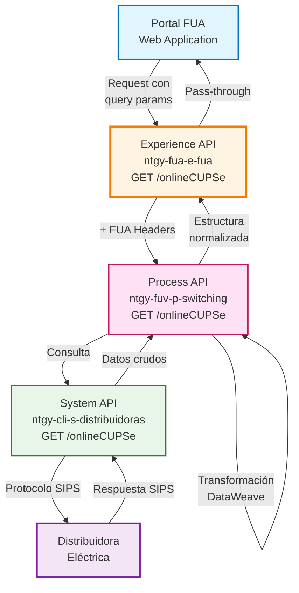
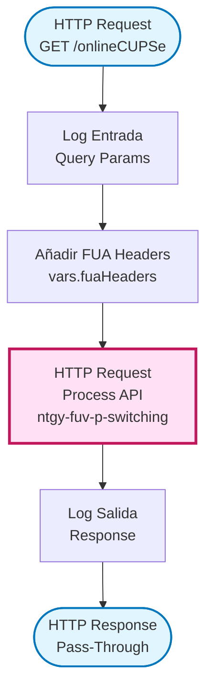
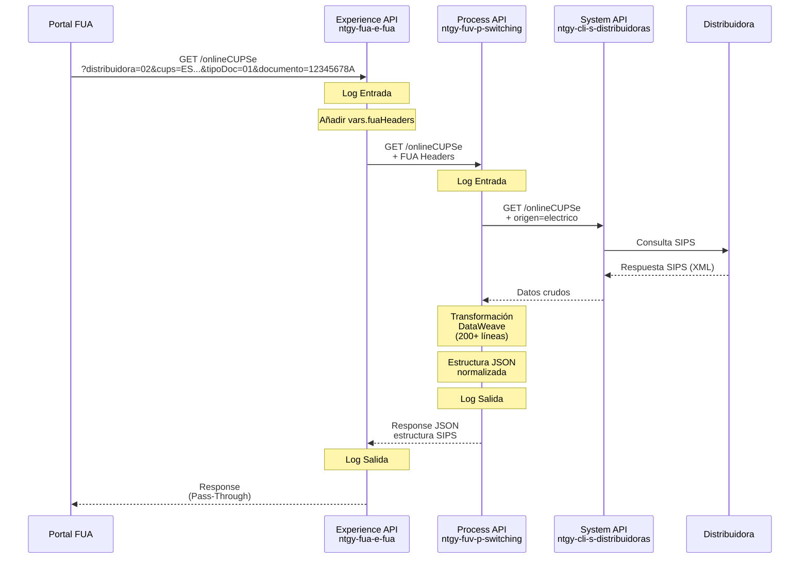
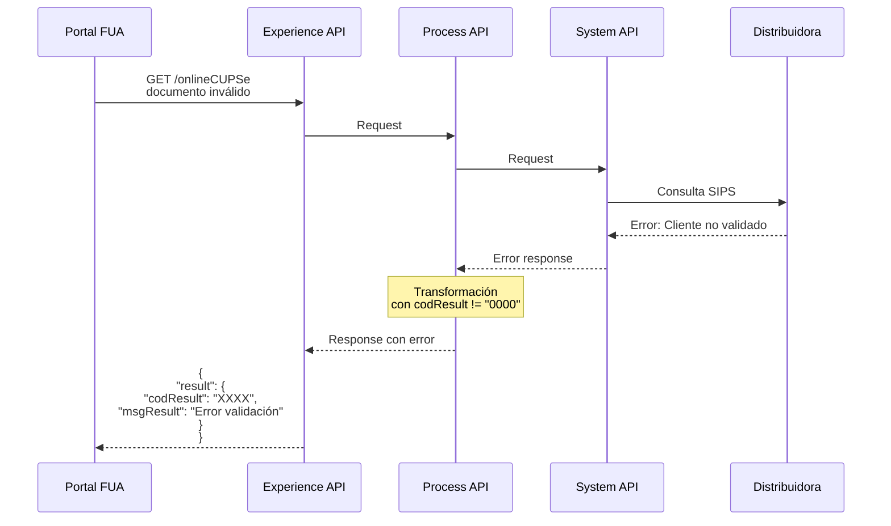
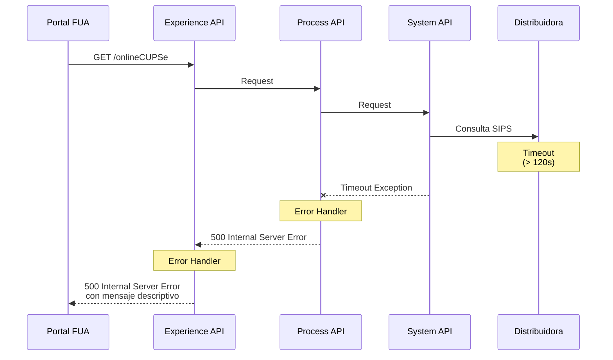

# GET /onlineCUPSe

## 📌 Descripción General

### Propósito del Endpoint

Consulta online información detallada de un CUPS (Código Universal del Punto de Suministro) eléctrico directamente en la distribuidora correspondiente, validando la titularidad del cliente y obteniendo el estado actual del punto de suministro según el estándar SIPS (Sistema de Información del Punto de Suministro).

### Tipo de API

**Capa:** Experience API (API-Led Connectivity)

**Función:** Adaptación de experiencia para portal web FUA (Frontal Único de Atención)

### Patrón de Integración

**Tipo:** Pass-Through con Headers Adicionales

**Descripción:** Este endpoint actúa como proxy hacia la Process API de switching, añadiendo headers específicos del contexto FUA (`vars.fuaHeaders`) pero sin transformar la estructura de la respuesta. La transformación compleja de datos SIPS se realiza en la capa Process API.

### Arquitectura API-Led Connectivity



---

## 💼 Propósito del Negocio

### Casos de Uso Principales

1. **Validación de Titularidad de CUPS**
   - Verificar que el cliente es el titular del punto de suministro
   - Validar documento de identidad contra registros de la distribuidora
   - Prevenir fraudes en procesos de switching

2. **Consulta de Estado Contratable**
   - Verificar si el CUPS está disponible para contratación
   - Obtener potencia máxima sin expediente
   - Identificar solicitudes en curso

3. **Obtención de Datos Técnicos del Suministro**
   - Características del equipo de medida
   - Potencias contratadas por periodo
   - Tipo de tarifa ATR vigente
   - Documentación técnica (CIE, APM)

### 📱 Canal y Audiencia

#### Canal de Consumo

**Canal:** Web

**Características del Canal:**
- **Plataforma**: Portal FUA (Frontal Único de Atención)
- **Dispositivos**: Navegadores web (desktop y responsive)
- **Conectividad**: Conexión estable requerida (timeout 120s)
- **Experiencia de Usuario**: Consulta en tiempo real con feedback visual

#### Audiencia Objetivo

**Usuarios Finales:**
- **Clientes Potenciales**: Personas interesadas en contratar suministro eléctrico que necesitan validar disponibilidad del CUPS
- **Clientes Existentes**: Usuarios que desean consultar información detallada de su punto de suministro
- **Agentes de Call Center**: Personal de atención al cliente que requiere información completa del CUPS para gestionar solicitudes

**Contexto de Uso:**
- **Proceso de Alta**: Durante el proceso de contratación de nuevo suministro eléctrico
- **Cambio de Comercializadora**: En procesos de switching entre comercializadoras
- **Consulta de Información**: Para verificar condiciones contractuales actuales

#### Adaptaciones del Canal

**Optimizaciones Aplicadas:**
- **Headers FUA**: Se añaden headers de contexto específicos del portal FUA
- **Timeout Extendido**: 120 segundos para consultas a distribuidoras (pueden ser lentas)
- **Pass-Through**: No se simplifica la respuesta, se mantiene estructura SIPS completa para máxima información

### 🔗 Endpoints Dependientes

Este Experience API consume el siguiente Process API:

| Process API | Endpoint | Método | Propósito |
|-------------|----------|--------|-----------|
| `ntgy-fuv-p-switching` | `/onlineCUPSe` | GET | Orquestación de consulta online a distribuidoras eléctricas con transformación de respuesta SIPS |

### Contexto Empresarial

- **Dominio:** Switching y Gestión de Puntos de Suministro
- **Sector:** Energía - Utilities
- **División:** Naturgy España - FUA (Frontal Único de Atención)
- **Canal:** Web

### Stakeholders

- **Clientes Finales**: Necesitan validar disponibilidad y condiciones del CUPS antes de contratar
- **Equipo Comercial**: Requiere información precisa para procesos de venta
- **Equipo de Switching**: Necesita datos técnicos para gestionar cambios de comercializadora
- **Distribuidoras Eléctricas**: Proveen información oficial del punto de suministro

### Valor de Negocio

- **Reducción de Fraude**: Validación en tiempo real de titularidad previene contrataciones fraudulentas
- **Mejora de Experiencia**: Cliente obtiene información inmediata sin esperas
- **Eficiencia Operativa**: Automatización de consultas reduce carga en call center
- **Cumplimiento Normativo**: Consulta directa a distribuidora garantiza datos oficiales según normativa CNMC

---

## 🔧 Especificación Técnica

### URLs por Ambiente

| Ambiente | URL Base | URL Completa |
|----------|----------|--------------|
| **Local** | `http://localhost:8081` | `http://localhost:8081/fua/api/onlineCUPSe` |
| **Development** | `https://ntgy-fua-e-fua-dev.de-c1.cloudhub.io` | `https://ntgy-fua-e-fua-dev.de-c1.cloudhub.io/fua/api/onlineCUPSe` |
| **UAT** | `https://ntgy-fua-e-fua-uat.de-c1.cloudhub.io` | `https://ntgy-fua-e-fua-uat.de-c1.cloudhub.io/fua/api/onlineCUPSe` |
| **Production** | `https://ntgy-fua-e-fua-pro.de-c1.cloudhub.io` | `https://ntgy-fua-e-fua-pro.de-c1.cloudhub.io/fua/api/onlineCUPSe` |

### Método HTTP

```
GET /fua/api/onlineCUPSe
```

### 🎯 Consideraciones del Canal

#### Limitaciones del Canal

| Aspecto | Limitación | Razón |
|---------|------------|-------|
| **Timeout** | 120 segundos | Consultas a distribuidoras pueden ser lentas, especialmente en horarios pico |
| **Rate Limiting** | Según política API Gateway | Protección contra abuso y sobrecarga de distribuidoras |
| **Concurrencia** | Limitada por distribuidora | Cada distribuidora tiene sus propios límites de consultas simultáneas |

#### Campos Específicos del Canal

**Headers Añadidos por el Experience API:**

| Header | Tipo | Descripción | Razón |
|--------|------|-------------|-------|
| `vars.fuaHeaders` | Object | Headers de contexto FUA (sesión, canal, etc.) | Trazabilidad y contexto de la petición desde el portal FUA |

**Campos de Respuesta:**

⚠️ **Este Experience API NO transforma la respuesta del Process API.**

Para el schema completo de la respuesta, consultar:
📖 **Process API: `ntgy-fuv-p-switching` endpoint `GET /onlineCUPSe`**

La respuesta sigue el estándar SIPS (Sistema de Información del Punto de Suministro) con estructura completa de:
- Cabecera del mensaje
- Información del punto de suministro
- Datos del cliente titular
- Características técnicas del equipo
- Documentación técnica (CIE/APM)

### Parámetros de Entrada

#### Query Parameters (Obligatorios)

| Parámetro | Tipo | Obligatorio | Descripción | Ejemplo |
|-----------|------|-------------|-------------|---------|
| `distribuidora` | string | ✅ Sí | Código de la distribuidora eléctrica (2 caracteres) | `"02"` (Endesa) |
| `cups` | string | ✅ Sí | Código Universal del Punto de Suministro (20-22 caracteres) | `"ES0236150039964563QN"` |
| `tipoDoc` | string | ✅ Sí | Tipo de documento según tabla CNMC:<br/>- `"01"`: NIF<br/>- `"03"`: Pasaporte<br/>- `"04"`: NIE<br/>- `"07"`: NIVA<br/>- `"08"`: Otros | `"01"` |
| `documento` | string | ✅ Sí | Número de documento del titular (mínimo 8 caracteres) | `"12345678A"` |

#### Validaciones

- **distribuidora**: Mínimo 2 caracteres
- **cups**: Mínimo 20 caracteres, formato estándar CUPS español
- **tipoDoc**: Debe ser uno de los valores enumerados
- **documento**: Mínimo 8 caracteres

### Respuestas

#### 200 OK - Consulta Exitosa

**Estructura de Respuesta SIPS:**

```json
{
  "MensajeEnvioInformacionPS": {
    "Cabecera": {
      "CodigoREEEmpresaEmisora": "string",
      "CodigoREEEmpresaDestino": "string",
      "CodigoDelProceso": "string",
      "CodigoDePaso": "string",
      "CodigoDeSolicitud": "string",
      "SecuencialDeSolicitud": "string",
      "FechaSolicitud": "string",
      "CUPS": "string"
    },
    "EnvioInformacionPS": {
      "ResultadoValidacionCliente": "string",
      "EnVigor": "string",
      "EstadoContratable": {
        "Contratable": "string",
        "PotenciaMaxSinExpediente": "number"
      },
      "ExisteSolicitudEnCurso": "string",
      "Contrato": {
        "TipoContratoATR": "string",
        "CondicionesContractuales": {
          "TarifaATR": "string",
          "PotenciasContratadas": {
            "Potencia": {
              "PotenciaP1": "number",
              "PotenciaP2": "number"
            }
          },
          "ModoControlPotencia": "string"
        }
      },
      "Cliente": {
        "IdCliente": {
          "TipoIdentificador": "string",
          "Identificador": "string",
          "TipoPersona": "string"
        },
        "Nombre": {
          "NombreDePila": "string",
          "PrimerApellido": "string",
          "SegundoApellido": "string"
        },
        "DireccionSuministro": {
          "Pais": "string",
          "Provincia": "string",
          "Municipio": "string",
          "Poblacion": "string",
          "CodPostal": "string",
          "Via": {
            "TipoVia": "string",
            "Calle": "string",
            "NumeroFinca": "string",
            "Piso": "string",
            "Puerta": "string"
          }
        }
      },
      "Equipo": {
        "TipoAparato": "string",
        "TipoEquipo": "string",
        "TipoPropiedad": "string"
      }
    }
  },
  "result": {
    "codResult": "0000",
    "msgResult": "Cups Existente"
  }
}
```

#### 500 Internal Server Error

```json
{
  "result": {
    "codResult": "9999",
    "msgResult": "Error en consulta a distribuidora"
  }
}
```

### Autenticación

- **Tipo:** OAuth 2.0 (gestionado por API Gateway)
- **Headers Requeridos:**
  - `Authorization: Bearer {token}`
  - `client_id: {client_id}`

### Timeouts

| Tipo | Valor | Razón |
|------|-------|-------|
| **Request Timeout** | 120 segundos | Consultas a distribuidoras pueden tardar debido a sistemas legacy y carga |
| **Connection Timeout** | 30 segundos | Tiempo máximo para establecer conexión con Process API |

---

## 🏗️ Implementación Técnica

### Arquitectura del Flow



### Configuración HTTP Request

**Archivo:** `e-fua-onlineCUPSeFlow.xml`

**Configuración del Conector:**

```xml
<http:request 
    method="GET" 
    config-ref="HTTP_Request_ntgy-fuv-p-switching" 
    path="${p-switching.path.onlineCUPSe}">
    <http:query-params>
        <![CDATA[#[output application/java
---
attributes.queryParams ++ vars.fuaHeaders]]]>
    </http:query-params>
</http:request>
```

**Properties (e-fua-pro-config.yaml):**

```yaml
p-switching:
  path:
    onlineCUPSe: "/onlineCUPSe"
  host: "mule-worker-internal-ntgy-fuv-p-switching.de-c1.cloudhub.io"
  port: "8091"
  timeout: "30000"
  responseTimeoutCupsQueryE: "120000"
```

### Transformaciones de Canal

**Tipo:** Pass-Through (Sin Transformación)

⚠️ **Este Experience API NO transforma la respuesta del Process API.**

**Operaciones Realizadas:**

1. **Recepción de Query Parameters**: Captura todos los parámetros de consulta
2. **Adición de Headers FUA**: Combina query params con `vars.fuaHeaders`
3. **Reenvío a Process API**: Llama al endpoint correspondiente en Process API
4. **Devolución de Respuesta**: Retorna la respuesta sin modificaciones

**Lógica de Query Parameters:**

```dataweave
%dw 2.0
output application/java
---
attributes.queryParams ++ vars.fuaHeaders
```

**Explicación:**
- `attributes.queryParams`: Parámetros recibidos (distribuidora, cups, tipoDoc, documento)
- `vars.fuaHeaders`: Headers de contexto FUA (sesión, canal, trazabilidad)
- `++`: Operador de concatenación que combina ambos objetos

### Patrones de Diseño

**Patrón:** API Gateway / Proxy Pattern

**Justificación:** 
- Separa la lógica de presentación (Experience) de la lógica de orquestación (Process)
- Permite añadir contexto específico del canal (headers FUA) sin duplicar lógica
- Facilita evolución independiente de cada capa
- Mantiene la complejidad de transformación SIPS en la capa Process donde corresponde

### Diagramas de Secuencia

#### 1. Flujo Normal de Éxito



#### 2. Flujo con Error de Validación



#### 3. Flujo con Error Técnico (Timeout)



### Logging

**Puntos de Log:**

1. **Log Entrada (Experience API):**
   ```
   ntgy-e-fua-onlineCUPSe.logEntrada ## payload: #[attributes.queryParams]
   ```

2. **Log Salida (Experience API):**
   ```
   ntgy-e-fua-onlineCUPSe.logSalida ## payload: #[payload]
   ```

**Información Registrada:**
- Query parameters recibidos
- Response completo devuelto
- Timestamp de entrada y salida
- Correlation ID para trazabilidad

### Manejo de Errores

**Estrategia:** Propagación de errores desde Process API

**Tipos de Error:**

1. **Error de Validación (Process API):**
   - Cliente no validado en distribuidora
   - CUPS no encontrado
   - Documento no coincide con titular

2. **Error Técnico:**
   - Timeout en consulta a distribuidora
   - Distribuidora no disponible
   - Error de conectividad

**Response de Error:**

```json
{
  "result": {
    "codResult": "XXXX",
    "msgResult": "Descripción del error"
  }
}
```

---

## 💻 Ejemplos de Uso

### Ejemplo 1: Consulta Exitosa de CUPS Eléctrico

#### cURL

```bash
curl -X GET "https://ntgy-fua-e-fua-pro.de-c1.cloudhub.io/fua/api/onlineCUPSe?distribuidora=02&cups=ES0236150039964563QN&tipoDoc=01&documento=12345678A" \
  -H "Content-Type: application/json" \
  -H "Authorization: Bearer YOUR_ACCESS_TOKEN" \
  -H "client_id: YOUR_CLIENT_ID"
```

#### Respuesta (200 OK)

```json
{
  "MensajeEnvioInformacionPS": {
    "Cabecera": {
      "CodigoREEEmpresaEmisora": "0236",
      "CodigoREEEmpresaDestino": "0001",
      "CodigoDelProceso": "C1",
      "CodigoDePaso": "01",
      "CodigoDeSolicitud": "202401150001",
      "SecuencialDeSolicitud": "001",
      "FechaSolicitud": "2024-01-15",
      "CUPS": "ES0236150039964563QN"
    },
    "EnvioInformacionPS": {
      "ResultadoValidacionCliente": "01",
      "EnVigor": "S",
      "EstadoContratable": {
        "Contratable": "S",
        "PotenciaMaxSinExpediente": 15
      },
      "ExisteSolicitudEnCurso": "N",
      "Contrato": {
        "TipoContratoATR": "01",
        "IndBonoSocial": "N",
        "ViviendaHabitual": "S",
        "CNAE": "9820",
        "CondicionesContractuales": {
          "TarifaATR": "2.0TD",
          "PotenciasContratadas": {
            "Potencia": {
              "PotenciaP1": 5.75,
              "PotenciaP2": 5.75
            }
          },
          "ModoControlPotencia": "1"
        },
        "ModoFacturacionPotencia": "1",
        "NoInterrumpible": "N",
        "PeriodicidadFacturacion": "01",
        "TipodeTelegestion": "5",
        "ICPActivadoTelegestion": "S",
        "PeajeDirecto": "N",
        "DepositoGarantia": "N"
      },
      "PotenciaMaxAutorizada": 15,
      "TensionDelSuministro": 400,
      "DerechosReconocidos": {
        "DerechoAcceso": "S",
        "DerechosExtension": "N",
        "FechaLimiteDerechosExtension": ""
      },
      "CaracteristicasPM": {
        "TipoPM": "5"
      },
      "Historia": {
        "FechaUltimoMovimientoContratacion": "2023-06-15",
        "FechaCambioComercializador": "2023-06-15",
        "FechaUltimaLectura": "2024-01-01",
        "FechaUltimaVerificacion": "2022-05-10"
      },
      "Cliente": {
        "IdCliente": {
          "TipoIdentificador": "NI",
          "Identificador": "12345678A",
          "TipoPersona": "F"
        },
        "Nombre": {
          "NombreDePila": "Juan",
          "PrimerApellido": "García",
          "SegundoApellido": "López"
        },
        "IndicadorTipoDireccion": "S",
        "DireccionSuministro": {
          "Pais": "ES",
          "Provincia": "28",
          "Municipio": "079",
          "Poblacion": "Madrid",
          "CodPostal": "28001",
          "Via": {
            "TipoVia": "CL",
            "Calle": "Gran Vía",
            "NumeroFinca": "1",
            "Piso": "3",
            "Puerta": "A"
          }
        },
        "Telefono": {
          "PrefijoPais": "34",
          "Numero": "912345678"
        },
        "CorreoElectronico": "juan.garcia@example.com"
      },
      "Equipo": {
        "TipoAparato": "CG",
        "TipoEquipo": "E",
        "TipoPropiedad": "A",
        "CodigoFasesEquipoMedida": "M",
        "TipoDHEdM": "5"
      },
      "DocTecnica": {
        "CIEDisponible": "S",
        "DatosCie": {
          "PotenciaInstBT": 15,
          "CIEPapel": {
            "CodigoCie": "28079001234567",
            "FechaEmisionCie": "2020-03-15",
            "TensionSuministroCIE": 400,
            "TipoSuministro": "M"
          }
        }
      }
    }
  },
  "result": {
    "codResult": "0000",
    "msgResult": "Cups Existente"
  }
}
```

### Ejemplo 2: Error - Cliente No Validado

#### cURL

```bash
curl -X GET "https://ntgy-fua-e-fua-pro.de-c1.cloudhub.io/fua/api/onlineCUPSe?distribuidora=02&cups=ES0236150039964563QN&tipoDoc=01&documento=99999999Z" \
  -H "Content-Type: application/json" \
  -H "Authorization: Bearer YOUR_ACCESS_TOKEN" \
  -H "client_id: YOUR_CLIENT_ID"
```

#### Respuesta (200 OK con error de negocio)

```json
{
  "MensajeEnvioInformacionPS": {
    "Cabecera": {
      "CodigoREEEmpresaEmisora": "0236",
      "CodigoREEEmpresaDestino": "0001",
      "CodigoDelProceso": "C1",
      "CodigoDePaso": "01",
      "CUPS": "ES0236150039964563QN"
    },
    "EnvioInformacionPS": {
      "ResultadoValidacionCliente": "02"
    }
  },
  "result": {
    "codResult": "0001",
    "msgResult": "Cliente no validado"
  }
}
```

### Ejemplo 3: JavaScript (Portal Web FUA)

```javascript
async function consultarCUPS(distribuidora, cups, tipoDoc, documento) {
  try {
    const params = new URLSearchParams({
      distribuidora: distribuidora,
      cups: cups,
      tipoDoc: tipoDoc,
      documento: documento
    });

    const response = await fetch(
      `https://ntgy-fua-e-fua-pro.de-c1.cloudhub.io/fua/api/onlineCUPSe?${params}`,
      {
        method: 'GET',
        headers: {
          'Content-Type': 'application/json',
          'Authorization': `Bearer ${accessToken}`,
          'client_id': clientId
        }
      }
    );

    if (!response.ok) {
      throw new Error(`HTTP error! status: ${response.status}`);
    }

    const data = await response.json();
    
    // Verificar resultado
    if (data.result.codResult === "0000") {
      console.log("CUPS encontrado:", data.MensajeEnvioInformacionPS);
      
      // Verificar si es contratable
      const contratable = data.MensajeEnvioInformacionPS.EnvioInformacionPS.EstadoContratable.Contratable;
      if (contratable === "S") {
        console.log("✅ CUPS disponible para contratación");
      } else {
        console.log("❌ CUPS no disponible para contratación");
      }
      
      return data;
    } else {
      console.error("Error de negocio:", data.result.msgResult);
      return null;
    }
    
  } catch (error) {
    console.error("Error en consulta CUPS:", error);
    throw error;
  }
}

// Uso
consultarCUPS("02", "ES0236150039964563QN", "01", "12345678A")
  .then(data => {
    if (data) {
      // Procesar datos del CUPS
      const potenciaP1 = data.MensajeEnvioInformacionPS.EnvioInformacionPS.Contrato.CondicionesContractuales.PotenciasContratadas.Potencia.PotenciaP1;
      console.log(`Potencia P1 contratada: ${potenciaP1} kW`);
    }
  })
  .catch(error => {
    console.error("Error:", error);
  });
```

### Ejemplo 4: Python

```python
import requests

def consultar_cups(distribuidora, cups, tipo_doc, documento):
    """
    Consulta información de un CUPS eléctrico
    
    Args:
        distribuidora (str): Código de distribuidora (2 caracteres)
        cups (str): Código CUPS (20-22 caracteres)
        tipo_doc (str): Tipo de documento ("01", "03", "04", "07", "08")
        documento (str): Número de documento
    
    Returns:
        dict: Información del CUPS o None si hay error
    """
    url = "https://ntgy-fua-e-fua-pro.de-c1.cloudhub.io/fua/api/onlineCUPSe"
    
    params = {
        'distribuidora': distribuidora,
        'cups': cups,
        'tipoDoc': tipo_doc,
        'documento': documento
    }
    
    headers = {
        'Content-Type': 'application/json',
        'Authorization': f'Bearer {access_token}',
        'client_id': client_id
    }
    
    try:
        response = requests.get(url, params=params, headers=headers, timeout=120)
        response.raise_for_status()
        
        data = response.json()
        
        # Verificar resultado
        if data['result']['codResult'] == "0000":
            print("✅ CUPS encontrado")
            
            # Extraer información relevante
            info_ps = data['MensajeEnvioInformacionPS']['EnvioInformacionPS']
            
            print(f"Contratable: {info_ps['EstadoContratable']['Contratable']}")
            print(f"Potencia máxima: {info_ps['EstadoContratable']['PotenciaMaxSinExpediente']} kW")
            
            if 'Cliente' in info_ps:
                cliente = info_ps['Cliente']
                nombre_completo = f"{cliente['Nombre']['NombreDePila']} {cliente['Nombre']['PrimerApellido']}"
                print(f"Titular: {nombre_completo}")
            
            return data
        else:
            print(f"❌ Error: {data['result']['msgResult']}")
            return None
            
    except requests.exceptions.Timeout:
        print("❌ Timeout: La consulta tardó más de 120 segundos")
        return None
    except requests.exceptions.RequestException as e:
        print(f"❌ Error en la petición: {e}")
        return None

# Uso
resultado = consultar_cups(
    distribuidora="02",
    cups="ES0236150039964563QN",
    tipo_doc="01",
    documento="12345678A"
)

if resultado:
    # Procesar resultado
    pass
```
