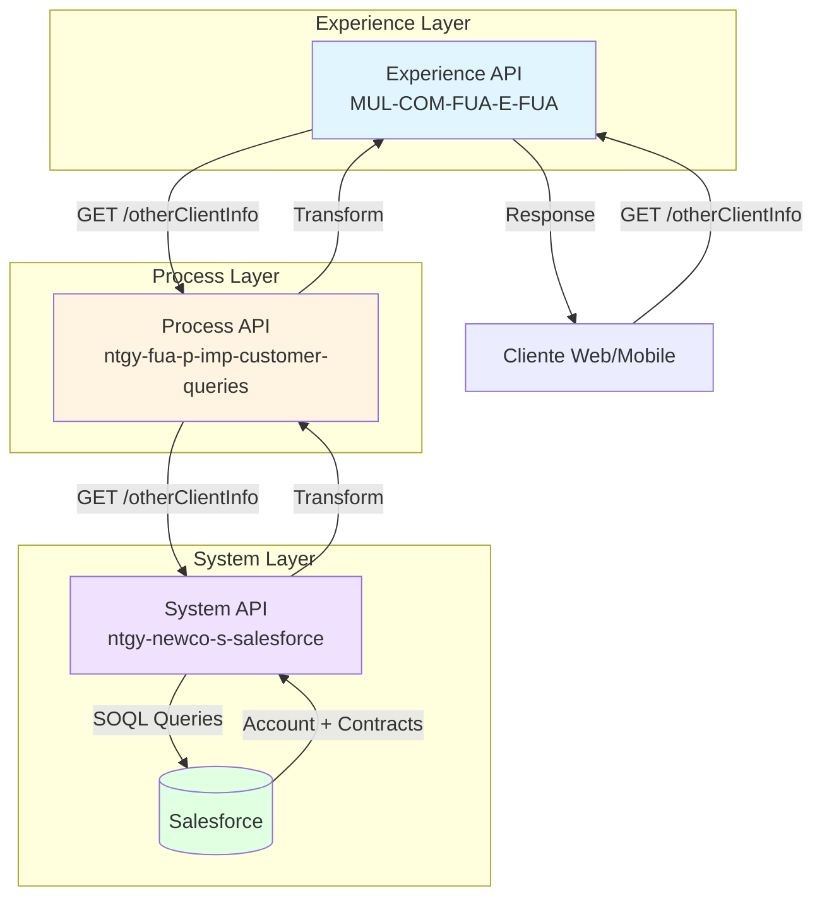
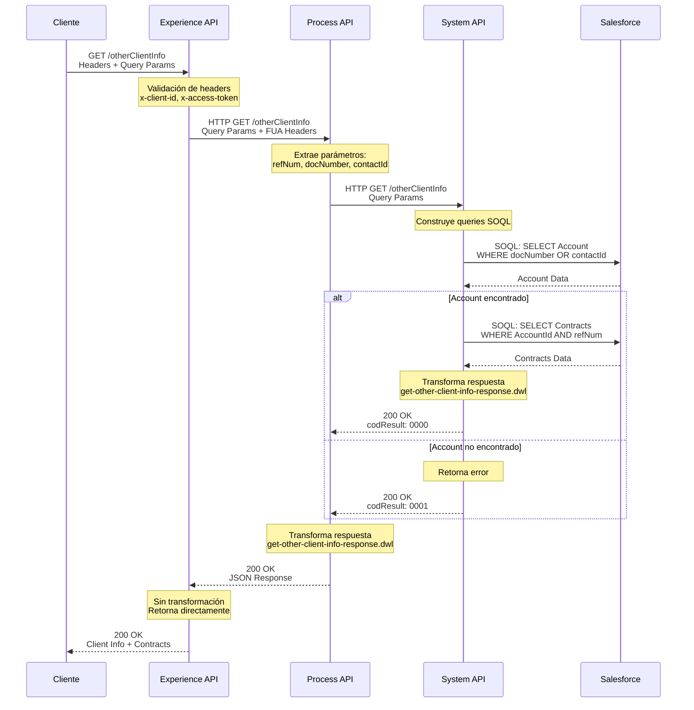
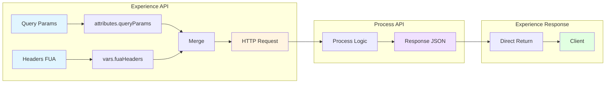

# GET /otherClientInfo

## 📌 Descripción General

Endpoint de Experience API que permite obtener información detallada de otros clientes a través de diferentes criterios de búsqueda: número de documento, referencia de cliente o ID de contacto. Este endpoint es fundamental para procesos de atención al cliente, validación de identidad y consulta de información contractual.

### Características Principales

- **Búsqueda flexible**: Permite buscar por documento, referencia o contacto
- **Información completa**: Retorna datos personales y contratos asociados
- **Integración Salesforce**: Consulta directa a objetos Account y Contract
- **Sin transformación**: Retorna directamente la respuesta del Process API
- **Autenticación requerida**: Requiere token de acceso válido

### Casos de Uso

1. **Consulta de información de cliente**: Obtener datos personales y contratos
2. **Validación de identidad**: Verificar información del cliente por documento
3. **Búsqueda por referencia**: Localizar cliente mediante número de referencia
4. **Consulta de contratos**: Ver todos los contratos asociados a un cliente

## 💼 Propósito del Negocio

### Objetivo

Proporcionar acceso unificado a la información de clientes almacenada en Salesforce, permitiendo consultas rápidas y eficientes para procesos de atención al cliente, validación de identidad y gestión contractual.

### Valor de Negocio

- **Atención al cliente mejorada**: Acceso rápido a información completa del cliente
- **Validación de identidad**: Verificación segura mediante múltiples criterios
- **Gestión contractual**: Visibilidad completa de contratos activos y en borrador
- **Experiencia omnicanal**: Información consistente en todos los canales

### Reglas de Negocio

1. **Criterios de búsqueda**:
   - Se puede buscar por `docNumber`, `refNum` o `contactId`
   - Los parámetros son opcionales pero al menos uno debe proporcionarse
   - Se pueden combinar múltiples criterios para búsquedas más específicas

2. **Información retornada**:
   - Datos personales del cliente (nombre, documento, email, teléfono)
   - Lista de contratos activos o en borrador
   - Información de suministro (CUPS, dirección, tarifa, potencia)

3. **Estados de contrato**:
   - Solo se retornan contratos en estado "Activated" o "Draft"
   - Los contratos se ordenan por fecha de creación descendente

## 🔧 Especificación Técnica

### Endpoint

```
GET /otherClientInfo
```

### Headers

#### Headers Obligatorios

| Header | Tipo | Descripción |
|--------|------|-------------|
| `x-client-id` | string | Identificador único del cliente |
| `x-client-doc-number` | string | Número de documento del cliente |
| `x-access-token` | string | Token de acceso para autenticación |
| `x-language` | string | Idioma de la respuesta (es, en) |

#### Headers Opcionales

| Header | Tipo | Descripción |
|--------|------|-------------|
| `x-interaction-id` | string | ID de interacción para trazabilidad |
| `x-trading-company` | string | Código de la comercializadora |
| `x-user-id` | string | ID del usuario que realiza la consulta |
| `x-client-code` | string | Código interno del cliente |

### Query Parameters

| Parámetro | Tipo | Requerido | Descripción | Ejemplo |
|-----------|------|-----------|-------------|---------|
| `refNum` | string | No | Número de referencia del cliente | "1234567" |
| `docNumber` | string | No | Número de documento del cliente | "12345678A" |
| `contactId` | string | No | ID del contacto en Salesforce | "0031t00000ABC456DEF" |

:::info Nota sobre parámetros
Al menos uno de los tres parámetros debe proporcionarse. Se pueden combinar múltiples parámetros para búsquedas más específicas.
:::

### Respuesta Exitosa (200)

```json
{
  "result": {
    "codResult": "0000",
    "msgResult": "No hay error"
  },
  "otherClientInfo": {
    "name": "Juan García López",
    "serviceAccount": {
      "clientId": "0011t00000XYZ123ABC",
      "serviceAccountId": "a0X1t000000ABC123",
      "lastInvoice": null,
      "supplyAddress": {
        "fullAddress": "Calle Mayor 123, 28013 Madrid",
        "addressId": "a0Z1t000000DEF456",
        "zipCode": "28013",
        "province": "Madrid",
        "city": "Madrid",
        "town": "Madrid",
        "wayId": "12345",
        "way": "Calle Mayor",
        "wayType": "Calle",
        "number": "123",
        "floor": "3",
        "door": "A",
        "portal": "1",
        "stairs": "Izquierda"
      },
      "billingAccountList": {
        "refNum": "1234567",
        "billingAccountId": "a0Y1t000000GHI789",
        "isDirectPayment": true,
        "billDeliveryMethod": "Email",
        "mailingAddress": {
          "fullAddress": "Calle Mayor 123, 28013 Madrid",
          "zipCode": "28013",
          "province": "Madrid",
          "city": "Madrid"
        },
        "bankAccount": {
          "bankAccountId": "a1A1t000000JKL012",
          "contactId": "0031t00000ABC456DEF",
          "holderName": "Juan García López",
          "holderType": "Titular",
          "iban": "ES1234567890123456789012"
        },
        "products": [
          {
            "productName": "Tarifa Luz 2.0TD",
            "contractNumber": "C-2024-001234",
            "startDate": "2024-01-01",
            "productTypeFamily": "luz"
          }
        ]
      }
    },
    "renewalContracts": false,
    "orderItemList": [
      {
        "productName": "Tarifa Luz 2.0TD",
        "techDataId": "a2B1t000000MNO345",
        "contractNumber": "C-2024-001234",
        "startDate": "2024-01-01",
        "prices": {
          "maxConsumption": 5000.0,
          "annualAmount": 1200.0,
          "consumoAnual": 4500.0,
          "serviceAmount": 0.0,
          "flatRateAmount": 0.0,
          "energy": [0.15, 0.12, 0.10, 0.08, 0.06, 0.05],
          "power": [45.0, 40.0, 35.0, 30.0, 25.0, 20.0],
          "fixedTerm": 0.0,
          "variableTerm": 0.0
        },
        "productTypeFamily": "luz",
        "rateInfoData": [
          {
            "text": "Tarifa con discriminación horaria",
            "icon": "https://example.com/icon.png"
          }
        ],
        "orderItemId": "8021t000000PQR678"
      }
    ],
    "orderId": "8011t000000STU901",
    "invoicesDueList": [
      {
        "invoiceId": "a3C1t000000VWX234",
        "issuedDate": "2024-01-15",
        "status": "Pendiente",
        "pendingAmount": 120.50,
        "amount": 120.50,
        "billingDate": "2024-01-01",
        "productInvoiceRelationList": [
          {
            "productFamilyId": "luz",
            "invoice": "F-2024-001",
            "contractNumber": "C-2024-001234"
          }
        ]
      }
    ],
    "itemsDebt": [
      {
        "debtItem": "Factura pendiente",
        "amount": 120.50
      }
    ],
    "orderItemSubrogateList": [
      {
        "productName": "Tarifa Alternativa",
        "prices": {
          "annualAmount": 1100.0
        },
        "productTypeFamily": "luz",
        "rateInfoData": [
          {
            "text": "Tarifa alternativa disponible"
          }
        ],
        "endDate": "2025-12-31",
        "orderItemId": "8021t000000YZA567",
        "contractNumber": "C-2024-001235",
        "startDate": "2024-01-01",
        "promotionDesc": "Promoción Bienvenida",
        "promotionStartDate": "2024-01-01",
        "promotionEndDate": "2024-12-31"
      }
    ],
    "existsActiveLoan": false
  }
}
```

### Respuesta de Error (200)

```json
{
  "result": {
    "codResult": "0001",
    "msgResult": "No se encontró información del cliente"
  }
}
```

### Códigos de Respuesta

| Código | Descripción |
|--------|-------------|
| `0000` | Operación exitosa |
| `0001` | Error en la operación (cliente no encontrado, error de backend) |

### Estructura de Datos

#### otherClientInfo (Objeto Raíz)

| Campo | Tipo | Descripción |
|-------|------|-------------|
| `name` | string | Nombre completo del cliente |
| `serviceAccount` | object | Información de la cuenta de servicio |
| `renewalContracts` | boolean | Indica si hay contratos en renovación |
| `orderItemList` | array | Lista de productos/contratos actuales |
| `orderId` | string | ID de la orden en Salesforce |
| `invoicesDueList` | array | Lista de facturas pendientes |
| `itemsDebt` | array | Detalles de deuda |
| `orderItemSubrogateList` | array | Lista de productos alternativos disponibles |
| `existsActiveLoan` | boolean | Indica si existe financiación activa |

#### serviceAccount

| Campo | Tipo | Descripción |
|-------|------|-------------|
| `clientId` | string | ID del cliente en Salesforce |
| `serviceAccountId` | string | ID de la cuenta de servicio |
| `lastInvoice` | object/null | Última factura (normalmente null) |
| `supplyAddress` | object | Dirección de suministro completa |
| `billingAccountList` | object | Información de cuenta de facturación |

#### orderItemList (Item)

| Campo | Tipo | Descripción |
|-------|------|-------------|
| `productName` | string | Nombre del producto/tarifa |
| `techDataId` | string | ID de datos técnicos |
| `contractNumber` | string | Número de contrato |
| `startDate` | string | Fecha de inicio (YYYY-MM-DD) |
| `prices` | object | Objeto con precios detallados |
| `productTypeFamily` | string | Familia del producto (luz, gas, servicios) |
| `rateInfoData` | array | Información de marketing de la tarifa |
| `orderItemId` | string | ID del item de orden |

#### prices

| Campo | Tipo | Descripción |
|-------|------|-------------|
| `maxConsumption` | number | Consumo máximo pactado |
| `annualAmount` | number | Importe anual estimado |
| `consumoAnual` | number | Consumo anual base (opcional) |
| `serviceAmount` | number | Importe mensual de servicio |
| `flatRateAmount` | number | Cuota mensual de tarifa plana |
| `energy` | array[number] | Precios de término de energía (6 periodos) |
| `power` | array[number] | Precios de término de potencia (6 periodos) |
| `fixedTerm` | number | Término fijo (gas) |
| `variableTerm` | number | Término variable (gas) |

#### invoicesDueList (Item)

| Campo | Tipo | Descripción |
|-------|------|-------------|
| `invoiceId` | string | ID de la factura |
| `issuedDate` | string | Fecha de emisión |
| `status` | string | Estado de la factura |
| `pendingAmount` | number | Importe pendiente |
| `amount` | number | Importe total |
| `billingDate` | string | Fecha de facturación |
| `productInvoiceRelationList` | array | Relación de productos facturados |

## 🏗️ Implementación Técnica

### Arquitectura de 3 Capas



### Flujo de Datos Detallado



### Implementación en Experience API

**Archivo:** `implementation/get-other-client-info.xml` (líneas 8-13)

```xml
<http:request method="GET" 
              doc:name="Newco-evo Get Other Client Request" 
              config-ref="HTTP_FUA_PROCESS_NEWCO_EVO" 
              path="/otherClientInfo">
    <http:query-params><![CDATA[#[output application/java
---
attributes.queryParams ++ vars.fuaHeaders]]]></http:query-params>
</http:request>
```

**Características:**
- **Sin transformación**: Retorna directamente la respuesta del Process API
- **Propagación de parámetros**: Pasa todos los query params y headers FUA
- **Configuración HTTP**: Usa `HTTP_FUA_PROCESS_NEWCO_EVO`
- **Endpoint destino**: `http://ntgy-newco-p-fua-evo-pro.us-e2.cloudhub.io`

### Implementación en Process API

**Archivo:** `ntgy-newco-p-fua-evo/src/main/mule/ntgy-newco-p-fua.xml` (líneas 350-395)

**Flow Principal:**
```xml
<flow name="get:\otherClientInfo:ntgy-newco-p-fua-config">
    <logger level="INFO" message="Entrada de datos: #[attributes]" />
    
    <!-- Extracción de variables -->
    <ee:transform doc:name="Transform Message">
        <ee:variables>
            <ee:set-variable variableName="refNum">
                attributes.queryParams.'refNum'
            </ee:set-variable>
            <ee:set-variable variableName="clientCode">
                attributes.queryParams.'docNumber' default ""
            </ee:set-variable>
            <ee:set-variable variableName="language">
                if(attributes.queryParams.'x-language'== null) "" 
                else attributes.queryParams.'x-language'
            </ee:set-variable>
            <ee:set-variable variableName="docNumberLog">
                attributes.queryParams.'x-client-code' default ""
            </ee:set-variable>
            <ee:set-variable variableName="accountId">
                attributes.queryParams.'x-client-id' default ""
            </ee:set-variable>
            <ee:set-variable variableName="contactId">
                attributes.queryParams.'contactId' default ""
            </ee:set-variable>
        </ee:variables>
    </ee:transform>
    
    <!-- Llamada al subflow -->
    <flow-ref name="getOtherClientInfo" />
</flow>
```

**Subflow de Implementación:** `services/clients/clientInfo.xml` (líneas 10-844)

El subflow `getOtherClientInfo` implementa una lógica compleja de validación y orquestación:

1. **Validación de Cliente** (líneas 16-34):
   - Verifica que el `clientCode` sea diferente del `docNumberLog`
   - Llama a System API PostgreSQL-Salesforce para obtener datos del cliente
   - Extrae `IdCliente`, `IdContacto`, `IGpart`, `IVkont`

2. **Validación de Productos** (líneas 54-125):
   - Obtiene lista de productos del cliente
   - Valida estados de productos (activos, servicios, energéticos)
   - Filtra productos por estado válido

3. **Validación de Solicitudes en Curso** (líneas 127-160):
   - Consulta PostgreSQL para verificar solicitudes de contratación activas
   - Valida que no haya solicitudes restrictivas (tipo 23 o 17)

4. **Orquestación Paralela con Scatter-Gather** (líneas 343-505):
   - **Route 1**: Obtiene facturas pendientes (`getFacturasPendientes`)
   - **Route 2**: Obtiene precios de productos (`getProductPrices`)
   - **Route 3**: Obtiene deuda de items (`getItemsDebt`)
   - **Route 4**: Calcula tarifas planas (Rate Calculation)
   - **Route 5**: Verifica financiación activa en SAP
   - **Route 6**: Busca promociones activas

5. **Transformación Final** (líneas 508-738):
   - Diferencia entre clientes Residenciales y Pymes
   - Construye respuesta completa con toda la información orquestada

**System APIs Llamados:**

1. **s-postgresql-salesforce** (línea 17):
   ```xml
   <http:request method="GET" path="/client">
       <http:query-params>
           { clientCode: vars.clientCode }
       </http:query-params>
   </http:request>
   ```

2. **s-postgresql-salesforce** (línea 54):
   ```xml
   <http:request method="GET" path="/contractAccountsNew">
       <http:query-params>
           {
               clientId: vars.IdCliente,
               refNum: vars.refNum,
               language: vars.language
           }
       </http:query-params>
   </http:request>
   ```

3. **s-postgresql-salesforce** (línea 142):
   ```xml
   <http:request method="POST" path="/ejecutarQuery">
       <http:body>
           {
               "query": "SELECT acn_fld_contract__c, acn_fld_status__c, 
                         acn_fld_sctype__c 
                         FROM newcosalesforce.acn_obj_contractrequest__c 
                         WHERE acn_fld_status__c = '02' 
                         AND acn_fld_contract__c = '[contractId]'"
           }
       </http:body>
   </http:request>
   ```

4. **s-salesforce** (línea 294):
   ```xml
   <http:request method="GET" 
                 path="/accounts/{accountId}/billing-accounts/{billingAccountId}/
                       service-accounts/{serviceAccountId}/contacts/{contactId}/assets">
   </http:request>
   ```

5. **s-sap** (línea 413):
   ```xml
   <http:request method="GET" path="${ntgy-newco-s-sap.functions.checkFinanActiva}">
       <http:query-params>
           { idCuentaContrato: vars.IVkont }
       </http:query-params>
   </http:request>
   ```

**Estructura de Respuesta Real** (líneas 539-625 para Residencial):

```json
{
  "result": {
    "codResult": "0000",
    "msgResult": "No hay error"
  },
  "otherClientInfo": {
    "name": "Juan García López",
    "serviceAccount": {
      "clientId": "0011t00000XYZ123ABC",
      "serviceAccountId": "a0X1t000000ABC123",
      "lastInvoice": null,
      "supplyAddress": {
        "fullAddress": "Calle Mayor 123, Madrid",
        "zipCode": "28013",
        "province": "Madrid",
        "city": "Madrid"
      },
      "billingAccountList": {
        "refNum": "1234567",
        "billingAccountId": "a0Y1t000000DEF456",
        "isDirectPayment": true,
        "billDeliveryMethod": "Email",
        "mailingAddress": {...},
        "bankAccount": {...},
        "products": [...]
      }
    },
    "renewalContracts": false,
    "orderItemList": [...],
    "orderId": "8011t000000GHI789",
    "invoicesDueList": [...],
    "itemsDebt": [...],
    "orderItemSubrogateList": [...],
    "existsActiveLoan": false
  }
}
```

### Configuración HTTP

**Archivo:** `global.xml` (líneas 30-32)

```xml
<http:request-config name="HTTP_FUA_PROCESS_NEWCO_EVO" 
                     doc:name="HTTP Request configuration" 
                     basePath="/api" 
                     responseTimeout="${newco-p-fua-evo.timeout}">
    <http:request-connection host="${newco-p-fua-evo.host}" 
                            port="${newco-p-fua-evo.port}" 
                            connectionIdleTimeout="${newco-p-fua-evo.timeout}"/>
</http:request-config>
```

**Configuración de Propiedades** (`e-fua-pro-config.yaml` - líneas 25-28):

```yaml
newco-p-fua-evo:
  host: "mule-worker-internal-ntgy-newco-p-fua-evo.de-c1.cloudhub.io"
  port: "8091"
  timeout: "60000"
```

### Manejo de Errores

**Archivo:** `implementation/get-other-client-info.xml` (líneas 14-28)

```xml
<error-handler>
    <on-error-propagate enableNotifications="true" 
                       logException="true" 
                       doc:name="On Error Propagate">
        <ee:transform doc:name="Set Error Message">
            <ee:message>
                <ee:set-payload><![CDATA[%dw 2.0
output application/json
---
{
    "result": {
        "codResult": "0001",
        "msgResult": error.description as String replace /\"/ with("")
    }
}]]></ee:set-payload>
            </ee:message>
        </ee:transform>
        <logger level="ERROR" 
                doc:name="Error" 
                message='#[{
    "result": {
        "codResult": "0001",
        "msgResult": error.description as String replace /\"/ with("")
    }
}]' />
    </on-error-propagate>
</error-handler>
```

**Características del Manejo de Errores:**
- **Propagación de errores**: Usa `on-error-propagate` para mantener el error
- **Transformación de error**: Convierte cualquier error en formato estándar
- **Logging**: Registra el error con nivel ERROR
- **Formato consistente**: Retorna siempre código 0001 para errores
- **Limpieza de mensaje**: Elimina comillas del mensaje de error

### Diagrama de Transformación de Datos



### Consideraciones de Implementación

1. **Sin Transformación en Experience API**:
   - El Experience API actúa como proxy transparente
   - No modifica la respuesta del Process API
   - Simplifica el mantenimiento y reduce latencia

2. **Propagación de Headers**:
   - Todos los headers FUA se propagan al Process API
   - Permite trazabilidad end-to-end
   - Mantiene contexto de autenticación

3. **Manejo de Errores Robusto**:
   - Captura cualquier error de comunicación
   - Retorna formato consistente
   - Registra errores para troubleshooting

4. **Configuración Externalizada**:
   - Host y puerto configurables por ambiente
   - Timeout ajustable (60 segundos)
   - Facilita despliegues en diferentes entornos

## 💻 Ejemplos de Uso

### Ejemplo 1: Búsqueda por Número de Documento

**Request:**

```bash
curl -X GET "https://api.example.com/fua/otherClientInfo?docNumber=12345678A" \
  -H "x-client-id: CLIENT123" \
  -H "x-client-doc-number: 12345678A" \
  -H "x-access-token: eyJhbGciOiJIUzI1NiIsInR5cCI6IkpXVCJ9..." \
  -H "x-language: es" \
  -H "x-interaction-id: INT-2024-001234"
```

**Response (200 OK):**

```json
{
  "result": {
    "codResult": "0000",
    "msgResult": "OK"
  },
  "data": {
    "clientInfo": {
      "clientId": "0011t00000XYZ123ABC",
      "docNumber": "12345678A",
      "docType": "NIF",
      "name": "Juan",
      "surname": "García López",
      "email": "juan.garcia@example.com",
      "phone": "+34600123456",
      "contactId": "0031t00000ABC456DEF"
    },
    "contracts": [
      {
        "contractId": "8001t00000XYZ789GHI",
        "contractNumber": "C-2024-001234",
        "status": "Activated",
        "startDate": "2024-01-01",
        "endDate": "2025-12-31",
        "cups": "ES0021000000000001JN",
        "supplyAddress": "Calle Mayor 123, 28013 Madrid",
        "rate": "2.0TD",
        "contractedPower": "4.6"
      },
      {
        "contractId": "8001t00000XYZ789GHJ",
        "contractNumber": "C-2024-001235",
        "status": "Draft",
        "startDate": "2024-06-01",
        "endDate": "2025-05-31",
        "cups": "ES0021000000000002KM",
        "supplyAddress": "Avenida de la Constitución 45, 28014 Madrid",
        "rate": "3.0TD",
        "contractedPower": "5.75"
      }
    ]
  }
}
```

### Ejemplo 2: Búsqueda por Referencia

**Request:**

```bash
curl -X GET "https://api.example.com/fua/otherClientInfo?refNum=1234567" \
  -H "x-client-id: CLIENT123" \
  -H "x-client-doc-number: 12345678A" \
  -H "x-access-token: eyJhbGciOiJIUzI1NiIsInR5cCI6IkpXVCJ9..." \
  -H "x-language: es"
```

**Response (200 OK):**

```json
{
  "result": {
    "codResult": "0000",
    "msgResult": "OK"
  },
  "data": {
    "clientInfo": {
      "clientId": "0011t00000XYZ123ABC",
      "docNumber": "12345678A",
      "docType": "NIF",
      "name": "María",
      "surname": "Rodríguez Pérez",
      "email": "maria.rodriguez@example.com",
      "phone": "+34611223344",
      "contactId": "0031t00000ABC789XYZ"
    },
    "contracts": [
      {
        "contractId": "8001t00000XYZ456DEF",
        "contractNumber": "C-2024-002345",
        "status": "Activated",
        "startDate": "2024-03-15",
        "endDate": "2025-03-14",
        "cups": "ES0021000000000003LN",
        "supplyAddress": "Plaza España 10, 28008 Madrid",
        "rate": "2.0TD",
        "contractedPower": "3.45"
      }
    ]
  }
}
```

### Ejemplo 3: Búsqueda por Contact ID

**Request:**

```bash
curl -X GET "https://api.example.com/fua/otherClientInfo?contactId=0031t00000ABC456DEF" \
  -H "x-client-id: CLIENT123" \
  -H "x-client-doc-number: 12345678A" \
  -H "x-access-token: eyJhbGciOiJIUzI1NiIsInR5cCI6IkpXVCJ9..." \
  -H "x-language: es" \
  -H "x-user-id: USER789"
```

**Response (200 OK):**

```json
{
  "result": {
    "codResult": "0000",
    "msgResult": "OK"
  },
  "data": {
    "clientInfo": {
      "clientId": "0011t00000XYZ123ABC",
      "docNumber": "87654321B",
      "docType": "NIE",
      "name": "Carlos",
      "surname": "Martínez Sánchez",
      "email": "carlos.martinez@example.com",
      "phone": "+34622334455",
      "contactId": "0031t00000ABC456DEF"
    },
    "contracts": []
  }
}
```

### Ejemplo 4: Cliente No Encontrado

**Request:**

```bash
curl -X GET "https://api.example.com/fua/otherClientInfo?docNumber=99999999Z" \
  -H "x-client-id: CLIENT123" \
  -H "x-client-doc-number: 99999999Z" \
  -H "x-access-token: eyJhbGciOiJIUzI1NiIsInR5cCI6IkpXVCJ9..." \
  -H "x-language: es"
```

**Response (200 OK):**

```json
{
  "result": {
    "codResult": "0001",
    "msgResult": "No se encontró información del cliente"
  }
}
```

### Ejemplo 5: Error de Comunicación

**Request:**

```bash
curl -X GET "https://api.example.com/fua/otherClientInfo?docNumber=12345678A" \
  -H "x-client-id: CLIENT123" \
  -H "x-client-doc-number: 12345678A" \
  -H "x-access-token: eyJhbGciOiJIUzI1NiIsInR5cCI6IkpXVCJ9..." \
  -H "x-language: es"
```

**Response (200 OK):**

```json
{
  "result": {
    "codResult": "0001",
    "msgResult": "HTTP GET on resource 'http://mule-worker-internal-ntgy-newco-p-fua-evo.de-c1.cloudhub.io:8091/api/otherClientInfo' failed: timeout exceeded."
  }
}
```

### Ejemplo 6: Búsqueda Combinada (Documento + Referencia)

**Request:**

```bash
curl -X GET "https://api.example.com/fua/otherClientInfo?docNumber=12345678A&refNum=1234567" \
  -H "x-client-id: CLIENT123" \
  -H "x-client-doc-number: 12345678A" \
  -H "x-access-token: eyJhbGciOiJIUzI1NiIsInR5cCI6IkpXVCJ9..." \
  -H "x-language: es" \
  -H "x-trading-company: NEWCO"
```

**Response (200 OK):**

```json
{
  "result": {
    "codResult": "0000",
    "msgResult": "OK"
  },
  "data": {
    "clientInfo": {
      "clientId": "0011t00000XYZ123ABC",
      "docNumber": "12345678A",
      "docType": "NIF",
      "name": "Ana",
      "surname": "López Fernández",
      "email": "ana.lopez@example.com",
      "phone": "+34633445566",
      "contactId": "0031t00000ABC123GHI"
    },
    "contracts": [
      {
        "contractId": "8001t00000XYZ111AAA",
        "contractNumber": "C-2024-003456",
        "status": "Activated",
        "startDate": "2024-01-15",
        "endDate": "2025-01-14",
        "cups": "ES0021000000000004MO",
        "supplyAddress": "Calle Gran Vía 28, 28013 Madrid",
        "rate": "2.0TD",
        "contractedPower": "5.75"
      }
    ]
  }
}
```
