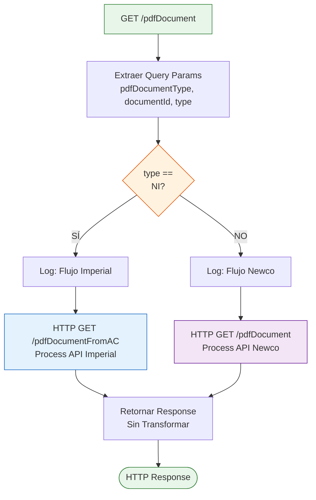
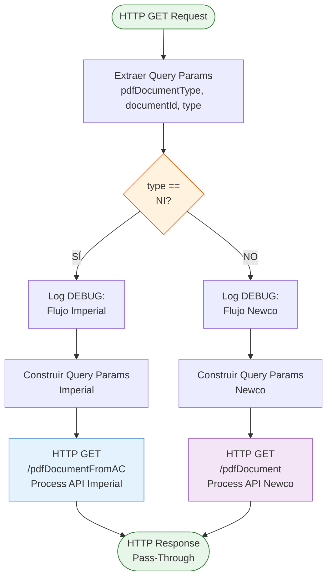
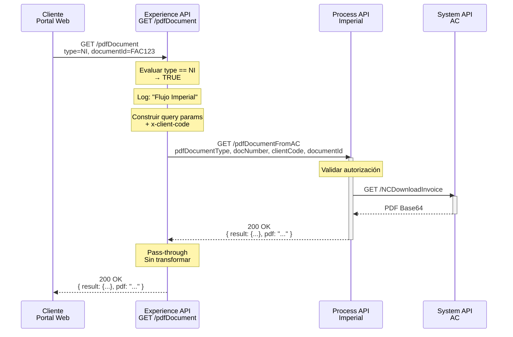
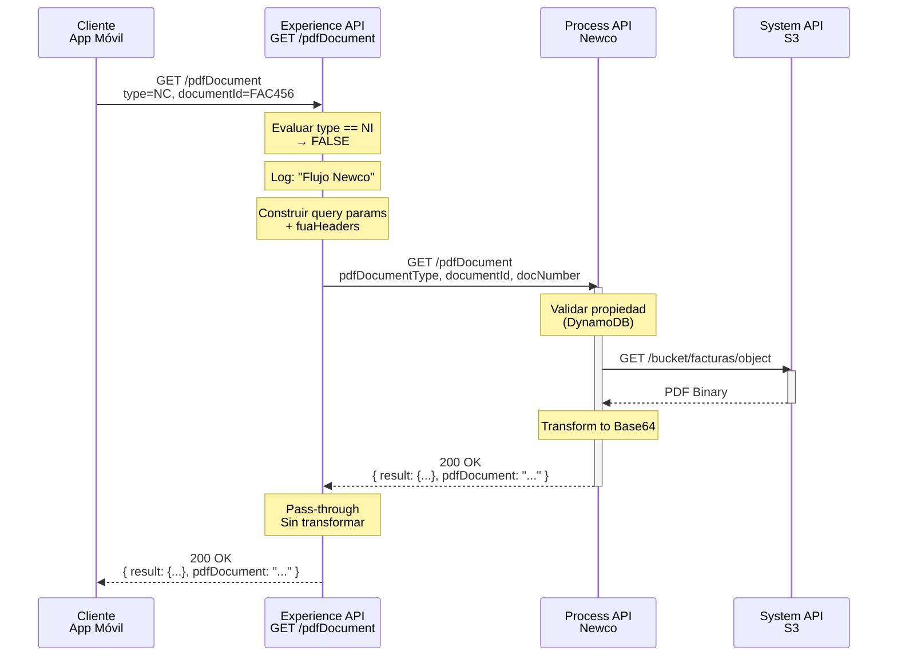
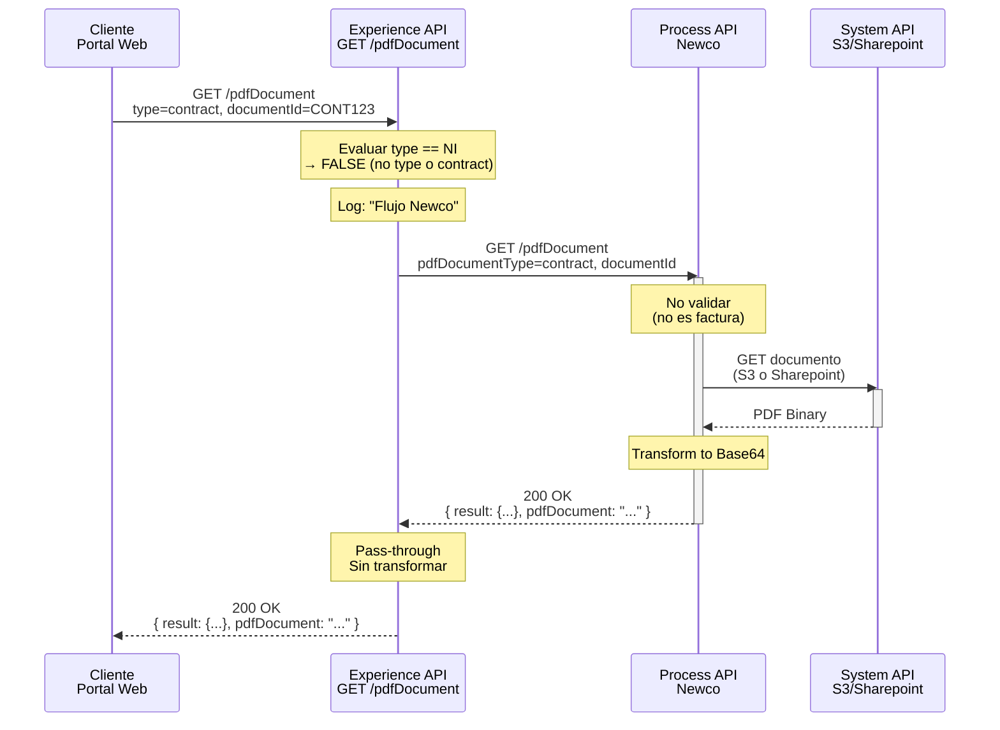
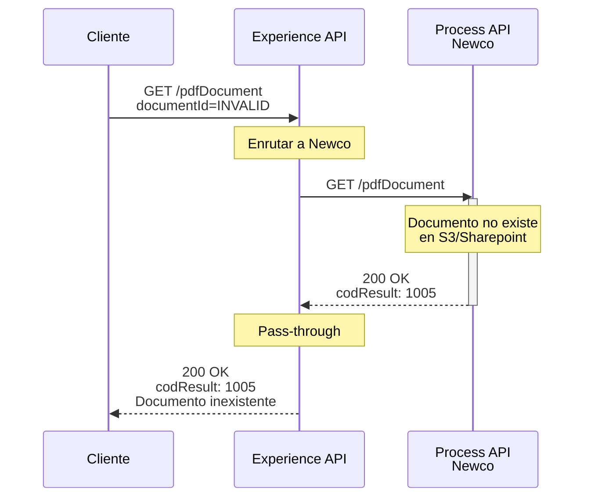

# GET /pdfDocument

## 📌 Descripción General

### Propósito del Endpoint

Este endpoint permite la descarga de documentos PDF (facturas o contratos) del cliente, implementando un enrutamiento inteligente basado en el tipo de factura. Orquesta llamadas a diferentes Process APIs según si la factura es de tipo NI (Imperial) o NC/otros (Newco), proporcionando una experiencia unificada independientemente del sistema backend.

### Tipo de API

**Capa:** Experience API (API-Led Connectivity)

**Función:** Orquestación y enrutamiento de descarga de documentos con lógica de decisión por tipo de factura

### Patrón de Integración

**Tipo:** Content-Based Routing con Pass-Through

**Descripción:** El endpoint implementa un patrón de enrutamiento condicional que:
1. **Analiza el tipo de factura** mediante el parámetro `type`
2. **Enruta a Imperial** si `type == "NI"` (facturas Imperial)
3. **Enruta a Newco** en caso contrario (facturas NC y contratos)
4. **Retorna la respuesta** sin transformación adicional

### Arquitectura API-Led Connectivity

```mermaid
graph TB
    C[Cliente<br/>Portal Web/App Móvil]
    E[Experience API<br/>ntgy-fua-e-fua<br/>GET /pdfDocument]
    P1[Process API<br/>ntgy-fua-p-imp-customer-queries<br/>GET /pdfDocumentFromAC]
    P2[Process API<br/>ntgy-newco-p-fua-evo<br/>GET /pdfDocument]
    S1[System API<br/>ntgy-fua-s-ac-fua<br/>Sistema AC]
    S2[System API<br/>ntgy-newco-s-s3-small<br/>AWS S3]
    S3[System API<br/>ntgy-newco-s-sharepoint<br/>Sharepoint]
    
    C -->|Request con type| E
    E -->|Tipo NI| P1
    E -->|Tipo NC/otros| P2
    P1 -->|Consulta| S1
    P2 -->|Consulta| S2
    P2 -->|Consulta| S3
    S1 -->|PDF Base64| P1
    S2 -->|PDF Base64| P2
    S3 -->|PDF Base64| P2
    P1 -->|Response| E
    P2 -->|Response| E
    E -->|PDF documento| C
    
    style C fill:#e1f5ff,stroke:#0277bd,stroke-width:2px
    style E fill:#fff4e1,stroke:#f57c00,stroke-width:3px
    style P1 fill:#ffe1f5,stroke:#c2185b,stroke-width:2px
    style P2 fill:#ffe1f5,stroke:#c2185b,stroke-width:2px
    style S1 fill:#e8f5e9,stroke:#2e7d32,stroke-width:2px
    style S2 fill:#e8f5e9,stroke:#2e7d32,stroke-width:2px
    style S3 fill:#e8f5e9,stroke:#2e7d32,stroke-width:2px
```



---

## 💼 Propósito del Negocio

### Casos de Uso Principales

1. **Descarga de Facturas Imperial (NI)**
   - Cliente con factura tipo NI accede desde portal web
   - Sistema enruta automáticamente a Process API Imperial
   - Recupera PDF desde Sistema AC
   - **Beneficio**: Acceso transparente a facturas legacy sin conocer el sistema backend

2. **Descarga de Facturas Newco (NC)**
   - Cliente con factura tipo NC solicita descarga
   - Sistema enruta a Process API Newco
   - Recupera PDF desde S3 o Sharepoint
   - **Beneficio**: Acceso unificado a facturas modernas con validación de seguridad

3. **Descarga de Contratos**
   - Cliente necesita consultar su contrato
   - Sistema enruta a Process API Newco (sin parámetro type)
   - Recupera contrato desde almacenamiento correspondiente
   - **Beneficio**: Acceso inmediato a documentación contractual

### 📱 Canal y Audiencia

#### Canal de Consumo

**Canal:** Web / Mobile

**Características del Canal:**
- **Plataforma**: Portal FUA (Frontal Único de Atención), Aplicaciones móviles iOS/Android
- **Dispositivos**: Navegadores web modernos, smartphones, tablets
- **Conectividad**: Requiere conexión estable para descarga de PDFs (pueden ser archivos grandes)
- **Experiencia de Usuario**: Descarga directa de documentos con feedback visual de progreso

#### Audiencia Objetivo

**Usuarios Finales:**
- **Clientes Residenciales**: Necesitan acceder a sus facturas y contratos de energía
- **Clientes Empresariales**: Requieren documentación fiscal para contabilidad
- **Agentes de Call Center**: Consultan documentos para resolver incidencias

**Contexto de Uso:**
- **Autoservicio**: Cliente descarga factura para pago o consulta
- **Soporte**: Agente necesita visualizar documento del cliente
- **Gestión Documental**: Cliente archiva documentación para trámites

#### Adaptaciones del Canal

**Optimizaciones Aplicadas:**
- **Pass-Through**: No se transforma la respuesta, se retorna tal cual del Process API
- **Enrutamiento Transparente**: Cliente no necesita conocer el sistema backend (Imperial/Newco)
- **Formato Estándar**: PDF en Base64 compatible con navegadores y apps móviles
- **Timeout Extendido**: 60 segundos para Process API Newco (documentos grandes)

### 🔗 Endpoints Dependientes

Este Experience API consume los siguientes Process APIs:

| Process API | Endpoint | Método | Propósito |
|-------------|----------|--------|-----------|
| `ntgy-fua-p-imp-customer-queries` | `/pdfDocumentFromAC` | GET | Recupera documentos PDF de facturas Imperial (tipo NI) desde Sistema AC |
| `ntgy-newco-p-fua-evo` | `/pdfDocument` | GET | Recupera documentos PDF de facturas Newco y contratos desde S3/Sharepoint |

### Lógica de Orquestación



**Pasos del Proceso:**

1. **Extracción de Parámetros**: Captura `pdfDocumentType`, `documentId`, `type` de query params
2. **Decisión de Enrutamiento**: Evalúa el parámetro `type`
   - Si `type == "NI"` → Flujo Imperial
   - Si `type != "NI"` o no existe → Flujo Newco
3. **Llamada a Process API**: Invoca el Process API correspondiente con todos los parámetros
4. **Respuesta Pass-Through**: Retorna la respuesta del Process API sin modificar

### Transformaciones Aplicadas

⚠️ **Este Experience API NO transforma la respuesta de los Process APIs.**

**Implementación actual (líneas 13-27 del código):**

```xml
<choice doc:name="Choice">
    <when expression="#[attributes.queryParams.'type' == &quot;NI&quot;]">
        <logger level="DEBUG" doc:name="Flujo Imperial" message='#["Flujo Imperial"]' />
        <http:request method="GET" doc:name="IMPERIAL Get_pdfDocument Request" 
                     config-ref="HTTP_API_ProcesoConsultaImperial" 
                     path="/pdfDocumentFromAC">
            <!-- Query params pass-through -->
        </http:request>
    </when>
    <otherwise>
        <logger level="DEBUG" doc:name="Flujo Newco" message='#["Flujo Newco"]' />
        <http:request method="GET" doc:name="Newco Get PDF Document Request" 
                     config-ref="HTTP_FUA_PROCESS_NEWCO_EVO" 
                     path="/pdfDocument">
            <!-- Query params pass-through -->
        </http:request>
    </otherwise>
</choice>
```

El endpoint retorna el `payload` **exactamente como viene del Process API**, sin ninguna transformación adicional.

**Estructura retornada (confirmada de los Process APIs):**

Ambos Process APIs retornan la misma estructura estándar:

```json
{
  "result": {
    "codResult": "0000",
    "msgResult": "No hay error"
  },
  "pdfDocument": "[Base64 encoded PDF]"
}
```

**Nota:** El campo puede ser `pdf` (Imperial) o `pdfDocument` (Newco), pero ambos contienen el PDF en Base64.

**Flujo completo:**
1. Experience API recibe request con parámetros
2. Experience API decide enrutamiento según `type`
3. Experience API llama a Process API correspondiente
4. Process API retorna `{ result: {...}, pdfDocument/pdf: "..." }`
5. Experience API retorna el payload sin modificar

### Contexto Empresarial

- **Dominio:** Gestión Documental y Facturación
- **Sector:** Energía - Utilities (Gas & Electricidad)
- **División:** Naturgy España - Clientes Minoristas (Imperial y Newco)
- **Canal:** Web / Mobile (Portal FUA y Apps)
- **Proceso de Negocio:** Autoservicio de documentos con enrutamiento transparente

### Stakeholders

- **Clientes Finales**: Necesitan acceso rápido a sus documentos sin conocer complejidad técnica
- **Agentes de Call Center**: Requieren acceso unificado a documentos de cualquier tipo de cliente
- **Equipo de Desarrollo**: Mantienen separación de sistemas legacy (Imperial) y modernos (Newco)
- **Equipo de Arquitectura**: Aseguran abstracción de complejidad backend en capa Experience

### Valor de Negocio

- **Transparencia**: Cliente no necesita saber si su factura es Imperial o Newco
- **Unificación**: Una sola API para todos los tipos de documentos
- **Flexibilidad**: Fácil migración de clientes entre sistemas sin cambiar la API
- **Mantenibilidad**: Cambios en Process APIs no afectan a consumidores del Experience API

### Consumidores Potenciales

Este endpoint puede ser consumido por:
- Portal web FUA (Frontal Único de Atención)
- Aplicaciones móviles de clientes (iOS/Android)
- Sistemas de agentes de call center
- Portales de autoservicio
- Aplicaciones de terceros autorizados

---

## 🔧 Especificación Técnica

### URLs por Ambiente

| Ambiente | URL Base | URL Completa |
|----------|----------|--------------|
| **Local** | `http://localhost:8081` | `http://localhost:8081/fua/api/pdfDocument` |
| **Development** | `https://ntgy-fua-e-fua-dev.de-c1.cloudhub.io` | `https://ntgy-fua-e-fua-dev.de-c1.cloudhub.io/fua/api/pdfDocument` |
| **UAT** | `https://ntgy-fua-e-fua-uat.de-c1.cloudhub.io` | `https://ntgy-fua-e-fua-uat.de-c1.cloudhub.io/fua/api/pdfDocument` |
| **Production** | `https://ntgy-fua-e-fua-pro.de-c1.cloudhub.io` | `https://ntgy-fua-e-fua-pro.de-c1.cloudhub.io/fua/api/pdfDocument` |

### Método HTTP

```
GET /fua/api/pdfDocument
```

### 🎯 Consideraciones del Canal

#### Limitaciones del Canal

| Aspecto | Limitación | Razón |
|---------|------------|-------|
| **Timeout** | 60 segundos (Newco), 30 segundos (Imperial) | Documentos PDF pueden ser grandes, especialmente facturas con múltiples páginas |
| **Tamaño de Respuesta** | ~10 MB máximo (Base64) | PDFs codificados en Base64 aumentan ~33% el tamaño original |
| **Rate Limiting** | 100 requests/minuto por cliente | Evitar abuso de descarga masiva de documentos |
| **Formato** | Solo PDF | Único formato soportado para facturas y contratos |

#### Campos Específicos del Canal

**Campos Pass-Through (sin modificación):**

Este Experience API **NO añade ni omite campos**. Retorna la respuesta exacta del Process API correspondiente.

**Estructura de respuesta (ambos Process APIs):**

| Campo | Tipo | Descripción | Origen |
|-------|------|-------------|--------|
| `result.codResult` | string | Código de resultado ("0000" = éxito) | Process API |
| `result.msgResult` | string | Mensaje descriptivo del resultado | Process API |
| `pdfDocument` o `pdf` | string | Contenido del PDF codificado en Base64 | Process API |

**Nota:** El nombre del campo puede variar (`pdf` en Imperial, `pdfDocument` en Newco), pero ambos contienen el mismo tipo de dato.

### Parámetros de Entrada

#### Query Parameters

| Parámetro | Tipo | Requerido | Descripción | Valores Permitidos |
|-----------|------|-----------|-------------|-------------------|
| `pdfDocumentType` | string | Sí | Tipo de documento a descargar | `invoice`, `contract` |
| `documentId` | string | Sí | ID del documento PDF a descargar o CUPS del cliente | UUID, número de factura, CUPS |
| `type` | string | No | Indicador del tipo de factura (determina enrutamiento) | `NI` (Imperial), `NC` (Newco), o vacío |

**Lógica de Enrutamiento:**
- Si `type == "NI"` → Enruta a Process API Imperial
- Si `type == "NC"` o no se proporciona → Enruta a Process API Newco

#### Headers

| Header | Tipo | Requerido | Descripción | Ejemplo |
|--------|------|-----------|-------------|---------|
| `x-client-code` | string | Sí | Código del cliente para validación | `CLI123456` |
| `client_id` | string | Sí | Client ID de Anypoint Platform | `abc123...` |
| `client_secret` | string | Sí | Client Secret de Anypoint Platform | `xyz789...` |

### Respuestas

#### 200 OK - Documento Recuperado Exitosamente

**Descripción:** Documento encontrado y retornado en Base64

**Content-Type:** `application/json`

**Schema (Process API Imperial):**
```json
{
  "result": {
    "codResult": "0000",
    "msgResult": "No hay error"
  },
  "pdf": "[Base64 encoded PDF content]"
}
```

**Schema (Process API Newco):**
```json
{
  "result": {
    "codResult": "0000",
    "msgResult": "No hay error"
  },
  "pdfDocument": "[Base64 encoded PDF content]"
}
```

**Campos de la respuesta:**

| Campo | Tipo | Descripción |
|-------|------|-------------|
| `result.codResult` | string | Código de resultado: "0000" para éxito |
| `result.msgResult` | string | Mensaje descriptivo del resultado |
| `pdf` o `pdfDocument` | string | Contenido del PDF codificado en Base64 |

#### Errores de Negocio (Process API Imperial)

##### Error 2001 - Tipo de Documento Incorrecto

```json
{
  "result": {
    "codResult": "2001",
    "msgResult": "pdfDocumentType incorrecto"
  }
}
```

**Causa:** El parámetro `pdfDocumentType` no es "invoice" ni "contract"

##### Error 2002 - Parámetros Faltantes

```json
{
  "result": {
    "codResult": "2002",
    "msgResult": "Faltan campos obligatorios"
  }
}
```

**Causa:** Uno o más parámetros obligatorios no fueron proporcionados

##### Error 5000 - No Autorizado

**HTTP Status:** 403 Forbidden

```json
{
  "result": {
    "codResult": "5000",
    "msgResult": "No autorizado"
  }
}
```

**Causa:** El cliente no tiene autorización para acceder al documento

#### Errores de Negocio (Process API Newco)

##### Error 1005 - Documento No Encontrado

```json
{
  "result": {
    "codResult": "1005",
    "msgResult": "Documento inexistente"
  }
}
```

**Causa:** El documento no existe en el sistema de almacenamiento

##### Error 1006 - Documento de Otro Cliente

```json
{
  "result": {
    "codResult": "1006",
    "msgResult": "Documento asociado a otro cliente"
  }
}
```

**Causa:** El documento existe pero pertenece a otro cliente

#### Errores Técnicos

##### Error HTTP:INTERNAL_SERVER_ERROR

**HTTP Status:** 500 Internal Server Error

```json
{
  "result": {
    "codResult": "0001",
    "msgResult": "[Descripción del error técnico]"
  }
}
```

**Causa:** Error no controlado durante el procesamiento en Process API

##### Error HTTP:BAD_REQUEST

**HTTP Status:** 400 Bad Request (transformado a 200 con payload de error)

```json
{
  "result": {
    "codResult": "[código]",
    "msgResult": "[mensaje de error]"
  }
}
```

**Causa:** Error de validación en Process API

### Autenticación

- **Tipo:** OAuth 2.0 (Client ID & Client Secret)
- **Implementación:** Anypoint Platform API Gateway
- **Headers Requeridos:**
  - `client_id: [your_client_id]`
  - `client_secret: [your_client_secret]`

### Timeouts

| Tipo | Valor | Justificación |
|------|-------|---------------|
| **Process API Imperial** | 30 segundos | Documentos desde Sistema AC (respuesta rápida) |
| **Process API Newco** | 60 segundos | Documentos desde S3/Sharepoint (pueden ser grandes) |

### Rate Limiting

- **Límite:** 100 requests/minuto por cliente
- **Implementación:** API Gateway de Anypoint Platform

---

## 🏗️ Implementación Técnica

### Arquitectura del Flow



### Componentes del Flow

#### 1. Flow Principal: `get:\pdfDocument:e-fua-config`

**Ubicación:** `src/main/mule/get-pdf-document.xml` (líneas 9-11)

**Responsabilidades:**
- Recibir request HTTP GET
- Invocar subflow de procesamiento

**Código XML:**
```xml
<flow name="get:\pdfDocument:e-fua-config">
    <flow-ref doc:name="get-pdf-document" name="get-pdf-document" />
</flow>
```

#### 2. Subflow: `get-pdf-document`

**Ubicación:** `src/main/mule/get-pdf-document.xml` (líneas 13-50)

**Responsabilidades:**
- Implementar lógica de enrutamiento
- Llamar a Process API correspondiente
- Manejar errores

**Código XML Completo:**

```xml
<flow name="get-pdf-document">
    <choice doc:name="Choice">
        <when expression="#[attributes.queryParams.'type' == &quot;NI&quot;]">
            <logger level="DEBUG" doc:name="Flujo Imperial" 
                    message='#["Flujo Imperial"]' />
            <http:request method="GET" 
                         doc:name="IMPERIAL Get_pdfDocument Request" 
                         config-ref="HTTP_API_ProcesoConsultaImperial" 
                         path="/pdfDocumentFromAC">
                <error-mapping targetType="APP:IMPERIAL_ERROR" />
                <http:query-params><![CDATA[#[output application/java
---
{
    "pdfDocumentType": attributes.queryParams.pdfDocumentType,
    "docNumber": attributes.headers['x-client-code'],
    "clientCode": attributes.headers['x-client-code'],
    "documentId": attributes.queryParams.documentId
}]]]></http:query-params>
            </http:request>
        </when>
        <otherwise>
            <logger level="DEBUG" doc:name="Flujo Newco" 
                    message='#["Flujo Newco"]' />
            <http:request method="GET" 
                         doc:name="Newco Get PDF Document Request" 
                         config-ref="HTTP_FUA_PROCESS_NEWCO_EVO" 
                         path="/pdfDocument">
                <http:query-params><![CDATA[#[output application/java
---
attributes.queryParams ++ vars.fuaHeaders]]]></http:query-params>
            </http:request>
        </otherwise>
    </choice>
    <error-handler>
        <!-- Error handlers -->
    </error-handler>
</flow>
```

#### 3. Decisión de Enrutamiento

**Choice: Determinar Flujo**

```xml
<choice doc:name="Choice">
    <when expression="#[attributes.queryParams.'type' == &quot;NI&quot;]">
        <!-- Flujo Imperial -->
    </when>
    <otherwise>
        <!-- Flujo Newco -->
    </otherwise>
</choice>
```

**Lógica:**
- **Condición:** `attributes.queryParams.'type' == "NI"`
- **Si TRUE:** Ejecuta flujo Imperial
- **Si FALSE o NULL:** Ejecuta flujo Newco (default)

#### 4. Construcción de Query Parameters

**Para Process API Imperial:**

```dataweave
%dw 2.0
output application/java
---
{
    "pdfDocumentType": attributes.queryParams.pdfDocumentType,
    "docNumber": attributes.headers['x-client-code'],
    "clientCode": attributes.headers['x-client-code'],
    "documentId": attributes.queryParams.documentId
}
```

**Mapeo de parámetros:**
- `pdfDocumentType` → Pass-through desde query param
- `docNumber` → Extraído del header `x-client-code`
- `clientCode` → Extraído del header `x-client-code`
- `documentId` → Pass-through desde query param

**Para Process API Newco:**

```dataweave
%dw 2.0
output application/java
---
attributes.queryParams ++ vars.fuaHeaders
```

**Lógica:**
- Combina todos los query params originales
- Añade headers FUA adicionales (si existen en `vars.fuaHeaders`)

### Configuración HTTP

**Config References:**

**1. HTTP_API_ProcesoConsultaImperial** (global.xml, líneas 18-20):

```xml
<http:request-config name="HTTP_API_ProcesoConsultaImperial" 
                     basePath="/api" 
                     responseTimeout="${p-imp-customer-queries.timeout}">
    <http:request-connection host="${p-imp-customer-queries.host}" 
                            port="${p-imp-customer-queries.port}" 
                            connectionIdleTimeout="${p-imp-customer-queries.timeout}" />
</http:request-config>
```

**Propiedades (e-fua-pro-config.yaml, líneas 5-8):**
```yaml
p-imp-customer-queries:
  host: "mule-worker-internal-ntgy-fua-p-imp-customer-queries.de-c1.cloudhub.io"
  port: "8091"
  timeout: "30000"
```

**2. HTTP_FUA_PROCESS_NEWCO_EVO** (global.xml, líneas 30-32):

```xml
<http:request-config name="HTTP_FUA_PROCESS_NEWCO_EVO" 
                     basePath="/api" 
                     responseTimeout="${newco-p-fua-evo.timeout}">
    <http:request-connection host="${newco-p-fua-evo.host}" 
                            port="${newco-p-fua-evo.port}" 
                            connectionIdleTimeout="${newco-p-fua-evo.timeout}"/>
</http:request-config>
```

**Propiedades (e-fua-pro-config.yaml, líneas 25-28):**
```yaml
newco-p-fua-evo:
  host: "mule-worker-internal-ntgy-newco-p-fua-evo.de-c1.cloudhub.io"
  port: "8091"
  timeout: "60000"
```

### Patrones de Diseño

**Patrón 1: Content-Based Routing**

**Justificación:** 
- Diferentes tipos de facturas se gestionan en diferentes sistemas backend
- Facturas NI (Imperial) en Sistema AC legacy
- Facturas NC y contratos (Newco) en S3/Sharepoint moderno
- Enrutamiento transparente para el cliente

**Patrón 2: Pass-Through (No Transformation)**

**Justificación:**
- Experience API actúa como router, no como transformador
- Mantiene simplicidad y rendimiento
- Delega lógica de negocio a Process APIs
- Facilita mantenimiento independiente de cada Process API

**Patrón 3: Error Mapping**

**Justificación:**
- Mapea errores específicos de Imperial a tipo `APP:IMPERIAL_ERROR`
- Permite manejo diferenciado de errores por sistema
- Facilita troubleshooting y logging

### Diagramas de Secuencia

#### 1. Flujo Normal - Factura Imperial (NI)



#### 2. Flujo Normal - Factura Newco (NC)



#### 3. Flujo Normal - Contrato



#### 4. Flujo con Error - Documento No Encontrado



### Manejo de Errores

**Estrategia:** Pass-Through con Error Mapping específico para Imperial

El Experience API **NO transforma errores**, los retorna tal cual del Process API correspondiente.

#### Error Handlers Implementados (líneas 32-50)

**1. HTTP:INTERNAL_SERVER_ERROR**

```xml
<on-error-propagate enableNotifications="true" logException="true" 
                    type="HTTP:INTERNAL_SERVER_ERROR">
    <ee:transform doc:name="Set Error Message">
        <ee:message>
            <ee:set-payload><![CDATA[%dw 2.0
output application/json
---
{
    "result": {
        "codResult": "0001",
        "msgResult": error.description as String replace /\"/ with("")
    }
}]]></ee:set-payload>
        </ee:message>
    </ee:transform>
    <logger level="ERROR" doc:name="Error" message="#[payload]" />
</on-error-propagate>
```

**2. HTTP:BAD_REQUEST**

```xml
<on-error-propagate enableNotifications="true" logException="true" 
                    type="HTTP:BAD_REQUEST">
    <set-variable value="200" doc:name="Set HttpStatus To 200" 
                  variableName="httpStatus"/>
    <ee:transform doc:name="Transform Message">
        <ee:message>
            <ee:set-payload><![CDATA[%dw 2.0
output application/json
---
error.errorMessage.payload]]></ee:set-payload>
        </ee:message>
    </ee:transform>
    <logger level="ERROR" doc:name="Error" message="#[error.errorMessage.payload]"/>
</on-error-propagate>
```

**Nota:** Transforma HTTP 400 a 200 con payload de error del Process API

**3. APP:IMPERIAL_ERROR**

```xml
<on-error-propagate enableNotifications="true" logException="true" 
                    type="APP:IMPERIAL_ERROR">
    <ee:transform doc:name="Set Error Message">
        <ee:message>
            <ee:set-payload><![CDATA[%dw 2.0
output application/json
---
if ( !isEmpty(error.errorMessage.payload) ) error.errorMessage.payload
else 
{
    "result": {
        "codResult": "0001",
        "msgResult": error.description as String replace /\"/ with("")
    }
}]]></ee:set-payload>
        </ee:message>
    </ee:transform>
    <logger level="ERROR" doc:name="Error" message="#[payload]" />
</on-error-propagate>
```

**Estrategia de Logging:**
- Todos los errores se registran con nivel ERROR
- Se incluye el payload completo del error
- Se propaga el error al cliente con el formato del Process API

---

## 💻 Ejemplos de Uso

### Ejemplo 1: Descarga de Factura Imperial (NI)

#### cURL

```bash
curl -X GET "https://ntgy-fua-e-fua-pro.de-c1.cloudhub.io/fua/api/pdfDocument?pdfDocumentType=invoice&documentId=FAC123456&type=NI" \
  -H "Content-Type: application/json" \
  -H "x-client-code: CLI789" \
  -H "client_id: YOUR_CLIENT_ID" \
  -H "client_secret: YOUR_CLIENT_SECRET"
```

#### Respuesta (200 OK)

```json
{
  "result": {
    "codResult": "0000",
    "msgResult": "No hay error"
  },
  "pdf": "JVBERi0xLjQKJeLjz9MKMyAwIG9iago8PC9UeXBlL1BhZ2UvUGFyZW50IDIgMCBSL1Jlc291cmNlczw8L0ZvbnQ8PC9GMSA1IDAgUj4+L1Byb2NTZXRbL1BERi9UZXh0L0ltYWdlQi9JbWFnZUMvSW1hZ2VJXT4+L01lZGlhQm94WzAgMCA1OTUuMzIgODQxLjkyXS9Db250ZW50cyA0IDAgUi9Hcm91cDw8L1R5cGUvR3JvdXAvUy9UcmFuc3BhcmVuY3kvQ1MvRGV2aWNlUkdCPj4vVGFicz..."
}
```

**Nota:** El campo `pdf` contiene el PDF codificado en Base64 (respuesta de Process API Imperial)

### Ejemplo 2: Descarga de Factura Newco (NC)

#### cURL

```bash
curl -X GET "https://ntgy-fua-e-fua-pro.de-c1.cloudhub.io/fua/api/pdfDocument?pdfDocumentType=invoice&documentId=INV-2024-001&type=NC" \
  -H "Content-Type: application/json" \
  -H "x-client-code: NEWCO123" \
  -H "client_id: YOUR_CLIENT_ID" \
  -H "client_secret: YOUR_CLIENT_SECRET"
```

#### Respuesta (200 OK)

```json
{
  "result": {
    "codResult": "0000",
    "msgResult": "No hay error"
  },
  "pdfDocument": "JVBERi0xLjQKJeLjz9MKMSAwIG9iago8PC9UeXBlL0NhdGFsb2cvUGFnZXMgMiAwIFI+PgplbmRvYmoKMiAwIG9iago8PC9UeXBlL1BhZ2VzL0NvdW50IDEvS2lkc1szIDAgUl0+PgplbmRvYmoKMyAwIG9iago8PC9UeXBlL1BhZ2UvTWVkaWFCb3hbMCAwIDYxMiA3OTJdL1BhcmVudCAyIDAgUi9SZXNvdXJjZXM8PC9Gb250PDwvRjEgNCAwIFI+Pj4+L0NvbnRlbnRzIDUgMCBSPj4KZW5kb2JqCjQgMCBvYmoKPDwvVHlwZS9Gb250L1N1YnR5cGUvVHlwZTEvQmFzZUZvbnQvSGVsdmV0aWNhPj4KZW5kb2JqCjUgMCBvYmoKPDwvTGVuZ3RoIDQ0Pj4Kc3RyZWFtCkJUCi9GMSA0OCBUZgoxMCA3MDAgVGQKKEhlbGxvIFdvcmxkKSBUagpFVAplbmRzdHJlYW0KZW5kb2JqCnhyZWYKMCA2CjAwMDAwMDAwMDAgNjU1MzUgZiAKMDAwMDAwMDAxNSAwMDAwMCBuIAowMDAwMDAwMDY0IDAwMDAwIG4gCjAwMDAwMDAxMjEgMDAwMDAgbiAKMDAwMDAwMDIyNyAwMDAwMCBuIAowMDAwMDAwMjk1IDAwMDAwIG4gCnRyYWlsZXIKPDwvU2l6ZSA2L1Jvb3QgMSAwIFI+PgpzdGFydHhyZWYKMzg3CiUlRU9GCg=="
}
```

**Nota:** El campo `pdfDocument` contiene el PDF codificado en Base64 (respuesta de Process API Newco)

### Ejemplo 3: Descarga de Contrato

#### cURL

```bash
curl -X GET "https://ntgy-fua-e-fua-pro.de-c1.cloudhub.io/fua/api/pdfDocument?pdfDocumentType=contract&documentId=ES0021000000000001AB" \
  -H "Content-Type: application/json" \
  -H "x-client-code: NEWCO456" \
  -H "client_id: YOUR_CLIENT_ID" \
  -H "client_secret: YOUR_CLIENT_SECRET"
```

#### Respuesta (200 OK)

```json
{
  "result": {
    "codResult": "0000",
    "msgResult": "No hay error"
  },
  "pdfDocument": "[Base64 encoded contract PDF]"
}
```

### Ejemplo 4: Error - Documento No Encontrado (Newco)

#### cURL

```bash
curl -X GET "https://ntgy-fua-e-fua-pro.de-c1.cloudhub.io/fua/api/pdfDocument?pdfDocumentType=invoice&documentId=INVALID-ID" \
  -H "Content-Type: application/json" \
  -H "x-client-code: NEWCO123" \
  -H "client_id: YOUR_CLIENT_ID" \
  -H "client_secret: YOUR_CLIENT_SECRET"
```

#### Respuesta (200 OK - Código 1005)

```json
{
  "result": {
    "codResult": "1005",
    "msgResult": "Documento inexistente"
  }
}
```

### Ejemplo 5: Error - No Autorizado (Imperial)

#### cURL

```bash
curl -X GET "https://ntgy-fua-e-fua-pro.de-c1.cloudhub.io/fua/api/pdfDocument?pdfDocumentType=invoice&documentId=FAC123&type=NI" \
  -H "Content-Type: application/json" \
  -H "x-client-code: WRONG-CLIENT" \
  -H "client_id: YOUR_CLIENT_ID" \
  -H "client_secret: YOUR_CLIENT_SECRET"
```

#### Respuesta (403 Forbidden - Código 5000)

```json
{
  "result": {
    "codResult": "5000",
    "msgResult": "No autorizado"
  }
}
```

### Ejemplo 6: JavaScript (Fetch API con Descarga)

```javascript
async function downloadPdfDocument(documentId, documentType, type = null) {
  try {
    // Construir URL con parámetros
    const params = new URLSearchParams({
      pdfDocumentType: documentType,
      documentId: documentId
    });
    
    if (type) {
      params.append('type', type);
    }

    const response = await fetch(
      `https://ntgy-fua-e-fua-pro.de-c1.cloudhub.io/fua/api/pdfDocument?${params}`,
      {
        method: 'GET',
        headers: {
          'Content-Type': 'application/json',
          'x-client-code': 'CLI123456',
          'client_id': 'YOUR_CLIENT_ID',
          'client_secret': 'YOUR_CLIENT_SECRET'
        }
      }
    );

    if (!response.ok) {
      throw new Error(`HTTP error! status: ${response.status}`);
    }

    const data = await response.json();
    
    // Verificar código de resultado
    if (data.result.codResult !== '0000') {
      console.error(`Error: ${data.result.msgResult}`);
      return null;
    }
    
    // Extraer el PDF en Base64 (puede ser 'pdf' o 'pdfDocument')
    const pdfBase64 = data.pdf || data.pdfDocument;
    
    // Decodificar Base64 y crear blob para descarga
    const pdfBlob = base64ToBlob(pdfBase64, 'application/pdf');
    const url = window.URL.createObjectURL(pdfBlob);
    
    // Crear enlace de descarga
    const a = document.createElement('a');
    a.href = url;
    a.download = `${documentType}_${documentId}.pdf`;
    document.body.appendChild(a);
    a.click();
    document.body.removeChild(a);
    window.URL.revokeObjectURL(url);
    
    return data;
  } catch (error) {
    console.error('Error downloading PDF:', error);
    throw error;
  }
}

// Función auxiliar para convertir Base64 a Blob
function base64ToBlob(base64, contentType) {
  const byteCharacters = atob(base64);
  const byteArrays = [];
  
  for (let offset = 0; offset < byteCharacters.length; offset += 512) {
    const slice = byteCharacters.slice(offset, offset + 512);
    const byteNumbers = new Array(slice.length);
    
    for (let i = 0; i < slice.length; i++) {
      byteNumbers[i] = slice.charCodeAt(i);
    }
    
    const byteArray = new Uint8Array(byteNumbers);
    byteArrays.push(byteArray);
  }
  
  return new Blob(byteArrays, { type: contentType });
}

// Ejemplos de uso
// Factura Imperial
downloadPdfDocument('FAC123456', 'invoice', 'NI');

// Factura Newco
downloadPdfDocument('INV-2024-001', 'invoice', 'NC');

// Contrato (sin type)
downloadPdfDocument('ES0021000000000001AB', 'contract');
```

### Ejemplo 7: Python

```python
import requests
import base64
from pathlib import Path

def download_pdf_document(document_id, document_type, client_code, 
                         client_id, client_secret, doc_type=None, output_path=None):
    """
    Descarga un documento PDF desde el Experience API de Naturgy
    
    Args:
        document_id: ID del documento (número de factura o CUPS)
        document_type: 'invoice' o 'contract'
        client_code: Código del cliente
        client_id: Client ID para autenticación
        client_secret: Client Secret para autenticación
        doc_type: 'NI' (Imperial), 'NC' (Newco), o None
        output_path: Ruta donde guardar el PDF (opcional)
    
    Returns:
        dict: Respuesta del API
    """
    url = "https://ntgy-fua-e-fua-pro.de-c1.cloudhub.io/fua/api/pdfDocument"
    
    params = {
        'pdfDocumentType': document_type,
        'documentId': document_id
    }
    
    if doc_type:
        params['type'] = doc_type
    
    headers = {
        'Content-Type': 'application/json',
        'x-client-code': client_code,
        'client_id': client_id,
        'client_secret': client_secret
    }
    
    try:
        response = requests.get(url, params=params, headers=headers)
        response.raise_for_status()
        
        data = response.json()
        
        # Verificar código de resultado
        if data['result']['codResult'] != '0000':
            print(f"Error: {data['result']['msgResult']}")
            return data
        
        # Extraer el PDF en Base64 (puede ser 'pdf' o 'pdfDocument')
        pdf_base64 = data.get('pdf') or data.get('pdfDocument')
        
        # Si se proporciona ruta de salida, guardar el PDF
        if output_path and pdf_base64:
            pdf_content = base64.b64decode(pdf_base64)
            output_file = Path(output_path)
            output_file.write_bytes(pdf_content)
            print(f"PDF guardado en: {output_file}")
        
        return data
        
    except requests.exceptions.HTTPError as e:
        if e.response.status_code == 403:
            print(f"Error de autorización: {e.response.json()}")
        elif e.response.status_code == 400:
            print(f"Error en parámetros: {e.response.json()}")
        else:
            print(f"Error HTTP: {e}")
        raise
    except Exception as e:
        print(f"Error descargando PDF: {e}")
        raise

# Ejemplos de uso
if __name__ == "__main__":
    # Descarga de factura Imperial
    download_pdf_document(
        document_id='FAC123456',
        document_type='invoice',
        client_code='CLI789',
        doc_type='NI',
        client_id='YOUR_CLIENT_ID',
        client_secret='YOUR_CLIENT_SECRET',
        output_path='factura_imperial_FAC123456.pdf'
    )
    
    # Descarga de factura Newco
    download_pdf_document(
        document_id='INV-2024-001',
        document_type='invoice',
        client_code='NEWCO123',
        doc_type='NC',
        client_id='YOUR_CLIENT_ID',
        client_secret='YOUR_CLIENT_SECRET',
        output_path='factura_newco_INV-2024-001.pdf'
    )
    
    # Descarga de contrato (sin type)
    download_pdf_document(
        document_id='ES0021000000000001AB',
        document_type='contract',
        client_code='NEWCO456',
        client_id='YOUR_CLIENT_ID',
        client_secret='YOUR_CLIENT_SECRET',
        output_path='contrato_ES0021000000000001AB.pdf'
    )
```
