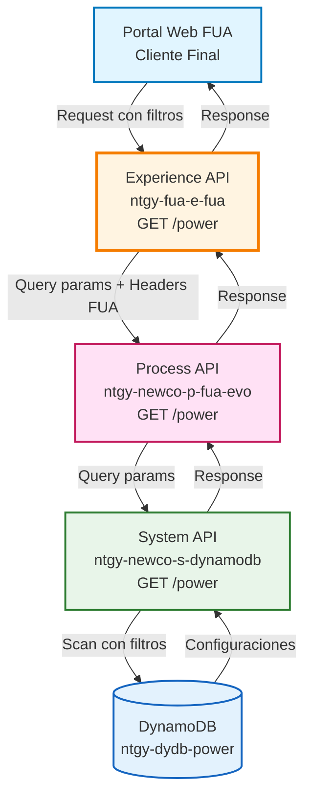
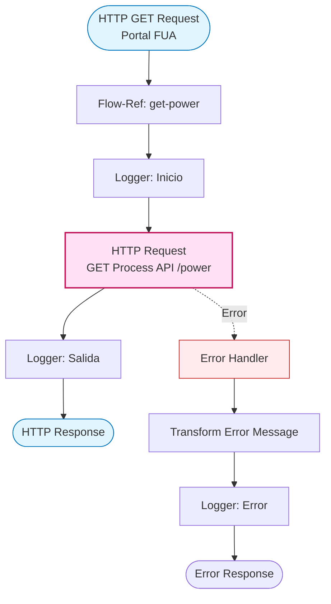
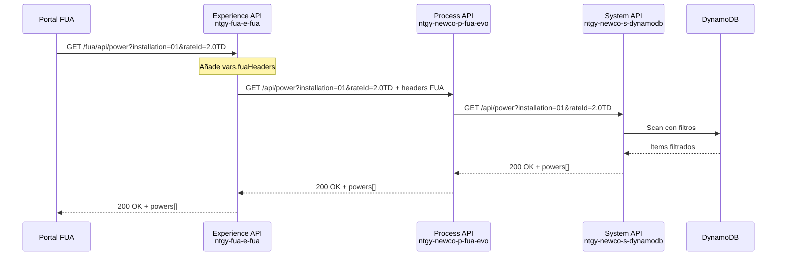
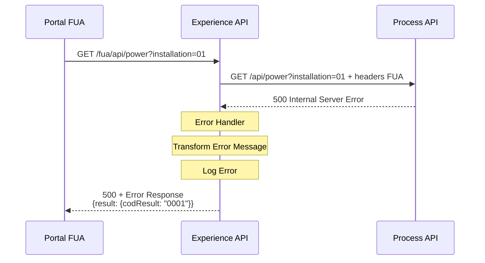
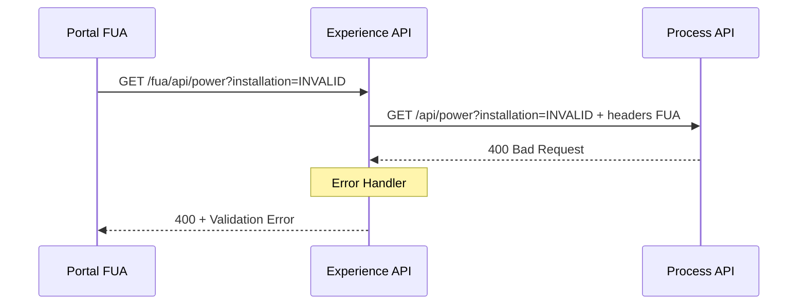

# GET /power

## 📌 Descripción General

### Propósito del Endpoint

Este endpoint permite a los clientes del portal FUA consultar las potencias eléctricas disponibles para contratar según el tipo de instalación (monofásica/trifásica), la tarifa y si tienen gestión remota habilitada. Proporciona una interfaz optimizada para el canal web que facilita la selección de potencia durante procesos de alta o modificación de contrato.

### Tipo de API

**Capa:** Experience API (API-Led Connectivity)

**Función:** Adaptación de experiencia para portal web FUA (Frontal Único de Atención)

### Patrón de Integración

**Tipo:** Pass-Through Directo

**Descripción:** Este endpoint actúa como proxy directo hacia el Process API `ntgy-newco-p-fua-evo`, propagando los query parameters y añadiendo headers específicos del canal FUA. No realiza transformaciones en la respuesta, manteniendo la estructura original del Process API.

### Arquitectura API-Led Connectivity



---

## 💼 Propósito del Negocio

### Casos de Uso Principales

1. **Consulta de Potencias Durante Alta de Contrato**
   - Cliente visualiza potencias disponibles según su tipo de instalación
   - Facilita la selección de potencia adecuada durante el proceso de contratación
   - Beneficio: Reduce errores en la selección de potencia y mejora la experiencia de alta

2. **Modificación de Potencia Contratada**
   - Cliente consulta potencias disponibles para cambiar su potencia actual
   - Permite comparar opciones según tarifa y tipo de instalación
   - Beneficio: Autoservicio para optimización de costes energéticos

3. **Asesoramiento en Gestión Remota**
   - Muestra potencias disponibles con/sin gestión remota
   - Ayuda al cliente a entender opciones de optimización energética
   - Beneficio: Promoción de servicios de valor añadido

### 📱 Canal y Audiencia

#### Canal de Consumo

**Canal:** Portal Web FUA

**Características del Canal:**
- **Plataforma**: Aplicación web responsive para desktop y tablet
- **Dispositivos**: Navegadores modernos (Chrome, Firefox, Safari, Edge)
- **Conectividad**: Conexión estable de banda ancha
- **Experiencia de Usuario**: Interfaz visual con selección interactiva de potencias

#### Audiencia Objetivo

**Usuarios Finales:**
- **Clientes Residenciales**: Consultan potencias para optimizar su contrato de energía
- **Clientes Empresariales**: Gestionan potencias de instalaciones comerciales
- **Nuevos Clientes**: Seleccionan potencia durante proceso de alta

**Contexto de Uso:**
- **Proceso de Alta**: Durante contratación de nuevo suministro
- **Modificación de Contrato**: Al cambiar potencia o tarifa
- **Consulta Informativa**: Para conocer opciones disponibles

#### Adaptaciones del Canal

**Optimizaciones Aplicadas:**
- **Headers FUA**: Añade headers específicos del portal (vars.fuaHeaders) para trazabilidad
- **Propagación Directa**: Query parameters se envían sin modificación al Process API
- **Sin Transformación**: Respuesta se retorna tal cual para mantener consistencia

### 🔗 Endpoints Dependientes

Este Experience API consume el siguiente Process API:

| Process API | Endpoint | Método | Propósito |
|-------------|----------|--------|-----------|
| `ntgy-newco-p-fua-evo` | `/power` | GET | Recupera configuraciones de potencia desde DynamoDB (pass-through) |

### Contexto Empresarial

- **Dominio:** Autoservicio de Clientes - Gestión de Contratos
- **Sector:** Energía - Utilities
- **División:** Naturgy España - NewCo
- **Canal:** Portal Web FUA

### Stakeholders

- **Clientes Finales**: Necesitan consultar potencias disponibles de forma clara y sencilla
- **Equipo de Producto FUA**: Requiere endpoint optimizado para experiencia web
- **Equipo de Ventas**: Utiliza información para asesorar en contrataciones

### Valor de Negocio

- **Autoservicio**: Clientes pueden consultar potencias sin llamar al call center
- **Transparencia**: Información clara sobre opciones disponibles según su instalación
- **Optimización**: Facilita la selección de potencia adecuada para reducir costes
- **Experiencia de Usuario**: Interfaz web optimizada para consulta rápida

---

## 🔧 Especificación Técnica

### URLs por Ambiente

| Ambiente | URL Base | URL Completa |
|----------|----------|--------------|
| **Local** | `http://localhost:8081` | `http://localhost:8081/fua/api/power` |
| **Development** | `https://ntgy-fua-e-fua-dev.us-e2.cloudhub.io` | `https://ntgy-fua-e-fua-dev.us-e2.cloudhub.io/fua/api/power` |
| **UAT** | `https://ntgy-fua-e-fua-uat.us-e2.cloudhub.io` | `https://ntgy-fua-e-fua-uat.us-e2.cloudhub.io/fua/api/power` |
| **Production** | `https://ntgy-fua-e-fua-pro.us-e2.cloudhub.io` | `https://ntgy-fua-e-fua-pro.us-e2.cloudhub.io/fua/api/power` |

### Método HTTP

```
GET /fua/api/power
```

### 🎯 Consideraciones del Canal

#### Limitaciones del Canal

| Aspecto | Limitación | Razón |
|---------|------------|-------|
| **Timeout** | 60 segundos | Timeout del Process API (configurado en properties) |
| **Rate Limiting** | Según políticas de Anypoint Platform | Protección del servicio |
| **Caché** | No implementado | Datos dinámicos según filtros |

#### Headers Específicos del Canal

**Headers Añadidos por el Experience API:**

| Header | Tipo | Descripción | Razón |
|--------|------|-------------|-------|
| `vars.fuaHeaders` | object | Headers específicos del portal FUA | Trazabilidad y contexto del canal |

**Nota:** Los headers FUA se añaden automáticamente mediante la variable `vars.fuaHeaders` configurada en el flow.

### Parámetros de Entrada

#### Query Parameters

| Parámetro | Tipo | Requerido | Descripción | Valores Válidos | Ejemplo |
|-----------|------|-----------|-------------|-----------------|---------|
| `installation` | string | No | Tipo de instalación eléctrica | `"01"` (monofásica), `"02"` (trifásica) | `"01"` |
| `rateId` | string | No | Identificador de la tarifa de acceso | Código de tarifa | `"2.0TD"` |
| `rate` | string | No | Código de tarifa (filtro adicional) | Código de tarifa | `"20TD"` |
| `remoteManagement` | boolean | No | Indica si tiene gestión remota | `true`, `false` | `true` |

**Notas sobre Parámetros:**
- Todos los parámetros son opcionales
- Los parámetros se propagan directamente al Process API sin transformación
- Los filtros se aplican en el System API (DynamoDB)

### Respuestas

#### 200 OK - Éxito

**Content-Type:** `application/json`

⚠️ **Nota Importante:** Este endpoint es un **pass-through directo** desde el Experience API al Process API `ntgy-newco-p-fua-evo`. La respuesta mantiene la estructura exacta del Process API sin transformaciones.

**Estructura de Respuesta:**

```json
{
  "result": {
    "codResult": "string",
    "msgResult": "string"
  },
  "powers": ["string"]
}
```

**Campos:**

| Campo | Tipo | Descripción |
|-------|------|-------------|
| `result` | object | Objeto con información del resultado de la operación |
| `result.codResult` | string | Código de resultado (`"0000"` = éxito) |
| `result.msgResult` | string | Mensaje descriptivo del resultado |
| `powers` | array[string] | Array de valores de potencia disponibles en kW (como strings) |

**Para el schema completo y detalles de los campos, consultar:**
📖 **Process API: `ntgy-newco-p-fua-evo` endpoint `/power`**

#### 400 Bad Request - Error de Validación

**Content-Type:** `application/json`

```json
{
  "code": "VALIDATION_ERROR",
  "message": "Parámetros de entrada inválidos",
  "details": "El formato del parámetro 'installation' no es válido",
  "timestamp": "2026-09-29T17:00:00Z"
}
```

#### 500 Internal Server Error - Error del Sistema

**Content-Type:** `application/json`

```json
{
  "result": {
    "codResult": "0001",
    "msgResult": "Error al procesar la solicitud"
  }
}
```

### Autenticación

- **Tipo:** Client ID & Client Secret (Anypoint Platform)
- **Headers Requeridos:**
  - `client_id`: ID del cliente registrado en Anypoint Platform
  - `client_secret`: Secret del cliente

### Timeouts

| Tipo | Valor | Razón |
|------|-------|-------|
| **Request Timeout** | 60 segundos | Configurado según timeout del Process API |
| **Connection Timeout** | 30 segundos | Timeout de conexión HTTP |

---

## 🏗️ Implementación Técnica

### Arquitectura del Flow



### Código de Implementación

#### Flow Principal: `get:\power:e-fua-config`

**Ubicación:** `src/main/mule/e-fua.xml`

```xml
<flow name="get:\power:e-fua-config">
    <flow-ref doc:name="get-power" name="get-power" />
</flow>
```

#### Sub-Flow: `get-power`

**Ubicación:** `src/main/mule/implementation/power.xml`

```xml
<flow name="get-power">
    <http:request method="GET" 
                  doc:name="Newco Post Power Request" 
                  config-ref="HTTP_FUA_PROCESS_NEWCO_EVO" 
                  path="/power" 
                  outputMimeType="application/json" 
                  outputEncoding="UTF-8">
        <http:query-params>
            <![CDATA[#[output application/java
---
attributes.queryParams ++ vars.fuaHeaders]]]>
        </http:query-params>
    </http:request>
    
    <error-handler>
        <on-error-propagate enableNotifications="true" logException="true">
            <ee:transform doc:name="Set Error Message">
                <ee:message>
                    <ee:set-payload><![CDATA[%dw 2.0
output application/json
---
{
    "result": {
        "codResult": "0001",
        "msgResult": error.description as String replace /\"/ with("")
    }
}]]></ee:set-payload>
                </ee:message>
            </ee:transform>
            <logger level="ERROR" doc:name="Error" 
                    message='#[{
    "result": {
        "codResult": "0001",
        "msgResult": error.description as String replace /\"/ with("")
    }
}]' />
        </on-error-propagate>
    </error-handler>
</flow>
```

### Transformaciones DataWeave

#### Construcción de Query Parameters

**Propósito:** Combinar query parameters del request con headers FUA

```dataweave
%dw 2.0
output application/java
---
attributes.queryParams ++ vars.fuaHeaders
```

**Lógica:**
- `attributes.queryParams`: Parámetros originales del request (installation, rateId, rate, remoteManagement)
- `vars.fuaHeaders`: Headers específicos del canal FUA (añadidos automáticamente)
- Operador `++`: Concatena ambos objetos para enviar al Process API

#### Transformación de Error

**Propósito:** Estandarizar formato de error

```dataweave
%dw 2.0
output application/json
---
{
    "result": {
        "codResult": "0001",
        "msgResult": error.description as String replace /\"/ with("")
    }
}
```

**Lógica:**
- Extrae descripción del error
- Elimina comillas dobles del mensaje
- Retorna formato estándar con código "0001"

### Configuración HTTP

**Config-Ref:** `HTTP_FUA_PROCESS_NEWCO_EVO`

**Ubicación:** `src/main/mule/global.xml`

**Propiedades (e-fua-pro-config.yaml):**
```yaml
newco-p-fua-evo:
  host: "mule-worker-internal-ntgy-newco-p-fua-evo.de-c1.cloudhub.io"
  port: "8091"
  timeout: "60000"
```

**Configuración:**
- **Host:** `${newco-p-fua-evo.host}`
- **Port:** `${newco-p-fua-evo.port}`
- **Base Path:** `/api`
- **Timeout:** `${newco-p-fua-evo.timeout}` (60 segundos)
- **Protocol:** HTTPS (en ambientes desplegados)

### Patrones de Diseño

**Patrón:** Pass-Through Proxy con Headers de Canal

**Justificación:** 
- Mantiene consistencia de datos entre capas
- Añade contexto del canal (headers FUA) sin modificar la lógica de negocio
- Facilita trazabilidad de requests desde el portal web
- Permite evolución independiente del Process API

### Diagramas de Secuencia

#### 1. Flujo Normal de Éxito



#### 2. Flujo con Error de Backend



#### 3. Flujo con Parámetros Inválidos



### Optimizaciones del Canal

**Headers FUA (vars.fuaHeaders):**
- Añade contexto del canal web para trazabilidad
- Permite identificar requests del portal FUA en logs
- Facilita análisis de uso por canal

**Sin Transformación de Datos:**
- Respuesta se retorna tal cual del Process API
- Mantiene consistencia entre canales
- Reduce latencia al evitar transformaciones innecesarias

### Manejo de Errores

**Estrategia:** Captura y estandarización de errores del Process API

**Errores Manejados:**

1. **Errores de Conectividad (500)**
   - Error de conexión con Process API
   - Timeout en la llamada
   - **Acción:** Transform error message + Log ERROR + Response 500

2. **Errores de Validación (400)**
   - Parámetros inválidos
   - **Acción:** Propagar error del Process API

3. **Errores de Sistema (500)**
   - Errores internos del Process API
   - **Acción:** Transform + Log + Response con codResult "0001"

**Logging:**
- Log de error con nivel ERROR
- Incluye descripción del error en formato JSON
- Facilita troubleshooting en CloudWatch

---

## 💻 Ejemplos de Uso

### Ejemplo 1: Consulta con Gestión Remota y Monofásica

#### cURL

```bash
curl -X GET "https://ntgy-fua-e-fua-dev.us-e2.cloudhub.io/fua/api/power?installation=01&rateId=2.0TD&remoteManagement=true" \
  -H "Content-Type: application/json" \
  -H "client_id: YOUR_CLIENT_ID" \
  -H "client_secret: YOUR_CLIENT_SECRET"
```

#### Respuesta (200 OK)

```json
{
  "result": {
    "codResult": "0000",
    "msgResult": "No hay error"
  },
  "powers": [
    "3.3",
    "4.6",
    "5.75",
    "6.9",
    "8.05",
    "9.2"
  ]
}
```

### Ejemplo 2: Consulta sin Gestión Remota y Trifásica

#### cURL

```bash
curl -X GET "https://ntgy-fua-e-fua-dev.us-e2.cloudhub.io/fua/api/power?installation=02&rateId=3.0TD&remoteManagement=false" \
  -H "Content-Type: application/json" \
  -H "client_id: YOUR_CLIENT_ID" \
  -H "client_secret: YOUR_CLIENT_SECRET"
```

#### Respuesta (200 OK)

```json
{
  "result": {
    "codResult": "0000",
    "msgResult": "No hay error"
  },
  "powers": [
    "10.35",
    "13.8",
    "17.25",
    "20.7"
  ]
}
```

### Ejemplo 3: JavaScript (para Portal Web FUA)

```javascript
const getPowerOptions = async (installation, rateId, remoteManagement) => {
  const baseUrl = 'https://ntgy-fua-e-fua-dev.us-e2.cloudhub.io/fua/api/power';
  const params = new URLSearchParams({
    installation: installation,
    rateId: rateId,
    remoteManagement: remoteManagement
  });
  
  try {
    const response = await fetch(`${baseUrl}?${params}`, {
      method: 'GET',
      headers: {
        'Content-Type': 'application/json',
        'client_id': process.env.CLIENT_ID,
        'client_secret': process.env.CLIENT_SECRET'
      }
    });
    
    if (!response.ok) {
      throw new Error(`HTTP error! status: ${response.status}`);
    }
    
    const data = await response.json();
    
    if (data.result.codResult === '0000') {
      console.log('Potencias disponibles:', data.powers);
      return data.powers;
    } else {
      console.error('Error:', data.result.msgResult);
      return [];
    }
  } catch (error) {
    console.error('Error fetching power options:', error);
    throw error;
  }
};

// Uso en componente React del portal FUA
function PowerSelector({ installation, rateId, hasRemoteManagement }) {
  const [powers, setPowers] = useState([]);
  const [loading, setLoading] = useState(false);
  
  useEffect(() => {
    setLoading(true);
    getPowerOptions(installation, rateId, hasRemoteManagement)
      .then(data => {
        setPowers(data);
        setLoading(false);
      })
      .catch(error => {
        console.error('Error:', error);
        setLoading(false);
      });
  }, [installation, rateId, hasRemoteManagement]);
  
  if (loading) return <div>Cargando potencias...</div>;
  
  return (
    <div className="power-selector">
      <h3>Seleccione la potencia deseada</h3>
      <select>
        <option value="">Seleccione una opción</option>
        {powers.map(power => (
          <option key={power} value={power}>
            {power} kW
          </option>
        ))}
      </select>
    </div>
  );
}
```

### Ejemplo 4: Python (para Testing)

```python
import requests
from typing import Optional, List, Dict, Any

def get_power_options(
    installation: str,
    rate_id: str,
    remote_management: bool,
    base_url: str = "https://ntgy-fua-e-fua-dev.us-e2.cloudhub.io"
) -> List[str]:
    """
    Consulta potencias disponibles desde el Experience API del portal FUA.
    
    Args:
        installation: Tipo de instalación ("01" monofásica, "02" trifásica)
        rate_id: Identificador de tarifa (ej: "2.0TD")
        remote_management: Si tiene gestión remota
        base_url: URL base del API
    
    Returns:
        Lista de potencias disponibles en kW
    """
    url = f"{base_url}/fua/api/power"
    
    params = {
        'installation': installation,
        'rateId': rate_id,
        'remoteManagement': str(remote_management).lower()
    }
    
    headers = {
        'Content-Type': 'application/json',
        'client_id': 'YOUR_CLIENT_ID',
        'client_secret': 'YOUR_CLIENT_SECRET'
    }
    
    try:
        response = requests.get(url, params=params, headers=headers)
        response.raise_for_status()
        
        data = response.json()
        
        if data['result']['codResult'] == '0000':
            powers = data['powers']
            print(f"✓ Recuperadas {len(powers)} potencias disponibles")
            return powers
        else:
            print(f"✗ Error: {data['result']['msgResult']}")
            return []
            
    except requests.exceptions.RequestException as e:
        print(f"✗ Error de conexión: {str(e)}")
        return []

# Uso
if __name__ == "__main__":
    # Consulta para instalación monofásica con gestión remota
    powers_mono = get_power_options(
        installation='01',
        rate_id='2.0TD',
        remote_management=True
    )
    
    print("Potencias monofásicas con gestión remota:")
    for power in powers_mono:
        print(f"  - {power} kW")
    
    # Consulta para instalación trifásica sin gestión remota
    powers_trifa = get_power_options(
        installation='02',
        rate_id='3.0TD',
        remote_management=False
    )
    
    print("\nPotencias trifásicas sin gestión remota:")
    for power in powers_trifa:
        print(f"  - {power} kW")
```

### Ejemplo 5: Error - Parámetros Inválidos

#### cURL

```bash
curl -X GET "https://ntgy-fua-e-fua-dev.us-e2.cloudhub.io/fua/api/power?installation=INVALID" \
  -H "Content-Type: application/json" \
  -H "client_id: YOUR_CLIENT_ID" \
  -H "client_secret: YOUR_CLIENT_SECRET"
```

#### Respuesta (400 Bad Request)

```json
{
  "code": "VALIDATION_ERROR",
  "message": "Parámetros de entrada inválidos",
  "details": "El formato del parámetro 'installation' no es válido. Debe ser '01' o '02'",
  "timestamp": "2026-09-29T17:00:00Z"
}
```

### Ejemplo 6: Error - Timeout del Backend

#### Respuesta (500 Internal Server Error)

```json
{
  "result": {
    "codResult": "0001",
    "msgResult": "HTTP:TIMEOUT - Timeout exceeded"
  }
}