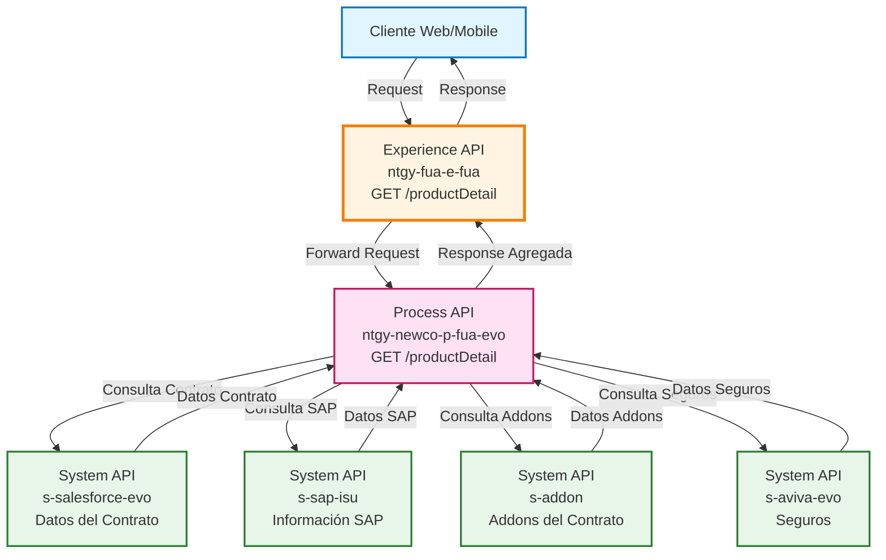
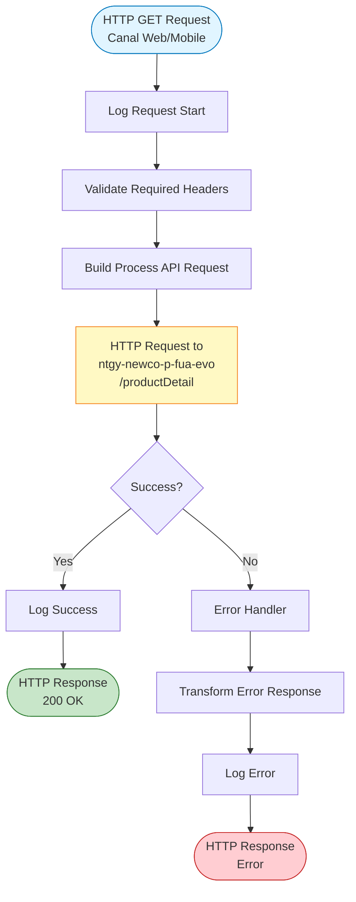
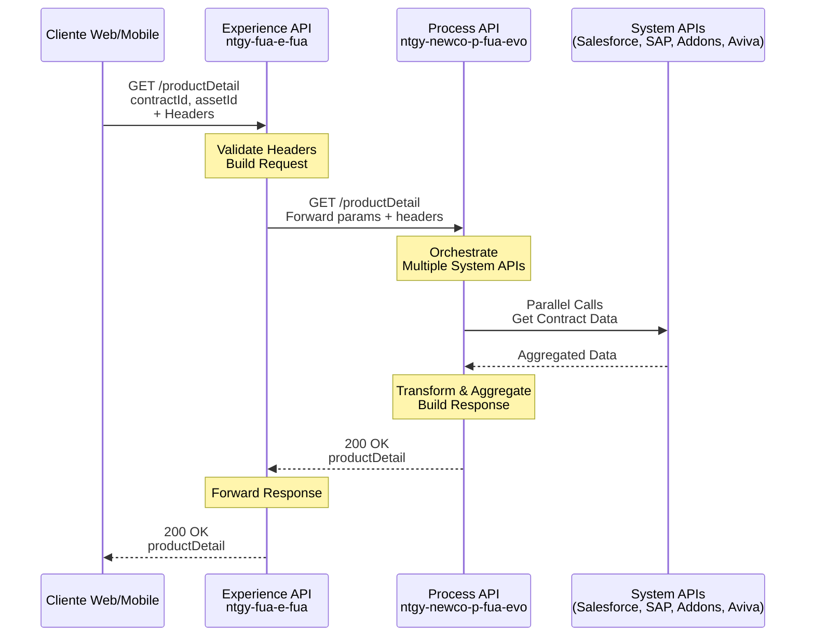
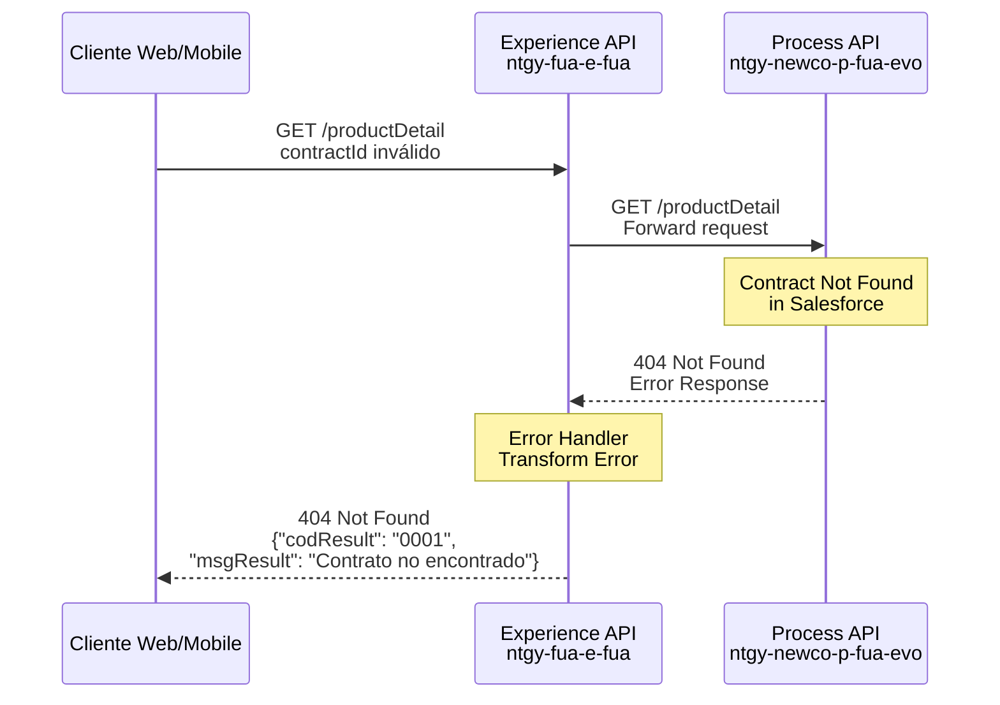
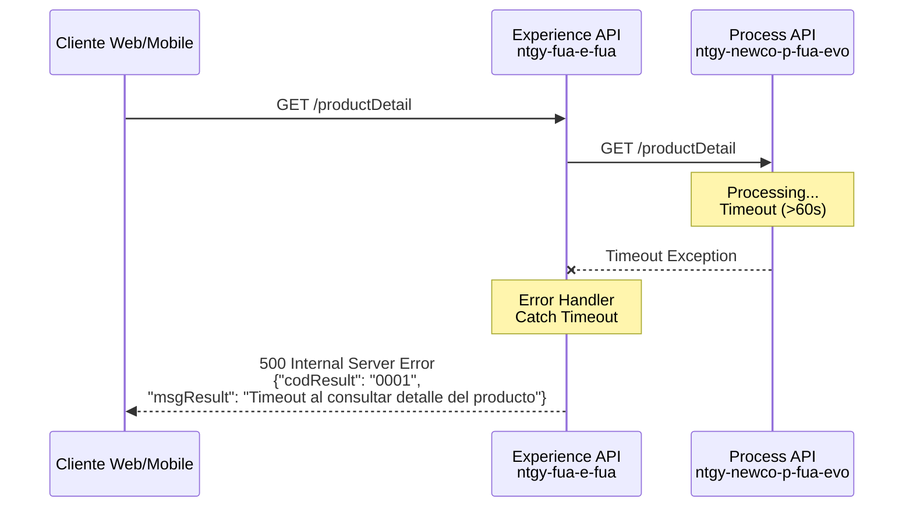

# GET /productDetail

## 📌 Descripción General

### Propósito del Endpoint

Este endpoint proporciona una vista consolidada y completa del detalle de un contrato/producto para clientes de Naturgy. Agrega información de múltiples fuentes (Salesforce, SAP ISU, Addons, Seguros) en una única respuesta optimizada para canales web y móvil, facilitando que los clientes accedan a toda la información relevante de sus contratos de energía.

### Tipo de API

**Capa:** Experience API (API-Led Connectivity)

**Función:** Adaptación de experiencia para canales web y móvil

### Patrón de Integración

**Tipo:** Pass-Through con Headers Forwarding

**Descripción:** Este Experience API actúa como pass-through, reenviando la petición al Process API `ntgy-newco-p-fua-evo` que orquesta las llamadas a múltiples System APIs. El Experience API se encarga de:
- Validar y reenviar headers de autenticación y contexto
- Propagar parámetros de consulta (contractId, assetId)
- Gestionar errores y timeouts específicos del canal
- Mantener la respuesta completa del Process API sin transformaciones adicionales

### Arquitectura API-Led Connectivity



---

## 💼 Propósito del Negocio

### Casos de Uso Principales

1. **Consulta de Detalle de Contrato desde Área de Cliente**
   - Cliente accede a su área privada web o móvil
   - Visualiza información completa de su contrato de energía
   - Accede a datos de facturación, consumo, addons y seguros contratados

2. **Gestión de Productos Contratados**
   - Cliente revisa los servicios adicionales (addons) asociados al contrato
   - Consulta información de seguros contratados
   - Verifica datos de la dirección de suministro

3. **Soporte a Agentes de Atención al Cliente**
   - Agentes consultan información completa del contrato del cliente
   - Acceso rápido a todos los detalles para resolver consultas
   - Vista unificada de información distribuida en múltiples sistemas

### 📱 Canal y Audiencia

#### Canal de Consumo

**Canal:** Web y Mobile

**Características del Canal:**
- **Plataforma**: Portal web FUA (Frontal Único de Atención) y aplicaciones móviles iOS/Android
- **Dispositivos**: Navegadores web modernos, smartphones y tablets
- **Conectividad**: Requiere conexión a internet estable
- **Experiencia de Usuario**: Interfaz responsive optimizada para diferentes tamaños de pantalla

#### Audiencia Objetivo

**Usuarios Finales:**
- **Clientes Residenciales**: Clientes particulares que consultan información de sus contratos de energía
- **Clientes Empresariales**: Empresas que gestionan sus contratos de suministro energético
- **Agentes de Atención al Cliente**: Personal de call center que asiste a clientes

**Contexto de Uso:**
- **Autoservicio Web/Móvil**: Cliente consulta información de su contrato desde su área privada
- **Atención Telefónica**: Agente consulta información mientras atiende al cliente
- **Gestión de Cuenta**: Cliente revisa y gestiona sus productos y servicios contratados

#### Adaptaciones del Canal

**Optimizaciones Aplicadas:**
- **Timeout Extendido**: 60 segundos para permitir la orquestación de múltiples System APIs
- **Headers de Contexto**: Propagación de headers de autenticación, idioma y trading company
- **Gestión de Errores**: Respuestas de error estandarizadas con código y mensaje descriptivo
- **Sin Paginación**: Respuesta completa del detalle del contrato en una única llamada

### 🔗 Endpoints Dependientes

Este Experience API consume el siguiente Process API:

| Process API | Endpoint | Método | Propósito |
|-------------|----------|--------|-----------|
| `ntgy-newco-p-fua-evo` | `/productDetail` | GET | Orquesta la obtención de datos del producto desde múltiples System APIs (Salesforce, SAP ISU, Addons, Aviva) y agrega la información en una respuesta unificada |

**Nota:** El Process API `ntgy-newco-p-fua-evo` a su vez consume múltiples System APIs para construir la respuesta completa. Ver documentación del Process API para detalles de la orquestación.

### Contexto Empresarial

- **Dominio:** Gestión de Contratos y Productos de Energía
- **Sector:** Energía - Utilities
- **División:** Naturgy España - NewCo
- **Canal:** Web y Mobile (Portal FUA y Apps)

### Stakeholders

- **Clientes de Energía**: Necesitan acceso fácil y completo a la información de sus contratos
- **Agentes de Atención al Cliente**: Requieren vista unificada para resolver consultas eficientemente
- **Equipo de Desarrollo FUA**: Mantienen y evolucionan el portal y aplicaciones móviles
- **Equipo de Producto**: Definen la experiencia de usuario y funcionalidades del área de cliente

### Valor de Negocio

- **Mejora de Experiencia del Cliente**: Vista consolidada de información distribuida en múltiples sistemas backend
- **Reducción de Llamadas al Call Center**: Clientes pueden autogestionar y consultar información sin necesidad de contactar soporte
- **Eficiencia Operativa**: Agentes acceden rápidamente a información completa del cliente
- **Transparencia**: Clientes tienen visibilidad completa de sus productos, servicios y seguros contratados

---

## 🔧 Especificación Técnica

### URLs por Ambiente

| Ambiente | URL Base | URL Completa |
|----------|----------|--------------|
| **Local** | `http://localhost:8081` | `http://localhost:8081/fua/api/productDetail` |
| **Development** | `https://e-fua-dev.de-c1.cloudhub.io` | `https://e-fua-dev.de-c1.cloudhub.io/fua/api/productDetail` |
| **Production** | `https://e-fua-pro.de-c1.cloudhub.io` | `https://e-fua-pro.de-c1.cloudhub.io/fua/api/productDetail` |

### Método HTTP

```
GET /fua/api/productDetail
```

### 🎯 Consideraciones del Canal

#### Limitaciones del Canal

| Aspecto | Limitación | Razón |
|---------|------------|-------|
| **Timeout** | 60 segundos | Permite la orquestación de múltiples System APIs en el Process API |
| **Rate Limiting** | Según política de API Gateway | Protección contra abuso y garantía de disponibilidad |
| **Autenticación** | OAuth 2.0 requerido | Seguridad y control de acceso a datos sensibles del cliente |

#### Campos Específicos del Canal

**Este Experience API NO añade campos adicionales ni omite campos del Process API.**

Es un pass-through que mantiene la estructura completa de la respuesta del Process API `ntgy-newco-p-fua-evo`.

Para el schema completo de la respuesta, consultar:
📖 **Process API: `ntgy-newco-p-fua-evo` endpoint `/productDetail`**

### Parámetros de Entrada

#### Headers

| Header | Tipo | Requerido | Descripción |
|--------|------|-----------|-------------|
| `x-client-id` | string | No | Identificador del cliente |
| `x-client-doc-number` | string | Sí | Número de documento del cliente (DNI/NIE) |
| `x-interaction-id` | string | No | ID de interacción para trazabilidad |
| `x-access-token` | string | Sí | Token de acceso OAuth 2.0 |
| `x-language` | string | Sí | Idioma de la respuesta (es, ca, en) |
| `x-trading-company` | string | No | Compañía comercializadora (imp/newco) |
| `x-user-id` | string | No | ID del usuario autenticado |
| `x-client-code` | string | No | Código del cliente |

#### Query Parameters

| Parámetro | Tipo | Requerido | Descripción | Ejemplo |
|-----------|------|-----------|-------------|---------|
| `contractId` | string | Sí | Identificador único del contrato | `"8007Y0000031FbfQAE"` |
| `assetId` | string | No | Identificador del asset asociado al contrato | `"02i7Y000000CmZQQA0"` |

### Respuestas

#### 200 OK - Respuesta Exitosa

**Estructura de Respuesta:**

```json
{
  "result": {
    "codResult": "0000",
    "msgResult": "OK"
  },
  "productDetail": {
    "contractId": "string",
    "status": "string",
    "product": {
      "productType": "string",
      "productName": "string",
      "rate": "string"
    },
    "customer": {
      "customerId": "string",
      "name": "string",
      "documentNumber": "string"
    },
    "address": {
      "street": "string",
      "city": "string",
      "postalCode": "string",
      "province": "string"
    },
    "billing": {
      "paymentMethod": "string",
      "billingCycle": "string",
      "iban": "string"
    },
    "addons": [
      {
        "addonId": "string",
        "addonName": "string",
        "status": "string"
      }
    ],
    "insurance": {
      "insuranceId": "string",
      "insuranceName": "string",
      "status": "string"
    }
  }
}
```

**Campos de la Respuesta:**

| Campo | Tipo | Descripción |
|-------|------|-------------|
| `result.codResult` | string | Código de resultado ("0000" = éxito) |
| `result.msgResult` | string | Mensaje descriptivo del resultado |
| `productDetail` | object | Objeto con el detalle completo del producto/contrato |

**Nota:** Para el schema completo y detallado de `productDetail`, consultar la documentación del Process API `ntgy-newco-p-fua-evo`.

#### 400 Bad Request - Error de Validación

```json
{
  "result": {
    "codResult": "0001",
    "msgResult": "Parámetro contractId es requerido"
  }
}
```

#### 401 Unauthorized - Error de Autenticación

```json
{
  "result": {
    "codResult": "0001",
    "msgResult": "Token de acceso inválido o expirado"
  }
}
```

#### 404 Not Found - Contrato No Encontrado

```json
{
  "result": {
    "codResult": "0001",
    "msgResult": "Contrato no encontrado"
  }
}
```

#### 500 Internal Server Error - Error del Servidor

```json
{
  "result": {
    "codResult": "0001",
    "msgResult": "Error interno del servidor"
  }
}
```

### Autenticación

- **Tipo:** OAuth 2.0
- **Header:** `x-access-token`
- **Descripción:** Token de acceso válido obtenido del proceso de autenticación

### Timeouts

| Tipo | Valor | Razón |
|------|-------|-------|
| **Request Timeout** | 60 segundos | Optimizado para permitir la orquestación de múltiples System APIs en el Process API |
| **Connection Idle Timeout** | 60 segundos | Mantiene la conexión activa durante operaciones largas |

---

## 🏗️ Implementación Técnica

### Arquitectura del Flow



### Detalles de Implementación

#### Archivo de Implementación

**Ubicación:** `src/main/mule/implementation/get-product-detail.xml`

**Flow Principal:** `get-product-detail`

#### Componentes del Flow

1. **HTTP Request al Process API**
   - **Configuración:** `HTTP_FUA_PROCESS_NEWCO_EVO`
   - **Método:** GET
   - **Path:** `/productDetail`
   - **Timeout:** 60 segundos (configurado en `newco-p-fua-evo.timeout`)

2. **Query Parameters**
   ```dataweave
   {
     "contractId": attributes.queryParams.contractId,
     "assetId": attributes.queryParams.assetId
   } ++ vars.fuaHeaders
   ```
   - Propaga `contractId` y `assetId` desde la petición original
   - Añade headers FUA almacenados en `vars.fuaHeaders`

3. **Error Handler**
   - **Tipo:** On Error Propagate
   - **Transformación de Error:**
     ```dataweave
     {
       "result": {
         "codResult": "0001",
         "msgResult": error.description as String replace /\"/ with("")
       }
     }
     ```
   - **Logging:** Registra el error con nivel ERROR

### Transformaciones de Canal

⚠️ **Este Experience API NO transforma la respuesta del Process API.**

**Patrón:** Pass-Through completo

**Justificación:** 
- La respuesta del Process API ya está optimizada para consumo web/móvil
- No se requieren adaptaciones adicionales específicas del canal
- Mantiene la integridad de la estructura de datos orquestada por el Process API

Para el schema completo y transformaciones de datos, consultar:
📖 **Process API: `ntgy-newco-p-fua-evo` endpoint `/productDetail`**

### Patrones de Diseño

**Patrón:** API Gateway Pass-Through

**Justificación:** 
- El Experience API actúa como punto de entrada unificado para canales web y móvil
- Delega la orquestación compleja al Process API
- Se enfoca en gestión de autenticación, headers y errores específicos del canal
- Permite evolución independiente del Process API sin afectar a los clientes

### Diagramas de Secuencia

#### 1. Flujo Normal de Éxito



#### 2. Flujo con Error de Negocio (Contrato No Encontrado)



#### 3. Flujo con Error Técnico (Timeout)



### Configuración HTTP

**Connector:** `HTTP_FUA_PROCESS_NEWCO_EVO`

**Configuración (global.xml):**
```xml
<http:request-config 
    name="HTTP_FUA_PROCESS_NEWCO_EVO" 
    basePath="/api" 
    responseTimeout="${newco-p-fua-evo.timeout}">
    <http:request-connection 
        host="${newco-p-fua-evo.host}" 
        port="${newco-p-fua-evo.port}" 
        connectionIdleTimeout="${newco-p-fua-evo.timeout}"/>
</http:request-config>
```

**Properties (e-fua-pro-config.yaml):**
```yaml
newco-p-fua-evo:
  host: "mule-worker-internal-ntgy-newco-p-fua-evo.de-c1.cloudhub.io"
  port: "8091"
  timeout: "60000"
```

### Manejo de Errores

#### Estrategia de Error Handling

**Tipo:** On Error Propagate

**Comportamiento:**
1. Captura cualquier error del Process API o timeout
2. Transforma el error a formato estándar
3. Registra el error con nivel ERROR
4. Propaga el error al cliente con código HTTP apropiado

#### Transformación de Errores

**DataWeave:**
```dataweave
%dw 2.0
output application/json
---
{
  "result": {
    "codResult": "0001",
    "msgResult": error.description as String replace /\"/ with("")
  }
}
```

**Logging:**
```dataweave
{
  "result": {
    "codResult": "0001",
    "msgResult": error.description as String replace /\"/ with("")
  }
}
```

#### Códigos de Error

| Código | Descripción | Acción |
|--------|-------------|--------|
| `0000` | Operación exitosa | N/A |
| `0001` | Error genérico | Revisar mensaje de error específico |

---

## 💻 Ejemplos de Uso

### Ejemplo 1: Consulta Exitosa de Detalle de Contrato

#### cURL

```bash
curl -X GET "https://e-fua-pro.de-c1.cloudhub.io/fua/api/productDetail?contractId=8007Y0000031FbfQAE&assetId=02i7Y000000CmZQQA0" \
  -H "Content-Type: application/json" \
  -H "x-client-doc-number: 12345678A" \
  -H "x-access-token: eyJhbGciOiJIUzI1NiIsInR5cCI6IkpXVCJ9..." \
  -H "x-language: es" \
  -H "x-client-id: 0017Y00000ABC123QAD"
```

#### Respuesta (200 OK)

```json
{
  "result": {
    "codResult": "0000",
    "msgResult": "OK"
  },
  "productDetail": {
    "contractId": "8007Y0000031FbfQAE",
    "status": "Active",
    "product": {
      "productType": "Electricity",
      "productName": "Tarifa Estable",
      "rate": "2.0TD"
    },
    "customer": {
      "customerId": "0017Y00000ABC123QAD",
      "name": "Juan García López",
      "documentNumber": "12345678A"
    },
    "address": {
      "street": "Calle Mayor 123",
      "city": "Madrid",
      "postalCode": "28013",
      "province": "Madrid"
    },
    "billing": {
      "paymentMethod": "Direct Debit",
      "billingCycle": "Monthly",
      "iban": "ES79 2100 0813 4502 0005 1332"
    },
    "addons": [
      {
        "addonId": "addon-001",
        "addonName": "Mantenimiento Caldera",
        "status": "Active"
      }
    ],
    "insurance": {
      "insuranceId": "ins-001",
      "insuranceName": "Seguro Hogar Básico",
      "status": "Active"
    }
  }
}
```

### Ejemplo 2: Error - Contrato No Encontrado

#### cURL

```bash
curl -X GET "https://e-fua-pro.de-c1.cloudhub.io/fua/api/productDetail?contractId=INVALID_ID" \
  -H "Content-Type: application/json" \
  -H "x-client-doc-number: 12345678A" \
  -H "x-access-token: eyJhbGciOiJIUzI1NiIsInR5cCI6IkpXVCJ9..." \
  -H "x-language: es"
```

#### Respuesta (404 Not Found)

```json
{
  "result": {
    "codResult": "0001",
    "msgResult": "Contrato no encontrado"
  }
}
```

### Ejemplo 3: Error - Token Inválido

#### cURL

```bash
curl -X GET "https://e-fua-pro.de-c1.cloudhub.io/fua/api/productDetail?contractId=8007Y0000031FbfQAE" \
  -H "Content-Type: application/json" \
  -H "x-client-doc-number: 12345678A" \
  -H "x-access-token: INVALID_TOKEN" \
  -H "x-language: es"
```

#### Respuesta (401 Unauthorized)

```json
{
  "result": {
    "codResult": "0001",
    "msgResult": "Token de acceso inválido o expirado"
  }
}
```

### Ejemplo 4: JavaScript (Fetch API)

```javascript
const getProductDetail = async (contractId, assetId = null) => {
  const url = new URL('https://e-fua-pro.de-c1.cloudhub.io/fua/api/productDetail');
  url.searchParams.append('contractId', contractId);
  if (assetId) {
    url.searchParams.append('assetId', assetId);
  }

  try {
    const response = await fetch(url, {
      method: 'GET',
      headers: {
        'Content-Type': 'application/json',
        'x-client-doc-number': '12345678A',
        'x-access-token': 'YOUR_ACCESS_TOKEN',
        'x-language': 'es',
        'x-client-id': '0017Y00000ABC123QAD'
      }
    });

    if (!response.ok) {
      throw new Error(`HTTP error! status: ${response.status}`);
    }

    const data = await response.json();
    console.log('Product Detail:', data.productDetail);
    return data;
  } catch (error) {
    console.error('Error fetching product detail:', error);
    throw error;
  }
};

// Uso
getProductDetail('8007Y0000031FbfQAE', '02i7Y000000CmZQQA0')
  .then(data => console.log('Success:', data))
  .catch(error => console.error('Error:', error));
```

### Ejemplo 5: Python (Requests)

```python
import requests

def get_product_detail(contract_id, asset_id=None):
    """
    Obtiene el detalle de un producto/contrato
    
    Args:
        contract_id (str): ID del contrato
        asset_id (str, optional): ID del asset
    
    Returns:
        dict: Detalle del producto
    """
    url = "https://e-fua-pro.de-c1.cloudhub.io/fua/api/productDetail"
    
    params = {
        'contractId': contract_id
    }
    if asset_id:
        params['assetId'] = asset_id
    
    headers = {
        'Content-Type': 'application/json',
        'x-client-doc-number': '12345678A',
        'x-access-token': 'YOUR_ACCESS_TOKEN',
        'x-language': 'es',
        'x-client-id': '0017Y00000ABC123QAD'
    }
    
    try:
        response = requests.get(url, params=params, headers=headers)
        response.raise_for_status()
        
        data = response.json()
        print(f"Product Detail retrieved successfully")
        return data
        
    except requests.exceptions.HTTPError as http_err:
        print(f"HTTP error occurred: {http_err}")
        print(f"Response: {response.text}")
        raise
    except Exception as err:
        print(f"Other error occurred: {err}")
        raise

# Uso
if __name__ == "__main__":
    try:
        result = get_product_detail(
            contract_id='8007Y0000031FbfQAE',
            asset_id='02i7Y000000CmZQQA0'
        )
        print(f"Contract ID: {result['productDetail']['contractId']}")
        print(f"Status: {result['productDetail']['status']}")
    except Exception as e:
        print(f"Failed to get product detail: {e}")
```
