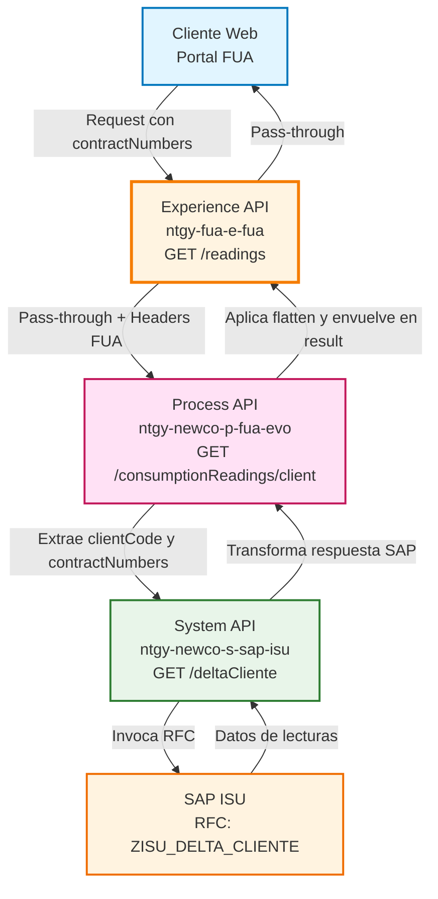
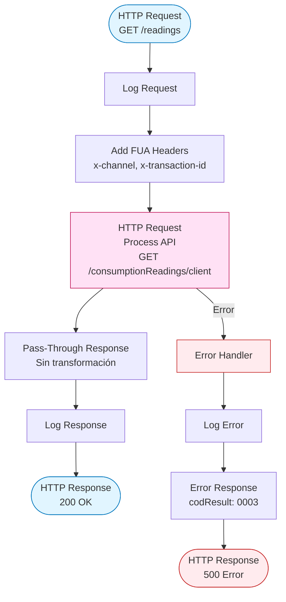
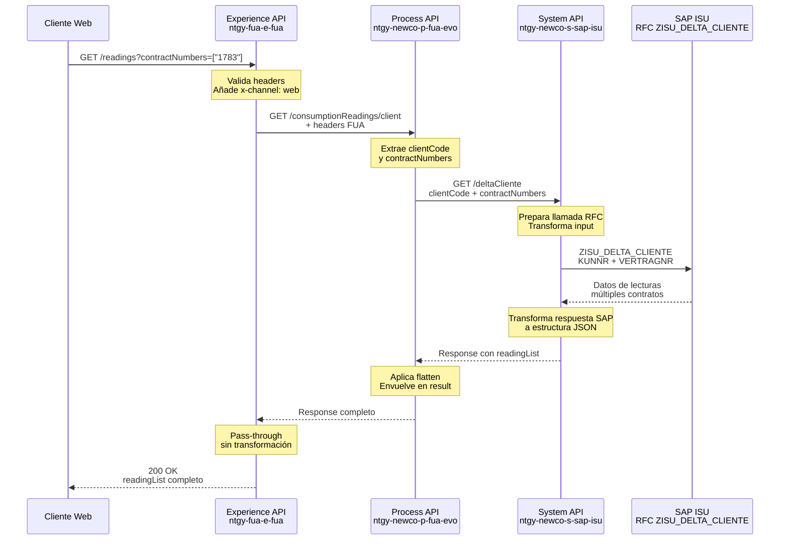
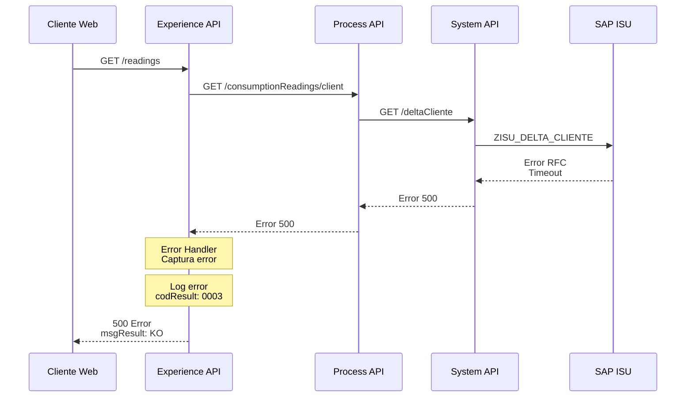
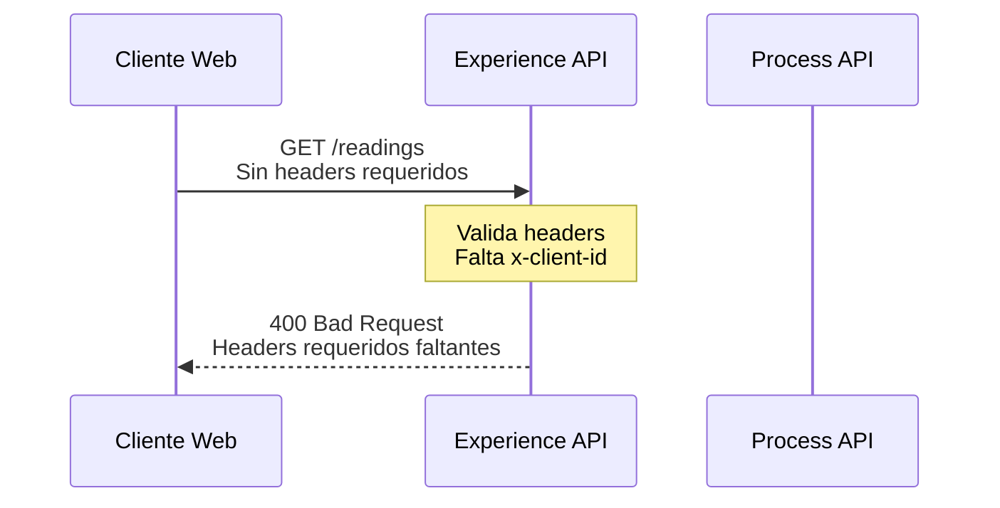

# GET /readings

## 📌 Descripción General

### Propósito del Endpoint

Este endpoint proporciona acceso al historial de lecturas de consumo de energía (electricidad y gas) para uno o varios contratos de un cliente. Actúa como punto de entrada en la capa Experience para consultar datos históricos de medidores almacenados en SAP ISU, permitiendo a los clientes visualizar su evolución de consumo a lo largo del tiempo.

### Tipo de API

**Capa:** Experience API (API-Led Connectivity)

**Función:** Orquestación y adaptación de experiencia para el canal web de autoservicio FUA (Frontal Único de Atención)

### Patrón de Integración

**Tipo:** Pass-Through con Headers de Trazabilidad

**Descripción:** Este Experience API actúa como proxy transparente hacia el Process API, añadiendo únicamente headers de trazabilidad y contexto del canal. No realiza transformaciones en la respuesta, delegando toda la lógica de negocio y transformación de datos a las capas inferiores.

### Arquitectura API-Led Connectivity



---

## 💼 Propósito del Negocio

### Casos de Uso Principales

1. **Visualización de Historial de Consumo**
   - Los clientes pueden consultar el historial completo de lecturas de sus contadores
   - Permite identificar patrones de consumo y tendencias a lo largo del tiempo
   - Facilita la comprensión de la facturación basada en lecturas reales

2. **Validación de Facturación**
   - Los clientes pueden verificar las lecturas que se utilizaron para calcular sus facturas
   - Permite detectar discrepancias entre lecturas estimadas y reales
   - Proporciona transparencia en el proceso de facturación

3. **Análisis de Eficiencia Energética**
   - Los clientes pueden analizar su evolución de consumo
   - Facilita la identificación de oportunidades de ahorro energético
   - Permite evaluar el impacto de cambios en hábitos de consumo

### 📱 Canal y Audiencia

#### Canal de Consumo

**Canal:** Web

**Características del Canal:**
- **Plataforma**: Portal web FUA (Frontal Único de Atención)
- **Dispositivos**: Navegadores web en desktop y móvil
- **Conectividad**: Requiere conexión estable para consultas históricas
- **Experiencia de Usuario**: Visualización de datos históricos con gráficas y tablas

#### Audiencia Objetivo

**Usuarios Finales:**
- **Clientes Residenciales**: Consultan lecturas de sus contadores domésticos para entender su consumo
- **Clientes Empresariales**: Analizan lecturas de múltiples puntos de suministro para gestión energética
- **Agentes de Atención al Cliente**: Consultan lecturas para resolver dudas y reclamaciones

**Contexto de Uso:**
- **Consulta de Factura**: Cliente revisa lecturas al recibir una factura
- **Análisis de Consumo**: Cliente analiza su evolución de consumo periódicamente
- **Resolución de Incidencias**: Agente verifica lecturas para resolver reclamaciones

#### Adaptaciones del Canal

**Optimizaciones Aplicadas:**
- **Pass-Through**: No se aplican transformaciones, se mantiene la estructura completa del Process API
- **Headers de Trazabilidad**: Se añaden headers de canal y contexto para auditoría
- **Timeout Extendido**: 60 segundos para permitir consultas de múltiples contratos
- **Sin Paginación**: Se retorna el historial completo disponible en SAP ISU

### 🔗 Endpoints Dependientes

Este Experience API consume el siguiente Process API:

| Process API | Endpoint | Método | Propósito |
|-------------|----------|--------|-----------|
| `ntgy-newco-p-fua-evo` | `/consumptionReadings/client` | GET | Orquestación de consulta de lecturas históricas desde SAP ISU |

**Cadena de Dependencias Completa:**

```
Experience API (ntgy-fua-e-fua)
    ↓ GET /readings
Process API (ntgy-newco-p-fua-evo)
    ↓ GET /consumptionReadings/client
System API (ntgy-newco-s-sap-isu)
    ↓ GET /deltaCliente
SAP ISU
    ↓ RFC: ZISU_DELTA_CLIENTE
```

### Contexto Empresarial

- **Dominio:** Autoservicio de Clientes - Gestión de Consumo
- **Sector:** Energía - Utilities
- **División:** Naturgy España - NewCo
- **Canal:** Web (Portal FUA)

### Stakeholders

- **Clientes de Energía**: Necesitan acceso transparente a sus datos de consumo histórico
- **Equipo de Atención al Cliente**: Requieren información precisa para resolver consultas
- **Equipo de Facturación**: Utilizan estos datos para validar procesos de facturación
- **Equipo de Eficiencia Energética**: Analizan patrones de consumo para programas de ahorro

### Valor de Negocio

- **Transparencia**: Proporciona visibilidad completa del historial de lecturas al cliente
- **Reducción de Llamadas**: Los clientes pueden autogestionar consultas sobre lecturas
- **Confianza**: Mejora la confianza del cliente al poder verificar datos de facturación
- **Eficiencia Operativa**: Reduce la carga de trabajo del call center

---

## 🔧 Especificación Técnica

### URLs por Ambiente

| Ambiente | URL Base | URL Completa |
|----------|----------|--------------|
| **Local** | `http://localhost:8081` | `http://localhost:8081/fua/api/readings` |
| **Development** | `https://ntgy-fua-e-fua-dev.de-c1.cloudhub.io` | `https://ntgy-fua-e-fua-dev.de-c1.cloudhub.io/fua/api/readings` |
| **Production** | `https://ntgy-fua-e-fua-pro.de-c1.cloudhub.io` | `https://ntgy-fua-e-fua-pro.de-c1.cloudhub.io/fua/api/readings` |

### Método HTTP

```
GET /fua/api/readings
```

### 🎯 Consideraciones del Canal

#### Limitaciones del Canal

| Aspecto | Limitación | Razón |
|---------|------------|-------|
| **Timeout** | 60 segundos | Consultas históricas pueden requerir tiempo de procesamiento en SAP |
| **Tamaño de Respuesta** | Sin límite específico | Historial completo disponible en SAP ISU |
| **Rate Limiting** | Según política general del API | Protección del backend SAP ISU |
| **Contratos Simultáneos** | Múltiples (array) | Permite consultar varios contratos en una sola llamada |

#### Campos Específicos del Canal

**Campos Añadidos por el Experience API:**

Este endpoint NO añade campos adicionales. Actúa como pass-through.

**Campos Omitidos del Process API:**

Ninguno. La respuesta del Process API se retorna sin modificaciones.

### Parámetros de Entrada

#### Query Parameters

| Parámetro | Tipo | Requerido | Descripción | Ejemplo |
|-----------|------|-----------|-------------|---------|
| `contractNumbers` | string[] | No | Array de números de contrato para los cuales se desean obtener lecturas | `["1783", "1784"]` |

#### Headers Obligatorios

| Header | Tipo | Requerido | Descripción | Ejemplo |
|--------|------|-----------|-------------|---------|
| `x-client-id` | string | Sí | Identificador único del cliente | `"12345"` |
| `x-client-doc-number` | string | Sí | Número de documento del cliente | `"12345678A"` |
| `x-access-token` | string | Sí | Token de autenticación OAuth 2.0 | `"eyJhbGc..."` |
| `x-interaction-id` | string | No | ID de interacción para trazabilidad | `"uuid-1234"` |
| `x-trading-company` | string | No | Compañía comercializadora | `"newco"` |
| `x-user-id` | string | No | ID del usuario autenticado | `"user123"` |
| `x-language` | string | No | Idioma de respuesta | `"es"` |
| `x-client-code` | string | No | Código de cliente en sistemas backend | `"0001234567"` |
| `x-channel` | string | Sí | Canal de origen de la petición | `"web"` |
| `x-transaction-id` | string | No | ID de transacción para correlación | `"txn-5678"` |

### Respuestas

#### Respuesta Exitosa (200 OK)

**⚠️ IMPORTANTE - Estructura Real del Código:**

La estructura documentada a continuación está basada en el **código real verificado** del System API (`consumption-readings-response.dwl`), NO en el RAML del Experience API que está desactualizado.

**Estructura de Respuesta Real:**

```json
{
  "result": {
    "codResult": "0000",
    "msgResult": "No hay error"
  },
  "readingList": [
    {
      "productTypeFamily": "luz",
      "invoiceId": "INV-2024-001",
      "readingDetailList": [
        {
          "magnitude": "Activa",
          "values": [
            {
              "readingDate": "2024-01-15",
              "type": "Real",
              "period": "1",
              "value": "1250.5",
              "counter": "ES0021000001234567FG",
              "consumption": "70.3"
            },
            {
              "readingDate": "2024-02-15",
              "type": "Real",
              "period": "2",
              "value": "1320.8",
              "counter": "ES0021000001234567FG",
              "consumption": "75.1"
            }
          ]
        }
      ],
      "agentInfo": {
        "cups": "ES0021000001234567FG",
        "coversionFactor": "1.0",
        "distribuitor": "UFD",
        "atrInvoiceId": ["ATR-2024-001"],
        "invoiceType": "Normal",
        "invoiceOriginId": "SAP"
      }
    }
  ]
}
```

**Descripción de Campos (Estructura Real):**

| Campo | Tipo | Descripción |
|-------|------|-------------|
| `result.codResult` | string | Código de resultado ("0000" = éxito) |
| `result.msgResult` | string | Mensaje descriptivo del resultado |
| `readingList` | array | Lista de lecturas agrupadas por tipo de producto |
| `readingList[].productTypeFamily` | string | Familia de producto: "luz" o "gas" |
| `readingList[].invoiceId` | string | ID de factura asociada |
| `readingList[].readingDetailList` | array | Detalles de lecturas por magnitud |
| `readingList[].readingDetailList[].magnitude` | string | Tipo de magnitud (ej: "Activa", "Reactiva") |
| `readingList[].readingDetailList[].values` | array | Array de valores de lecturas |
| `readingList[].readingDetailList[].values[].readingDate` | string | Fecha de la lectura (formato: YYYY-MM-DD) |
| `readingList[].readingDetailList[].values[].type` | string | Tipo de lectura (ej: "Real", "Estimada") |
| `readingList[].readingDetailList[].values[].period` | string | Periodo tarifario (1, 2, 3...) |
| `readingList[].readingDetailList[].values[].value` | string | Valor de la lectura en kWh |
| `readingList[].readingDetailList[].values[].counter` | string | Número del contador/CUPS |
| `readingList[].readingDetailList[].values[].consumption` | string | Consumo calculado |
| `readingList[].agentInfo` | object | Información del agente distribuidor |
| `readingList[].agentInfo.cups` | string | CUPS del punto de suministro |
| `readingList[].agentInfo.coversionFactor` | string | Factor de conversión (nota: typo en código "coversionFactor") |
| `readingList[].agentInfo.distribuitor` | string | Nombre de la distribuidora (nota: typo en código "distribuitor") |
| `readingList[].agentInfo.atrInvoiceId` | array | Array con IDs de facturas ATR |
| `readingList[].agentInfo.invoiceType` | string | Tipo de factura |
| `readingList[].agentInfo.invoiceOriginId` | string | ID de origen de la factura |

**⚠️ Notas Importantes:**

1. **Discrepancia con RAML:** El RAML del Experience API (`e-fua.raml` líneas 1032-1062) define campos adicionales (`dateReads`, `adviseGasAllowed`, `tolls`, `unbilledReadingList`) que **NO son retornados** por el código real del Process API.

2. **Typos en el código:** El System API tiene errores tipográficos en los nombres de campos:
   - `coversionFactor` (debería ser `conversionFactor`)
   - `distribuitor` (debería ser `distributor`)

3. **Transformación en Process API:** El Process API aplica `flatten(payload.*readingList)` sobre la respuesta del System API y la envuelve en una estructura con `result`.

4. **Nombres de campos diferentes al RAML:**
   - RAML usa: `readingValue`, `readingType`, `meterNumber`
   - Código real usa: `value`, `type`, `counter`

#### Respuesta de Error (400 Bad Request)

```json
{
  "result": {
    "codResult": "0001",
    "msgResult": "Parámetros de entrada inválidos"
  }
}
```

#### Respuesta de Error (500 Internal Server Error)

```json
{
  "result": {
    "codResult": "0003",
    "msgResult": "KO"
  }
}
```

### Autenticación

- **Tipo:** OAuth 2.0 Bearer Token
- **Header:** `x-access-token`
- **Validación:** Token validado en API Gateway antes de llegar al Experience API

### Timeouts

| Tipo | Valor | Razón |
|------|-------|-------|
| **Request Timeout** | 60 segundos | Consultas históricas en SAP ISU pueden requerir tiempo de procesamiento |
| **Connection Timeout** | 30 segundos | Tiempo máximo para establecer conexión con Process API |

---

## 🏗️ Implementación Técnica

### Arquitectura del Flow



### Transformaciones de Canal

**⚠️ Este Experience API NO transforma la respuesta del Process API.**

**Patrón:** Pass-Through Completo

**Justificación:**
- La estructura de datos del Process API es adecuada para el canal web
- No se requiere simplificación o adaptación de campos
- Se mantiene la integridad de los datos históricos de SAP ISU

**Transformación en Process API:**

El Process API (ntgy-newco-p-fua-evo) SÍ aplica transformación:

```dataweave
%dw 2.0
output application/json
---
{
    "result": {
        "codResult": "0000",
        "msgResult": "No hay error"
    },
    "readingList": flatten(payload.*readingList)
}
```

**Explicación de `flatten(payload.*readingList)`:**
- `payload.*readingList`: Extrae todos los arrays `readingList` de la respuesta del System API
- `flatten()`: Aplana arrays anidados en un solo array de nivel superior
- Esto sugiere que SAP retorna múltiples arrays de lecturas que se consolidan en uno solo

Para el schema completo de la respuesta, consultar:
📖 **RAML Experience API:** `e-fua.raml` líneas 1032-1062

### Patrones de Diseño

**Patrón:** API Gateway + Pass-Through Proxy

**Justificación:** 
- El Experience API actúa como punto de entrada único para el canal web
- Añade contexto de canal mediante headers de trazabilidad
- Delega toda la lógica de negocio y transformación a capas inferiores
- Permite evolución independiente de la lógica de negocio sin afectar al cliente

### Diagramas de Secuencia

#### 1. Flujo Normal de Éxito



#### 2. Flujo con Error de Backend



#### 3. Flujo con Error de Validación



### Optimizaciones del Canal

**Optimizaciones Aplicadas:**

1. **Headers de Trazabilidad:**
   - Se añaden headers de canal (`x-channel: web`) para auditoría
   - Se propagan headers de correlación para trazabilidad end-to-end

2. **Timeout Extendido:**
   - 60 segundos para permitir consultas de múltiples contratos
   - Adecuado para consultas históricas en SAP ISU

3. **Pass-Through:**
   - No se aplican transformaciones innecesarias
   - Reduce latencia y complejidad

### Manejo de Errores

**Estrategia de Manejo de Errores:**

1. **Error de Backend (500):**
   - Se captura el error del Process API
   - Se registra en logs con nivel ERROR
   - Se retorna respuesta estándar con `codResult: "0003"`

2. **Error de Validación (400):**
   - Se validan headers obligatorios
   - Se retorna error descriptivo al cliente

3. **Timeout:**
   - Timeout de 60 segundos
   - Se retorna error con `codResult: "0003"` y mensaje descriptivo

**Códigos de Error:**

| Código | Descripción | Acción |
|--------|-------------|--------|
| `0000` | Éxito | Operación completada correctamente |
| `0001` | Error de validación | Verificar parámetros de entrada |
| `0003` | Error de backend | Reintentar o contactar soporte |

---

## 💻 Ejemplos de Uso

### Ejemplo 1: Consulta de Lecturas de un Contrato

#### cURL

```bash
curl -X GET "https://ntgy-fua-e-fua-pro.de-c1.cloudhub.io/fua/api/readings?contractNumbers=%5B%221783%22%5D" \
  -H "Content-Type: application/json" \
  -H "x-client-id: 12345" \
  -H "x-client-doc-number: 12345678A" \
  -H "x-access-token: eyJhbGciOiJIUzI1NiIsInR5cCI6IkpXVCJ9..." \
  -H "x-channel: web" \
  -H "x-language: es"
```

#### Respuesta (200 OK)

```json
{
  "result": {
    "codResult": "0000",
    "msgResult": "No hay error"
  },
  "readingList": [
    {
      "productTypeFamily": "luz",
      "invoiceId": "INV-2024-001",
      "readingDetailList": [
        {
          "magnitude": "Activa",
          "values": [
            {
              "readingDate": "2024-01-15",
              "type": "Real",
              "period": "1",
              "value": "1250.5",
              "counter": "ES0021000001234567FG",
              "consumption": "70.3"
            },
            {
              "readingDate": "2024-02-15",
              "type": "Real",
              "period": "2",
              "value": "1320.8",
              "counter": "ES0021000001234567FG",
              "consumption": "75.1"
            }
          ]
        }
      ],
      "agentInfo": {
        "cups": "ES0021000001234567FG",
        "coversionFactor": "1.0",
        "distribuitor": "UFD",
        "atrInvoiceId": ["ATR-2024-001"],
        "invoiceType": "Normal",
        "invoiceOriginId": "SAP"
      }
    }
  ]
}
```

### Ejemplo 2: Consulta de Lecturas de Múltiples Contratos

#### JavaScript (Fetch API)

```javascript
const contractNumbers = ["1783", "1784"];

const response = await fetch(
  `https://ntgy-fua-e-fua-pro.de-c1.cloudhub.io/fua/api/readings?contractNumbers=${encodeURIComponent(JSON.stringify(contractNumbers))}`,
  {
    method: 'GET',
    headers: {
      'Content-Type': 'application/json',
      'x-client-id': '12345',
      'x-client-doc-number': '12345678A',
      'x-access-token': 'eyJhbGciOiJIUzI1NiIsInR5cCI6IkpXVCJ9...',
      'x-channel': 'web',
      'x-language': 'es'
    }
  }
);

const data = await response.json();

// Acceder a los datos reales
console.log('Código resultado:', data.result.codResult);
console.log('Total de lecturas:', data.readingList.length);

// Iterar sobre las lecturas
data.readingList.forEach(reading => {
  console.log(`Producto: ${reading.productTypeFamily}`);
  console.log(`Factura: ${reading.invoiceId}`);
  console.log(`CUPS: ${reading.agentInfo.cups}`);
  
  reading.readingDetailList.forEach(detail => {
    console.log(`  Magnitud: ${detail.magnitude}`);
    detail.values.forEach(value => {
      console.log(`    Fecha: ${value.readingDate}, Valor: ${value.value} kWh`);
    });
  });
});
```

### Ejemplo 3: Python con Requests

```python
import requests
import json

url = "https://ntgy-fua-e-fua-pro.de-c1.cloudhub.io/fua/api/readings"

headers = {
    'Content-Type': 'application/json',
    'x-client-id': '12345',
    'x-client-doc-number': '12345678A',
    'x-access-token': 'eyJhbGciOiJIUzI1NiIsInR5cCI6IkpXVCJ9...',
    'x-channel': 'web',
    'x-language': 'es'
}

params = {
    'contractNumbers': json.dumps(["1783", "1784"])
}

response = requests.get(url, headers=headers, params=params)

if response.status_code == 200:
    data = response.json()
    
    # Verificar resultado
    if data['result']['codResult'] == '0000':
        print(f"✅ Éxito: {data['result']['msgResult']}")
        print(f"Total de lecturas: {len(data['readingList'])}")
        
        # Iterar sobre las lecturas
        for reading in data['readingList']:
            print(f"\nProducto: {reading['productTypeFamily']}")
            print(f"Factura: {reading['invoiceId']}")
            print(f"CUPS: {reading['agentInfo']['cups']}")
            
            for detail in reading['readingDetailList']:
                print(f"  Magnitud: {detail['magnitude']}")
                for value in detail['values']:
                    print(f"    {value['readingDate']}: {value['value']} kWh (Tipo: {value['type']})")
    else:
        print(f"❌ Error: {data['result']['msgResult']}")
else:
    print(f"Error HTTP: {response.status_code}")
    print(response.json())
```

### Ejemplo 4: Manejo de Errores

#### cURL con Error (Sin Headers Requeridos)

```bash
curl -X GET "https://ntgy-fua-e-fua-pro.de-c1.cloudhub.io/fua/api/readings?contractNumbers=%5B%221783%22%5D" \
  -H "Content-Type: application/json"
```

#### Respuesta de Error (400 Bad Request)

```json
{
  "result": {
    "codResult": "0001",
    "msgResult": "Headers requeridos faltantes: x-client-id, x-client-doc-number, x-access-token"
  }
}
```

### Ejemplo 5: Timeout de Backend

#### Respuesta de Error (500 Internal Server Error)

```json
{
  "result": {
    "codResult": "0003",
    "msgResult": "KO"
  }
}
```

**Nota:** En caso de timeout o error de backend, el cliente debe implementar lógica de reintento con backoff exponencial.

---

## 📝 Notas Técnicas Adicionales

### RFC SAP ISU: ZLE_FM_CONSULTA_LECTURAS

**Verificado en código:** `consumption-readings-rfc-input.dwl`

**Parámetros de Entrada:**
- `I_CONTRATO`: Número(s) de contrato
- `I_NIF`: Código de cliente (NIF)

**Transformación de Respuesta SAP:**

El System API transforma la respuesta XML de SAP a JSON usando `consumption-readings-response.dwl`:

```dataweave
{
    "readingList": payload.ZLE_FM_CONSULTA_LECTURAS.export.READINGLIST2.*row map {
        "productTypeFamily": if(item.PRODUCTTYPEFAMILY == "01") "luz" else "gas",
        "invoiceId": item.INVOICEID,
        "readingDetailList": item.READINGDETAILLIST.*row map {
            "magnitude": item2.MAGNITUDE,
            "values": item2.VALUES.*row map {
                "readingDate": formatDate(item3.READINGDATE),
                "type": item3.TYPE,
                "period": (index1+1) as String,
                "value": trim(item3.VALUE),
                "counter": item3.COUNTER,
                "consumption": item3.CONSUMPTION
            }
        },
        "agentInfo": {
            "cups": item.READINGDETAILLIST.row.AGENTINFO.row.CUPS,
            "conversionFactor": item.READINGDETAILLIST.row.AGENTINFO.row.CONVERSIONFACTOR,
            "distributor": item.READINGDETAILLIST.row.AGENTINFO.row.DISTRIBUTOR,
            "atrInvoiceId": [item.READINGDETAILLIST.row.AGENTINFO.row.ATRINVOICED],
            "invoiceType": item.READINGDETAILLIST.row.AGENTINFO.row.INVOICETYPE,
            "invoiceOriginId": item.READINGDETAILLIST.row.AGENTINFO.row.INVOICEORIGINID
        }
    }
}
```

### Coherencia de Respuestas Entre Capas

**✅ VERIFICADO Y CORREGIDO:**

1. **Experience API → Cliente:**
   - Pass-through completo de la respuesta del Process API
   - ⚠️ **IMPORTANTE:** El RAML (`e-fua.raml` líneas 1032-1062) está **desactualizado**
   - La estructura real retornada es la del Process API, NO la del RAML

2. **Process API → Experience API:**
   - Aplica `flatten(payload.*readingList)` sobre respuesta del System API
   - Envuelve en estructura con `result`:
     ```dataweave
     {
         "result": {
             "codResult": "0000",
             "msgResult": "No hay error"
         },
         "readingList": flatten(payload.*readingList)
     }
     ```

3. **System API → Process API:**
   - Transforma XML de SAP a JSON usando `consumption-readings-response.dwl`
   - RFC: `ZLE_FM_CONSULTA_LECTURAS` (verificado en `consumption-readings-rfc-input.dwl`)
   - Estructura de campos:
     - `productTypeFamily`: "luz" o "gas"
     - `values[]`: contiene `type`, `value`, `counter`, `consumption` (NO los nombres del RAML)
     - `agentInfo`: contiene `cups`, `coversionFactor`, `distribuitor`, etc.

**Flujo de Datos Completo (Verificado):**

```
SAP ISU (XML)
    ↓ RFC: ZLE_FM_CONSULTA_LECTURAS
    ↓ Parámetros: I_CONTRATO, I_NIF
System API (JSON transformation)
    ↓ consumption-readings-response.dwl
    ↓ Estructura: { readingList: [...] }
Process API (flatten + result wrapper)
    ↓ flatten(payload.*readingList)
    ↓ Estructura: { result: {...}, readingList: [...] }
Experience API (pass-through)
    ↓ Sin transformación
    ↓ Estructura final: { result: {...}, readingList: [...] }
Cliente (JSON final)
```

**⚠️ Discrepancias Identificadas:**

| Aspecto | RAML (Desactualizado) | Código Real |
|---------|----------------------|-------------|
| Campos nivel superior | `dateReads`, `adviseGasAllowed`, `tolls`, `unbilledReadingList` | Solo `result` y `readingList` |
| Campo valor lectura | `readingValue` | `value` |
| Campo tipo lectura | `readingType` | `type` |
| Campo contador | `meterNumber` | `counter` |
| Campo consumo | No existe | `consumption` |
| agentInfo.nombre | `agentName`, `agentCode` | `cups`, `distribuitor`, `atrInvoiceId`, etc. |

**Recomendación:** El RAML del Experience API debería actualizarse para reflejar la estructura real que retorna el código.
