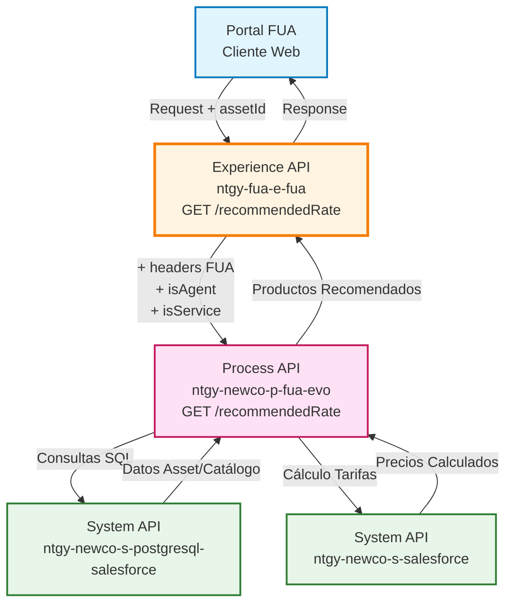
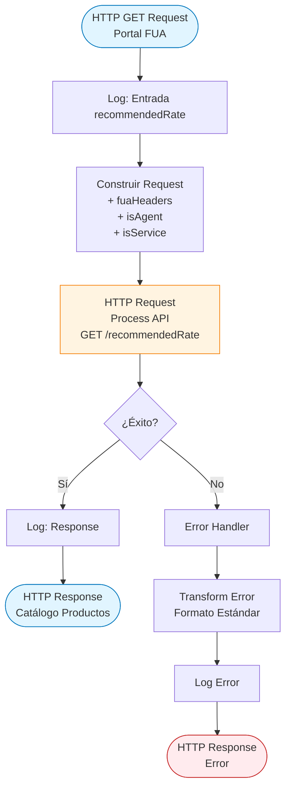
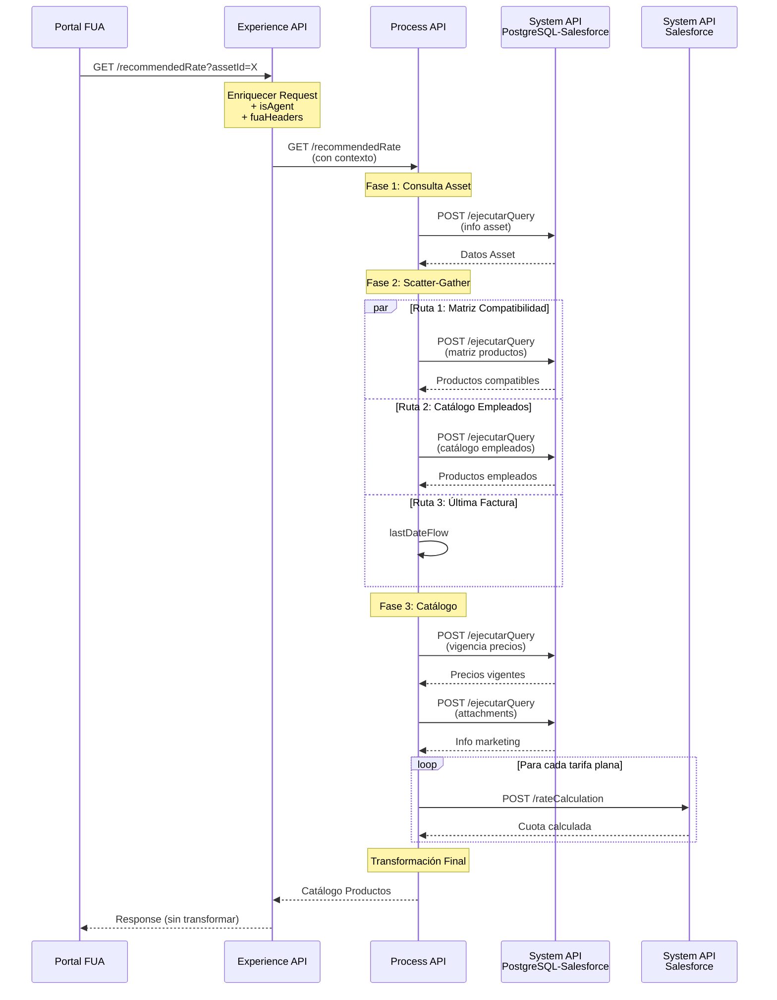
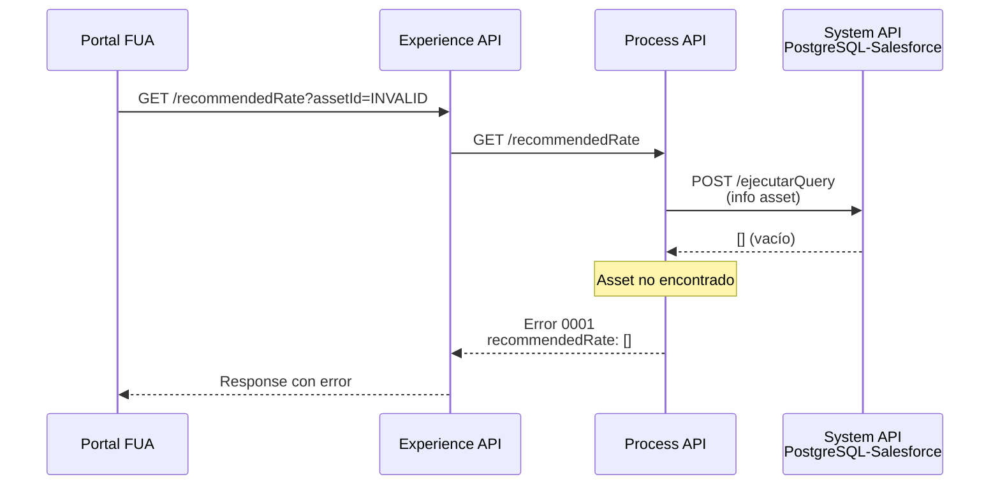
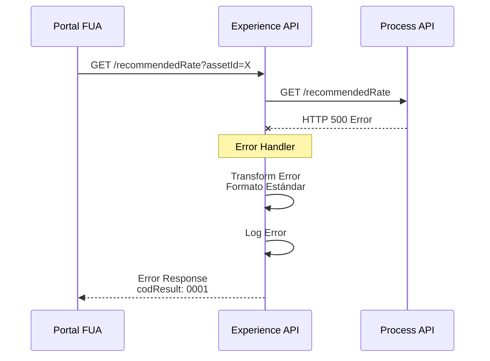

# GET /recommendedRate

## 📌 Descripción General

### Propósito del Endpoint

Este endpoint proporciona recomendaciones personalizadas de productos energéticos (electricidad/gas) para clientes que desean realizar un cambio de producto. Analiza el asset actual del cliente y devuelve un catálogo de productos compatibles con sus precios, condiciones comerciales y información de marketing.

### Tipo de API

**Capa:** Experience API (API-Led Connectivity)

**Función:** Orquestación y adaptación de experiencia para portal web FUA

### Patrón de Integración

**Tipo:** Pass-Through con Enriquecimiento de Headers

**Descripción:** El Experience API enriquece la petición con headers FUA y parámetros adicionales (`isAgent`, `isService`) antes de delegar la lógica completa al Process API. No transforma la respuesta, actuando como proxy con contexto adicional.

### Arquitectura API-Led Connectivity



---

## 💼 Propósito del Negocio

### Casos de Uso Principales

1. **Cambio de Producto Energético**
   - Cliente desea cambiar su tarifa actual de electricidad o gas
   - Sistema recomienda productos compatibles basándose en su situación actual
   - Beneficio: Facilita la decisión del cliente mostrando solo opciones viables

2. **Comparativa de Tarifas**
   - Cliente compara su producto actual con alternativas disponibles
   - Visualiza precios, términos de energía/potencia y condiciones
   - Beneficio: Transparencia en precios y condiciones comerciales

3. **Catálogo Personalizado para Empleados**
   - Empleados con bonificación acceden a catálogo especial
   - Productos exclusivos con condiciones preferenciales
   - Beneficio: Gestión automática de beneficios para empleados

### 📱 Canal y Audiencia

#### Canal de Consumo

**Canal:** Web

**Características del Canal:**
- **Plataforma**: Portal FUA (Frontal Único de Atención)
- **Dispositivos**: Desktop y tablets
- **Conectividad**: Conexión estable requerida (respuestas complejas)
- **Experiencia de Usuario**: Interfaz rica con comparativas visuales de productos

#### Audiencia Objetivo

**Usuarios Finales:**
- **Clientes Residenciales**: Buscan optimizar su tarifa energética
- **Clientes PYMES**: Necesitan productos adaptados a su consumo empresarial
- **Empleados Naturgy**: Acceden a catálogo especial con bonificaciones

**Contexto de Uso:**
- **Autoservicio Web**: Cliente explora opciones de cambio de producto
- **Gestión Asistida**: Agente de call center ayuda al cliente en el proceso

#### Adaptaciones del Canal

**Optimizaciones Aplicadas:**
- **Headers FUA**: Añade contexto de sesión y trazabilidad
- **Parámetro isAgent**: Diferencia catálogo cliente vs agente
- **Parámetro isService**: Adapta consulta para productos vs servicios
- **Timeout Extendido**: 60 segundos para procesar catálogos complejos

### 🔗 Endpoints Dependientes

Este Experience API consume el siguiente Process API:

| Process API | Endpoint | Método | Propósito |
|-------------|----------|--------|-----------|
| `ntgy-newco-p-fua-evo` | `/recommendedRate` | GET | Orquesta consultas a múltiples System APIs para obtener catálogo de productos recomendados con precios calculados |

**Nota:** El Process API consume internamente:
- `ntgy-newco-s-postgresql-salesforce` (consultas SQL a Salesforce)
- `ntgy-newco-s-salesforce` (cálculo de tarifas planas)

### Contexto Empresarial

- **Dominio:** Gestión de Productos y Tarifas Energéticas
- **Sector:** Energía - Utilities
- **División:** Naturgy España - NewCo
- **Canal:** Portal Web FUA

### Stakeholders

- **Clientes Finales**: Necesitan recomendaciones claras para cambio de producto
- **Agentes Call Center**: Requieren visibilidad de productos adicionales para asesorar
- **Área Comercial**: Define matriz de compatibilidad y catálogo de productos
- **Área de Pricing**: Gestiona vigencia de precios y condiciones comerciales

### Valor de Negocio

- **Incremento de Conversión**: Facilita cambios de producto con recomendaciones personalizadas
- **Reducción de Abandono**: Catálogo filtrado evita confusión con productos incompatibles
- **Optimización Comercial**: Visibilidad diferenciada para agentes permite upselling
- **Gestión Automática**: Catálogo de empleados se gestiona sin intervención manual

---

## 🔧 Especificación Técnica

### URLs por Ambiente

| Ambiente | URL Base | URL Completa |
|----------|----------|--------------|
| **Local** | `http://localhost:8081` | `http://localhost:8081/fua/api/recommendedRate?assetId={assetId}` |
| **Development** | `https://ntgy-fua-e-fua-dev.de-c1.cloudhub.io` | `https://ntgy-fua-e-fua-dev.de-c1.cloudhub.io/fua/api/recommendedRate?assetId={assetId}` |
| **Production** | `https://ntgy-fua-e-fua-pro.de-c1.cloudhub.io` | `https://ntgy-fua-e-fua-pro.de-c1.cloudhub.io/fua/api/recommendedRate?assetId={assetId}` |

### Método HTTP

```
GET /fua/api/recommendedRate
```

### 🎯 Consideraciones del Canal

#### Limitaciones del Canal

| Aspecto | Limitación | Razón |
|---------|------------|-------|
| **Timeout** | 60 segundos | Procesamiento complejo de catálogo con múltiples consultas SQL y cálculos |
| **Rate Limiting** | Según política API Manager | Protección contra abuso |
| **Caché** | No aplica | Datos dinámicos (precios, vigencias) |

#### Campos Específicos del Canal

**Campos Añadidos por el Experience API:**

| Campo | Tipo | Descripción | Razón |
|-------|------|-------------|-------|
| `isAgent` | boolean | Indica si la petición viene de un agente | Controla visibilidad de productos en catálogo |
| `isService` | boolean | Indica si se consultan servicios o productos | Optimiza query SQL (servicios no tienen CUPS/potencias) |
| `fuaHeaders` | object | Headers de contexto FUA | Trazabilidad y contexto de sesión |

**Campos Propagados del Request Original:**

| Campo | Tipo | Descripción |
|-------|------|-------------|
| `assetId` | string | ID del asset para cambio de producto |

### Parámetros de Entrada

#### Query Parameters

| Parámetro | Tipo | Obligatorio | Descripción | Ejemplo |
|-----------|------|-------------|-------------|---------|
| `assetId` | string | ✅ Sí | Identificador único del asset (contrato) para el cual se solicitan recomendaciones | `"0025I00000AbCdEFG"` |
| `isService` | boolean | ❌ No | Indica si el asset es un servicio (true) o producto energético (false). Default: false | `false` |

**Nota:** El parámetro `isAgent` se obtiene de variables de sesión (`vars.isAgent`), no del query string.

#### Headers Requeridos

| Header | Tipo | Obligatorio | Descripción |
|--------|------|-------------|-------------|
| `Content-Type` | string | ✅ Sí | Tipo de contenido: `application/json` |
| `client_id` | string | ✅ Sí | Client ID para autenticación API Manager |

### Respuestas

#### 200 OK - Éxito

**Descripción:** Catálogo de productos recomendados obtenido exitosamente.

**⚠️ Nota sobre Campos Condicionales en `prices`:**

El objeto `prices` contiene campos que aparecen condicionalmente según el tipo de tarifa:

- **Tarifas con términos de potencia/energía** (productos normales): Incluyen `power`, `energy`, `fixedTerm`, `variableTerm` con valores reales. Los campos `annualAmount`, `maxConsumption` y `consumoAnual` NO están presentes.
- **Tarifas planas** (cuota fija mensual): Incluyen `annualAmount`, `maxConsumption`, `consumoAnual`. Los arrays `power` y `energy` contienen ceros, y `fixedTerm`/`variableTerm` son 0.

**Estructura de Respuesta:**

```json
{
  "startDate": "string (dd/MM/yyyy)",
  "recommendedRate": [
    {
      "productId": "string",
      "priceBookEntryId": "string",
      "productType": {
        "isEco": boolean,
        "productClientType": "string",
        "productTypeId": "string",
        "productCode": "string",
        "productTypeName": "string",
        "isActualProduct": boolean,
        "productActualOfferType": "string",
        "productTypeFamily": "string (luz|gas|servicios)",
        "isVariable": boolean
      },
      "marketingInfo": [
        {
          "text": "string",
          "icon": "string (URL)"
        }
      ],
      "prices": [
        {
          "productOfferType": "string",
          "serviceAmount": number,
          "flatRateAmount": number,
          "annualAmount": number,
          "dateReview": "string (ISO date)",
          "power": [number, number, number, number, number, number],
          "energy": [number, number, number, number, number, number],
          "fixedTerm": number,
          "variableTerm": number,
          "maxConsumption": number,
          "consumoAnual": number
        }
      ]
    }
  ]
}
```

**Nota:** Los campos marcados en la tabla siguiente indican su condicionalidad.

**Campos de Respuesta:**

| Campo | Tipo | Condicional | Descripción |
|-------|------|-------------|-------------|
| `startDate` | string | - | Fecha de última facturación o inicio de contrato (formato dd/MM/yyyy) |
| `recommendedRate` | array | - | Lista de productos recomendados |
| `recommendedRate[].productId` | string | - | ID único del producto en Salesforce |
| `recommendedRate[].priceBookEntryId` | string | - | ID de entrada en el catálogo de precios |
| `recommendedRate[].productType` | object | - | Información del tipo de producto |
| `recommendedRate[].productType.isEco` | boolean | - | Indica si es producto ecológico |
| `recommendedRate[].productType.productClientType` | string | - | Tipo de cliente (R: Residencial, P: PYME, E: Empleado) |
| `recommendedRate[].productType.productCode` | string | - | Código del producto |
| `recommendedRate[].productType.productTypeName` | string | - | Nombre comercial del producto |
| `recommendedRate[].productType.isActualProduct` | boolean | ⚠️ Opcional | Indica si es el producto actual del cliente (solo si aplica) |
| `recommendedRate[].productType.productActualOfferType` | string | ⚠️ Opcional | Tipo de oferta actual (solo si isActualProduct=true) |
| `recommendedRate[].productType.productTypeFamily` | string | - | Familia: "luz", "gas" o "servicios" |
| `recommendedRate[].productType.isVariable` | boolean | - | Indica si es tarifa indexada (variable) |
| `recommendedRate[].marketingInfo` | array | - | Información de marketing (iconos, textos) |
| `recommendedRate[].prices` | array | ⚠️ Opcional | Precios por tipo de oferta (no presente para productos de empleados tipo E) |
| `recommendedRate[].prices[].productOfferType` | string | - | Tipo de oferta comercial |
| `recommendedRate[].prices[].serviceAmount` | number | - | Importe del servicio |
| `recommendedRate[].prices[].flatRateAmount` | number | - | Cuota mensual (0 para tarifas normales, valor real para tarifas planas) |
| `recommendedRate[].prices[].annualAmount` | number | 🔵 Solo tarifas planas | Importe anual estimado (solo presente si es tarifa plana) |
| `recommendedRate[].prices[].dateReview` | string | - | Fecha de revisión de precios (formato ISO date) |
| `recommendedRate[].prices[].power` | array[6] | - | Términos de potencia P1-P6 en €/kW/día (valores reales para tarifas normales, [0,0,0,0,0,0] para tarifas planas) |
| `recommendedRate[].prices[].energy` | array[6] | - | Términos de energía TE1-TE6 en €/kWh (valores reales para tarifas normales, [0,0,0,0,0,0] para tarifas planas) |
| `recommendedRate[].prices[].fixedTerm` | number | - | Término fijo para gas (valor real para tarifas normales, 0 para tarifas planas) |
| `recommendedRate[].prices[].variableTerm` | number | - | Término variable para gas (valor real para tarifas normales, 0 para tarifas planas) |
| `recommendedRate[].prices[].maxConsumption` | number | 🔵 Solo tarifas planas | Consumo máximo pactado en kWh (solo presente si es tarifa plana) |
| `recommendedRate[].prices[].consumoAnual` | number | 🔵 Solo tarifas planas | Consumo anual base en kWh (solo presente si es tarifa plana) |

**Leyenda:**
- **-**: Campo siempre presente
- **⚠️ Opcional**: Campo que puede o no estar presente según condiciones
- **🔵 Solo tarifas planas**: Campo exclusivo de tarifas con cuota fija mensual

#### 400 Bad Request - Error de Validación

```json
{
  "result": {
    "codResult": "0001",
    "msgResult": "Información asset no encontrada"
  },
  "startDate": "",
  "recommendedRate": []
}
```

#### 500 Internal Server Error - Error del Sistema

```json
{
  "result": {
    "codResult": "0001",
    "msgResult": "Error description"
  }
}
```

### Autenticación

- **Tipo:** OAuth 2.0 via API Manager
- **Header:** `client_id` (proporcionado por API Manager)
- **Scope:** Acceso a operaciones de consulta de productos

### Timeouts

| Tipo | Valor | Razón |
|------|-------|-------|
| **Request Timeout** | 60 segundos | Procesamiento complejo en Process API (múltiples consultas SQL, cálculos de tarifas) |
| **Connection Idle Timeout** | 60 segundos | Mantiene conexión para operaciones largas |

---

## 🏗️ Implementación Técnica

### Arquitectura del Flow



### Transformaciones de Canal

**Este Experience API NO transforma la respuesta del Process API.**

⚠️ **Patrón Pass-Through:** La respuesta del Process API se devuelve directamente al cliente sin modificaciones.

**Enriquecimiento de Request:**

| Campo Original | Campo Añadido | Transformación |
|----------------|---------------|----------------|
| `assetId` (query param) | `assetId` | Propagación directa |
| `isService` (query param) | `isService` | Propagación directa |
| N/A | `isAgent` | Obtenido de `vars.isAgent` (contexto de sesión) |
| N/A | `fuaHeaders` | Obtenido de `vars.fuaHeaders` (headers de contexto) |

**Lógica de Enriquecimiento:**

```dataweave
%dw 2.0
output application/java
---
{
  "assetId": attributes.queryParams.assetId,
  "isAgent": vars.isAgent default false,
  "isService": attributes.queryParams.isService
} ++ vars.fuaHeaders
```

### Configuración HTTP Request

**Connector:** `HTTP_FUA_PROCESS_NEWCO_EVO`

**Configuración:**
```xml
<http:request 
    method="GET" 
    config-ref="HTTP_FUA_PROCESS_NEWCO_EVO" 
    path="/recommendedRate">
    <http:query-params>
        {
            "assetId": attributes.queryParams.assetId,
            "isAgent": vars.isAgent default false,
            "isService": attributes.queryParams.isService
        } ++ vars.fuaHeaders
    </http:query-params>
</http:request>
```

**Properties (Production):**
```yaml
newco-p-fua-evo:
  host: "mule-worker-internal-ntgy-newco-p-fua-evo.de-c1.cloudhub.io"
  port: "8091"
  timeout: "60000"
```

### Patrones de Diseño

**Patrón:** API Gateway con Enriquecimiento de Contexto

**Justificación:** 
- El Experience API actúa como gateway añadiendo contexto de sesión (isAgent, fuaHeaders)
- Delega toda la lógica de negocio al Process API
- Apropiado para portal web donde el contexto de sesión es crítico

### Diagramas de Secuencia

#### 1. Flujo Normal de Éxito



#### 2. Flujo con Asset No Encontrado



#### 3. Flujo con Error Técnico



### Manejo de Errores

**Error Handler Global:**

```xml
<error-handler>
    <on-error-propagate 
        enableNotifications="true" 
        logException="true">
        <ee:transform doc:name="Set Error Message">
            <ee:set-payload>
                {
                    "result": {
                        "codResult": "0001",
                        "msgResult": error.description as String replace /\"/ with("")
                    }
                }
            </ee:set-payload>
        </ee:transform>
        <logger level="ERROR" message="Error en recommendedRate"/>
    </on-error-propagate>
</error-handler>
```

**Códigos de Error:**

| Código | Descripción | Origen |
|--------|-------------|--------|
| `0001` | Error genérico del sistema | Experience API |
| `0001` | Información asset no encontrada | Process API |
| `0002` | Error al consultar el catálogo de productos | Process API |

---

## 💻 Ejemplos de Uso

### Ejemplo 1: Consulta Exitosa - Tarifa Normal con Términos de Potencia/Energía

Este ejemplo muestra un producto con términos de potencia y energía (tarifa normal). Observa que **NO incluye** los campos `annualAmount`, `maxConsumption` ni `consumoAnual`.

#### cURL

```bash
curl -X GET "https://ntgy-fua-e-fua-pro.de-c1.cloudhub.io/fua/api/recommendedRate?assetId=0025I00000AbCdEFG&isService=false" \
  -H "Content-Type: application/json" \
  -H "client_id: YOUR_CLIENT_ID"
```

#### Respuesta (200 OK)

```json
{
  "startDate": "15/01/2026",
  "recommendedRate": [
    {
      "productId": "01t5I000001AbCdEFG",
      "priceBookEntryId": "01u5I000002XyZABC",
      "productType": {
        "isEco": true,
        "productClientType": "R",
        "productTypeId": "01t5I000001AbCdEFG",
        "productCode": "ELEC_ECO_FIJA",
        "productTypeName": "Tarifa Eco Fija",
        "isActualProduct": false,
        "productTypeFamily": "luz",
        "isVariable": false
      },
      "marketingInfo": [
        {
          "text": "100% energía renovable certificada",
          "icon": "https://cdn.naturgy.com/icons/eco-leaf.svg"
        }
      ],
      "prices": [
        {
          "productOfferType": "ONLINE",
          "serviceAmount": 0,
          "flatRateAmount": 0,
          "dateReview": "2026-01-13T12:00:00Z",
          "power": [0.105, 0.105, 0.105, 0.105, 0.105, 0.105],
          "energy": [0.145, 0.125, 0.115, 0.105, 0.095, 0.085],
          "fixedTerm": 0,
          "variableTerm": 0
        }
      ]
    }
  ]
}
```

**Nota:** Observa que este producto NO incluye los campos `annualAmount`, `maxConsumption` ni `consumoAnual` porque es una tarifa con términos de potencia/energía, no una tarifa plana.

---

### Ejemplo 2: Consulta Exitosa - Tarifa Plana

Este ejemplo muestra un producto con tarifa plana (cuota fija mensual). Observa que **SÍ incluye** los campos `annualAmount`, `maxConsumption` y `consumoAnual`, mientras que los arrays `power` y `energy` contienen ceros.

#### Respuesta (200 OK) - Fragmento

```json
{
  "startDate": "15/01/2026",
  "recommendedRate": [
    {
      "productId": "01t5I000001XyZABC",
      "priceBookEntryId": "01u5I000002AbCdEF",
      "productType": {
        "isEco": false,
        "productClientType": "R",
        "productTypeId": "01t5I000001XyZABC",
        "productCode": "ELEC_PLANA_60",
        "productTypeName": "Tarifa Plana 60",
        "isActualProduct": true,
        "productActualOfferType": "STANDARD",
        "productTypeFamily": "luz",
        "isVariable": false
      },
      "marketingInfo": [],
      "prices": [
        {
          "productOfferType": "STANDARD",
          "serviceAmount": 0,
          "flatRateAmount": 65.50,
          "annualAmount": 786.00,
          "dateReview": "2026-01-13T12:00:00Z",
          "power": [0, 0, 0, 0, 0, 0],
          "energy": [0, 0, 0, 0, 0, 0],
          "fixedTerm": 0,
          "variableTerm": 0,
          "maxConsumption": 250.0,
          "consumoAnual": 2800
        }
      ]
    }
  ]
}
```

**Nota:** Observa que este producto **SÍ incluye** `annualAmount` (786.00), `maxConsumption` (250.0) y `consumoAnual` (2800) porque es una tarifa plana. Los arrays `power` y `energy` contienen ceros.

---

### Ejemplo 3: Asset No Encontrado

#### cURL

```bash
curl -X GET "https://ntgy-fua-e-fua-pro.de-c1.cloudhub.io/fua/api/recommendedRate?assetId=INVALID_ID" \
  -H "Content-Type: application/json" \
  -H "client_id: YOUR_CLIENT_ID"
```

#### Respuesta (200 OK con error de negocio)

```json
{
  "result": {
    "codResult": "0001",
    "msgResult": "Información asset no encontrada"
  },
  "startDate": "",
  "recommendedRate": []
}
```

### Ejemplo 4: JavaScript (Portal Web)

```javascript
async function getRecommendedRates(assetId) {
  try {
    const response = await fetch(
      `https://ntgy-fua-e-fua-pro.de-c1.cloudhub.io/fua/api/recommendedRate?assetId=${assetId}&isService=false`,
      {
        method: 'GET',
        headers: {
          'Content-Type': 'application/json',
          'client_id': 'YOUR_CLIENT_ID'
        }
      }
    );

    if (!response.ok) {
      throw new Error(`HTTP error! status: ${response.status}`);
    }

    const data = await response.json();
    
    // Procesar productos recomendados
    if (data.recommendedRate && data.recommendedRate.length > 0) {
      console.log(`Encontrados ${data.recommendedRate.length} productos recomendados`);
      console.log(`Fecha de inicio: ${data.startDate}`);
      
      data.recommendedRate.forEach(product => {
        console.log(`- ${product.productType.productTypeName} (${product.productType.productCode})`);
        if (product.productType.isActualProduct) {
          console.log('  ⭐ Producto actual del cliente');
        }
      });
    } else {
      console.log('No se encontraron productos recomendados');
    }
    
    return data;
  } catch (error) {
    console.error('Error al obtener tarifas recomendadas:', error);
    throw error;
  }
}

// Uso
getRecommendedRates('0025I00000AbCdEFG');
```

### Ejemplo 5: Python

```python
import requests
import json

def get_recommended_rates(asset_id, is_service=False):
    """
    Obtiene productos recomendados para un asset específico
    
    Args:
        asset_id (str): ID del asset
        is_service (bool): True si es servicio, False si es producto
    
    Returns:
        dict: Catálogo de productos recomendados
    """
    url = "https://ntgy-fua-e-fua-pro.de-c1.cloudhub.io/fua/api/recommendedRate"
    
    params = {
        'assetId': asset_id,
        'isService': str(is_service).lower()
    }
    
    headers = {
        'Content-Type': 'application/json',
        'client_id': 'YOUR_CLIENT_ID'
    }
    
    try:
        response = requests.get(url, params=params, headers=headers)
        response.raise_for_status()
        
        data = response.json()
        
        # Procesar respuesta
        if 'recommendedRate' in data and len(data['recommendedRate']) > 0:
            print(f"Encontrados {len(data['recommendedRate'])} productos recomendados")
            print(f"Fecha de inicio: {data['startDate']}")
            
            for product in data['recommendedRate']:
                product_type = product['productType']
                print(f"- {product_type['productTypeName']} ({product_type['productCode']})")
                
                if product_type.get('isActualProduct'):
                    print("  ⭐ Producto actual del cliente")
                
                if product_type.get('isEco'):
                    print("  🌱 Producto ecológico")
        else:
            print("No se encontraron productos recomendados")
        
        return data
        
    except requests.exceptions.HTTPError as e:
        print(f"Error HTTP: {e}")
        raise
    except requests.exceptions.RequestException as e:
        print(f"Error de conexión: {e}")
        raise

# Uso
if __name__ == "__main__":
    result = get_recommended_rates('0025I00000AbCdEFG')
    print(json.dumps(result, indent=2, ensure_ascii=False))
```

### Ejemplo 6: Error de Sistema

#### cURL

```bash
curl -X GET "https://ntgy-fua-e-fua-pro.de-c1.cloudhub.io/fua/api/recommendedRate?assetId=0025I00000AbCdEFG" \
  -H "Content-Type: application/json" \
  -H "client_id: YOUR_CLIENT_ID"
```

#### Respuesta (500 Internal Server Error)

```json
{
  "result": {
    "codResult": "0001",
    "msgResult": "Connection timeout to Process API"
  }
}
```
