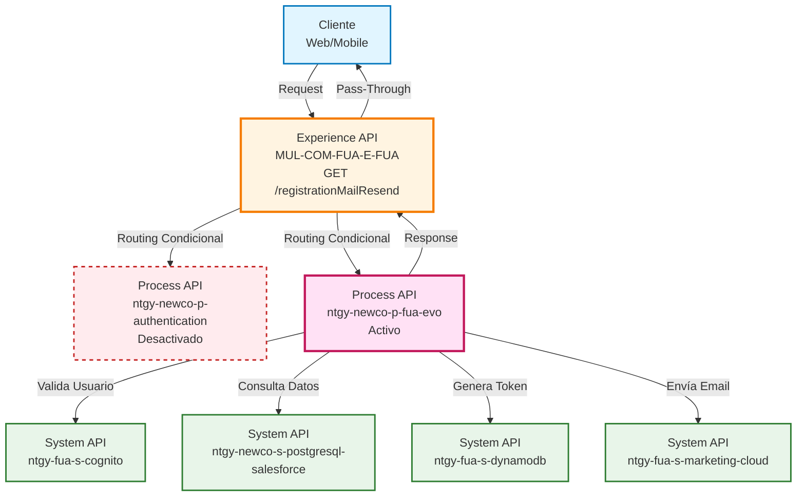
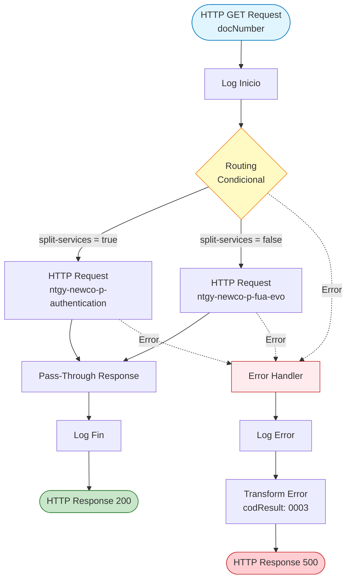
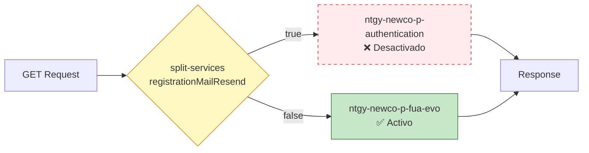
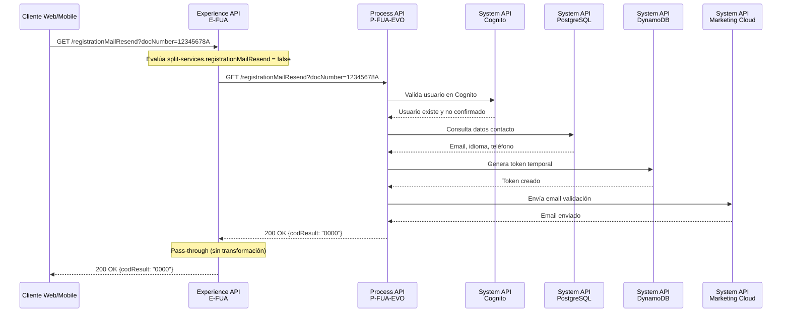
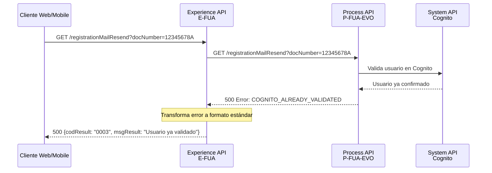
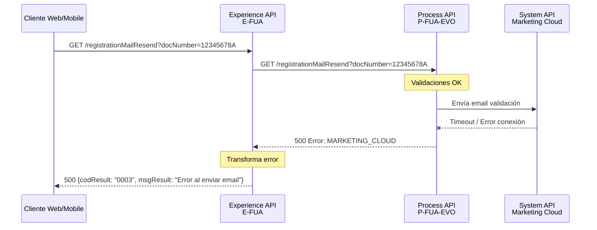

# GET /registrationMailResend

## 📌 Descripción General

### Propósito del Endpoint

Este endpoint permite reenviar el email de validación a un usuario que se ha registrado pero no ha recibido o no ha podido completar el proceso de confirmación inicial. Es parte del flujo de registro y activación de cuentas en el portal FUA.

### Tipo de API

**Capa:** Experience API (API-Led Connectivity)

**Función:** Orquestación con routing condicional entre dos Process APIs alternativos

### Patrón de Integración

**Tipo:** Pass-Through con Routing Condicional

**Descripción:** El Experience API actúa como orquestador que enruta la petición a uno de dos Process APIs según configuración, sin transformar la respuesta exitosa. Solo transforma respuestas de error para estandarización.

### Arquitectura API-Led Connectivity



---

## 💼 Propósito del Negocio

### Casos de Uso Principales

1. **Usuario no recibió email de confirmación**
   - El usuario completó el registro pero no recibió el email
   - Necesita reenvío del código de validación
   - Beneficio: Permite completar el proceso de alta sin contactar soporte

2. **Email expirado o perdido**
   - El usuario perdió el email original
   - El token de validación puede haber expirado
   - Beneficio: Genera nuevo token y reenvía email

3. **Cambio de dirección de email**
   - El usuario se registró con email incorrecto
   - Necesita reenvío a email actualizado
   - Beneficio: Facilita corrección de datos sin reiniciar registro

### 📱 Canal y Audiencia

#### Canal de Consumo

**Canal:** Web | Mobile

**Características del Canal:**
- **Plataforma**: Portal FUA web y aplicaciones móviles
- **Dispositivos**: Desktop, tablets, smartphones
- **Conectividad**: Requiere conexión a internet
- **Experiencia de Usuario**: Autoservicio sin intervención de agentes

#### Audiencia Objetivo

**Usuarios Finales:**
- **Clientes Registrados Pendientes de Validación**: Usuarios que completaron registro pero no confirmaron su cuenta
- **Nuevos Usuarios**: Clientes que acaban de registrarse en el portal FUA

**Contexto de Uso:**
- **Proceso de Alta**: Durante el flujo de registro y activación de cuenta
- **Recuperación de Acceso**: Cuando el usuario no puede acceder por falta de validación

#### Adaptaciones del Canal

**Optimizaciones Aplicadas:**
- **Simplificación de Datos**: Solo requiere número de documento
- **Formato de Respuesta**: Respuesta simple con código de resultado
- **Timeout**: 60 segundos para permitir procesamiento completo
- **Error Handling**: Mensajes de error estandarizados y user-friendly

### 🔗 Endpoints Dependientes

Este Experience API consume uno de los siguientes Process APIs (routing condicional):

| Process API | Endpoint | Método | Estado | Propósito |
|-------------|----------|--------|--------|-----------|
| `ntgy-newco-p-authentication` | `/registrationMailResend` | GET | ❌ Desactivado | Ruta alternativa de autenticación |
| `ntgy-newco-p-fua-evo` | `/registrationMailResend` | GET | ✅ Activo | Ruta principal de reenvío de email |

**Configuración de Routing:**
- **Flag:** `split-services.registrationMailResend`
- **Valor Actual:** `false`
- **Comportamiento:** Cuando `false`, usa `ntgy-newco-p-fua-evo` (ruta activa)

### Contexto Empresarial

- **Dominio:** Gestión de Identidad y Acceso
- **Sector:** Energía - Utilities
- **División:** Naturgy España - FUA (Frontal Único de Atención)
- **Canal:** Web y Mobile

### Stakeholders

- **Clientes Finales**: Necesitan completar validación para acceder al portal
- **Equipo de Soporte**: Reducción de llamadas por problemas de validación
- **Equipo de Producto**: Mejora de tasa de conversión en registro

### Valor de Negocio

- **Reducción de Fricción**: Elimina barreras en el proceso de alta
- **Mejora de Conversión**: Aumenta tasa de completitud de registros
- **Reducción de Costes**: Menos llamadas a soporte por problemas de validación
- **Experiencia de Usuario**: Autoservicio completo sin intervención manual

---

## 🔧 Especificación Técnica

### URLs por Ambiente

| Ambiente | URL Base | URL Completa |
|----------|----------|--------------|
| **Local** | `http://localhost:8081` | `http://localhost:8081/fua/api/registrationMailResend?docNumber=12345678A` |
| **Development** | `https://mul-com-fua-e-fua-dev.de-c1.cloudhub.io` | `https://mul-com-fua-e-fua-dev.de-c1.cloudhub.io/fua/api/registrationMailResend?docNumber=12345678A` |
| **UAT** | `https://mul-com-fua-e-fua-uat.de-c1.cloudhub.io` | `https://mul-com-fua-e-fua-uat.de-c1.cloudhub.io/fua/api/registrationMailResend?docNumber=12345678A` |
| **Production** | `https://mul-com-fua-e-fua-pro.de-c1.cloudhub.io` | `https://mul-com-fua-e-fua-pro.de-c1.cloudhub.io/fua/api/registrationMailResend?docNumber=12345678A` |

### Método HTTP

```
GET /fua/api/registrationMailResend
```

### 🎯 Consideraciones del Canal

#### Limitaciones del Canal

| Aspecto | Limitación | Razón |
|---------|------------|-------|
| **Timeout** | 60 segundos | Permite procesamiento completo del flujo (validación + email) |
| **Rate Limiting** | No especificado | Controlado por API Gateway |
| **Reintentos** | No recomendado | Cada llamada genera nuevo token y email |

#### Campos Específicos del Canal

**Headers Propagados:**

El Experience API propaga headers adicionales mediante `vars.fuaHeaders`:

| Header | Tipo | Descripción | Obligatorio |
|--------|------|-------------|-------------|
| `x-client-id` | string | Identificador del cliente | No |
| `x-client-code` | string | Código del cliente | No |
| `x-language` | string | Idioma preferido (es, ca, eu, gl) | No |

### Parámetros de Entrada

#### Query Parameters

| Parámetro | Tipo | Obligatorio | Descripción | Ejemplo |
|-----------|------|-------------|-------------|---------|
| `docNumber` | string | ✅ Sí | Número de documento del usuario (DNI/NIE) | `12345678A` |

**Validaciones:**
- El documento debe existir en el sistema
- El usuario debe estar en estado "pendiente de confirmación"
- El usuario no debe estar ya validado

### Respuestas

#### Respuesta Exitosa (200 OK)

**Descripción:** El email de validación ha sido reenviado correctamente.

```json
{
  "result": {
    "codResult": "0000",
    "msgResult": "No hay error"
  }
}
```

**Campos de Respuesta:**

| Campo | Tipo | Descripción |
|-------|------|-------------|
| `result` | object | Objeto contenedor del resultado |
| `result.codResult` | string | Código de resultado (`0000` = éxito) |
| `result.msgResult` | string | Mensaje descriptivo del resultado |

#### Respuesta de Error (500 Internal Server Error)

**Descripción:** Error durante el procesamiento de la solicitud.

```json
{
  "result": {
    "codResult": "0003",
    "msgResult": "Descripción del error"
  }
}
```

**Códigos de Error Comunes:**

| Código | Descripción | Causa |
|--------|-------------|-------|
| `0003` | Error genérico | Error en el procesamiento del Process API |
| `COGNITO_USER_NOT_EXISTS` | Usuario no existe | El documento no está registrado en Cognito |
| `COGNITO_ALREADY_VALIDATED` | Usuario ya validado | El usuario ya completó la validación |
| `POSTGRESQL_SALESFORCE` | Error de consulta | No se pudo obtener información del contacto |
| `MARKETING_CLOUD` | Error de envío | No se pudo enviar el email |

### Autenticación

- **Tipo:** No requiere autenticación previa
- **Razón:** Es parte del flujo de registro, el usuario aún no tiene sesión activa

### Timeouts

| Tipo | Valor | Razón |
|------|-------|-------|
| **Request Timeout** | 60 segundos | Permite completar flujo completo: validación + consulta + token + email |
| **Connection Timeout** | 30 segundos | Timeout estándar para conexión |

---

## 🏗️ Implementación Técnica

### Arquitectura del Flow



### Routing Condicional (Feature Toggle)

Este endpoint implementa un **patrón de feature toggle** que permite cambiar entre dos Process APIs sin modificar código:



**Configuración Actual:**

| Flag | Valor | Process API Activo |
|------|-------|-------------------|
| `split-services.registrationMailResend` | `false` | `ntgy-newco-p-fua-evo` |

**Propósito del Feature Toggle:**
- Permite migración gradual entre implementaciones
- Facilita rollback inmediato en caso de problemas
- Habilita testing A/B de diferentes implementaciones
- No requiere redespliegue para cambiar de ruta

### Transformaciones de Canal

**Este Experience API es Pass-Through:**

⚠️ **El Experience API NO transforma la respuesta exitosa del Process API.**

**Comportamiento:**
- **Respuesta Exitosa (200):** Pass-through directo del Process API
- **Respuesta de Error (500):** Transformación para estandarización

Para el schema completo de la respuesta exitosa, consultar:
📖 **Process API: `ntgy-newco-p-fua-evo` endpoint `GET /registrationMailResend`**

### Transformación de Errores

**Lógica de Error Handler:**

```dataweave
%dw 2.0
output application/json
---
if (!isEmpty(error.errorMessage.payload)) 
  error.errorMessage.payload
else 
  {
    "result": {
      "codResult": "0003",
      "msgResult": error.description as String replace /\"/ with("")
    }
  }
```

**Comportamiento:**
1. Si el error tiene payload estructurado → Propagar tal cual
2. Si el error no tiene payload → Crear estructura estándar con código `0003`
3. Limpiar comillas dobles del mensaje de error

### Patrones de Diseño

**Patrón:** API Gateway con Feature Toggle

**Justificación:** 
- Permite cambio dinámico de implementación sin downtime
- Facilita estrategias de despliegue blue-green
- Reduce riesgo en migraciones de backend

### Diagramas de Secuencia

#### 1. Flujo Normal de Éxito (Ruta Activa)



#### 2. Flujo con Error de Negocio (Usuario Ya Validado)



#### 3. Flujo con Error Técnico



### Código de Implementación

**Flow Principal (Experience API):**

```xml
<flow name="get-registrationMailResendFlow">
    <choice doc:name="Choice">
        <when expression="#[(Mule::p('split-services.registrationMailResend') as Boolean default false)]">
            <!-- Ruta alternativa (desactivada) -->
            <http:request 
                method="GET" 
                config-ref="HTTP_Request_newco-p-authentication" 
                path="/registrationMailResend">
                <http:query-params>
                    {
                        "docNumber": attributes.queryParams.docNumber
                    } ++ vars.fuaHeaders
                </http:query-params>
            </http:request>
        </when>
        <otherwise>
            <!-- Ruta activa -->
            <http:request 
                method="GET" 
                config-ref="HTTP_FUA_PROCESS_NEWCO_EVO" 
                path="/registrationMailResend">
                <http:query-params>
                    {
                        "docNumber": attributes.queryParams.docNumber
                    } ++ vars.fuaHeaders
                </http:query-params>
            </http:request>
        </otherwise>
    </choice>
    
    <error-handler>
        <on-error-propagate>
            <logger level="ERROR" message="Error en registrationMailResend" />
            <ee:transform>
                <ee:set-payload>
                    if (!isEmpty(error.errorMessage.payload)) 
                        error.errorMessage.payload
                    else 
                        {
                            "result": {
                                "codResult": "0003",
                                "msgResult": error.description as String replace /\"/ with("")
                            }
                        }
                </ee:set-payload>
            </ee:transform>
        </on-error-propagate>
    </error-handler>
</flow>
```

### Optimizaciones del Canal

**Para Web:**
- Respuesta simple y rápida
- Mensaje de éxito claro para mostrar en UI
- Códigos de error específicos para mensajes user-friendly

**Para Mobile:**
- Payload mínimo para reducir consumo de datos
- Timeout generoso para conexiones lentas
- Estructura de respuesta consistente

### Manejo de Errores

**Estrategia:**
1. **Propagación de Errores Estructurados:** Si el Process API devuelve error con payload, se propaga tal cual
2. **Estandarización de Errores No Estructurados:** Si el error no tiene payload, se crea estructura estándar
3. **Logging Completo:** Todos los errores se registran con nivel ERROR
4. **Código Genérico:** Todos los errores se mapean a código `0003` para el cliente

**Tipos de Error:**

| Tipo | Origen | Manejo |
|------|--------|--------|
| **Validación de Negocio** | Process API | Propagación directa del payload |
| **Error Técnico** | Timeout, conexión | Transformación a formato estándar |
| **Error de Sistema** | Excepción no controlada | Transformación con mensaje genérico |

---

## 💻 Ejemplos de Uso

### Ejemplo 1: Llamada Exitosa desde Web

#### cURL

```bash
curl -X GET "https://mul-com-fua-e-fua-pro.de-c1.cloudhub.io/fua/api/registrationMailResend?docNumber=12345678A" \
  -H "Content-Type: application/json" \
  -H "x-language: es"
```

#### Respuesta (200 OK)

```json
{
  "result": {
    "codResult": "0000",
    "msgResult": "No hay error"
  }
}
```

**Interpretación:**
- El email de validación ha sido reenviado correctamente
- El usuario recibirá un nuevo email con token de validación
- El token tiene fecha de expiración configurada

### Ejemplo 2: JavaScript (para Web)

```javascript
async function resendValidationEmail(docNumber) {
  try {
    const response = await fetch(
      `https://mul-com-fua-e-fua-pro.de-c1.cloudhub.io/fua/api/registrationMailResend?docNumber=${docNumber}`,
      {
        method: 'GET',
        headers: {
          'Content-Type': 'application/json',
          'x-language': 'es'
        }
      }
    );
    
    const data = await response.json();
    
    if (data.result.codResult === '0000') {
      console.log('Email reenviado correctamente');
      // Mostrar mensaje de éxito al usuario
      showSuccessMessage('Hemos reenviado el email de validación. Por favor, revisa tu bandeja de entrada.');
    } else {
      console.error('Error al reenviar email:', data.result.msgResult);
      showErrorMessage(data.result.msgResult);
    }
    
    return data;
  } catch (error) {
    console.error('Error de conexión:', error);
    showErrorMessage('Error de conexión. Por favor, inténtalo de nuevo.');
    throw error;
  }
}

// Uso
resendValidationEmail('12345678A');
```

### Ejemplo 3: React Hook (para Mobile/Web)

```javascript
import { useState } from 'react';

function useResendValidationEmail() {
  const [loading, setLoading] = useState(false);
  const [error, setError] = useState(null);
  
  const resendEmail = async (docNumber) => {
    setLoading(true);
    setError(null);
    
    try {
      const response = await fetch(
        `https://mul-com-fua-e-fua-pro.de-c1.cloudhub.io/fua/api/registrationMailResend?docNumber=${docNumber}`,
        {
          method: 'GET',
          headers: {
            'Content-Type': 'application/json',
            'x-language': navigator.language.split('-')[0] || 'es'
          }
        }
      );
      
      const data = await response.json();
      
      if (data.result.codResult !== '0000') {
        throw new Error(data.result.msgResult);
      }
      
      return data;
    } catch (err) {
      setError(err.message);
      throw err;
    } finally {
      setLoading(false);
    }
  };
  
  return { resendEmail, loading, error };
}

// Uso en componente
function RegistrationValidation({ docNumber }) {
  const { resendEmail, loading, error } = useResendValidationEmail();
  
  const handleResend = async () => {
    try {
      await resendEmail(docNumber);
      alert('Email reenviado correctamente');
    } catch (err) {
      alert(`Error: ${err.message}`);
    }
  };
  
  return (
    <button onClick={handleResend} disabled={loading}>
      {loading ? 'Enviando...' : 'Reenviar email de validación'}
    </button>
  );
}
```

### Ejemplo 4: Error - Usuario Ya Validado

#### cURL

```bash
curl -X GET "https://mul-com-fua-e-fua-pro.de-c1.cloudhub.io/fua/api/registrationMailResend?docNumber=87654321B" \
  -H "Content-Type: application/json"
```

#### Respuesta (500 Internal Server Error)

```json
{
  "result": {
    "codResult": "0003",
    "msgResult": "El usuario ya está validado"
  }
}
```

**Interpretación:**
- El usuario con documento `87654321B` ya completó la validación
- No es necesario reenviar el email
- El usuario puede proceder directamente al login

### Ejemplo 5: Error - Usuario No Existe

#### Respuesta (500 Internal Server Error)

```json
{
  "result": {
    "codResult": "0003",
    "msgResult": "El usuario no existe en el sistema"
  }
}
```

**Interpretación:**
- El documento proporcionado no está registrado
- El usuario debe completar primero el proceso de registro
- Redirigir al usuario a la página de registro

### Ejemplo 6: Python (para Testing/Automation)

```python
import requests

def resend_validation_email(doc_number, language='es'):
    """
    Reenvía email de validación para un usuario registrado.
    
    Args:
        doc_number (str): Número de documento del usuario
        language (str): Idioma preferido (es, ca, eu, gl)
    
    Returns:
        dict: Respuesta del API
    
    Raises:
        requests.exceptions.RequestException: Error de conexión
        ValueError: Error de validación
    """
    url = 'https://mul-com-fua-e-fua-pro.de-c1.cloudhub.io/fua/api/registrationMailResend'
    
    params = {
        'docNumber': doc_number
    }
    
    headers = {
        'Content-Type': 'application/json',
        'x-language': language
    }
    
    try:
        response = requests.get(url, params=params, headers=headers, timeout=60)
        data = response.json()
        
        if data['result']['codResult'] == '0000':
            print(f'✅ Email reenviado correctamente para {doc_number}')
        else:
            print(f'❌ Error: {data["result"]["msgResult"]}')
            raise ValueError(data['result']['msgResult'])
        
        return data
        
    except requests.exceptions.Timeout:
        print('⏱️ Timeout: El servidor tardó demasiado en responder')
        raise
    except requests.exceptions.RequestException as e:
        print(f'🔌 Error de conexión: {e}')
        raise

# Uso
if __name__ == '__main__':
    try:
        result = resend_validation_email('12345678A', language='es')
        print('Resultado:', result)
    except Exception as e:
        print(f'Error: {e}')
```

### Ejemplo 7: Postman Collection

```json
{
  "info": {
    "name": "FUA - Registration Mail Resend",
    "schema": "https://schema.getpostman.com/json/collection/v2.1.0/collection.json"
  },
  "item": [
    {
      "name": "Resend Validation Email - Success",
      "request": {
        "method": "GET",
        "header": [
          {
            "key": "Content-Type",
            "value": "application/json"
          },
          {
            "key": "x-language",
            "value": "es"
          }
        ],
        "url": {
          "raw": "{{baseUrl}}/fua/api/registrationMailResend?docNumber={{docNumber}}",
          "host": ["{{baseUrl}}"],
          "path": ["fua", "api", "registrationMailResend"],
          "query": [
            {
              "key": "docNumber",
              "value": "{{docNumber}}"
            }
          ]
        }
      },
      "response": []
    }
  ],
  "variable": [
    {
      "key": "baseUrl",
      "value": "https://mul-com-fua