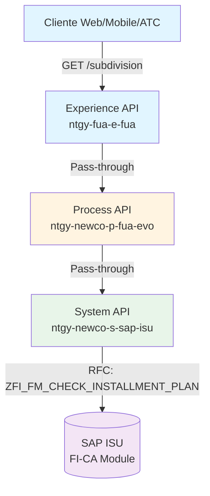
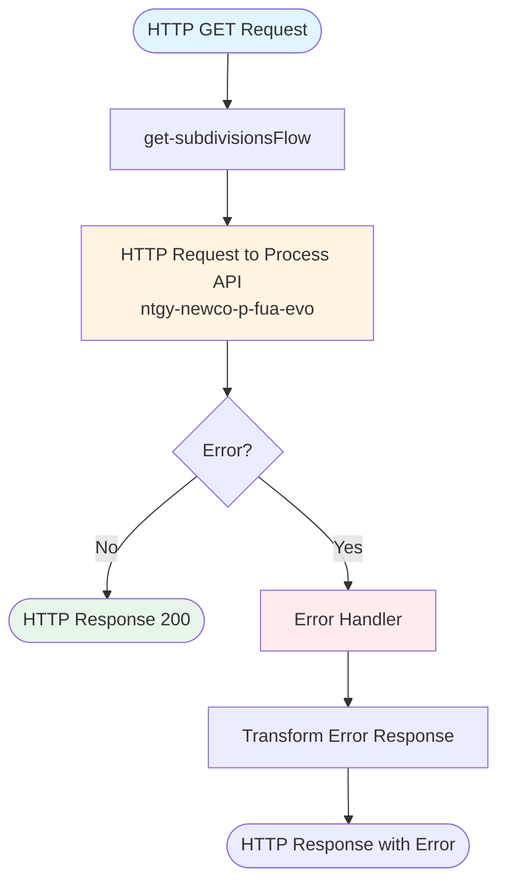
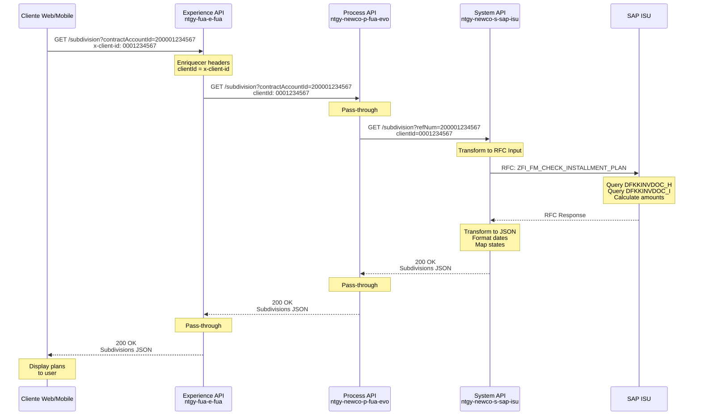
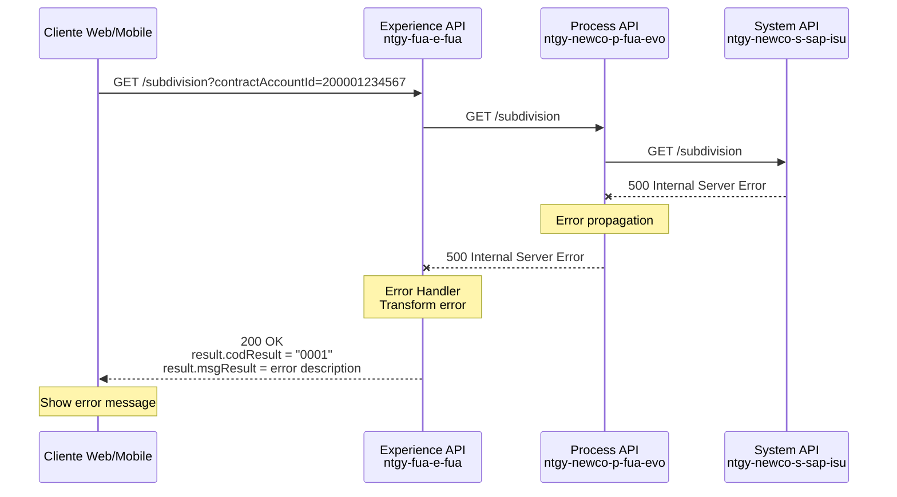

# GET /subdivision

## 📌 Descripción General

### Propósito del Endpoint
Consulta información detallada de fraccionamientos (planes de pago) existentes, incluyendo cuotas, importes, fechas de vencimiento y estado de cada plan de pago asociado a una cuenta contrato.

### Tipo de API
**Capa:** Experience API (Orquestación y experiencia de usuario)

### Patrón de Integración
**Tipo:** Pass-Through con enriquecimiento de headers

### Arquitectura API-Led Connectivity



---

## 💼 Propósito del Negocio

### Casos de Uso Principales

1. **Consulta de Planes de Pago Activos**: Clientes consultan sus fraccionamientos vigentes desde web o app móvil
2. **Verificación de Cuotas Pendientes**: Agentes verifican estado de pagos fraccionados durante atención al cliente
3. **Seguimiento de Deuda Fraccionada**: Monitoreo de importes pendientes en planes de pago
4. **Validación de Elegibilidad**: Verificar si cliente tiene fraccionamientos activos antes de crear uno nuevo
5. **Auditoría de Pagos**: Revisión histórica de planes de pago y su cumplimiento

### Contexto Empresarial
- **Dominio:** Gestión de Deuda y Financiación
- **Sector:** Energía - Utilities
- **División:** Naturgy España - FUA (Factura Única Avanzada)
- **Proceso de Negocio:** Financial Contract Accounting (FI-CA)

### Stakeholders
- **Clientes Finales**: Consultan estado de sus planes de pago desde portal web o app móvil
- **Agentes de Call Center**: Verifican fraccionamientos durante atención al cliente
- **Departamento de Cobranzas**: Monitorean cumplimiento de planes de pago
- **Sistemas de Terceros**: Integraciones que requieren información de financiación

### Valor de Negocio
- **Transparencia Financiera**: Visibilidad completa de planes de pago activos
- **Autoservicio**: Clientes pueden consultar sus fraccionamientos sin llamar
- **Gestión de Cobranza**: Facilita seguimiento de pagos fraccionados
- **Prevención de Duplicados**: Evita crear múltiples fraccionamientos para misma deuda
- **Cumplimiento Normativo**: Registro auditable de acuerdos de pago

### Canales de Consumo
- Portal web de autoservicio de clientes
- Aplicación móvil (iOS/Android)
- Sistema de agentes de call center (ATC)
- Integraciones de terceros autorizados

---

## 🔧 Especificación Técnica

### URLs por Ambiente

| Ambiente | URL Base | URL Completa |
|----------|----------|--------------|
| Local | `http://localhost:8081` | `http://localhost:8081/api/subdivision?contractAccountId={contractAccountId}` |
| Desarrollo | `https://dev-ntgy-fua-e-fua.cloudhub.io` | `https://dev-ntgy-fua-e-fua.cloudhub.io/api/subdivision?contractAccountId={contractAccountId}` |
| UAT | `https://uat-ntgy-fua-e-fua.cloudhub.io` | `https://uat-ntgy-fua-e-fua.cloudhub.io/api/subdivision?contractAccountId={contractAccountId}` |
| Producción | `https://ntgy-fua-e-fua.cloudhub.io` | `https://ntgy-fua-e-fua.cloudhub.io/api/subdivision?contractAccountId={contractAccountId}` |

### Método HTTP
```
GET /api/subdivision
```

### Parámetros de Entrada

#### Query Parameters

| Parámetro | Tipo | Requerido | Descripción | Ejemplo | Validaciones |
|-----------|------|-----------|-------------|---------|--------------|
| `contractAccountId` | string | ✅ Sí | Identificador de la cuenta contrato | `200001234567` | Longitud: 12 dígitos |

#### Headers HTTP

| Header | Tipo | Requerido | Descripción | Ejemplo |
|--------|------|-----------|-------------|---------|
| `x-client-id` | string | ✅ Sí | ID del cliente (Business Partner) | `0001234567` |
| `x-client-code` | string | ❌ No | Código de cliente (NIF/CIF) | `12345678A` |
| `Content-Type` | string | ✅ Sí | Tipo de contenido | `application/json` |
| `Accept` | string | ❌ No | Formato de respuesta esperado | `application/json` |

### Respuestas

#### Respuesta Exitosa (200 OK)

**Estructura de Respuesta:**

```json
{
  "result": {
    "codResult": "0000",
    "msgResult": "No hay error"
  },
  "maxCancel": false,
  "maxSubdivision": false,
  "subdivisions": [
    {
      "numRef": "1000123456",
      "numAgreement": "1000123456",
      "totalAmount": 500.00,
      "pendingAmount": 300.00,
      "state": "Activo",
      "dues": [
        {
          "idDue": "001",
          "numberDue": "1",
          "endDate": "2024-02-15 00:00:00",
          "amount": 100.00,
          "state": "Pagado"
        },
        {
          "idDue": "002",
          "numberDue": "2",
          "endDate": "2024-03-15 00:00:00",
          "amount": 100.00,
          "state": "Pagado"
        },
        {
          "idDue": "003",
          "numberDue": "3",
          "endDate": "2024-04-15 00:00:00",
          "amount": 100.00,
          "state": "Pendiente"
        },
        {
          "idDue": "004",
          "numberDue": "4",
          "endDate": "2024-05-15 00:00:00",
          "amount": 100.00,
          "state": "Pendiente"
        },
        {
          "idDue": "005",
          "numberDue": "5",
          "endDate": "2024-06-15 00:00:00",
          "amount": 100.00,
          "state": "Pendiente"
        }
      ],
      "associatedInvoicesId": [
        "1234567890",
        "1234567891"
      ]
    }
  ]
}
```

**Descripción de Campos Principales:**

| Campo | Tipo | Descripción |
|-------|------|-------------|
| `result.codResult` | string | Código de resultado: `0000` = éxito, `0001` = error |
| `result.msgResult` | string | Mensaje descriptivo del resultado |
| `maxCancel` | boolean | Flag que indica si se alcanzó el máximo de cancelaciones permitidas |
| `maxSubdivision` | boolean | Flag que indica si se alcanzó el máximo de fraccionamientos permitidos |
| `subdivisions` | array | Lista de planes de fraccionamiento |
| `subdivisions[].numRef` | string | Número de referencia del plan de fraccionamiento |
| `subdivisions[].numAgreement` | string | Número de acuerdo de fraccionamiento (mismo valor que numRef) |
| `subdivisions[].totalAmount` | number | Importe total del plan de pago |
| `subdivisions[].pendingAmount` | number | Importe pendiente de pago |
| `subdivisions[].state` | string | Estado del plan: Activo, Completado, Cancelado |
| `subdivisions[].dues` | array | Lista de cuotas del plan |
| `subdivisions[].dues[].idDue` | string | ID de la cuota |
| `subdivisions[].dues[].numberDue` | string | Número de cuota (1, 2, 3...) |
| `subdivisions[].dues[].endDate` | string | Fecha de vencimiento (formato: yyyy-MM-dd HH:mm:ss) |
| `subdivisions[].dues[].amount` | number | Importe de la cuota |
| `subdivisions[].dues[].state` | string | Estado de la cuota: Pagado, Pendiente, Vencido |
| `subdivisions[].associatedInvoicesId` | array | IDs de facturas asociadas al plan |

**Campos Calculables (no vienen en la respuesta):**
- `numDues`: Se puede calcular como `dues.length`
- `paidDues`: Se puede calcular filtrando `dues` por `state == "Pagado"`
- `pendingDues`: Se puede calcular filtrando `dues` por `state == "Pendiente"`
- `nextDueDate`: Se puede obtener de la primera cuota con `state == "Pendiente"`

#### Respuestas de Error

**400 Bad Request - Parámetros Faltantes:**
```json
{
  "result": {
    "codResult": "0001",
    "msgResult": "contractAccountId is required"
  }
}
```

**404 Not Found - Sin Fraccionamientos:**
```json
{
  "result": {
    "codResult": "0001",
    "msgResult": "No installment plans found"
  },
  "maxCancel": false,
  "maxSubdivision": false,
  "subdivisions": []
}
```

**500 Internal Server Error - Error Backend:**
```json
{
  "result": {
    "codResult": "0001",
    "msgResult": "Backend service error"
  }
}
```

**503 Service Unavailable - Servicio No Disponible:**
```json
{
  "result": {
    "codResult": "0001",
    "msgResult": "Service temporarily unavailable"
  }
}
```

### Códigos de Resultado (codResult)

| Código | Significado | Descripción |
|--------|-------------|-------------|
| `0000` | Éxito | Fraccionamientos encontrados y retornados correctamente |
| `0001` | Error General | Error en la consulta o sin fraccionamientos |

### Autenticación y Autorización

- **Tipo de Autenticación**: Headers personalizados (x-client-id, x-client-code)
- **Headers Requeridos**: `x-client-id` (obligatorio)
- **Validación**: El sistema valida que el cliente tenga permisos para consultar la cuenta contrato

### Timeouts

| Tipo | Valor | Descripción |
|------|-------|-------------|
| Request Timeout | 30 segundos | Timeout máximo para la llamada completa |
| Connection Timeout | 10 segundos | Timeout de conexión a servicios backend |

### Protocolo
- **Protocolo**: HTTPS (Producción), HTTP (Local)
- **TLS Version**: TLS 1.2+

---

## 🏗️ Implementación Técnica

### Arquitectura del Flow



### 🔄 Patrón de Implementación

**Patrón:** Pass-Through Puro con Enriquecimiento de Headers

**Características:**
- **Sin Transformación**: La respuesta del Process API se devuelve tal cual
- **Enriquecimiento de Headers**: Se añaden headers de cliente (`x-client-id`)
- **Propagación de Query Params**: Los query parameters se pasan directamente
- **Error Handling**: Manejo de errores con transformación a formato estándar

**Flujo de Datos:**
1. Experience API recibe request con `contractAccountId` y headers
2. Enriquece request con `x-client-id` header
3. Llama a Process API (pass-through)
4. Process API llama a System API (pass-through)
5. System API consulta SAP ISU y transforma respuesta
6. Respuesta se propaga sin cambios hasta Experience API

### Implementación del Flow

**Archivo:** `src/main/mule/implementation/subdivisions.xml`

**Flow Principal:** `get-subdivisionsFlow`

```xml
<flow name="get-subdivisionsFlow">
    <http:request method="GET" 
                  config-ref="HTTP_FUA_PROCESS_NEWCO_EVO" 
                  path="/subdivision">
        <http:headers>
            #["clientId": attributes.headers['x-client-id']]
        </http:headers>
        <http:query-params>
            #[attributes.queryParams ++ vars.fuaHeaders]
        </http:query-params>
    </http:request>
    
    <error-handler>
        <on-error-propagate>
            <ee:transform>
                <ee:set-payload>
                    {
                        "result": {
                            "codResult": "0001",
                            "msgResult": error.description
                        }
                    }
                </ee:set-payload>
            </ee:transform>
        </on-error-propagate>
    </error-handler>
</flow>
```

**Mapeo de Parámetros:**

| Entrada (Experience API) | Salida (Process API) | Transformación |
|--------------------------|----------------------|----------------|
| `queryParams.contractAccountId` | `queryParams.contractAccountId` | Pass-through |
| `headers['x-client-id']` | `headers['clientId']` | Renombrado |
| `vars.fuaHeaders` | `queryParams` | Merge con query params |

---

### Dependencias de APIs

#### Process API: ntgy-newco-p-fua-evo

**Endpoint:** `GET /subdivision`

**Relación:** Pass-through directo

**Configuración:**
- **Config Reference:** `HTTP_FUA_PROCESS_NEWCO_EVO`
- **Path:** `/subdivision`
- **Method:** GET

#### System API: ntgy-newco-s-sap-isu

**Endpoint:** `GET /subdivision`

**Relación:** Consumido por Process API

**Backend:** SAP ISU - RFC `ZFI_FM_CHECK_INSTALLMENT_PLAN`

---

### Diagramas de Secuencia

#### 1. Flujo Normal de Éxito



#### 2. Flujo con Error de Backend



---

### Manejo de Errores

**Estrategia de Error Handling:**

1. **Errores de Validación** (400):
   - Parámetro `contractAccountId` faltante
   - Header `x-client-id` faltante
   - Formato de parámetro inválido

2. **Errores de Negocio** (200 con codResult='0001'):
   - Sin fraccionamientos encontrados
   - Cliente sin permisos para consultar la cuenta

3. **Errores Técnicos** (500):
   - Timeout de conexión a Process API
   - Error en servicios backend
   - Error en transformación

4. **Errores de Disponibilidad** (503):
   - Process API no disponible
   - System API no disponible
   - SAP ISU no disponible

**Error Handler:**
```dataweave
{
  "result": {
    "codResult": "0001",
    "msgResult": error.description as String replace /\"/ with("")
  }
}
```

---

## 💻 Ejemplos de Uso

### Ejemplo 1: Consulta Exitosa

#### cURL
```bash
curl -X GET "https://ntgy-fua-e-fua.cloudhub.io/api/subdivision?contractAccountId=200001234567" \
  -H "x-client-id: 0001234567" \
  -H "Content-Type: application/json" \
  -H "Accept: application/json"
```

#### Respuesta
```json
{
  "result": {
    "codResult": "0000",
    "msgResult": "No hay error"
  },
  "maxCancel": false,
  "maxSubdivision": false,
  "subdivisions": [
    {
      "numRef": "1000123456",
      "numAgreement": "1000123456",
      "totalAmount": 500.00,
      "pendingAmount": 300.00,
      "state": "Activo",
      "dues": [
        {
          "idDue": "001",
          "numberDue": "1",
          "endDate": "2024-02-15 00:00:00",
          "amount": 100.00,
          "state": "Pagado"
        },
        {
          "idDue": "002",
          "numberDue": "2",
          "endDate": "2024-03-15 00:00:00",
          "amount": 100.00,
          "state": "Pendiente"
        }
      ],
      "associatedInvoicesId": ["1234567890"]
    }
  ]
}
```

### Ejemplo 2: JavaScript (Fetch API)

```javascript
const contractAccountId = '200001234567';
const clientId = '0001234567';

fetch(`https://ntgy-fua-e-fua.cloudhub.io/api/subdivision?contractAccountId=${contractAccountId}`, {
  method: 'GET',
  headers: {
    'x-client-id': clientId,
    'Content-Type': 'application/json',
    'Accept': 'application/json'
  }
})
.then(response => response.json())
.then(data => {
  if (data.result.codResult === '0000' && data.subdivisions.length > 0) {
    console.log('Fraccionamientos encontrados:', data.subdivisions.length);
    
    // Mostrar información de cada plan
    data.subdivisions.forEach(plan => {
      console.log(`\nPlan ${plan.numRef}:`);
      console.log(`  Total: €${plan.totalAmount}`);
      console.log(`  Pendiente: €${plan.pendingAmount}`);
      console.log(`  Estado: ${plan.state}`);
      
      // Calcular cuotas
      const totalDues = plan.dues.length;
      const paidDues = plan.dues.filter(d => d.state === 'Pagado').length;
      const pendingDues = plan.dues.filter(d => d.state === 'Pendiente').length;
      
      console.log(`  Cuotas: ${paidDues}/${totalDues} pagadas`);
      console.log(`  Cuotas pendientes: ${pendingDues}`);
      
      // Próxima cuota
      const nextDue = plan.dues.find(d => d.state === 'Pendiente');
      if (nextDue) {
        console.log(`  Próxima cuota: €${nextDue.amount} el ${nextDue.endDate}`);
      }
    });
    
    // Verificar límites
    if (data.maxSubdivision) {
      console.warn('⚠️ Máximo de fraccionamientos alcanzado');
    }
    if (data.maxCancel) {
      console.warn('⚠️ Máximo de cancelaciones alcanzado');
    }
  } else {
    console.log('No se encontraron fraccionamientos');
  }
})
.catch(error => {
  console.error('Error de conexión:', error);
});
```

### Ejemplo 3: Python (requests)

```python
import requests
from datetime import datetime

contract_account_id = '200001234567'
client_id = '0001234567'
url = 'https://ntgy-fua-e-fua.cloudhub.io/api/subdivision'

params = {
    'contractAccountId': contract_account_id
}

headers = {
    'x-client-id': client_id,
    'Content-Type': 'application/json',
    'Accept': 'application/json'
}

try:
    response = requests.get(url, params=params, headers=headers, timeout=30)
    response.raise_for_status()
    
    data = response.json()
    
    if data['result']['codResult'] == '0000' and len(data['subdivisions']) > 0:
        print(f"Fraccionamientos encontrados: {len(data['subdivisions'])}\n")
        
        for plan in data['subdivisions']:
            print(f"Plan {plan['numRef']}:")
            print(f"  Total: €{plan['totalAmount']:.2f}")
            print(f"  Pendiente: €{plan['pendingAmount']:.2f}")
            print(f"  Estado: {plan['state']}")
            
            # Calcular cuotas
            total_dues = len(plan['dues'])
            paid_dues = len([d for d in plan['dues'] if d['state'] == 'Pagado'])
            pending_dues = len([d for d in plan['dues'] if d['state'] == 'Pendiente'])
            
            print(f"  Cuotas: {paid_dues}/{total_dues} pagadas")
            print(f"  Cuotas pendientes: {pending_dues}")
            
            # Próxima cuota
            next_due = next((d for d in plan['dues'] if d['state'] == 'Pendiente'), None)
            if next_due:
                print(f"  Próxima cuota: €{next_due['amount']:.2f} el {next_due['endDate']}")
            
            # Facturas asociadas
            print(f"  Facturas asociadas: {len(plan['associatedInvoicesId'])}")
            print()
        
        # Verificar límites
        if data.get('maxSubdivision'):
            print("⚠️ Máximo de fraccionamientos alcanzado")
        if data.get('maxCancel'):
            print("⚠️ Máximo de cancelaciones alcanzado")
    else:
        print("No se encontraron fraccionamientos")
        
except requests.exceptions.Timeout:
    print("Error: Timeout al consultar el servicio")
except requests.exceptions.RequestException as e:
    print(f"Error de conexión: {e}")
```

### Ejemplo 4: React Component

```jsx
import React, { useState, useEffect } from 'react';

function SubdivisionsList({ contractAccountId, clientId }) {
  const [subdivisions, setSubdivisions] = useState([]);
  const [loading, setLoading] = useState(true);
  const [error, setError] = useState(null);
  const [maxLimits, setMaxLimits] = useState({ maxCancel: false, maxSubdivision: false });

  useEffect(() => {
    const fetchSubdivisions = async () => {
      try {
        const response = await fetch(
          `https://ntgy-fua-e-fua.cloudhub.io/api/subdivision?contractAccountId=${contractAccountId}`,
          {
            headers: {
              'x-client-id': clientId,
              'Content-Type': 'application/json',
              'Accept': 'application/json'
            }
          }
        );

        const data = await response.json();

        if (data.result.codResult === '0000') {
          setSubdivisions(data.subdivisions || []);
          setMaxLimits({
            maxCancel: data.maxCancel || false,
            maxSubdivision: data.maxSubdivision || false
          });
        } else {
          setError(data.result.msgResult);
        }
      } catch (err) {
        setError('Error al cargar fraccionamientos');
      } finally {
        setLoading(false);
      }
    };

    fetchSubdivisions();
  }, [contractAccountId, clientId]);

  if (loading) return <div>Cargando fraccionamientos...</div>;
  if (error) return <div>Error: {error}</div>;
  if (subdivisions.length === 0) return <div>No hay fraccionamientos activos</div>;

  return (
    <div className="subdivisions-container">
      <h2>Mis Fraccionamientos</h2>
      
      {maxLimits.maxSubdivision && (
        <div className="alert alert-warning">
          ⚠️ Has alcanzado el máximo de fraccionamientos permitidos
        </div>
      )}
      
      {maxLimits.maxCancel && (
        <div className="alert alert-warning">
          ⚠️ Has alcanzado el máximo de cancelaciones permitidas
        </div>
      )}

      {subdivisions.map(plan => {
        const totalDues = plan.dues.length;
        const paidDues = plan.dues.filter(d => d.state === 'Pagado').length;
        const pendingDues = plan.dues.filter(d => d.state === 'Pendiente').length;
        const nextDue = plan.dues.find(d => d.state === 'Pendiente');

        return (
          <div key={plan.numRef} className="subdivision-card">
            <h3>Plan {plan.numRef}</h3>
            <div className="plan-details">
              <p><strong>Estado:</strong> {plan.state}</p>
              <p><strong>Total:</strong> €{plan.totalAmount.toFixed(2)}</p>
              <p><strong>Pendiente:</strong> €{plan.pendingAmount.toFixed(2)}</p>
              <p><strong>Cuotas:</strong> {paidDues}/{totalDues} pagadas</p>
              
              {nextDue && (
                <div className="next-due">
                  <p><strong>Próxima cuota:</strong></p>
                  <p>€{nextDue.amount.toFixed(2)} - {nextDue.endDate}</p>
                </div>
              )}
              
              <div className="dues-list">
                <h4>Detalle de Cuotas</h4>
                {plan.dues.map(due => (
                  <div key={due.idDue} className={`due-item ${due.state.toLowerCase()}`}>
                    <span>Cuota {due.numberDue}</span>
                    <span>