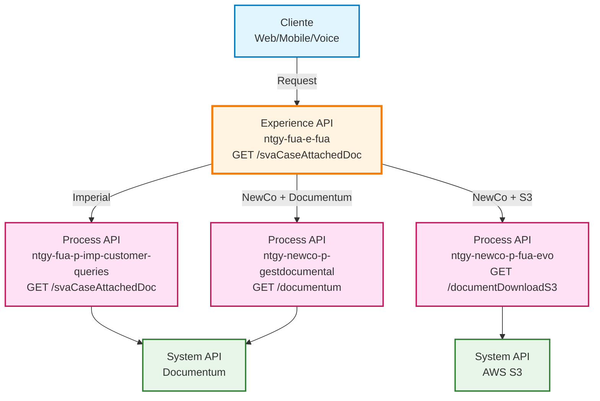
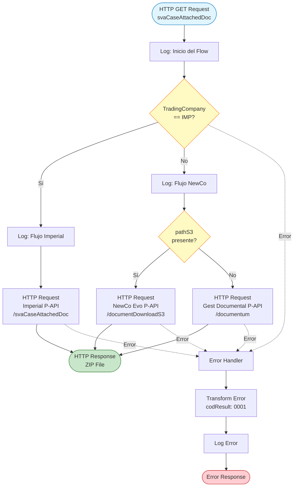
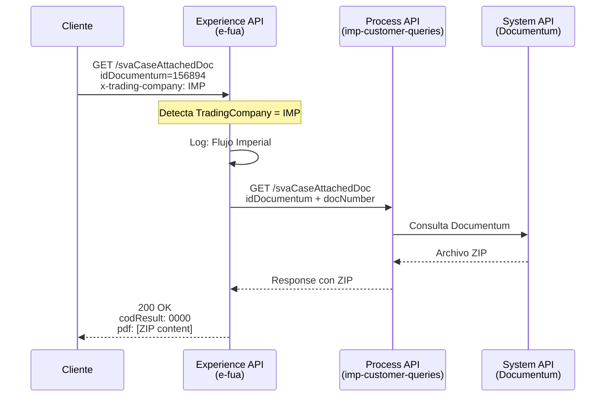
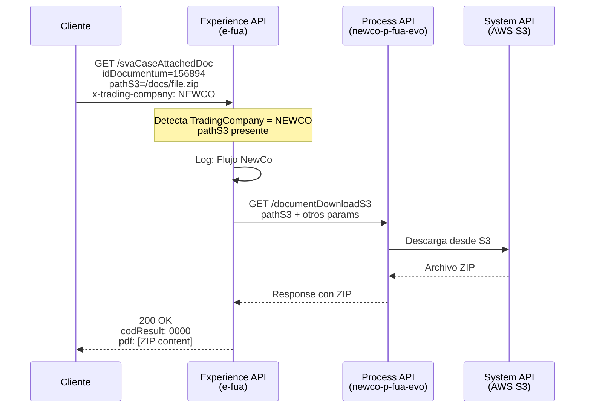
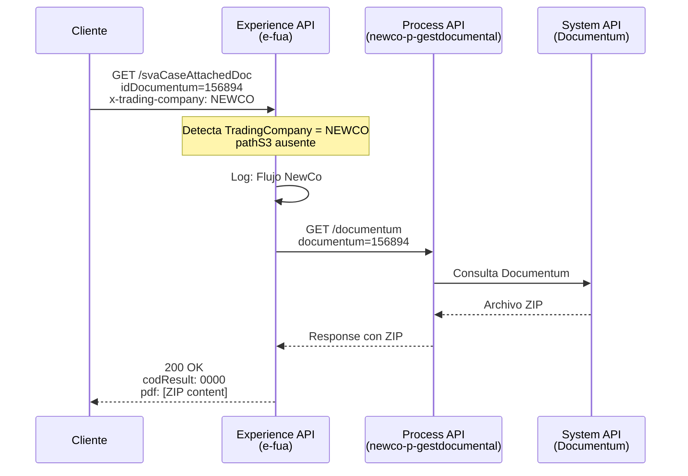
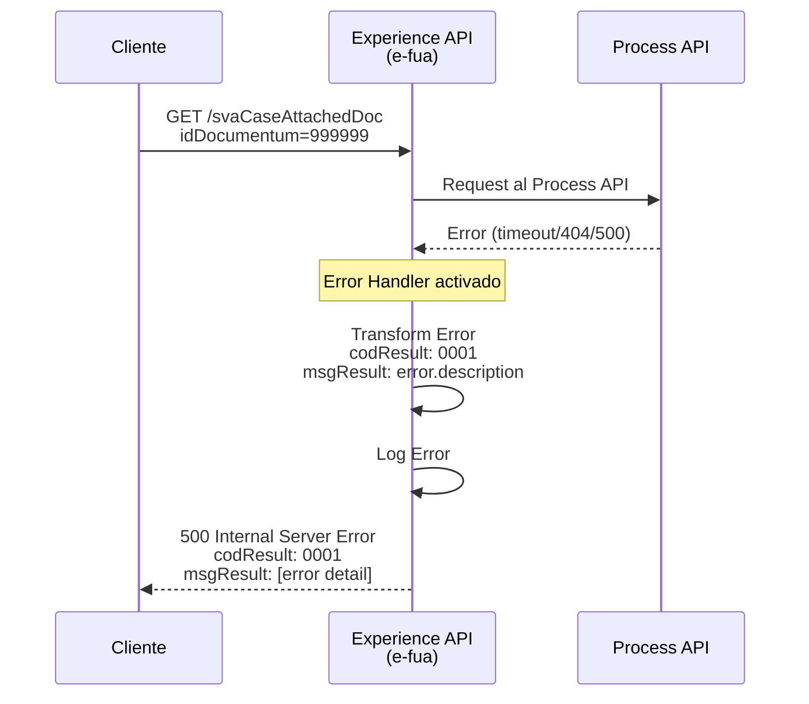

# GET /svaCaseAttachedDoc

## 📌 Descripción General

### Propósito del Endpoint

Este endpoint permite descargar documentos adjuntos a gestiones de SVA (Servicios de Valor Añadido) en formato ZIP. Implementa un sistema de enrutamiento inteligente que selecciona automáticamente el backend apropiado según la compañía del cliente (Imperial o NewCo) y la ubicación del documento (Documentum o S3).

### Tipo de API

**Capa:** Experience API (API-Led Connectivity)

**Función:** Orquestación y enrutamiento condicional para acceso unificado a documentos SVA desde múltiples sistemas backend.

### Patrón de Integración

**Tipo:** Content-Based Router con tres rutas condicionales

**Descripción:** El endpoint analiza el contexto de la solicitud (compañía y parámetros) para enrutar dinámicamente la petición al Process API correspondiente:
- **Ruta Imperial:** Para clientes del sistema legacy Imperial
- **Ruta NewCo S3:** Para documentos almacenados en AWS S3
- **Ruta NewCo Documentum:** Para documentos almacenados en Documentum

### Arquitectura API-Led Connectivity



---

## 💼 Propósito del Negocio

### Casos de Uso Principales

1. **Descarga de Documentación de Gestiones SVA por Agentes**
   - Los agentes de atención al cliente necesitan acceder a documentos adjuntos a gestiones SVA
   - El sistema identifica automáticamente el backend correcto según el cliente
   - Proporciona acceso rápido sin necesidad de conocer el sistema origen

2. **Autoservicio de Clientes desde Portal Web/Móvil**
   - Los clientes pueden descargar documentación relacionada con sus gestiones SVA
   - Experiencia unificada independiente del sistema backend (Imperial/NewCo)
   - Acceso optimizado para diferentes canales (web, móvil, voz)

3. **Integración con Sistemas Automatizados**
   - Sistemas de terceros pueden recuperar documentación de gestiones SVA
   - API unificada simplifica la integración
   - Enrutamiento transparente a múltiples backends

### 📱 Canal y Audiencia

#### Canal de Consumo

**Canal:** Web | Mobile | Voice

**Características del Canal:**
- **Plataforma**: Portal FUA (Frontal Único de Atención), aplicaciones móviles, sistemas de voz
- **Dispositivos**: Navegadores web, smartphones, tablets, sistemas IVR
- **Conectividad**: Requiere conexión estable para descarga de archivos ZIP
- **Experiencia de Usuario**: Descarga directa de archivos con manejo de errores robusto

#### Audiencia Objetivo

**Usuarios Finales:**
- **Agentes de Atención al Cliente**: Necesitan acceder rápidamente a documentación de gestiones SVA para resolver consultas
- **Clientes Residenciales y Empresariales**: Requieren acceso a documentos relacionados con sus servicios de valor añadido
- **Sistemas Automatizados**: Aplicaciones de terceros que necesitan recuperar documentación

**Contexto de Uso:**
- **Resolución de Incidencias**: Agentes descargando documentación para verificar gestiones
- **Autoservicio**: Clientes accediendo a sus documentos desde el portal o app móvil
- **Auditoría y Compliance**: Sistemas recuperando documentación para procesos de auditoría

#### Adaptaciones del Canal

**Optimizaciones Aplicadas:**
- **Enrutamiento Inteligente**: Selección automática del backend según contexto del cliente
- **Formato de Respuesta**: Estructura JSON estándar con contenido del archivo ZIP
- **Manejo de Errores**: Respuestas de error estandarizadas para todos los canales
- **Timeout Diferenciado**: 30s para Imperial, 60s para NewCo (operaciones más complejas)

### 🔗 Endpoints Dependientes

Este Experience API consume los siguientes Process APIs según el flujo:

| Process API | Endpoint | Método | Propósito |
|-------------|----------|--------|-----------|
| `ntgy-fua-p-imp-customer-queries` | `/svaCaseAttachedDoc` | GET | Descarga de documentos SVA para clientes Imperial |
| `ntgy-newco-p-fua-evo` | `/documentDownloadS3` | GET | Descarga de documentos desde AWS S3 para clientes NewCo |
| `ntgy-newco-p-gestdocumental` | `/documentum` | GET | Descarga de documentos desde Documentum para clientes NewCo |

### Contexto Empresarial

- **Dominio:** Gestión de Servicios de Valor Añadido (SVA)
- **Sector:** Energía - Utilities
- **División:** Naturgy España - Imperial y NewCo
- **Canal:** Multi-canal (Web, Móvil, Voz)

### Stakeholders

- **Agentes de Atención al Cliente**: Requieren acceso rápido y confiable a documentación de gestiones
- **Clientes Finales**: Necesitan autoservicio para acceder a sus documentos
- **Equipos de Desarrollo**: Requieren API unificada que abstraiga la complejidad de múltiples backends
- **Equipos de Operaciones**: Necesitan visibilidad del enrutamiento y manejo de errores

### Valor de Negocio

- **Unificación de Acceso**: Una sola API para acceder a documentos en múltiples sistemas backend
- **Experiencia Consistente**: Los usuarios no necesitan conocer el sistema origen de los documentos
- **Flexibilidad Operativa**: Soporte para migración gradual de Documentum a S3
- **Reducción de Complejidad**: Los consumidores no necesitan implementar lógica de enrutamiento

---

## 🔧 Especificación Técnica

### URLs por Ambiente

| Ambiente | URL Base | URL Completa |
|----------|----------|--------------|
| **Local** | `http://localhost:8081` | `http://localhost:8081/fua/api/svaCaseAttachedDoc` |
| **Development** | `https://ntgy-fua-e-fua-dev.de-c1.cloudhub.io` | `https://ntgy-fua-e-fua-dev.de-c1.cloudhub.io/fua/api/svaCaseAttachedDoc` |
| **Production** | `https://ntgy-fua-e-fua-pro.de-c1.cloudhub.io` | `https://ntgy-fua-e-fua-pro.de-c1.cloudhub.io/fua/api/svaCaseAttachedDoc` |

### Método HTTP

```
GET /fua/api/svaCaseAttachedDoc
```

### 🎯 Consideraciones del Canal

#### Limitaciones del Canal

| Aspecto | Limitación | Razón |
|---------|------------|-------|
| **Timeout** | 30-60 segundos | Varía según backend (Imperial: 30s, NewCo: 60s) |
| **Tamaño de Respuesta** | Depende del archivo ZIP | Sin límite explícito, controlado por backend |
| **Rate Limiting** | Según política de API Gateway | Protección contra abuso |
| **Formato** | Solo archivos ZIP | Formato estándar para múltiples documentos |

#### Campos Específicos del Canal

**Campos Requeridos por el Experience API:**

| Campo | Ubicación | Tipo | Descripción | Razón |
|-------|-----------|------|-------------|-------|
| `x-trading-company` | Header | string | Compañía del cliente ("IMP" o "NEWCO") | Determina el flujo de enrutamiento |
| `x-client-doc-number` | Header | string | Número de documento del cliente | Requerido para flujo Imperial |

**Campos Pass-Through:**

Este Experience API actúa como pass-through para los parámetros de query, enviándolos directamente al Process API correspondiente según el flujo.

### Parámetros de Entrada

#### Query Parameters

| Parámetro | Tipo | Obligatorio | Descripción | Ejemplo |
|-----------|------|-------------|-------------|---------|
| `idDocumentum` | string | Sí | Identificador del documento en Documentum | `"156894"` |
| `pathS3` | string | No | Ruta del documento en S3 (solo para NewCo) | `"/docs/sva/file.zip"` |

#### Headers

| Header | Tipo | Obligatorio | Descripción | Ejemplo |
|--------|------|-------------|-------------|---------|
| `x-client-doc-number` | string | Sí (Imperial) | Número de documento del cliente | `"12345678A"` |
| `x-trading-company` | string | Sí | Compañía del cliente | `"IMP"` o `"NEWCO"` |
| `Content-Type` | string | Sí | Tipo de contenido | `"application/json"` |

### Respuestas

#### 200 OK - Éxito

**Descripción:** Documento descargado exitosamente

**Estructura:**

```json
{
  "result": {
    "codResult": "0000",
    "msgResult": "No hay error"
  },
  "pdf": "[Contenido del archivo ZIP]"
}
```

**Campos de Respuesta:**

| Campo | Tipo | Descripción |
|-------|------|-------------|
| `result.codResult` | string | Código de resultado ("0000" = éxito) |
| `result.msgResult` | string | Mensaje descriptivo del resultado |
| `pdf` | string | Contenido del archivo ZIP (nota: el nombre del campo es histórico, contiene ZIP no PDF) |

#### 400 Bad Request - Error de Validación

**Descripción:** Parámetros inválidos o faltantes

**Estructura:**

```json
{
  "result": {
    "codResult": "0001",
    "msgResult": "Parámetro idDocumentum es obligatorio"
  }
}
```

#### 500 Internal Server Error - Error del Sistema

**Descripción:** Error en el procesamiento o en sistemas backend

**Estructura:**

```json
{
  "result": {
    "codResult": "0001",
    "msgResult": "Error al recuperar documento desde Documentum"
  }
}
```

### Autenticación

- **Tipo:** OAuth 2.0 (gestionado por API Gateway)
- **Scope:** Según rol del usuario (cliente, agente, sistema)
- **Headers Adicionales:** `client_id`, `client_secret` (según configuración de API Manager)

### Timeouts

| Tipo | Valor | Razón |
|------|-------|-------|
| **Request Timeout (Imperial)** | 30 segundos | Operaciones más rápidas en sistema legacy |
| **Request Timeout (NewCo)** | 60 segundos | Operaciones más complejas, puede incluir transformaciones |
| **Connection Idle Timeout** | Igual que Request Timeout | Mantiene consistencia con timeout de respuesta |

---

## 🏗️ Implementación Técnica

### Arquitectura del Flow



### Lógica de Enrutamiento Condicional

#### Decisión 1: Compañía (Imperial vs NewCo)

**Variable de Decisión:** `vars.TradingCompany`

**Condición:**
```dataweave
vars.TradingCompany == p('fua.tradingCompany.imperial')
```

**Flujos Resultantes:**
- **Imperial (IMP):** Enruta a `ntgy-fua-p-imp-customer-queries`
- **NewCo:** Procede a segunda decisión

#### Decisión 2: Ubicación del Documento (S3 vs Documentum)

**Variable de Decisión:** `attributes.queryParams.pathS3`

**Condición:**
```dataweave
attributes.queryParams.pathS3 != null and attributes.queryParams.pathS3 != ""
```

**Flujos Resultantes:**
- **S3:** Enruta a `ntgy-newco-p-fua-evo` → `/documentDownloadS3`
- **Documentum:** Enruta a `ntgy-newco-p-gestdocumental` → `/documentum`

### Transformaciones de Parámetros por Flujo

#### Flujo 1: Imperial

**Transformación de Query Parameters:**

```dataweave
%dw 2.0
output application/java
---
{
  "idDocumentum": attributes.queryParams.idDocumentum,
  "docNumber": attributes.headers.'x-client-doc-number'
}
```

**Mapeo:**
| Origen | Destino | Transformación |
|--------|---------|----------------|
| `attributes.queryParams.idDocumentum` | `idDocumentum` | Pass-through |
| `attributes.headers.'x-client-doc-number'` | `docNumber` | Extracción de header |

#### Flujo 2: NewCo con S3

**Transformación de Query Parameters:**

```dataweave
%dw 2.0
output application/java
---
vars.fuaHeaders ++ attributes.queryParams
```

**Descripción:** Combina headers de FUA con todos los query parameters (incluyendo `pathS3`)

#### Flujo 3: NewCo con Documentum

**Transformación de Query Parameters:**

```dataweave
%dw 2.0
output application/java
---
{
  "documentum": attributes.queryParams.idDocumentum
}
```

**Mapeo:**
| Origen | Destino | Transformación |
|--------|---------|----------------|
| `attributes.queryParams.idDocumentum` | `documentum` | Renombrado de parámetro |

### Configuraciones HTTP por Backend

#### HTTP_API_ProcesoConsultaImperial

```yaml
host: "mule-worker-internal-ntgy-fua-p-imp-customer-queries.de-c1.cloudhub.io"
port: "8091"
basePath: "/api"
timeout: "30000"
```

#### HTTP_FUA_PROCESS_NEWCO_EVO

```yaml
host: "mule-worker-internal-ntgy-newco-p-fua-evo.de-c1.cloudhub.io"
port: "8091"
basePath: "/api"
timeout: "60000"
```

#### HTTP_GEST_DOCUMENTAL_NEWCO

```yaml
host: "mule-worker-internal-ntgy-newco-p-gestdocumental.de-c1.cloudhub.io"
port: "8091"
basePath: "/api"
timeout: "60000"
```

### Patrones de Diseño

**Patrón:** Content-Based Router (Enterprise Integration Pattern)

**Justificación:** 
- Permite enrutamiento dinámico basado en el contenido del mensaje (headers y query params)
- Facilita la coexistencia de múltiples sistemas backend (Imperial y NewCo)
- Soporta migración gradual de almacenamiento (Documentum a S3)
- Proporciona flexibilidad para añadir nuevas rutas sin modificar consumidores

**Implementación:**
- Primera decisión: Choice basado en `TradingCompany`
- Segunda decisión: Choice anidado basado en presencia de `pathS3`
- Cada ruta llama a un Process API específico con transformación apropiada

### Diagramas de Secuencia

#### 1. Flujo Imperial - Éxito



#### 2. Flujo NewCo con S3 - Éxito



#### 3. Flujo NewCo con Documentum - Éxito



#### 4. Flujo con Error de Backend



### Manejo de Errores

#### Error Handler Global

**Ubicación:** `get-sva-case-attached-docFlow` (líneas 40-56)

**Tipo:** `on-error-propagate`

**Comportamiento:**
1. Captura cualquier error del flow
2. Transforma el error a formato estándar
3. Registra el error en logs
4. Propaga el error al cliente

**Transformación de Error:**

```dataweave
%dw 2.0
output application/json
---
{
  "result": {
    "codResult": "0001",
    "msgResult": error.description as String replace /\"/ with("")
  }
}
```

**Sanitización:**
- Elimina comillas dobles del mensaje de error
- Convierte descripción del error a string
- Mantiene formato consistente con respuestas exitosas

**Logging de Errores:**
- Nivel: ERROR
- Contenido: Estructura JSON completa del error
- Propósito: Trazabilidad y debugging

#### Tipos de Errores Manejados

| Tipo de Error | Origen | Código | Mensaje |
|---------------|--------|--------|---------|
| **Timeout** | Process API no responde | 0001 | "Timeout al conectar con [backend]" |
| **404 Not Found** | Documento no existe | 0001 | "Documento no encontrado" |
| **500 Backend Error** | Error en Process/System API | 0001 | Descripción del error backend |
| **Validation Error** | Parámetros inválidos | 0001 | Descripción de validación |

### Optimizaciones del Canal

#### 1. Enrutamiento Inteligente
- **Optimización:** Selección automática del backend más apropiado
- **Beneficio:** Reduce latencia al evitar saltos innecesarios
- **Implementación:** Choice basado en contexto del cliente

#### 2. Timeouts Diferenciados
- **Optimización:** Timeouts ajustados por backend (30s vs 60s)
- **Beneficio:** Balance entre experiencia de usuario y confiabilidad
- **Implementación:** Configuración por connector HTTP

#### 3. Pass-Through de Respuesta
- **Optimización:** No transforma la respuesta del Process API
- **Beneficio:** Reduce latencia y complejidad
- **Implementación:** Response directa sin transformación DataWeave

#### 4. Logging Estratégico
- **Optimización:** Logs solo en puntos clave (inicio, decisiones, errores)
- **Beneficio:** Trazabilidad sin impacto en performance
- **Implementación:** Logger en DEBUG para flujos, ERROR para excepciones

---

## 💻 Ejemplos de Uso

### Ejemplo 1: Cliente Imperial - Descarga Exitosa

#### cURL

```bash
curl -X GET "https://ntgy-fua-e-fua-pro.de-c1.cloudhub.io/fua/api/svaCaseAttachedDoc?idDocumentum=156894" \
  -H "Content-Type: application/json" \
  -H "x-client-doc-number: 12345678A" \
  -H "x-trading-company: IMP" \
  -H "client_id: YOUR_CLIENT_ID"
```

#### Respuesta (200 OK)

```json
{
  "result": {
    "codResult": "0000",
    "msgResult": "No hay error"
  },
  "pdf": "UEsDBBQAAAAIAKuPeFkAAA..."
}
```

**Nota:** El campo `pdf` contiene el archivo ZIP codificado (el nombre es histórico, no es un PDF).

### Ejemplo 2: Cliente NewCo con S3 - Descarga Exitosa

#### cURL

```bash
curl -X GET "https://ntgy-fua-e-fua-pro.de-c1.cloudhub.io/fua/api/svaCaseAttachedDoc?idDocumentum=156894&pathS3=/sva/documents/2024/file.zip" \
  -H "Content-Type: application/json" \
  -H "x-client-doc-number: 87654321B" \
  -H "x-trading-company: NEWCO" \
  -H "client_id: YOUR_CLIENT_ID"
```

#### Respuesta (200 OK)

```json
{
  "result": {
    "codResult": "0000",
    "msgResult": "No hay error"
  },
  "pdf": "UEsDBBQAAAAIAKuPeFkAAA..."
}
```

### Ejemplo 3: Cliente NewCo con Documentum - Descarga Exitosa

#### cURL

```bash
curl -X GET "https://ntgy-fua-e-fua-pro.de-c1.cloudhub.io/fua/api/svaCaseAttachedDoc?idDocumentum=156894" \
  -H "Content-Type: application/json" \
  -H "x-client-doc-number: 87654321B" \
  -H "x-trading-company: NEWCO" \
  -H "client_id: YOUR_CLIENT_ID"
```

#### Respuesta (200 OK)

```json
{
  "result": {
    "codResult": "0000",
    "msgResult": "No hay error"
  },
  "pdf": "UEsDBBQAAAAIAKuPeFkAAA..."
}
```

### Ejemplo 4: Error - Documento No Encontrado

#### cURL

```bash
curl -X GET "https://ntgy-fua-e-fua-pro.de-c1.cloudhub.io/fua/api/svaCaseAttachedDoc?idDocumentum=999999" \
  -H "Content-Type: application/json" \
  -H "x-client-doc-number: 12345678A" \
  -H "x-trading-company: IMP" \
  -H "client_id: YOUR_CLIENT_ID"
```

#### Respuesta (500 Internal Server Error)

```json
{
  "result": {
    "codResult": "0001",
    "msgResult": "Documento no encontrado en Documentum"
  }
}
```

### Ejemplo 5: JavaScript (Frontend Web)

```javascript
async function downloadSVADocument(idDocumentum, tradingCompany, clientDocNumber, pathS3 = null) {
  const baseUrl = 'https://ntgy-fua-e-fua-pro.de-c1.cloudhub.io/fua/api';
  let url = `${baseUrl}/svaCaseAttachedDoc?idDocumentum=${idDocumentum}`;
  
  // Añadir pathS3 si está presente (solo para NewCo)
  if (pathS3) {
    url += `&pathS3=${encodeURIComponent(pathS3)}`;
  }
  
  try {
    const response = await fetch(url, {
      method: 'GET',
      headers: {
        'Content-Type': 'application/json',
        'x-client-doc-number': clientDocNumber,
        'x-trading-company': tradingCompany,
        'client_id': 'YOUR_CLIENT_ID'
      }
    });
    
    const data = await response.json();
    
    if (data.result.codResult === '0000') {
      // Éxito - procesar el archivo ZIP
      console.log('Documento descargado exitosamente');
      return data.pdf; // Contenido del ZIP en base64
    } else {
      // Error de negocio
      console.error('Error:', data.result.msgResult);
      throw new Error(data.result.msgResult);
    }
  } catch (error) {
    console.error('Error al descargar documento:', error);
    throw error;
  }
}

// Uso para cliente Imperial
downloadSVADocument('156894', 'IMP', '12345678A')
  .then(zipContent => {
    console.log('ZIP descargado:', zipContent.substring(0, 50) + '...');
  })
  .catch(error => {
    console.error('Fallo en descarga:', error);
  });

// Uso para cliente NewCo con S3
downloadSVADocument('156894', 'NEWCO', '87654321B', '/sva/documents/2024/file.zip')
  .then(zipContent => {
    console.log('ZIP descargado desde S3:', zipContent.substring(0, 50) + '...');
  })
  .catch(error => {
    console.error('Fallo en descarga:', error);
  });
```

### Ejemplo 6: Python

```python
import requests
import base64

def download_sva_document(id_documentum, trading_company, client_doc_number, path_s3=None):
    """
    Descarga documentos adjuntos a gestiones SVA
    
    Args:
        id_documentum (str): ID del documento en Documentum
        trading_company (str): Compañía del cliente ('IMP' o 'NEWCO')
        client_doc_number (str): Número de documento del cliente
        path_s3 (str, optional): Ruta del documento en S3 (solo NewCo)
    
    Returns:
        bytes: Contenido del archivo ZIP decodificado
    """
    base_url = 'https://ntgy-fua-e-fua-pro.de-c1.cloudhub.io/fua/api'
    url = f'{base_url}/svaCaseAttachedDoc'
    
    # Parámetros de query
    params = {'idDocumentum': id_documentum}
    if path_s3:
        params['pathS3'] = path_s3
    
    # Headers
    headers = {
        'Content-Type': 'application/json',
        'x-client-doc-number': client_doc_number,
        'x-trading-company': trading_company,
        'client_id': 'YOUR_CLIENT_ID'
    }
    
    try:
        response = requests.get(url, params=params, headers=headers, timeout=60)
        response.raise_for_status()
        
        data = response.json()
        
        if data['result']['codResult'] == '0000':
            # Decodificar el contenido del ZIP desde base64
            zip_content = base64.b64decode(data['pdf'])
            print(f'Documento descargado exitosamente: {len(zip_content)} bytes')
            return zip_content
        else:
            raise Exception(f"Error de negocio: {data['result']['msgResult']}")
            
    except requests.exceptions.Timeout:
        raise Exception('Timeout al descargar documento')
    except requests.exceptions.RequestException as e:
        raise Exception(f'Error en la petición: {str(e)}')

# Ejemplo de uso para cliente Imperial
try:
    zip_data = download_sva_document(
        id_documentum='156894',
        trading_company='IMP',
        client_doc_number='12345678A'
    )
    
    # Guardar el archivo ZIP
    with open('documentos_sva.zip', 'wb') as f:
        f.write(zip_data)
    print('Archivo guardado como documentos_sva.zip')
    
except Exception as e:
    print(f'Error: {e}')

# Ejemplo de uso para cliente NewCo con S3
try:
    zip_data = download_sva_document(
        id_documentum='156894',
        trading_company='NEWCO',
        client_doc_number='87654321B',
        path_s3='/sva/documents/2024/file.zip'
    )
    
    with open('documentos_sva_s3.zip', 'wb') as f:
        f.write(zip_data)
    print('Archivo guardado como documentos_sva_s3.zip')
    
except Exception as e:
    print(f'Error: {e}')
```

### Ejemplo 7: Postman Collection

```json
{
  "info": {
    "name": "FUA E-API - SVA Documents",
    "schema": "https://schema.getpostman.com/json/collection/v2.1.0/collection.json"
  },
  "item": [
    {
      "name": "GET svaCaseAttachedDoc - Imperial",
      "request": {
        "method": "GET",
        "header": [
          {
            "key": "Content-Type",
            "value": "application/json"
          },
          {
            "key": "x-client-doc-number",
            "value": "12345678A"
          },
          {
            "key": "x-trading-company",
            "value": "IMP"
          },
          {
            "key": "client_id",
            "value": "{{client_id}}"
          }
        ],
        "url": {
          "raw": "{{base_url}}/fua/api/svaCaseAttachedDoc?idDocumentum=156894",
          "host": ["{{base_url}}"],
          "path": ["fua", "api", "svaCaseAttachedDoc"],
          "query": [
            {
              "key": "idDocumentum",
              "value": "156894"
            }
          ]
        }
      }
    },
    {
      "name": "GET svaCaseAttachedDoc - NewCo S3",
      "request": {
        "method": "GET",
        "header": [
          {
            "key": "Content-Type",
            "value": "application/json"
          },
          {
            "key": "x-client-doc-number",
            "value": "87654321B"
          },
          {
            "key": "x-trading-company",
            "value": "NEWCO"
          },
          {
            "key": "client_id",
            "value": "{{client_id}}"
          }
        ],
        "url": {
          "raw": "{{base_url}}/fua/api/svaCaseAttachedDoc?idDocumentum=156894&pathS3=/sva/documents/2024/file.zip",
          "host": ["{{base_url}}"],
          "path": ["fua", "api", "svaCaseAttachedDoc"],
          "query": [
            {
              "key": "idDocumentum",
              "value": "156894"
            },
            {
              "key": "pathS3",
              "value": "/sva/documents/2024/file.zip"
            }
          ]
        }
      }
    },
    {
      "name": "GET svaCaseAttachedDoc - NewCo Documentum",
      "request": {
        "method": "GET",
        "header": [
          {
            "key": "Content-Type",
            "value": "application/json"
          },
          {
            "key": "x-client-doc-number",
            "value": "87654321B"
          },
          {
            "key": "x-trading-company",
            "value": "NEWCO"
          },
          {
            "key": "client_id",
            "value": "{{client_id}}"
          }
        ],
        "url": {
          "raw": "{{base_url}}/fua/api/svaCaseAttachedDoc?idDocumentum=156894",
          "host": ["{{base_url}}"],
          "path": ["fua", "api", "svaCaseAttachedDoc"],
          "query": [
            {
              "key": "idDocumentum",
              "value": "156894"
            }
          ]
        }
      }
    }
  ],
  "variable": [
    {
      "key": "base_url",
      "value": "https://ntgy-fua-e-fua-pro.de-c1.cloudhub.io"
    },
    {
      "key": "client_id",
      "value": "YOUR_CLIENT_ID"
    }
  ]
}
```
