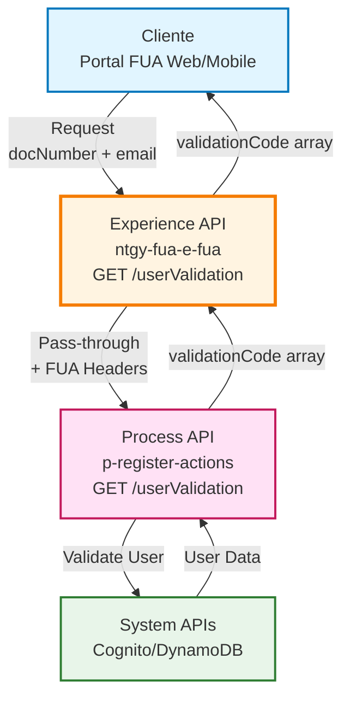
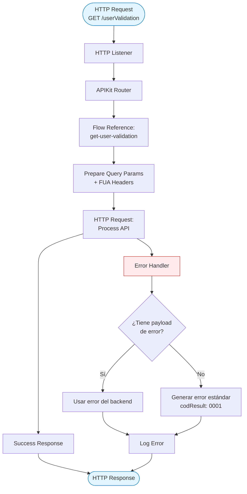
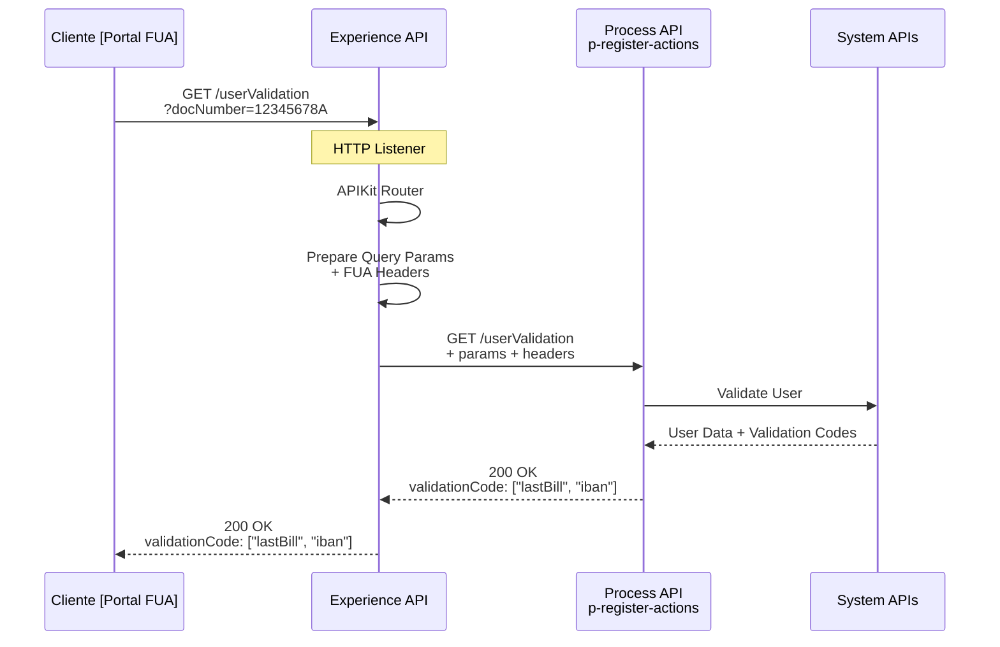
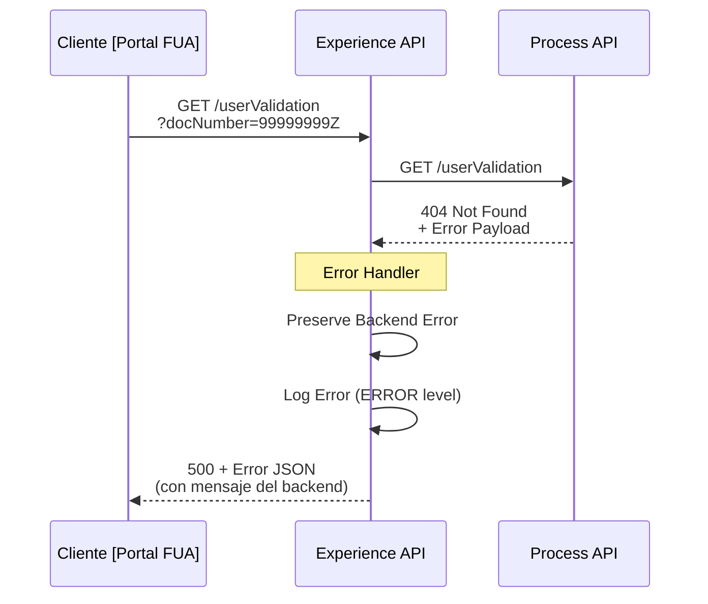
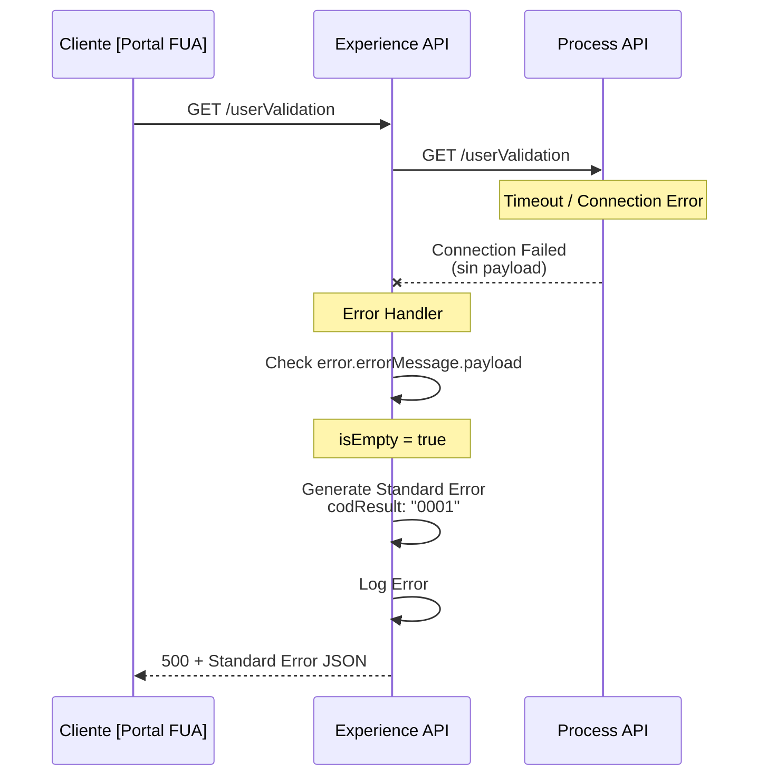

# GET /userValidation

## 📌 Descripción General

### Propósito del Endpoint

Este endpoint proporciona validación de usuarios para el proceso de recuperación de contraseña en el portal FUA (Frontal Único de Atención). Permite verificar la identidad del usuario mediante su documento y opcionalmente su email, retornando los códigos de validación disponibles que el usuario puede utilizar para demostrar su identidad (como "lastBill" para última factura o "iban" para cuenta bancaria).

### Tipo de API

**Capa:** Experience API (API-Led Connectivity)

**Función:** Pass-through para validación de usuarios en proceso de recuperación de contraseña

### Patrón de Integración

**Tipo:** Pass-Through Simple

**Descripción:** Este endpoint actúa como pass-through directo hacia el Process API de acciones de registro. No realiza transformaciones de datos, simplemente reenvía los query parameters junto con los headers FUA al backend y retorna la respuesta tal cual. Este patrón garantiza consistencia en la validación de usuarios entre diferentes canales.

### Arquitectura API-Led Connectivity



---

## 💼 Propósito del Negocio

### Casos de Uso Principales

1. **Recuperación de Contraseña Olvidada**
   - Usuario inicia proceso de recuperación de contraseña
   - Sistema valida su identidad mediante documento
   - Retorna métodos de validación disponibles (última factura, IBAN)
   - Beneficio: Proceso seguro de recuperación sin intervención de call center

2. **Validación de Identidad para Cambios Sensibles**
   - Usuario solicita cambio de datos sensibles (email, teléfono)
   - Sistema requiere validación adicional de identidad
   - Retorna códigos de seguridad disponibles
   - Beneficio: Mayor seguridad en operaciones críticas

3. **Verificación de Usuario en Registro**
   - Nuevo usuario intenta registrarse
   - Sistema valida que el documento existe en base de datos
   - Retorna métodos de validación para completar registro
   - Beneficio: Prevención de registros fraudulentos

### 📱 Canal y Audiencia

#### Canal de Consumo

**Canal:** Web | Mobile

**Características del Canal:**
- **Plataforma**: Portal FUA (Frontal Único de Atención)
- **Dispositivos**: Navegadores web (Chrome, Firefox, Safari, Edge), aplicaciones móviles iOS/Android
- **Conectividad**: Requiere conexión a internet para validación en tiempo real
- **Experiencia de Usuario**: Validación rápida sin necesidad de login previo

#### Audiencia Objetivo

**Usuarios Finales:**
- **Clientes que Olvidaron Contraseña**: Usuarios que necesitan recuperar acceso a su cuenta
- **Nuevos Usuarios en Registro**: Clientes que están completando su registro inicial
- **Usuarios Actualizando Datos**: Clientes que necesitan validar identidad para cambios sensibles

**Contexto de Uso:**
- **Recuperación de Contraseña**: Primer paso del proceso de reset de password
- **Registro de Usuario**: Validación de identidad durante onboarding
- **Cambios de Seguridad**: Validación antes de modificar datos críticos

#### Adaptaciones del Canal

**Optimizaciones Aplicadas:**
- **Pass-Through Simple**: Sin transformaciones para máxima velocidad
- **Error Handling Robusto**: Preserva mensajes de error del backend
- **Headers FUA**: Añade headers de contexto automáticamente
- **Sin Autenticación Previa**: Permite validación sin estar logueado

### 🔗 Endpoints Dependientes

Este Experience API consume el siguiente Process API:

| Process API | Endpoint | Método | Propósito |
|-------------|----------|--------|-----------|
| `ntgy-fua-p-register-actions` | `/userValidation` | GET | Valida usuarios y retorna códigos de validación disponibles para recuperación de contraseña |

### Contexto Empresarial

- **Dominio:** Seguridad y Gestión de Usuarios
- **Sector:** Energía - Utilities
- **División:** Naturgy España - NewCo
- **Canal:** Web/Móvil

### Stakeholders

- **Clientes de Energía**: Necesitan recuperar acceso a su cuenta de forma autónoma
- **Equipo de Seguridad**: Responsables de garantizar validación segura de identidad
- **Equipo de Atención al Cliente**: Reducen carga de trabajo al permitir autoservicio
- **Equipo de Desarrollo FUA**: Mantienen y evolucionan el sistema de validación

### Valor de Negocio

- **Autoservicio Mejorado**: Clientes recuperan contraseña sin llamar al call center
- **Reducción de Costos**: Menos llamadas de soporte para recuperación de contraseña
- **Seguridad Mejorada**: Validación multi-factor con datos del cliente
- **Experiencia de Usuario**: Proceso rápido y sencillo de recuperación
- **Disponibilidad 24/7**: Recuperación de contraseña en cualquier momento

---

## 🔧 Especificación Técnica

### URLs por Ambiente

| Ambiente | URL Base | URL Completa |
|----------|----------|--------------|
| **Local** | `http://localhost:8081` | `http://localhost:8081/fua/api/userValidation` |
| **Development** | `https://ntgy-fua-e-fua-dev.us-e2.cloudhub.io` | `https://ntgy-fua-e-fua-dev.us-e2.cloudhub.io/fua/api/userValidation` |
| **UAT** | `https://ntgy-fua-e-fua-uat.us-e2.cloudhub.io` | `https://ntgy-fua-e-fua-uat.us-e2.cloudhub.io/fua/api/userValidation` |
| **Production** | `https://ntgy-fua-e-fua-pro.us-e2.cloudhub.io` | `https://ntgy-fua-e-fua-pro.us-e2.cloudhub.io/fua/api/userValidation` |

### Método HTTP

```
GET /fua/api/userValidation
```

### 🎯 Consideraciones del Canal

#### Limitaciones del Canal

| Aspecto | Limitación | Razón |
|---------|------------|-------|
| **Timeout** | 30 segundos | Timeout estándar para operaciones de validación |
| **Rate Limiting** | Según políticas de API Manager | Protección contra ataques de fuerza bruta |
| **Intentos de Validación** | Limitados por usuario/IP | Seguridad contra intentos de acceso no autorizado |

### Parámetros de Entrada

#### Query Parameters

| Parámetro | Tipo | Obligatorio | Descripción | Ejemplo |
|-----------|------|-------------|-------------|---------|
| `docNumber` | String | **Sí** | Número de documento del usuario (DNI, NIE, etc.) | `"12345678A"` |
| `docType` | String | No | Tipo de documento (DNI, NIE, Pasaporte) | `"DNI"` |
| `email` | String | No | Email del usuario para validación adicional | `"juan.perez@example.com"` |

**Notas:**
- El parámetro `docNumber` es obligatorio para identificar al usuario
- `docType` es opcional pero recomendado para mayor precisión
- `email` es opcional y se usa para validación adicional cuando está disponible

**Ejemplo de URL:**
```
GET /fua/api/userValidation?docNumber=12345678A&docType=DNI&email=juan.perez@example.com
```

### Respuestas

#### 200 OK - Validación Exitosa

**Estructura de Respuesta:**

```json
{
  "result": {
    "codResult": "0000",
    "msgResult": "No hay error"
  },
  "validationCode": ["lastBill", "iban"]
}
```

**Campos de Respuesta:**

| Campo | Tipo | Descripción |
|-------|------|-------------|
| `result` | Object | Objeto con resultado de la operación |
| `result.codResult` | String | Código de resultado ("0000" = éxito) |
| `result.msgResult` | String | Mensaje descriptivo del resultado |
| `validationCode` | String[] | Array de códigos de validación disponibles para el usuario |

**Códigos de Validación Posibles:**

| Código | Descripción | Uso |
|--------|-------------|-----|
| `lastBill` | Última factura | Usuario debe proporcionar datos de su última factura |
| `iban` | Cuenta bancaria | Usuario debe proporcionar su IBAN |
| `securityCode` | Código de seguridad | Usuario debe proporcionar código de seguridad previamente configurado |
| `email` | Email verificado | Usuario recibirá código por email |
| `phone` | Teléfono verificado | Usuario recibirá código por SMS |

⚠️ **Nota sobre Schema Completo:**

Este Experience API actúa como pass-through. Para información adicional sobre los códigos de validación y su procesamiento, consultar:

📖 **Process API:** `p-register-actions` endpoint `/userValidation`

#### 400 Bad Request - Parámetros Inválidos

```json
{
  "result": {
    "codResult": "0002",
    "msgResult": "Parámetro docNumber es obligatorio"
  }
}
```

#### 404 Not Found - Usuario No Encontrado

```json
{
  "result": {
    "codResult": "0003",
    "msgResult": "Usuario no encontrado con el documento proporcionado"
  }
}
```

#### 500 Internal Server Error - Error del Servidor

**Caso 1: Error con payload del backend**

```json
{
  "result": {
    "codResult": "0001",
    "msgResult": "[Mensaje de error del backend]"
  }
}
```

**Caso 2: Error sin payload del backend**

```json
{
  "result": {
    "codResult": "0001",
    "msgResult": "Error en la validación del usuario"
  }
}
```

### Autenticación

- **Tipo:** Este endpoint NO requiere autenticación previa (es parte del proceso de recuperación)
- **Seguridad:** Protegido por rate limiting y validación de parámetros
- **Headers:** Se añaden automáticamente headers FUA de contexto

### Timeouts

| Tipo | Valor | Razón |
|------|-------|-------|
| **Request Timeout** | 30 segundos | Configurado en `p-register-actions.timeout` |
| **Connection Idle Timeout** | 30 segundos | Mantiene conexión activa para múltiples validaciones |

---

## 🏗️ Implementación Técnica

### Arquitectura del Flow



### Flujo Principal (e-fua.xml)

**Ubicación:** `src/main/mule/e-fua.xml`

```xml
<flow name="get:\userValidation:e-fua-config">
    <flow-ref doc:name="get-user-validation" name="get-user-validation" />
</flow>
```

### Implementación del Subflow (get-user-validation)

**Ubicación:** Flow `get-user-validation`

```xml
<flow name="get-user-validation">
    <http:request method="GET" 
                  doc:name="Get User Validation Request" 
                  config-ref="HTTP_API_ProcesoAccionesRegistro" 
                  path="/userValidation">
        <http:query-params><![CDATA[#[output application/java
---
attributes.queryParams ++ vars.fuaHeaders]]]></http:query-params>
    </http:request>
    
    <error-handler>
        <on-error-propagate enableNotifications="true" logException="true">
            <ee:transform doc:name="Set Error Message">
                <ee:message>
                    <ee:set-payload><![CDATA[%dw 2.0
output application/json
---
if ( !isEmpty(error.errorMessage.payload) ) error.errorMessage.payload
else 
{
    "result": {
        "codResult": "0001",
        "msgResult": error.description as String replace /\"/ with("")
    }
}]]></ee:set-payload>
                </ee:message>
            </ee:transform>
            <logger level="ERROR" doc:name="Error" message='...' />
        </on-error-propagate>
    </error-handler>
</flow>
```

### Componentes Clave

#### 1. HTTP Request - Pass-Through al Process API

**Configuración:**
- **Config Reference:** `HTTP_API_ProcesoAccionesRegistro`
- **Method:** GET
- **Path:** `/userValidation`
- **Query Parameters:** Combina `attributes.queryParams` + `vars.fuaHeaders`

**Lógica de Query Parameters:**

```dataweave
output application/java
---
attributes.queryParams ++ vars.fuaHeaders
```

**Comportamiento:**
- Toma todos los query parameters de la petición original (`docNumber`, `docType`, `email`)
- Añade headers FUA de contexto (`vars.fuaHeaders`)
- Envía todo al Process API sin transformación

#### 2. Error Handler - Manejo Inteligente de Errores

**Estrategia:** On-Error-Propagate con preservación de payload

**Lógica de Error:**

```dataweave
if ( !isEmpty(error.errorMessage.payload) ) 
    error.errorMessage.payload
else 
{
    "result": {
        "codResult": "0001",
        "msgResult": error.description as String replace /\"/ with("")
    }
}
```

**Comportamiento:**
1. **Si hay payload de error del backend**: Lo preserva y retorna tal cual
2. **Si NO hay payload**: Genera respuesta estándar con código "0001"

**Logging:**
- Nivel: ERROR
- Contenido: Payload de error o descripción del error

### Patrones de Diseño

**Patrón:** Pass-Through con Error Handling Robusto

**Justificación:** 
- **Simplicidad**: No requiere transformación de datos
- **Consistencia**: Mantiene contrato del Process API
- **Performance**: Mínima latencia al no transformar
- **Mantenibilidad**: Cambios en el backend no afectan al Experience API

### Diagramas de Secuencia

#### 1. Flujo Normal de Éxito



#### 2. Flujo con Usuario No Encontrado



#### 3. Flujo con Error Técnico



### Configuración HTTP

**HTTP Request Configuration - Process API de Registro:**

```yaml
HTTP_API_ProcesoAccionesRegistro:
  host: "${p-register-actions.host}"
  port: "${p-register-actions.port}"
  basePath: "/api"
  timeout: "${p-register-actions.timeout}"
  connectionIdleTimeout: "${p-register-actions.timeout}"
```

**Propiedades por Ambiente:**

```yaml
# e-fua-local-config.yaml
p-register-actions:
  host: "localhost"
  port: "8084"
  timeout: "30000"
```

### Manejo de Errores

**Estrategia Global:**

1. **Captura:** `on-error-propagate` captura cualquier error
2. **Evaluación:** Verifica si existe payload de error del backend
3. **Preservación:** Si hay payload, lo preserva y retorna
4. **Generación:** Si no hay payload, genera error estándar
5. **Logging:** Logger registra error con nivel ERROR
6. **Respuesta:** Retorna JSON con código "0001"

**Formato de Error con Payload del Backend:**

```json
{
  "result": {
    "codResult": "0001",
    "msgResult": "[Mensaje específico del backend]"
  }
}
```

**Formato de Error sin Payload:**

```json
{
  "result": {
    "codResult": "0001",
    "msgResult": "Error en la validación del usuario"
  }
}
```

**Tipos de Errores Manejados:**
- Usuario no encontrado (404 del backend)
- Parámetros inválidos (400 del backend)
- Errores de conexión al Process API
- Timeouts
- Errores HTTP (4xx, 5xx)

---

## 💻 Ejemplos de Uso

### Ejemplo 1: Validación Exitosa con Documento

#### cURL

```bash
curl -X GET "https://ntgy-fua-e-fua-pro.us-e2.cloudhub.io/fua/api/userValidation?docNumber=12345678A&docType=DNI" \
  -H "Content-Type: application/json"
```

#### Respuesta (200 OK)

```json
{
  "result": {
    "codResult": "0000",
    "msgResult": "No hay error"
  },
  "validationCode": ["lastBill", "iban"]
}
```

### Ejemplo 2: Validación con Documento y Email

#### cURL

```bash
curl -X GET "https://ntgy-fua-e-fua-pro.us-e2.cloudhub.io/fua/api/userValidation?docNumber=87654321B&docType=NIE&email=maria.garcia@example.com" \
  -H "Content-Type: application/json"
```

#### Respuesta (200 OK)

```json
{
  "result": {
    "codResult": "0000",
    "msgResult": "No hay error"
  },
  "validationCode": ["lastBill", "iban", "email"]
}
```

### Ejemplo 3: JavaScript (para Web/Mobile)

```javascript
// Función para validar usuario
async function validateUser(docNumber, docType = null, email = null) {
  try {
    // Construir query parameters
    const params = new URLSearchParams({
      docNumber: docNumber
    });
    
    if (docType) params.append('docType', docType);
    if (email) params.append('email', email);
    
    const response = await fetch(
      `https://ntgy-fua-e-fua-pro.us-e2.cloudhub.io/fua/api/userValidation?${params}`,
      {
        method: 'GET',
        headers: {
          'Content-Type': 'application/json'
        }
      }
    );

    if (!response.ok) {
      throw new Error(`HTTP error! status: ${response.status}`);
    }

    const data = await response.json();
    
    if (data.result.codResult === "0000") {
      return {
        success: true,
        validationCodes: data.validationCode,
        message: 'Usuario validado correctamente'
      };
    } else {
      throw new Error(data.result.msgResult);
    }
  } catch (error) {
    console.error('Error de validación:', error);
    return {
      success: false,
      error: error.message
    };
  }
}

// Uso en proceso de recuperación de contraseña
async function startPasswordRecovery() {
  const docNumber = document.getElementById('docNumber').value;
  const docType = document.getElementById('docType').value;
  const email = document.getElementById('email').value;
  
  const result = await validateUser(docNumber, docType, email);
  
  if (result.success) {
    console.log('Códigos de validación disponibles:', result.validationCodes);
    
    // Mostrar opciones de validación al usuario
    if (result.validationCodes.includes('lastBill')) {
      showValidationOption('lastBill', 'Última Factura');
    }
    if (result.validationCodes.includes('iban')) {
      showValidationOption('iban', 'Cuenta Bancaria (IBAN)');
    }
    if (result.validationCodes.includes('email')) {
      showValidationOption('email', 'Código por Email');
    }
  } else {
    console.error('Validación fallida:', result.error);
    alert('No se pudo validar el usuario. Verifique los datos ingresados.');
  }
}

function showValidationOption(code, label) {
  // Mostrar opción de validación en la UI
  const optionsContainer = document.getElementById('validationOptions');
  const option = document.createElement('button');
  option.textContent = label;
  option.onclick = () => selectValidationMethod(code);
  optionsContainer.appendChild(option);
}

function selectValidationMethod(method) {
  console.log('Método de validación seleccionado:', method);
  // Continuar con el proceso de recuperación usando el método seleccionado
}
```

### Ejemplo 4: Python

```python
import requests
from typing import Dict, List, Optional

class UserValidationClient:
    """Cliente para validación de usuarios en el portal FUA."""
    
    def __init__(self, base_url: str):
        self.base_url = base_url
    
    def validate_user(
        self, 
        doc_number: str, 
        doc_type: Optional[str] = None,
        email: Optional[str] = None
    ) -> Dict:
        """
        Valida un usuario y obtiene códigos de validación disponibles.
        
        Args:
            doc_number: Número de documento del usuario
            doc_type: Tipo de documento (DNI, NIE, etc.)
            email: Email del usuario (opcional)
        
        Returns:
            Dict con resultado de validación y códigos disponibles
        """
        url = f"{self.base_url}/fua/api/userValidation"
        
        params = {
            'docNumber': doc_number
        }
        
        if doc_type:
            params['docType'] = doc_type
        if email:
            params['email'] = email
        
        headers = {
            'Content-Type': 'application/json'
        }
        
        try:
            response = requests.get(url, params=params, headers=headers)
            response.raise_for_status()
            
            data = response.json()
            
            if data['result']['codResult'] == '0000':
                return {
                    'success': True,
                    'validationCodes': data['validationCode'],
                    'message': 'Usuario validado correctamente'
                }
            else:
                return {
                    'success': False,
                    'error': data['result']['msgResult']
                }
                
        except requests.exceptions.HTTPError as e:
            return {
                'success': False,
                'error': f'HTTP Error: {e}'
            }
        except Exception as e:
            return {
                'success': False,
                'error': f'Error: {str(e)}'
            }
    
    def get_validation_method_description(self, code: str) -> str:
        """Retorna descripción legible del método de validación."""
        descriptions = {
            'lastBill': 'Última Factura - Deberá proporcionar datos de su última factura',
            'iban': 'Cuenta Bancaria - Deberá proporcionar su IBAN',
            'securityCode': 'Código de Seguridad - Deberá proporcionar su código de seguridad',
            'email': 'Email - Recibirá un código por correo electrónico',
            'phone': 'Teléfono - Recibirá un código por SMS'
        }
        return descriptions.get(code, f'Método de validación: {code}')

# Uso
client = UserValidationClient('https://ntgy-fua-e-fua-pro.us-e2.cloudhub.io')

# Validar usuario para recuperación de contraseña
result = client.validate_user('12345678A', 'DNI', 'juan.perez@example.com')

if result['success']:
    print(f"✓ {result['message']}")
    print(f"Códigos de validación disponibles: {len(result['validationCodes'])}")
    
    for code in result['validationCodes']:
        description = client.get_validation_method_description(code)
        print(f"  - {description}")
else:
    print(f"✗ Error: {result['error']}")
```

### Ejemplo 5: Error - Usuario No Encontrado

#### cURL

```bash
curl -X GET "https://ntgy-fua-e-fua-pro.us-e2.cloudhub.io/fua/api/userValidation?docNumber=99999999Z&docType=DNI" \
  -H "Content-Type: application/json"
```

#### Respuesta (500 Internal Server Error)

```json
{
  "result": {
    "codResult": "0003",
    "msgResult": "Usuario no encontrado con el documento proporcionado"
  }
}
```

### Ejemplo 6: Error - Parámetro Obligatorio Faltante

#### cURL

```bash
curl -X GET "https://ntgy-fua-e-fua-pro.us-e2.cloudhub.io/fua/api/userValidation?docType=DNI" \
  -H "Content-Type: application/json"
```

#### Respuesta (500 Internal Server Error)

```json
{
  "result": {
    "codResult": "0002",
    "msgResult": "Parámetro docNumber es obligatorio"
  }
}