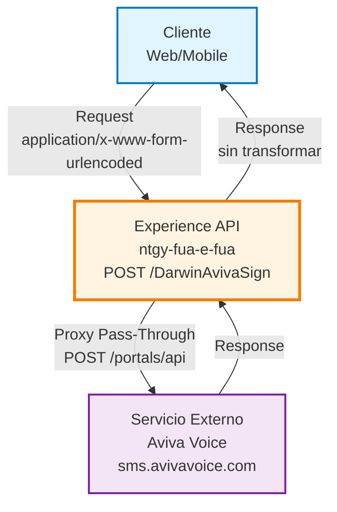
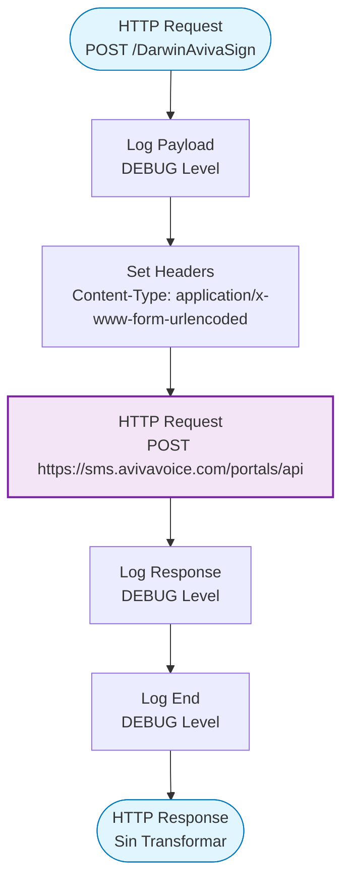
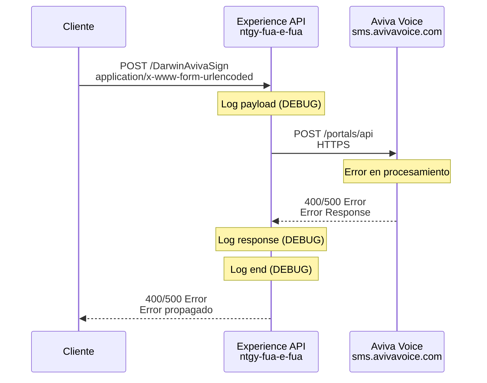
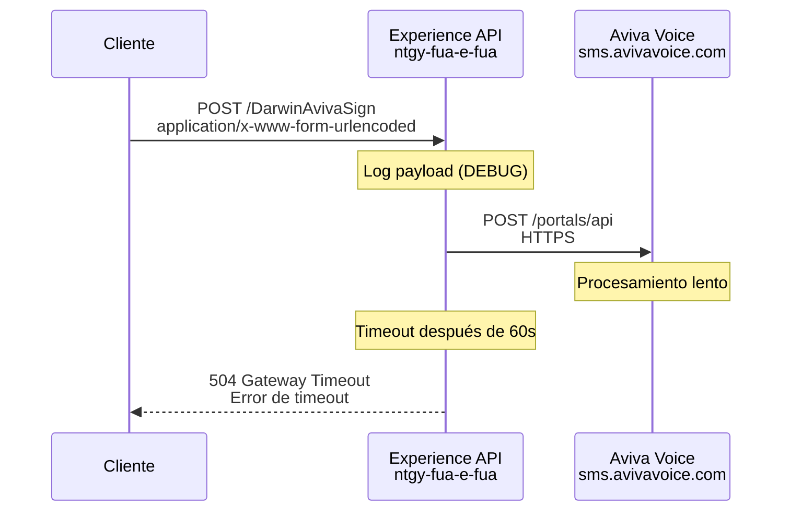

# POST /DarwinAvivaSign

## 📌 Descripción General

### Propósito del Endpoint

Este endpoint actúa como un **proxy pass-through** hacia el servicio externo Aviva Voice, reenviando las peticiones sin realizar transformaciones en el payload. Permite la integración directa con la plataforma de comunicaciones Aviva Voice desde el Experience API de FUA.

⚠️ **NOTA IMPORTANTE:** Este endpoint actúa como proxy pass-through hacia el servicio externo Aviva Voice. La documentación completa de parámetros, respuestas y casos de uso específicos requiere acceso a la documentación del API de Aviva Voice (https://sms.avivavoice.com).

### Tipo de API

**Capa:** Experience API (API-Led Connectivity)

**Función:** Proxy pass-through hacia servicio externo

### Patrón de Integración

**Tipo:** Pass-Through (Proxy Directo)

**Descripción:** El endpoint reenvía las peticiones directamente al servicio externo Aviva Voice sin realizar transformaciones en el payload. Solo añade logging para trazabilidad.

### Arquitectura API-Led Connectivity



---

## 💼 Propósito del Negocio

### Casos de Uso Principales

⚠️ **PENDIENTE DE DOCUMENTACIÓN:** Los casos de uso específicos dependen de la funcionalidad del servicio Aviva Voice. Se requiere documentación del proveedor para detallar:
- Tipos de operaciones soportadas
- Escenarios de negocio específicos
- Flujos de trabajo asociados

### 📱 Canal y Audiencia

#### Canal de Consumo

**Canal:** Web / Mobile

**Características del Canal:**
- **Plataforma**: Portal FUA (Frontal Único de Atención)
- **Dispositivos**: Navegadores web y aplicaciones móviles
- **Conectividad**: Requiere conexión HTTPS
- **Experiencia de Usuario**: Integración transparente con servicio externo

#### Audiencia Objetivo

**Usuarios Finales:**
- **Clientes de Naturgy**: Usuarios del portal FUA que requieren funcionalidades del servicio Aviva Voice
- **Agentes de Atención**: Personal de atención al cliente que utiliza el portal FUA

**Contexto de Uso:**
- **Integración con Servicios Externos**: Acceso a funcionalidades de la plataforma Aviva Voice desde el portal FUA
- **Operaciones de Comunicación**: Operaciones relacionadas con el servicio de comunicaciones (requiere documentación del proveedor)

#### Adaptaciones del Canal

**Optimizaciones Aplicadas:**
- **Sin Transformación**: El payload se reenvía tal cual al servicio externo
- **Logging**: Se registra el payload de entrada y salida para trazabilidad
- **Timeout**: Configurado a 60 segundos para operaciones del servicio externo

### 🔗 Endpoints Dependientes

Este Experience API consume el siguiente servicio externo:

| Servicio Externo | Endpoint | Método | Propósito |
|------------------|----------|--------|-----------|
| `Aviva Voice` | `/portals/api` | POST | Servicio externo de comunicaciones (requiere documentación del proveedor) |

### Contexto Empresarial

- **Dominio:** Integración con Servicios Externos
- **Sector:** Energía - Utilities
- **División:** Naturgy España - NewCo
- **Canal:** Web/Mobile (Portal FUA)

### Stakeholders

- **Usuarios del Portal FUA**: Requieren acceso a funcionalidades del servicio Aviva Voice
- **Equipo de Desarrollo**: Mantiene la integración con el servicio externo
- **Proveedor Aviva Voice**: Proporciona el servicio externo de comunicaciones

### Valor de Negocio

- **Integración Simplificada**: Acceso directo al servicio Aviva Voice desde el portal FUA
- **Trazabilidad**: Logging de operaciones para auditoría y troubleshooting
- **Flexibilidad**: Patrón pass-through permite evolución independiente del servicio externo

---

## 🔧 Especificación Técnica

### URLs por Ambiente

| Ambiente | URL Base | URL Completa |
|----------|----------|--------------|
| **Local** | `http://localhost:8081` | `http://localhost:8081/fua/api/DarwinAvivaSign` |
| **Development** | `https://e-fua-dev.de-c1.cloudhub.io` | `https://e-fua-dev.de-c1.cloudhub.io/fua/api/DarwinAvivaSign` |
| **Production** | `https://e-fua-pro.de-c1.cloudhub.io` | `https://e-fua-pro.de-c1.cloudhub.io/fua/api/DarwinAvivaSign` |

### Método HTTP

```
POST /fua/api/DarwinAvivaSign
```

### 🎯 Consideraciones del Canal

#### Limitaciones del Canal

| Aspecto | Limitación | Razón |
|---------|------------|-------|
| **Timeout** | 60 segundos | Configurado para operaciones del servicio externo |
| **Content-Type** | application/x-www-form-urlencoded | Requerido por el servicio Aviva Voice |
| **Protocolo** | HTTPS | Seguridad en comunicación con servicio externo |

### Parámetros de Entrada

⚠️ **NOTA:** Los parámetros específicos dependen del servicio Aviva Voice y se envían en formato `application/x-www-form-urlencoded`.

#### Headers

| Header | Tipo | Obligatorio | Descripción |
|--------|------|-------------|-------------|
| `Content-Type` | string | ✅ Sí | Debe ser `application/x-www-form-urlencoded` |

#### Body

**Formato:** `application/x-www-form-urlencoded`

⚠️ **PENDIENTE DE DOCUMENTACIÓN:** La estructura específica del body depende de la documentación del servicio Aviva Voice. El endpoint reenvía el payload sin transformaciones.

**Ejemplo genérico:**
```
param1=value1&param2=value2&param3=value3
```

### Respuestas

#### Respuesta Exitosa

⚠️ **NOTA:** La estructura de respuesta depende del servicio Aviva Voice y se propaga sin transformación.

**Código:** `200 OK`

**Content-Type:** Depende del servicio Aviva Voice

**Body:** El response del servicio Aviva Voice se devuelve sin transformaciones

#### Respuestas de Error

Las respuestas de error del servicio Aviva Voice se propagan directamente al cliente.

**Códigos de Estado Comunes:**
- `400 Bad Request`: Error en los parámetros enviados
- `401 Unauthorized`: Error de autenticación con el servicio externo
- `500 Internal Server Error`: Error en el servicio Aviva Voice
- `504 Gateway Timeout`: Timeout en la comunicación con Aviva Voice (>60s)

### Autenticación

- **Tipo:** Depende del servicio Aviva Voice
- **Implementación:** Los parámetros de autenticación se incluyen en el body según la documentación del proveedor

### Timeouts

| Tipo | Valor | Razón |
|------|-------|-------|
| **Request Timeout** | 60 segundos | Configurado para operaciones del servicio externo Aviva Voice |
| **Connection Idle Timeout** | 60 segundos | Mantiene conexión activa durante operaciones largas |

---

## 🏗️ Implementación Técnica

### Arquitectura del Flow



### Código del Flow

**Ubicación:** `src/main/mule/e-fua.xml` (líneas 510-521)

```xml
<flow name="post:\DarwinAvivaSign:application\x-www-form-urlencoded:e-fua-config">
    <logger level="DEBUG" doc:name="Logger" doc:id="64d0e84a-9271-496b-bcf7-3fe37dfcd5cd" 
            message="#[payload]" />
    <http:request method="POST" doc:name="Request1" doc:id="b1fb3792-93f5-4da6-83d2-e5531fa99a02" 
                  config-ref="HTTP_AVOICE" path="portals/api">
        <http:headers><![CDATA[#[output application/java
---
{
	"Content-Type" : "application/x-www-form-urlencoded; charset=utf-8"
}]]]></http:headers>
    </http:request>
    <logger level="DEBUG" doc:name="Logger" doc:id="1bb0de7e-7f5e-46e6-8fbc-c7f5324b1f1b" 
            message="#[payload]" />
    <logger level="DEBUG" doc:name="Logger End" doc:id="3f8791cb-a3b2-446f-a4c2-e25d89090e7e" 
            message="End post:\DarwinAvivaSign:application\x-www-form-urlencoded-fua-config" />
</flow>
```

### Configuración del Conector HTTP

**Ubicación:** `src/main/mule/global.xml` (líneas 41-43)

```xml
<http:request-config name="HTTP_AVOICE" doc:name="HTTP Request configuration" 
                     doc:id="11b4d4c8-b130-4878-9b0d-e67f0fa96915" 
                     responseTimeout="${newco-e-fua-avoice.timeout}">
    <http:request-connection host="${newco-e-fua-avoice.host}" 
                            port="${newco-e-fua-avoice.port}" 
                            connectionIdleTimeout="${newco-e-fua-avoice.timeout}" 
                            protocol="HTTPS"/>
</http:request-config>
```

### Propiedades de Configuración

**Ubicación:** `src/main/resources/e-fua-pro-config.yaml` (líneas 38-41)

```yaml
newco-e-fua-avoice:
  host: "sms.avivavoice.com"
  port: "443"
  timeout: "60000"
```

### Transformaciones de Canal

⚠️ **Este Experience API NO transforma la respuesta del servicio externo.**

**Patrón:** Pass-Through puro

**Características:**
- ✅ El payload de entrada se reenvía sin modificaciones
- ✅ La respuesta del servicio externo se devuelve sin transformaciones
- ✅ Solo se añaden logs para trazabilidad

### Patrones de Diseño

**Patrón:** Proxy Pass-Through

**Justificación:** 
- Permite integración directa con servicio externo sin acoplamiento
- Facilita evolución independiente del servicio Aviva Voice
- Simplifica mantenimiento al no requerir transformaciones

**Características:**
- Sin transformaciones de datos
- Logging para trazabilidad
- Propagación directa de errores del servicio externo

### Diagramas de Secuencia

#### 1. Flujo Normal de Éxito


#### 2. Flujo con Error del Servicio Externo



#### 3. Flujo con Timeout



### Características de la Implementación

| Característica | Valor | Ubicación en Código |
|----------------|-------|---------------------|
| **Patrón** | Pass-Through | Flow completo |
| **Logging** | DEBUG (entrada/salida) | Líneas 511, 519, 520 |
| **Timeout** | 60 segundos | global.xml + properties |
| **Protocolo** | HTTPS | global.xml línea 42 |
| **Host** | sms.avivavoice.com | e-fua-pro-config.yaml |
| **Port** | 443 | e-fua-pro-config.yaml |
| **Path** | /portals/api | e-fua.xml línea 512 |
| **Content-Type** | application/x-www-form-urlencoded | e-fua.xml líneas 513-517 |

### Manejo de Errores

**Estrategia:** Propagación directa de errores del servicio externo

**Comportamiento:**
- Los errores del servicio Aviva Voice se propagan sin transformación
- Los timeouts (>60s) generan error 504 Gateway Timeout
- Los errores de conectividad generan error 500 Internal Server Error
- Todos los errores se registran en logs DEBUG

---

## 💻 Ejemplos de Uso

### Ejemplo 1: Llamada Exitosa (Genérica)

⚠️ **NOTA:** Los parámetros específicos dependen de la documentación del servicio Aviva Voice.

#### cURL

```bash
curl -X POST "https://e-fua-pro.de-c1.cloudhub.io/fua/api/DarwinAvivaSign" \
  -H "Content-Type: application/x-www-form-urlencoded" \
  -d "param1=value1&param2=value2&param3=value3"
```

#### Respuesta (200 OK)

⚠️ **NOTA:** La estructura de respuesta depende del servicio Aviva Voice.

```
[Response del servicio Aviva Voice sin transformar]
```

### Ejemplo 2: JavaScript (para Web)

```javascript
const formData = new URLSearchParams();
formData.append('param1', 'value1');
formData.append('param2', 'value2');
formData.append('param3', 'value3');

const response = await fetch('https://e-fua-pro.de-c1.cloudhub.io/fua/api/DarwinAvivaSign', {
  method: 'POST',
  headers: {
    'Content-Type': 'application/x-www-form-urlencoded'
  },
  body: formData
});

const data = await response.text(); // o response.json() según el servicio
console.log(data);
```

### Ejemplo 3: Python

```python
import requests

data = {
    'param1': 'value1',
    'param2': 'value2',
    'param3': 'value3'
}

response = requests.post(
    'https://e-fua-pro.de-c1.cloudhub.io/fua/api/DarwinAvivaSign',
    headers={
        'Content-Type': 'application/x-www-form-urlencoded'
    },
    data=data
)

print(response.text)
```

### Ejemplo 4: Error de Timeout

#### Request

```bash
curl -X POST "https://e-fua-pro.de-c1.cloudhub.io/fua/api/DarwinAvivaSign" \
  -H "Content-Type: application/x-www-form-urlencoded" \
  -d "param1=value1"
```

#### Respuesta (504 Gateway Timeout)

```json
{
  "error": "Gateway Timeout",
  "message": "El servicio externo no respondió en el tiempo esperado (60 segundos)"
}
```

### Ejemplo 5: Error del Servicio Externo

#### Request

```bash
curl -X POST "https://e-fua-pro.de-c1.cloudhub.io/fua/api/DarwinAvivaSign" \
  -H "Content-Type: application/x-www-form-urlencoded" \
  -d "invalid_param=invalid_value"
```

#### Respuesta (400 Bad Request)

⚠️ **NOTA:** El formato de error depende del servicio Aviva Voice.

```
[Error response del servicio Aviva Voice sin transformar]
```

---

## 📋 Notas Adicionales

### Limitaciones Conocidas

1. **Documentación del Servicio Externo:** Se requiere acceso a la documentación del API de Aviva Voice para:
   - Parámetros específicos del request
   - Estructura detallada de las respuestas
   - Casos de uso específicos de negocio
   - Códigos de error específicos

2. **Sin Transformación:** El endpoint no realiza validaciones ni transformaciones, por lo que:
   - Los errores del servicio externo se propagan directamente
   - No hay normalización de respuestas
   - La estructura de datos depende completamente del servicio Aviva Voice

3. **Trazabilidad:** Los logs DEBUG permiten troubleshooting pero requieren:
   - Acceso a logs de CloudHub
   - Nivel de log configurado en DEBUG
   - Correlación con logs del servicio Aviva Voice

### Recomendaciones

1. **Documentación Adicional:** Solicitar al proveedor Aviva Voice:
   - Documentación completa del API
   - Ejemplos de uso reales
   - Códigos de error y su significado
   - Casos de uso de negocio

2. **Monitoreo:** Implementar monitoreo específico para:
   - Tasa de errores del servicio externo
   - Tiempos de respuesta
   - Timeouts frecuentes

3. **Manejo de Errores:** Considerar implementar:
   - Transformación de errores para mejor experiencia de usuario
   - Retry logic para errores transitorios
   - Circuit breaker para protección ante fallos del servicio externo

### Información de Contacto

**Servicio Externo:**
- **Proveedor:** Aviva Voice
- **Host:** sms.avivavoice.com
- **Protocolo:** HTTPS
- **Puerto:** 443

**Equipo Responsable:**
- **API:** Equipo de Desarrollo FUA Experience API
- **Servicio Externo:** Proveedor Aviva Voice