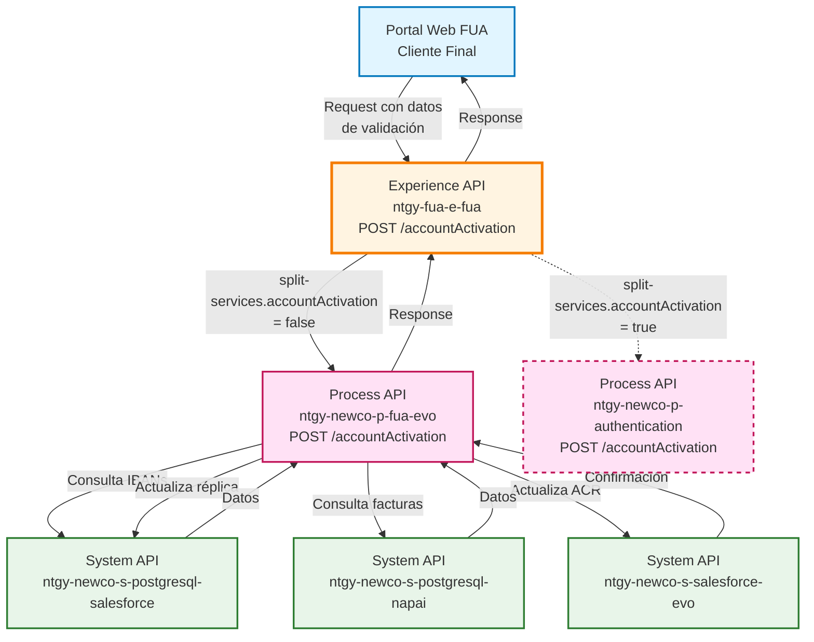
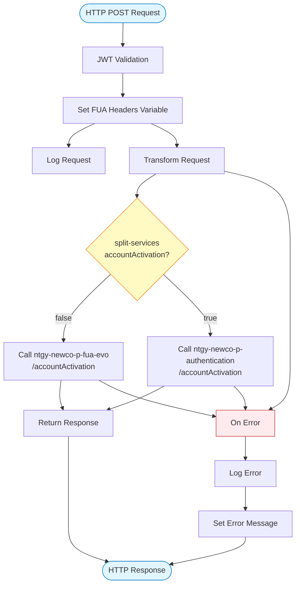
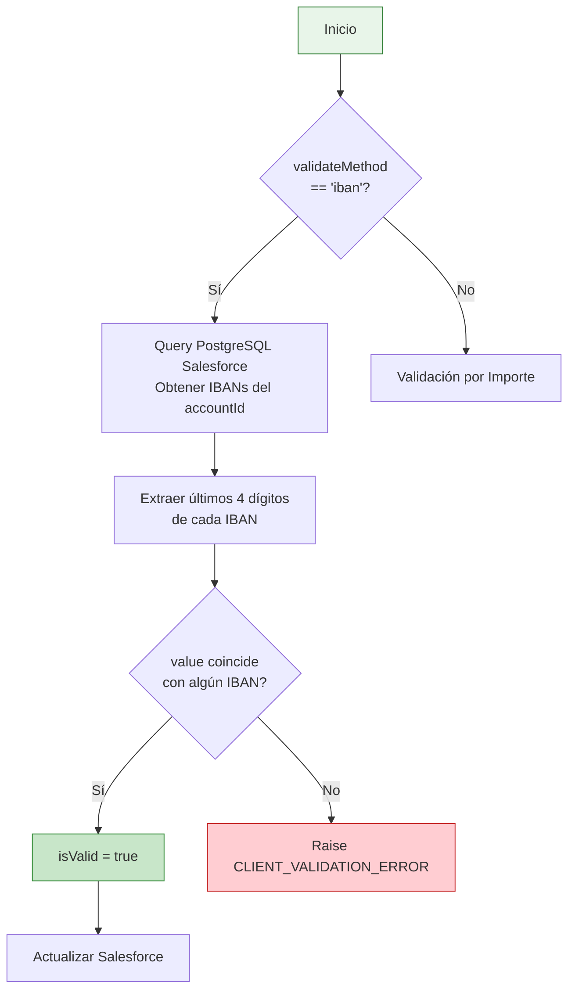
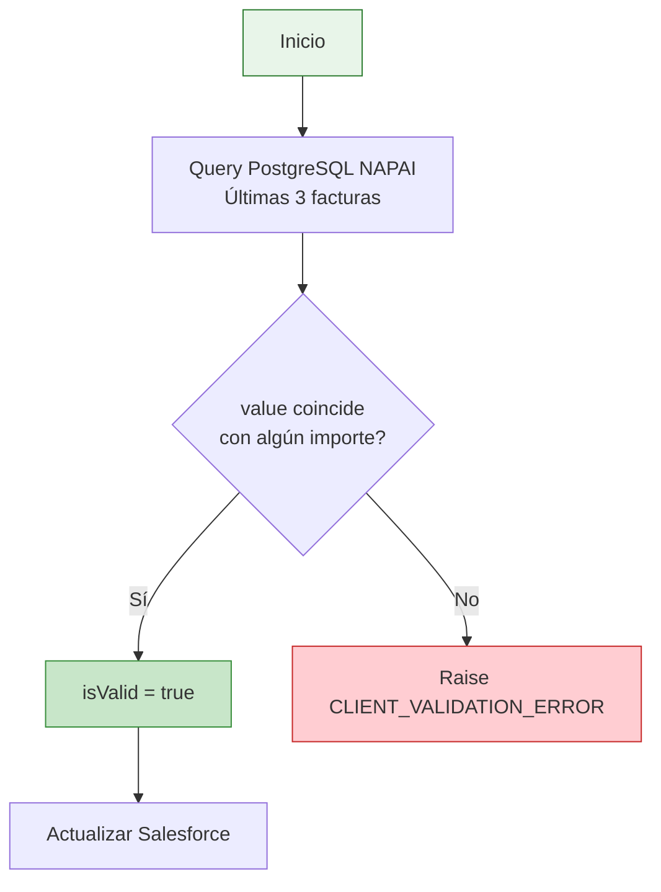
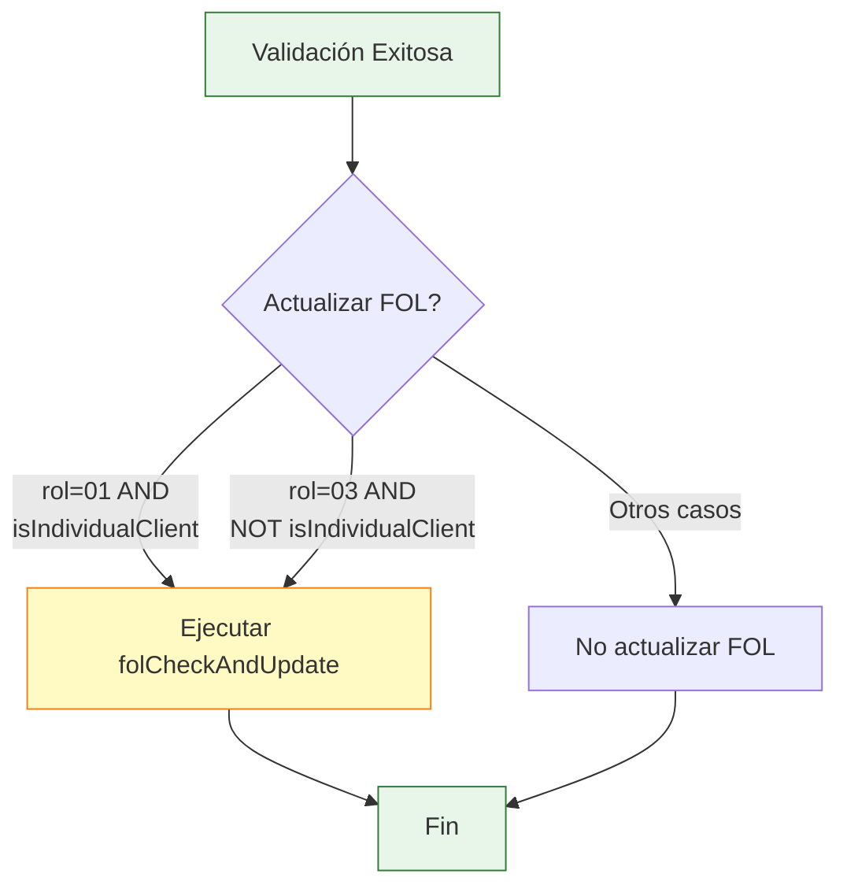
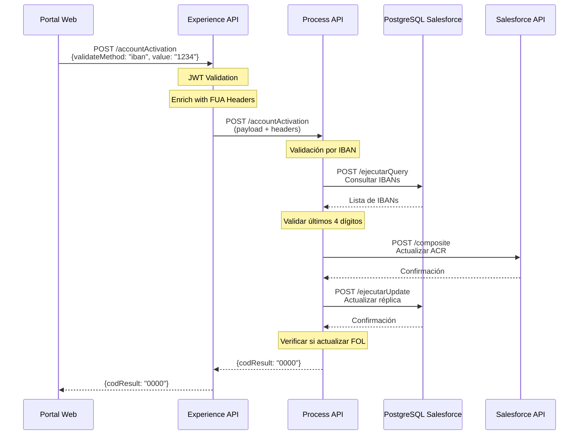
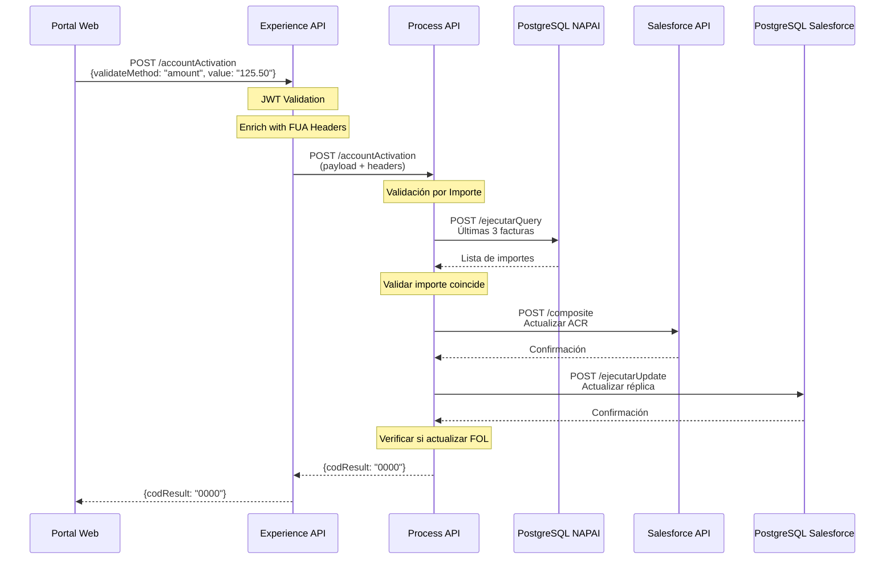
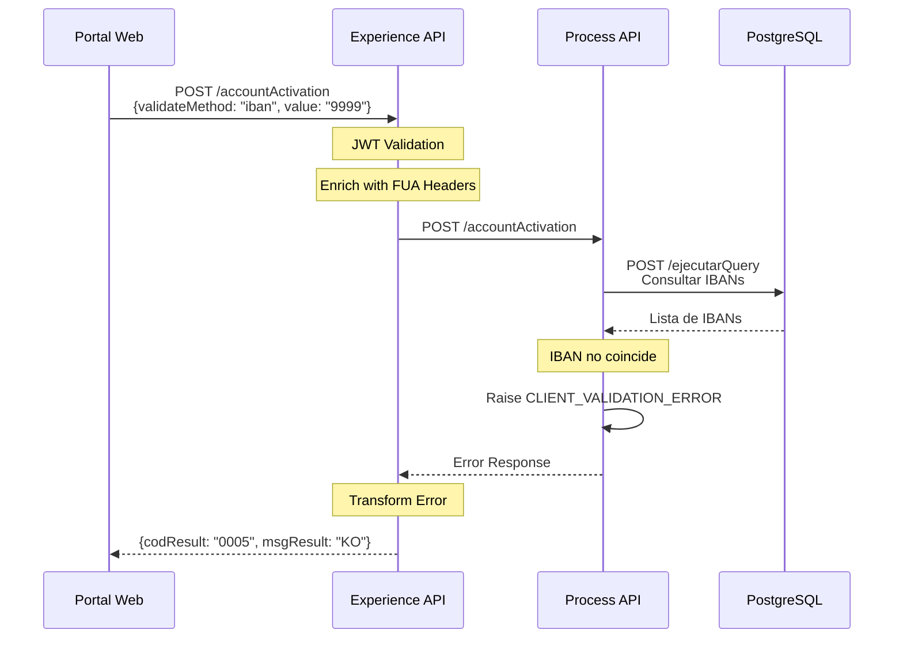

# POST /accountActivation

## 📌 Descripción General

### Propósito del Endpoint

Este endpoint permite activar cuentas de cliente que se encuentran en estado "Pendiente" mediante dos métodos de validación: por IBAN (últimos 4 dígitos) o por importe de factura. Una vez validado exitosamente, actualiza el estado de la relación Account-Contact en Salesforce y opcionalmente actualiza el FOL (First Online Login) según el rol del contacto.

### Tipo de API

**Capa:** Experience API (API-Led Connectivity)

**Función:** Adaptación de experiencia para canal web de autoservicio de clientes

### Patrón de Integración

**Tipo:** Pass-Through con Enriquecimiento de Headers

**Descripción:** El Experience API recibe la petición del portal web, enriquece el payload con headers FUA (x-interaction-id, x-user-id, x-client-code, etc.) y delega toda la lógica de negocio al Process API. Incluye enrutamiento condicional basado en configuración para soportar migración a nuevo servicio de autenticación.

### Arquitectura API-Led Connectivity



---

## 💼 Propósito del Negocio

### Casos de Uso Principales

1. **Activación de Cuenta por Validación de IBAN**
   - El cliente proporciona los últimos 4 dígitos de su IBAN
   - El sistema valida contra los IBANs registrados en Salesforce
   - Si coincide, activa la cuenta y cambia el estado a "Validado"

2. **Activación de Cuenta por Validación de Importe**
   - El cliente proporciona el importe de una de sus últimas 3 facturas
   - El sistema valida contra las facturas en NAPAI (PostgreSQL)
   - Si coincide, activa la cuenta y cambia el estado a "Validado"

3. **Actualización Automática de FOL (First Online Login)**
   - Si el contacto es titular (rol 01) y cliente individual
   - O si es representante legal (rol 03) y cliente empresa
   - Actualiza automáticamente el indicador FOL en Salesforce

### 📱 Canal y Audiencia

#### Canal de Consumo

**Canal:** Web

**Características del Canal:**
- **Plataforma**: Portal de autoservicio FUA (Frontal Único de Atención)
- **Dispositivos**: Navegadores web (desktop y mobile responsive)
- **Conectividad**: Requiere conexión estable para validaciones en tiempo real
- **Experiencia de Usuario**: Proceso de activación guiado con validación inmediata

#### Audiencia Objetivo

**Usuarios Finales:**
- **Clientes Residenciales**: Clientes particulares que necesitan activar su cuenta para acceder al portal
- **Clientes Empresariales**: Representantes legales de empresas que activan cuentas corporativas
- **Contactos Autorizados**: Personas autorizadas por el titular para gestionar la cuenta

**Contexto de Uso:**
- **Primer Acceso**: Cliente registrado que necesita activar su cuenta antes del primer login
- **Reactivación**: Cliente que necesita reactivar una cuenta previamente desactivada
- **Validación de Identidad**: Proceso de verificación de identidad mediante datos financieros

#### Adaptaciones del Canal

**Optimizaciones Aplicadas:**
- **Enriquecimiento de Headers**: Añade headers FUA con contexto de sesión (x-interaction-id, x-user-id, x-client-code)
- **Enrutamiento Dinámico**: Soporta migración gradual a nuevo servicio de autenticación mediante configuración
- **Manejo de Errores Simplificado**: Transforma errores técnicos en mensajes comprensibles para el usuario web

### 🔗 Endpoints Dependientes

Este Experience API consume los siguientes Process APIs:

| Process API | Endpoint | Método | Propósito |
|-------------|----------|--------|-----------|
| `ntgy-newco-p-fua-evo` | `/accountActivation` | POST | Orquesta la validación de cliente y actualización de estado en Salesforce (ruta actual) |
| `ntgy-newco-p-authentication` | `/accountActivation` | POST | Servicio de autenticación nuevo (ruta alternativa, actualmente deshabilitada) |

**Dependencias del Process API (ntgy-newco-p-fua-evo):**

| System API | Endpoint | Método | Propósito |
|------------|----------|--------|-----------|
| `ntgy-newco-s-postgresql-salesforce` | `/ejecutarQuery` | POST | Consulta IBANs del cliente en réplica de Salesforce |
| `ntgy-newco-s-postgresql-napai` | `/ejecutarQuery` | POST | Consulta últimas 3 facturas del cliente |
| `ntgy-newco-s-salesforce-evo` | `/composite` | POST | Actualiza AccountContactRelation en Salesforce |
| `ntgy-newco-s-postgresql-salesforce` | `/ejecutarUpdate` | POST | Actualiza estado en réplica PostgreSQL de Salesforce |

### Contexto Empresarial

- **Dominio:** Gestión de Identidad y Acceso (IAM)
- **Sector:** Energía - Utilities
- **División:** Naturgy España - NewCo
- **Canal:** Web (Portal FUA)

### Stakeholders

- **Clientes Finales**: Necesitan activar su cuenta para acceder a servicios de autogestión
- **Equipo de Atención al Cliente**: Requieren que el proceso sea simple y con baja tasa de error
- **Equipo de Seguridad**: Necesitan validación robusta de identidad del cliente
- **Equipo de Desarrollo**: Requieren flexibilidad para migrar a nuevo servicio de autenticación

### Valor de Negocio

- **Reducción de Llamadas al Call Center**: Proceso automatizado de activación sin intervención de agentes
- **Mejora de Seguridad**: Validación de identidad mediante datos financieros del cliente
- **Experiencia de Usuario Mejorada**: Activación inmediata sin esperas ni trámites adicionales
- **Flexibilidad Operativa**: Soporte para migración gradual a nueva arquitectura de autenticación

---

## 🔧 Especificación Técnica

### URLs por Ambiente

| Ambiente | URL Base | URL Completa |
|----------|----------|--------------|
| **Local** | `http://localhost:8081` | `http://localhost:8081/fua/api/accountActivation` |
| **Development** | `https://ntgy-fua-e-fua-dev.de-c1.cloudhub.io` | `https://ntgy-fua-e-fua-dev.de-c1.cloudhub.io/fua/api/accountActivation` |
| **Production** | `https://ntgy-fua-e-fua-pro.de-c1.cloudhub.io` | `https://ntgy-fua-e-fua-pro.de-c1.cloudhub.io/fua/api/accountActivation` |

### Método HTTP

```
POST /fua/api/accountActivation
```

### 🎯 Consideraciones del Canal

#### Limitaciones del Canal

| Aspecto | Limitación | Razón |
|---------|------------|-------|
| **Timeout** | 60 segundos | Permite tiempo suficiente para validaciones en múltiples sistemas |
| **Rate Limiting** | No especificado | Controlado por API Gateway |
| **Reintentos** | No recomendado | Operación idempotente pero puede causar múltiples actualizaciones |

#### Campos Específicos del Canal

**Headers Añadidos por el Experience API:**

| Header | Tipo | Descripción | Razón |
|--------|------|-------------|-------|
| `x-interaction-id` | string | ID único de la interacción | Trazabilidad de la sesión web |
| `x-interaction-origin` | string | Origen de la interacción | Identificar canal de entrada |
| `x-user-id` | string | ID del usuario | Contexto de usuario autenticado |
| `x-client-id` | string | ID del cliente (Account) | Identificación del cliente en Salesforce |
| `x-client-doc-number` | string | Número de documento | Identificación fiscal del cliente |
| `x-client-code` | string | Código del cliente | Identificación en sistemas legacy |
| `x-origin` | string | Sistema origen | Trazabilidad del origen de la petición |
| `x-user-role` | string | Rol del usuario | Control de permisos |
| `traceparent` | string | Trace context | Trazabilidad distribuida |
| `x-agent-mail` | string | Email del agente (si aplica) | Identificación de agente en caso de soporte |
| `x-language` | string | Idioma preferido | Internacionalización |
| `x-contact-id` | string | ID del contacto | Identificación del contacto en Salesforce |

### Parámetros de Entrada

#### Headers (Obligatorios)

| Header | Tipo | Obligatorio | Descripción |
|--------|------|-------------|-------------|
| `Content-Type` | string | Sí | Debe ser `application/json` |
| `x-client-code` | string | Sí | Código del cliente para validación |
| `x-client-id` | string | Sí | ID del Account en Salesforce |
| `x-contact-id` | string | Sí | ID del Contact en Salesforce |

#### Body (application/json)

| Campo | Tipo | Obligatorio | Descripción |
|-------|------|-------------|-------------|
| `iban` | string | No* | Últimos 4 dígitos del IBAN (si validateMethod = "iban") |
| `lastBill` | string | No* | Importe de la última factura (si validateMethod != "iban") |
| `contactId` | string | No | ID del contacto (también puede venir en header) |
| `rol` | string | No | Rol del contacto (01=Titular, 03=Representante Legal) |
| `validateMethod` | string | Sí | Método de validación: "iban" o "amount" |
| `value` | string | Sí | Valor a validar (4 dígitos IBAN o importe) |
| `accountId` | string | Sí | ID de la cuenta en Salesforce |
| `isIndividualClient` | boolean | Sí | Indica si es cliente individual (true) o empresa (false) |

**Nota:** `iban` o `lastBill` son obligatorios según el método de validación elegido.

### Respuestas

#### 200 OK - Activación Exitosa

```json
{
  "result": {
    "codResult": "0000",
    "msgResult": "No hay error"
  }
}
```

#### 400 Bad Request - Error de Validación

```json
{
  "result": {
    "codResult": "0005",
    "msgResult": "KO"
  }
}
```

**Causas comunes:**
- IBAN no coincide con ninguno registrado
- Importe no coincide con ninguna de las últimas 3 facturas
- Datos de entrada incompletos o inválidos

#### 500 Internal Server Error

```json
{
  "result": {
    "codResult": "0005",
    "msgResult": "KO"
  }
}
```

**Causas comunes:**
- Error en conexión con Process API
- Error en actualización de Salesforce
- Error en consulta de base de datos

### Autenticación

- **Tipo:** OAuth 2.0 (gestionado por API Gateway)
- **Scope:** Requiere autenticación previa del usuario
- **Headers adicionales:** JWT token validado por `jwt-validation` flow

### Timeouts

| Tipo | Valor | Razón |
|------|-------|-------|
| **Request Timeout (Experience → Process)** | 60 segundos | Permite tiempo para validaciones en múltiples sistemas backend |
| **Connection Idle Timeout** | 60 segundos | Mantiene conexión abierta para operaciones largas |

---

## 🏗️ Implementación Técnica

### Arquitectura del Flow



### Transformaciones de Canal

**Transformación de Request (Experience API):**

El Experience API enriquece el payload con headers FUA:

```dataweave
%dw 2.0
output application/json
---
payload ++ vars.fuaHeaders
```

**Donde `vars.fuaHeaders` contiene:**

```dataweave
{
  ("x-interaction-id": attributes.headers['x-interaction-id']) if (!isEmpty(attributes.headers['x-interaction-id'])),
  ("x-interaction-origin": attributes.headers['x-interaction-origin']) if (!isEmpty(attributes.headers['x-interaction-origin'])),
  ("x-user-id": attributes.headers['x-user-id']) if (!isEmpty(attributes.headers['x-user-id'])),
  ("x-client-id": attributes.headers['x-client-id']) if (!isEmpty(attributes.headers['x-client-id'])),
  ("x-client-doc-number": attributes.headers['x-client-doc-number']) if (!isEmpty(attributes.headers['x-client-doc-number'])),
  ("x-client-code": attributes.headers['x-client-code']) if (!isEmpty(attributes.headers['x-client-code'])),
  ("x-origin": attributes.headers['x-origin']) if (!isEmpty(attributes.headers['x-origin'])),
  ("x-user-role": attributes.headers['x-user-role']) if (!isEmpty(attributes.headers['x-user-role'])),
  ("traceparent": attributes.headers['traceparent']) if (!isEmpty(attributes.headers['traceparent'])),
  ("x-agent-mail": attributes.headers['x-agent-mail']) if (!isEmpty(attributes.headers['x-agent-mail'])),
  ("x-language": attributes.headers['x-language']) if (!isEmpty(attributes.headers['x-language'])),
  ("x-contact-id": attributes.headers['x-contact-id']) if (!isEmpty(attributes.headers['x-contact-id']))
}
```

**Transformación de Response:**

⚠️ **Este Experience API NO transforma la respuesta del Process API.**

Para el schema completo y la lógica de negocio, consultar:
📖 **Process API: `ntgy-newco-p-fua-evo` endpoint `/accountActivation`**

### Lógica de Negocio (Process API)

El Process API ejecuta la siguiente lógica:

#### 1. Validación por IBAN



**Query SQL para IBANs:**

```sql
SELECT DISTINCT vcpc.vlocity_cmt__iban__c AS iban 
FROM newcosalesforce.vlocity_cmt__paymentmethod__c vcpc 
WHERE vcpc.vlocity_cmt__accountid__c = :param1  
  AND vcpc.newco_fechafirmamandatosepa__c IS NOT NULL 
  AND vcpc.vlocity_cmt__iban__c IS NOT NULL
```

#### 2. Validación por Importe



**Query SQL para Facturas:**

```sql
SELECT * FROM (
  (SELECT agfe."Importe_total_euro" 
   FROM self_publication_sistemas.agrupador_facturas_elec AS agfe 
   WHERE agfe."Documento_Identidad" = :param1 
   ORDER BY agfe."Fecha_emision" DESC LIMIT 3) 
  UNION 
  (SELECT agfg.importe_total_euro 
   FROM self_publication_sistemas.agrupador_facturas_gas agfg 
   WHERE agfg."Documento_Identidad" = :param1 
   ORDER BY agfg."Fecha_emision" DESC LIMIT 3)
) AS importe LIMIT 3
```

#### 3. Actualización en Salesforce

Una vez validado exitosamente:

**a) Actualización vía API Composite:**

```json
{
  "body": {
    "allOrNone": true,
    "collateSubrequests": false,
    "compositeRequest": [
      {
        "method": "PATCH",
        "url": "/services/data/v52.0/sobjects/AccountContactRelation/NewCo_ExternalACRId__c/{accountId}_{contactId}",
        "referenceId": "refAccountContactRelation",
        "body": {
          "newco_estadologinomega__c": "Validado",
          "newco_estadoatencion__c": "02",
          "NewCo_FechaMod__c": "{fecha_actual}"
        }
      }
    ]
  },
  "operationSalesforce": "composite"
}
```

**b) Actualización en réplica PostgreSQL:**

```sql
UPDATE newcosalesforce.accountcontactrelation 
SET newco_estadologinomega__c = 'Validado', 
    newco_estadoatencion__c = '02' 
WHERE contactid = :param1 
  AND accountid = :param2
```

#### 4. Actualización FOL (Condicional)



**Condición para actualizar FOL:**

```dataweave
vars.actualizarFol = (vars.entryPayload.rol == '01' and vars.entryPayload.isIndividualClient) 
                  or (vars.entryPayload.rol == '03' and !vars.entryPayload.isIndividualClient)
```

### Patrones de Diseño

**Patrón:** Pass-Through con Enriquecimiento de Contexto

**Justificación:** El Experience API no contiene lógica de negocio, solo enriquece el contexto con headers de sesión web y delega al Process API. Esto permite:
- Separación clara de responsabilidades
- Reutilización del Process API por otros canales
- Migración gradual a nueva arquitectura mediante configuración

**Patrón Adicional:** Strategy Pattern para Enrutamiento

**Justificación:** El uso de `split-services.accountActivation` permite cambiar dinámicamente entre el servicio actual y el nuevo sin modificar código, facilitando despliegues blue-green.

### Diagramas de Secuencia

#### 1. Flujo Normal de Éxito (Validación por IBAN)



#### 2. Flujo con Validación por Importe



#### 3. Flujo con Error de Validación



### Configuración de Enrutamiento

**Archivo:** `e-fua-pro-config.yaml`

```yaml
split-services:
  accountActivation: "false"  # false = usa ntgy-newco-p-fua-evo
                              # true = usa ntgy-newco-p-authentication
```

**Lógica de Enrutamiento en Experience API:**

```xml
<choice doc:name="Choice">
  <when expression="#[(Mule::p('split-services.accountActivation') as Boolean default false)]">
    <http:request method="POST" 
                  config-ref="HTTP_Request_newco-p-authentication" 
                  path="/accountActivation" />
  </when>
  <otherwise>
    <http:request method="POST" 
                  config-ref="HTTP_FUA_PROCESS_NEWCO_EVO" 
                  path="/accountActivation" />
  </otherwise>
</choice>
```

### Manejo de Errores

**Error Handler en Experience API:**

```xml
<error-handler>
  <on-error-propagate enableNotifications="true" logException="true">
    <logger level="ERROR" message='#[if (!isEmpty(error.errorMessage.payload)) 
                                       error.errorMessage.payload
                                     else 
                                       {
                                         "result": {
                                           "codResult": "0005",
                                           "msgResult": error.description as String replace /"/ with("")
                                         }
                                       }]' />
    <ee:transform doc:name="Set Error Message">
      <ee:message>
        <ee:set-payload><![CDATA[%dw 2.0
output application/json
---
if (!isEmpty(error.errorMessage.payload)) error.errorMessage.payload
else 
{
  "result": {
    "codResult": "0005",
    "msgResult": "KO"
  }
}]]></ee:set-payload>
      </ee:message>
    </ee:transform>
  </on-error-propagate>
</error-handler>
```

**Tipos de Errores del Process API:**

| Error Type | Descripción | Acción |
|------------|-------------|--------|
| `APP:CLIENT_VALIDATION_ERROR` | Validación de IBAN o importe fallida | Retorna error 400 con mensaje de validación |
| `APP:POSTGRESQL_SALESFORCE` | Error en consulta PostgreSQL Salesforce | Retorna error 500 |
| `APP:POSTGRESQL_NAPAI` | Error en consulta PostgreSQL NAPAI | Retorna error 500 |
| `MULE:CONNECTIVITY` | Error de conectividad con System APIs | Retorna error 500 |

---

## 💻 Ejemplos de Uso

### Ejemplo 1: Activación Exitosa por IBAN

#### Request

```bash
curl -X POST "https://ntgy-fua-e-fua-pro.de-c1.cloudhub.io/fua/api/accountActivation" \
  -H "Content-Type: application/json" \
  -H "Authorization: Bearer YOUR_JWT_TOKEN" \
  -H "x-client-code: 12345678A" \
  -H "x-client-id: 0015I00000ABC123" \
  -H "x-contact-id: 0035I00000XYZ789" \
  -H "x-interaction-id: web-session-12345" \
  -H "x-user-id: user-67890" \
  -d '{
    "validateMethod": "iban",
    "value": "1234",
    "accountId": "0015I00000ABC123",
    "contactId": "0035I00000XYZ789",
    "rol": "01",
    "isIndividualClient": true
  }'
```

#### Response (200 OK)

```json
{
  "result": {
    "codResult": "0000",
    "msgResult": "No hay error"
  }
}
```

### Ejemplo 2: Activación Exitosa por Importe de Factura

#### Request

```bash
curl -X POST "https://ntgy-fua-e-fua-pro.de-c1.cloudhub.io/fua/api/accountActivation" \
  -H "Content-Type: application/json" \
  -H "Authorization: Bearer YOUR_JWT_TOKEN" \
  -H "x-client-code: 87654321B" \
  -H "x-client-id: 0015I00000DEF456" \
  -H "x-contact-id: 0035I00000UVW012" \
  -d '{
    "validateMethod": "amount",
    "value": "125.50",
    "accountId": "0015I00000DEF456",
    "contactId": "0035I00000UVW012",
    "rol": "03",
    "isIndividualClient": false
  }'
```

#### Response (200 OK)

```json
{
  "result": {
    "codResult": "0000",
    "msgResult": "No hay error"
  }
}
```

### Ejemplo 3: Error de Validación - IBAN Incorrecto

#### Request

```bash
curl -X POST "https://ntgy-fua-e-fua-pro.de-c1.cloudhub.io/fua/api/accountActivation" \
  -H "Content-Type: application/json" \
  -H "Authorization: Bearer YOUR_JWT_TOKEN" \
  -H "x-client-code: 12345678A" \
  -H "x-client-id: 0015I00000ABC123" \
  -H "x-contact-id: 0035I00000XYZ789" \
  -d '{
    "validateMethod": "iban",
    "value": "9999",
    "accountId": "0015I00000ABC123",
    "contactId": "0035I00000XYZ789",
    "rol": "01",
    "isIndividualClient": true
  }'
```

#### Response (400 Bad Request)

```json
{
  "result": {
    "codResult": "0005",
    "msgResult": "KO"
  }
}
```

### Ejemplo 4: JavaScript (React/Vue)

```javascript
async function activateAccount(validationData) {
  try {
    const response = await fetch(
      'https://ntgy-fua-e-fua-pro.de-c1.cloudhub.io/fua/api/accountActivation',
      {
        method: 'POST',
        headers: {
          'Content-Type': 'application/json',
          'Authorization': `Bearer ${getJWTToken()}`,
          'x-client-code': validationData.clientCode,
          'x-client-id': validationData.accountId,
          'x-contact-id': validationData.contactId,
          'x-interaction-id': generateInteractionId(),
          'x-user-id': getCurrentUserId()
        },
        body: JSON.stringify({
          validateMethod: validationData.method, // "iban" or "amount"
          value: validationData.value,
          accountId: validationData.accountId,
          contactId: validationData.contactId,
          rol: validationData.rol,
          isIndividualClient: validationData.isIndividual
        })
      }
    );

    const data = await response.json();
    
    if (data.result.codResult === "0000") {
      console.log("Cuenta activada exitosamente");
      return { success: true, data };
    } else {
      console.error("Error en activación:", data.result.msgResult);
      return { success: false, error: data.result };
    }
  } catch (error) {
    console.error("Error de red:", error);
    return { success: false, error: error.message };
  }
}

// Uso
const result = await activateAccount({
  method: "iban",
  value: "1234",
  accountId: "0015I00000ABC123",
  contactId: "0035I00000XYZ789",
  clientCode: "12345678A",
  rol: "01",
  isIndividual: true
});
```

### Ejemplo 5: Python

```python
import requests
import json

def activate_account(validation_data, jwt_token):
    """
    Activa una cuenta de cliente mediante validación por IBAN o importe.
    
    Args:
        validation_data (dict): Datos de validación
        jwt_token (str): Token JWT de autenticación
    
    Returns:
        dict: Respuesta del API
    """
    url = "https://ntgy-fua-e-fua-pro.de-c1.cloudhub.io/fua/api/accountActivation"
    
    headers = {
        "Content-Type": "application/json",
        "Authorization": f"Bearer {jwt_token}",
        "x-client-code": validation_data["client_code"],
        "x-client-id": validation_data["account_id"],
        "x-contact-id": validation_data["contact_id"],
        "x-interaction-id": generate_interaction_id(),
        "x-user-id": get_current_user_id()
    }
    
    payload = {
        "validateMethod": validation_data["method"],  # "iban" or "amount"
        "value": validation_data["value"],
        "accountId": validation_data["account_id"],
        "contactId": validation_data["contact_id"],
        "rol": validation_data["rol"],
        "isIndividualClient": validation_data["is_individual"]
    }
    
    try:
        response = requests.post(url, headers=headers, json=payload, timeout=60)
        response.raise_for_status()
        
        data = response.json()
        
        if data["result"]["codResult"] == "0000":
            print("Cuenta activada exitosamente")
            return {"success": True, "data": data}
        else:
            print(f"Error en activación: {data['result']['msgResult']}")
            return {"success": False, "error": data["result"]}
            
    except requests.exceptions.RequestException as e:
        print(f"Error de red: {e}")
        return {"success": False, "error": str(e)}

# Uso
result = activate_account(
    validation_data={
        "method": "iban",
        "value": "1234",
        "account_id": "0015I00000ABC123",
        "contact_id": "0035I00000XYZ789",
        "client_code": "12345678A",
        "rol": "01",
        "is_individual": True
    },
    jwt_token="your_jwt_token_here"
)
```

### Notas de Implementación

1. **Validación de IBAN**: Solo se validan los últimos 4 dígitos por seguridad
2. **Validación de Importe**: Se compara contra las últimas 3 facturas (electricidad y gas)
3. **Actualización FOL**: Solo se ejecuta para titulares individuales o representantes legales de empresas
4. **Idempotencia**: La operación es idempotente - múltiples llamadas con los mismos datos producen el mismo resultado
5. **Timeout**: Configurar timeout de cliente en 60+ segundos para permitir validaciones en múltiples sistemas
