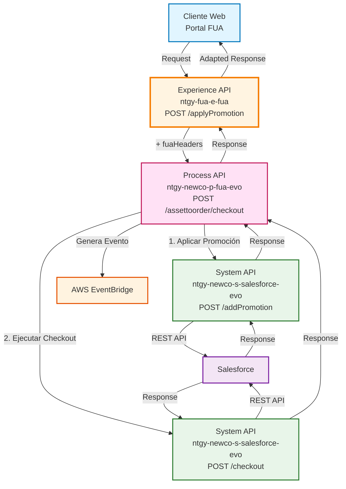
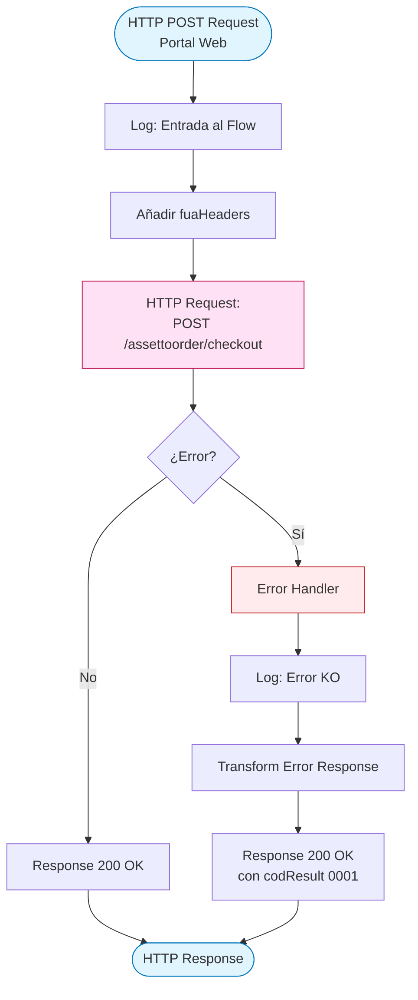
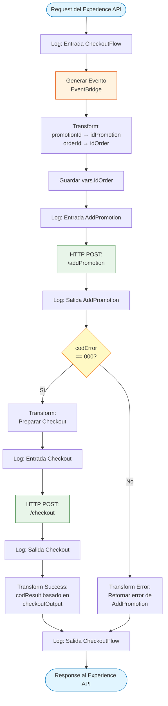
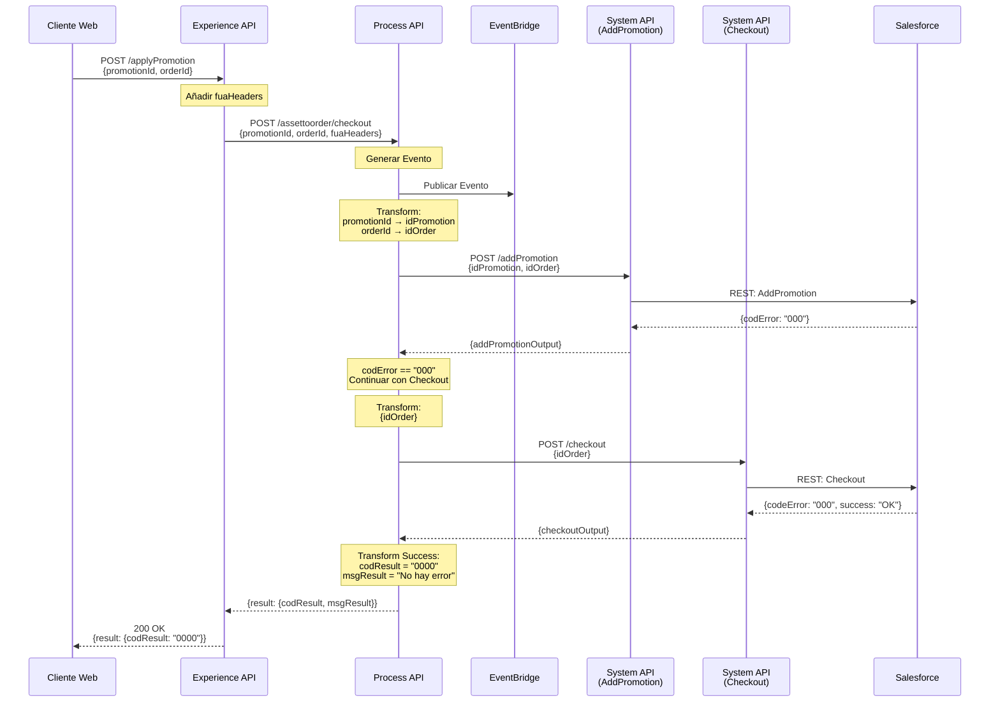
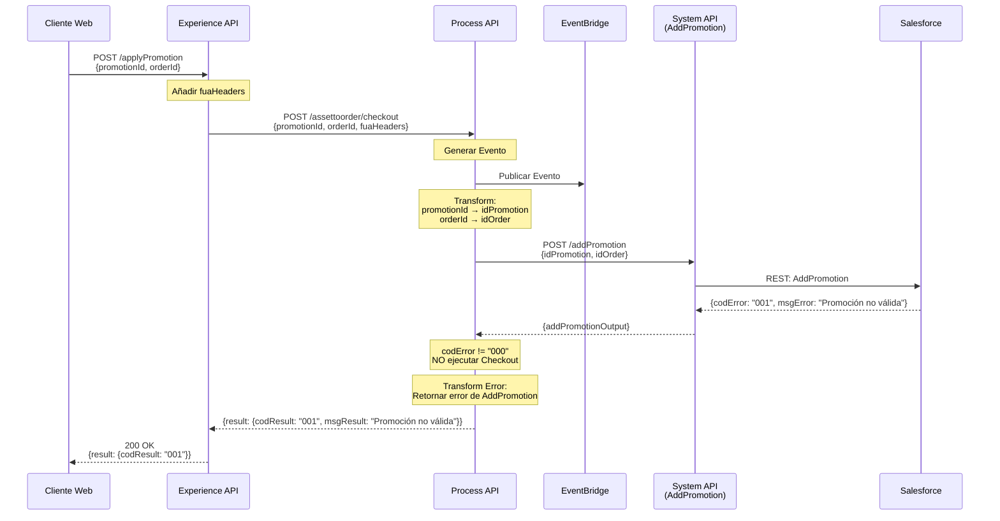
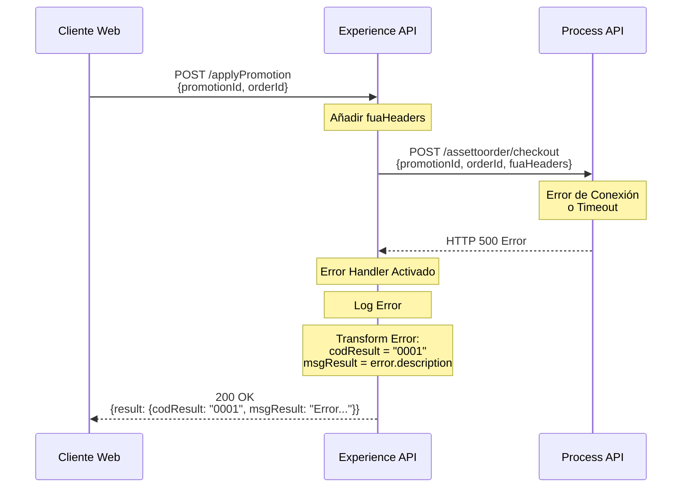

# POST /applyPromotion

## 📌 Descripción General

### Propósito del Endpoint

Este endpoint permite aplicar una promoción a un pedido específico y ejecutar el proceso de checkout en Salesforce. Es parte del flujo de gestión de promociones y descuentos para clientes de Naturgy, facilitando la aplicación de ofertas comerciales durante el proceso de compra.

### Tipo de API

**Capa:** Experience API (API-Led Connectivity)

**Función:** Orquestación de aplicación de promociones y checkout para canal web

### Patrón de Integración

**Tipo:** Orquestación con Transformación

**Descripción:** El Experience API recibe la solicitud del cliente, añade headers de contexto FUA, y delega al Process API que coordina la aplicación de la promoción y el checkout en Salesforce.

### Arquitectura API-Led Connectivity



---

## 💼 Propósito del Negocio

### Casos de Uso Principales

1. **Aplicación de Promociones en Proceso de Compra**
   - Cliente selecciona una promoción disponible durante el proceso de compra
   - Sistema valida y aplica la promoción al pedido
   - Se ejecuta el checkout automáticamente si la promoción es válida

2. **Gestión de Descuentos Comerciales**
   - Aplicación de ofertas especiales y descuentos
   - Validación de elegibilidad de la promoción
   - Actualización del pedido con los beneficios aplicados

3. **Automatización del Checkout**
   - Proceso integrado de aplicación de promoción y checkout
   - Reducción de pasos manuales en el proceso de compra
   - Mejora de la experiencia del usuario

### 📱 Canal y Audiencia

#### Canal de Consumo

**Canal:** Web

**Características del Canal:**
- **Plataforma**: Portal web FUA (Frontal Único de Atención)
- **Dispositivos**: Navegadores web (desktop y mobile)
- **Conectividad**: Conexión estable requerida para proceso transaccional
- **Experiencia de Usuario**: Proceso de checkout simplificado con aplicación automática de promociones

#### Audiencia Objetivo

**Usuarios Finales:**
- **Clientes Residenciales**: Clientes que contratan servicios de energía con promociones
- **Clientes Empresariales**: Empresas que aplican descuentos comerciales en sus contratos

**Contexto de Uso:**
- **Proceso de Compra**: Durante la contratación de nuevos servicios o productos
- **Aplicación de Ofertas**: Al seleccionar promociones disponibles en el catálogo
- **Checkout Automatizado**: Finalización del proceso de compra con descuentos aplicados

#### Adaptaciones del Canal

**Optimizaciones Aplicadas:**
- **Simplificación de Datos**: Solo se envían promotionId y orderId
- **Formato de Respuesta**: Respuesta estándar con código de resultado y mensaje
- **Manejo de Errores**: Errores transformados a formato amigable para el usuario web
- **Headers FUA**: Añadidos automáticamente por el Experience API

### 🔗 Endpoints Dependientes

Este Experience API consume el siguiente Process API:

| Process API | Endpoint | Método | Propósito |
|-------------|----------|--------|-----------|
| `ntgy-newco-p-fua-evo` | `/assettoorder/checkout` | POST | Aplica promoción y ejecuta checkout en Salesforce (flujo completo de aplicación de descuento) |

### Contexto Empresarial

- **Dominio:** Gestión de Promociones y Checkout
- **Sector:** Energía - Utilities
- **División:** Naturgy España - NewCo
- **Canal:** Web (Portal FUA)

### Stakeholders

- **Clientes Finales**: Usuarios que aplican promociones durante el proceso de compra
- **Equipo Comercial**: Define y gestiona las promociones disponibles
- **Equipo de Ventas**: Monitorea la efectividad de las promociones aplicadas
- **Equipo de Desarrollo**: Mantiene la integración con Salesforce

### Valor de Negocio

- **Automatización**: Proceso integrado de aplicación de promoción y checkout
- **Experiencia del Cliente**: Simplificación del proceso de compra con descuentos
- **Eficiencia Operativa**: Reducción de intervención manual en aplicación de promociones
- **Trazabilidad**: Registro de eventos en EventBridge para auditoría

---

## 🔧 Especificación Técnica

### URLs por Ambiente

| Ambiente | URL Base | URL Completa |
|----------|----------|--------------|
| **Local** | `http://localhost:8081` | `http://localhost:8081/fua/api/applyPromotion` |
| **Development** | `https://ntgy-fua-e-fua-dev.de-c1.cloudhub.io` | `https://ntgy-fua-e-fua-dev.de-c1.cloudhub.io/fua/api/applyPromotion` |
| **UAT** | `https://ntgy-fua-e-fua-cc.de-c1.cloudhub.io` | `https://ntgy-fua-e-fua-cc.de-c1.cloudhub.io/fua/api/applyPromotion` |
| **Production** | `https://ntgy-fua-e-fua-pro.de-c1.cloudhub.io` | `https://ntgy-fua-e-fua-pro.de-c1.cloudhub.io/fua/api/applyPromotion` |

### Método HTTP

```
POST /fua/api/applyPromotion
```

### 🎯 Consideraciones del Canal

#### Limitaciones del Canal

| Aspecto | Limitación | Razón |
|---------|------------|-------|
| **Timeout** | 60 segundos | Proceso transaccional con múltiples llamadas a Salesforce |
| **Tamaño de Request** | 10 KB máximo | Solo se envían IDs de promoción y pedido |
| **Rate Limiting** | 100 requests/minuto | Protección contra uso excesivo |
| **Sincronía** | Síncrono | Requiere confirmación inmediata del checkout |

#### Campos Específicos del Canal

**Campos Añadidos por el Experience API:**

| Campo | Tipo | Descripción | Razón |
|-------|------|-------------|-------|
| `fuaHeaders` | Object | Headers de contexto FUA | Trazabilidad y autenticación en Process API |

**Campos del Request Original:**

| Campo | Tipo | Descripción |
|-------|------|-------------|
| `promotionId` | String | ID de la promoción a aplicar |
| `orderId` | String | ID del pedido asociado |

### Parámetros de Entrada

#### Headers

| Header | Tipo | Requerido | Descripción |
|--------|------|-----------|-------------|
| `Content-Type` | String | ✅ Sí | Debe ser `application/json` |
| `client_id` | String | ✅ Sí | Client ID para autenticación OAuth 2.0 |
| `Authorization` | String | ✅ Sí | Token Bearer para autenticación |

#### Body (JSON)

```json
{
  "promotionId": "string",
  "orderId": "string"
}
```

**Campos del Body:**

| Campo | Tipo | Requerido | Descripción | Ejemplo |
|-------|------|-----------|-------------|---------|
| `promotionId` | String | ✅ Sí | ID de la promoción a aplicar | `"a0X5I000000XYZ1UAO"` |
| `orderId` | String | ✅ Sí | ID del pedido asociado | `"8015I000000ABC1QAO"` |

### Respuestas

#### 200 OK - Éxito

**Descripción:** La promoción se aplicó correctamente y el checkout se ejecutó con éxito.

```json
{
  "result": {
    "codResult": "0000",
    "msgResult": "No hay error"
  }
}
```

**Estructura de Respuesta:**

| Campo | Tipo | Descripción |
|-------|------|-------------|
| `result` | Object | Objeto con el resultado de la operación |
| `result.codResult` | String | Código de resultado (`"0000"` = éxito) |
| `result.msgResult` | String | Mensaje descriptivo del resultado |

#### 200 OK - Error de Negocio (Promoción No Válida)

**Descripción:** La promoción no pudo ser aplicada (código de error diferente de "000").

```json
{
  "result": {
    "codResult": "0001",
    "msgResult": "La promoción no es válida para este pedido"
  }
}
```

#### 500 Internal Server Error

**Descripción:** Error técnico durante el procesamiento.

```json
{
  "result": {
    "codResult": "0001",
    "msgResult": "Error al procesar la solicitud: [descripción del error]"
  }
}
```

### Códigos de Estado HTTP

| Código | Descripción | Cuándo Ocurre |
|--------|-------------|---------------|
| `200` | OK | Solicitud procesada (éxito o error de negocio) |
| `400` | Bad Request | Request malformado o parámetros inválidos |
| `401` | Unauthorized | Token de autenticación inválido o expirado |
| `500` | Internal Server Error | Error técnico en el procesamiento |
| `503` | Service Unavailable | Process API o Salesforce no disponible |

### Autenticación

- **Tipo:** OAuth 2.0 con Client Credentials
- **Headers Requeridos:**
  - `client_id`: Client ID proporcionado por API Manager
  - `Authorization`: Bearer token obtenido del servidor OAuth

### Timeouts

| Tipo | Valor | Razón |
|------|-------|-------|
| **Request Timeout** | 60 segundos | Proceso con múltiples llamadas a Salesforce (addPromotion + checkout) |
| **Connection Timeout** | 30 segundos | Tiempo máximo para establecer conexión con Process API |

---

## 🏗️ Implementación Técnica

### Arquitectura del Flow



### Flujo Detallado del Process API (CheckoutFlow)



### Transformaciones de Datos

#### Transformación 1: Experience API → Process API

**Ubicación:** `post-apply-promotionFlow` (Experience API)

**Operación:** Añadir headers FUA al payload

```dataweave
%dw 2.0
output application/json
---
payload ++ vars.fuaHeaders
```

**Descripción:** El Experience API combina el payload original con los headers de contexto FUA antes de enviar al Process API.

#### Transformación 2: Process API → System API (AddPromotion)

**Ubicación:** `CheckoutFlow` (Process API)

**Operación:** Mapear campos para AddPromotion

```dataweave
%dw 2.0
output application/json
---
{
  idPromotion: payload.promotionId,
  idOrder: payload.orderId
}
```

**Mapeo de Campos:**

| Campo Origen (Experience) | Campo Destino (System) | Transformación |
|---------------------------|------------------------|----------------|
| `promotionId` | `idPromotion` | Renombrado |
| `orderId` | `idOrder` | Renombrado |

#### Transformación 3: Process API → System API (Checkout)

**Ubicación:** `CheckoutFlow` (Process API)

**Operación:** Preparar request para Checkout (solo si AddPromotion fue exitoso)

```dataweave
%dw 2.0
output application/json
---
{
  idOrder: vars.idOrder
}
```

**Descripción:** Se usa la variable `idOrder` guardada previamente.

#### Transformación 4: System API → Process API (Success)

**Ubicación:** `CheckoutFlow` (Process API)

**Operación:** Transformar respuesta exitosa de Checkout

```dataweave
%dw 2.0
output application/json
---
{
  "result": {
    "codResult": if(payload.checkoutOutput.codeError == "000") "0000" else payload.checkoutOutput.codeError,
    "msgResult": if(payload.checkoutOutput.success == "OK") "No hay error" else payload.checkoutOutput.success
  }
}
```

**Lógica de Transformación:**
- Si `codeError == "000"` → `codResult = "0000"` (éxito)
- Si `success == "OK"` → `msgResult = "No hay error"`
- En caso contrario, se retornan los valores originales

#### Transformación 5: System API → Process API (Error AddPromotion)

**Ubicación:** `CheckoutFlow` (Process API)

**Operación:** Transformar error de AddPromotion

```dataweave
%dw 2.0
output application/json
---
{
  "result": {
    "codResult": payload.addPromotionOutput.codError,
    "msgResult": payload.addPromotionOutput.msgError
  }
}
```

#### Transformación 6: Error Handler (Experience API)

**Ubicación:** `post-apply-promotionFlow` error handler

**Operación:** Transformar excepciones técnicas

```dataweave
%dw 2.0
output application/json
---
{
  "result": {
    "codResult": "0001",
    "msgResult": error.description as String replace /\"/ with("")
  }
}
```

**Descripción:** Captura cualquier error técnico y lo transforma a formato estándar, eliminando comillas de la descripción del error.

### Patrones de Diseño

**Patrón:** Orquestación con Manejo de Errores Centralizado

**Justificación:** 
- El Experience API actúa como punto de entrada único para el canal web
- Añade contexto (fuaHeaders) antes de delegar al Process API
- El Process API coordina múltiples llamadas a System APIs
- Manejo de errores en ambas capas para garantizar respuestas consistentes

### Diagramas de Secuencia

#### 1. Flujo Normal de Éxito



#### 2. Flujo con Error de Negocio (Promoción No Válida)



#### 3. Flujo con Error Técnico



### Generación de Eventos

**Ubicación:** `CheckoutFlow` (Process API)

**Servicio:** AWS EventBridge

**Propósito:** Registrar evento de aplicación de promoción para auditoría y trazabilidad

**Flow:** `generarEventoFlow`

**Descripción:** Antes de aplicar la promoción, se genera un evento en EventBridge con la información del request para trazabilidad completa del proceso.

### Manejo de Errores

#### Error Handler del Experience API

**Ubicación:** `post-apply-promotionFlow`

**Tipo:** `on-error-propagate`

**Comportamiento:**
1. Captura cualquier error durante el procesamiento
2. Registra el error en logs con nivel ERROR
3. Transforma el error a formato estándar
4. Retorna respuesta 200 OK con `codResult = "0001"`

**Código del Error Handler:**

```xml
<on-error-propagate enableNotifications="true" logException="true">
    <logger level="ERROR" message='{"result": {"codResult": "0001", "msgResult": error.description}}'/>
    <ee:transform>
        <ee:set-payload>
            {
                "result": {
                    "codResult": "0001",
                    "msgResult": error.description as String replace /\"/ with("")
                }
            }
        </ee:set-payload>
    </ee:transform>
</on-error-propagate>
```

#### Lógica Condicional del Process API

**Ubicación:** `CheckoutFlow`

**Tipo:** `<choice>` basado en código de error de AddPromotion

**Condición:** `payload.addPromotionOutput.codError == "000"`

**Comportamiento:**
- **Si codError == "000"**: Continúa con el checkout
- **Si codError != "000"**: Retorna error sin ejecutar checkout

### Configuración de Conectores

#### HTTP Request Configuration (Experience API)

**Nombre:** `HTTP_FUA_PROCESS_NEWCO_EVO`

**Configuración:**
- **Host:** `${newco-p-fua-evo.host}`
- **Port:** `${newco-p-fua-evo.port}`
- **Base Path:** `/api`
- **Timeout:** `${newco-p-fua-evo.timeout}` (60000 ms = 60 segundos)

**Propiedades (Production):**
```yaml
newco-p-fua-evo:
  host: "mule-worker-internal-ntgy-newco-p-fua-evo.de-c1.cloudhub.io"
  port: "8091"
  timeout: "60000"
```

---

## 💻 Ejemplos de Uso

### Ejemplo 1: Llamada Exitosa desde Portal Web

#### cURL

```bash
curl -X POST "https://ntgy-fua-e-fua-pro.de-c1.cloudhub.io/fua/api/applyPromotion" \
  -H "Content-Type: application/json" \
  -H "client_id: YOUR_CLIENT_ID" \
  -H "Authorization: Bearer YOUR_ACCESS_TOKEN" \
  -d '{
    "promotionId": "a0X5I000000XYZ1UAO",
    "orderId": "8015I000000ABC1QAO"
  }'
```

#### Request Body

```json
{
  "promotionId": "a0X5I000000XYZ1UAO",
  "orderId": "8015I000000ABC1QAO"
}
```

#### Response (200 OK)

```json
{
  "result": {
    "codResult": "0000",
    "msgResult": "No hay error"
  }
}
```

### Ejemplo 2: Error de Negocio - Promoción No Válida

#### cURL

```bash
curl -X POST "https://ntgy-fua-e-fua-pro.de-c1.cloudhub.io/fua/api/applyPromotion" \
  -H "Content-Type: application/json" \
  -H "client_id: YOUR_CLIENT_ID" \
  -H "Authorization: Bearer YOUR_ACCESS_TOKEN" \
  -d '{
    "promotionId": "a0X5I000000INVALID",
    "orderId": "8015I000000ABC1QAO"
  }'
```

#### Response (200 OK - Error de Negocio)

```json
{
  "result": {
    "codResult": "001",
    "msgResult": "La promoción no es válida para este pedido"
  }
}
```

### Ejemplo 3: JavaScript (para Aplicación Web)

```javascript
async function applyPromotion(promotionId, orderId) {
  try {
    const response = await fetch('https://ntgy-fua-e-fua-pro.de-c1.cloudhub.io/fua/api/applyPromotion', {
      method: 'POST',
      headers: {
        'Content-Type': 'application/json',
        'client_id': 'YOUR_CLIENT_ID',
        'Authorization': `Bearer ${accessToken}`
      },
      body: JSON.stringify({
        promotionId: promotionId,
        orderId: orderId
      })
    });

    const data = await response.json();
    
    if (data.result.codResult === '0000') {
      console.log('Promoción aplicada con éxito');
      return { success: true, data: data };
    } else {
      console.error('Error al aplicar promoción:', data.result.msgResult);
      return { success: false, error: data.result.msgResult };
    }
  } catch (error) {
    console.error('Error de conexión:', error);
    return { success: false, error: 'Error de conexión' };
  }
}

// Uso
const result = await applyPromotion('a0X5I000000XYZ1UAO', '8015I000000ABC1QAO');
if (result.success) {
  // Mostrar mensaje de éxito al usuario
  showSuccessMessage('Promoción aplicada correctamente');
} else {
  // Mostrar mensaje de error al usuario
  showErrorMessage(result.error);
}
```

### Ejemplo 4: Python

```python
import requests
import json

def apply_promotion(promotion_id, order_id, access_token):
    """
    Aplica una promoción a un pedido
    
    Args:
        promotion_id (str): ID de la promoción
        order_id (str): ID del pedido
        access_token (str): Token de acceso OAuth 2.0
    
    Returns:
        dict: Respuesta del API
    """
    url = 'https://ntgy-fua-e-fua-pro.de-c1.cloudhub.io/fua/api/applyPromotion'
    
    headers = {
        'Content-Type': 'application/json',
        'client_id': 'YOUR_CLIENT_ID',
        'Authorization': f'Bearer {access_token}'
    }
    
    payload = {
        'promotionId': promotion_id,
        'orderId': order_id
    }
    
    try:
        response = requests.post(url, headers=headers, json=payload, timeout=60)
        response.raise_for_status()
        
        data = response.json()
        
        if data['result']['codResult'] == '0000':
            print('Promoción aplicada con éxito')
            return {'success': True, 'data': data}
        else:
            print(f"Error al aplicar promoción: {data['result']['msgResult']}")
            return {'success': False, 'error': data['result']['msgResult']}
            
    except requests.exceptions.Timeout:
        print('Error: Timeout al conectar con el API')
        return {'success': False, 'error': 'Timeout'}
    except requests.exceptions.RequestException as e:
        print(f'Error de conexión: {str(e)}')
        return {'success': False, 'error': str(e)}

# Uso
result = apply_promotion('a0X5I000000XYZ1UAO', '8015I000000ABC1QAO', 'your_access_token')
if result['success']:
    print('Promoción aplicada correctamente')
else:
    print(f"Error: {result['error']}")
```

### Ejemplo 5: Error Técnico - Timeout

#### cURL

```bash
curl -X POST "https://ntgy-fua-e-fua-pro.de-c1.cloudhub.io/fua/api/applyPromotion" \
  -H "Content-Type: application/json" \
  -H "client_id: YOUR_CLIENT_ID" \
  -H "Authorization: Bearer YOUR_ACCESS_TOKEN" \
  -d '{
    "promotionId": "a0X5I000000XYZ1UAO",
    "orderId": "8015I000000ABC1QAO"
  }' \
  --max-time 60
```

#### Response (200 OK - Error Técnico)

```json
{
  "result": {
    "codResult": "0001",
    "msgResult": "HTTP POST on resource 'https://mule-worker-internal-ntgy-newco-p-fua-evo.de-c1.cloudhub.io:8091/api/assettoorder/checkout' failed: timeout exceeded."
  }
}
```
