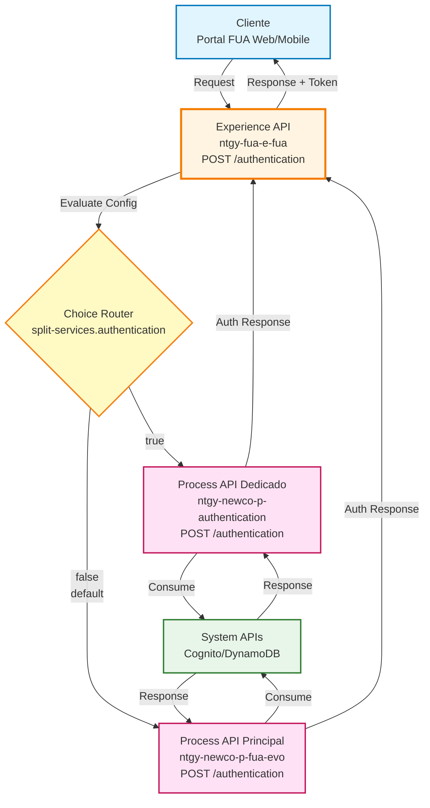
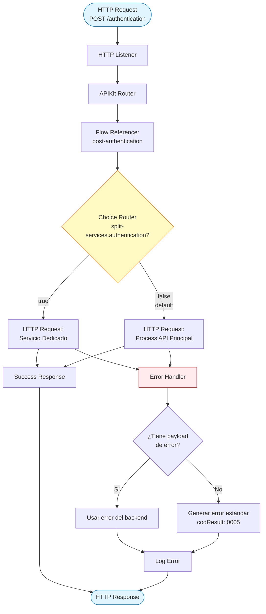
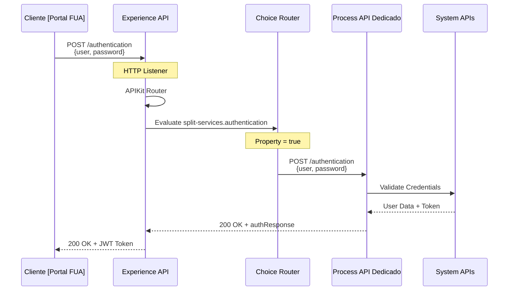
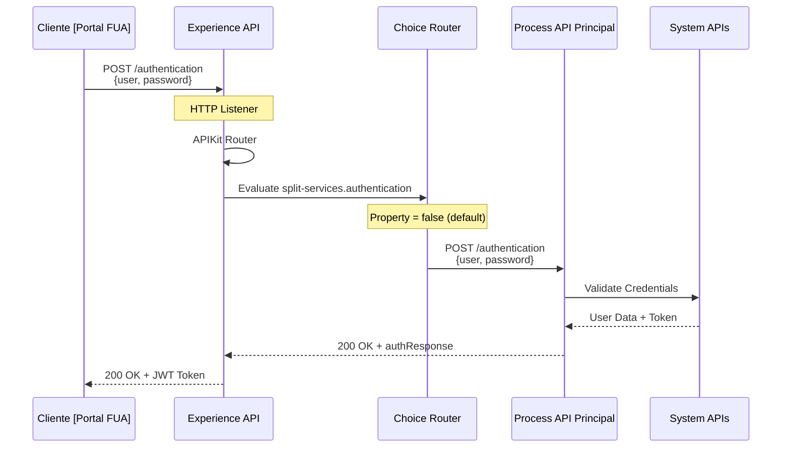
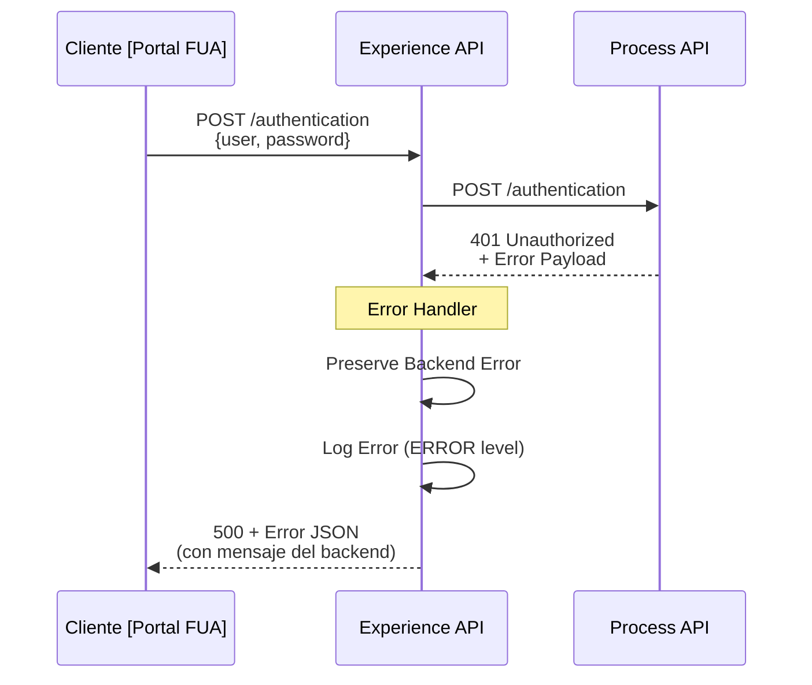
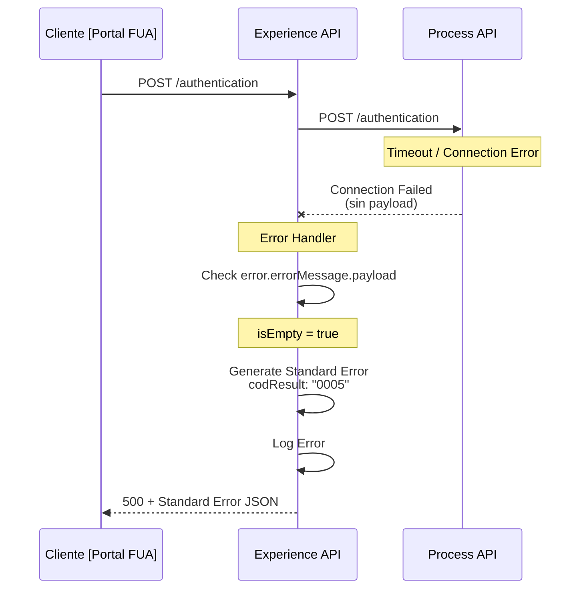

# POST /authentication

## 📌 Descripción General

### Propósito del Endpoint

Este endpoint proporciona autenticación de usuarios para el portal FUA (Frontal Único de Atención), implementando un patrón de routing condicional que permite dirigir las peticiones a un servicio de autenticación dedicado o al Process API principal según la configuración del ambiente. Esta flexibilidad arquitectónica facilita la migración gradual hacia microservicios especializados.

### Tipo de API

**Capa:** Experience API (API-Led Connectivity)

**Función:** Orquestación de autenticación con routing condicional para canales digitales (web/móvil)

### Patrón de Integración

**Tipo:** Routing Condicional con Fallback

**Descripción:** Este endpoint implementa un patrón de routing inteligente basado en la propiedad de configuración `split-services.authentication`. Cuando está habilitada, las peticiones se dirigen a un servicio de autenticación dedicado; de lo contrario, utiliza el Process API principal. Este diseño permite:
- Migración gradual hacia arquitectura de microservicios
- Testing A/B entre diferentes implementaciones
- Rollback rápido en caso de problemas
- Flexibilidad operacional sin cambios en el contrato del API

### Arquitectura API-Led Connectivity



---

## 💼 Propósito del Negocio

### Casos de Uso Principales

1. **Login de Cliente Residencial**
   - Cliente accede al portal FUA con sus credenciales
   - Obtiene token JWT para acceder a sus datos de energía
   - Beneficio: Acceso seguro y rápido a información de consumo y facturación

2. **Login de Cliente Empresarial**
   - Cliente corporativo accede con credenciales empresariales
   - Obtiene token con permisos específicos para múltiples contratos
   - Beneficio: Gestión centralizada de múltiples suministros

3. **Login de Agente de Atención al Cliente**
   - Agente del call center accede con credenciales corporativas
   - Obtiene token con permisos extendidos para soporte
   - Beneficio: Acceso a información de clientes para resolución de consultas

### 📱 Canal y Audiencia

#### Canal de Consumo

**Canal:** Web | Mobile

**Características del Canal:**
- **Plataforma**: Portal FUA (Frontal Único de Atención)
- **Dispositivos**: Navegadores web (Chrome, Firefox, Safari, Edge), aplicaciones móviles iOS/Android
- **Conectividad**: Requiere conexión a internet estable para autenticación
- **Experiencia de Usuario**: Login rápido con validación en tiempo real

#### Audiencia Objetivo

**Usuarios Finales:**
- **Clientes Residenciales**: Usuarios domésticos que acceden a su información de energía
- **Clientes Empresariales**: Usuarios corporativos con múltiples contratos
- **Agentes de Atención al Cliente**: Personal del call center que requiere acceso a datos de clientes

**Contexto de Uso:**
- **Primer Acceso**: Login inicial para acceder al portal
- **Sesión Expirada**: Re-autenticación cuando el token JWT expira
- **Cambio de Dispositivo**: Login desde diferentes dispositivos

#### Adaptaciones del Canal

**Optimizaciones Aplicadas:**
- **Routing Condicional**: Permite migración gradual a servicio dedicado
- **Error Handling Robusto**: Preserva mensajes de error del backend
- **Logging Detallado**: Registro de errores para troubleshooting
- **Flexibilidad Arquitectónica**: Cambio de backend sin modificar contrato

### 🔗 Endpoints Dependientes

Este Experience API puede consumir uno de los siguientes Process APIs (según configuración):

| Process API | Endpoint | Método | Propósito | Condición |
|-------------|----------|--------|-----------|-----------|
| `ntgy-newco-p-authentication` | `/authentication` | POST | Servicio de autenticación dedicado | `split-services.authentication=true` |
| `ntgy-newco-p-fua-evo` | `/authentication` | POST | Servicio de autenticación en Process API principal | `split-services.authentication=false` (default) |

### Contexto Empresarial

- **Dominio:** Autenticación y Seguridad
- **Sector:** Energía - Utilities
- **División:** Naturgy España - NewCo
- **Canal:** Web/Móvil

### Stakeholders

- **Clientes de Energía**: Necesitan acceso seguro y confiable a su información
- **Agentes de Call Center**: Requieren autenticación rápida para atender clientes
- **Equipo de Seguridad**: Responsables de la protección de credenciales y tokens
- **Equipo de Desarrollo FUA**: Mantienen y evolucionan el sistema de autenticación

### Valor de Negocio

- **Seguridad Mejorada**: Autenticación centralizada con tokens JWT
- **Flexibilidad Arquitectónica**: Migración gradual a microservicios sin downtime
- **Experiencia de Usuario**: Login rápido y confiable
- **Escalabilidad**: Permite separar el servicio de autenticación para mejor rendimiento
- **Resiliencia**: Capacidad de rollback rápido en caso de problemas

---

## 🔧 Especificación Técnica

### URLs por Ambiente

| Ambiente | URL Base | URL Completa |
|----------|----------|--------------|
| **Local** | `http://localhost:8081` | `http://localhost:8081/fua/api/authentication` |
| **Development** | `https://ntgy-fua-e-fua-dev.us-e2.cloudhub.io` | `https://ntgy-fua-e-fua-dev.us-e2.cloudhub.io/fua/api/authentication` |
| **UAT** | `https://ntgy-fua-e-fua-uat.us-e2.cloudhub.io` | `https://ntgy-fua-e-fua-uat.us-e2.cloudhub.io/fua/api/authentication` |
| **Production** | `https://ntgy-fua-e-fua-pro.us-e2.cloudhub.io` | `https://ntgy-fua-e-fua-pro.us-e2.cloudhub.io/fua/api/authentication` |

### Método HTTP

```
POST /fua/api/authentication
```

### 🎯 Consideraciones del Canal

#### Limitaciones del Canal

| Aspecto | Limitación | Razón |
|---------|------------|-------|
| **Timeout** | 30 segundos | Timeout estándar para operaciones de autenticación |
| **Rate Limiting** | Según políticas de API Manager | Protección contra ataques de fuerza bruta |
| **Intentos Fallidos** | Bloqueo temporal tras múltiples fallos | Seguridad contra intentos de acceso no autorizado |

#### Configuración de Routing

**Propiedad de Configuración:**

| Propiedad | Tipo | Default | Descripción |
|-----------|------|---------|-------------|
| `split-services.authentication` | Boolean | `false` | Controla el routing entre servicio dedicado y principal |

**Comportamiento:**
- **`true`**: Usa servicio dedicado `HTTP_Request_newco-p-authentication`
- **`false`** (default): Usa Process API principal `HTTP_FUA_PROCESS_NEWCO_EVO`

### Parámetros de Entrada

#### Request Body

**Content-Type:** `application/json`

| Campo | Tipo | Obligatorio | Descripción | Ejemplo |
|-------|------|-------------|-------------|---------|
| `user` | String | Sí | Nombre de usuario o email | `"juan.perez@example.com"` |
| `password` | String o null | Sí | Contraseña del usuario (puede ser null en casos especiales) | `"SecurePass123!"` |

**Estructura del Request:**

```json
{
  "user": "string",
  "password": "string | null"
}
```

**Notas:**
- El campo `password` puede ser `null` en casos especiales (ej: autenticación con token de recuperación)
- El campo `user` puede ser email o nombre de usuario según la configuración del sistema

### Respuestas

#### 200 OK - Autenticación Exitosa

**Estructura de Respuesta:**

```json
{
  "result": {
    "codResult": "0000",
    "msgResult": "No hay error"
  },
  "authResponse": {
    "token": "edf80616-a552-4df2-8275-e12fd53fb716",
    "idToken": "edf80616-a552-4df2-8275-e12fd53fb716",
    "refreshToken": "edf80616-a552-4df2-8275-e12fd53fb716",
    "userName": "Manuel",
    "user": {
      "userId": "U12458FGH1",
      "userName": "Manuel",
      "clientCode": "65985624",
      "name": "Manuel",
      "email": "manuelcliente@gmail.com",
      "roleTypeId": 2
    }
  }
}
```

**Campos de Respuesta:**

| Campo | Tipo | Descripción |
|-------|------|-------------|
| `result` | Object | Objeto con resultado de la operación |
| `result.codResult` | String | Código de resultado ("0000" = éxito) |
| `result.msgResult` | String | Mensaje descriptivo del resultado |
| `authResponse` | Object | Objeto con datos de autenticación |
| `authResponse.token` | String | Token de acceso para autenticación en peticiones subsecuentes |
| `authResponse.idToken` | String | Token de identidad (opcional) |
| `authResponse.refreshToken` | String | Token para renovar la sesión (opcional) |
| `authResponse.userName` | String | Nombre del usuario (opcional) |
| `authResponse.user` | Object | Objeto con información detallada del usuario |
| `authResponse.user.userId` | String | ID único del usuario |
| `authResponse.user.userName` | String | Nombre de usuario |
| `authResponse.user.clientCode` | String | Código del cliente |
| `authResponse.user.name` | String | Nombre completo del usuario |
| `authResponse.user.email` | String | Email del usuario |
| `authResponse.user.roleTypeId` | Integer | ID del tipo de rol (2 = customer, etc.) |

⚠️ **Nota sobre Schema Completo:**

Este Experience API actúa como pass-through con routing condicional. Para el schema completo del objeto `authResponse`, consultar:

📖 **Process API (según configuración):**
- **Servicio Dedicado:** `ntgy-newco-p-authentication` endpoint `/authentication`
- **Servicio Principal:** `ntgy-newco-p-fua-evo` endpoint `/authentication`

#### 401 Unauthorized - Credenciales Inválidas

```json
{
  "result": {
    "codResult": "0005",
    "msgResult": "Usuario o contraseña incorrectos"
  }
}
```

#### 500 Internal Server Error - Error del Servidor

**Caso 1: Error con payload del backend**

```json
{
  "result": {
    "codResult": "0005",
    "msgResult": "[Mensaje de error del backend]"
  }
}
```

**Caso 2: Error sin payload del backend**

```json
{
  "result": {
    "codResult": "0005",
    "msgResult": "KO"
  }
}
```

### Autenticación

- **Tipo:** Este endpoint NO requiere autenticación previa (es el endpoint de login)
- **Respuesta:** Retorna token JWT que debe usarse en peticiones subsecuentes
- **Token Usage:** El token debe incluirse en el header `Authorization: Bearer {token}` en otras peticiones

### Timeouts

| Tipo | Valor | Razón |
|------|-------|-------|
| **Request Timeout** | 30 segundos | Timeout estándar para operaciones de autenticación |
| **Response Timeout** | 30 segundos | Tiempo suficiente para validación de credenciales |

---

## 🏗️ Implementación Técnica

### Arquitectura del Flow



### Flujo Principal (e-fua.xml)

**Ubicación:** `src/main/mule/e-fua.xml` (línea 187-189)

```xml
<flow name="post:\authentication:application\json:e-fua-config">
    <flow-ref doc:name="post-authentication" name="post-authentication" />
</flow>
```

### Implementación del Subflow (post-authentication)

**Ubicación:** Flow `post-authentication` con lógica de routing condicional

```xml
<flow name="post-authentication">
    <choice doc:name="Choice">
        <when expression="#[(Mule::p('split-services.authentication') as Boolean default false)]">
            <!-- Ruta 1: Servicio de autenticación dedicado -->
            <http:request method="POST" 
                          doc:name="Authentication Request" 
                          config-ref="HTTP_Request_newco-p-authentication" 
                          path="/authentication" />
        </when>
        <otherwise>
            <!-- Ruta 2: Process API principal (default) -->
            <http:request method="POST" 
                          doc:name="Authentication Request" 
                          config-ref="HTTP_FUA_PROCESS_NEWCO_EVO" 
                          path="/authentication" />
        </otherwise>
    </choice>
    <error-handler>
        <on-error-propagate enableNotifications="true" logException="true">
            <logger level="ERROR" doc:name="Error" message='#[if ( !isEmpty(error.errorMessage.payload) ) error.errorMessage.payload
else 
{
    "result": {
        "codResult": "0005",
        "msgResult": error.description as String replace /\"/ with("")
    }
}]' />
            <ee:transform doc:name="Set Error Message">
                <ee:message>
                    <ee:set-payload><![CDATA[%dw 2.0
output application/json
---
if ( !isEmpty(error.errorMessage.payload) ) error.errorMessage.payload
else 
{
    "result": {
        "codResult": "0005",
        "msgResult": "KO"
    }
}]]></ee:set-payload>
                </ee:message>
            </ee:transform>
        </on-error-propagate>
    </error-handler>
</flow>
```

### Componentes Clave

#### 1. Choice Router - Routing Condicional

**Expresión de Evaluación:**

```dataweave
#[(Mule::p('split-services.authentication') as Boolean default false)]
```

**Lógica:**
- Lee la propiedad `split-services.authentication` del archivo de configuración
- Convierte a Boolean con default `false`
- Si `true`: Usa servicio dedicado
- Si `false` o no definida: Usa Process API principal

**Beneficios del Patrón:**
- **Flexibilidad**: Cambio de backend sin modificar código
- **Testing**: Permite A/B testing entre implementaciones
- **Migración Gradual**: Facilita transición a microservicios
- **Rollback Rápido**: Cambio de configuración sin redeploy

#### 2. HTTP Request - Servicio Dedicado

**Configuración:**
- **Config Reference:** `HTTP_Request_newco-p-authentication`
- **Method:** POST
- **Path:** `/authentication`
- **Body:** Payload original (user + password)

#### 3. HTTP Request - Process API Principal

**Configuración:**
- **Config Reference:** `HTTP_FUA_PROCESS_NEWCO_EVO`
- **Method:** POST
- **Path:** `/authentication`
- **Body:** Payload original (user + password)

#### 4. Error Handler - Manejo Inteligente de Errores

**Estrategia:** On-Error-Propagate con preservación de payload

**Lógica de Error:**

```dataweave
if ( !isEmpty(error.errorMessage.payload) ) 
    error.errorMessage.payload
else 
{
    "result": {
        "codResult": "0005",
        "msgResult": "KO"
    }
}
```

**Comportamiento:**
1. **Si hay payload de error del backend**: Lo preserva y retorna tal cual
2. **Si NO hay payload**: Genera respuesta estándar con código "0005"

**Logging:**
- Nivel: ERROR
- Contenido: Payload de error o descripción del error

### Patrones de Diseño

**Patrón:** Conditional Routing con Strategy Pattern

**Justificación:** 
- **Flexibilidad Arquitectónica**: Permite cambiar la estrategia de autenticación sin modificar el contrato del API
- **Migración Sin Downtime**: Facilita la transición gradual a arquitectura de microservicios
- **Testing y Rollback**: Permite testing A/B y rollback rápido mediante configuración
- **Separación de Concerns**: Aísla la lógica de routing de la lógica de negocio

### Diagramas de Secuencia

#### 1. Flujo Normal de Éxito (Servicio Dedicado)



#### 2. Flujo Normal de Éxito (Process API Principal)



#### 3. Flujo con Credenciales Inválidas



#### 4. Flujo con Error Técnico



### Configuración HTTP

**HTTP Request Configuration - Servicio Dedicado:**

```yaml
HTTP_Request_newco-p-authentication:
  host: "${newco-p-authentication.host}"
  port: "${newco-p-authentication.port}"
  basePath: "/api"
  timeout: "${newco-p-authentication.timeout}"
```

**HTTP Request Configuration - Process API Principal:**

```yaml
HTTP_FUA_PROCESS_NEWCO_EVO:
  host: "${newco-p-fua-evo.host}"
  port: "${newco-p-fua-evo.port}"
  basePath: "/api"
  timeout: "${newco-p-fua-evo.timeout}"
```

**Propiedades por Ambiente:**

```yaml
# e-fua-local-config.yaml
split-services:
  authentication: false  # Default: usa Process API principal

newco-p-authentication:
  host: "localhost"
  port: "8083"
  timeout: "30000"

newco-p-fua-evo:
  host: "localhost"
  port: "8082"
  timeout: "30000"
```

### Manejo de Errores

**Estrategia Global:**

1. **Captura:** `on-error-propagate` captura cualquier error
2. **Evaluación:** Verifica si existe payload de error del backend
3. **Preservación:** Si hay payload, lo preserva y retorna
4. **Generación:** Si no hay payload, genera error estándar
5. **Logging:** Logger registra error con nivel ERROR
6. **Respuesta:** Retorna JSON con código "0005"

**Formato de Error con Payload del Backend:**

```json
{
  "result": {
    "codResult": "0005",
    "msgResult": "[Mensaje específico del backend]"
  }
}
```

**Formato de Error sin Payload:**

```json
{
  "result": {
    "codResult": "0005",
    "msgResult": "KO"
  }
}
```

**Tipos de Errores Manejados:**
- Credenciales inválidas (401 del backend)
- Errores de conexión al Process API
- Timeouts
- Errores HTTP (4xx, 5xx)
- Errores de transformación

---

## 💻 Ejemplos de Uso

### Ejemplo 1: Login Exitoso de Cliente

#### cURL

```bash
curl -X POST "https://ntgy-fua-e-fua-pro.us-e2.cloudhub.io/fua/api/authentication" \
  -H "Content-Type: application/json" \
  -d '{
    "user": "juan.perez@example.com",
    "password": "SecurePass123!"
  }'
```

#### Respuesta (200 OK)

```json
{
  "result": {
    "codResult": "0000",
    "msgResult": "No hay error"
  },
  "authResponse": {
    "token": "edf80616-a552-4df2-8275-e12fd53fb716",
    "idToken": "edf80616-a552-4df2-8275-e12fd53fb716",
    "refreshToken": "rt_abc123def456ghi789jkl012mno345pqr678stu901vwx234yz",
    "userName": "Juan Pérez",
    "user": {
      "userId": "U12458FGH1",
      "userName": "juan.perez",
      "clientCode": "65985624",
      "name": "Juan Pérez García",
      "email": "juan.perez@example.com",
      "roleTypeId": 2
    }
  }
}
```

### Ejemplo 2: Login de Agente

#### cURL

```bash
curl -X POST "https://ntgy-fua-e-fua-pro.us-e2.cloudhub.io/fua/api/authentication" \
  -H "Content-Type: application/json" \
  -d '{
    "user": "maria.lopez@naturgy.com",
    "password": "AgentPass456!"
  }'
```

#### Respuesta (200 OK)

```json
{
  "result": {
    "codResult": "0000",
    "msgResult": "No hay error"
  },
  "authResponse": {
    "token": "edf80616-a552-4df2-8275-e12fd53fb716",
    "idToken": "edf80616-a552-4df2-8275-e12fd53fb716",
    "refreshToken": "rt_agent_xyz789abc012def345ghi678jkl901mno234pqr567stu890",
    "userName": "maria.lopez",
    "user": {
      "userId": "A78945MNO2",
      "userName": "maria.lopez",
      "clientCode": "AGENT001",
      "name": "María López",
      "email": "maria.lopez@naturgy.com",
      "roleTypeId": 3
    }
  }
}
```

### Ejemplo 3: JavaScript (para Web/Mobile)

```javascript
// Función para autenticar usuario
async function authenticateUser(username, password) {
  try {
    const response = await fetch(
      'https://ntgy-fua-e-fua-pro.us-e2.cloudhub.io/fua/api/authentication',
      {
        method: 'POST',
        headers: {
          'Content-Type': 'application/json'
        },
        body: JSON.stringify({
          user: username,
          password: password
        })
      }
    );

    if (!response.ok) {
      throw new Error(`HTTP error! status: ${response.status}`);
    }

    const data = await response.json();
    
    if (data.result.codResult === "0000") {
      // Guardar token en localStorage o sessionStorage
      localStorage.setItem('authToken', data.authResponse.token);
      localStorage.setItem('idToken', data.authResponse.idToken);
      localStorage.setItem('refreshToken', data.authResponse.refreshToken);
      localStorage.setItem('userId', data.authResponse.user.userId);
      localStorage.setItem('clientCode', data.authResponse.user.clientCode);
      
      return {
        success: true,
        token: data.authResponse.token,
        idToken: data.authResponse.idToken,
        refreshToken: data.authResponse.refreshToken,
        user: {
          userId: data.authResponse.user.userId,
          userName: data.authResponse.user.userName,
          clientCode: data.authResponse.user.clientCode,
          name: data.authResponse.user.name,
          email: data.authResponse.user.email,
          roleTypeId: data.authResponse.user.roleTypeId
        }
      };
    } else {
      throw new Error(data.result.msgResult);
    }
  } catch (error) {
    console.error('Error de autenticación:', error);
    return {
      success: false,
      error: error.message
    };
  }
}

// Uso
const result = await authenticateUser('juan.perez@example.com', 'SecurePass123!');
if (result.success) {
  console.log('Login exitoso:', result.user);
  // Redirigir al dashboard
  window.location.href = '/dashboard';
} else {
  console.error('Login fallido:', result.error);
  // Mostrar mensaje de error al usuario
  alert('Usuario o contraseña incorrectos');
}
```

### Ejemplo 4: Python

```python
import requests
from typing import Dict, Optional

class AuthenticationClient:
    """Cliente para autenticación en el portal FUA."""
    
    def __init__(self, base_url: str):
        self.base_url = base_url
        self.token = None
        self.user_data = None
    
    def authenticate(self, username: str, password: str) -> Dict:
        """
        Autentica un usuario y guarda el token.
        
        Args:
            username: Nombre de usuario o email
            password: Contraseña del usuario
        
        Returns:
            Dict con resultado de autenticación
        """
        url = f"{self.base_url}/fua/api/authentication"
        
        payload = {
            "user": username,
            "password": password
        }
        
        headers = {
            'Content-Type': 'application/json'
        }
        
        try:
            response = requests.post(url, json=payload, headers=headers)
            response.raise_for_status()
            
            data = response.json()
            
            if data['result']['codResult'] == '0000':
                # Guardar token y datos de usuario
                self.token = data['authResponse']['token']
                self.id_token = data['authResponse'].get('idToken')
                self.refresh_token = data['authResponse'].get('refreshToken')
                self.user_data = {
                    'userId': data['authResponse']['user']['userId'],
                    'userName': data['authResponse']['user']['userName'],
                    'clientCode': data['authResponse']['user']['clientCode'],
                    'name': data['authResponse']['user']['name'],
                    'email': data['authResponse']['user']['email'],
                    'roleTypeId': data['authResponse']['user']['roleTypeId']
                }
                
                return {
                    'success': True,
                    'token': self.token,
                    'idToken': self.id_token,
                    'refreshToken': self.refresh_token,
                    'user': self.user_data
                }
            else:
                return {
                    'success': False,
                    'error': data['result']['msgResult']
                }
                
        except requests.exceptions.HTTPError as e:
            return {
                'success': False,
                'error': f'HTTP Error: {e}'
            }
        except Exception as e:
            return {
                'success': False,
                'error': f'Error: {str(e)}'
            }
    
    def get_auth_header(self) -> Dict[str, str]:
        """Retorna el header de autenticación para usar en otras peticiones."""
        if not self.token:
            raise ValueError("No hay token de autenticación. Debe autenticarse primero.")
        
        return {
            'Authorization': f'Bearer {self.token}'
        }

# Uso
client = AuthenticationClient('https://ntgy-fua-e-fua-pro.us-e2.cloudhub.io')

# Autenticar usuario
result = client.authenticate('juan.perez@example.com', 'SecurePass123!')

if result['success']:
    print(f"Login exitoso: {result['user']['userName']}")
    print(f"Rol: {result['user']['userRole']}")
    print(f"Token: {result['token'][:50]}...")
    
    # Usar el token en otras peticiones
    auth_header = client.get_auth_header()
    print(f"Header de autenticación: {auth_header}")
else:
    print(f"Login fallido: {result['error']}")
```

### Ejemplo 5: Error - Credenciales Inválidas

#### cURL

```bash
curl -X POST "https://ntgy-fua-e-fua-pro.us-e2.cloudhub.io/fua/api/authentication" \
  -H "Content-Type: application/json" \
  -d '{
    "user": "usuario.invalido@example.com",
    "password": "PasswordIncorrecto"
  }'
```

#### Respuesta (500 Internal Server Error)

```json
{
  "result": {
    "codResult": "0005",
    "msgResult": "Usuario o contraseña incorrectos"
  }
}
```
